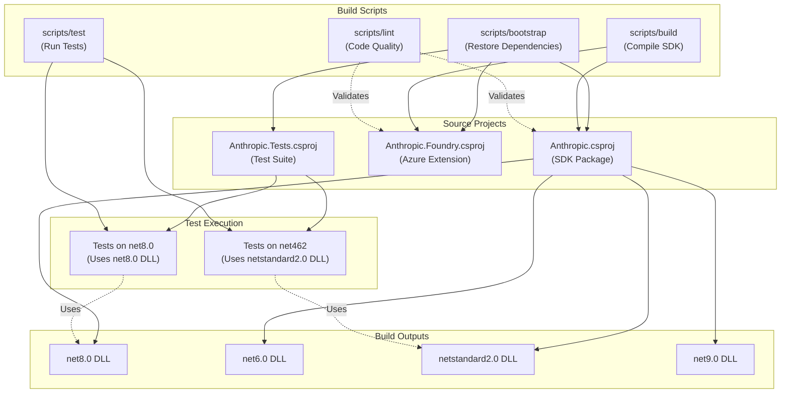
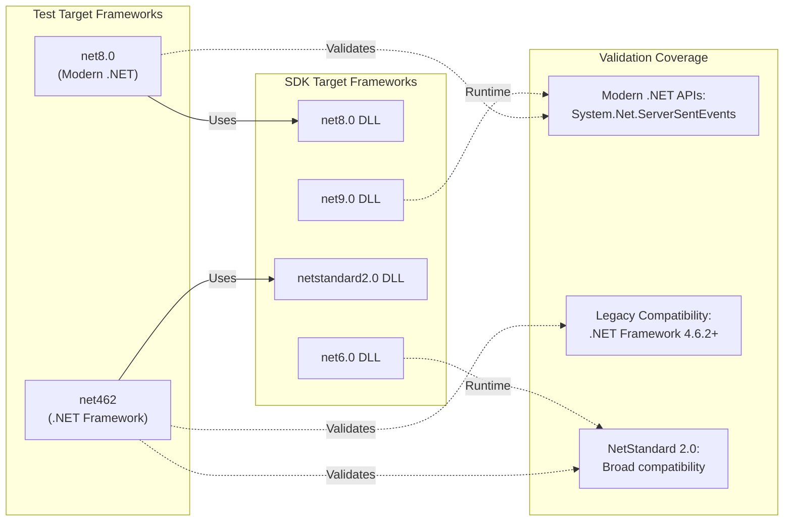
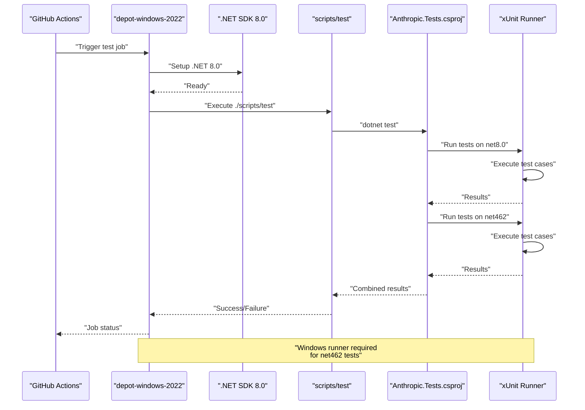
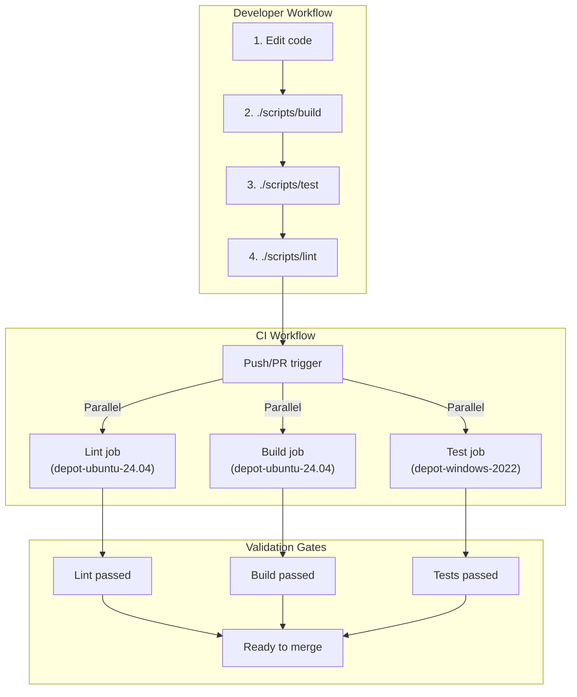

<!-- source: DeepWiki mcp.deepwiki.com · repo anthropics/anthropic-sdk-csharp · page 10.2 Building and Testing · fetched 2026-10-26 -->

# Building and Testing

<details>
<summary>Relevant source files</summary>

The following files were used as context for generating this wiki page:

- [.csharpierignore](.csharpierignore)
- [.editorconfig](.editorconfig)
- [.github/workflows/ci.yml](.github/workflows/ci.yml)
- [.github/workflows/publish-nuget.yml](.github/workflows/publish-nuget.yml)
- [src/Anthropic.Tests/Anthropic.Tests.csproj](src/Anthropic.Tests/Anthropic.Tests.csproj)
- [src/Anthropic.Tests/Models/Beta/AnthropicBetaTest.cs](src/Anthropic.Tests/Models/Beta/AnthropicBetaTest.cs)
- [src/Anthropic.Tests/Models/Beta/Files/DeletedFileTest.cs](src/Anthropic.Tests/Models/Beta/Files/DeletedFileTest.cs)
- [src/Anthropic.Tests/Models/Beta/Messages/Batches/BetaMessageBatchTest.cs](src/Anthropic.Tests/Models/Beta/Messages/Batches/BetaMessageBatchTest.cs)
- [src/Anthropic.Tests/Models/Beta/Messages/BetaBase64ImageSourceTest.cs](src/Anthropic.Tests/Models/Beta/Messages/BetaBase64ImageSourceTest.cs)
- [src/Anthropic.Tests/Models/Beta/Messages/BetaBashCodeExecutionToolResultErrorParamTest.cs](src/Anthropic.Tests/Models/Beta/Messages/BetaBashCodeExecutionToolResultErrorParamTest.cs)
- [src/Anthropic.Tests/Models/Beta/Messages/BetaBashCodeExecutionToolResultErrorTest.cs](src/Anthropic.Tests/Models/Beta/Messages/BetaBashCodeExecutionToolResultErrorTest.cs)
- [src/Anthropic.Tests/Models/Beta/Messages/BetaCacheControlEphemeralTest.cs](src/Anthropic.Tests/Models/Beta/Messages/BetaCacheControlEphemeralTest.cs)

</details>


This document explains how to build the Anthropic C# SDK and run its test suite across multiple .NET framework versions. It covers the build system, test infrastructure, local development workflows, and CI/CD integration.

For information about the development environment setup (dev containers, editors), see [Development Environment](#10.1). For details about the CI/CD pipeline and release automation, see [CI/CD Pipeline](#10.3).

## Overview

The SDK uses standard .NET build tooling with MSBuild-based project files. The build system supports multiple target frameworks (netstandard2.0, net6.0, net8.0, net9.0) and includes a comprehensive test suite that validates both the core Anthropic package and the Anthropic.Foundry extension.

## Build System Architecture



**Build System Flow**: The SDK provides shell scripts in the `scripts/` directory that orchestrate the build process. The `bootstrap` script restores NuGet dependencies, the `build` script compiles the SDK projects, and the `test` script runs the test suite. The Anthropic package produces DLLs for four target frameworks, while tests run on two frameworks to validate both modern (.NET 8.0) and legacy (.NET Framework 4.6.2) compatibility.

Sources: [.github/workflows/ci.yml:22-50](), [src/Anthropic.Tests/Anthropic.Tests.csproj:1-30]()

## Building the SDK Locally

### Prerequisites

- .NET SDK 8.0 or later
- All platforms: Linux, macOS, Windows

### Build Commands

The SDK provides convenience scripts for building:

```bash
# Restore dependencies
./scripts/bootstrap

# Build all projects
./scripts/build
```

These scripts internally invoke `dotnet` commands with appropriate configurations. The build process:

1. **Restores NuGet packages** for all projects
2. **Compiles the Anthropic package** for all target frameworks (netstandard2.0, net6.0, net8.0, net9.0)
3. **Compiles the Anthropic.Foundry package** with its Azure-specific dependencies
4. **Produces build artifacts** in each project's `bin/` directory

### Manual Build

You can also use standard `dotnet` commands directly:

```bash
# Build all projects
dotnet build

# Build specific project
dotnet build src/Anthropic/Anthropic.csproj

# Build in Release mode
dotnet build --configuration Release
```

Sources: [.github/workflows/ci.yml:30-50]()

## Test Project Structure

```mermaid
graph TB
    subgraph "Test Project Configuration"
        TestCsproj["Anthropic.Tests.csproj"]
        
        TargetFrameworks["TargetFrameworks:<br/>net8.0;net462"]
        IsTestProject["IsTestProject: true"]
        IsPackable["IsPackable: false"]
    end
    
    subgraph "Package References"
        XUnit["xunit 2.5.3<br/>(Test Framework)"]
        XUnitRunner["xunit.runner.visualstudio 2.5.3<br/>(Test Runner)"]
        MsTestSdk["Microsoft.NET.Test.Sdk 17.8.0<br/>(Test Host)"]
        Coverlet["coverlet.collector 6.0.0<br/>(Coverage)"]
    end
    
    subgraph "Project References"
        AnthropicRef["ProjectReference:<br/>Anthropic.csproj"]
        FoundryRef["ProjectReference:<br/>Anthropic.Foundry.csproj"]
    end
    
    subgraph "Compiler Configuration"
        NoWarn["NoWarn: xUnit1004, 0618<br/>(Skipped tests, Deprecations)"]
        LangVersion["LangVersion: 12"]
        Nullable["Nullable: enable"]
        ImplicitUsings["ImplicitUsings: disable"]
    end
    
    TestCsproj --> TargetFrameworks
    TestCsproj --> IsTestProject
    TestCsproj --> IsPackable
    
    TestCsproj --> XUnit
    TestCsproj --> XUnitRunner
    TestCsproj --> MsTestSdk
    TestCsproj --> Coverlet
    
    TestCsproj --> AnthropicRef
    TestCsproj --> FoundryRef
    
    TestCsproj --> NoWarn
    TestCsproj --> LangVersion
    TestCsproj --> Nullable
    TestCsproj --> ImplicitUsings
```



**Test Project Configuration**: The test project [src/Anthropic.Tests/Anthropic.Tests.csproj:1-30]() is configured as a multi-targeting test project that validates SDK functionality across different .NET versions. It targets `net8.0` (which uses the SDK's net8.0 DLL) and `net462` (which uses the SDK's netstandard2.0 DLL). The project uses xUnit as its test framework and explicitly disables warnings for skipped tests (`xUnit1004`) and deprecated API usage (`0618`), since the SDK may reference its own deprecated symbols during testing.

Sources: [src/Anthropic.Tests/Anthropic.Tests.csproj:1-30]()

### Test Framework Details

| Configuration | Value | Purpose |
|---------------|-------|---------|
| **Test Framework** | xUnit 2.5.3 | Assertion and test organization framework |
| **Test Runner** | xunit.runner.visualstudio | Visual Studio Test Explorer integration |
| **Test Host** | Microsoft.NET.Test.Sdk | Test execution infrastructure |
| **Coverage Tool** | coverlet.collector | Code coverage collection |
| **Language Version** | C# 12 | Modern C# features support |
| **Nullable Context** | Enabled | Null reference type checking |
| **Implicit Usings** | Disabled | Explicit namespace control |

Sources: [src/Anthropic.Tests/Anthropic.Tests.csproj:19-28]()

## Running Tests

### Using Test Scripts

The SDK provides a test script that runs the complete test suite:

```bash
./scripts/test
```

This script executes tests on all configured target frameworks sequentially.

### Manual Test Execution

You can also use `dotnet test` commands directly:

```bash
# Run all tests on all frameworks
dotnet test

# Run tests on specific framework
dotnet test --framework net8.0
dotnet test --framework net462

# Run with verbose output
dotnet test --verbosity detailed

# Run specific test project
dotnet test src/Anthropic.Tests/Anthropic.Tests.csproj
```

Sources: [.github/workflows/ci.yml:52-66]()

## Multi-Framework Testing Strategy



**Multi-Framework Testing Approach**: The test suite [src/Anthropic.Tests/Anthropic.Tests.csproj:6-8]() uses a strategic two-framework approach. Tests run on `net8.0` to validate the SDK's net8.0 build with modern .NET APIs, and on `net462` to validate the SDK's netstandard2.0 build for legacy compatibility. This ensures the SDK works correctly on both modern .NET platforms and older .NET Framework applications.

Sources: [src/Anthropic.Tests/Anthropic.Tests.csproj:6-8]()

### Why These Frameworks?

| Framework | SDK Build Tested | Purpose |
|-----------|-----------------|---------|
| **net8.0** | net8.0 DLL | Validates modern .NET functionality, including System.Net.ServerSentEvents for streaming |
| **net462** | netstandard2.0 DLL | Validates .NET Framework compatibility and ensures netstandard2.0 build works correctly |

The SDK produces builds for net6.0 and net9.0 as well, but these don't require separate test runs since they share API surface with net8.0. The netstandard2.0 build is the most restrictive and ensures maximum compatibility.

Sources: [src/Anthropic.Tests/Anthropic.Tests.csproj:6-8]()

## Compiler Diagnostics Configuration

The SDK uses [.editorconfig:1-34]() to configure compiler warnings and code style enforcement. Key diagnostics settings:

| Diagnostic | Severity | Reason |
|------------|----------|--------|
| `CA1510` | None | ArgumentNullException throw helper not available in netstandard2.0 |
| `IDE0060` | None | Resources with no methods generate unused parameter warnings |
| `IDE1006` | None | API names may not match C# naming conventions |
| `IDE0290` | None | SDK doesn't use primary constructors |
| `IDE0057` | None | `.Substring()` required for .NET Standard 2.0 |
| `CA1866` | None | `.StartsWith()` with single char required for netstandard2.0 |
| `CA1847` | None | `.Contains()` with single char required for netstandard2.0 |
| `CA2263` | None | Non-generic `Enum.IsDefined()` required for netstandard2.0 |

The test project [src/Anthropic.Tests/Anthropic.Tests.csproj:14-17]() additionally suppresses:
- `xUnit1004`: Skipped test warnings (tests may be conditionally skipped)
- `0618`: Deprecation warnings (tests validate deprecated APIs)

Sources: [.editorconfig:24-34](), [src/Anthropic.Tests/Anthropic.Tests.csproj:13-17]()

## CI/CD Test Execution



**CI Test Execution Flow**: The CI pipeline [.github/workflows/ci.yml:52-66]() runs tests on a Windows runner (`depot-windows-2022`) because .NET Framework 4.6.2 tests require Windows. The test job sets up .NET 8.0 SDK, then executes the `./scripts/test` script which runs tests on both `net8.0` and `net462` frameworks sequentially. Test failures cause the CI pipeline to fail, preventing merges of broken code.

Sources: [.github/workflows/ci.yml:52-66]()

### CI Job Configuration

The test job in [.github/workflows/ci.yml:52-66]() is configured as follows:

| Configuration | Value | Purpose |
|---------------|-------|---------|
| **Job Name** | `test` | Identifies the test job in CI logs |
| **Timeout** | 10 minutes | Prevents hung tests from blocking CI |
| **Runner** | `depot-windows-2022` (or `windows-latest` for forks) | Windows required for .NET Framework tests |
| **Trigger Condition** | Push or fork PR | Runs on main repo pushes and fork PRs |
| **.NET Version** | 8.0.x | Primary SDK version for building and testing |

Sources: [.github/workflows/ci.yml:52-66]()

## Build and Test Integration



**Complete Development Flow**: Developers run build and test scripts locally before pushing code. Upon push or PR creation, CI runs three parallel jobs [.github/workflows/ci.yml:15-66](): lint (Ubuntu), build (Ubuntu), and test (Windows). All three must pass before code can be merged. The parallel execution speeds up validation while the sequential local workflow ensures developers catch issues early.

Sources: [.github/workflows/ci.yml:15-66]()

## Package Build and Packing

While building compiles the code, packaging creates distributable NuGet packages:

```bash
# Create NuGet packages
dotnet pack --configuration Release --output ./artifacts/packages
```

This command [.github/workflows/publish-nuget.yml:21-23]() generates `.nupkg` files for both the Anthropic and Anthropic.Foundry packages in the specified output directory. The Release configuration ensures optimized builds suitable for distribution.

Sources: [.github/workflows/publish-nuget.yml:20-23]()

## Common Build and Test Scenarios

### Scenario 1: Local Development Iteration

```bash
# Full rebuild and test cycle
./scripts/build && ./scripts/test

# Test specific framework
dotnet test --framework net8.0

# Test with detailed output
dotnet test --verbosity detailed
```

### Scenario 2: Validating Cross-Framework Compatibility

```bash
# Build all frameworks
dotnet build

# Run tests on both frameworks
dotnet test --framework net8.0
dotnet test --framework net462

# Verify specific API works on old framework
dotnet test --framework net462 --filter FullyQualifiedName~MyTest
```

### Scenario 3: Pre-Commit Validation

```bash
# Run complete validation suite
./scripts/lint && ./scripts/build && ./scripts/test
```

This mimics what CI will run and catches issues before pushing.

Sources: [.github/workflows/ci.yml:22-66]()

## Troubleshooting

### Build Failures

| Issue | Cause | Solution |
|-------|-------|----------|
| **Missing dependencies** | NuGet restore failed | Run `./scripts/bootstrap` |
| **Compiler errors** | Syntax or type errors | Check error messages, verify .NET SDK version |
| **Framework not found** | Missing .NET Framework on Linux/macOS | net462 tests require Windows |

### Test Failures

| Issue | Cause | Solution |
|-------|-------|----------|
| **All tests fail on net462** | Running on non-Windows OS | Use Windows or skip net462 tests |
| **Timeout in CI** | Tests hung | Check for infinite loops or network issues |
| **Inconsistent failures** | Race conditions | Review test isolation and async handling |

Sources: [src/Anthropic.Tests/Anthropic.Tests.csproj:6-8](), [.github/workflows/ci.yml:52-66]()

---

