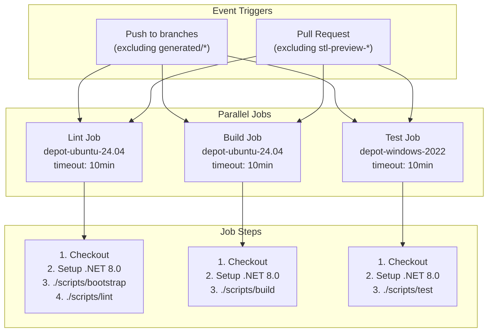
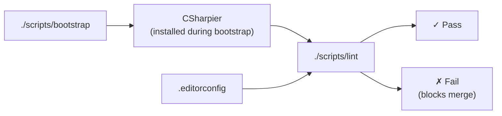
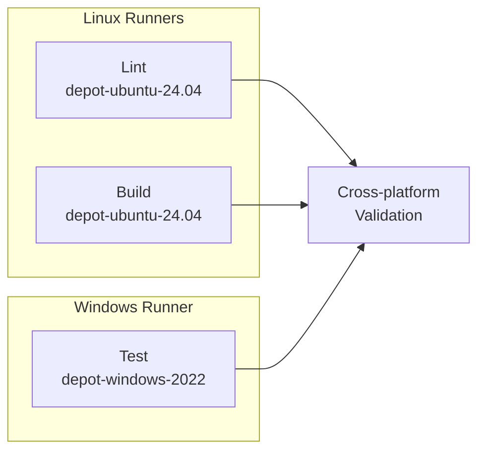
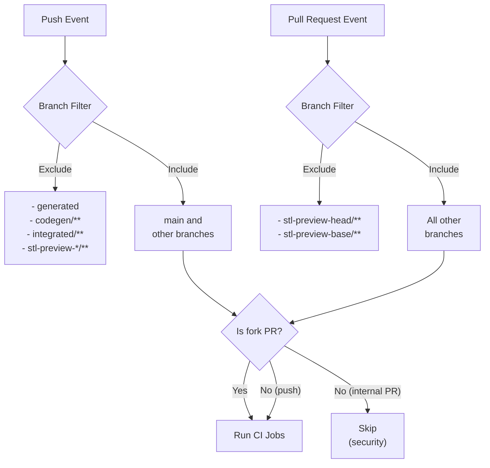
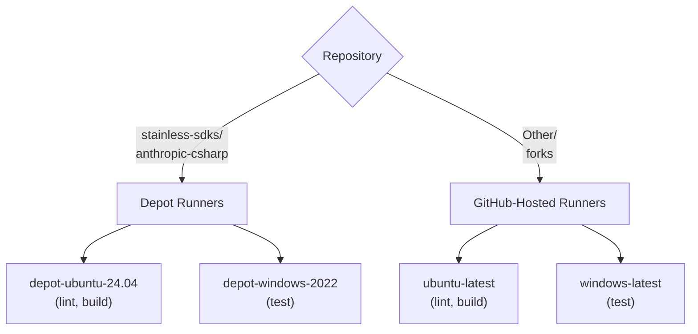
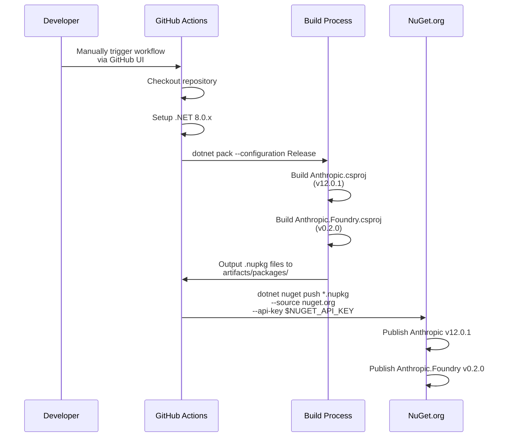
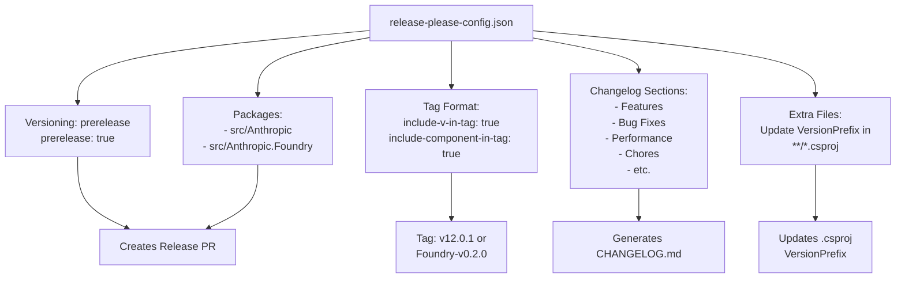
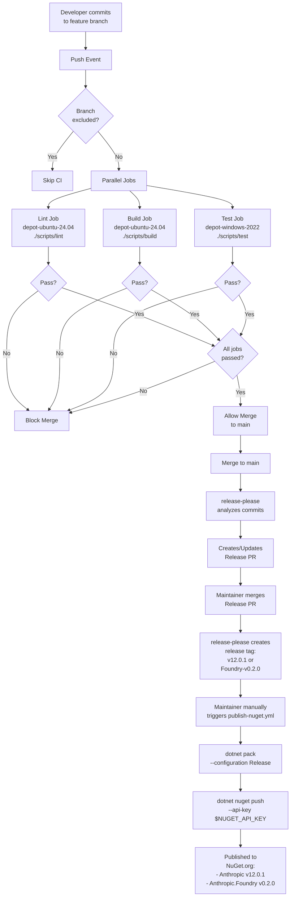

<!-- source: DeepWiki mcp.deepwiki.com · repo anthropics/anthropic-sdk-csharp · page 10.3 CI/CD Pipeline · fetched 2026-10-26 -->

# CI/CD Pipeline

<details>
<summary>Relevant source files</summary>

The following files were used as context for generating this wiki page:

- [.editorconfig](.editorconfig)
- [.github/workflows/ci.yml](.github/workflows/ci.yml)
- [.github/workflows/publish-nuget.yml](.github/workflows/publish-nuget.yml)

</details>


This document describes the automated CI/CD pipeline for the Anthropic C# SDK, implemented through GitHub Actions workflows. The pipeline handles linting, building, testing, and package publishing to NuGet. For information about the release automation and versioning strategy, see [Release Process](#10.4). For details about running builds and tests locally, see [Building and Testing](#10.2).

## Overview

The CI/CD pipeline consists of two primary GitHub Actions workflows:

1. **CI Workflow** (`.github/workflows/ci.yml`) - Automatically runs on push and pull request events, executing lint, build, and test jobs in parallel
2. **Publish to NuGet Workflow** (`.github/workflows/publish-nuget.yml`) - Manual workflow for publishing packages to NuGet after releases

The pipeline integrates with the release-please automation system (documented in [Release Process](#10.4)) to manage versioning and changelog generation.

Sources: [.github/workflows/ci.yml](), [.github/workflows/publish-nuget.yml](), [release-please-config.json]()

## CI Workflow Architecture

The CI workflow is defined in `.github/workflows/ci.yml` and executes three parallel jobs: lint, build, and test. Each job runs independently to provide fast feedback on code quality, compilation success, and test coverage.



**CI Workflow Job Execution Flow**

Sources: [.github/workflows/ci.yml:1-67]()

## Lint Job

The lint job enforces code style and formatting standards. It runs on Ubuntu using depot runners for improved performance.

### Configuration

| Property | Value |
|----------|-------|
| Runner | `depot-ubuntu-24.04` (or `ubuntu-latest` for forks) |
| Timeout | 10 minutes |
| .NET Version | 8.0.x |
| Trigger Condition | Push or fork pull requests |

### Execution Steps

1. **Checkout** - Uses `actions/checkout@v4` to clone the repository
2. **Setup .NET** - Configures .NET 8.0.x SDK via `actions/setup-dotnet@v3`
3. **Bootstrap** - Runs `./scripts/bootstrap` to install dependencies (e.g., CSharpier)
4. **Run Lints** - Executes `./scripts/lint` to validate code formatting

### Code Style Enforcement

The lint job validates against `.editorconfig` rules, which define:

- **Indentation**: 4 spaces for C#, 2 spaces for XML
- **Line Endings**: CRLF
- **Disabled Diagnostics**: CA1510, IDE0060, IDE1006, IDE0290, and .NET Standard 2.0 compatibility rules



**Lint Job Dependency Flow**

Sources: [.github/workflows/ci.yml:16-34](), [.editorconfig:1-34]()

## Build Job

The build job compiles the SDK for all target frameworks to verify successful compilation across .NET 8, .NET 9, and .NET Standard 2.0.

### Configuration

| Property | Value |
|----------|-------|
| Runner | `depot-ubuntu-24.04` (or `ubuntu-latest` for forks) |
| Timeout | 10 minutes |
| .NET Version | 8.0.x |
| Target Frameworks | `net8.0`, `net9.0`, `netstandard2.0` |

### Execution Steps

1. **Checkout** - Clones repository with `actions/checkout@v4`
2. **Setup .NET** - Installs .NET 8.0.x SDK via `actions/setup-dotnet@v3`
3. **Build SDK** - Runs `./scripts/build` which executes `dotnet build` for all projects

### Build Targets

The build compiles two packages as defined in the repository structure:

- **Anthropic** (`src/Anthropic/Anthropic.csproj`) - Core SDK at version 12.0.1
- **Anthropic.Foundry** (`src/Anthropic.Foundry/`) - Azure Foundry extension at version 0.2.0

Sources: [.github/workflows/ci.yml:35-50](), [src/Anthropic/Anthropic.csproj:32](), [.release-please-manifest.json:1-4]()

## Test Job

The test job runs the SDK's test suite on Windows to ensure compatibility with Windows-specific .NET runtime behaviors.

### Configuration

| Property | Value |
|----------|-------|
| Runner | `depot-windows-2022` (or `windows-latest` for forks) |
| Timeout | 10 minutes |
| .NET Version | 8.0.x |
| Trigger Condition | Push or fork pull requests |

### Execution Steps

1. **Checkout** - Uses `actions/checkout@v4`
2. **Setup .NET** - Configures .NET 8.0.x via `actions/setup-dotnet@v5`
3. **Run Tests** - Executes `./scripts/test` to run all test suites

### Platform-Specific Testing

The test job specifically runs on Windows (`depot-windows-2022`) while lint and build run on Linux (`depot-ubuntu-24.04`). This provides cross-platform validation since:

- Linux validation occurs during lint and build
- Windows validation occurs during test execution
- The SDK targets .NET Standard 2.0 and must work on both platforms



**Cross-Platform CI Coverage**

Sources: [.github/workflows/ci.yml:52-67]()

## Workflow Triggering and Branch Filtering

The CI workflow uses sophisticated branch filtering to avoid running on generated or preview branches.

### Trigger Configuration



**Branch Filtering Logic**

### Excluded Branches

The following branches are excluded from CI execution:

| Branch Pattern | Reason |
|----------------|--------|
| `generated` | Auto-generated code branches |
| `codegen/**` | Code generation workspace branches |
| `integrated/**` | Integration testing branches |
| `stl-preview-head/**` | Stainless preview head branches |
| `stl-preview-base/**` | Stainless preview base branches |

### Fork Handling

The workflow includes a fork safety check: `if: github.event_name == 'push' || github.event.pull_request.head.repo.fork`

This ensures that:
- All push events trigger CI
- Pull requests from forks trigger CI (common open-source contribution pattern)
- Internal pull requests from the same repository skip CI (to prevent duplicate runs)

Sources: [.github/workflows/ci.yml:2-13](), [.github/workflows/ci.yml:20](), [.github/workflows/ci.yml:39](), [.github/workflows/ci.yml:56]()

## Runner Infrastructure

The workflow uses conditional runner selection based on repository context, leveraging depot runners for the official repository and GitHub-hosted runners for forks.



**Runner Selection Strategy**

### Runner Selection Syntax

The runner is selected using a ternary expression in the workflow YAML:

```yaml
runs-on: ${{ github.repository == 'stainless-sdks/anthropic-csharp' && 'depot-ubuntu-24.04' || 'ubuntu-latest' }}
```

### Depot vs GitHub-Hosted Runners

| Runner Type | Usage | Benefits |
|-------------|-------|----------|
| **depot-ubuntu-24.04** | Official repository lint/build | Faster execution, consistent environment |
| **depot-windows-2022** | Official repository test | Windows-specific testing, better performance |
| **ubuntu-latest** | Fork lint/build | Free for open-source forks |
| **windows-latest** | Fork test | Free for open-source forks |

Sources: [.github/workflows/ci.yml:19](), [.github/workflows/ci.yml:38](), [.github/workflows/ci.yml:55]()

## NuGet Publishing Workflow

The NuGet publishing workflow provides a manual mechanism to publish packages to NuGet.org. This workflow is typically triggered after release-please creates a release tag (see [Release Process](#10.4)).

### Workflow Configuration

| Property | Value |
|----------|-------|
| File | `.github/workflows/publish-nuget.yml` |
| Trigger | Manual (`workflow_dispatch`) |
| Runner | `ubuntu-latest` |
| .NET Version | 8.0.x |

### Publishing Flow



**NuGet Publishing Sequence**

### Execution Steps

1. **Checkout** - Clones repository using `actions/checkout@v4`
2. **Setup .NET** - Installs .NET 8.0.x SDK via `actions/setup-dotnet@v5`
3. **Build and Pack** - Runs `dotnet pack --configuration Release --output artifacts/packages`
4. **Publish** - Pushes `.nupkg` files to NuGet.org using API key from secrets

### API Key Configuration

The workflow retrieves the NuGet API key from GitHub Secrets with fallback:

```yaml
env:
  NUGET_API_KEY: ${{ secrets.ANTHROPIC_NUGET_API_KEY || secrets.NUGET_API_KEY }}
```

This supports two secret names:
- `ANTHROPIC_NUGET_API_KEY` (preferred)
- `NUGET_API_KEY` (fallback)

### Manual Trigger URL

The workflow can be triggered by navigating to:
```
https://www.github.com/anthropics/anthropic-sdk-csharp/actions/workflows/publish-nuget.yml
```

Sources: [.github/workflows/publish-nuget.yml:1-31]()

## Package Metadata and Configuration

Both packages include comprehensive metadata defined in their `.csproj` files, which is included in the published NuGet packages.

### Core Package Metadata (Anthropic)

The `Anthropic` package configuration includes:

| Property | Value |
|----------|--------|
| **AssemblyName** | `Anthropic` |
| **PackageId** | `Anthropic` |
| **VersionPrefix** | `12.0.1` (managed by release-please) |
| **Description** | "The official .NET library for the Anthropic API." |
| **PackageLicenseExpression** | `MIT` |
| **RepositoryUrl** | `https://www.github.com/anthropics/anthropic-sdk-csharp` |
| **TargetFrameworks** | `net8.0;net9.0;netstandard2.0` |

### Build Configuration

Both packages use consistent build settings:

```xml
<PropertyGroup>
  <Deterministic>true</Deterministic>
  <Nullable>enable</Nullable>
  <TreatWarningsAsErrors>true</TreatWarningsAsErrors>
  <GenerateDocumentationFile>true</GenerateDocumentationFile>
  <PublishRepositoryUrl>true</PublishRepositoryUrl>
  <EmbedUntrackedSources>true</EmbedUntrackedSources>
  <IncludeSymbols>true</IncludeSymbols>
  <DebugType>embedded</DebugType>
</PropertyGroup>
```

These settings enable:
- Deterministic builds for reproducibility
- Nullable reference type checking
- Warnings treated as errors (enforced by CI)
- XML documentation generation
- Source link support for debugging
- Embedded debug symbols in the package

Sources: [src/Anthropic/Anthropic.csproj:1-55]()

## Release Please Integration

The CI/CD pipeline integrates with release-please for automated version management. The configuration is split across two files:

### Version Manifest

`.release-please-manifest.json` tracks the current version of each package:

```json
{
  "src/Anthropic": "12.0.1",
  "src/Anthropic.Foundry": "0.2.0"
}
```

### Release Configuration

`release-please-config.json` defines the release behavior:



**Release Please Configuration Structure**

### Key Configuration Elements

| Setting | Value | Purpose |
|---------|-------|---------|
| `versioning` | `"prerelease"` | Uses prerelease versioning strategy |
| `prerelease` | `true` | Marks releases as prerelease on GitHub |
| `include-v-in-tag` | `true` | Tags include "v" prefix (e.g., `v12.0.1`) |
| `include-component-in-tag` | `true` | Foundry uses component prefix (e.g., `Foundry-v0.2.0`) |
| `bump-minor-pre-major` | `true` | Bumps minor version before 1.0.0 |
| `release-type` | `"csharp"` | Uses C#-specific release strategies |

### Version Update Mechanism

The `extra-files` configuration uses XPath to update `.csproj` files:

```json
{
  "type": "xml",
  "path": "**/*.csproj",
  "xpath": "//Project/PropertyGroup/VersionPrefix",
  "glob": true
}
```

This ensures that when release-please updates versions, it modifies the `<VersionPrefix>` element in all `.csproj` files, which is then used during `dotnet pack`.

Sources: [release-please-config.json:1-72](), [.release-please-manifest.json:1-4]()

## CI/CD Complete Flow

The following diagram illustrates the complete CI/CD flow from code change to NuGet publication:



**End-to-End CI/CD Pipeline**

Sources: [.github/workflows/ci.yml](), [.github/workflows/publish-nuget.yml](), [release-please-config.json]()

## Job Timeout and Failure Handling

All CI jobs have consistent timeout and failure characteristics:

### Timeout Configuration

Each job specifies a 10-minute timeout:

```yaml
timeout-minutes: 10
```

This prevents jobs from hanging indefinitely and consuming runner resources. If a job exceeds 10 minutes, GitHub Actions automatically terminates it and marks it as failed.

### Failure Impact

The CI workflow uses implicit job dependencies:

- Jobs run in parallel
- Any job failure blocks PR merging
- All jobs must pass for the overall workflow to succeed
- Failed jobs appear as red X marks on the GitHub PR

### Retry Behavior

GitHub Actions does not automatically retry failed jobs. Developers must:
1. Fix the issue causing the failure
2. Push new commits to trigger a fresh CI run
3. Or manually re-run failed jobs from the GitHub Actions UI

Sources: [.github/workflows/ci.yml:17](), [.github/workflows/ci.yml:36](), [.github/workflows/ci.yml:53]()

## Script Dependencies

The CI workflow relies on three shell scripts that must be maintained alongside the workflow definitions:

| Script | Purpose | Called By |
|--------|---------|-----------|
| `./scripts/bootstrap` | Install dependencies (e.g., CSharpier) | Lint job |
| `./scripts/lint` | Execute formatting validation | Lint job |
| `./scripts/build` | Compile all projects | Build job |
| `./scripts/test` | Run test suite | Test job |

These scripts provide a consistent interface between the CI workflow and the actual build/test operations, allowing developers to run the same commands locally as CI uses (see [Building and Testing](#10.2)).

Sources: [.github/workflows/ci.yml:31](), [.github/workflows/ci.yml:34](), [.github/workflows/ci.yml:50](), [.github/workflows/ci.yml:66]()

---

