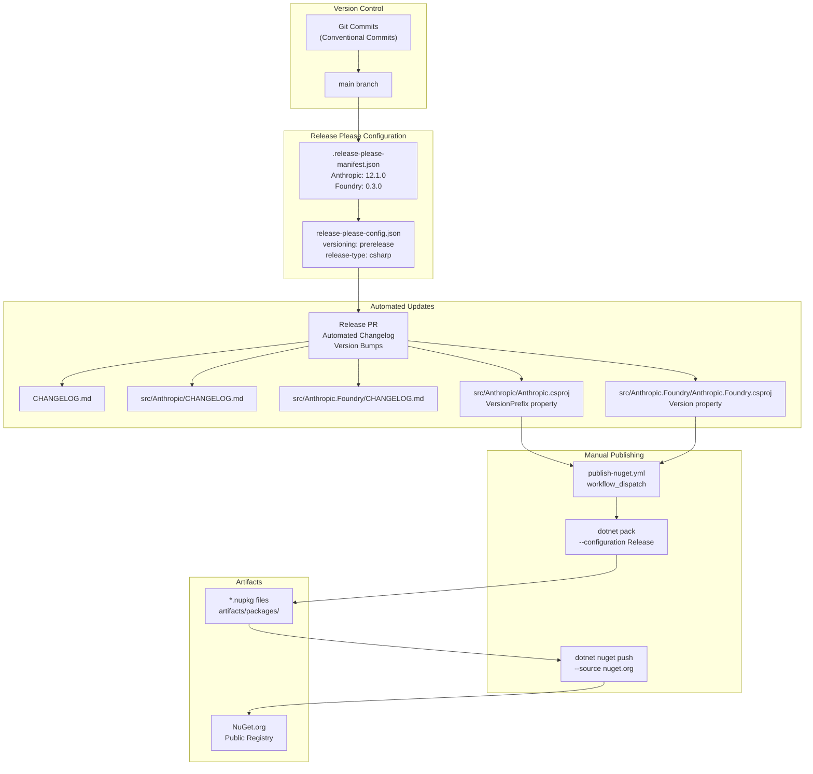
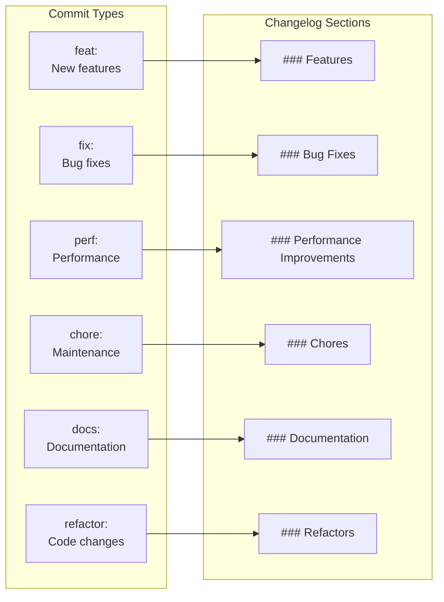
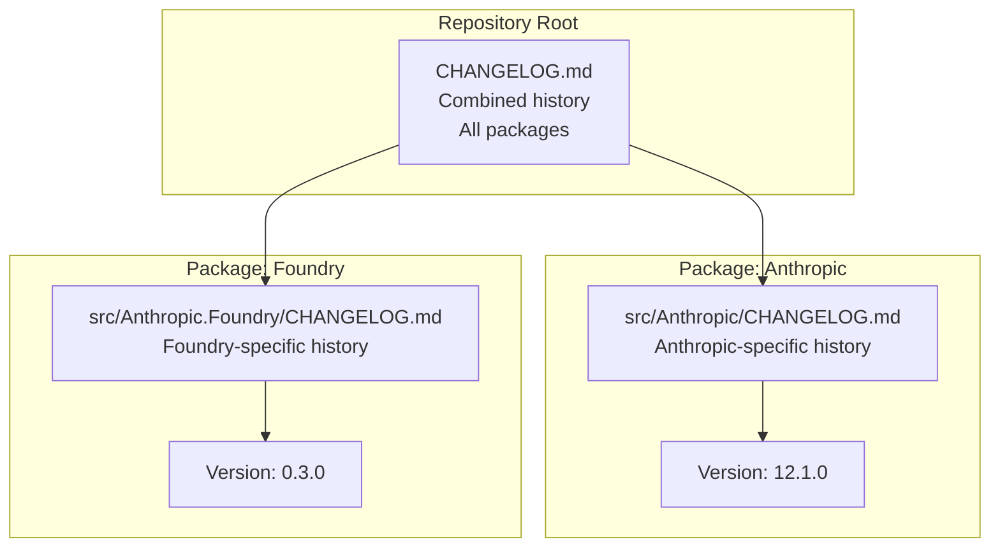
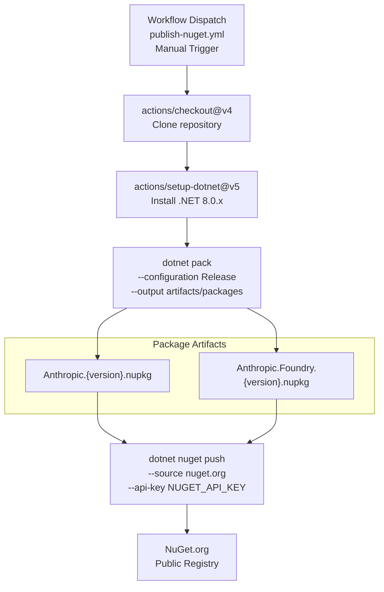

<!-- source: DeepWiki mcp.deepwiki.com · repo anthropics/anthropic-sdk-csharp · page 10.4 Release Process · fetched 2026-10-26 -->

# Release Process

<details>
<summary>Relevant source files</summary>

The following files were used as context for generating this wiki page:

- [.editorconfig](.editorconfig)
- [.github/workflows/ci.yml](.github/workflows/ci.yml)
- [.github/workflows/publish-nuget.yml](.github/workflows/publish-nuget.yml)
- [.release-please-manifest.json](.release-please-manifest.json)
- [CHANGELOG.md](CHANGELOG.md)
- [examples/ChatClientExample/ChatClientExample.csproj](examples/ChatClientExample/ChatClientExample.csproj)
- [release-please-config.json](release-please-config.json)
- [src/Anthropic.Foundry/Anthropic.Foundry.csproj](src/Anthropic.Foundry/Anthropic.Foundry.csproj)
- [src/Anthropic.Foundry/CHANGELOG.md](src/Anthropic.Foundry/CHANGELOG.md)
- [src/Anthropic/Anthropic.csproj](src/Anthropic/Anthropic.csproj)
- [src/Anthropic/CHANGELOG.md](src/Anthropic/CHANGELOG.md)
- [src/logo.png](src/logo.png)

</details>


This document describes the automated release management system for the Anthropic C# SDK, including version control, changelog generation, and NuGet package publishing. For information about the CI/CD pipeline execution, see [CI/CD Pipeline](#10.3). For details on building and packaging the SDK, see [Building and Testing](#10.2).

## Overview

The SDK uses **release-please** automation to manage releases across two independent NuGet packages: `Anthropic` (core SDK) and `Anthropic.Foundry` (Azure integration). The system automatically generates changelogs from conventional commit messages, updates version numbers across project files, and creates release pull requests. Publishing to NuGet.org is performed through a manual workflow dispatch.

**Current Versions:**
- Anthropic: 12.1.0
- Anthropic.Foundry: 0.3.0

Sources: [.release-please-manifest.json:1-4](), [src/Anthropic/Anthropic.csproj:7](), [src/Anthropic.Foundry/Anthropic.Foundry.csproj:6]()

## Release Automation Architecture



**Diagram: Release automation flow from commits to NuGet publication**

Sources: [.release-please-manifest.json:1-4](), [release-please-config.json:1-72](), [.github/workflows/publish-nuget.yml:1-31]()

## Version Management

### Release Please Manifest

The `.release-please-manifest.json` file tracks the current version for each package independently:

```json
{
  "src/Anthropic": "12.1.0",
  "src/Anthropic.Foundry": "0.3.0"
}
```

Each package path maps to its semantic version. The manifest is automatically updated when release PRs are merged.

Sources: [.release-please-manifest.json:1-4]()

### Configuration Schema

The `release-please-config.json` defines behavior for both packages:

| Configuration Key | Value | Description |
|------------------|-------|-------------|
| `packages` | `src/Anthropic`, `src/Anthropic.Foundry` | Package directories |
| `versioning` | `prerelease` | Version strategy |
| `prerelease` | `true` | Enable prerelease mode |
| `release-type` | `csharp` | Language-specific rules |
| `include-v-in-tag` | `true` | Tag format: `v12.1.0` |
| `include-component-in-tag` | `true` | Tag format: `Anthropic-v12.1.0` |
| `bump-minor-pre-major` | `true` | Bump minor for v0.x.x |
| `bump-patch-for-minor-pre-major` | `false` | Don't bump patch for minor |

Sources: [release-please-config.json:1-12]()

### Version Update Targets

The `extra-files` configuration specifies additional files to update beyond default targets:

```json
{
  "type": "xml",
  "path": "**/*.csproj",
  "xpath": "//Project/PropertyGroup/VersionPrefix",
  "glob": true
}
```

This XPath selector updates the `<VersionPrefix>` element in all `.csproj` files:
- [src/Anthropic/Anthropic.csproj:7]() - Uses `VersionPrefix`
- [src/Anthropic.Foundry/Anthropic.Foundry.csproj:6]() - Uses `Version`

Sources: [release-please-config.json:64-71](), [src/Anthropic/Anthropic.csproj:7](), [src/Anthropic.Foundry/Anthropic.Foundry.csproj:6]()

## Changelog Generation

### Conventional Commit Mapping

Release-please parses commit messages following conventional commit format and categorizes them into changelog sections:



**Diagram: Commit type to changelog section mapping**

The complete section configuration from [release-please-config.json:15-61]():

| Commit Type | Changelog Section | Visibility |
|-------------|------------------|------------|
| `feat` | Features | Visible |
| `fix` | Bug Fixes | Visible |
| `perf` | Performance Improvements | Visible |
| `revert` | Reverts | Visible |
| `chore` | Chores | Visible |
| `docs` | Documentation | Visible |
| `style` | Styles | Visible |
| `refactor` | Refactors | Visible |
| `test` | Tests | Hidden |
| `build` | Build System | Visible |
| `ci` | Continuous Integration | Hidden |

Sources: [release-please-config.json:15-61]()

### Multi-Package Changelog Structure

The SDK maintains three separate changelog files:



**Diagram: Changelog file hierarchy and scope**

Each changelog follows the format:
```markdown
## {version} (YYYY-MM-DD)

Full Changelog: [previous...current](github-compare-url)

### ⚠ BREAKING CHANGES

* Description of breaking change

### Features

* **scope:** description ([commit-hash](commit-url))

### Bug Fixes

* **scope:** description ([commit-hash](commit-url))
```

Sources: [CHANGELOG.md:1-350](), [src/Anthropic/CHANGELOG.md:1-163](), [src/Anthropic.Foundry/CHANGELOG.md:1-78]()

## Release Pull Request Workflow

### Pull Request Structure

Release-please creates automated PRs with the title pattern:
```
release: ${version}
```

As specified in [release-please-config.json:14](), with header "Automated Release PR" [release-please-config.json:13]().

The PR includes:
1. Updated version in `.release-please-manifest.json`
2. Updated version in all `.csproj` files
3. New changelog entries in all three changelog files
4. Git tags for each released package

### Version Bumping Strategy

For prerelease mode (v0.x.x and below):

| Change Type | Version Increment | Example |
|-------------|------------------|---------|
| Breaking (`BREAKING CHANGE:`) | Minor | 0.2.0 → 0.3.0 |
| Feature (`feat:`) | Minor | 0.2.0 → 0.3.0 |
| Fix (`fix:`) | Patch | 0.2.0 → 0.2.1 |
| Other | Patch | 0.2.0 → 0.2.1 |

For stable releases (v1.0.0+):

| Change Type | Version Increment | Example |
|-------------|------------------|---------|
| Breaking | Major | 1.2.0 → 2.0.0 |
| Feature | Minor | 1.2.0 → 1.3.0 |
| Fix | Patch | 1.2.0 → 1.2.1 |

Sources: [release-please-config.json:9-12]()

## NuGet Publishing Process

### Manual Publishing Workflow

Publishing is triggered manually via GitHub Actions workflow dispatch:



**Diagram: Manual NuGet publishing workflow steps**

Sources: [.github/workflows/publish-nuget.yml:1-31]()

### Publishing Workflow Configuration

The workflow runs on `ubuntu-latest` and executes the following steps:

**Step 1: Build and Pack**
```bash
dotnet pack \
  --configuration Release \
  --output "${{github.workspace}}/artifacts/packages"
```

This generates `.nupkg` files for both packages using the `Release` configuration. The package metadata comes from `.csproj` properties:
- [src/Anthropic/Anthropic.csproj:9-12]() - Description, PackageReadmeFile, PackageIcon
- [src/Anthropic.Foundry/Anthropic.Foundry.csproj:7]() - PackageIcon

**Step 2: Publish to NuGet**
```bash
dotnet nuget push \
  ${{ github.workspace }}/artifacts/packages/*.nupkg \
  --source https://api.nuget.org/v3/index.json \
  --api-key $NUGET_API_KEY
```

The API key is stored as a GitHub secret: `ANTHROPIC_NUGET_API_KEY` (with fallback to `NUGET_API_KEY`).

Sources: [.github/workflows/publish-nuget.yml:21-31]()

### Package Metadata

Both packages include standardized metadata:

| Property | Anthropic | Foundry |
|----------|-----------|---------|
| PackageId | `Anthropic` | `Anthropic.Foundry` |
| Description | "The official .NET library for the Anthropic API." | (Inherited from main) |
| PackageIcon | `logo.png` | `logo.png` |
| PackageReadmeFile | `README.md` | (None specified) |
| TargetFrameworks | `net8.0`, `netstandard2.0` | `net8.0`, `netstandard2.0` |

The logo is included via:
```xml
<None Include="..\logo.png" Pack="true" PackagePath="\" />
```

Sources: [src/Anthropic/Anthropic.csproj:3-13](), [src/Anthropic.Foundry/Anthropic.Foundry.csproj:3-11](), [src/logo.png:1]()

## Version History Examples

### Breaking Change Release (v11.0.0)

From [CHANGELOG.md:3-45]():

```markdown
## 11.0.0 (2025-12-01)

### ⚠ BREAKING CHANGES

* **client:** use readonly types for properties

### Features

* **client:** improve csproj

### Bug Fixes

* **client:** update custom code for readonly
* release please config for foundry
```

This release included:
- Breaking change requiring property migration
- Configuration improvements
- Multi-package release coordination

### Feature Release (v12.1.0)

From [src/Anthropic/CHANGELOG.md:3-26]():

```markdown
## 12.1.0 (2026-01-06)

### Features

* **client:** add EnvironmentUrl
* **client:** add multipart form data support

### Bug Fixes

* **internal:** test nullability warnings

### Chores

* **internal:** share csproj properties with dir build props
```

This release added new features without breaking changes, resulting in a minor version bump.

Sources: [CHANGELOG.md:1-350](), [src/Anthropic/CHANGELOG.md:1-163]()

## Release Process Steps

### Step-by-Step Release Procedure

**1. Development Phase**
- Commit changes using conventional commit format
- Ensure CI passes ([CI/CD Pipeline](#10.3))
- Merge PRs to `main` branch

**2. Automated Release PR Creation**
- Release-please bot analyzes commits since last release
- Generates changelog entries from commit messages
- Updates version in `.release-please-manifest.json`
- Updates `VersionPrefix` in `.csproj` files via XPath
- Creates release PR with title "release: {version}"

**3. Release PR Review**
- Review generated changelog for accuracy
- Verify version bumps are appropriate
- Check that breaking changes are properly documented
- Merge PR when approved

**4. Tag Creation**
- Git tags are automatically created on merge
- Format: `Anthropic-v{version}` and `Foundry-v{version}`
- Includes component name due to `include-component-in-tag: true`

**5. NuGet Publishing**
- Navigate to Actions → Publish to NuGet workflow
- Click "Run workflow" → "Run workflow" button
- Workflow builds packages in Release configuration
- Publishes to NuGet.org using API key
- Packages become publicly available

Sources: [release-please-config.json:7-8](), [.github/workflows/publish-nuget.yml:1-31]()

## Troubleshooting

### Common Issues

**Failed Version Update in .csproj**

If version doesn't update, verify XPath selector matches project structure:
- Anthropic uses `<VersionPrefix>` at [src/Anthropic/Anthropic.csproj:7]()
- Foundry uses `<Version>` at [src/Anthropic.Foundry/Anthropic.Foundry.csproj:6]()

The XPath `//Project/PropertyGroup/VersionPrefix` may not match both patterns.

**Publishing Failures**

From [.github/workflows/publish-nuget.yml:29-31](), the workflow requires:
1. Valid NuGet API key in secrets (`ANTHROPIC_NUGET_API_KEY`)
2. Successful `dotnet pack` with no build errors
3. Network access to `https://api.nuget.org/v3/index.json`

**Changelog Generation Issues**

Ensure commits follow format:
```
type(scope): description

Detailed explanation

BREAKING CHANGE: description of breaking change
```

Types must match [release-please-config.json:15-61]() configuration.

Sources: [release-please-config.json:64-71](), [.github/workflows/publish-nuget.yml:26-31]()

## Configuration Reference

### Complete release-please-config.json Structure

```json
{
  "packages": {
    "src/Anthropic": {},
    "src/Anthropic.Foundry": {}
  },
  "$schema": "https://raw.githubusercontent.com/stainless-api/release-please/main/schemas/config.json",
  "include-v-in-tag": true,
  "include-component-in-tag": true,
  "versioning": "prerelease",
  "prerelease": true,
  "bump-minor-pre-major": true,
  "bump-patch-for-minor-pre-major": false,
  "pull-request-header": "Automated Release PR",
  "pull-request-title-pattern": "release: ${version}",
  "release-type": "csharp",
  "extra-files": [...]
}
```

### Environment Variables

| Variable | Usage | Required |
|----------|-------|----------|
| `ANTHROPIC_NUGET_API_KEY` | NuGet.org API key (primary) | Yes (publishing) |
| `NUGET_API_KEY` | NuGet.org API key (fallback) | Alternative |

Sources: [release-please-config.json:1-72](), [.github/workflows/publish-nuget.yml:31]()

---

