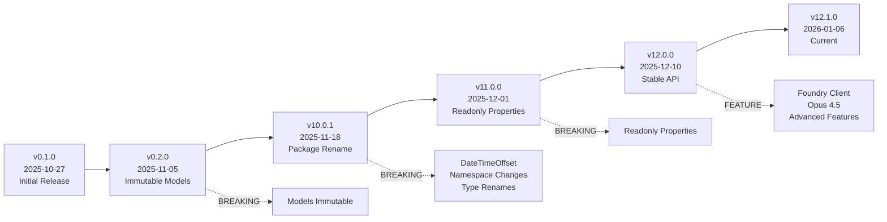
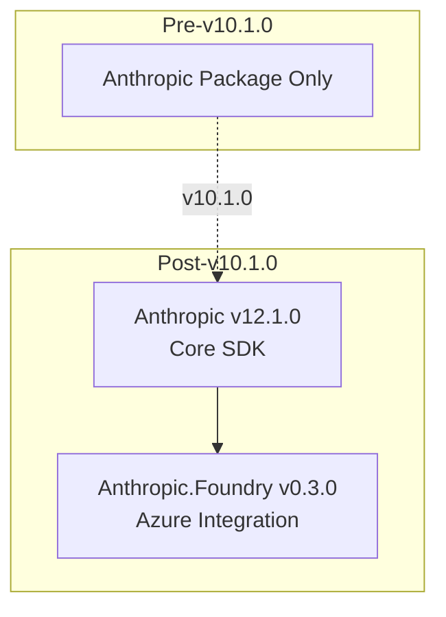
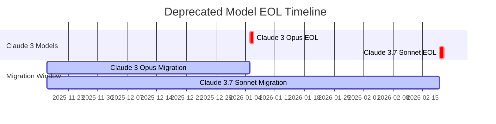
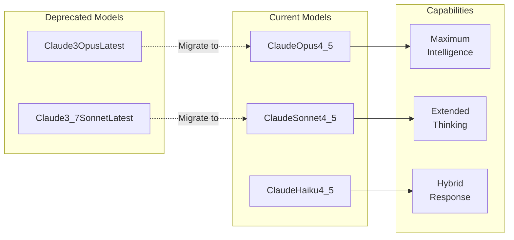
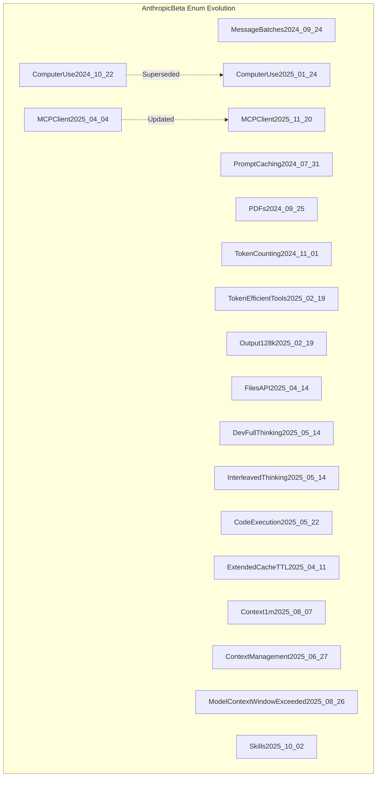
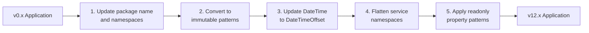

<!-- source: DeepWiki mcp.deepwiki.com · repo anthropics/anthropic-sdk-csharp · page 11 Migration Guides · fetched 2026-10-26 -->

# Migration Guides

<details>
<summary>Relevant source files</summary>

The following files were used as context for generating this wiki page:

- [.release-please-manifest.json](.release-please-manifest.json)
- [.stats.yml](.stats.yml)
- [CHANGELOG.md](CHANGELOG.md)
- [examples/ChatClientExample/ChatClientExample.csproj](examples/ChatClientExample/ChatClientExample.csproj)
- [release-please-config.json](release-please-config.json)
- [src/Anthropic.Foundry/Anthropic.Foundry.csproj](src/Anthropic.Foundry/Anthropic.Foundry.csproj)
- [src/Anthropic.Foundry/CHANGELOG.md](src/Anthropic.Foundry/CHANGELOG.md)
- [src/Anthropic/Anthropic.csproj](src/Anthropic/Anthropic.csproj)
- [src/Anthropic/CHANGELOG.md](src/Anthropic/CHANGELOG.md)
- [src/Anthropic/Models/Beta/AnthropicBeta.cs](src/Anthropic/Models/Beta/AnthropicBeta.cs)
- [src/Anthropic/Models/Messages/Model.cs](src/Anthropic/Models/Messages/Model.cs)
- [src/logo.png](src/logo.png)

</details>


This document helps users migrate between versions of the Anthropic C# SDK by documenting breaking changes, deprecated features, and providing migration strategies. It covers version-specific changes from the initial release (v0.1.0) through current versions (Anthropic v12.1.0 and Anthropic.Foundry v0.3.0). For general getting started information, see [Getting Started](#2). For development and contribution information, see [Development Guide](#10).

## Version Evolution Timeline

The following diagram shows the major version progression and key breaking changes across SDK versions:



**Version Progression and Breaking Changes**
This diagram shows the SDK's version history with major breaking changes indicated. The transition from v0.2.0 to v10.0.1 included a package rename from an internal name to "Anthropic". Version 11.0.0 introduced readonly properties, while v12.0.0 stabilized the API surface.

Sources: [CHANGELOG.md:1-350](), [src/Anthropic/CHANGELOG.md:1-163]()

## Package Architecture Changes



**Package Split Timeline**
Starting with version 10.1.0 (2025-11-18), the SDK introduced a separate `Anthropic.Foundry` package for Azure integration. Existing users are unaffected unless they need Azure Foundry features.

Sources: [CHANGELOG.md:128-134](), [src/Anthropic.Foundry/CHANGELOG.md:1-78]()

## Breaking Changes by Version

### Version 11.0.0: Readonly Types (2025-12-01)

**Impact:** High - Affects all model and parameter instantiation

**Change:** All model properties changed from mutable to readonly (`get; set;` to `get; init;`)

**Before:**
```csharp
var message = new Message
{
    Id = "msg_123",
    Content = contentBlocks,
    Model = Model.ClaudeSonnet4_5,
    Role = MessageRole.Assistant
};

// Mutation was allowed
message.Model = Model.ClaudeOpus4_5;
```

**After:**
```csharp
// Object initializer still works
var message = new Message
{
    Id = "msg_123",
    Content = contentBlocks,
    Model = Model.ClaudeSonnet4_5,
    Role = MessageRole.Assistant
};

// Mutation no longer allowed - use with expression
message = message with { Model = Model.ClaudeOpus4_5 };
```

**Migration Strategy:**
1. Replace property mutations with `with` expressions
2. Update test code that relied on property setters
3. Use constructor patterns for complex object initialization

**Files Modified:** All files in [src/Anthropic/Models/]()

Sources: [CHANGELOG.md:3-22](), [src/Anthropic/CHANGELOG.md:35-42]()

### Version 10.0.1: Multiple Breaking Changes (2025-11-18)

#### Package Rename

**Impact:** High - Affects all using directives

**Before:**
```csharp
using ClaudeSDK;
using ClaudeSDK.Messages;
```

**After:**
```csharp
using Anthropic;
using Anthropic.Models.Messages;
```

**Migration Strategy:** Global find-and-replace across solution

Sources: [CHANGELOG.md:136-151]()

#### DateTime to DateTimeOffset

**Impact:** Medium - Affects timestamp handling

**Change:** All `DateTime` properties changed to `DateTimeOffset`

**Before:**
```csharp
DateTime expiresAt = batch.ExpiresAt;
DateTime createdAt = message.CreatedAt;
```

**After:**
```csharp
DateTimeOffset expiresAt = batch.ExpiresAt;
DateTimeOffset createdAt = message.CreatedAt;

// For timezone-aware operations
var utcTime = expiresAt.UtcDateTime;
var localTime = expiresAt.LocalDateTime;
```

**Migration Strategy:**
1. Replace `DateTime` types with `DateTimeOffset` in variable declarations
2. Update serialization/deserialization code
3. Use `.UtcDateTime` or `.LocalDateTime` when DateTime is required

Sources: [CHANGELOG.md:142-175]()

#### Service Namespace Flattening

**Impact:** Medium - Affects service access patterns

**Before:**
```csharp
client.Messages.Messages.Create(params);
client.Batches.Batches.List();
```

**After:**
```csharp
client.Messages.Create(params);
client.Batches.List();
```

**Migration Strategy:** Remove duplicate namespace segment in service calls

Sources: [CHANGELOG.md:144](), [CHANGELOG.md:203-205]()

#### Type Name Improvements

**Impact:** Low to Medium - Affects specific type references

**Changes:**
- Various internal type names refined for clarity
- Parameter and response model naming standardized

**Migration Strategy:** Update type references based on compiler errors. Most changes are to internal types and don't affect public API usage.

Sources: [CHANGELOG.md:142-206]()

### Version 0.2.0: Immutable Models (2025-11-05)

**Impact:** High - Affects all model instantiation

**Change:** Models changed from mutable classes to immutable records

**Before:**
```csharp
var params = new MessageCreateParams();
params.Model = Model.ClaudeSonnet4_5;
params.MaxTokens = 1024;
params.Messages = messages;
```

**After:**
```csharp
var params = new MessageCreateParams
{
    Model = Model.ClaudeSonnet4_5,
    MaxTokens = 1024,
    Messages = messages
};

// Or use with expression for modifications
params = params with { MaxTokens = 2048 };
```

**Migration Strategy:**
1. Convert imperative property setting to object initializers
2. Use `with` expressions for modifications
3. Update builder patterns to use `with` expressions

Sources: [CHANGELOG.md:210-239]()

## Model Deprecation Timeline



**Model Deprecation Schedule**
This timeline shows end-of-life dates for deprecated models and migration windows. Users should migrate before the EOL dates to avoid service disruptions.

Sources: [src/Anthropic/Models/Messages/Model.cs:28-125]()

### Deprecated Models Reference

The following table lists all deprecated models with their EOL dates and recommended replacements:

| Deprecated Model | EOL Date | Recommended Replacement | Migration Notes |
|-----------------|----------|------------------------|-----------------|
| `Claude3OpusLatest` | 2026-01-05 | `ClaudeOpus4_5` or `ClaudeOpus4_0` | Upgrade to Claude 4 series for improved performance |
| `Claude_3_Opus_20240229` | 2026-01-05 | `ClaudeOpus4_5_20251101` | Specific dated model replacement |
| `Claude3_7SonnetLatest` | 2026-02-19 | `ClaudeSonnet4_5` | Upgrade to Claude 4 Sonnet for extended thinking |
| `Claude3_7Sonnet20250219` | 2026-02-19 | `ClaudeSonnet4_5_20250929` | Specific dated model replacement |

Sources: [src/Anthropic/Models/Messages/Model.cs:28-125]()

### Model Migration Code Patterns



**Model Migration Paths**
This diagram shows recommended migration paths from deprecated models to current models, along with their key capabilities.

Sources: [src/Anthropic/Models/Messages/Model.cs:15-95]()

**Migration Example:**

Before (using deprecated model):
```csharp
var response = await client.Messages.Create(new MessageCreateParams
{
    Model = Model.Claude3OpusLatest, // Deprecated
    MaxTokens = 1024,
    Messages = messages
});
```

After (using current model):
```csharp
var response = await client.Messages.Create(new MessageCreateParams
{
    Model = Model.ClaudeOpus4_5, // Current
    MaxTokens = 1024,
    Messages = messages
});
```

For date-specific models:
```csharp
// Old
Model = Model.Claude_3_Opus_20240229

// New
Model = Model.ClaudeOpus4_5_20251101
```

Sources: [src/Anthropic/Models/Messages/Model.cs:1-196]()

## Framework Target Changes

### .NET Standard 2.0 Support (v10.4.0)

**Added:** 2025-11-25

**Impact:** Expanded framework compatibility

Starting with version 10.4.0, the SDK added `.NET Standard 2.0` support alongside `net8.0`, enabling use in:
- .NET Framework 4.6.2+
- .NET Core 2.0+
- Xamarin.iOS 10.14+
- Xamarin.Android 8.0+

**Migration for Legacy Projects:**

```xml
<!-- Before: Required .NET 8.0 -->
<TargetFramework>net8.0</TargetFramework>

<!-- After: Can use .NET Framework -->
<TargetFramework>net462</TargetFramework>
<PackageReference Include="Anthropic" Version="12.1.0" />
```

**Known Limitations:**
- Some advanced features may have limited compatibility on .NET Standard 2.0
- Diagnostic suppressions added for .NET Standard 2.0 target ([src/Anthropic/Anthropic.csproj:23-26]())

Sources: [CHANGELOG.md:46-64](), [src/Anthropic/Anthropic.csproj:1-27](), [src/Anthropic.Foundry/Anthropic.Foundry.csproj:16-19]()

## Beta Feature Evolution



**Beta Feature Version Updates**
Several beta features have received versioned updates. When migrating, update to the latest version of each beta feature for improved functionality.

**Migration Pattern:**
```csharp
// Old
var client = new AnthropicClient(options)
    .WithOptions(o => o.AnthropicBeta = new[] 
    { 
        AnthropicBeta.ComputerUse2024_10_22  // Old version
    });

// New
var client = new AnthropicClient(options)
    .WithOptions(o => o.AnthropicBeta = new[] 
    { 
        AnthropicBeta.ComputerUse2025_01_24  // Updated version
    });
```

Sources: [src/Anthropic/Models/Beta/AnthropicBeta.cs:1-104]()

## Azure Foundry Client Migration

For users who need Azure deployment support added in v10.1.0:

**Installation:**
```bash
dotnet add package Anthropic.Foundry --version 0.3.0
```

**Migration from Standard Client:**

Before:
```csharp
var client = new AnthropicClient(new ClientOptions
{
    ApiKey = Environment.GetEnvironmentVariable("ANTHROPIC_API_KEY")
});
```

After (Azure Foundry):
```csharp
using Anthropic.Foundry;
using Azure.Identity;

var client = new AnthropicFoundryClient(
    credentials: new DefaultAzureCredential(),
    resourceId: "your-foundry-resource-id",
    options: new ClientOptions()
);

// Or with explicit endpoint
var client = new AnthropicFoundryClient(
    credentials: new DefaultAzureCredential(),
    endpoint: new Uri("https://your-resource.services.ai.azure.com"),
    options: new ClientOptions()
);
```

**API Compatibility:**
- All standard API methods work identically
- `AnthropicFoundryClient` extends `AnthropicClient`
- Uses Azure authentication instead of API keys

Sources: [src/Anthropic.Foundry/Anthropic.Foundry.csproj:1-21](), [CHANGELOG.md:128-134](), [src/Anthropic.Foundry/CHANGELOG.md:22-78]()

## Common Migration Scenarios

### Scenario 1: Upgrading from v0.x to v12.x



**Step-by-Step Migration:**

1. **Update Package Reference:**
   ```xml
   <!-- Remove old package -->
   <!-- <PackageReference Include="ClaudeSDK" Version="0.2.0" /> -->
   
   <!-- Add new package -->
   <PackageReference Include="Anthropic" Version="12.1.0" />
   ```

2. **Update Namespaces:**
   - Find: `using ClaudeSDK`
   - Replace: `using Anthropic`

3. **Convert to Immutable Patterns:**
   - Replace property mutations with object initializers or `with` expressions
   - Update builder patterns

4. **Update DateTime Types:**
   - Replace `DateTime` with `DateTimeOffset`
   - Update comparisons and serialization

5. **Flatten Service Calls:**
   - Remove duplicate namespace segments in service method calls

6. **Apply Readonly Patterns:**
   - Use `with` expressions instead of property setters

Sources: [CHANGELOG.md:1-350]()

### Scenario 2: Migrating Deprecated Models

**Bulk Model Update Script (PowerShell):**
```powershell
# Update deprecated model references
Get-ChildItem -Path . -Include *.cs -Recurse | ForEach-Object {
    (Get-Content $_) `
        -replace 'Model\.Claude3OpusLatest', 'Model.ClaudeOpus4_5' `
        -replace 'Model\.Claude_3_Opus_20240229', 'Model.ClaudeOpus4_5_20251101' `
        -replace 'Model\.Claude3_7SonnetLatest', 'Model.ClaudeSonnet4_5' `
        -replace 'Model\.Claude3_7Sonnet20250219', 'Model.ClaudeSonnet4_5_20250929' |
    Set-Content $_
}
```

Sources: [src/Anthropic/Models/Messages/Model.cs:28-125]()

### Scenario 3: Handling Removed Endpoints

Certain endpoints were removed or consolidated. Check [CHANGELOG.md:307]() for specific endpoint changes.

**Migration Strategy:**
1. Review changelog for removed endpoints
2. Identify equivalent functionality in current API
3. Update method calls to use replacement endpoints

## Testing Migration Changes

### Unit Test Updates

```csharp
// Before: Tests relied on property mutations
[Fact]
public void TestMessageModification()
{
    var message = new Message();
    message.Model = Model.ClaudeSonnet4_5;  // Mutation
    Assert.Equal(Model.ClaudeSonnet4_5, message.Model);
}

// After: Tests use with expressions
[Fact]
public void TestMessageModification()
{
    var message = new Message
    {
        Model = Model.ClaudeSonnet4_5
    };
    
    var modified = message with { Model = Model.ClaudeOpus4_5 };
    Assert.Equal(Model.ClaudeOpus4_5, modified.Model);
    Assert.Equal(Model.ClaudeSonnet4_5, message.Model); // Original unchanged
}
```

### Integration Test Updates

Update integration tests to handle DateTimeOffset:
```csharp
// Before
var expirationTime = DateTime.UtcNow.AddHours(1);
Assert.True(batch.ExpiresAt > expirationTime);

// After
var expirationTime = DateTimeOffset.UtcNow.AddHours(1);
Assert.True(batch.ExpiresAt > expirationTime);
```

Sources: [src/Anthropic/CHANGELOG.md:1-163]()

## Version Compatibility Matrix

| SDK Version | .NET 8.0 | .NET Standard 2.0 | .NET Framework 4.6.2+ | Package Name | Foundry Support |
|------------|----------|-------------------|-----------------------|--------------|-----------------|
| v0.1.0 - v0.2.0 | ✓ | ✗ | ✗ | Internal | ✗ |
| v10.0.1 - v10.3.0 | ✓ | ✗ | ✗ | Anthropic | ✗ |
| v10.4.0 - v11.0.0 | ✓ | ✓ | ✓ | Anthropic | ✓ |
| v12.0.0+ | ✓ | ✓ | ✓ | Anthropic | ✓ |

Sources: [CHANGELOG.md:1-350](), [src/Anthropic/Anthropic.csproj:1-27]()

## Rollback Strategies

If migration issues arise, consider these rollback approaches:

### Gradual Migration
```csharp
// Keep old version for legacy code
#if LEGACY_VERSION
using OldAnthropicSDK;
#else
using Anthropic;
#endif
```

### Adapter Pattern
Create adapter classes to maintain old interfaces:
```csharp
public class LegacyMessageAdapter
{
    private readonly AnthropicClient _client;
    
    public LegacyMessageAdapter(AnthropicClient client)
    {
        _client = client;
    }
    
    // Provide old-style mutable interface
    public LegacyMessage CreateMessage()
    {
        return new LegacyMessage(_client);
    }
}
```

## Getting Help

For migration assistance:
- Review full changelogs: [src/Anthropic/CHANGELOG.md]() and [CHANGELOG.md]()
- Check model documentation: [src/Anthropic/Models/Messages/Model.cs]()
- Report migration issues: https://github.com/anthropics/anthropic-sdk-csharp/issues
- Review deprecation documentation: https://docs.anthropic.com/en/docs/resources/model-deprecations

Sources: [CHANGELOG.md:1-350](), [src/Anthropic/CHANGELOG.md:1-163](), [src/Anthropic/Models/Messages/Model.cs:28-125]()

---

