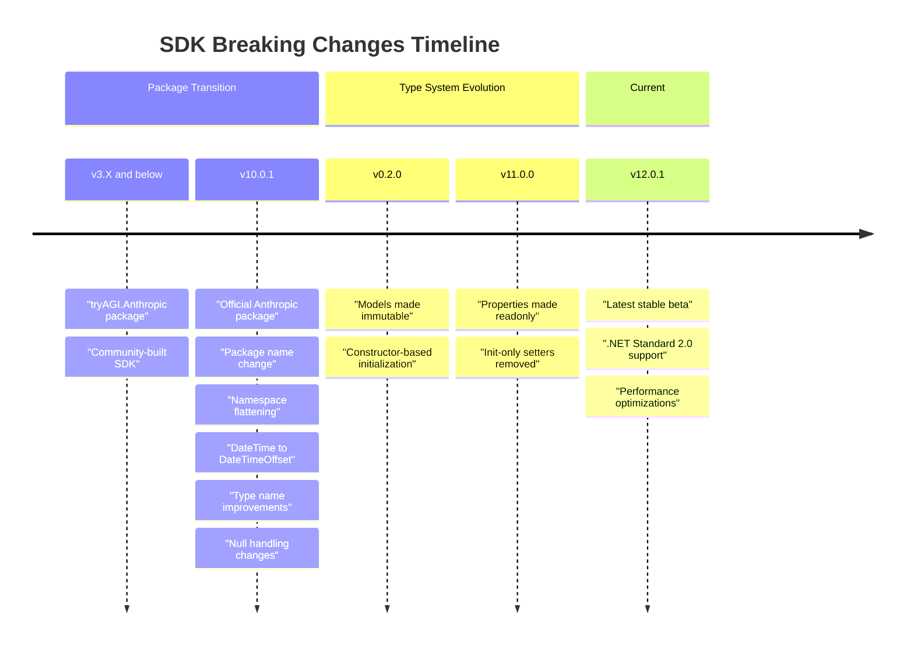
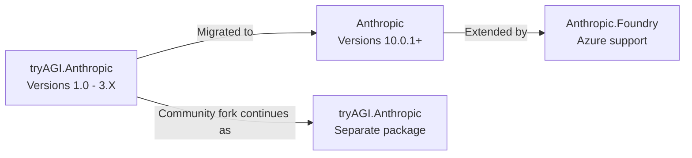
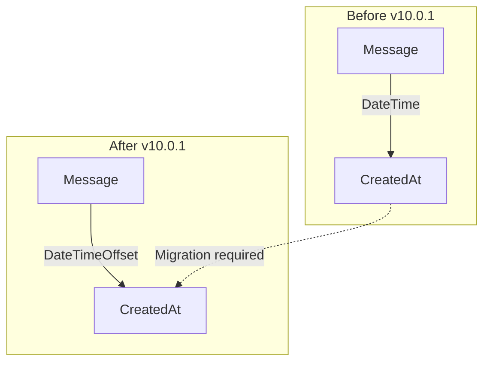
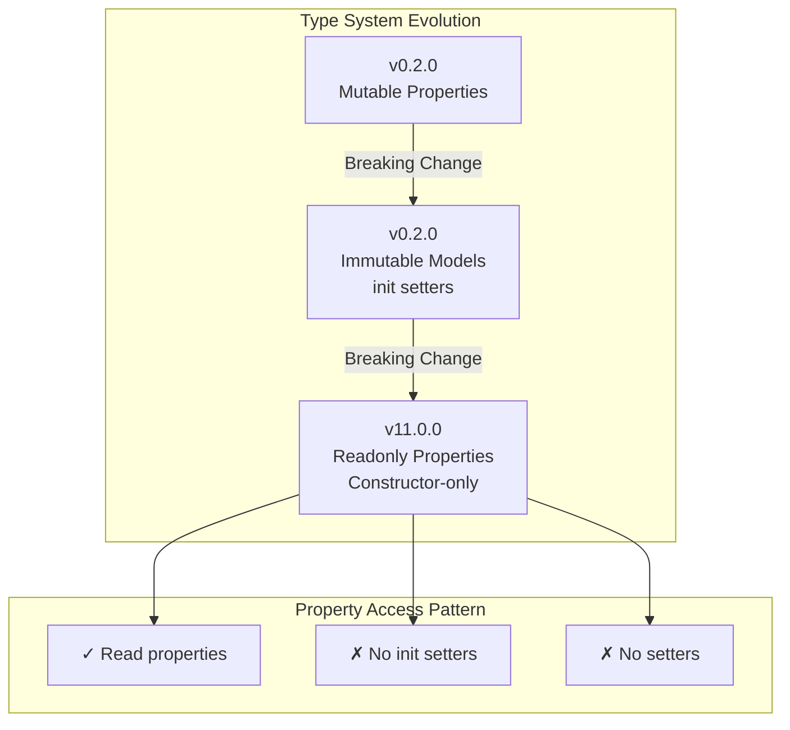
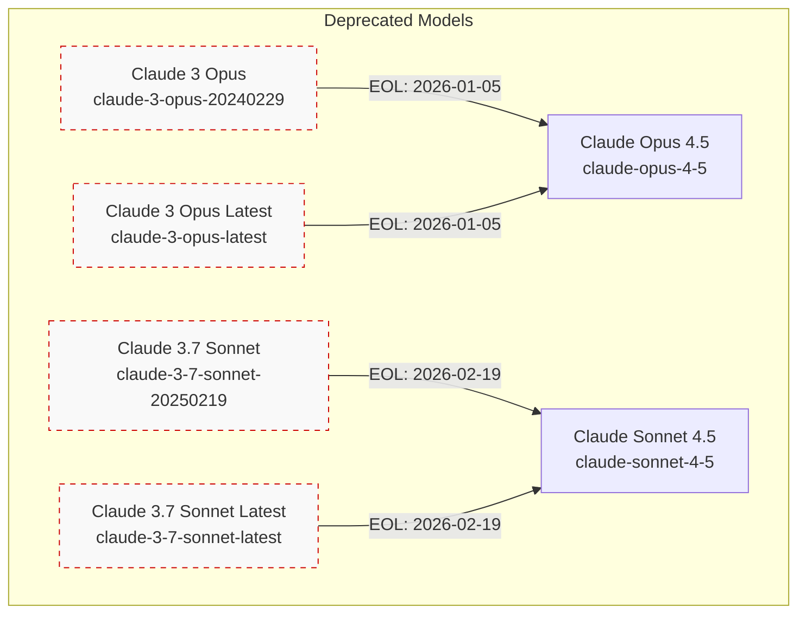
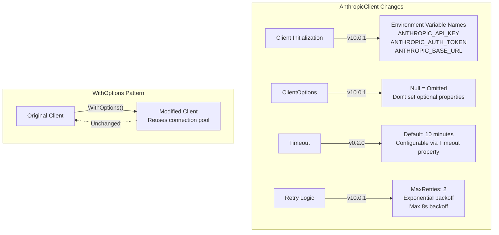
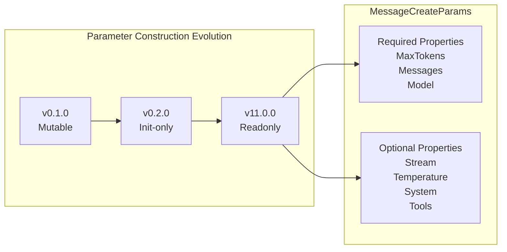
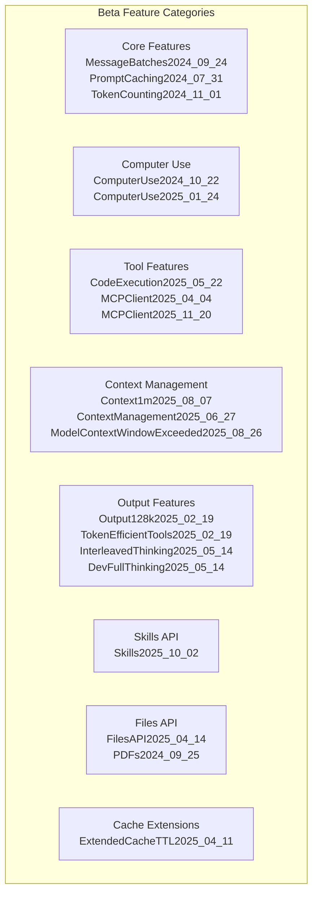

<!-- source: DeepWiki mcp.deepwiki.com · repo anthropics/anthropic-sdk-csharp · page 11.1 Breaking Changes Log · fetched 2026-10-26 -->

# Breaking Changes Log

<details>
<summary>Relevant source files</summary>

The following files were used as context for generating this wiki page:

- [.release-please-manifest.json](.release-please-manifest.json)
- [CHANGELOG.md](CHANGELOG.md)
- [examples/ChatClientExample/ChatClientExample.csproj](examples/ChatClientExample/ChatClientExample.csproj)
- [release-please-config.json](release-please-config.json)
- [src/Anthropic.Foundry/Anthropic.Foundry.csproj](src/Anthropic.Foundry/Anthropic.Foundry.csproj)
- [src/Anthropic.Foundry/CHANGELOG.md](src/Anthropic.Foundry/CHANGELOG.md)
- [src/Anthropic/Anthropic.csproj](src/Anthropic/Anthropic.csproj)
- [src/Anthropic/CHANGELOG.md](src/Anthropic/CHANGELOG.md)
- [src/logo.png](src/logo.png)

</details>


This page documents all breaking changes in the Anthropic C# SDK across versions, providing migration instructions and code examples for each change. The SDK is currently in beta, and breaking changes may occur more frequently than in a stable release.

**Related Pages:**
- For deprecated features and alternatives, see [Deprecated Features](#11.2)
- For general migration strategies, see [Migration Guides](#11)
- For release process details, see [Release Process](#10.4)

## Purpose and Scope

This document catalogs breaking API changes in the `Anthropic` and `Anthropic.Foundry` packages, organized chronologically by version. Each breaking change includes:

- **Description**: What changed and why
- **Affected Components**: Which classes, namespaces, or types are impacted
- **Migration Path**: Step-by-step instructions to update existing code
- **Code Examples**: Before/after comparisons

**Important:** During the beta period, breaking changes may occur in minor or patch releases. Once the SDK reaches stable release (v1.0), it will follow SemVer conventions strictly.

---

## Version Timeline and Breaking Changes



Sources: [CHANGELOG.md:1-356](), [README.md:3-19](), [src/Anthropic/Anthropic.csproj:7]()

---

## Package Transition (v3.X → v10.0.1)

### Overview

**Version:** v10.0.1 (Released 2025-11-18)

The most significant breaking change was the package name transition. Version 10.0.1 marks the first official Anthropic SDK release, replacing the community-built `tryAGI.Anthropic` package that used versions 3.X and below.

### Package Name Change



Sources: [README.md:3-9]()

### Migration Instructions

**1. Update NuGet Package Reference**

Remove the old package:
```bash
dotnet remove package tryAGI.Anthropic
```

Add the official package:
```bash
dotnet add package Anthropic
```

**2. Update Using Statements**

The root namespace remains `Anthropic`, so most using statements are unchanged. However, service namespaces were flattened (see below).

**3. Review API Differences**

While the core API remains similar, review all breaking changes listed in subsequent sections, as v10.0.1 included multiple structural changes.

Sources: [README.md:25-31](), [CHANGELOG.md:137-209]()

---

## Version 10.0.1 Breaking Changes

### 1. Service Namespace Flattening

**Change:** Service interfaces moved from nested namespaces to flat structure.

**Before (v0.X):**
```
Anthropic.Services.Messages.IMessageService
Anthropic.Services.Models.IModelService
Anthropic.Services.Beta.IBetaService
```

**After (v10.0.1+):**
```
Anthropic.Services.IMessageService
Anthropic.Services.IModelService
Anthropic.Services.IBetaService
```

**Migration:**

Update using statements:
```csharp
// Before
using Anthropic.Services.Messages;
using Anthropic.Services.Models;

// After
using Anthropic.Services;
```

No code changes required beyond using statements, as services are accessed through client properties.

Sources: [CHANGELOG.md:205](), [CHANGELOG.md:144]()

### 2. DateTime to DateTimeOffset

**Change:** All date/time properties now use `DateTimeOffset` instead of `DateTime` for proper timezone handling.

**Affected Types:**
- `Message.CreatedAt`
- `MessageBatch.CreatedAt`
- `MessageBatch.ExpiresAt`
- `MessageBatch.EndedAt`
- All timestamp fields in response models



**Migration:**

```csharp
// Before: DateTime comparison
DateTime messageTime = message.CreatedAt;
if (messageTime > DateTime.UtcNow.AddHours(-1)) { }

// After: DateTimeOffset comparison
DateTimeOffset messageTime = message.CreatedAt;
if (messageTime > DateTimeOffset.UtcNow.AddHours(-1)) { }

// Converting from DateTime to DateTimeOffset
DateTime localTime = DateTime.Now;
DateTimeOffset offsetTime = new DateTimeOffset(localTime);
```

**Why This Change:** `DateTimeOffset` provides proper timezone information and prevents ambiguity when comparing times across timezones.

Sources: [CHANGELOG.md:175](), [CHANGELOG.md:143]()

### 3. Type Name Improvements

**Change:** Several types renamed for clarity and consistency.

**Key Renames:**

| Old Name | New Name | Component |
|----------|----------|-----------|
| `StreamEvent` | `RawMessageStreamEvent` | Message streaming |
| `BetaStreamEvent` | `RawBetaMessageStreamEvent` | Beta message streaming |
| Various union type names | More descriptive names | Throughout SDK |

**Migration:**

```csharp
// Before
await foreach (StreamEvent evt in client.Messages.CreateStreaming(params)) {
    // Handle event
}

// After
await foreach (RawMessageStreamEvent evt in client.Messages.CreateStreaming(params)) {
    // Handle event
}
```

Sources: [CHANGELOG.md:206](), [CHANGELOG.md:142]()

### 4. Null Handling Changes

**Change:** Certain properties now interpret `null` as "omitted from request" rather than "explicitly set to null".

**Affected Properties:**
- Optional request parameters in `MessageCreateParams`
- Optional fields in `ClientOptions`
- Various optional configuration properties

**Migration:**

```csharp
// Before: Could set null explicitly
var params = new MessageCreateParams
{
    Temperature = null,  // Treated as explicit null
    MaxTokens = 1024
};

// After: Don't set property if you want it omitted
var params = new MessageCreateParams
{
    // Don't set Temperature at all
    MaxTokens = 1024
};

// Or use default value explicitly if API supports it
var params = new MessageCreateParams
{
    Temperature = 1.0,  // Use default
    MaxTokens = 1024
};
```

**Why This Change:** Aligns with API expectations where omitted fields use server defaults, while explicit `null` may have different semantics.

Sources: [CHANGELOG.md:174](), [CHANGELOG.md:145]()

---

## Version 11.0.0 Breaking Changes

### Readonly Properties

**Version:** v11.0.0 (Released 2025-12-01)

**Change:** All model and response properties changed from init-only setters to fully readonly fields.



Sources: [CHANGELOG.md:3-21](), [src/Anthropic/Anthropic.csproj:7]()

### Impact on Model Construction

**Before v11.0.0:**
```csharp
// Could use object initializer with init setters
var message = new MessageParam
{
    Role = Role.User,
    Content = "Hello, Claude"
};

// Could modify after construction
var params = new MessageCreateParams
{
    Model = Model.ClaudeSonnet4_5
};
params.MaxTokens = 1024;  // Allowed with init
```

**After v11.0.0:**
```csharp
// Must use constructor or helper methods
var message = new MessageParam(
    role: Role.User,
    content: "Hello, Claude"
);

// All properties must be set in constructor/initializer
var params = new MessageCreateParams
{
    Model = Model.ClaudeSonnet4_5,
    MaxTokens = 1024,  // Must set here
    Messages = new[] { message }
};
// params.MaxTokens = 2048;  // ERROR: readonly property
```

### Migration Strategy

**1. Update Object Initialization**

Convert all object initializers to include all required properties upfront:

```csharp
// Before
var params = new MessageCreateParams();
params.Model = Model.ClaudeSonnet4_5;
params.MaxTokens = 1024;
params.Messages = messages;

// After
var params = new MessageCreateParams
{
    Model = Model.ClaudeSonnet4_5,
    MaxTokens = 1024,
    Messages = messages
};
```

**2. Use Builder Pattern for Complex Objects**

For complex configurations, consider creating helper methods:

```csharp
public static class MessageParamsBuilder
{
    public static MessageCreateParams BuildStandard(
        Model model,
        int maxTokens,
        IEnumerable<MessageParam> messages)
    {
        return new MessageCreateParams
        {
            Model = model,
            MaxTokens = maxTokens,
            Messages = messages.ToList()
        };
    }
}
```

**3. Update Test Code**

Test code often uses incremental object construction:

```csharp
// Before
var testParams = new MessageCreateParams();
testParams.Model = Model.ClaudeHaiku4_5;
testParams.MaxTokens = 100;
// ... more setup

// After - use object initializer or test builder
var testParams = new MessageCreateParams
{
    Model = Model.ClaudeHaiku4_5,
    MaxTokens = 100,
    Messages = TestData.DefaultMessages
};
```

Sources: [CHANGELOG.md:9](), [CHANGELOG.md:19]()

---

## Version 0.2.0 Breaking Changes

### Immutable Models

**Version:** v0.2.0 (Released 2025-11-05)

**Change:** Response models changed from mutable to immutable using init-only setters.

**Before v0.2.0:**
```csharp
// Could modify response objects
var message = await client.Messages.Create(params);
message.Role = Role.Assistant;  // Allowed
```

**After v0.2.0:**
```csharp
// Response objects are immutable
var message = await client.Messages.Create(params);
// message.Role = Role.Assistant;  // ERROR: init-only setter
```

**Why This Change:** 
- Prevents accidental modification of API responses
- Enables thread-safe usage of response objects
- Aligns with functional programming patterns

Sources: [CHANGELOG.md:217](), [CHANGELOG.md:223]()

---

## Model and Enum Deprecations

### Deprecated Models

Several older Claude models have been deprecated with end-of-life dates:



**Deprecated Model Enum Values:**

| Enum Value | String Identifier | EOL Date | Recommended Alternative |
|------------|-------------------|----------|-------------------------|
| `Model.Claude3OpusLatest` | `claude-3-opus-latest` | 2026-01-05 | `Model.ClaudeOpus4_5` |
| `Model.Claude_3_Opus_20240229` | `claude-3-opus-20240229` | 2026-01-05 | `Model.ClaudeOpus4_5` |
| `Model.Claude3_7SonnetLatest` | `claude-3-7-sonnet-latest` | 2026-02-19 | `Model.ClaudeSonnet4_5` |
| `Model.Claude3_7Sonnet20250219` | `claude-3-7-sonnet-20250219` | 2026-02-19 | `Model.ClaudeSonnet4_5` |

**Migration:**

```csharp
// Before - using deprecated model
var params = new MessageCreateParams
{
    Model = Model.Claude_3_Opus_20240229,  // Deprecated
    MaxTokens = 1024
};

// After - using current model
var params = new MessageCreateParams
{
    Model = Model.ClaudeOpus4_5,  // Current
    MaxTokens = 1024
};
```

Sources: [src/Anthropic/Models/Messages/Model.cs:28-120](), [CHANGELOG.md:229]()

---

## Breaking Changes by Component

### Client and Configuration



**No Breaking Changes in:**
- `WithOptions()` method signature
- Environment variable names
- Retry configuration API
- Timeout configuration API

Sources: [README.md:68-118](), [CHANGELOG.md:224]()

### Service Layer

**Namespace Flattening (v10.0.1):**

| Service | Old Namespace | New Namespace |
|---------|---------------|---------------|
| Messages | `Anthropic.Services.Messages` | `Anthropic.Services` |
| Models | `Anthropic.Services.Models` | `Anthropic.Services` |
| Beta | `Anthropic.Services.Beta` | `Anthropic.Services` |
| Batches | `Anthropic.Services.Batches` | `Anthropic.Services` (sub-service) |

**Service Interface Names (Unchanged):**
- `IMessageService`
- `IModelService`
- `IBetaService`
- `IBatchService`

Sources: [CHANGELOG.md:205]()

### Request Parameters



**Breaking Change Pattern:**

Each version tightened immutability:
- v0.1.0: Fully mutable after construction
- v0.2.0: Init-only setters (immutable after initialization)
- v11.0.0: Fully readonly (constructor/initializer only)

Sources: [CHANGELOG.md:217](), [CHANGELOG.md:9]()

### Response Models

**Immutability Changes:**

All response types follow the same evolution:
- `Message`
- `MessageBatch`
- `ContentBlock` variants
- `Usage` statistics
- Error responses

**No changes to:**
- Property names
- Property types (except `DateTime` → `DateTimeOffset`)
- JSON serialization format
- Response structure

Sources: [CHANGELOG.md:175]()

---

## Beta Features Breaking Changes

### Beta Header Management

The `AnthropicBeta` enum has grown significantly but no breaking changes to existing values:

**Current Beta Features (v12.0.1):**



**No Breaking Changes:** New beta features are additive. Existing beta headers remain valid.

Sources: [src/Anthropic/Models/Beta/AnthropicBeta.cs:9-30]()

---

## Migration Checklist

Use this checklist when upgrading between major versions:

### Migrating from tryAGI.Anthropic to Anthropic v10+

- [ ] Update package reference from `tryAGI.Anthropic` to `Anthropic`
- [ ] Update all using statements (remove nested service namespaces)
- [ ] Replace `DateTime` with `DateTimeOffset` in time comparisons
- [ ] Update any code that sets properties to `null` explicitly
- [ ] Test with updated type names (especially streaming events)
- [ ] Review deprecated model usage and plan migration

### Upgrading from v10.X to v11.0.0

- [ ] Update all object initializers to set all properties upfront
- [ ] Remove any code that modifies properties after initialization
- [ ] Update test code to use full object initializers
- [ ] Consider implementing builder pattern for complex objects
- [ ] Verify no code attempts to mutate response objects

### Upgrading from v0.X to v10.0.1

- [ ] Combine all breaking changes from tryAGI migration
- [ ] Update immutable model handling (if coming from pre-v0.2.0)
- [ ] Apply namespace flattening changes
- [ ] Update DateTime to DateTimeOffset
- [ ] Review and test null handling behavior

---

## Forward Compatibility

### Preparing for Future Breaking Changes

During the beta period, follow these practices to minimize migration effort:

**1. Use Object Initializers Exclusively**
```csharp
// Good - resilient to property changes
var params = new MessageCreateParams
{
    Model = Model.ClaudeSonnet4_5,
    MaxTokens = 1024,
    Messages = messages
};

// Avoid - breaks if properties become readonly
var params = new MessageCreateParams();
params.Model = Model.ClaudeSonnet4_5;
```

**2. Don't Rely on Mutable Responses**
```csharp
// Good - treat responses as immutable
var message = await client.Messages.Create(params);
var modifiedMessage = new MessageData 
{
    Role = message.Role,
    Content = modifiedContent
};

// Avoid - assumes mutability
var message = await client.Messages.Create(params);
message.Content = modifiedContent;  // May break
```

**3. Use Strong Typing**
```csharp
// Good - catch breaking changes at compile time
Model model = Model.ClaudeSonnet4_5;
DateTimeOffset timestamp = message.CreatedAt;

// Avoid - masks type changes
var model = Model.ClaudeSonnet4_5;
var timestamp = message.CreatedAt;
```

**4. Avoid Reflection on SDK Types**
```csharp
// Avoid - breaks on structural changes
typeof(MessageCreateParams).GetProperty("Model").SetValue(params, model);

// Good - use public API
var params = new MessageCreateParams { Model = model };
```

Sources: [README.md:344-355]()

---

## Reporting Issues

If you encounter undocumented breaking changes or need migration assistance:

1. Check the [GitHub Issues](https://github.com/anthropics/anthropic-sdk-csharp/issues) for existing reports
2. Review the [full CHANGELOG.md](https://github.com/anthropics/anthropic-sdk-csharp/blob/main/CHANGELOG.md)
3. File a new issue with:
   - Source version and target version
   - Specific code that breaks
   - Expected vs actual behavior
   - Stack trace if applicable

The SDK team actively monitors issues and provides migration guidance during the beta period.

Sources: [README.md:19]()

---

