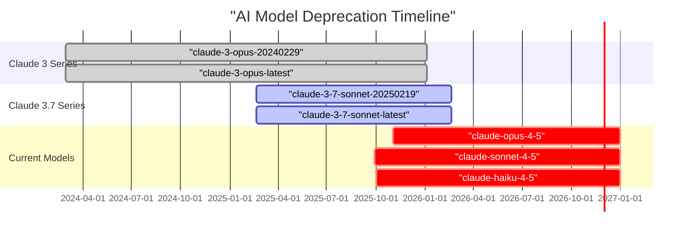
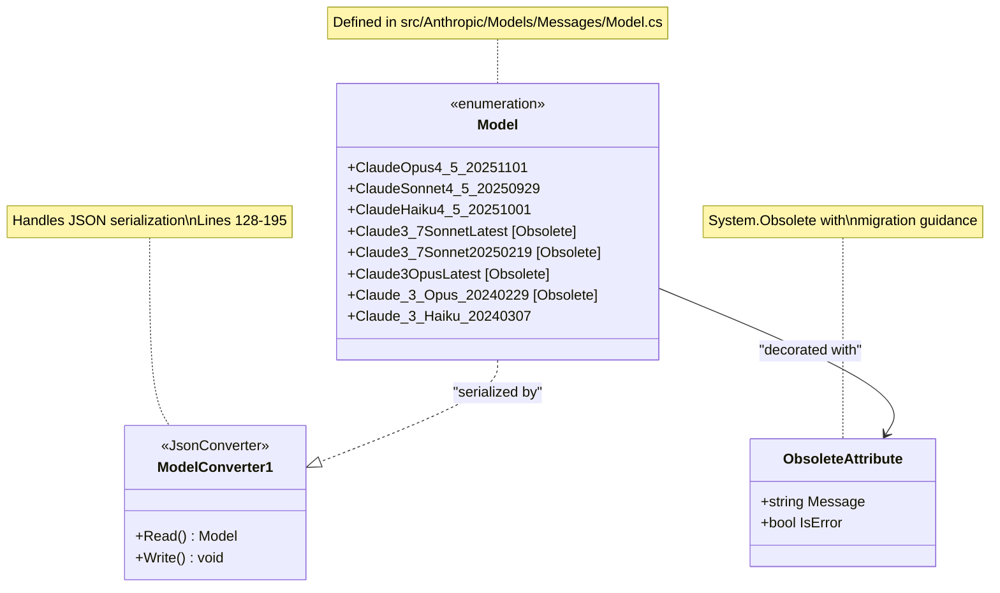
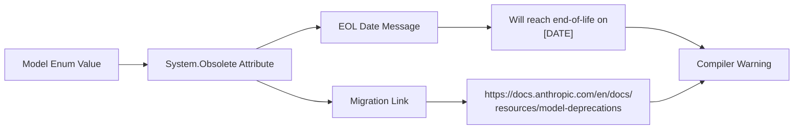
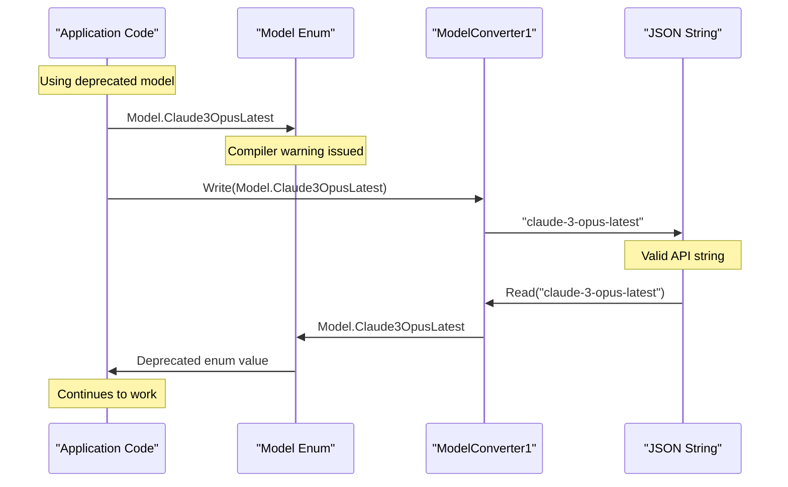
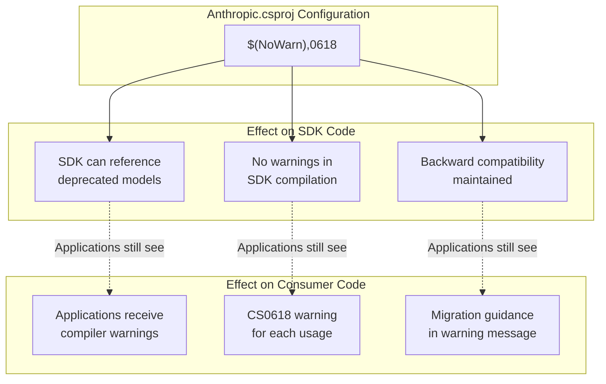
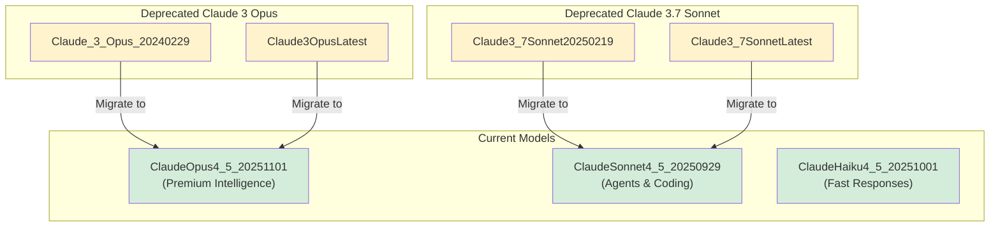
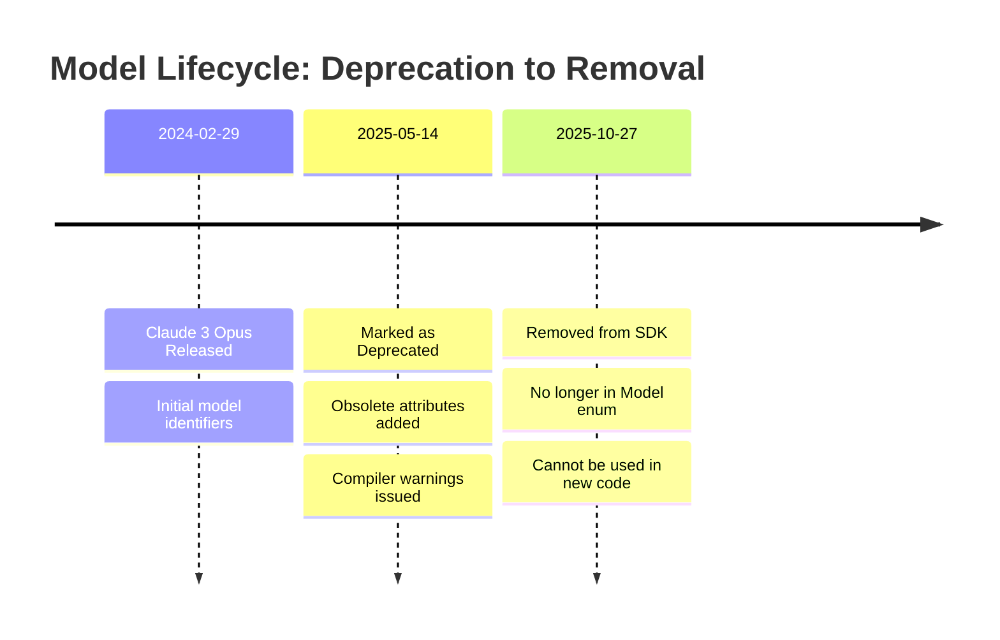
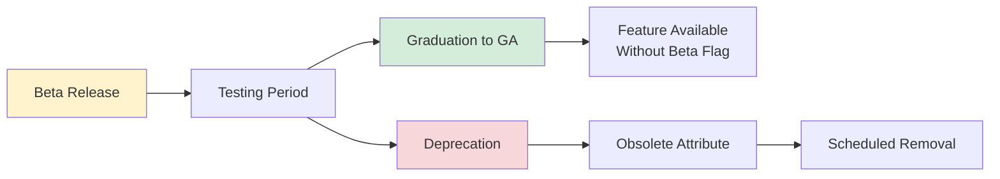

<!-- source: DeepWiki mcp.deepwiki.com · repo anthropics/anthropic-sdk-csharp · page 11.2 Deprecated Features · fetched 2026-10-26 -->

# Deprecated Features

<details>
<summary>Relevant source files</summary>

The following files were used as context for generating this wiki page:

- [.release-please-manifest.json](.release-please-manifest.json)
- [.stats.yml](.stats.yml)
- [CHANGELOG.md](CHANGELOG.md)
- [examples/ChatClientExample/ChatClientExample.csproj](examples/ChatClientExample/ChatClientExample.csproj)
- [release-please-config.json](release-please-config.json)
- [src/Anthropic.Foundry/Anthropic.Foundry.csproj](src/Anthropic.Foundry/Anthropic.Foundry.csproj)
- [src/Anthropic.Foundry/CHANGELOG.md](src/Anthropic.Foundry/CHANGELOG.md)
- [src/Anthropic/Anthropic.csproj](src/Anthropic/Anthropic.csproj)
- [src/Anthropic/CHANGELOG.md](src/Anthropic/CHANGELOG.md)
- [src/Anthropic/Models/Beta/AnthropicBeta.cs](src/Anthropic/Models/Beta/AnthropicBeta.cs)
- [src/Anthropic/Models/Messages/Model.cs](src/Anthropic/Models/Messages/Model.cs)
- [src/logo.png](src/logo.png)

</details>


This document catalogs all deprecated features in the Anthropic C# SDK, including AI models, methods, and configuration options that are scheduled for removal or have reached end-of-life. For information about breaking changes across SDK versions, see [Breaking Changes Log](#11.1).

---

## Overview

The SDK uses standard .NET deprecation attributes (`[System.Obsolete]`) to mark features that are no longer recommended for use. Deprecated features remain functional but will trigger compiler warnings unless explicitly suppressed. The SDK itself disables these warnings internally to avoid issues when referencing its own deprecated symbols [src/Anthropic/Anthropic.csproj:40-41]().

All deprecation notices include:
- **End-of-life date**: When the feature will no longer be supported by the Anthropic API
- **Migration guidance**: Links to documentation for recommended alternatives
- **Reason**: Context for why the feature is being deprecated

---

## Deprecated AI Models

### Model Deprecation Timeline

The primary deprecated features in the SDK are AI model identifiers in the `Model` enum. These models have been superseded by newer versions with improved capabilities.



**Sources:** [CHANGELOG.md:229](), [src/Anthropic/Models/Messages/Model.cs:1-196]()

### Deprecated Model Enum Values

The following table documents all deprecated model identifiers in the `Model` enum:

| Enum Value | String Identifier | End-of-Life Date | Deprecated In | Replacement |
|------------|-------------------|------------------|---------------|-------------|
| `Claude3_7SonnetLatest` | `claude-3-7-sonnet-latest` | February 19, 2026 | v0.2.0 | `ClaudeSonnet4_5` |
| `Claude3_7Sonnet20250219` | `claude-3-7-sonnet-20250219` | February 19, 2026 | v0.2.0 | `ClaudeSonnet4_5_20250929` |
| `Claude3OpusLatest` | `claude-3-opus-latest` | January 5, 2026 | v0.2.0 | `ClaudeOpus4_5` |
| `Claude_3_Opus_20240229` | `claude-3-opus-20240229` | January 5, 2026 | v0.2.0 | `ClaudeOpus4_5_20251101` |

**Sources:** [src/Anthropic/Models/Messages/Model.cs:28-120]()

---

## Model Enum Implementation

### Code Structure for Deprecated Models

The `Model` enum in the SDK uses the standard .NET `[System.Obsolete]` attribute to mark deprecated values. Here's how deprecation is implemented:



**Sources:** [src/Anthropic/Models/Messages/Model.cs:1-196]()

### Deprecation Attribute Format

Each deprecated model uses a consistent format for the obsolete attribute:



The deprecation message format is:
```
"Will reach end-of-life on [DATE]. Please migrate to a newer model. Visit https://docs.anthropic.com/en/docs/resources/model-deprecations for more information."
```

**Sources:** [src/Anthropic/Models/Messages/Model.cs:28-120]()

---

## Model Serialization and Deserialization

### JSON Conversion for Deprecated Models

The `ModelConverter1` class handles JSON serialization for all model values, including deprecated ones. Deprecated models continue to serialize and deserialize correctly:



**Key Points:**
- Deprecated models continue to serialize to valid API strings [src/Anthropic/Models/Messages/Model.cs:162-194]()
- JSON deserialization recognizes deprecated model strings [src/Anthropic/Models/Messages/Model.cs:136-159]()
- No runtime errors occur when using deprecated models (only compile-time warnings)
- The converter uses a simple switch expression for bidirectional mapping

**Sources:** [src/Anthropic/Models/Messages/Model.cs:128-195]()

---

## Compiler Warning Suppression

### SDK Internal Handling

The SDK suppresses deprecation warnings in its own code to avoid cascading warnings when the codebase references its own deprecated symbols:



**Configuration Details:**
- Warning code `0618` is suppressed for SDK internal code [src/Anthropic/Anthropic.csproj:40-41]()
- Test projects also suppress this warning [src/Anthropic.Tests/Anthropic.Tests.csproj:16-17]()
- Consumer applications will still receive warnings when using deprecated features
- Comment explicitly states: "Disable deprecation warnings since we may reference our own deprecated symbols"

**Sources:** [src/Anthropic/Anthropic.csproj:40-41](), [src/Anthropic.Tests/Anthropic.Tests.csproj:16-17]()

---

## Migration Strategies

### Upgrading from Deprecated Models



### Step-by-Step Migration Process

1. **Identify Usage**: Search codebase for deprecated model identifiers
2. **Review Capabilities**: Compare deprecated model with recommended replacement
3. **Update Code**: Replace enum value with current equivalent
4. **Test**: Verify output quality and performance with new model
5. **Monitor**: Track API usage and costs after migration

### Code Example: Before and After

**Before (Deprecated):**
```csharp
MessageCreateParams parameters = new()
{
    MaxTokens = 1024,
    Messages = [ /* ... */ ],
    Model = Model.Claude3OpusLatest // Compiler warning CS0618
};
```

**After (Current):**
```csharp
MessageCreateParams parameters = new()
{
    MaxTokens = 1024,
    Messages = [ /* ... */ ],
    Model = Model.ClaudeOpus4_5 // No warning
};
```

**Sources:** [src/Anthropic/Models/Messages/Model.cs:18-112](), [README.md:48-64]()

---

## Removed Models

### Previously Deprecated Models No Longer Available

Some models were fully removed from the SDK in version 0.1.0 after their deprecation period ended. These models are no longer present in the codebase:



According to the changelog, "older deprecated models" were removed in version 0.1.0 [CHANGELOG.md:258](). These models are no longer available in the current SDK version and will cause compilation errors if referenced.

**Sources:** [CHANGELOG.md:258]()

---

## Beta Feature Deprecation

### AnthropicBeta Enum Stability

The `AnthropicBeta` enum [src/Anthropic/Models/Beta/AnthropicBeta.cs:1-104]() contains beta feature identifiers. While none are currently marked as deprecated, beta features follow a different lifecycle:



**Beta Feature Lifecycle:**
- **Experimental**: Requires beta flag in API headers
- **Stable**: May graduate to general availability (GA)
- **Deprecated**: Marked obsolete if superseded or discontinued
- **Removed**: Eventually removed after deprecation period

Currently, all beta features in `AnthropicBeta` enum [src/Anthropic/Models/Beta/AnthropicBeta.cs:10-30]() are active and not deprecated.

**Sources:** [src/Anthropic/Models/Beta/AnthropicBeta.cs:1-104](), [CHANGELOG.md:1-356]()

---

## Handling Deprecation Warnings

### Application-Level Warning Suppression

If you need to temporarily suppress deprecation warnings in your application code (not recommended for production):

**Option 1: Project-wide suppression (csproj)**
```xml
<PropertyGroup>
    <NoWarn>$(NoWarn),0618</NoWarn>
</PropertyGroup>
```

**Option 2: File-level suppression**
```csharp
#pragma warning disable CS0618
using Anthropic.Models.Messages;
#pragma warning restore CS0618
```

**Option 3: Statement-level suppression**
```csharp
#pragma warning disable CS0618
Model model = Model.Claude3OpusLatest;
#pragma warning restore CS0618
```

### Recommended Approach

Instead of suppressing warnings, migrate to current models:
1. **Treat warnings as errors** during development to prevent deprecated code from being committed
2. **Schedule migration work** before end-of-life dates
3. **Monitor Anthropic documentation** for new deprecation announcements at https://docs.anthropic.com/en/docs/resources/model-deprecations

**Sources:** [src/Anthropic/Anthropic.csproj:40-41](), [src/Anthropic/Models/Messages/Model.cs:28-120]()

---

## Summary Table

### All Deprecated Features

| Feature Type | Identifier | Status | EOL Date | Replacement | Migration Priority |
|-------------|------------|---------|----------|-------------|-------------------|
| Model | `Claude3_7SonnetLatest` | Deprecated | Feb 19, 2026 | `ClaudeSonnet4_5` | Medium |
| Model | `Claude3_7Sonnet20250219` | Deprecated | Feb 19, 2026 | `ClaudeSonnet4_5_20250929` | Medium |
| Model | `Claude3OpusLatest` | Deprecated | Jan 5, 2026 | `ClaudeOpus4_5` | High |
| Model | `Claude_3_Opus_20240229` | Deprecated | Jan 5, 2026 | `ClaudeOpus4_5_20251101` | High |

**Priority Levels:**
- **High**: EOL date within 6 months - migrate immediately
- **Medium**: EOL date 6-12 months - schedule migration
- **Low**: EOL date beyond 12 months - monitor and plan

**Sources:** [src/Anthropic/Models/Messages/Model.cs:28-120](), [CHANGELOG.md:229]()