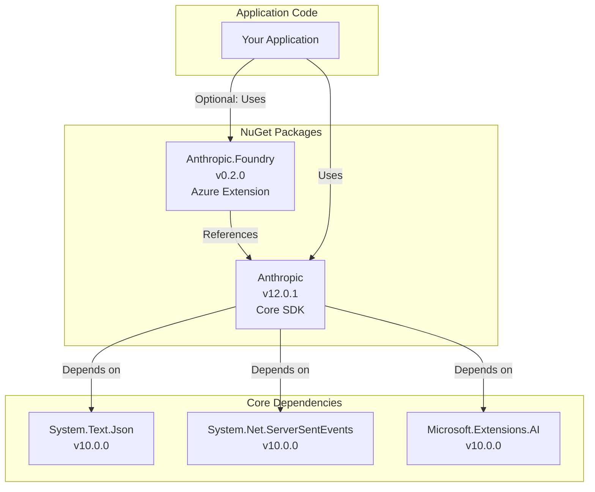
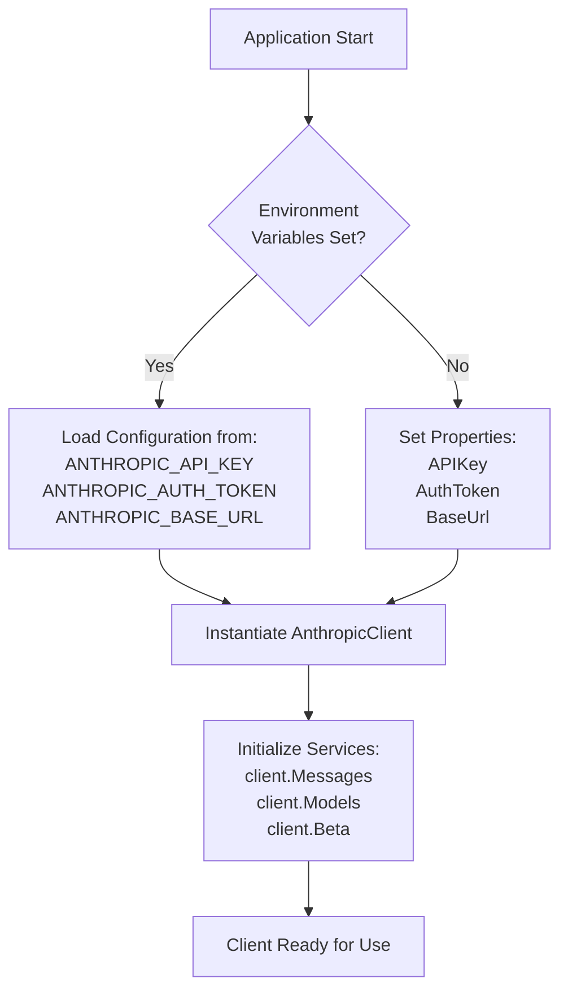
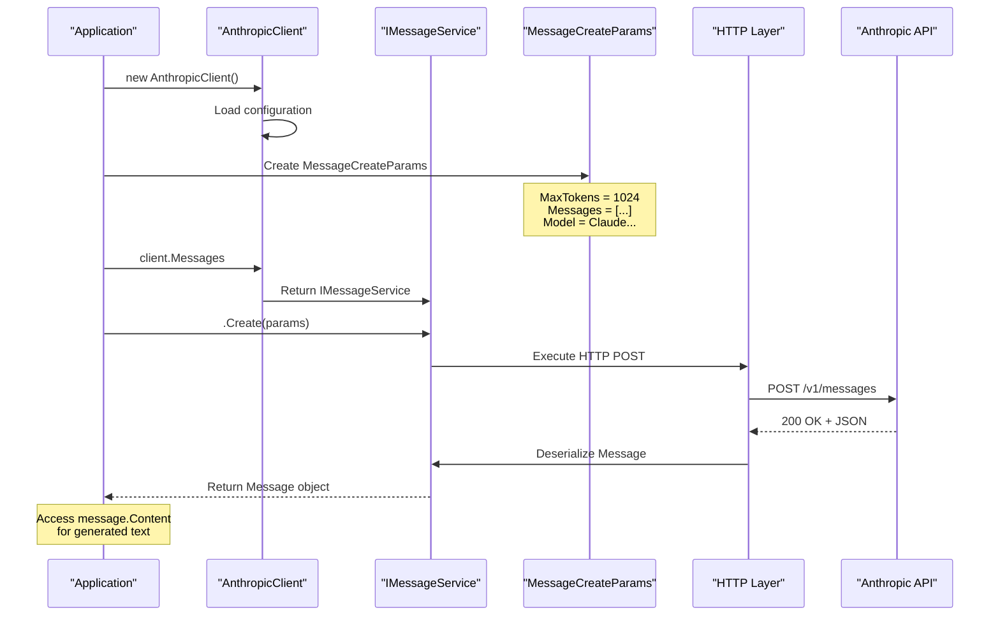
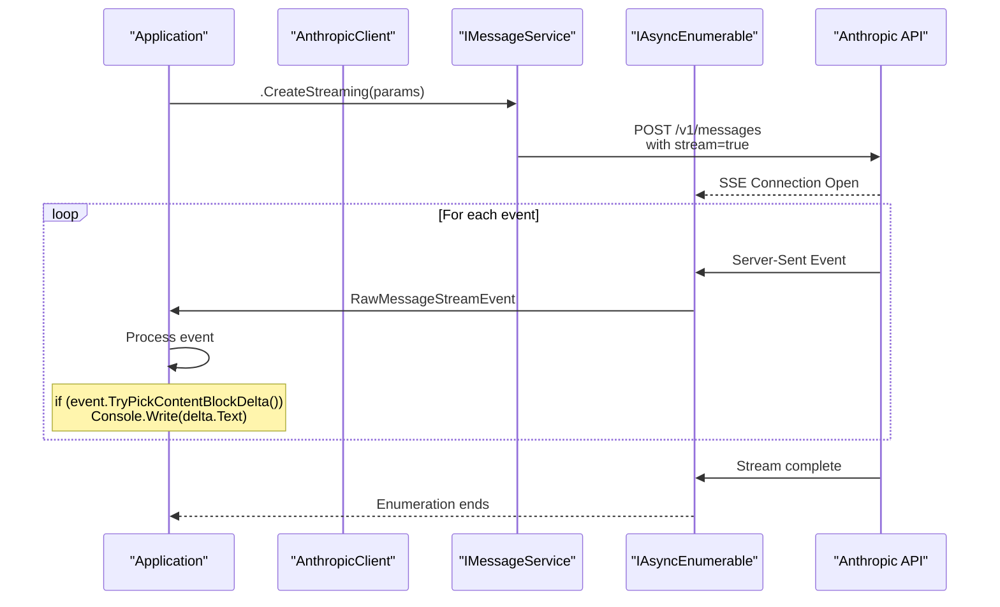

<!-- source: DeepWiki mcp.deepwiki.com · repo anthropics/anthropic-sdk-csharp · page 2 Getting Started · fetched 2026-10-26 -->

# Getting Started

<details>
<summary>Relevant source files</summary>

The following files were used as context for generating this wiki page:

- [README.md](README.md)
- [examples/MessagesExample/MessagesExample.csproj](examples/MessagesExample/MessagesExample.csproj)
- [examples/MessagesExample/Program.cs](examples/MessagesExample/Program.cs)
- [examples/MessagesStreamingExample/MessagesStreamingExample.csproj](examples/MessagesStreamingExample/MessagesStreamingExample.csproj)
- [examples/MessagesStreamingExample/Program.cs](examples/MessagesStreamingExample/Program.cs)
- [examples/ThinkingExample/Program.cs](examples/ThinkingExample/Program.cs)
- [examples/ThinkingExample/ThinkingExample.csproj](examples/ThinkingExample/ThinkingExample.csproj)
- [examples/ThinkingStreamingExample/Program.cs](examples/ThinkingStreamingExample/Program.cs)
- [examples/ThinkingStreamingExample/ThinkingStreamingExample.csproj](examples/ThinkingStreamingExample/ThinkingStreamingExample.csproj)
- [src/Anthropic.Foundry/AnthropicFoundryClient.cs](src/Anthropic.Foundry/AnthropicFoundryClient.cs)
- [src/Anthropic.Tests/TestBase.cs](src/Anthropic.Tests/TestBase.cs)
- [src/Anthropic/AnthropicClient.cs](src/Anthropic/AnthropicClient.cs)
- [src/Anthropic/Core/ClientOptions.cs](src/Anthropic/Core/ClientOptions.cs)
- [src/Anthropic/Core/EnvironmentUrl.cs](src/Anthropic/Core/EnvironmentUrl.cs)
- [src/Anthropic/IAnthropicClient.cs](src/Anthropic/IAnthropicClient.cs)

</details>


This document provides an introduction to installing and using the Anthropic C# SDK. It covers package installation, basic client configuration, and your first API requests. For detailed information on specific topics, see the child pages: [Installation](#2.1), [Configuration](#2.2), and [Quick Start Examples](#2.3).

The Anthropic C# SDK is currently in **beta** (version 12.0.1 as of this writing). While functional and tested, it may undergo breaking changes in future releases. The SDK provides convenient access to the Anthropic REST API from .NET applications.

**Sources:** [README.md:1-23](), [src/Anthropic/Anthropic.csproj:1-10]()

---

## Package Overview

The SDK consists of two NuGet packages:

| Package | Version | Purpose |
|---------|---------|---------|
| `Anthropic` | 12.0.1 | Core SDK for Anthropic API access |
| `Anthropic.Foundry` | 0.2.0 | Azure-hosted Anthropic deployments |

Both packages target **.NET Standard 2.0**, making them compatible with:
- .NET 8.0+
- .NET Framework 4.6.1+
- .NET Core 2.0+

The core `Anthropic` package depends on:
- `System.Text.Json` (v10.0.0) - JSON serialization
- `System.Net.ServerSentEvents` (v10.0.0) - Streaming support
- `Microsoft.Extensions.AI.Abstractions` (v10.0.0) - Standard AI abstractions

**Sources:** [src/Anthropic/Anthropic.csproj:32-54](), [.release-please-manifest.json:1-4](), [release-please-config.json:1-12]()

---

## Package Architecture



**Package Dependency Structure**

**Sources:** [src/Anthropic/Anthropic.csproj:43-54](), [README.md:1-23]()

---

## Installation

Install the core SDK via NuGet:

```bash
dotnet add package Anthropic
```

For Azure-hosted deployments, additionally install:

```bash
dotnet add package Anthropic.Foundry
```

This adds the necessary package references to your `.csproj` file. The SDK supports .NET Standard 2.0 and later, ensuring broad compatibility across .NET ecosystems.

For detailed installation instructions including target framework considerations, see [Installation](#2.1).

**Sources:** [README.md:25-31](), [examples/MessagesExample/MessagesExample.csproj:8-11]()

---

## Basic Configuration

The SDK uses the `AnthropicClient` class as the primary entry point. Configuration can be done via environment variables or programmatically.

### Environment Variable Configuration

```csharp
using Anthropic;

// Reads ANTHROPIC_API_KEY, ANTHROPIC_AUTH_TOKEN, and ANTHROPIC_BASE_URL
AnthropicClient client = new();
```

### Manual Configuration

```csharp
using Anthropic;

AnthropicClient client = new() 
{ 
    APIKey = "my-anthropic-api-key",
    BaseUrl = new Uri("https://api.anthropic.com")
};
```

| Property | Environment Variable | Required | Default |
|----------|---------------------|----------|---------|
| `APIKey` | `ANTHROPIC_API_KEY` | false | - |
| `AuthToken` | `ANTHROPIC_AUTH_TOKEN` | false | - |
| `BaseUrl` | `ANTHROPIC_BASE_URL` | true | `https://api.anthropic.com` |

For advanced configuration options including retries, timeouts, and the `WithOptions` pattern, see [Configuration](#2.2).

**Sources:** [README.md:67-95](), [examples/MessagesExample/Program.cs:4-8]()

---

## Client Instantiation Flow



**AnthropicClient Initialization Process**

**Sources:** [README.md:67-95](), [examples/MessagesExample/Program.cs:4-8]()

---

## Your First Request

### Creating a Message

The most common operation is creating a message using the `Messages.Create` method. Here's a minimal example:

```csharp
using Anthropic;
using Anthropic.Models.Messages;

AnthropicClient client = new();

MessageCreateParams parameters = new()
{
    MaxTokens = 1024,
    Messages =
    [
        new()
        {
            Role = Role.User,
            Content = "Hello, Claude",
        },
    ],
    Model = Model.ClaudeOpus4_5_20251101,
};

Message message = await client.Messages.Create(parameters);

Console.WriteLine(message);
```

The key components:
- `MessageCreateParams` - Request configuration
- `Role.User` - Message sender role
- `Model.ClaudeOpus4_5_20251101` - AI model to use
- `client.Messages.Create()` - Synchronous API call
- `Message` - Response object containing generated content

**Sources:** [README.md:37-65](), [examples/MessagesExample/Program.cs:10-30]()

---

### Streaming Responses

For real-time content generation, use `CreateStreaming`:

```csharp
using Anthropic;
using Anthropic.Models.Messages;

AnthropicClient client = new();

MessageCreateParams parameters = new()
{
    MaxTokens = 1024,
    Messages =
    [
        new()
        {
            Role = Role.User,
            Content = "Hello, Claude",
        },
    ],
    Model = Model.ClaudeOpus4_5_20251101,
};

await foreach (var event in client.Messages.CreateStreaming(parameters))
{
    Console.WriteLine(event);
}
```

The `CreateStreaming` method returns an `IAsyncEnumerable<RawMessageStreamEvent>`, allowing you to process chunks as they arrive using the `await foreach` pattern.

**Sources:** [README.md:126-156](), [examples/MessagesStreamingExample/Program.cs:1-28]()

---

## Request Flow Diagram



**Standard Message Creation Flow**

**Sources:** [examples/MessagesExample/Program.cs:1-31](), [README.md:120-125]()

---

## Streaming Flow Diagram



**Streaming Message Creation Flow**

**Sources:** [examples/MessagesStreamingExample/Program.cs:1-28](), [README.md:126-156]()

---

## Code Entity Reference

The following table maps natural language concepts to concrete code entities:

| Concept | Code Entity | Location |
|---------|-------------|----------|
| Main client | `AnthropicClient` | Core SDK |
| Message service | `IMessageService` | `client.Messages` |
| Request parameters | `MessageCreateParams` | Parameter object |
| User message | `Role.User` | Enum value |
| AI model | `Model.ClaudeOpus4_5_20251101` | Enum value |
| Response object | `Message` | Return type |
| Streaming events | `RawMessageStreamEvent` | Stream element type |
| Content extraction | `message.Content` | Property access |
| Text blocks | `TextBlock` | Content block type |
| Azure client | `AnthropicFoundryClient` | Foundry package |

**Sources:** [README.md:37-156](), [examples/MessagesExample/Program.cs:1-31]()

---

## Next Steps

This page provided a basic overview of installation and usage. For more detailed information:

- **[Installation](#2.1)** - Target frameworks, dependency management, package versioning
- **[Configuration](#2.2)** - ClientOptions, WithOptions pattern, retries, timeouts
- **[Quick Start Examples](#2.3)** - Complete runnable examples for common scenarios

For API-specific functionality, see:
- **[API Services](#4)** - Comprehensive guide to all available services
- **[Working with Messages](#5)** - Deep dive into message creation and handling
- **[Tools and Function Calling](#6)** - Integrating tools with Claude

**Sources:** [README.md:1-356]()

---

