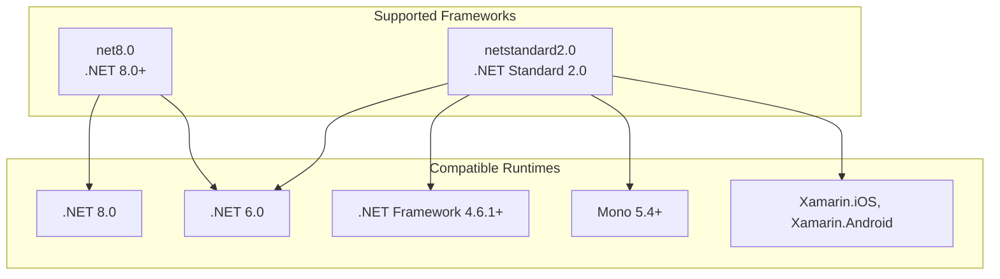
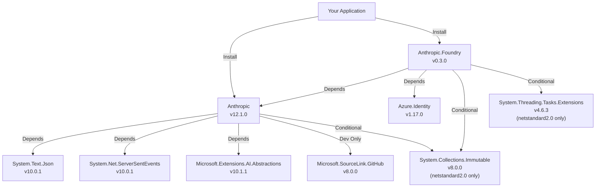
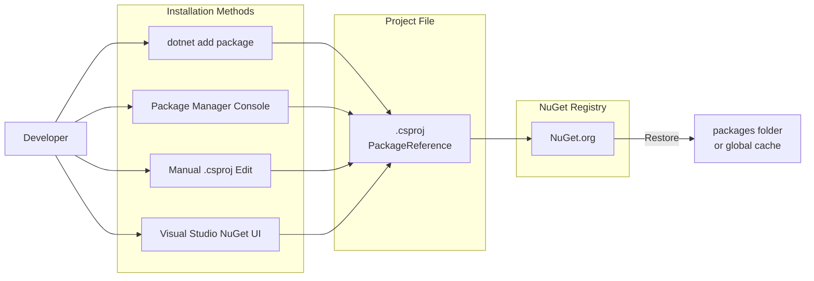

<!-- source: DeepWiki mcp.deepwiki.com · repo anthropics/anthropic-sdk-csharp · page 2.1 Installation · fetched 2026-10-26 -->

# Installation

<details>
<summary>Relevant source files</summary>

The following files were used as context for generating this wiki page:

- [.release-please-manifest.json](.release-please-manifest.json)
- [CHANGELOG.md](CHANGELOG.md)
- [examples/ChatClientExample/ChatClientExample.csproj](examples/ChatClientExample/ChatClientExample.csproj)
- [release-please-config.json](release-please-config.json)
- [src/Anthropic.Foundry/Anthropic.Foundry.csproj](src/Anthropic.Foundry/Anthropic.Foundry.csproj)
- [src/Anthropic.Foundry/CHANGELOG.md](src/Anthropic.Foundry/CHANGELOG.md)
- [src/Anthropic/Anthropic.csproj](src/Anthropic/Anthropic.csproj)
- [src/Anthropic/CHANGELOG.md](src/Anthropic/CHANGELOG.md)
- [src/logo.png](src/logo.png)

</details>


This document describes how to install the Anthropic C# SDK packages from NuGet. The SDK is distributed as two separate packages: the core `Anthropic` package for general use, and the `Anthropic.Foundry` extension package for Azure integration. For information about configuring these packages after installation, see [Configuration](#2.2).

---

## Package Overview

The Anthropic C# SDK consists of two NuGet packages that can be installed independently:

| Package | Current Version | Purpose | Dependencies |
|---------|----------------|---------|--------------|
| `Anthropic` | 12.1.0 | Core SDK with full Anthropic API support | System.Text.Json, System.Net.ServerSentEvents, Microsoft.Extensions.AI.Abstractions |
| `Anthropic.Foundry` | 0.3.0 | Azure Foundry integration (extends core package) | Anthropic, Azure.Identity |

**Sources:** [src/Anthropic/Anthropic.csproj:1-26](), [src/Anthropic.Foundry/Anthropic.Foundry.csproj:1-21](), [.release-please-manifest.json:1-5]()

---

## Framework Requirements

Both packages support multi-framework targeting:



**Diagram: Framework Compatibility Matrix**

The SDK targets both `net8.0` and `netstandard2.0`, providing broad compatibility across modern .NET and legacy .NET Framework applications.

**Sources:** [src/Anthropic/Anthropic.csproj:1-26](), [src/Anthropic.Foundry/Anthropic.Foundry.csproj:1-21]()

---

## Installing the Core Package

### Using .NET CLI

```bash
dotnet add package Anthropic --version 12.1.0
```

### Using Package Manager Console

```powershell
Install-Package Anthropic -Version 12.1.0
```

### Using PackageReference

Add the following to your `.csproj` file:

```xml
<PackageReference Include="Anthropic" Version="12.1.0" />
```

**Sources:** [src/Anthropic/Anthropic.csproj:1-26](), [examples/ChatClientExample/ChatClientExample.csproj:1-13]()

---

## Installing the Foundry Package (Azure Support)

The `Anthropic.Foundry` package extends the core SDK with Azure-specific functionality. It automatically includes the core `Anthropic` package as a dependency.

### Using .NET CLI

```bash
dotnet add package Anthropic.Foundry --version 0.3.0
```

### Using Package Manager Console

```powershell
Install-Package Anthropic.Foundry -Version 0.3.0
```

### Using PackageReference

```xml
<PackageReference Include="Anthropic.Foundry" Version="0.3.0" />
```

**Note:** When you install `Anthropic.Foundry`, the core `Anthropic` package (version 12.1.0) is automatically installed as a transitive dependency.

**Sources:** [src/Anthropic.Foundry/Anthropic.Foundry.csproj:1-21]()

---

## Package Dependency Graph



**Diagram: Package Dependency Resolution**

### Automatic Dependencies

When you install the Anthropic packages, NuGet automatically resolves and installs the following dependencies:

#### For `Anthropic` package:
- `System.Text.Json` (v10.0.1) - JSON serialization/deserialization
- `System.Net.ServerSentEvents` (v10.0.1) - Server-Sent Events for streaming
- `Microsoft.Extensions.AI.Abstractions` (v10.1.1) - Microsoft AI abstractions for `IChatClient` support
- `System.Collections.Immutable` (v8.0.0) - Only for `netstandard2.0` targets

#### For `Anthropic.Foundry` package:
- All dependencies from `Anthropic` (transitive)
- `Azure.Identity` (v1.17.0) - Azure authentication
- `System.Threading.Tasks.Extensions` (v4.6.3) - Only for `netstandard2.0` targets

**Sources:** [src/Anthropic/Anthropic.csproj:14-26](), [src/Anthropic.Foundry/Anthropic.Foundry.csproj:10-20]()

---

## Installation Methods Comparison



**Diagram: Package Installation Flow**

All installation methods ultimately modify the `.csproj` file to add a `<PackageReference>` element, which NuGet uses during package restoration.

**Sources:** [examples/ChatClientExample/ChatClientExample.csproj:1-13]()

---

## Verification

After installation, verify the packages are correctly referenced in your project:

### Check .csproj File

Your project file should contain references similar to:

```xml
<ItemGroup>
  <PackageReference Include="Anthropic" Version="12.1.0" />
  <!-- Optional: Only if using Azure Foundry -->
  <PackageReference Include="Anthropic.Foundry" Version="0.3.0" />
</ItemGroup>
```

### Check Installed Packages

Using .NET CLI:
```bash
dotnet list package
```

Expected output (core package only):
```
Project 'YourProject' has the following package references
   [net8.0]:
   Top-level Package                               Requested   Resolved
   > Anthropic                                     12.1.0      12.1.0
```

Expected output (with Foundry):
```
Project 'YourProject' has the following package references
   [net8.0]:
   Top-level Package                               Requested   Resolved
   > Anthropic.Foundry                             0.3.0       0.3.0
   
   Transitive Package                              Resolved
   > Anthropic                                     12.1.0
   > Azure.Identity                                1.17.0
```

**Sources:** [examples/ChatClientExample/ChatClientExample.csproj:1-13]()

---

## Version History

The SDK follows semantic versioning. Key milestones:

| Version | Release Date | Notes |
|---------|-------------|-------|
| 12.1.0 | 2026-01-06 | Added `EnvironmentUrl` support, multipart form data |
| 12.0.1 | 2025-12-18 | Documentation fixes |
| 12.0.0 | 2025-12-10 | Breaking changes: readonly types for properties |
| 11.0.0 | 2025-12-01 | Breaking changes: readonly types, improved csproj |
| 10.4.0 | 2025-11-25 | Added .NET Standard 2.0 support |

For complete version history, see [Breaking Changes Log](#11.1).

**Sources:** [CHANGELOG.md:1-350](), [src/Anthropic/CHANGELOG.md:1-163](), [src/Anthropic.Foundry/CHANGELOG.md:1-78]()

---

## Framework-Specific Considerations

### .NET Standard 2.0 Targets

When targeting `netstandard2.0`, additional packages are automatically included:

- `System.Collections.Immutable` (v8.0.0) - Required for immutable collections support
- `System.Threading.Tasks.Extensions` (v4.6.3) - Only for Foundry package

These are conditionally included via:

```xml
<ItemGroup Condition="'$(TargetFramework)' == 'netstandard2.0'">
  <PackageReference Include="System.Collections.Immutable" Version="8.0.0"/>
</ItemGroup>
```

**Sources:** [src/Anthropic/Anthropic.csproj:23-26](), [src/Anthropic.Foundry/Anthropic.Foundry.csproj:16-20]()

---

## Package Metadata

The published NuGet packages include:

- **Package Icon**: `logo.png` ([src/logo.png:1-350]())
- **Package Readme**: `README.md` from repository root
- **SourceLink**: Enabled for debugging support via `Microsoft.SourceLink.GitHub`
- **Debug Symbols**: Embedded in packages for enhanced debugging experience

The `StainlessMainProject` property in [src/Anthropic/Anthropic.csproj:8]() indicates this is the primary package in the repository.

**Sources:** [src/Anthropic/Anthropic.csproj:1-26](), [src/Anthropic.Foundry/Anthropic.Foundry.csproj:1-21]()

---

## Next Steps

After installing the packages:

1. Configure the client with your API key - see [Configuration](#2.2)
2. Try basic examples - see [Quick Start Examples](#2.3)
3. Learn about the client architecture - see [Client Layer](#3.1)

---

