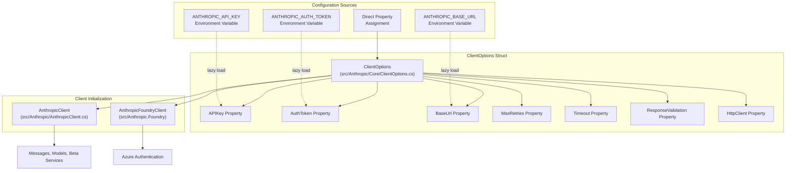
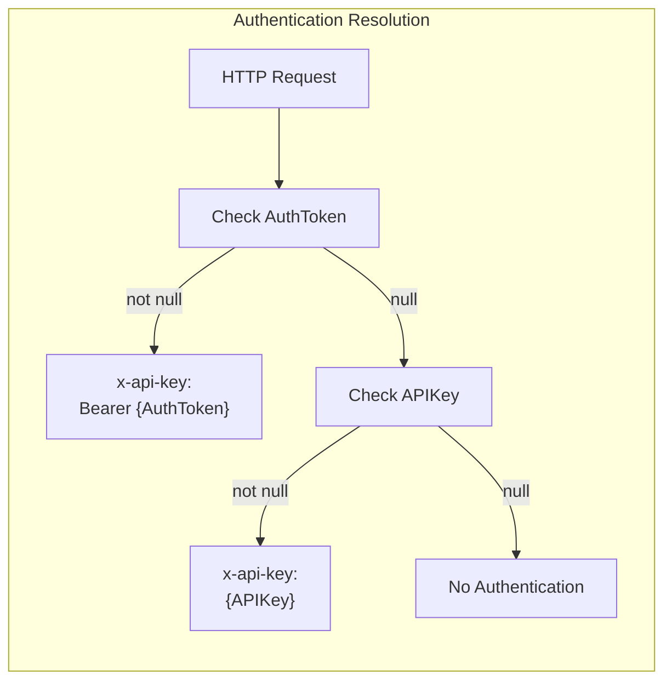
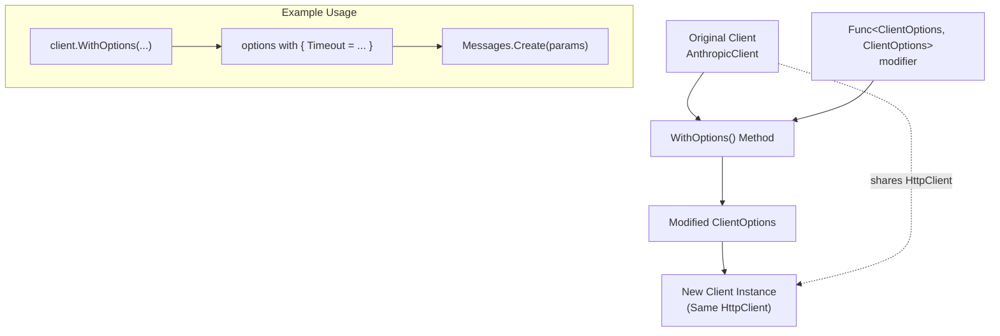
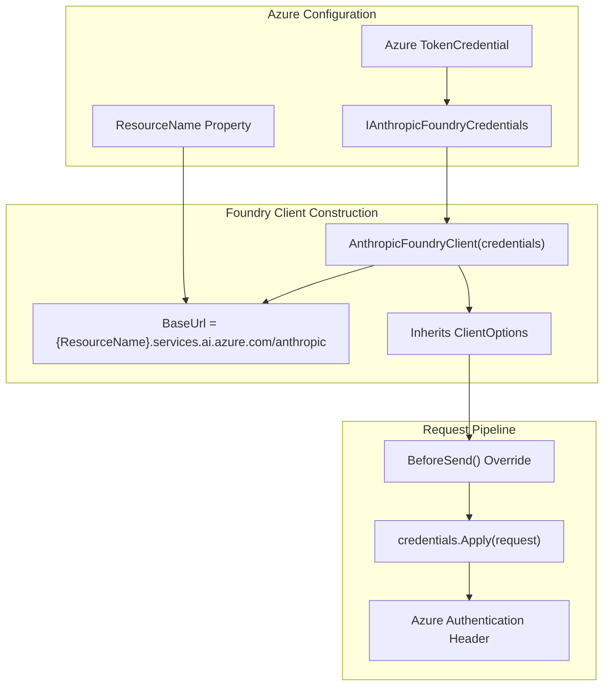
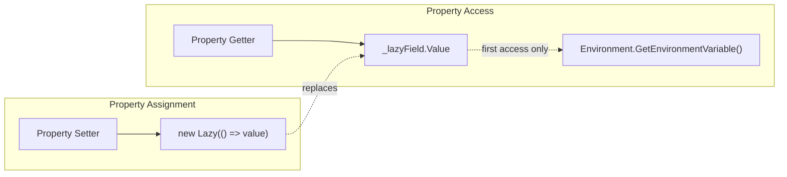

<!-- source: DeepWiki mcp.deepwiki.com · repo anthropics/anthropic-sdk-csharp · page 2.2 Configuration · fetched 2026-10-26 -->

# Configuration

<details>
<summary>Relevant source files</summary>

The following files were used as context for generating this wiki page:

- [.release-please-manifest.json](.release-please-manifest.json)
- [CHANGELOG.md](CHANGELOG.md)
- [README.md](README.md)
- [examples/ChatClientExample/ChatClientExample.csproj](examples/ChatClientExample/ChatClientExample.csproj)
- [release-please-config.json](release-please-config.json)
- [src/Anthropic.Foundry/Anthropic.Foundry.csproj](src/Anthropic.Foundry/Anthropic.Foundry.csproj)
- [src/Anthropic.Foundry/AnthropicFoundryClient.cs](src/Anthropic.Foundry/AnthropicFoundryClient.cs)
- [src/Anthropic.Foundry/CHANGELOG.md](src/Anthropic.Foundry/CHANGELOG.md)
- [src/Anthropic.Tests/TestBase.cs](src/Anthropic.Tests/TestBase.cs)
- [src/Anthropic/Anthropic.csproj](src/Anthropic/Anthropic.csproj)
- [src/Anthropic/AnthropicClient.cs](src/Anthropic/AnthropicClient.cs)
- [src/Anthropic/CHANGELOG.md](src/Anthropic/CHANGELOG.md)
- [src/Anthropic/Core/ClientOptions.cs](src/Anthropic/Core/ClientOptions.cs)
- [src/Anthropic/Core/EnvironmentUrl.cs](src/Anthropic/Core/EnvironmentUrl.cs)
- [src/Anthropic/IAnthropicClient.cs](src/Anthropic/IAnthropicClient.cs)
- [src/logo.png](src/logo.png)

</details>


This page documents how to configure the `AnthropicClient` and `AnthropicFoundryClient` instances, including environment variable support, direct property assignment, the `ClientOptions` structure, and the `WithOptions` pattern for temporary configuration changes. For information about using the configured client to make API calls, see [Quick Start Examples](#2.3). For Azure-specific deployment configuration, see [Azure Foundry Client](#8.3).

## Configuration Overview

The SDK provides three approaches to client configuration:

1. **Environment Variables**: Automatic resolution from system environment
2. **Direct Property Assignment**: Explicit initialization using object initializers
3. **Hybrid Approach**: Combination of environment variables with property overrides

Configuration is encapsulated in the `ClientOptions` struct and exposed through properties on `IAnthropicClient`.

**Configuration Flow Diagram**



Sources: [src/Anthropic/Core/ClientOptions.cs:1-97](), [src/Anthropic/AnthropicClient.cs:28-83](), [README.md:67-95]()

## Client Initialization Options

### Environment Variable Configuration

The SDK automatically resolves configuration from environment variables when no explicit values are provided:

```csharp
// Reads from ANTHROPIC_API_KEY, ANTHROPIC_AUTH_TOKEN, ANTHROPIC_BASE_URL
AnthropicClient client = new();
```

The `ClientOptions` struct uses `Lazy<T>` fields to defer environment variable resolution until first access:

| Property | Environment Variable | Required | Default Value |
|----------|---------------------|----------|---------------|
| `APIKey` | `ANTHROPIC_API_KEY` | false | null |
| `AuthToken` | `ANTHROPIC_AUTH_TOKEN` | false | null |
| `BaseUrl` | `ANTHROPIC_BASE_URL` | false | `EnvironmentUrl.Production`<br/>("https://api.anthropic.com") |

Sources: [README.md:69-76](), [src/Anthropic/Core/ClientOptions.cs:81-95](), [src/Anthropic/Core/EnvironmentUrl.cs:1-7]()

### Direct Property Assignment

Configuration can be explicitly set using object initializer syntax:

```csharp
AnthropicClient client = new() 
{ 
    APIKey = "my-anthropic-api-key",
    BaseUrl = "https://example.com",
    MaxRetries = 3,
    Timeout = TimeSpan.FromSeconds(30)
};
```

Sources: [README.md:78-84](), [src/Anthropic/AnthropicClient.cs:66-77]()

### Hybrid Configuration

Environment variables can be selectively overridden:

```csharp
// Uses ANTHROPIC_API_KEY and ANTHROPIC_AUTH_TOKEN from environment
// but overrides BaseUrl and Timeout
AnthropicClient client = new() 
{ 
    BaseUrl = "https://custom.endpoint.com",
    Timeout = TimeSpan.FromMinutes(5)
};
```

Sources: [README.md:86-95]()

## Configuration Properties

### Authentication Properties

**APIKey and AuthToken**



The SDK supports two authentication modes:
- **APIKey**: Direct API key authentication (most common)
- **AuthToken**: Bearer token authentication

Both properties are nullable and resolve from environment variables by default. The authentication header is constructed in the request parameter classes.

Sources: [src/Anthropic/Core/ClientOptions.cs:81-95](), [src/Anthropic/AnthropicClient.cs:66-77](), [README.md:90-94]()

### BaseUrl Property

The `BaseUrl` property determines the API endpoint:

**Default Resolution Order:**
1. Explicitly set value
2. `ANTHROPIC_BASE_URL` environment variable
3. `EnvironmentUrl.Production` constant ("https://api.anthropic.com")

The property uses a `Lazy<string>` field for deferred resolution:

```
ClientOptions._baseUrl: Lazy<string>
    └─> Environment.GetEnvironmentVariable("ANTHROPIC_BASE_URL") 
        ?? EnvironmentUrl.Production
```

Sources: [src/Anthropic/Core/ClientOptions.cs:26-39](), [src/Anthropic/IAnthropicClient.cs:29-34]()

### HttpClient Property

The `HttpClient` property allows reuse of existing HTTP connection pools:

**Default Behavior**: A new `HttpClient` instance is created if not provided.

**Custom HttpClient Usage:**
```csharp
using HttpClient sharedClient = new();
AnthropicClient client = new() { HttpClient = sharedClient };
```

**Important**: The client does NOT dispose the `HttpClient` if provided externally. When using the default client, disposal occurs when the `AnthropicClient` is disposed.

Sources: [src/Anthropic/Core/ClientOptions.cs:22-24](), [src/Anthropic/AnthropicClient.cs:31-35]()

### MaxRetries Property

Controls automatic retry behavior with exponential backoff:

**Default**: `2` (defined in `ClientOptions.DefaultMaxRetries`)

**Retried Error Types:**
- Connection errors (I/O failures)
- 408 Request Timeout
- 409 Conflict
- 429 Rate Limit
- 5xx server errors

**Set to `0`** to disable retries entirely, including API-instructed retries.

The retry logic is implemented in `AnthropicClient.Execute<T>()` with backoff calculation in `ComputeRetryBackoff()`:

```
backoff = min(0.5 * 2^(retries-1), 8.0) seconds
jitter = 1.0 - (0.25 * random)
actual_backoff = backoff * jitter
```

Sources: [src/Anthropic/Core/ClientOptions.cs:50-69](), [src/Anthropic/AnthropicClient.cs:104-156](), [src/Anthropic/AnthropicClient.cs:224-238](), [README.md:242-276]()

### Timeout Property

Sets the maximum duration for a single HTTP call (excluding retries):

**Default**: `TimeSpan.FromMinutes(10)` (defined in `ClientOptions.DefaultTimeout`)

The timeout applies to:
- DNS resolution
- Connection establishment
- Request body transmission
- Server processing
- Response body reading

Timeout enforcement uses `CancellationTokenSource` in `ExecuteOnce()`:

```
using CancellationTokenSource timeoutCts = new(Timeout ?? DefaultTimeout);
```

Sources: [src/Anthropic/Core/ClientOptions.cs:71-79](), [src/Anthropic/AnthropicClient.cs:197-199](), [README.md:278-303]()

### ResponseValidation Property

Controls upfront response validation:

**Default**: `false` (lazy validation)

When `false`:
- Validation occurs only when properties are accessed
- Missing required fields throw `AnthropicInvalidDataException` on access

When `true`:
- Full response shape is validated before returning
- Calls `Validate()` method on response models

**Explicit Validation:**
```csharp
var message = await client.Messages.Create(parameters);
message.Validate(); // Throws if response is malformed
```

Sources: [src/Anthropic/Core/ClientOptions.cs:41-48](), [src/Anthropic/IAnthropicClient.cs:36-43](), [README.md:309-342]()

## Configuration Properties Reference Table

| Property | Type | Default | Environment Variable | Nullable | Description |
|----------|------|---------|---------------------|----------|-------------|
| `APIKey` | `string?` | null | `ANTHROPIC_API_KEY` | Yes | API key for authentication |
| `AuthToken` | `string?` | null | `ANTHROPIC_AUTH_TOKEN` | Yes | Bearer token for authentication |
| `BaseUrl` | `string` | `EnvironmentUrl.Production` | `ANTHROPIC_BASE_URL` | No | API endpoint URL |
| `HttpClient` | `HttpClient` | new instance | - | No | HTTP client for requests |
| `MaxRetries` | `int?` | 2 | - | Yes | Maximum retry attempts |
| `Timeout` | `TimeSpan?` | 10 minutes | - | Yes | Per-request timeout |
| `ResponseValidation` | `bool` | false | - | No | Upfront validation flag |

Sources: [src/Anthropic/Core/ClientOptions.cs:9-96](), [src/Anthropic/IAnthropicClient.cs:22-78]()

## The WithOptions Pattern

The `WithOptions()` method creates a temporary client view with modified configuration while reusing connection and thread pools:

**WithOptions Execution Flow**



**Basic Usage:**

```csharp
var message = await client
    .WithOptions(options => options with 
    { 
        BaseUrl = "https://example.com",
        Timeout = TimeSpan.FromSeconds(42) 
    })
    .Messages.Create(parameters);
```

The pattern uses C# record-style `with` expressions for immutable updates. The original client remains unmodified.

**Implementation Details:**

The method is defined on `IAnthropicClient` and returns a new client instance:

```
IAnthropicClient WithOptions(Func<ClientOptions, ClientOptions> modifier)
    └─> new AnthropicClient(modifier(_options))
```

For `AnthropicFoundryClient`, the method preserves the Azure credentials:

```
IAnthropicClient WithOptions(...)
    └─> new AnthropicFoundryClient(_azureCredentials, modifier(_options))
```

Sources: [src/Anthropic/IAnthropicClient.cs:80-85](), [src/Anthropic/AnthropicClient.cs:80-83](), [src/Anthropic.Foundry/AnthropicFoundryClient.cs:49-52](), [README.md:96-119]()

## Azure Foundry Configuration

The `AnthropicFoundryClient` extends `AnthropicClient` with Azure-specific configuration:

**Foundry Configuration Architecture**



**Key Differences from Standard Client:**

1. **BaseUrl**: Automatically set to `https://{ResourceName}.services.ai.azure.com/anthropic`
2. **Authentication**: Uses Azure credentials instead of APIKey
3. **APIKey Property**: Throws `NotSupportedException` when accessed

**Initialization:**

```csharp
IAnthropicFoundryCredentials credentials = // ... (see Azure Foundry Client docs)
AnthropicFoundryClient client = new(credentials);
```

The `WithOptions()` method on `AnthropicFoundryClient` preserves the Azure credentials while modifying other options.

**APIKey Restriction:**

```csharp
[Obsolete("The APIKey property is not supported...", true)]
public override string? APIKey 
{
    get => throw new NotSupportedException(...);
    init => throw new NotSupportedException(...);
}
```

Sources: [src/Anthropic.Foundry/AnthropicFoundryClient.cs:1-65](), [src/Anthropic.Foundry/Anthropic.Foundry.csproj:1-21]()

## Configuration Resolution Implementation

The `ClientOptions` struct uses lazy initialization to defer environment variable resolution:

**Lazy Resolution Pattern**



**Example Implementation** (APIKey property):

```
Lazy<string?> _apiKey = new(() => Environment.GetEnvironmentVariable("ANTHROPIC_API_KEY"));

public string? APIKey
{
    readonly get { return _apiKey.Value; }  // Lazy evaluation
    set { _apiKey = new(() => value); }      // Replace lazy instance
}
```

This pattern ensures:
- Environment variables are read only when needed
- Explicit assignments bypass environment lookup
- Thread-safe lazy initialization via `Lazy<T>`

Sources: [src/Anthropic/Core/ClientOptions.cs:26-95]()

## Default Values Summary

| Configuration | Default Value | Source |
|--------------|---------------|--------|
| `MaxRetries` | 2 | `ClientOptions.DefaultMaxRetries` |
| `Timeout` | 10 minutes | `ClientOptions.DefaultTimeout` |
| `BaseUrl` | "https://api.anthropic.com" | `EnvironmentUrl.Production` |
| `HttpClient` | new instance | `new HttpClient()` |
| `ResponseValidation` | false | struct default |
| `APIKey` | null | environment or null |
| `AuthToken` | null | environment or null |

Sources: [src/Anthropic/Core/ClientOptions.cs:12-24](), [src/Anthropic/Core/EnvironmentUrl.cs:5]()

---

