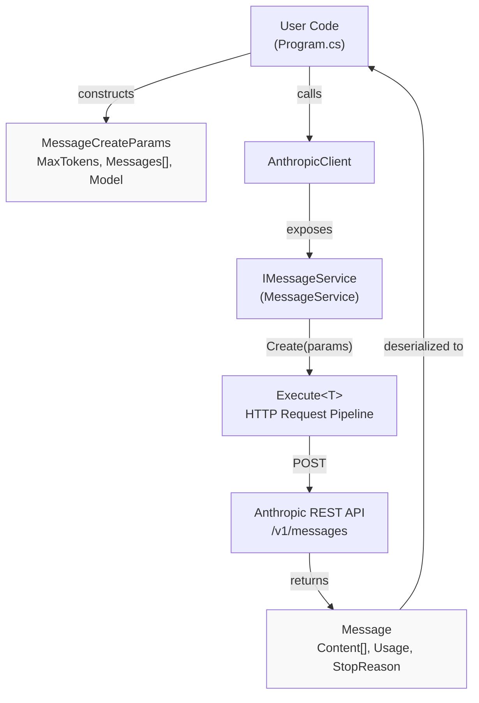
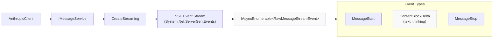
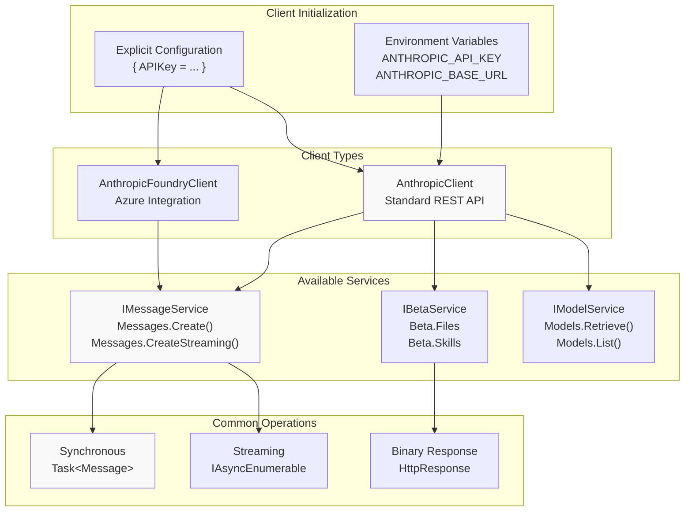

<!-- source: DeepWiki mcp.deepwiki.com · repo anthropics/anthropic-sdk-csharp · page 2.3 Quick Start Examples · fetched 2026-10-26 -->

# Quick Start Examples

<details>
<summary>Relevant source files</summary>

The following files were used as context for generating this wiki page:

- [README.md](README.md)
- [examples/MessagesExample/MessagesExample.csproj](examples/MessagesExample/MessagesExample.csproj)
- [examples/MessagesExample/Program.cs](examples/MessagesExample/Program.cs)
- [examples/MessagesStreamingExample/MessagesStreamingExample.csproj](examples/MessagesStreamingExample/MessagesStreamingExample.csproj)
- [examples/MessagesStreamingExample/Program.cs](examples/MessagesStreamingExample/Program.cs)
- [examples/ThinkingExample/Program.cs](examples/ThinkingExample/Program.cs)
- [examples/ThinkingExample/ThinkingExample.csproj](examples/ThinkingExample/ThinkingExample.csproj)
- [examples/ThinkingStreamingExample/Program.cs](examples/ThinkingStreamingExample/Program.cs)
- [examples/ThinkingStreamingExample/ThinkingStreamingExample.csproj](examples/ThinkingStreamingExample/ThinkingStreamingExample.csproj)
- [src/Anthropic.Foundry/AnthropicFoundryClient.cs](src/Anthropic.Foundry/AnthropicFoundryClient.cs)
- [src/Anthropic.Tests/TestBase.cs](src/Anthropic.Tests/TestBase.cs)
- [src/Anthropic/AnthropicClient.cs](src/Anthropic/AnthropicClient.cs)
- [src/Anthropic/Core/ClientOptions.cs](src/Anthropic/Core/ClientOptions.cs)
- [src/Anthropic/Core/EnvironmentUrl.cs](src/Anthropic/Core/EnvironmentUrl.cs)
- [src/Anthropic/IAnthropicClient.cs](src/Anthropic/IAnthropicClient.cs)

</details>


## Purpose and Scope

This page provides practical, runnable examples demonstrating the most common SDK operations. These examples show how to initialize clients, create messages, stream responses, and work with advanced features like thinking/reasoning.

For detailed configuration options, see [Configuration](#2.2). For comprehensive service documentation, see [API Services](#4). For tool usage patterns, see [Tools and Function Calling](#6).

## Client Initialization

### Standard Anthropic Client

The `AnthropicClient` can be initialized with environment variables or explicit configuration:

**Environment Variable Configuration** ([README.md:69-76]()):
```csharp
using Anthropic;

// Reads from ANTHROPIC_API_KEY, ANTHROPIC_AUTH_TOKEN, ANTHROPIC_BASE_URL
AnthropicClient client = new();
```

**Explicit Configuration** ([README.md:78-84]()):
```csharp
using Anthropic;

AnthropicClient client = new() { APIKey = "my-anthropic-api-key" };
```

### Azure Foundry Client

For Azure-hosted deployments, use `AnthropicFoundryClient` ([examples/MessagesExample/Program.cs:7-8]()):
```csharp
using Anthropic.Foundry;

AnthropicFoundryClient client = new(
    new AnthropicFoundryApiKeyCredentials("API-TOKEN", "RESOURCE-NAME")
);
```

**Sources:** [README.md:69-95](), [src/Anthropic/AnthropicClient.cs:321-335](), [src/Anthropic.Foundry/AnthropicFoundryClient.cs:10-22](), [examples/MessagesExample/Program.cs:5-8]()

---

## Basic Message Creation

### Simple Synchronous Request

The most common operation is creating a message with `IMessageService.Create`:

```csharp
using Anthropic;
using Anthropic.Models.Messages;

AnthropicClient client = new();

MessageCreateParams parameters = new()
{
    MaxTokens = 1024,
    Messages =
    [
        new()
        {
            Role = Role.User,
            Content = "Hello, Claude",
        },
    ],
    Model = Model.ClaudeOpus4_5_20251101,
};

var message = await client.Messages.Create(parameters);
Console.WriteLine(message);
```

**Key Components:**
- `MessageCreateParams`: Request parameter object containing model, messages, and configuration
- `Role.User`: Indicates the message sender (user vs assistant)
- `Model` enum: Type-safe model selection (see [Model Selection](#9.3))
- `IMessageService.Create`: Returns `Task<Message>` with the complete response

### Message Creation Flow



**Sources:** [README.md:41-65](), [examples/MessagesExample/Program.cs:10-30]()

### Extracting Response Content

Messages contain a `Content` array with typed blocks ([examples/MessagesExample/Program.cs:22-28]()):

```csharp
var message = string.Join(
    "",
    response
        .Content.Where(message => message.Value is TextBlock)
        .Select(message => message.Value as TextBlock)
        .Select((textBlock) => textBlock.Text)
);

Console.WriteLine(message);
```

For content block types and structure, see [Content Blocks](#5.3).

**Sources:** [examples/MessagesExample/Program.cs:10-31](), [README.md:41-65]()

---

## Streaming Responses

### Server-Sent Events (SSE) Streaming

Use `IMessageService.CreateStreaming` to process response chunks as they arrive:

```csharp
using Anthropic;
using Anthropic.Models.Messages;

AnthropicClient client = new();

MessageCreateParams parameters = new()
{
    MaxTokens = 2048,
    Messages =
    [
        new() { Content = "Tell me a story about building the best SDK!", Role = Role.User },
    ],
    Model = Model.Claude4Sonnet20250514,
};

IAsyncEnumerable<RawMessageStreamEvent> responseUpdates = 
    client.Messages.CreateStreaming(parameters);

await foreach (RawMessageStreamEvent rawEvent in responseUpdates)
{
    if (rawEvent.TryPickContentBlockDelta(out var delta) && 
        delta.Delta.TryPickText(out var text))
    {
        Console.Write(text.Text);
    }
}
```

**Key Components:**
- `IMessageService.CreateStreaming`: Returns `IAsyncEnumerable<RawMessageStreamEvent>`
- `RawMessageStreamEvent`: Discriminated union of event types (start, delta, stop, etc.)
- `TryPickContentBlockDelta`: Type-safe extraction of delta events
- `TryPickText`: Extracts text content from the delta

### Streaming Event Processing Flow



For detailed streaming documentation, see [Streaming Responses](#5.2).

**Sources:** [README.md:128-156](), [examples/MessagesStreamingExample/Program.cs:1-28]()

---

## Advanced Features

### Thinking and Reasoning

Enable extended reasoning with `ThinkingConfigEnabled`:

```csharp
using Anthropic;
using Anthropic.Models.Messages;

AnthropicClient client = new();

MessageCreateParams parameters = new()
{
    MaxTokens = 2048,
    Messages =
    [
        new() { Content = "Tell me a story about building the best SDK!", Role = Role.User },
    ],
    Model = Model.Claude4Sonnet20250514,
    Thinking = new ThinkingConfigEnabled() { BudgetTokens = 1024 },
};

var response = await client.Messages.Create(parameters);

foreach (ContentBlock block in response.Content)
{
    if (block.TryPickThinking(out ThinkingBlock? thinking))
    {
        Console.WriteLine($"Thinking: {thinking.Thinking}");
    }
    else if (block.TryPickText(out TextBlock? text))
    {
        Console.WriteLine($"Text: {text.Text}");
    }
}
```

**Key Components:**
- `ThinkingConfigEnabled`: Enables thinking with token budget allocation
- `ThinkingBlock`: Contains the model's reasoning process
- `TryPickThinking`: Type-safe extraction of thinking content blocks

### Thinking Stream Processing

For streaming thinking content ([examples/ThinkingStreamingExample/Program.cs:22-35]()):

```csharp
await foreach (RawMessageStreamEvent rawEvent in responseUpdates)
{
    if (rawEvent.TryPickContentBlockDelta(out var delta))
    {
        if (delta.Delta.TryPickThinking(out var thinkingDelta))
        {
            Console.Write(thinkingDelta.Thinking);
        }
        else if (delta.Delta.TryPickText(out var textDelta))
        {
            Console.Write(textDelta.Text);
        }
    }
}
```

For comprehensive thinking documentation, see [Thinking and Reasoning](#7.2).

**Sources:** [examples/ThinkingExample/Program.cs:1-38](), [examples/ThinkingStreamingExample/Program.cs:1-36]()

---

## Configuration Modification

### Temporary Option Changes

Use `WithOptions` to create a modified client view without affecting the original:

```csharp
using System;

var message = await client
    .WithOptions(options =>
        options with
        {
            BaseUrl = "https://example.com",
            Timeout = TimeSpan.FromSeconds(42),
        }
    )
    .Messages.Create(parameters);

Console.WriteLine(message);
```

**Key Properties:**
- `BaseUrl`: Override the API endpoint
- `Timeout`: Custom timeout per request
- `MaxRetries`: Retry configuration

The `WithOptions` method returns a new `IAnthropicClient` instance without modifying the original ([src/Anthropic/AnthropicClient.cs:80-83]()).

### Configuration Options Mapping

| Parameter | Type | Purpose | Default |
|-----------|------|---------|---------|
| `BaseUrl` | `string` | API endpoint URL | `https://api.anthropic.com` |
| `Timeout` | `TimeSpan?` | Request timeout | 10 minutes |
| `MaxRetries` | `int?` | Retry attempts | 2 |
| `ResponseValidation` | `bool` | Upfront validation | `false` |
| `APIKey` | `string?` | Authentication key | From `ANTHROPIC_API_KEY` |
| `AuthToken` | `string?` | Bearer token | From `ANTHROPIC_AUTH_TOKEN` |

For complete configuration details, see [Configuration](#2.2).

**Sources:** [README.md:96-118](), [src/Anthropic/IAnthropicClient.cs:80-85](), [src/Anthropic/Core/ClientOptions.cs:9-96]()

---

## Client Architecture Overview



**Sources:** [src/Anthropic/AnthropicClient.cs:15-335](), [src/Anthropic/IAnthropicClient.cs:22-101](), [src/Anthropic.Foundry/AnthropicFoundryClient.cs:8-64]()

---

## Key Type References

### Core Client Types

| Type | Location | Purpose |
|------|----------|---------|
| `AnthropicClient` | [src/Anthropic/AnthropicClient.cs:15]() | Main SDK client implementation |
| `IAnthropicClient` | [src/Anthropic/IAnthropicClient.cs:22]() | Client interface for abstraction |
| `AnthropicFoundryClient` | [src/Anthropic.Foundry/AnthropicFoundryClient.cs:8]() | Azure-specific client |
| `ClientOptions` | [src/Anthropic/Core/ClientOptions.cs:9]() | Configuration structure |

### Message Types

| Type | Purpose | Usage |
|------|---------|-------|
| `MessageCreateParams` | Request parameters | Input to `Create` and `CreateStreaming` |
| `Message` | Complete response | Returned by `Create` method |
| `RawMessageStreamEvent` | Stream event | Yielded by `CreateStreaming` method |
| `ContentBlock` | Response content | Union of text, thinking, tool use, etc. |
| `TextBlock` | Text content | Extracted via `TryPickText` |
| `ThinkingBlock` | Reasoning content | Extracted via `TryPickThinking` |

### Service Interfaces

| Interface | Exposed By | Methods |
|-----------|------------|---------|
| `IMessageService` | `client.Messages` | `Create`, `CreateStreaming`, `CountTokens` |
| `IModelService` | `client.Models` | `Retrieve`, `List` |
| `IBetaService` | `client.Beta` | Access to beta features |

**Sources:** [src/Anthropic/AnthropicClient.cs:85-101](), [src/Anthropic/IAnthropicClient.cs:87-91]()

---

## Example Project Structure

The SDK includes runnable examples in the `examples/` directory:

| Example | Project File | Demonstrates |
|---------|--------------|-------------|
| `MessagesExample` | [examples/MessagesExample/MessagesExample.csproj:1-12]() | Basic message creation |
| `MessagesStreamingExample` | [examples/MessagesStreamingExample/MessagesStreamingExample.csproj:1-11]() | SSE streaming |
| `ThinkingExample` | [examples/ThinkingExample/ThinkingExample.csproj:1-11]() | Extended reasoning (sync) |
| `ThinkingStreamingExample` | [examples/ThinkingStreamingExample/ThinkingStreamingExample.csproj:1-11]() | Extended reasoning (stream) |

All examples target .NET 8.0 and reference the SDK projects directly.

**Sources:** [examples/MessagesExample/MessagesExample.csproj:1-12](), [examples/MessagesStreamingExample/MessagesStreamingExample.csproj:1-11](), [examples/ThinkingExample/ThinkingExample.csproj:1-11](), [examples/ThinkingStreamingExample/ThinkingStreamingExample.csproj:1-11]()

---

