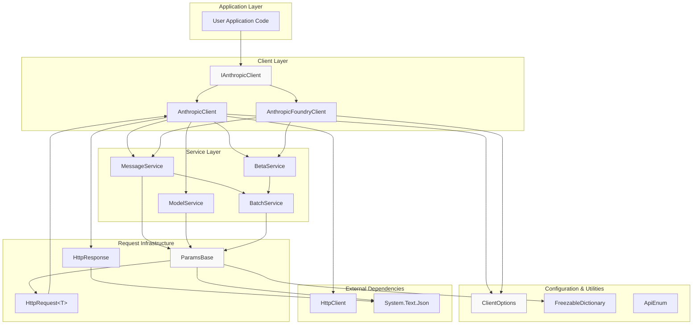
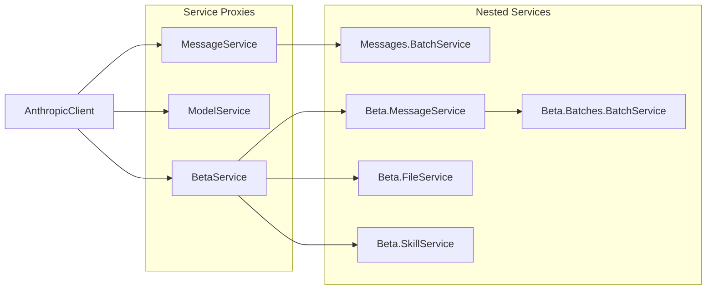
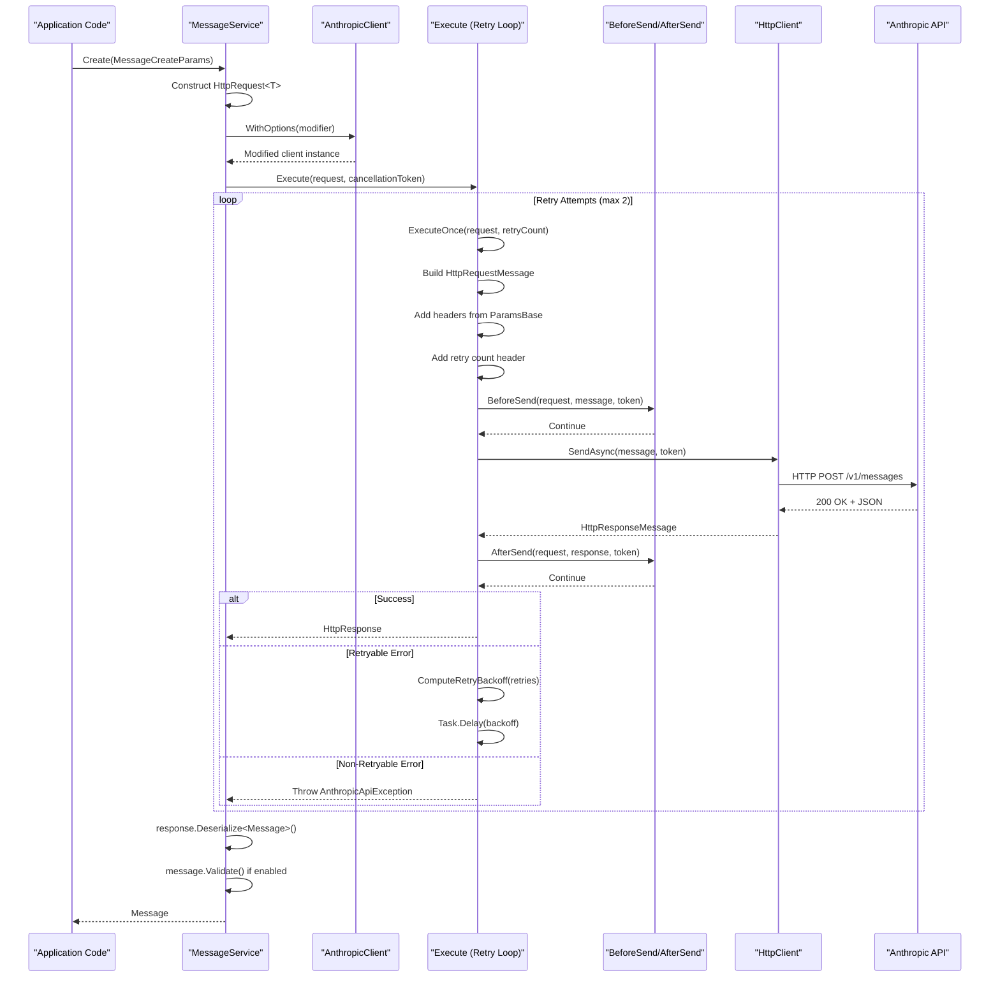
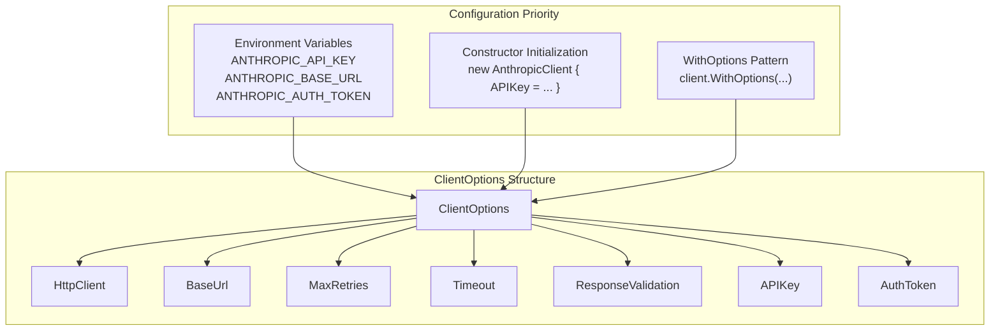

<!-- source: DeepWiki mcp.deepwiki.com · repo anthropics/anthropic-sdk-csharp · page 3 Core Architecture · fetched 2026-10-26 -->

# Core Architecture

<details>
<summary>Relevant source files</summary>

The following files were used as context for generating this wiki page:

- [README.md](README.md)
- [src/Anthropic.Foundry/AnthropicFoundryClient.cs](src/Anthropic.Foundry/AnthropicFoundryClient.cs)
- [src/Anthropic.Tests/TestBase.cs](src/Anthropic.Tests/TestBase.cs)
- [src/Anthropic/AnthropicClient.cs](src/Anthropic/AnthropicClient.cs)
- [src/Anthropic/Core/ApiEnum.cs](src/Anthropic/Core/ApiEnum.cs)
- [src/Anthropic/Core/ClientOptions.cs](src/Anthropic/Core/ClientOptions.cs)
- [src/Anthropic/Core/EnvironmentUrl.cs](src/Anthropic/Core/EnvironmentUrl.cs)
- [src/Anthropic/Core/FreezableDictionary.cs](src/Anthropic/Core/FreezableDictionary.cs)
- [src/Anthropic/Core/HttpResponse.cs](src/Anthropic/Core/HttpResponse.cs)
- [src/Anthropic/Core/ParamsBase.cs](src/Anthropic/Core/ParamsBase.cs)
- [src/Anthropic/IAnthropicClient.cs](src/Anthropic/IAnthropicClient.cs)
- [src/Anthropic/Services/Beta/MessageService.cs](src/Anthropic/Services/Beta/MessageService.cs)
- [src/Anthropic/Services/MessageService.cs](src/Anthropic/Services/MessageService.cs)

</details>


This document describes the internal architecture of the Anthropic C# SDK, including the client layer, service layer, request/response processing pipeline, and core infrastructure types. The architecture is organized into distinct layers with clear separation of concerns, enabling robust HTTP communication, automatic retry logic, and type-safe API interactions.

For information about specific API services (Messages, Batches, Models), see [API Services](#4). For details on data model infrastructure and type system, see [Data Models Reference](#9). For integration with external systems like Microsoft.Extensions.AI and Azure, see [Ecosystem Integration](#8).

## Architecture Overview

The SDK follows a layered architecture pattern with the following primary components:



**Sources:** [src/Anthropic/AnthropicClient.cs](), [src/Anthropic/IAnthropicClient.cs](), [src/Anthropic.Foundry/AnthropicFoundryClient.cs](), [src/Anthropic/Services/MessageService.cs]()

## Core Components

### Client Layer

The client layer provides the primary interface for interacting with the Anthropic API. It consists of three main types:

| Type | Purpose | Key Features |
|------|---------|--------------|
| `IAnthropicClient` | Interface defining the client contract | Exposes service properties, `Execute` method, `WithOptions` pattern |
| `AnthropicClient` | Standard implementation for Anthropic API | HTTP execution, retry logic, timeout management, service initialization |
| `AnthropicFoundryClient` | Azure-specialized implementation | Azure authentication, custom base URL construction, credential management |

The `IAnthropicClient` interface [src/Anthropic/IAnthropicClient.cs:22-101]() defines the contract with properties for configuration (`BaseUrl`, `MaxRetries`, `Timeout`, `ResponseValidation`) and service accessors (`Messages`, `Models`, `Beta`). It also declares the `Execute<T>` method [src/Anthropic/IAnthropicClient.cs:96-100]() which is the core request execution method.

`AnthropicClient` [src/Anthropic/AnthropicClient.cs:15-335]() implements this interface and manages:
- HTTP client lifecycle [src/Anthropic/AnthropicClient.cs:31-35]()
- Configuration through `ClientOptions` [src/Anthropic/AnthropicClient.cs:28]()
- Lazy initialization of services [src/Anthropic/AnthropicClient.cs:85-101]()
- Request execution with retry logic [src/Anthropic/AnthropicClient.cs:104-156]()

`AnthropicFoundryClient` [src/Anthropic.Foundry/AnthropicFoundryClient.cs:8-64]() extends `AnthropicClient` to provide Azure-specific functionality:
- Accepts `IAnthropicFoundryCredentials` for authentication [src/Anthropic.Foundry/AnthropicFoundryClient.cs:17-22]()
- Constructs Azure-specific base URLs [src/Anthropic.Foundry/AnthropicFoundryClient.cs:21]()
- Injects credentials into requests via `BeforeSend` hook [src/Anthropic.Foundry/AnthropicFoundryClient.cs:54-63]()

**Sources:** [src/Anthropic/IAnthropicClient.cs](), [src/Anthropic/AnthropicClient.cs](), [src/Anthropic.Foundry/AnthropicFoundryClient.cs]()

### Service Layer

Services act as proxies between the client and API endpoints, encapsulating specific API functionality:



Each service:
- Holds a reference to the parent `IAnthropicClient` [src/Anthropic/Services/MessageService.cs:24]()
- Constructs appropriate `ParamsBase` instances for requests
- Calls `client.Execute<T>()` to send requests [src/Anthropic/Services/MessageService.cs:49-62]()
- Deserializes responses using `HttpResponse.Deserialize<T>()` [src/Anthropic/Services/MessageService.cs:58]()
- Supports `WithOptions` pattern for per-request configuration [src/Anthropic/Services/MessageService.cs:19-22]()

Services are lazily initialized [src/Anthropic/AnthropicClient.cs:325-327]() to minimize overhead when only specific API functionality is needed.

**Sources:** [src/Anthropic/AnthropicClient.cs:85-101](), [src/Anthropic/Services/MessageService.cs](), [src/Anthropic/Services/Beta/MessageService.cs]()

### Request and Response Infrastructure

The request/response infrastructure handles HTTP communication and data transformation:

| Type | Purpose | Location |
|------|---------|----------|
| `ParamsBase` | Abstract base for all request parameters | [src/Anthropic/Core/ParamsBase.cs]() |
| `HttpRequest<T>` | Container for HTTP method and parameters | [src/Anthropic/Core/HttpRequest.cs]() |
| `HttpResponse` | Wrapper around `HttpResponseMessage` with deserialization | [src/Anthropic/Core/HttpResponse.cs]() |
| `ClientOptions` | Configuration struct for client behavior | [src/Anthropic/Core/ClientOptions.cs]() |

**ParamsBase** [src/Anthropic/Core/ParamsBase.cs:14-276]() is the abstract base class for all request parameters. It:
- Stores query and header data in `FreezableDictionary<string, JsonElement>` [src/Anthropic/Core/ParamsBase.cs:34-36]()
- Defines abstract `Url(ClientOptions)` method for URL construction [src/Anthropic/Core/ParamsBase.cs:54]()
- Provides `BodyContent()` for HTTP body generation [src/Anthropic/Core/ParamsBase.cs:188-191]()
- Adds default headers including API keys and user-agent [src/Anthropic/Core/ParamsBase.cs:193-212]()
- Contains static methods for query string and header serialization [src/Anthropic/Core/ParamsBase.cs:56-184]()

**HttpResponse** [src/Anthropic/Core/HttpResponse.cs:11-67]() wraps `HttpResponseMessage` and provides:
- Async deserialization to typed objects [src/Anthropic/Core/HttpResponse.cs:17-38]()
- Stream access for binary responses [src/Anthropic/Core/HttpResponse.cs:40-51]()
- String content reading [src/Anthropic/Core/HttpResponse.cs:53-64]()
- Cancellation token propagation [src/Anthropic/Core/HttpResponse.cs:15]()

**ClientOptions** [src/Anthropic/Core/ClientOptions.cs:9-96]() is a struct containing:
- `HttpClient` instance [src/Anthropic/Core/ClientOptions.cs:24]()
- `BaseUrl` (defaults to environment variable or production URL) [src/Anthropic/Core/ClientOptions.cs:26-39]()
- `MaxRetries` and `Timeout` settings [src/Anthropic/Core/ClientOptions.cs:69,79]()
- `APIKey` and `AuthToken` credentials [src/Anthropic/Core/ClientOptions.cs:81-95]()
- `ResponseValidation` flag [src/Anthropic/Core/ClientOptions.cs:48]()

**Sources:** [src/Anthropic/Core/ParamsBase.cs](), [src/Anthropic/Core/HttpResponse.cs](), [src/Anthropic/Core/ClientOptions.cs]()

### Supporting Types

**FreezableDictionary<K, V>** [src/Anthropic/Core/FreezableDictionary.cs:16-166]() is a specialized dictionary that:
- Allows mutation during initialization [src/Anthropic/Core/FreezableDictionary.cs:66-99]()
- Can be frozen to prevent further changes [src/Anthropic/Core/FreezableDictionary.cs:52-63]()
- Throws `InvalidOperationException` on mutation after freezing [src/Anthropic/Core/FreezableDictionary.cs:30]()
- Used for request parameters to ensure immutability after creation

**ApiEnum<TRaw, TEnum>** [src/Anthropic/Core/ApiEnum.cs:24-88]() wraps enum values to handle:
- Unknown enum values from newer API versions [src/Anthropic/Core/ApiEnum.cs:28-37]()
- Safe deserialization with `Raw()` and `Value()` accessors [src/Anthropic/Core/ApiEnum.cs:39-52]()
- Validation that throws `AnthropicInvalidDataException` for invalid values [src/Anthropic/Core/ApiEnum.cs:61-67]()
- Implicit conversion operators for ergonomic usage [src/Anthropic/Core/ApiEnum.cs:79-87]()

**Sources:** [src/Anthropic/Core/FreezableDictionary.cs](), [src/Anthropic/Core/ApiEnum.cs]()

## Request Execution Flow

The following diagram illustrates how a request flows through the SDK from service call to HTTP response:



**Sources:** [src/Anthropic/AnthropicClient.cs:104-156](), [src/Anthropic/AnthropicClient.cs:178-222](), [src/Anthropic/Services/MessageService.cs:39-64]()

### Retry Logic

The `Execute` method [src/Anthropic/AnthropicClient.cs:104-156]() implements retry logic with exponential backoff:

1. **Retry Conditions** [src/Anthropic/AnthropicClient.cs:280-313]():
   - Connection errors (IOException, AnthropicIOException)
   - 408 Request Timeout
   - 409 Conflict  
   - 429 Rate Limit
   - 5xx server errors

2. **Backoff Calculation** [src/Anthropic/AnthropicClient.cs:224-238]():
   - Checks for `Retry-After-Ms` or `Retry-After` headers [src/Anthropic/AnthropicClient.cs:240-278]()
   - Falls back to exponential backoff: `0.5 * 2^(retries-1)` seconds, capped at 8 seconds
   - Applies jitter: multiplies by random factor between 0.75 and 1.0

3. **Retry Count**: Defaults to 2 retries [src/Anthropic/Core/ClientOptions.cs:14](), configurable via `MaxRetries`

**Sources:** [src/Anthropic/AnthropicClient.cs:104-156](), [src/Anthropic/AnthropicClient.cs:224-313]()

## Client Configuration and Options

The SDK supports flexible configuration through multiple mechanisms:

### Configuration Sources



**Environment Variables** [src/Anthropic/Core/ClientOptions.cs:26-95]():
- `ANTHROPIC_BASE_URL` → `BaseUrl` (default: `"https://api.anthropic.com"`)
- `ANTHROPIC_API_KEY` → `APIKey`
- `ANTHROPIC_AUTH_TOKEN` → `AuthToken`

**Constructor Initialization** [src/Anthropic/AnthropicClient.cs:321-334]():
```csharp
AnthropicClient client = new() 
{ 
    APIKey = "my-api-key",
    MaxRetries = 3,
    Timeout = TimeSpan.FromSeconds(30)
};
```

**WithOptions Pattern** [src/Anthropic/AnthropicClient.cs:80-83]():
Creates a new client instance with modified options while reusing HTTP connection pools:
```csharp
var response = await client
    .WithOptions(options => options with { Timeout = TimeSpan.FromSeconds(42) })
    .Messages.Create(parameters);
```

The `WithOptions` pattern is implemented at both the client level [src/Anthropic/AnthropicClient.cs:80-83]() and service level [src/Anthropic/Services/MessageService.cs:19-22](), allowing configuration changes to be scoped to specific operations.

**Sources:** [src/Anthropic/Core/ClientOptions.cs](), [src/Anthropic/AnthropicClient.cs:80-83](), [README.md:96-119]()

## Client Lifecycle Hooks

`AnthropicClient` provides virtual hook methods for request/response interception:

- **BeforeSend** [src/Anthropic/AnthropicClient.cs:158-166](): Called before sending each HTTP request, allowing modification of `HttpRequestMessage`
- **AfterSend** [src/Anthropic/AnthropicClient.cs:168-176](): Called after receiving each HTTP response, allowing inspection of `HttpResponseMessage`

`AnthropicFoundryClient` uses `BeforeSend` to inject Azure credentials [src/Anthropic.Foundry/AnthropicFoundryClient.cs:54-63]():
```csharp
protected override ValueTask BeforeSend<T>(
    HttpRequest<T> request,
    HttpRequestMessage requestMessage,
    CancellationToken cancellationToken)
{
    _azureCredentials.Apply(requestMessage);
    return default;
}
```

These hooks enable extending the client for custom authentication schemes, logging, or telemetry without modifying core execution logic.

**Sources:** [src/Anthropic/AnthropicClient.cs:158-176](), [src/Anthropic.Foundry/AnthropicFoundryClient.cs:54-63]()

## Thread Safety and Instance Reuse

The architecture is designed for singleton client instances:

- `HttpClient` connection pooling benefits from reuse [src/Anthropic/IAnthropicClient.cs:13-16]()
- Services are lazily initialized and cached [src/Anthropic/AnthropicClient.cs:85-101]()
- `ClientOptions` uses `Lazy<T>` for thread-safe initialization [src/Anthropic/Core/ClientOptions.cs:26-95]()
- `FreezableDictionary` prevents mutation after initialization [src/Anthropic/Core/FreezableDictionary.cs:46-63]()

**Sources:** [src/Anthropic/IAnthropicClient.cs:13-16](), [src/Anthropic/AnthropicClient.cs:85-101](), [src/Anthropic/Core/ClientOptions.cs]()

---

