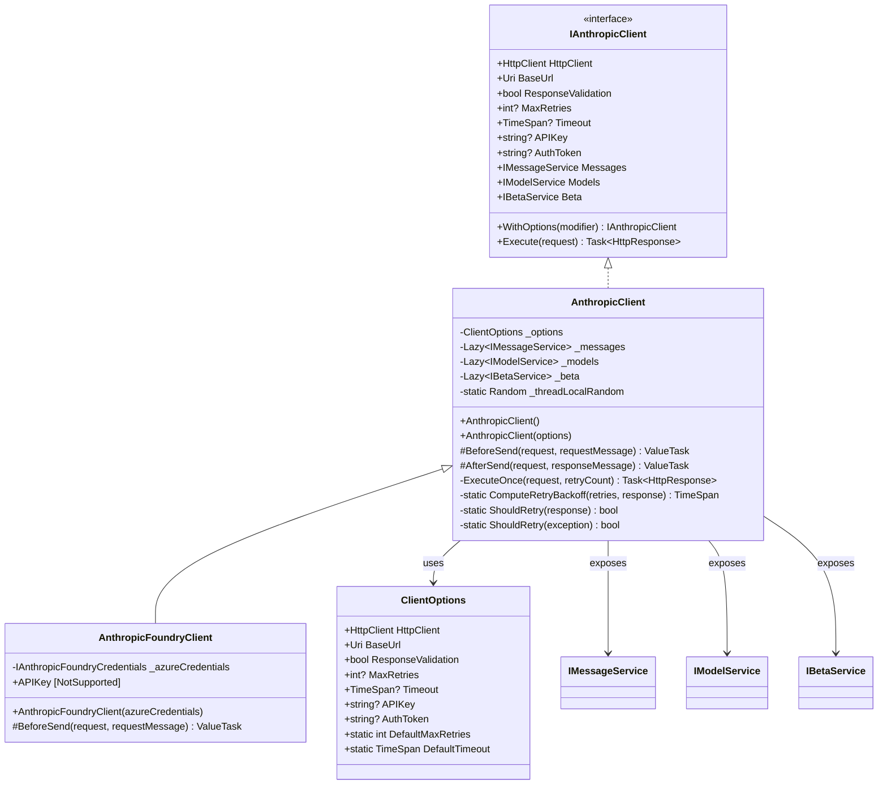
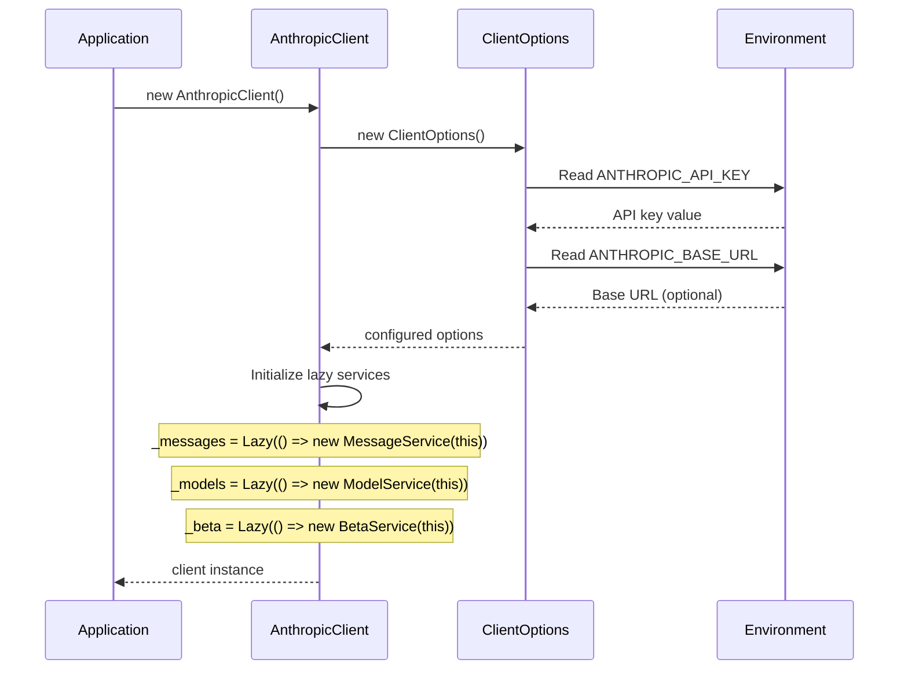
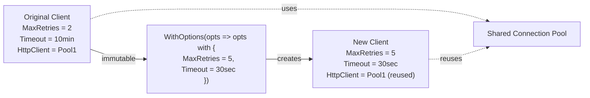
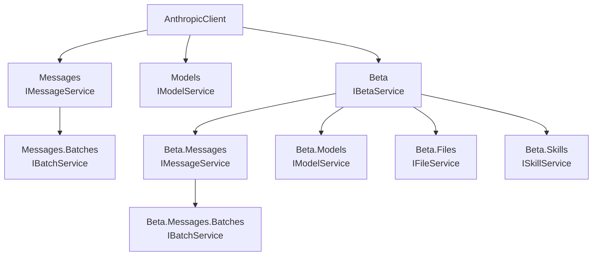
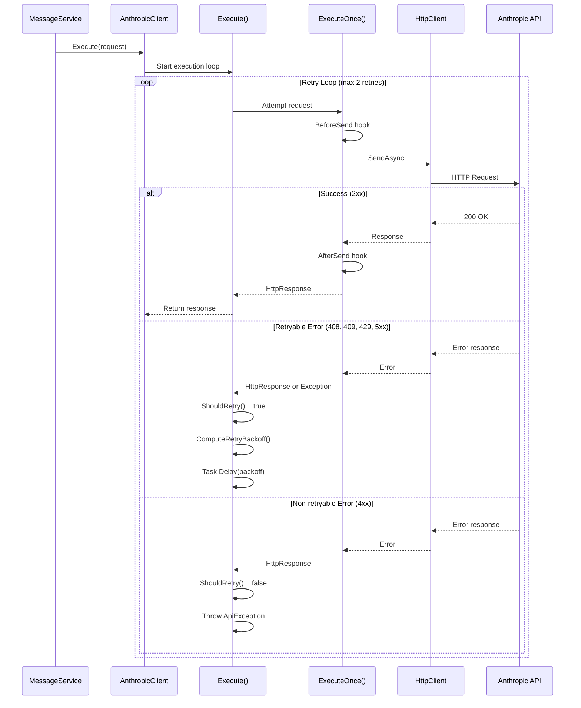
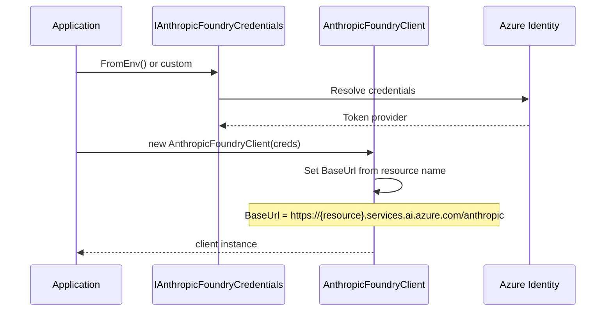
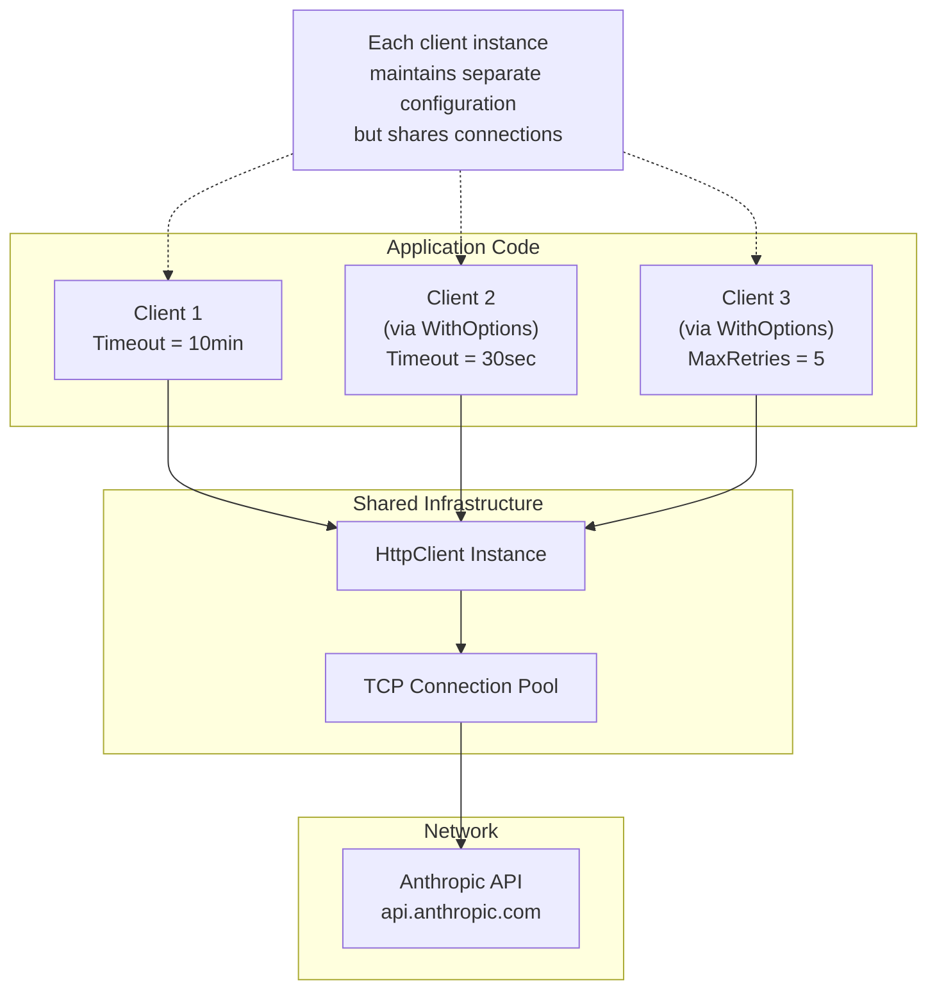

<!-- source: DeepWiki mcp.deepwiki.com · repo anthropics/anthropic-sdk-csharp · page 3.1 Client Layer · fetched 2026-10-26 -->

# Client Layer

<details>
<summary>Relevant source files</summary>

The following files were used as context for generating this wiki page:

- [README.md](README.md)
- [src/Anthropic.Foundry/AnthropicFoundryClient.cs](src/Anthropic.Foundry/AnthropicFoundryClient.cs)
- [src/Anthropic.Tests/TestBase.cs](src/Anthropic.Tests/TestBase.cs)
- [src/Anthropic/AnthropicClient.cs](src/Anthropic/AnthropicClient.cs)
- [src/Anthropic/Core/ClientOptions.cs](src/Anthropic/Core/ClientOptions.cs)
- [src/Anthropic/Core/EnvironmentUrl.cs](src/Anthropic/Core/EnvironmentUrl.cs)
- [src/Anthropic/IAnthropicClient.cs](src/Anthropic/IAnthropicClient.cs)

</details>


## Purpose and Scope

The Client Layer provides the primary entry point for interacting with the Anthropic REST API. It manages HTTP communication, authentication, retry logic, and exposes service interfaces for API operations. This document covers `AnthropicClient`, `AnthropicFoundryClient`, client configuration patterns, and the request execution pipeline.

For information about the services exposed by clients (Messages, Models, Beta), see [Service Layer](#3.2). For details on request/response processing, see [Request and Response Flow](#3.3).

---

## Client Architecture



**Sources:** [src/Anthropic/IAnthropicClient.cs:10-101](), [src/Anthropic/AnthropicClient.cs:15-325](), [src/Anthropic.Foundry/AnthropicFoundryClient.cs:8-65]()

---

## Core Client Classes

### AnthropicClient

The `AnthropicClient` class is the primary implementation of `IAnthropicClient`. It manages HTTP communication with the Anthropic API, including authentication, retry logic, and connection pooling.

**Key Characteristics:**

| Property | Type | Description |
|----------|------|-------------|
| `HttpClient` | `HttpClient` | The underlying HTTP client (reusable across instances) |
| `BaseUrl` | `Uri` | API base URL (default: https://api.anthropic.com) |
| `ResponseValidation` | `bool` | Whether to validate response schemas upfront |
| `MaxRetries` | `int?` | Maximum retry attempts (default: 2) |
| `Timeout` | `TimeSpan?` | Request timeout (default: 10 minutes) |
| `APIKey` | `string?` | Anthropic API key (from `ANTHROPIC_API_KEY` env var) |
| `AuthToken` | `string?` | Bearer token for authentication |

**Sources:** [src/Anthropic/AnthropicClient.cs:24-73](), [src/Anthropic/IAnthropicClient.cs:24-78]()

### IAnthropicClient Interface

`IAnthropicClient` defines the contract for all client implementations. It exposes configuration properties, service access points, and the core `Execute` method for HTTP requests.

**Important Note:** The interface documentation warns against external inheritance:
> "Do not inherit from this type outside the SDK unless you're okay with breaking changes in non-major versions."

**Sources:** [src/Anthropic/IAnthropicClient.cs:10-101]()

### AnthropicFoundryClient

`AnthropicFoundryClient` extends `AnthropicClient` for Azure-hosted Anthropic API deployments. It uses Azure credentials instead of API keys and automatically configures the base URL from Azure resource information.

**Key Differences:**
- Uses `IAnthropicFoundryCredentials` instead of API keys
- Base URL format: `https://{resourceName}.services.ai.azure.com/anthropic`
- `APIKey` property throws `NotSupportedException`
- Applies Azure authentication in `BeforeSend` hook

**Sources:** [src/Anthropic.Foundry/AnthropicFoundryClient.cs:8-65]()

---

## Client Initialization



**Sources:** [src/Anthropic/AnthropicClient.cs:311-324]()

### Default Constructor

The parameterless constructor creates a client with default options:

```csharp
// AnthropicClient.cs:311-318
public AnthropicClient()
{
    _options = new();
    
    _messages = new(() => new MessageService(this));
    _models = new(() => new ModelService(this));
    _beta = new(() => new BetaService(this));
}
```

`ClientOptions` automatically loads configuration from environment variables:
- `ANTHROPIC_API_KEY` → `APIKey`
- `ANTHROPIC_BASE_URL` → `BaseUrl`

**Sources:** [src/Anthropic/AnthropicClient.cs:311-318]()

### Explicit Configuration Constructor

For explicit configuration, use the constructor that accepts `ClientOptions`:

```csharp
// AnthropicClient.cs:320-324
public AnthropicClient(ClientOptions options)
    : this()
{
    _options = options;
}
```

This allows programmatic configuration while preserving the lazy service initialization.

**Sources:** [src/Anthropic/AnthropicClient.cs:320-324]()

---

## The WithOptions Pattern

The `WithOptions` method enables immutable configuration changes while reusing connection pools. This is critical for performance, as creating new `HttpClient` instances for each configuration change would exhaust system resources.



**Implementation:**

```csharp
// AnthropicClient.cs:76-79
public virtual IAnthropicClient WithOptions(Func<ClientOptions, ClientOptions> modifier)
{
    return new AnthropicClient(modifier(this._options));
}
```

**Usage Example:**

```csharp
var client = new AnthropicClient();

// Create a new client with custom timeout (reuses HttpClient)
var customClient = client.WithOptions(opts => opts with 
{ 
    Timeout = TimeSpan.FromSeconds(30) 
});
```

**Sources:** [src/Anthropic/AnthropicClient.cs:76-79]()

---

## Service Access

The client exposes three main service interfaces through lazy-loaded properties:



**Property Implementations:**

| Service | Property | Lazy Initialization |
|---------|----------|---------------------|
| `IMessageService` | `Messages` | `new(() => new MessageService(this))` |
| `IModelService` | `Models` | `new(() => new ModelService(this))` |
| `IBetaService` | `Beta` | `new(() => new BetaService(this))` |

Each service is initialized only when first accessed, reducing startup overhead.

**Sources:** [src/Anthropic/AnthropicClient.cs:81-97](), [src/Anthropic/AnthropicClient.cs:315-317]()

---

## HTTP Request Execution Pipeline

The `Execute` method orchestrates the complete request lifecycle, including retries and error handling.



**Sources:** [src/Anthropic/AnthropicClient.cs:100-152]()

### Execute Method

The `Execute` method handles the complete request lifecycle with automatic retries:

```csharp
// AnthropicClient.cs:100-152 (simplified)
public async Task<HttpResponse> Execute<T>(
    HttpRequest<T> request,
    CancellationToken cancellationToken = default)
    where T : ParamsBase
{
    var maxRetries = this.MaxRetries ?? ClientOptions.DefaultMaxRetries;
    var retries = 0;
    
    while (true)
    {
        HttpResponse? response = null;
        try
        {
            response = await ExecuteOnce(request, retries, cancellationToken);
        }
        catch (Exception e)
        {
            if (++retries > maxRetries || !ShouldRetry(e))
                throw;
        }
        
        if (response != null && (++retries > maxRetries || !ShouldRetry(response)))
        {
            if (response.Message.IsSuccessStatusCode)
                return response;
            
            throw AnthropicExceptionFactory.CreateApiException(
                response.Message.StatusCode,
                await response.ReadAsString(cancellationToken));
        }
        
        var backoff = ComputeRetryBackoff(retries, response);
        response?.Dispose();
        await Task.Delay(backoff, cancellationToken);
    }
}
```

**Sources:** [src/Anthropic/AnthropicClient.cs:100-152]()

### Retry Logic

The client automatically retries requests for transient errors with exponential backoff.

**Retryable Status Codes:**

| Status Code | Reason | Retry? |
|-------------|--------|--------|
| 408 | Request Timeout | ✓ |
| 409 | Conflict (lock timeout) | ✓ |
| 429 | Rate Limit | ✓ |
| 5xx | Internal Server Error | ✓ |
| Other 4xx | Client Error | ✗ |
| IOException | Network Error | ✓ |

**Sources:** [src/Anthropic/AnthropicClient.cs:276-309]()

### Backoff Strategy

The retry backoff algorithm combines exponential backoff with jitter to prevent thundering herd problems:

```csharp
// AnthropicClient.cs:220-234 (simplified)
static TimeSpan ComputeRetryBackoff(int retries, HttpResponse? response)
{
    // Check for Retry-After-Ms or Retry-After headers
    TimeSpan? apiBackoff = ParseRetryAfterMsHeader(response) 
                        ?? ParseRetryAfterHeader(response);
    if (apiBackoff != null && apiBackoff < TimeSpan.FromMinutes(1))
        return (TimeSpan)apiBackoff;
    
    // Exponential backoff: 0.5 * 2^(retries-1), max 8 seconds
    var backoffSeconds = Math.Min(0.5 * Math.Pow(2.0, retries - 1), 8.0);
    
    // Add jitter: 75-100% of computed backoff
    var jitter = 1.0 - 0.25 * Random.NextDouble();
    return TimeSpan.FromSeconds(backoffSeconds * jitter);
}
```

**Backoff Timeline:**

| Retry | Base Backoff | With Jitter Range |
|-------|--------------|-------------------|
| 1 | 0.5s | 0.375s - 0.5s |
| 2 | 1.0s | 0.75s - 1.0s |
| 3 | 2.0s | 1.5s - 2.0s |
| 4+ | 8.0s (max) | 6.0s - 8.0s |

**Sources:** [src/Anthropic/AnthropicClient.cs:220-274]()

### ExecuteOnce Method

`ExecuteOnce` handles a single HTTP request attempt with timeout and cancellation support:

```csharp
// AnthropicClient.cs:174-218 (simplified)
async Task<HttpResponse> ExecuteOnce<T>(
    HttpRequest<T> request,
    int retryCount,
    CancellationToken cancellationToken = default)
    where T : ParamsBase
{
    using HttpRequestMessage requestMessage = new(
        request.Method,
        request.Params.Url(this._options))
    {
        Content = request.Params.BodyContent(),
    };
    
    request.Params.AddHeadersToRequest(requestMessage, this._options);
    requestMessage.Headers.Add("x-stainless-retry-count", retryCount.ToString());
    
    using CancellationTokenSource timeoutCts = new(
        this.Timeout ?? ClientOptions.DefaultTimeout);
    using var cts = CancellationTokenSource.CreateLinkedTokenSource(
        timeoutCts.Token, cancellationToken);
    
    await BeforeSend(request, requestMessage, cts.Token);
    
    HttpResponseMessage responseMessage = await this.HttpClient.SendAsync(
        requestMessage,
        HttpCompletionOption.ResponseHeadersRead,
        cts.Token);
    
    await AfterSend(request, responseMessage, cts.Token);
    
    return new() { Message = responseMessage, CancellationToken = cts.Token };
}
```

**Sources:** [src/Anthropic/AnthropicClient.cs:174-218]()

### Hook Points

Clients provide virtual hook methods for customization:

**BeforeSend:**
- Called before sending each HTTP request
- Useful for adding custom headers, logging, or authentication
- Default implementation: no-op

**AfterSend:**
- Called after receiving HTTP response headers
- Useful for logging, metrics collection
- Default implementation: no-op

**Sources:** [src/Anthropic/AnthropicClient.cs:154-172]()

---

## Azure Foundry Client

The `AnthropicFoundryClient` specializes `AnthropicClient` for Azure-hosted deployments.

### Initialization



**Constructor:**

```csharp
// AnthropicFoundryClient.cs:17-23
public AnthropicFoundryClient(IAnthropicFoundryCredentials azureCredentials)
{
    _azureCredentials = azureCredentials 
        ?? throw new ArgumentNullException(nameof(azureCredentials));
    var url = $"https://{azureCredentials.ResourceName}.services.ai.azure.com/anthropic";
    BaseUrl = new Uri(url, UriKind.Absolute);
}
```

**Sources:** [src/Anthropic.Foundry/AnthropicFoundryClient.cs:17-23]()

### Authentication Flow

The Azure client overrides `BeforeSend` to apply Azure authentication:

```csharp
// AnthropicFoundryClient.cs:55-64
protected override ValueTask BeforeSend<T>(
    HttpRequest<T> request,
    HttpRequestMessage requestMessage,
    CancellationToken cancellationToken)
{
    _azureCredentials.Apply(requestMessage);
    return default;
}
```

Azure credentials replace the standard API key mechanism. Attempting to access the `APIKey` property throws `NotSupportedException`:

```csharp
// AnthropicFoundryClient.cs:35-48
[Obsolete("The APIKey property is not supported in this configuration.", true)]
public override string? APIKey
{
    get => throw new NotSupportedException(
        $"The {nameof(APIKey)} property is not supported in this configuration.");
    init => throw new NotSupportedException(
        $"The {nameof(APIKey)} property is not supported in this configuration.");
}
```

**Sources:** [src/Anthropic.Foundry/AnthropicFoundryClient.cs:35-64]()

### WithOptions Override

The Azure client preserves credential information when creating modified instances:

```csharp
// AnthropicFoundryClient.cs:50-53
public override IAnthropicClient WithOptions(Func<ClientOptions, ClientOptions> modifier)
{
    return new AnthropicFoundryClient(_azureCredentials, modifier(_options));
}
```

**Sources:** [src/Anthropic.Foundry/AnthropicFoundryClient.cs:50-53]()

---

## Connection Pool Management

The client layer emphasizes connection pool reuse for optimal performance:



**Best Practice:** Create a single `AnthropicClient` instance and reuse it throughout your application. Use `WithOptions` to create configuration variants without creating new connection pools.

**Why This Matters:**
- Each `HttpClient` maintains its own DNS resolution cache
- Connection pooling occurs at the `HttpClient` level
- Creating many `HttpClient` instances exhausts system resources
- `WithOptions` creates new client instances but reuses the underlying `HttpClient`

**Sources:** [src/Anthropic/IAnthropicClient.cs:10-21]()

---

## Summary

The Client Layer provides a robust foundation for API communication:

| Component | Responsibility |
|-----------|----------------|
| `AnthropicClient` | Core HTTP client with retry logic and service access |
| `AnthropicFoundryClient` | Azure-specific authentication and URL configuration |
| `IAnthropicClient` | Contract for client implementations |
| `ClientOptions` | Configuration container (API keys, timeouts, retries) |
| `WithOptions` | Immutable configuration pattern with connection reuse |
| `Execute` | Request orchestration with automatic retries |

**Key Design Patterns:**
- **Lazy Initialization:** Services are created only when accessed
- **Immutability:** Configuration changes create new client instances
- **Resource Reuse:** Connection pools are shared across client variants
- **Extensibility:** Virtual hooks (`BeforeSend`/`AfterSend`) enable customization
- **Resilience:** Automatic retries with exponential backoff and jitter

**Sources:** [src/Anthropic/AnthropicClient.cs:15-325](), [src/Anthropic.Foundry/AnthropicFoundryClient.cs:8-65](), [src/Anthropic/IAnthropicClient.cs:10-101]()

---

