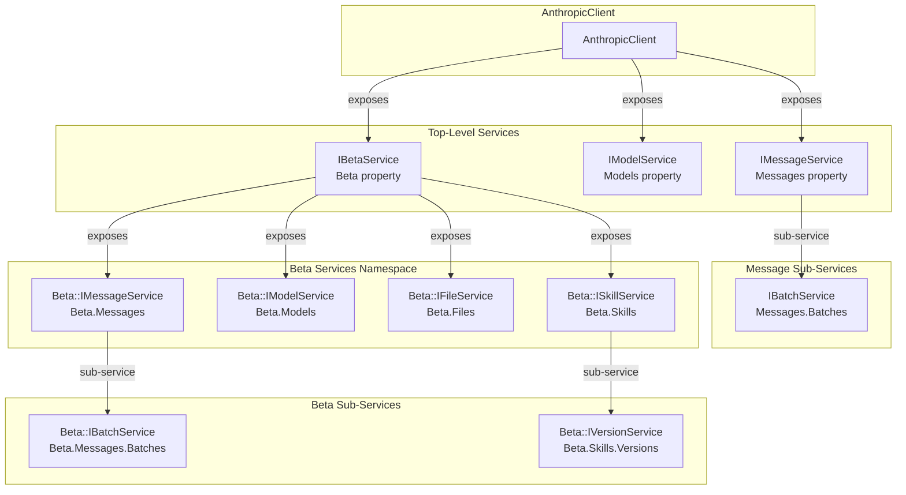
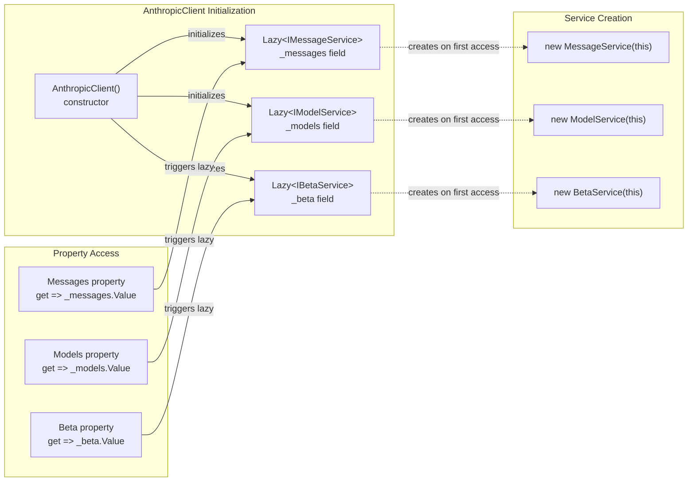
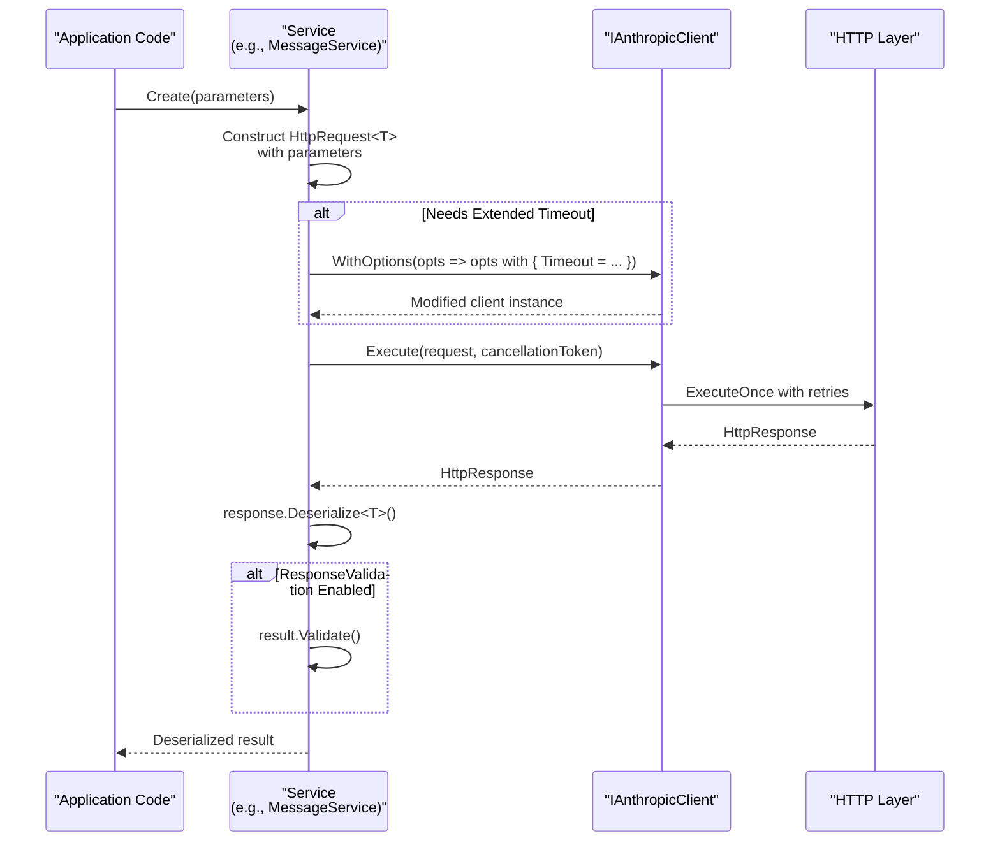
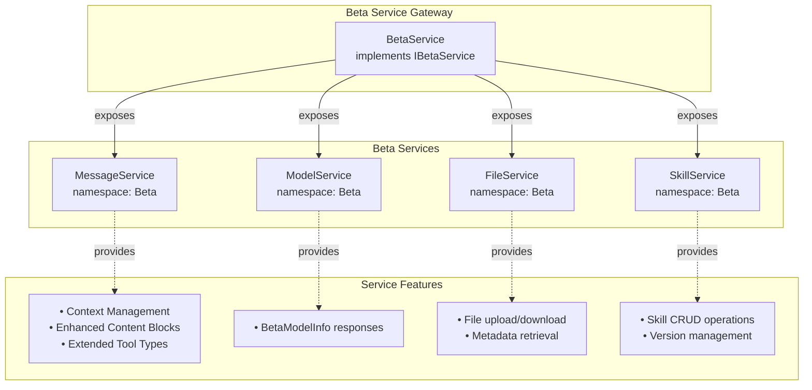
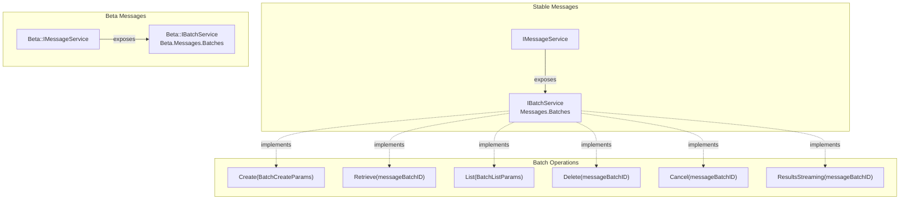
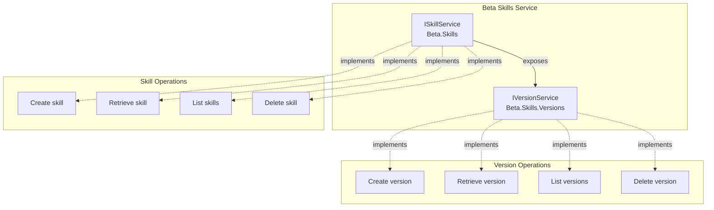
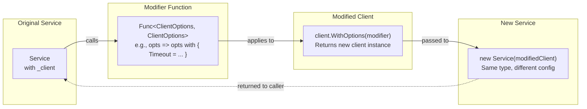
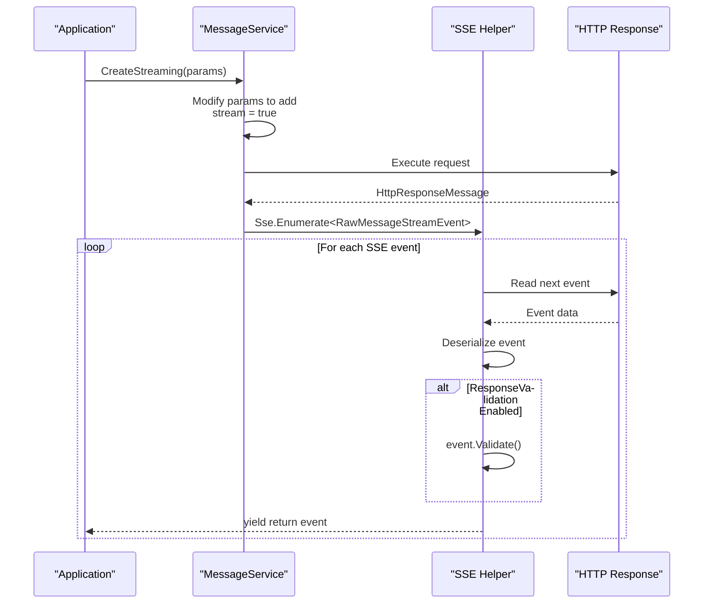

<!-- source: DeepWiki mcp.deepwiki.com · repo anthropics/anthropic-sdk-csharp · page 3.2 Service Layer · fetched 2026-10-26 -->

# Service Layer

<details>
<summary>Relevant source files</summary>

The following files were used as context for generating this wiki page:

- [src/Anthropic.Tests/AnthropicTestClients.cs](src/Anthropic.Tests/AnthropicTestClients.cs)
- [src/Anthropic.Tests/Services/Beta/FileServiceTest.cs](src/Anthropic.Tests/Services/Beta/FileServiceTest.cs)
- [src/Anthropic.Tests/Services/Beta/MessageServiceTest.cs](src/Anthropic.Tests/Services/Beta/MessageServiceTest.cs)
- [src/Anthropic.Tests/Services/Beta/Messages/BatchServiceTest.cs](src/Anthropic.Tests/Services/Beta/Messages/BatchServiceTest.cs)
- [src/Anthropic.Tests/Services/Beta/ModelServiceTest.cs](src/Anthropic.Tests/Services/Beta/ModelServiceTest.cs)
- [src/Anthropic.Tests/Services/Beta/SkillServiceTest.cs](src/Anthropic.Tests/Services/Beta/SkillServiceTest.cs)
- [src/Anthropic.Tests/Services/Beta/Skills/VersionServiceTest.cs](src/Anthropic.Tests/Services/Beta/Skills/VersionServiceTest.cs)
- [src/Anthropic.Tests/Services/MessageServiceTest.cs](src/Anthropic.Tests/Services/MessageServiceTest.cs)
- [src/Anthropic.Tests/Services/Messages/BatchServiceTest.cs](src/Anthropic.Tests/Services/Messages/BatchServiceTest.cs)
- [src/Anthropic.Tests/Services/ModelServiceTest.cs](src/Anthropic.Tests/Services/ModelServiceTest.cs)
- [src/Anthropic/Core/ApiEnum.cs](src/Anthropic/Core/ApiEnum.cs)
- [src/Anthropic/Core/FreezableDictionary.cs](src/Anthropic/Core/FreezableDictionary.cs)
- [src/Anthropic/Core/HttpResponse.cs](src/Anthropic/Core/HttpResponse.cs)
- [src/Anthropic/Core/ParamsBase.cs](src/Anthropic/Core/ParamsBase.cs)
- [src/Anthropic/Services/Beta/MessageService.cs](src/Anthropic/Services/Beta/MessageService.cs)
- [src/Anthropic/Services/MessageService.cs](src/Anthropic/Services/MessageService.cs)

</details>


## Purpose and Scope

The Service Layer organizes Anthropic API operations into domain-specific interfaces, providing a type-safe abstraction over HTTP requests and responses. Services are responsible for constructing request parameters, invoking the HTTP client, deserializing responses, and optionally validating returned data.

For information about the client that instantiates these services, see [Client Layer](#3.1). For details on how requests are constructed and executed, see [Request and Response Flow](#3.3). For API-specific documentation, see [API Services](#4).

## Service Architecture

### Top-Level Service Hierarchy

The SDK exposes three top-level services through `IAnthropicClient`:



**Sources:** [src/Anthropic/IAnthropicClient.cs:87-91](), [src/Anthropic/Services/IMessageService.cs:25](), [src/Anthropic/Services/IBetaService.cs:21-27]()

### Service Interfaces and Implementations

Each service is defined by an interface and implemented by a concrete class:

| Service Domain | Interface | Implementation | Location |
|----------------|-----------|----------------|----------|
| Messages | `IMessageService` | `MessageService` | [src/Anthropic/Services/MessageService.cs]() |
| Models | `IModelService` | `ModelService` | [src/Anthropic/Services/]() |
| Beta Gateway | `IBetaService` | `BetaService` | [src/Anthropic/Services/]() |
| Beta Messages | `Beta::IMessageService` | `Beta::MessageService` | [src/Anthropic/Services/Beta/MessageService.cs]() |
| Beta Models | `Beta::IModelService` | `Beta::ModelService` | [src/Anthropic/Services/Beta/]() |
| Beta Files | `Beta::IFileService` | `Beta::FileService` | [src/Anthropic/Services/Beta/]() |
| Beta Skills | `Beta::ISkillService` | `Beta::SkillService` | [src/Anthropic/Services/Beta/]() |
| Batches | `IBatchService` | `BatchService` | [src/Anthropic/Services/Messages/]() |
| Beta Batches | `Beta::IBatchService` | `Beta::BatchService` | [src/Anthropic/Services/Beta/Messages/]() |
| Skill Versions | `Beta::IVersionService` | `Beta::VersionService` | [src/Anthropic/Services/Beta/Skills/]() |

All service interfaces include documentation stating they should not be inherited outside the SDK to allow for non-breaking additions in minor versions.

**Sources:** [src/Anthropic/Services/IMessageService.cs:11-15](), [src/Anthropic/Services/IModelService.cs:9-13](), [src/Anthropic/Services/IBetaService.cs:7-11]()

## Service Implementation Pattern

### Client Reference and Lazy Initialization

Services hold an internal reference to the `IAnthropicClient` and use lazy initialization for sub-services:



The lazy initialization pattern ensures services are only created when accessed:

- [src/Anthropic/AnthropicClient.cs:81-84]() - `_messages` lazy field and `Messages` property
- [src/Anthropic/AnthropicClient.cs:87-90]() - `_models` lazy field and `Models` property  
- [src/Anthropic/AnthropicClient.cs:93-96]() - `_beta` lazy field and `Beta` property
- [src/Anthropic/AnthropicClient.cs:315-317]() - Lazy fields initialized in constructor

Each service implementation receives the client in its constructor:

- [src/Anthropic/Services/MessageService.cs:24-30]() - `MessageService` stores `_client` reference
- [src/Anthropic/Services/Beta/MessageService.cs:28-34]() - Beta `MessageService` stores `_client` reference

**Sources:** [src/Anthropic/AnthropicClient.cs:81-96](), [src/Anthropic/AnthropicClient.cs:311-318](), [src/Anthropic/Services/MessageService.cs:24-30]()

### Request Execution Flow

Services follow a consistent pattern for executing requests:



Example from `MessageService.Create`:

1. **Request Construction** - [src/Anthropic/Services/MessageService.cs:44-48]() creates `HttpRequest<MessageCreateParams>`
2. **Timeout Override** - [src/Anthropic/Services/MessageService.cs:49-56]() applies 10-minute timeout for message operations
3. **Execution** - [src/Anthropic/Services/MessageService.cs:60]() calls `_client.Execute()`
4. **Deserialization** - [src/Anthropic/Services/MessageService.cs:58]() deserializes response
5. **Optional Validation** - [src/Anthropic/Services/MessageService.cs:59-62]() validates if `ResponseValidation` is enabled

The same pattern applies to Beta services at [src/Anthropic/Services/Beta/MessageService.cs:43-69]().

**Sources:** [src/Anthropic/Services/MessageService.cs:38-63](), [src/Anthropic/Services/Beta/MessageService.cs:42-70]()

## Beta Services Namespace

### Beta Service Structure

The `IBetaService` acts as a namespace gateway for experimental API features:



Beta services share the same interface names as stable services but reside in the `Anthropic.Services.Beta` namespace. The Beta message service returns `BetaMessage` instead of `Message`, providing access to experimental features like context management and enhanced tool types.

**Sources:** [src/Anthropic/Services/IBetaService.cs:21-27](), [src/Anthropic/Services/Beta/IMessageService.cs:10-69]()

### Beta vs Stable Services

| Aspect | Stable Services | Beta Services |
|--------|----------------|---------------|
| Namespace | `Anthropic.Services` | `Anthropic.Services.Beta` |
| Response Types | `Message`, `ModelInfo` | `BetaMessage`, `BetaModelInfo` |
| Content Blocks | 6 types | 14 types |
| Tool Types | 6 types | 17+ types |
| Special Features | None | Context Management, Skills, Files |
| API Stability | Stable | Experimental |

**Sources:** [src/Anthropic/Services/Beta/IMessageService.cs](), [src/Anthropic/Services/IMessageService.cs]()

## Sub-Services

### Batch Services Architecture

Both stable and beta message services expose a `Batches` sub-service for batch processing operations:



Batch services are lazily initialized like top-level services:

- [src/Anthropic/Services/MessageService.cs:32-36]() - Stable batch service initialization
- [src/Anthropic/Services/Beta/MessageService.cs:36-40]() - Beta batch service initialization

Each batch service provides identical operations but works with namespace-specific types (`MessageBatch` vs `BetaMessageBatch`).

**Sources:** [src/Anthropic/Services/Messages/IBatchService.cs:15-132](), [src/Anthropic/Services/Beta/Messages/IBatchService.cs:15-132]()

### Skills and Versions Hierarchy

The Beta Skills service includes a nested `Versions` sub-service for managing skill versions:



The hierarchical structure reflects the API's resource nesting, where versions belong to specific skills.

**Sources:** [src/Anthropic/Services/Beta/ISkillService.cs:24](), [src/Anthropic/Services/Beta/Skills/IVersionService.cs:14-82]()

## WithOptions Pattern

### Service-Level Configuration

All services expose a `WithOptions` method that returns a new service instance with modified client options:



Example implementation from `MessageService`:

```csharp
public IMessageService WithOptions(Func<ClientOptions, ClientOptions> modifier)
{
    return new MessageService(this._client.WithOptions(modifier));
}
```

This pattern allows per-operation configuration without mutating the original service:

- [src/Anthropic/Services/MessageService.cs:19-22]() - Stable message service `WithOptions`
- [src/Anthropic/Services/Beta/MessageService.cs:19-26]() - Beta message service `WithOptions`

The pattern is used internally when services need to override default timeouts, as seen in [src/Anthropic/Services/MessageService.cs:49-56]() where message operations get a 10-minute timeout.

**Sources:** [src/Anthropic/Services/MessageService.cs:19-22](), [src/Anthropic/AnthropicClient.cs:76-79]()

## Common Service Operations

### Standard Service Methods

Services expose type-safe methods for each API endpoint:

| Method Pattern | Purpose | Return Type | Example |
|----------------|---------|-------------|---------|
| `Create(params)` | Create a resource | `Task<TResource>` | [src/Anthropic/Services/MessageService.cs:39-63]() |
| `CreateStreaming(params)` | Create with streaming | `IAsyncEnumerable<TEvent>` | [src/Anthropic/Services/MessageService.cs:67-103]() |
| `Retrieve(id, params)` | Get single resource | `Task<TResource>` | [src/Anthropic/Services/IModelService.cs:29-39]() |
| `List(params)` | List resources | `Task<TPageResponse>` | [src/Anthropic/Services/IModelService.cs:47-50]() |
| `Delete(id, params)` | Delete resource | `Task<TDeleted>` | [src/Anthropic/Services/Beta/IFileService.cs:34-44]() |
| `CountTokens(params)` | Count tokens | `Task<TTokensCount>` | [src/Anthropic/Services/MessageService.cs:107-128]() |

Each method typically provides both a full-parameter overload and a convenience overload with optional parameters.

**Sources:** [src/Anthropic/Services/IMessageService.cs:17-67](), [src/Anthropic/Services/IModelService.cs:14-51](), [src/Anthropic/Services/Beta/IFileService.cs:14-75]()

### Streaming Operations

Services that support streaming return `IAsyncEnumerable<T>` for incremental data processing:



The streaming pattern modifies request parameters to include `"stream": true` before execution:

- [src/Anthropic/Services/MessageService.cs:72-78]() - Adds stream flag to parameters
- [src/Anthropic/Services/MessageService.cs:94-102]() - Enumerates SSE events with validation

**Sources:** [src/Anthropic/Services/MessageService.cs:67-103](), [src/Anthropic/Services/Beta/MessageService.cs:73-112]()

## Response Validation

Services optionally validate responses when `ResponseValidation` is enabled on the client:

```csharp
if (this._client.ResponseValidation)
{
    message.Validate();
}
```

Validation checks:
- Required fields are present
- Enum values are recognized
- Union type discriminators are valid

This occurs at:
- [src/Anthropic/Services/MessageService.cs:59-62]() - After `Create` deserialization
- [src/Anthropic/Services/MessageService.cs:98-101]() - For each streaming event
- [src/Anthropic/Services/MessageService.cs:123-126]() - After `CountTokens` deserialization

Validation is disabled by default for performance, allowing gradual access to response fields that validates on-demand.

**Sources:** [src/Anthropic/Services/MessageService.cs:59-62](), [src/Anthropic/AnthropicClient.cs:41-45]()

---

