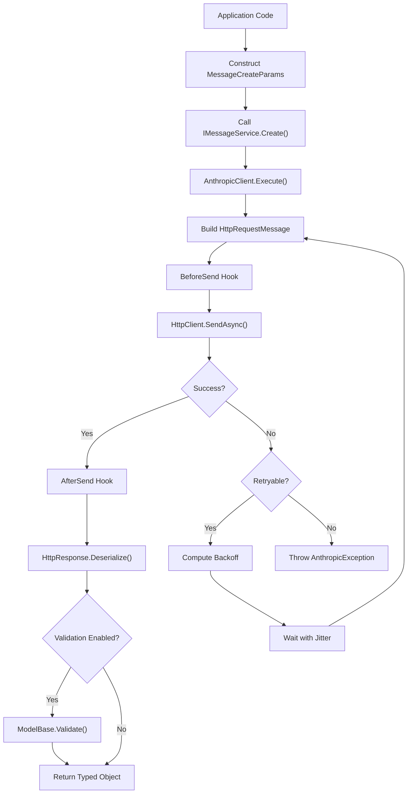
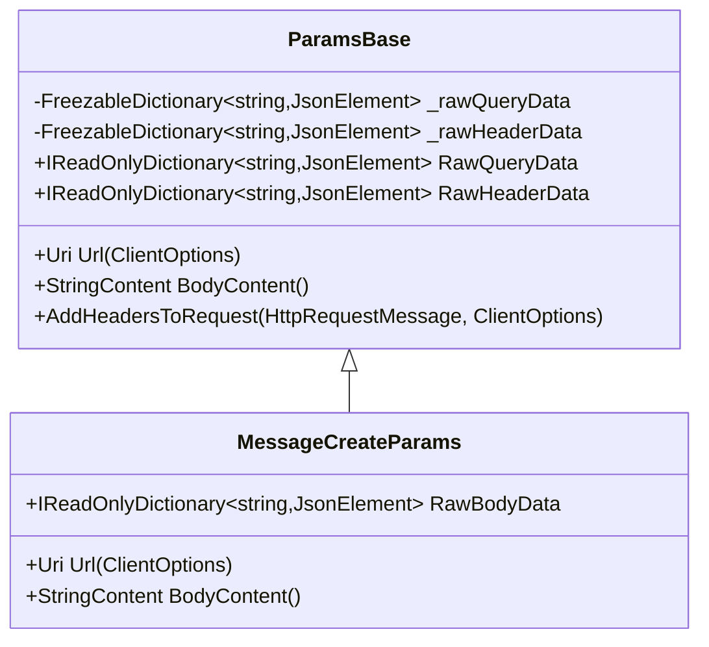
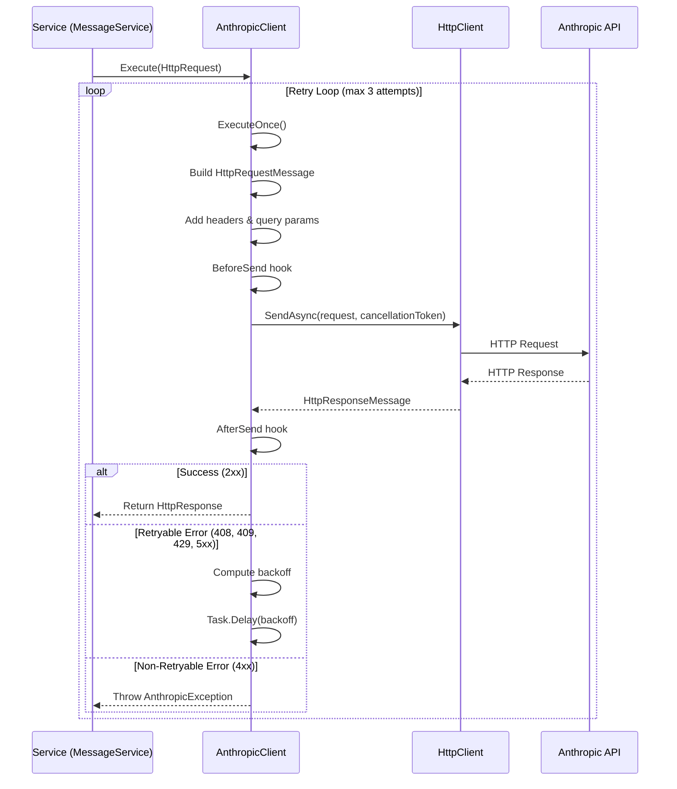
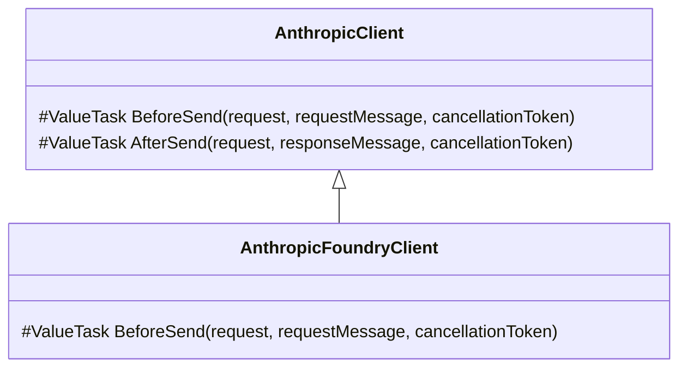
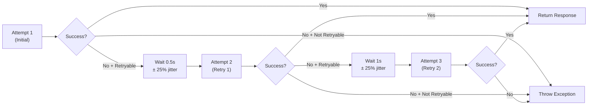
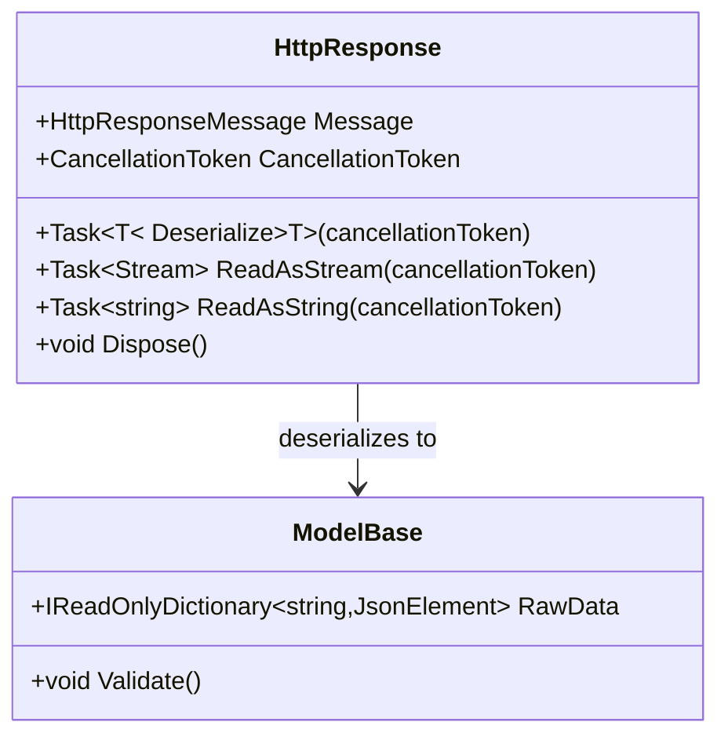
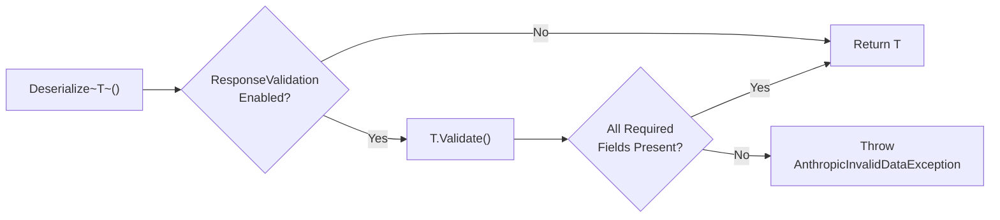
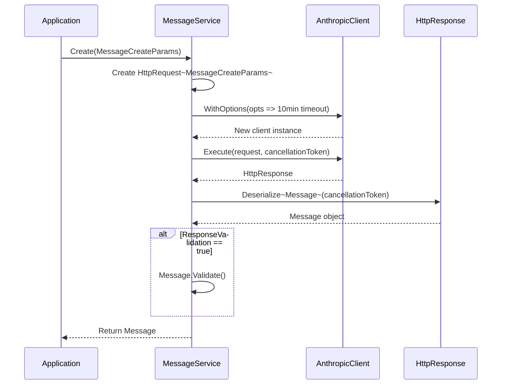
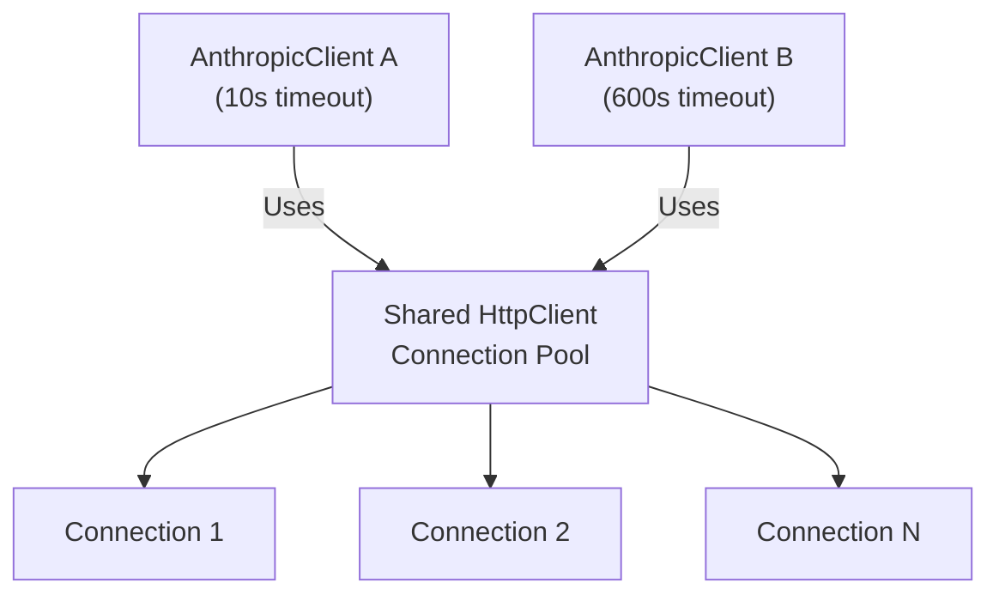

<!-- source: DeepWiki mcp.deepwiki.com · repo anthropics/anthropic-sdk-csharp · page 3.3 Request and Response Flow · fetched 2026-10-26 -->

# Request and Response Flow

<details>
<summary>Relevant source files</summary>

The following files were used as context for generating this wiki page:

- [README.md](README.md)
- [src/Anthropic.Foundry/AnthropicFoundryClient.cs](src/Anthropic.Foundry/AnthropicFoundryClient.cs)
- [src/Anthropic.Tests/TestBase.cs](src/Anthropic.Tests/TestBase.cs)
- [src/Anthropic/AnthropicClient.cs](src/Anthropic/AnthropicClient.cs)
- [src/Anthropic/Core/ApiEnum.cs](src/Anthropic/Core/ApiEnum.cs)
- [src/Anthropic/Core/ClientOptions.cs](src/Anthropic/Core/ClientOptions.cs)
- [src/Anthropic/Core/EnvironmentUrl.cs](src/Anthropic/Core/EnvironmentUrl.cs)
- [src/Anthropic/Core/FreezableDictionary.cs](src/Anthropic/Core/FreezableDictionary.cs)
- [src/Anthropic/Core/HttpResponse.cs](src/Anthropic/Core/HttpResponse.cs)
- [src/Anthropic/Core/ParamsBase.cs](src/Anthropic/Core/ParamsBase.cs)
- [src/Anthropic/IAnthropicClient.cs](src/Anthropic/IAnthropicClient.cs)
- [src/Anthropic/Services/Beta/MessageService.cs](src/Anthropic/Services/Beta/MessageService.cs)
- [src/Anthropic/Services/MessageService.cs](src/Anthropic/Services/MessageService.cs)

</details>


This document describes the complete lifecycle of HTTP requests in the Anthropic C# SDK, from parameter construction through response deserialization and validation. It covers request building, execution, retry logic, and response handling.

For information about error handling and exception types, see [Error Handling](#3.4). For details on specific API services, see [API Services](#4).

## Overview

Every API call in the SDK follows a consistent request-response flow:

1. **Request Construction** - Parameters are assembled into `ParamsBase` objects with headers, query strings, and body content
2. **Request Execution** - The `AnthropicClient.Execute` method sends the HTTP request with timeout and cancellation support
3. **Retry Logic** - Failed requests are automatically retried with exponential backoff for transient errors
4. **Response Processing** - Successful responses are deserialized into strongly-typed objects and optionally validated



**Sources:** [src/Anthropic/AnthropicClient.cs:100-152](), [src/Anthropic/Services/MessageService.cs:39-64]()

## Request Construction

### Parameter Objects

All API operations accept parameters through strongly-typed classes inheriting from `ParamsBase`. These classes maintain three key data structures:

- **`_rawQueryData`** - Query string parameters as JSON elements
- **`_rawHeaderData`** - HTTP headers as JSON elements  
- **`RawBodyData`** - Request body fields (in derived classes)



**Sources:** [src/Anthropic/Core/ParamsBase.cs:14-276]()

### URL Construction

The `Url()` method on parameter objects builds the complete request URI by combining:

1. Base URL from `ClientOptions.BaseUrl` (default: `https://api.anthropic.com`)
2. API path (e.g., `/v1/messages`)
3. Query string from `_rawQueryData`

Query parameters are serialized with special handling for different JSON value types:

| JsonValueKind | Serialization |
|---------------|---------------|
| String/Number | Direct toString() |
| Boolean | `"true"` or `"false"` |
| Array | Comma-separated values |
| Object | Nested bracket notation: `key[nested]=value` |

**Sources:** [src/Anthropic/Core/ParamsBase.cs:160-184]()

### Header Assembly

Headers are added to the `HttpRequestMessage` in two phases:

**Default Headers** (added by `AddDefaultHeaders`):

```
User-Agent: AnthropicClient/C# {version}
X-Stainless-Lang: csharp
X-Stainless-OS: {Windows|MacOS|Linux}
X-Stainless-Runtime: {.NET Core|.NET Framework}
X-Stainless-Runtime-Version: {version}
anthropic-version: 2023-06-01
X-Api-Key: {from ClientOptions.APIKey}
Authorization: Bearer {from ClientOptions.AuthToken}
X-Stainless-Timeout: {timeout in seconds}
```

**Custom Headers** from `_rawHeaderData` in the parameter object, which may include:

- `anthropic-beta` - Beta feature flags
- `content-type` - Always `application/json` for POST requests
- Request-specific headers

**Sources:** [src/Anthropic/Core/ParamsBase.cs:193-212](), [src/Anthropic/Core/ParamsBase.cs:16-32]()

### Body Content

For POST requests, the body content is serialized from the parameter object's `RawBodyData`:

```
Content-Type: application/json
Body: {serialized parameter fields}
```

The `BodyContent()` method returns a `StringContent` with UTF-8 encoding.

**Sources:** [src/Anthropic/Core/ParamsBase.cs:188-191]()

## Request Execution

### Execute Method Flow

The `AnthropicClient.Execute<T>()` method orchestrates the complete request lifecycle:



**Sources:** [src/Anthropic/AnthropicClient.cs:100-152](), [src/Anthropic/AnthropicClient.cs:174-218]()

### Timeout and Cancellation

Each request has two cancellation tokens:

1. **Timeout Token** - Created from `ClientOptions.Timeout` (default: 10 minutes for messages, 60 seconds for other endpoints)
2. **Caller Token** - Passed by the caller to abort the operation

These are linked using `CancellationTokenSource.CreateLinkedTokenSource()`:

**Sources:** [src/Anthropic/AnthropicClient.cs:193-199]()

### BeforeSend and AfterSend Hooks

Virtual methods allow subclasses to inject custom logic:

- **`BeforeSend()`** - Called before sending the HTTP request. The `AnthropicFoundryClient` uses this to apply Azure authentication headers.
- **`AfterSend()`** - Called after receiving the response but before processing.



**Sources:** [src/Anthropic/AnthropicClient.cs:154-172](), [src/Anthropic.Foundry/AnthropicFoundryClient.cs:55-64]()

## Retry Logic

### Retryable Conditions

The SDK automatically retries requests that fail due to transient errors. Retry decisions are made by two methods:

**`ShouldRetry(HttpResponse)`** - Status code based:

| Status Code | Retry? | Reason |
|-------------|--------|---------|
| 408 | Yes | Request timeout |
| 409 | Yes | Lock timeout |
| 429 | Yes* | Rate limit (not on .NET Standard 2.0) |
| 5xx | Yes | Server errors |
| Other | No | Client errors or success |

*Note: 429 is not retried on .NET Standard 2.0 due to platform limitations.

**`ShouldRetry(Exception)`** - Exception based:
- `IOException` - Network I/O errors
- `AnthropicIOException` - SDK I/O wrapper errors

The API can override retry behavior using the `X-Should-Retry` response header.

**Sources:** [src/Anthropic/AnthropicClient.cs:276-309]()

### Retry Configuration

Retry attempts are controlled by `ClientOptions.MaxRetries` (default: 2, meaning 3 total attempts including the initial request).



**Sources:** [src/Anthropic/AnthropicClient.cs:106-151]()

### Backoff Calculation

The `ComputeRetryBackoff()` method implements exponential backoff with jitter:

```
base_delay = min(0.5 * 2^(retries - 1), 8.0) seconds
jitter = random(0.75 to 1.0)
actual_delay = base_delay * jitter
```

| Retry Number | Base Delay | Range with Jitter | Max |
|--------------|------------|-------------------|-----|
| 1 | 0.5s | 0.375s - 0.5s | 0.5s |
| 2 | 1.0s | 0.75s - 1.0s | 1.0s |
| 3 | 2.0s | 1.5s - 2.0s | 2.0s |
| 4 | 4.0s | 3.0s - 4.0s | 4.0s |
| 5+ | 8.0s | 6.0s - 8.0s | 8.0s (cap) |

**Retry-After Headers** take precedence if present and reasonable (< 60 seconds):
- `Retry-After-Ms` - Milliseconds to wait
- `Retry-After` - Seconds to wait or HTTP date

**Sources:** [src/Anthropic/AnthropicClient.cs:220-274]()

## Response Processing

### HttpResponse Wrapper

The `HttpResponse` class wraps `HttpResponseMessage` and provides deserialization methods:



**Sources:** [src/Anthropic/Core/HttpResponse.cs:11-70]()

### Deserialization Process

The `Deserialize<T>()` method performs JSON deserialization using `System.Text.Json`:

1. Read response stream asynchronously
2. Deserialize using `ModelBase.SerializerOptions` with custom converters
3. Throw `AnthropicInvalidDataException` if result is null

Custom JSON converters handle:
- **`ApiEnumConverter`** - Enums that may have unknown values
- **`ModelConverter`** - Complex model objects with raw data preservation

**Sources:** [src/Anthropic/Core/HttpResponse.cs:17-38](), [src/Anthropic/Core/ModelBase.cs:34-112]()

### Response Validation

If `ClientOptions.ResponseValidation` is enabled, the service calls `Validate()` on the deserialized object:



Validation checks:
- All required fields are present
- Field values match expected types
- Enum values are recognized (if using `ApiEnum`)

**Sources:** [src/Anthropic/Services/MessageService.cs:59-62](), [src/Anthropic/Core/ModelBase.cs:255-264]()

### Error Response Handling

Non-success status codes trigger error handling:

1. Read response body as string
2. Pass to `AnthropicExceptionFactory.CreateApiException(statusCode, body)`
3. Factory creates appropriate exception type based on status code
4. Original `HttpResponse` is disposed

**Sources:** [src/Anthropic/AnthropicClient.cs:131-145]()

## Service-Level Usage

Services like `MessageService` consume this infrastructure by:

1. Constructing parameter objects
2. Creating `HttpRequest<TParams>` wrappers
3. Optionally modifying client options (e.g., extending timeout for long operations)
4. Calling `Execute()` and awaiting the result
5. Deserializing and validating the response

Example from `MessageService.Create()`:



**Sources:** [src/Anthropic/Services/MessageService.cs:39-64](), [src/Anthropic/Services/Beta/MessageService.cs:43-70]()

## Streaming Responses

Streaming responses follow a modified flow using Server-Sent Events (SSE):

1. Set `stream=true` in request body by modifying `RawBodyData`
2. Execute request normally to get `HttpResponse`
3. Use `Sse.Enumerate<T>()` to parse SSE stream
4. Yield events one at a time with optional validation

The streaming flow maintains the same retry and error handling semantics, but processes the response incrementally.

**Sources:** [src/Anthropic/Services/MessageService.cs:67-104]()

## Connection Pooling and Reuse

The SDK reuses `HttpClient` instances to benefit from connection pooling:

- `ClientOptions.HttpClient` holds the shared HTTP client
- `WithOptions()` creates new `AnthropicClient` instances but preserves the `HttpClient`
- This allows request-specific option changes without losing connection pool benefits



**Sources:** [src/Anthropic/AnthropicClient.cs:76-79]()

---

