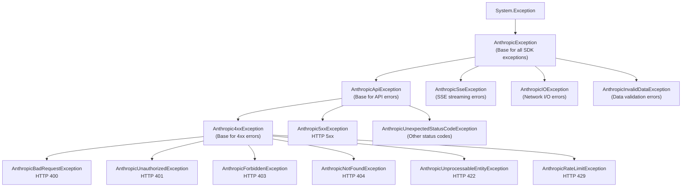
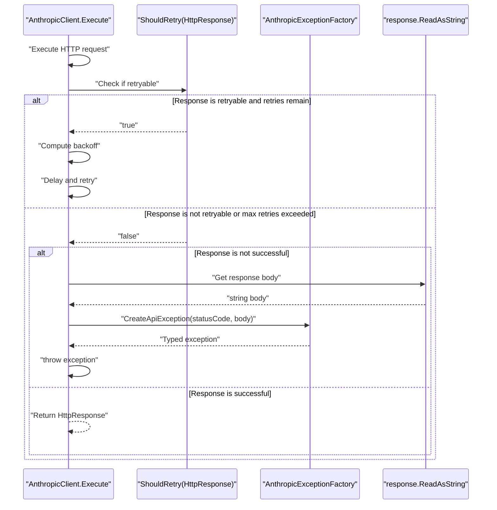
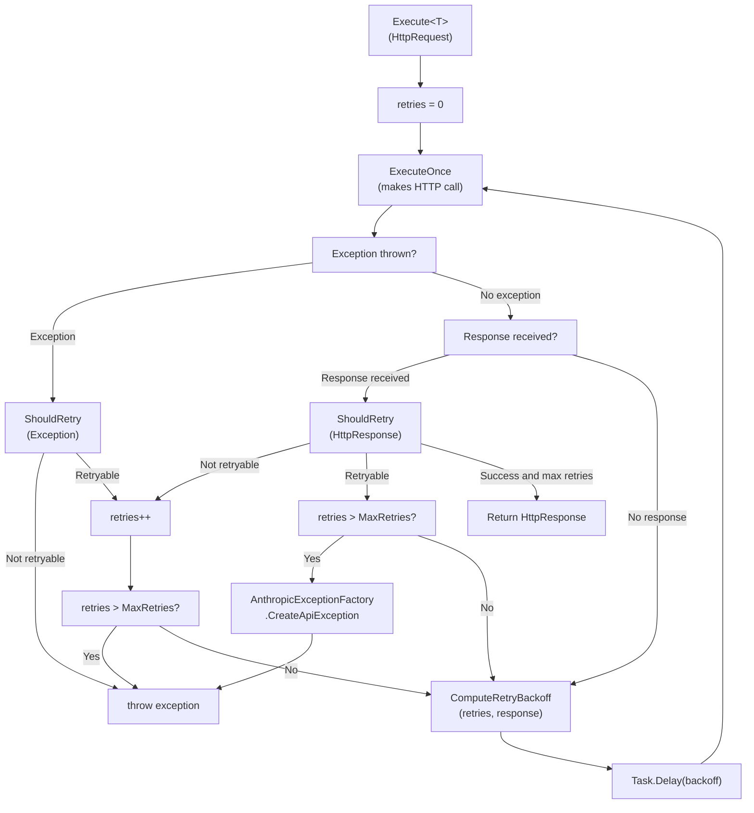
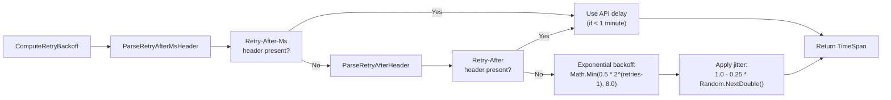
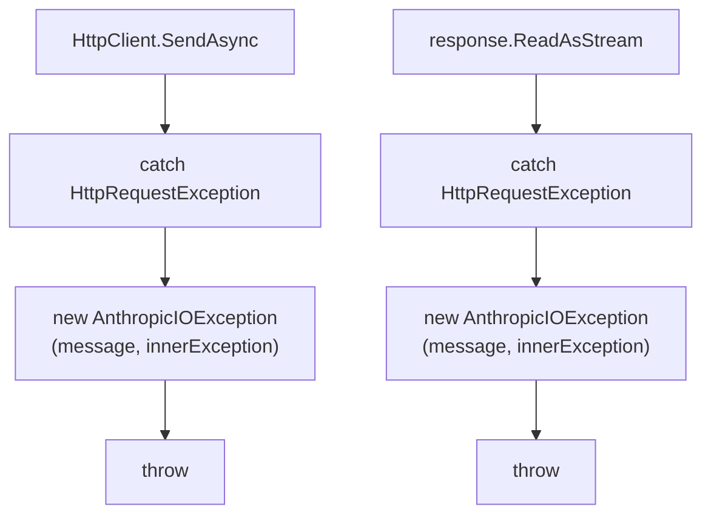
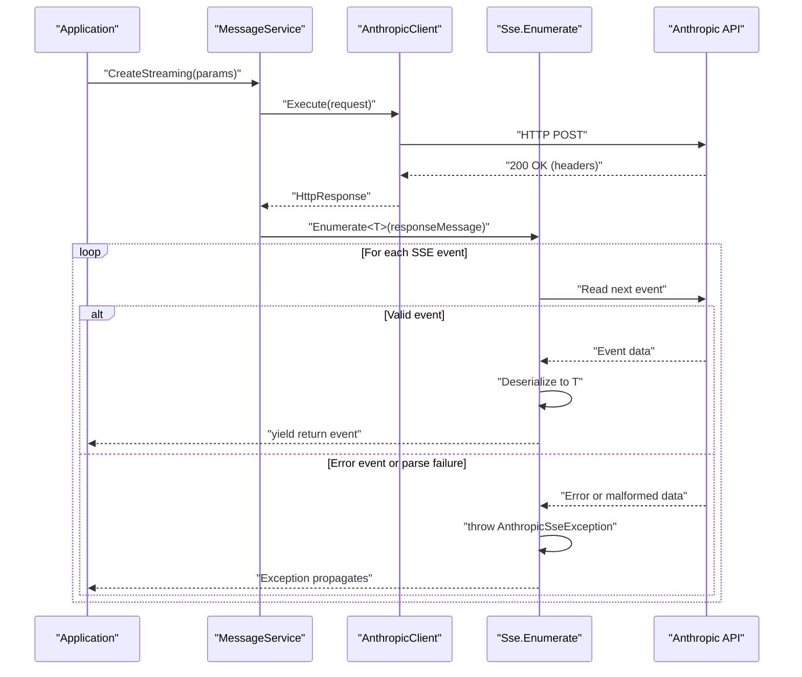
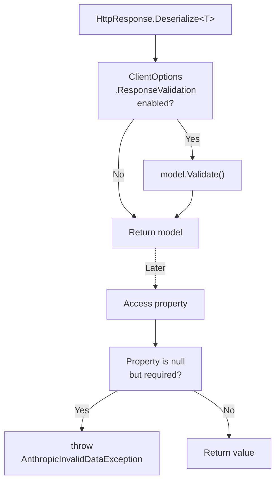
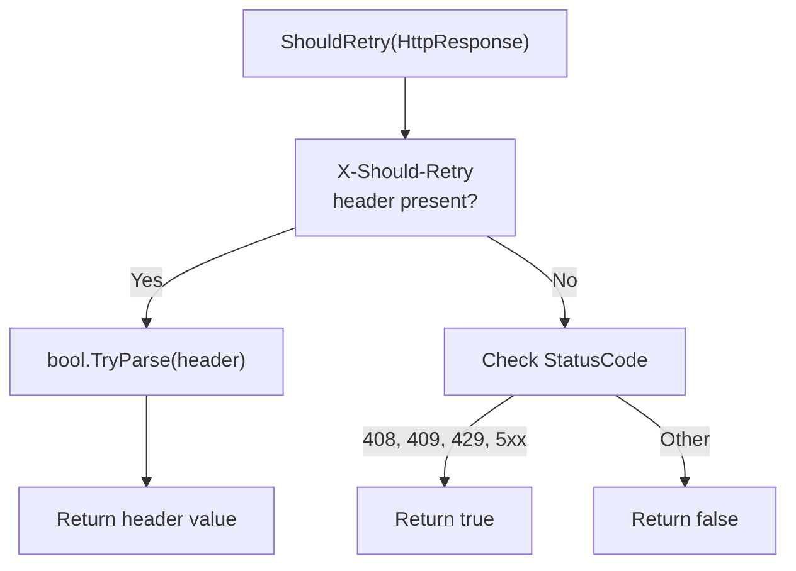

<!-- source: DeepWiki mcp.deepwiki.com · repo anthropics/anthropic-sdk-csharp · page 3.4 Error Handling · fetched 2026-10-26 -->

# Error Handling

<details>
<summary>Relevant source files</summary>

The following files were used as context for generating this wiki page:

- [README.md](README.md)
- [src/Anthropic.Foundry/AnthropicFoundryClient.cs](src/Anthropic.Foundry/AnthropicFoundryClient.cs)
- [src/Anthropic.Tests/Models/Beta/BetaErrorTest.cs](src/Anthropic.Tests/Models/Beta/BetaErrorTest.cs)
- [src/Anthropic.Tests/Models/Beta/Messages/Batches/BetaMessageBatchResultTest.cs](src/Anthropic.Tests/Models/Beta/Messages/Batches/BetaMessageBatchResultTest.cs)
- [src/Anthropic.Tests/Models/Beta/Messages/BetaBashCodeExecutionToolResultBlockParamTest.cs](src/Anthropic.Tests/Models/Beta/Messages/BetaBashCodeExecutionToolResultBlockParamTest.cs)
- [src/Anthropic.Tests/Models/Beta/Messages/BetaBashCodeExecutionToolResultBlockTest.cs](src/Anthropic.Tests/Models/Beta/Messages/BetaBashCodeExecutionToolResultBlockTest.cs)
- [src/Anthropic.Tests/Models/Beta/Messages/BetaCitationsDeltaTest.cs](src/Anthropic.Tests/Models/Beta/Messages/BetaCitationsDeltaTest.cs)
- [src/Anthropic.Tests/Models/Beta/Messages/BetaClearToolUses20250919EditTest.cs](src/Anthropic.Tests/Models/Beta/Messages/BetaClearToolUses20250919EditTest.cs)
- [src/Anthropic.Tests/Models/Beta/Messages/BetaCodeExecutionToolResultBlockContentTest.cs](src/Anthropic.Tests/Models/Beta/Messages/BetaCodeExecutionToolResultBlockContentTest.cs)
- [src/Anthropic.Tests/Models/Beta/Messages/BetaCodeExecutionToolResultBlockParamContentTest.cs](src/Anthropic.Tests/Models/Beta/Messages/BetaCodeExecutionToolResultBlockParamContentTest.cs)
- [src/Anthropic.Tests/Models/Beta/Messages/BetaContentBlockParamTest.cs](src/Anthropic.Tests/Models/Beta/Messages/BetaContentBlockParamTest.cs)
- [src/Anthropic.Tests/Models/Beta/Messages/BetaContextManagementConfigTest.cs](src/Anthropic.Tests/Models/Beta/Messages/BetaContextManagementConfigTest.cs)
- [src/Anthropic.Tests/TestBase.cs](src/Anthropic.Tests/TestBase.cs)
- [src/Anthropic/AnthropicClient.cs](src/Anthropic/AnthropicClient.cs)
- [src/Anthropic/Core/ClientOptions.cs](src/Anthropic/Core/ClientOptions.cs)
- [src/Anthropic/Core/EnvironmentUrl.cs](src/Anthropic/Core/EnvironmentUrl.cs)
- [src/Anthropic/IAnthropicClient.cs](src/Anthropic/IAnthropicClient.cs)

</details>


This page documents the SDK's exception hierarchy, retry behavior, and error handling patterns. It covers how HTTP errors are transformed into typed exceptions, how the SDK automatically retries transient failures, and how to handle errors in application code.

For information about request and response flow, see [Request and Response Flow](#3.3). For information about client configuration including retry settings, see [Configuration](#2.2).

## Exception Hierarchy

The SDK defines a hierarchy of exception types to represent different failure modes. All SDK exceptions inherit from `AnthropicException`, allowing applications to catch all SDK-specific errors with a single catch block if desired.



**Exception Hierarchy**

| Exception Type | HTTP Status | Description |
|----------------|-------------|-------------|
| `AnthropicBadRequestException` | 400 | Invalid request parameters |
| `AnthropicUnauthorizedException` | 401 | Missing or invalid API key |
| `AnthropicForbiddenException` | 403 | Insufficient permissions |
| `AnthropicNotFoundException` | 404 | Resource not found |
| `AnthropicUnprocessableEntityException` | 422 | Valid request but semantic errors |
| `AnthropicRateLimitException` | 429 | Rate limit exceeded |
| `Anthropic5xxException` | 5xx | Server-side errors |
| `AnthropicUnexpectedStatusCodeException` | Other | Unexpected HTTP status codes |

**Sources:** [README.md:213-239](), [AnthropicClient.cs:133-141]()

## API Error Creation Flow

When the SDK receives an error response from the API, it follows a specific flow to transform the HTTP response into a typed exception.



**API Error Creation Flow**

The SDK creates typed exceptions based on HTTP status codes. The response body is read as a string and passed to `AnthropicExceptionFactory.CreateApiException`, which instantiates the appropriate exception subclass.

**Sources:** [AnthropicClient.cs:124-146]()

## Retry Behavior

The SDK automatically retries transient failures with exponential backoff. This improves resilience against temporary network issues and server errors without requiring application-level retry logic.



**Retry Decision Flow**

### Retryable Conditions

The SDK determines whether to retry based on exception type or HTTP status code:

**Exception-Based Retry**
- `IOException` - Network I/O failures
- `AnthropicIOException` - SDK-wrapped I/O errors

**Response-Based Retry**
- HTTP 408 (Request Timeout)
- HTTP 409 (Conflict)
- HTTP 429 (Rate Limit) - Not retried on .NET Standard 2.0
- HTTP 5xx (Server Errors)

**Sources:** [AnthropicClient.cs:276-309]()

### Backoff Computation

The SDK computes retry delays using exponential backoff with jitter to prevent thundering herd problems:



**Backoff Computation Algorithm**

The backoff algorithm respects the following headers from the API:
- `Retry-After-Ms`: Milliseconds to wait (takes precedence)
- `Retry-After`: Seconds to wait or absolute timestamp

If the API specifies a reasonable delay (< 1 minute), the SDK uses that value. Otherwise, it applies exponential backoff: `0.5 * 2^(retries-1)` seconds, capped at 8 seconds, with 0-25% jitter.

**Sources:** [AnthropicClient.cs:224-238](), [AnthropicClient.cs:240-256](), [AnthropicClient.cs:258-278]()

### Configuration

Retry behavior can be configured at the client level or per-request:

```csharp
// Configure globally
AnthropicClient client = new() { MaxRetries = 3 };

// Configure per-request
var message = await client
    .WithOptions(options => options with { MaxRetries = 5 })
    .Messages.Create(parameters);
```

The default is 2 retries (3 total attempts). Set `MaxRetries = 0` to disable retries.

**Sources:** [README.md:242-276](), [AnthropicClient.cs:106]()

## I/O and Network Errors

Network-level failures are wrapped in `AnthropicIOException` to distinguish them from API-level errors.



**I/O Exception Wrapping**

The SDK wraps `HttpRequestException` in two locations:
1. During HTTP request execution in `ExecuteOnce` at [AnthropicClient.cs:217-220]()
2. During API error creation when reading the response body at [AnthropicClient.cs:139-145]()

This provides a consistent exception type for network errors that can be caught separately from API errors.

**Sources:** [AnthropicClient.cs:217-220](), [AnthropicClient.cs:139-145](), [README.md:234]()

## SSE Streaming Errors

Server-Sent Events (SSE) streaming introduces a unique error scenario: the initial HTTP response succeeds (200 OK), but errors occur while reading the event stream. These are represented by `AnthropicSseException`.



**SSE Error Flow**

Because SSE errors occur after the HTTP response has been returned successfully, they cannot be represented as HTTP status code exceptions. Instead, they are thrown as `AnthropicSseException` while enumerating the stream.

**Sources:** [README.md:232]()

## Response Validation

The SDK performs lazy validation of response data. By default, validation only occurs when accessing properties. Optional strict validation can be enabled to validate responses immediately.



**Response Validation Flow**

### Lazy Validation (Default)

By default, the SDK does not throw exceptions for invalid response data until you access it:

```csharp
var message = await client.Messages.Create(parameters);
// No exception yet, even if response is invalid

var text = message.Content[0].Text; 
// AnthropicInvalidDataException may be thrown here
```

### Strict Validation

Enable strict validation to catch errors immediately:

```csharp
// Enable globally
AnthropicClient client = new() { ResponseValidation = true };

// Enable per-request
var message = await client
    .WithOptions(options => options with { ResponseValidation = true })
    .Messages.Create(parameters);

// Or validate manually
message.Validate(); // throws if invalid
```

When validation is enabled, the SDK calls `Validate()` on response objects after deserialization. This method recursively validates all properties and throws `AnthropicInvalidDataException` if any required field is missing or has an unexpected type.

**Sources:** [README.md:307-342](), [ClientOptions.cs:42-48]()

## Error Handling Patterns

### Basic Error Handling

Catch specific exception types to handle different failure modes:

```csharp
try 
{
    var message = await client.Messages.Create(parameters);
}
catch (AnthropicRateLimitException e)
{
    // Handle rate limiting - maybe implement additional backoff
    await Task.Delay(TimeSpan.FromSeconds(60));
}
catch (AnthropicUnauthorizedException e)
{
    // Handle authentication errors - check API key
    logger.LogError("Invalid API key");
}
catch (Anthropic4xxException e)
{
    // Handle all other client errors
    logger.LogError($"Client error: {e.Message}");
}
catch (Anthropic5xxException e)
{
    // Handle server errors - maybe retry manually
    logger.LogError($"Server error: {e.Message}");
}
catch (AnthropicIOException e)
{
    // Handle network errors
    logger.LogError($"Network error: {e.Message}");
}
catch (AnthropicException e)
{
    // Catch-all for any SDK errors
    logger.LogError($"SDK error: {e.Message}");
}
```

### Streaming Error Handling

SSE streaming requires special consideration because errors can occur mid-stream:

```csharp
try 
{
    await foreach (var streamEvent in client.Messages.CreateStreaming(parameters))
    {
        // Process each event
        Console.WriteLine(streamEvent);
    }
}
catch (AnthropicSseException e)
{
    // Handle streaming-specific errors
    logger.LogError($"Stream error: {e.Message}");
}
catch (AnthropicIOException e)
{
    // Handle network errors during streaming
    logger.LogError($"Network error during stream: {e.Message}");
}
```

### Validation Error Handling

When using strict validation or manual validation, catch `AnthropicInvalidDataException`:

```csharp
try 
{
    var message = await client.Messages.Create(parameters);
    message.Validate(); // Explicitly validate
}
catch (AnthropicInvalidDataException e)
{
    // Handle unexpected response format
    logger.LogError($"Invalid response: {e.Message}");
    // May indicate SDK/API version mismatch
}
```

**Sources:** [README.md:213-239]()

## Server-Controlled Retry Behavior

The API can explicitly instruct the SDK whether to retry a request via the `X-Should-Retry` response header. This overrides the SDK's default retry logic.



**Server-Controlled Retry Logic**

The `ShouldRetry` method first checks for the `X-Should-Retry` header. If present and parseable as a boolean, that value is used. Otherwise, the SDK falls back to status code-based logic.

**Sources:** [AnthropicClient.cs:280-308]()

## Exception Context and Debugging

The SDK includes metadata in request headers to aid debugging:

| Header | Value | Purpose |
|--------|-------|---------|
| `x-stainless-retry-count` | Retry attempt number | Tracks which retry attempt failed |
| `X-Stainless-Timeout` | Request timeout in seconds | Shows timeout configuration |
| `User-Agent` | SDK name and version | Identifies SDK version |
| `X-Stainless-Runtime` | Runtime name | Identifies .NET runtime |
| `X-Stainless-Runtime-Version` | Runtime version | Identifies .NET version |

These headers are automatically included in every request and can be viewed in exception details or HTTP logs for troubleshooting.

**Sources:** [ParamsBase.cs:16-32](), [AnthropicClient.cs:189-192]()

---

