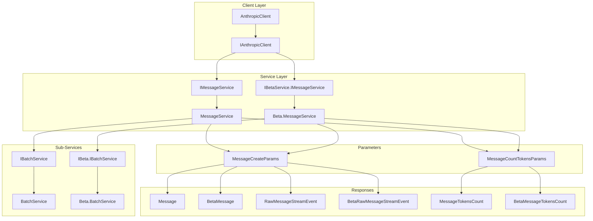
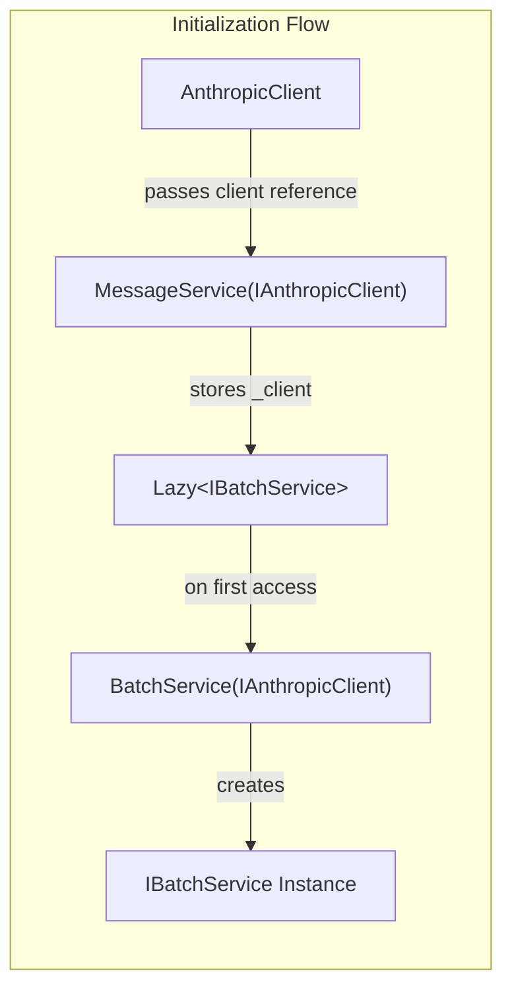
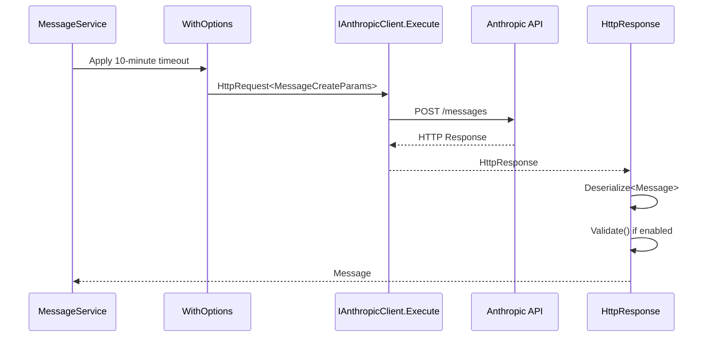
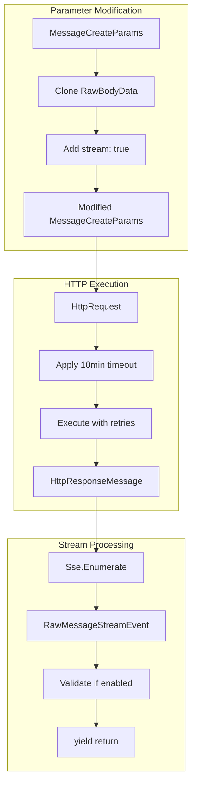
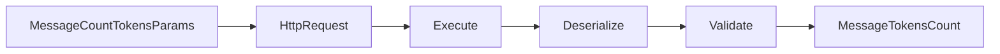
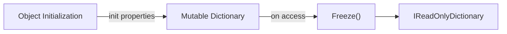
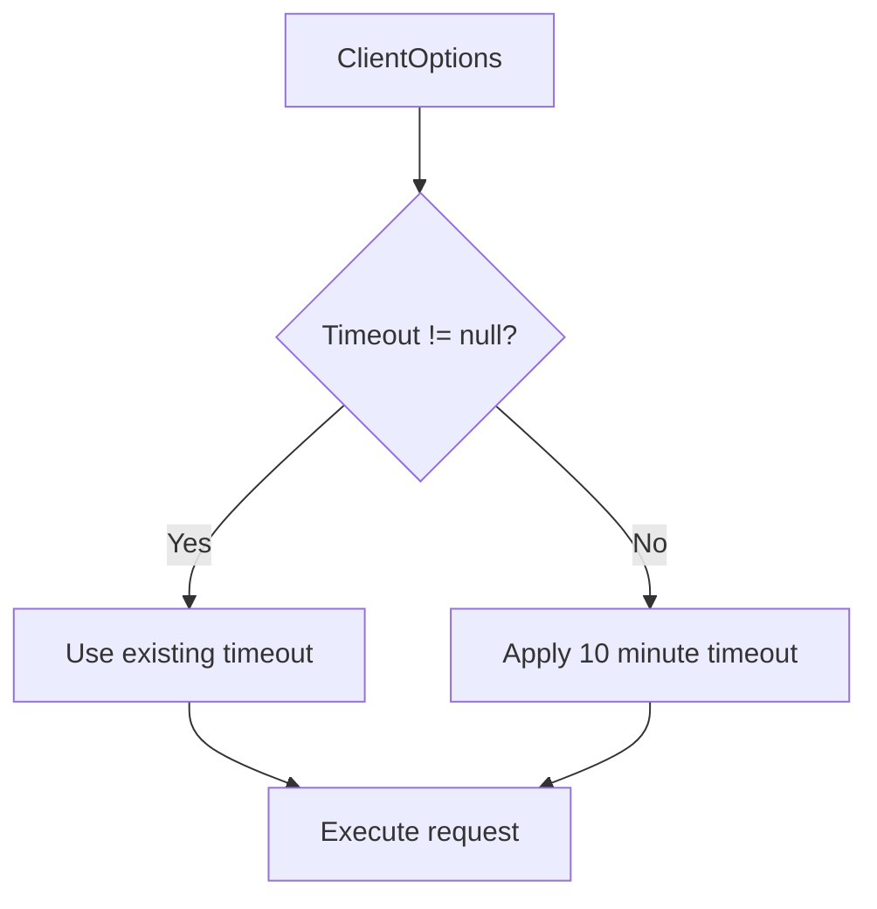
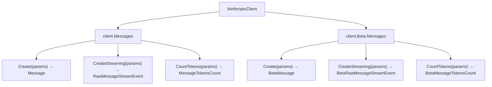

<!-- source: DeepWiki mcp.deepwiki.com · repo anthropics/anthropic-sdk-csharp · page 4.1 Messages Service · fetched 2026-10-26 -->

# Messages Service

<details>
<summary>Relevant source files</summary>

The following files were used as context for generating this wiki page:

- [examples/MessagesExample/MessagesExample.csproj](examples/MessagesExample/MessagesExample.csproj)
- [examples/MessagesExample/Program.cs](examples/MessagesExample/Program.cs)
- [examples/MessagesStreamingExample/MessagesStreamingExample.csproj](examples/MessagesStreamingExample/MessagesStreamingExample.csproj)
- [examples/MessagesStreamingExample/Program.cs](examples/MessagesStreamingExample/Program.cs)
- [examples/ThinkingExample/Program.cs](examples/ThinkingExample/Program.cs)
- [examples/ThinkingExample/ThinkingExample.csproj](examples/ThinkingExample/ThinkingExample.csproj)
- [examples/ThinkingStreamingExample/Program.cs](examples/ThinkingStreamingExample/Program.cs)
- [examples/ThinkingStreamingExample/ThinkingStreamingExample.csproj](examples/ThinkingStreamingExample/ThinkingStreamingExample.csproj)
- [src/Anthropic.Tests/AnthropicTestClients.cs](src/Anthropic.Tests/AnthropicTestClients.cs)
- [src/Anthropic.Tests/Services/Beta/FileServiceTest.cs](src/Anthropic.Tests/Services/Beta/FileServiceTest.cs)
- [src/Anthropic.Tests/Services/Beta/MessageServiceTest.cs](src/Anthropic.Tests/Services/Beta/MessageServiceTest.cs)
- [src/Anthropic.Tests/Services/Beta/Messages/BatchServiceTest.cs](src/Anthropic.Tests/Services/Beta/Messages/BatchServiceTest.cs)
- [src/Anthropic.Tests/Services/Beta/ModelServiceTest.cs](src/Anthropic.Tests/Services/Beta/ModelServiceTest.cs)
- [src/Anthropic.Tests/Services/Beta/SkillServiceTest.cs](src/Anthropic.Tests/Services/Beta/SkillServiceTest.cs)
- [src/Anthropic.Tests/Services/Beta/Skills/VersionServiceTest.cs](src/Anthropic.Tests/Services/Beta/Skills/VersionServiceTest.cs)
- [src/Anthropic.Tests/Services/MessageServiceTest.cs](src/Anthropic.Tests/Services/MessageServiceTest.cs)
- [src/Anthropic.Tests/Services/Messages/BatchServiceTest.cs](src/Anthropic.Tests/Services/Messages/BatchServiceTest.cs)
- [src/Anthropic.Tests/Services/ModelServiceTest.cs](src/Anthropic.Tests/Services/ModelServiceTest.cs)
- [src/Anthropic/Core/ApiEnum.cs](src/Anthropic/Core/ApiEnum.cs)
- [src/Anthropic/Core/FreezableDictionary.cs](src/Anthropic/Core/FreezableDictionary.cs)
- [src/Anthropic/Core/HttpResponse.cs](src/Anthropic/Core/HttpResponse.cs)
- [src/Anthropic/Core/ParamsBase.cs](src/Anthropic/Core/ParamsBase.cs)
- [src/Anthropic/Services/Beta/MessageService.cs](src/Anthropic/Services/Beta/MessageService.cs)
- [src/Anthropic/Services/MessageService.cs](src/Anthropic/Services/MessageService.cs)

</details>


The Messages Service is the primary interface for interacting with Claude AI models to create conversational messages. This service provides synchronous message creation, streaming responses, and token counting capabilities. It is accessed through the `IAnthropicClient.Messages` property and handles all communication with the `/messages` API endpoint.

For information about batch processing of messages, see [Batch Processing](#4.2). For details about message parameters and content types, see [Message Parameters](#5.1) and [Content Blocks](#5.3). For streaming-specific details, see [Streaming Responses](#5.2).

## Service Architecture

The Messages Service follows a proxy pattern where the service acts as an intermediary between the client and the API endpoint. Both stable and beta versions share the same operational structure but differ in their type systems.



**Sources:** [src/Anthropic/Services/MessageService.cs:16-129](), [src/Anthropic/Services/Beta/MessageService.cs:16-138]()

### Service Interface

The `IMessageService` interface defines three core operations and provides access to the Batches sub-service:

| Method | Return Type | Purpose |
|--------|------------|---------|
| `Create` | `Task<Message>` | Creates a single message synchronously |
| `CreateStreaming` | `IAsyncEnumerable<RawMessageStreamEvent>` | Creates a message with streaming response |
| `CountTokens` | `Task<MessageTokensCount>` | Counts tokens in a request without creating a message |
| `Batches` | `IBatchService` | Provides access to batch processing operations |
| `WithOptions` | `IMessageService` | Creates a new service instance with modified client options |

The service implementation is located at [src/Anthropic/Services/MessageService.cs:16]() for the stable API and [src/Anthropic/Services/Beta/MessageService.cs:16]() for the beta API.

**Sources:** [src/Anthropic/Services/MessageService.cs:16-36](), [src/Anthropic/Services/Beta/MessageService.cs:16-40]()

### Service Initialization

The `MessageService` is instantiated by the client and maintains a reference to its parent `IAnthropicClient`. The Batches sub-service is lazily initialized to avoid creating unnecessary objects:



**Sources:** [src/Anthropic/Services/MessageService.cs:26-36](), [src/Anthropic/Services/Beta/MessageService.cs:30-40]()

## Create Operation

The `Create` method sends a synchronous message request and returns a complete `Message` response. This operation applies a default timeout of 10 minutes if no timeout is configured.

### Method Signature

```csharp
Task<Message> Create(
    MessageCreateParams parameters,
    CancellationToken cancellationToken = default
)
```

**Sources:** [src/Anthropic/Services/MessageService.cs:39-64]()

### Execution Flow



**Sources:** [src/Anthropic/Services/MessageService.cs:39-64]()

### Implementation Details

The Create operation follows this sequence:

1. **Request Construction** - Creates an `HttpRequest<MessageCreateParams>` with HTTP POST method [src/Anthropic/Services/MessageService.cs:44-48]()
2. **Timeout Application** - Applies a 10-minute timeout using `WithOptions` if no timeout is set [src/Anthropic/Services/MessageService.cs:50-55]()
3. **Execution** - Calls `IAnthropicClient.Execute` with retry logic and exponential backoff [src/Anthropic/Services/MessageService.cs:56-57]()
4. **Deserialization** - Deserializes the HTTP response to a `Message` object [src/Anthropic/Services/MessageService.cs:58]()
5. **Validation** - Optionally validates the response if `ResponseValidation` is enabled [src/Anthropic/Services/MessageService.cs:59-62]()

**Sources:** [src/Anthropic/Services/MessageService.cs:39-64](), [src/Anthropic/Services/Beta/MessageService.cs:43-70]()

### Usage Example

The following example from the MessagesExample project demonstrates basic usage:

```csharp
MessageCreateParams parameters = new()
{
    MaxTokens = 2048,
    Messages = [new() { Content = "Tell me a story", Role = Role.User }],
    Model = "claude-sonnet-4-5",
};

var response = await client.Messages.Create(parameters);
```

**Sources:** [examples/MessagesExample/Program.cs:10-20]()

## CreateStreaming Operation

The `CreateStreaming` method enables streaming message responses using Server-Sent Events (SSE). This allows processing message content incrementally as it is generated, rather than waiting for the complete response.

### Method Signature

```csharp
IAsyncEnumerable<RawMessageStreamEvent> CreateStreaming(
    MessageCreateParams parameters,
    CancellationToken cancellationToken = default
)
```

**Sources:** [src/Anthropic/Services/MessageService.cs:67-104]()

### Stream Processing Flow



**Sources:** [src/Anthropic/Services/MessageService.cs:67-104]()

### Implementation Details

The streaming operation differs from the synchronous Create in several ways:

1. **Parameter Modification** - The `stream` field is automatically set to `true` in the request body by cloning `RawBodyData` and adding the stream flag [src/Anthropic/Services/MessageService.cs:72-78]()

2. **SSE Processing** - The response is processed using `Sse.Enumerate<RawMessageStreamEvent>` which parses Server-Sent Events [src/Anthropic/Services/MessageService.cs:94-96]()

3. **Event Validation** - Each event is optionally validated before yielding [src/Anthropic/Services/MessageService.cs:98-101]()

4. **Async Enumeration** - Returns events via `yield return` allowing consumers to process incrementally [src/Anthropic/Services/MessageService.cs:102]()

**Sources:** [src/Anthropic/Services/MessageService.cs:67-104](), [src/Anthropic/Services/Beta/MessageService.cs:73-113]()

### Stream Event Types

The `RawMessageStreamEvent` is a discriminated union containing various event types. Common events include:

- `MessageStart` - Initial message metadata
- `ContentBlockStart` - Beginning of a content block
- `ContentBlockDelta` - Incremental content updates
- `ContentBlockStop` - End of a content block
- `MessageDelta` - Message-level updates (usage metrics)
- `MessageStop` - End of message

**Sources:** [examples/MessagesStreamingExample/Program.cs:17-27](), [examples/ThinkingStreamingExample/Program.cs:18-35]()

### Streaming Usage Example

```csharp
IAsyncEnumerable<RawMessageStreamEvent> responseUpdates = 
    client.Messages.CreateStreaming(parameters);

await foreach (RawMessageStreamEvent rawEvent in responseUpdates)
{
    if (rawEvent.TryPickContentBlockDelta(out var delta) && 
        delta.Delta.TryPickText(out var text))
    {
        Console.Write(text.Text);
    }
}
```

**Sources:** [examples/MessagesStreamingExample/Program.cs:17-27]()

## CountTokens Operation

The `CountTokens` method calculates the number of tokens that would be consumed by a message request without actually creating the message. This is useful for estimating costs and managing token budgets.

### Method Signature

```csharp
Task<MessageTokensCount> CountTokens(
    MessageCountTokensParams parameters,
    CancellationToken cancellationToken = default
)
```

**Sources:** [src/Anthropic/Services/MessageService.cs:107-128]()

### Execution Pattern

The CountTokens operation follows a similar pattern to Create but uses different parameter and response types:



**Sources:** [src/Anthropic/Services/MessageService.cs:107-128]()

### Implementation Details

Key differences from the Create operation:

1. **No Timeout Override** - Uses the client's default timeout without applying the 10-minute override [src/Anthropic/Services/MessageService.cs:117-119]()

2. **Parameter Type** - Accepts `MessageCountTokensParams` which contains a subset of `MessageCreateParams` fields [src/Anthropic/Services/MessageService.cs:108]()

3. **Response Type** - Returns `MessageTokensCount` containing token usage information [src/Anthropic/Services/MessageService.cs:120-122]()

**Sources:** [src/Anthropic/Services/MessageService.cs:107-128](), [src/Anthropic/Services/Beta/MessageService.cs:116-137]()

### Usage Example

```csharp
var messageTokensCount = await client.Messages.CountTokens(
    new()
    {
        Messages = [new() { Content = "string", Role = Role.User }],
        Model = "claude-sonnet-4-5",
    }
);
```

**Sources:** [src/Anthropic.Tests/Services/MessageServiceTest.cs:56-63]()

## Request and Response Processing

### HttpRequest Construction

All operations construct an `HttpRequest<TParams>` object that encapsulates the HTTP method and parameters. The generic parameter type varies by operation:

| Operation | Parameter Type | HTTP Method | Endpoint |
|-----------|---------------|-------------|----------|
| Create | `MessageCreateParams` | POST | `/messages` |
| CreateStreaming | `MessageCreateParams` | POST | `/messages` |
| CountTokens | `MessageCountTokensParams` | POST | `/messages/count_tokens` |

**Sources:** [src/Anthropic/Services/MessageService.cs:44-48,80-84,112-116]()

### Parameter Serialization

Parameters inherit from `ParamsBase` which provides:

- **RawBodyData** - Freezable dictionary of JSON elements for the request body [src/Anthropic/Core/ParamsBase.cs:34]()
- **RawHeaderData** - Freezable dictionary of JSON elements for headers [src/Anthropic/Core/ParamsBase.cs:36]()
- **RawQueryData** - Freezable dictionary of JSON elements for query parameters [src/Anthropic/Core/ParamsBase.cs:34]()

The `FreezableDictionary` allows mutation during initialization via `init` properties, then freezes to prevent further modification:



**Sources:** [src/Anthropic/Core/ParamsBase.cs:34-52](), [src/Anthropic/Core/FreezableDictionary.cs:16-63]()

### Response Deserialization

The `HttpResponse` class wraps the HTTP response and provides deserialization through `System.Text.Json`:

1. **Stream Reading** - Reads the response content as a stream [src/Anthropic/Core/HttpResponse.cs:40-51]()
2. **JSON Deserialization** - Uses `JsonSerializer.DeserializeAsync<T>` with `ModelBase.SerializerOptions` [src/Anthropic/Core/HttpResponse.cs:25-30]()
3. **Null Validation** - Throws `AnthropicInvalidDataException` if the response is null [src/Anthropic/Core/HttpResponse.cs:32]()
4. **Error Wrapping** - Wraps `HttpRequestException` as `AnthropicIOException` [src/Anthropic/Core/HttpResponse.cs:34-37]()

**Sources:** [src/Anthropic/Core/HttpResponse.cs:17-38]()

### Response Validation

If `IAnthropicClient.ResponseValidation` is enabled, each response object's `Validate()` method is called. This verifies:

- Enum values are within known ranges (using `ApiEnum<TRaw, TEnum>` wrapper)
- Required fields are present
- Union types contain valid discriminators

**Sources:** [src/Anthropic/Services/MessageService.cs:59-62,98-101,123-126](), [src/Anthropic/Core/ApiEnum.cs:61-67]()

## Configuration and Timeout Management

### WithOptions Pattern

The `WithOptions` method creates a new service instance with modified client options. This enables per-request configuration without mutating the original client:

```csharp
public IMessageService WithOptions(Func<ClientOptions, ClientOptions> modifier)
{
    return new MessageService(this._client.WithOptions(modifier));
}
```

**Sources:** [src/Anthropic/Services/MessageService.cs:19-22]()

### Timeout Handling

Create and CreateStreaming operations apply a special timeout handling strategy:



The 10-minute default timeout for message operations is applied using the `WithOptions` pattern:

```csharp
await this._client.WithOptions(options =>
    options with
    {
        Timeout = options.Timeout ?? TimeSpan.FromMinutes(10),
    }
).Execute(request, cancellationToken)
```

This ensures that long-running message generation operations have sufficient time to complete, while still respecting explicitly configured timeouts.

**Sources:** [src/Anthropic/Services/MessageService.cs:50-55,86-91](), [src/Anthropic/Services/Beta/MessageService.cs:54-59,92-97]()

## Beta vs Stable Service Differences

The SDK provides parallel implementations of the Messages Service for stable and beta APIs. Both share the same operational logic but differ in type systems:

### Type System Differences

| Aspect | Stable API | Beta API |
|--------|-----------|----------|
| Namespace | `Anthropic.Models.Messages` | `Anthropic.Models.Beta.Messages` |
| Response Type | `Message` | `BetaMessage` |
| Stream Event | `RawMessageStreamEvent` | `BetaRawMessageStreamEvent` |
| Token Count | `MessageTokensCount` | `BetaMessageTokensCount` |
| Parameter Types | Shared | Shared |

**Sources:** [src/Anthropic/Services/MessageService.cs:10](), [src/Anthropic/Services/Beta/MessageService.cs:10]()

### Beta-Specific Features

The Beta API includes additional features not available in the stable API:

- **Container System** - `BetaContainer` with skills integration
- **Context Management** - `BetaContextManagementConfig` with edits and triggers
- **MCP Servers** - `BetaMCPServer` configuration
- **Output Configuration** - `OutputConfig` with effort settings
- **Extended Tools** - Additional tool types and configurations

These features are documented in the Beta Services section ([#4.4](#4.4)) and Advanced Features sections ([#7](#7)).

**Sources:** [src/Anthropic.Tests/Services/Beta/Messages/BatchServiceTest.cs:29-139]()

### Service Access Paths



**Sources:** [src/Anthropic.Tests/Services/MessageServiceTest.cs:14-65](), [src/Anthropic.Tests/Services/Beta/MessageServiceTest.cs:12-59]()

## Testing and Validation

### Test Infrastructure

The Messages Service is tested using the `AnthropicTestClientsAttribute` which provisions both `AnthropicClient` and `AnthropicFoundryClient` instances:

```csharp
[Theory]
[AnthropicTestClients]
[AnthropicTestData(TestSupportTypes.Anthropic, "Claude3_7SonnetLatest")]
[AnthropicTestData(TestSupportTypes.Foundry, "claude-sonnet-4-5")]
public async Task Create_Works(IAnthropicClient client, string modelName)
```

This attribute injects client instances configured to use a test API endpoint (default: `http://localhost:4010`) which is typically a Prism mock server.

**Sources:** [src/Anthropic.Tests/Services/MessageServiceTest.cs:10-26](), [src/Anthropic.Tests/AnthropicTestClients.cs:12-73]()

### Test Coverage

The service tests validate:

1. **Operation Execution** - Each method executes without exceptions
2. **Response Deserialization** - Responses deserialize to expected types
3. **Response Validation** - `Validate()` methods execute successfully
4. **Multi-Client Support** - Operations work with both Anthropic and Foundry clients
5. **Model Compatibility** - Different model names are handled correctly

**Sources:** [src/Anthropic.Tests/Services/MessageServiceTest.cs:14-65](), [src/Anthropic.Tests/Services/Beta/MessageServiceTest.cs:12-59]()

### Validation Pattern

All test methods follow this pattern:

```csharp
var response = await client.Messages.Create(parameters, cancellationToken);
response.Validate();
```

The `Validate()` method throws `AnthropicInvalidDataException` if the response contains invalid data, ensuring that API contract violations are detected during testing.

**Sources:** [src/Anthropic.Tests/Services/MessageServiceTest.cs:25](), [src/Anthropic/Core/ApiEnum.cs:61-67]()

---

