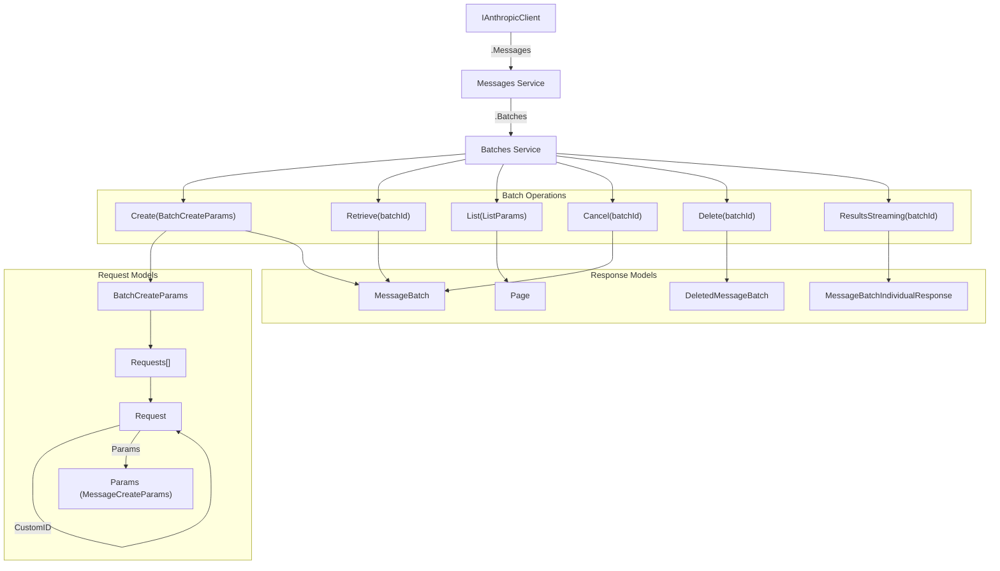
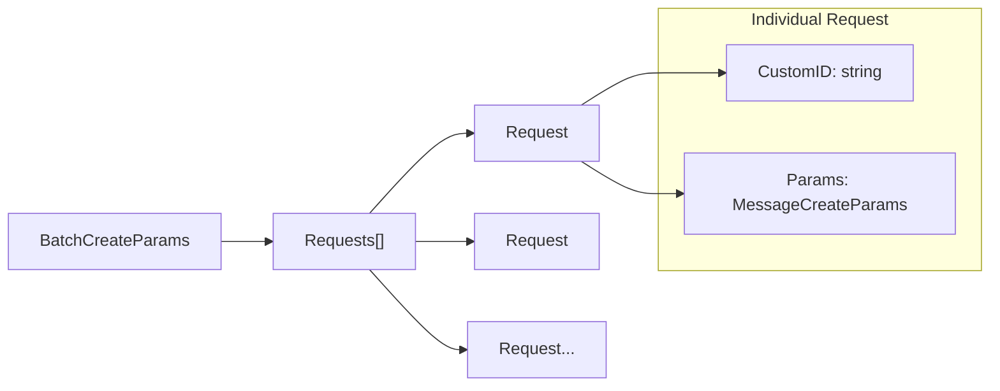
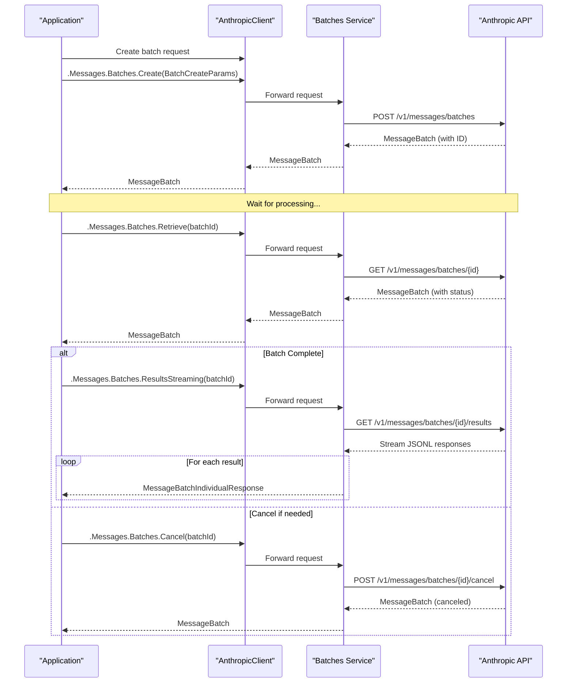
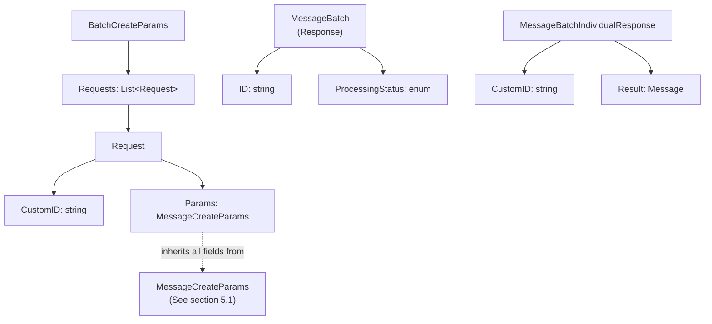

<!-- source: DeepWiki mcp.deepwiki.com · repo anthropics/anthropic-sdk-csharp · page 4.2 Batch Processing · fetched 2026-10-26 -->

# Batch Processing

<details>
<summary>Relevant source files</summary>

The following files were used as context for generating this wiki page:

- [src/Anthropic.Tests/AnthropicTestClients.cs](src/Anthropic.Tests/AnthropicTestClients.cs)
- [src/Anthropic.Tests/Models/Beta/Messages/Batches/BatchCreateParamsTest.cs](src/Anthropic.Tests/Models/Beta/Messages/Batches/BatchCreateParamsTest.cs)
- [src/Anthropic.Tests/Models/Beta/Messages/BetaClearThinking20251015EditTest.cs](src/Anthropic.Tests/Models/Beta/Messages/BetaClearThinking20251015EditTest.cs)
- [src/Anthropic.Tests/Models/Beta/Messages/BetaMessageParamTest.cs](src/Anthropic.Tests/Models/Beta/Messages/BetaMessageParamTest.cs)
- [src/Anthropic.Tests/Models/Beta/Messages/BetaServerToolUseBlockParamTest.cs](src/Anthropic.Tests/Models/Beta/Messages/BetaServerToolUseBlockParamTest.cs)
- [src/Anthropic.Tests/Models/Beta/Messages/BetaServerToolUseBlockTest.cs](src/Anthropic.Tests/Models/Beta/Messages/BetaServerToolUseBlockTest.cs)
- [src/Anthropic.Tests/Models/Beta/Messages/MessageCreateParamsTest.cs](src/Anthropic.Tests/Models/Beta/Messages/MessageCreateParamsTest.cs)
- [src/Anthropic.Tests/Models/Messages/Batches/BatchCreateParamsTest.cs](src/Anthropic.Tests/Models/Messages/Batches/BatchCreateParamsTest.cs)
- [src/Anthropic.Tests/Models/Messages/MessageCreateParamsTest.cs](src/Anthropic.Tests/Models/Messages/MessageCreateParamsTest.cs)
- [src/Anthropic.Tests/Models/Messages/MessageParamTest.cs](src/Anthropic.Tests/Models/Messages/MessageParamTest.cs)
- [src/Anthropic.Tests/Services/Beta/FileServiceTest.cs](src/Anthropic.Tests/Services/Beta/FileServiceTest.cs)
- [src/Anthropic.Tests/Services/Beta/MessageServiceTest.cs](src/Anthropic.Tests/Services/Beta/MessageServiceTest.cs)
- [src/Anthropic.Tests/Services/Beta/Messages/BatchServiceTest.cs](src/Anthropic.Tests/Services/Beta/Messages/BatchServiceTest.cs)
- [src/Anthropic.Tests/Services/Beta/ModelServiceTest.cs](src/Anthropic.Tests/Services/Beta/ModelServiceTest.cs)
- [src/Anthropic.Tests/Services/Beta/SkillServiceTest.cs](src/Anthropic.Tests/Services/Beta/SkillServiceTest.cs)
- [src/Anthropic.Tests/Services/Beta/Skills/VersionServiceTest.cs](src/Anthropic.Tests/Services/Beta/Skills/VersionServiceTest.cs)
- [src/Anthropic.Tests/Services/MessageServiceTest.cs](src/Anthropic.Tests/Services/MessageServiceTest.cs)
- [src/Anthropic.Tests/Services/Messages/BatchServiceTest.cs](src/Anthropic.Tests/Services/Messages/BatchServiceTest.cs)
- [src/Anthropic.Tests/Services/ModelServiceTest.cs](src/Anthropic.Tests/Services/ModelServiceTest.cs)

</details>


The Batch Processing service enables efficient submission of multiple message requests in a single API call, with asynchronous result retrieval. This approach optimizes costs and throughput for bulk message generation workloads. For single message operations, see [Messages Service](#4.1).

## Overview

The Batches service allows you to submit up to thousands of individual message requests as a single batch job. The API processes these requests asynchronously and makes results available for retrieval. This is particularly useful for:

- Large-scale content generation
- Bulk evaluation or testing scenarios
- Cost-optimized batch workloads where immediate responses are not required

The SDK provides both stable and beta batch APIs, with the beta version supporting additional features such as container management, context management, and MCP server integration.

Sources: [src/Anthropic.Tests/Services/Messages/BatchServiceTest.cs:1-156]()

## Service Architecture



Sources: [src/Anthropic.Tests/Services/Messages/BatchServiceTest.cs:12-155]()

## Accessing the Batch Service

The batch service is accessed through the `Messages.Batches` property on the client instance:

```csharp
var client = new AnthropicClient();
var batchService = client.Messages.Batches;
```

For beta features:
```csharp
var betaBatchService = client.Beta.Messages.Batches;
```

Sources: [src/Anthropic.Tests/Services/Messages/BatchServiceTest.cs:18](), [src/Anthropic.Tests/Services/Beta/Messages/BatchServiceTest.cs:16]()

## Creating Batch Jobs

### Request Structure

A batch job consists of an array of individual requests, each with a unique custom ID and message parameters:



Sources: [src/Anthropic.Tests/Models/Messages/Batches/BatchCreateParamsTest.cs:15-72]()

### Creating a Batch

| Parameter | Type | Description |
|-----------|------|-------------|
| `Requests` | `List<Request>` | Array of individual message requests |
| `Request.CustomID` | `string` | User-defined identifier for tracking individual requests |
| `Request.Params` | `Params` | Message creation parameters (identical to `MessageCreateParams`) |

Example invocation:

```csharp
var messageBatch = await client.Messages.Batches.Create(
    new BatchCreateParams()
    {
        Requests = [
            new Request()
            {
                CustomID = "my-custom-id-1",
                Params = new Params()
                {
                    MaxTokens = 1024,
                    Messages = [
                        new MessageParam() { 
                            Content = "Hello, world", 
                            Role = Role.User 
                        }
                    ],
                    Model = Model.ClaudeOpus4_5_20251101
                }
            }
        ]
    },
    cancellationToken
);
```

Sources: [src/Anthropic.Tests/Services/Messages/BatchServiceTest.cs:18-93]()

### Request Parameters

The `Params` object within each `Request` accepts all standard message creation parameters:

| Parameter | Type | Description |
|-----------|------|-------------|
| `MaxTokens` | `long` | Maximum tokens to generate |
| `Messages` | `List<MessageParam>` | Conversation messages |
| `Model` | `ApiEnum<string, Model>` | Model identifier |
| `Metadata` | `Metadata` | Request metadata |
| `ServiceTier` | `ApiEnum<string, ServiceTier>` | Service tier (Auto/StandardOnly) |
| `StopSequences` | `List<string>` | Stop sequences |
| `Stream` | `bool` | Enable streaming (typically false for batches) |
| `System` | `ParamsSystem` | System prompts |
| `Temperature` | `double` | Sampling temperature |
| `Thinking` | `ThinkingConfigParam` | Thinking configuration |
| `ToolChoice` | `ToolChoice` | Tool selection strategy |
| `Tools` | `List<ToolUnion>` | Available tools |
| `TopK` | `long` | Top-K sampling |
| `TopP` | `double` | Top-P sampling |

Sources: [src/Anthropic.Tests/Services/Messages/BatchServiceTest.cs:26-88](), [src/Anthropic.Tests/Models/Messages/Batches/BatchCreateParamsTest.cs:18-71]()

## Managing Batch Jobs

### Retrieving Batch Status

Retrieve the current status and metadata of a batch job:

```csharp
var messageBatch = await client.Messages.Batches.Retrieve(
    "message_batch_id",
    new RetrieveParams(),
    cancellationToken
);
```

Sources: [src/Anthropic.Tests/Services/Messages/BatchServiceTest.cs:99-106]()

### Listing Batches

List all batch jobs with pagination support:

```csharp
var page = await client.Messages.Batches.List(
    new ListParams(), 
    cancellationToken
);
```

The response is a `Page<MessageBatch>` object containing batch metadata.

Sources: [src/Anthropic.Tests/Services/Messages/BatchServiceTest.cs:111-114]()

### Canceling Batches

Cancel an in-progress batch job:

```csharp
var messageBatch = await client.Messages.Batches.Cancel(
    "message_batch_id",
    new CancelParams(),
    cancellationToken
);
```

Sources: [src/Anthropic.Tests/Services/Messages/BatchServiceTest.cs:131-138]()

### Deleting Batches

Delete a completed or canceled batch job:

```csharp
var deletedMessageBatch = await client.Messages.Batches.Delete(
    "message_batch_id",
    new DeleteParams(),
    cancellationToken
);
```

Sources: [src/Anthropic.Tests/Services/Messages/BatchServiceTest.cs:119-126]()

## Retrieving Results

### Streaming Results

Results are retrieved as a stream of individual responses using the `ResultsStreaming` method:

```csharp
var stream = client.Messages.Batches.ResultsStreaming(
    "message_batch_id",
    new ResultsStreamingParams(),
    cancellationToken
);

await foreach (var messageBatchIndividualResponse in stream)
{
    // Process individual response
    // Response includes CustomID to correlate with original request
}
```

The stream returns `MessageBatchIndividualResponse` objects in JSONL (JSON Lines) format, where each response can be matched to the original request via the `CustomID` field.

Sources: [src/Anthropic.Tests/Services/Messages/BatchServiceTest.cs:143-155]()

## Beta Batch Features

The beta batch service (`client.Beta.Messages.Batches`) supports all standard batch operations plus additional experimental features in the request parameters:

### Beta-Specific Parameters

| Parameter | Type | Description |
|-----------|------|-------------|
| `Container` | `BetaContainerParams` or `string` | Container and skills configuration |
| `ContextManagement` | `BetaContextManagementConfig` | Context editing and pruning |
| `MCPServers` | `List<BetaMCPServer>` | Model Context Protocol server configuration |
| `OutputConfig` | `BetaOutputConfig` | Output generation configuration |
| `OutputFormat` | `BetaOutputFormat` | Structured output schema |

### Container Configuration

```csharp
Container = new BetaContainerParams()
{
    ID = "container-id",
    Skills = [
        new BetaSkillParams()
        {
            SkillID = "skill-id",
            Type = BetaSkillParamsType.Anthropic,
            Version = "version"
        }
    ]
}
```

Sources: [src/Anthropic.Tests/Services/Beta/Messages/BatchServiceTest.cs:29-41]()

### Context Management

```csharp
ContextManagement = new BetaContextManagementConfig()
{
    Edits = [
        new BetaClearToolUses20250919Edit()
        {
            ClearAtLeast = new(0),
            ClearToolInputs = true,
            ExcludeTools = ["tool-name"],
            Keep = new(0),
            Trigger = new BetaInputTokensTrigger(1)
        }
    ]
}
```

Sources: [src/Anthropic.Tests/Services/Beta/Messages/BatchServiceTest.cs:42-54]()

### MCP Server Configuration

```csharp
MCPServers = [
    new BetaMCPServer()
    {
        Name = "server-name",
        URL = "server-url",
        AuthorizationToken = "token",
        ToolConfiguration = new BetaMCPServerToolConfiguration()
        {
            AllowedTools = ["tool1", "tool2"],
            Enabled = true
        }
    }
]
```

Sources: [src/Anthropic.Tests/Services/Beta/Messages/BatchServiceTest.cs:56-69]()

## Operation Flow Diagram



Sources: [src/Anthropic.Tests/Services/Messages/BatchServiceTest.cs:12-155]()

## Data Model Hierarchy



Sources: [src/Anthropic.Tests/Models/Messages/Batches/BatchCreateParamsTest.cs:10-391](), [src/Anthropic.Tests/Models/Beta/Messages/Batches/BatchCreateParamsTest.cs:10-722]()

## Client Support

Both `AnthropicClient` and `AnthropicFoundryClient` support batch operations:

| Client Type | Access Path |
|-------------|-------------|
| Standard | `client.Messages.Batches` |
| Beta | `client.Beta.Messages.Batches` |
| Azure Foundry | `foundryClient.Messages.Batches` |

All clients support the same batch operation methods (Create, Retrieve, List, Cancel, Delete, ResultsStreaming).

Sources: [src/Anthropic.Tests/AnthropicTestClients.cs:37-69]()

## Key Differences: Standard vs Beta

| Feature | Standard | Beta |
|---------|----------|------|
| Basic batch operations | ✓ | ✓ |
| Container/Skills | ✗ | ✓ |
| Context Management | ✗ | ✓ |
| MCP Servers | ✗ | ✓ |
| Output Format Schema | ✗ | ✓ |
| Tool allowed callers | ✗ | ✓ |
| Tool defer loading | ✗ | ✓ |

Sources: [src/Anthropic.Tests/Services/Messages/BatchServiceTest.cs:16-94](), [src/Anthropic.Tests/Services/Beta/Messages/BatchServiceTest.cs:14-145]()

---

