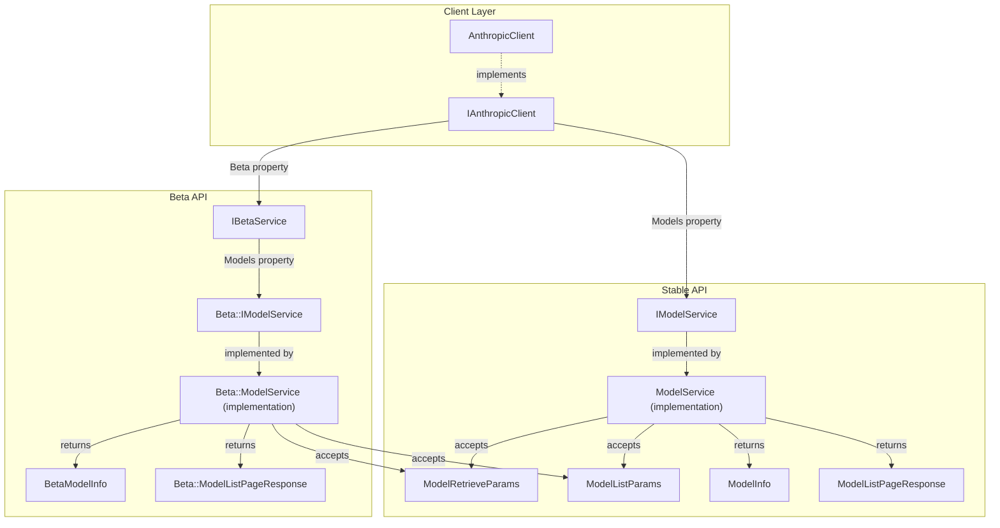
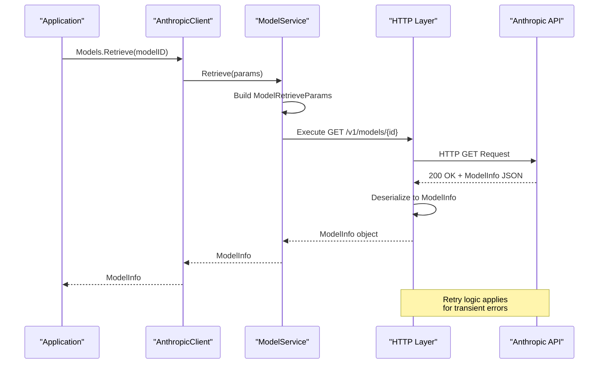
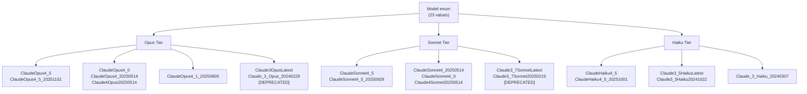
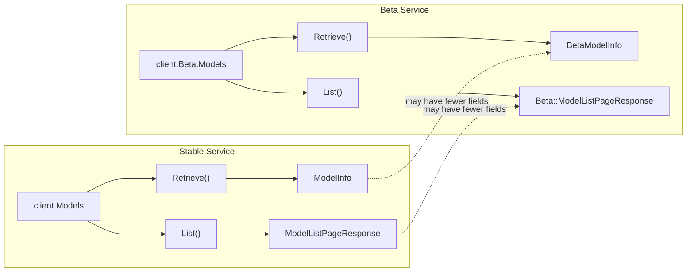

<!-- source: DeepWiki mcp.deepwiki.com · repo anthropics/anthropic-sdk-csharp · page 4.3 Models Service · fetched 2026-10-26 -->

# Models Service

<details>
<summary>Relevant source files</summary>

The following files were used as context for generating this wiki page:

- [.stats.yml](.stats.yml)
- [src/Anthropic.Tests/AnthropicTestClients.cs](src/Anthropic.Tests/AnthropicTestClients.cs)
- [src/Anthropic.Tests/Services/Beta/FileServiceTest.cs](src/Anthropic.Tests/Services/Beta/FileServiceTest.cs)
- [src/Anthropic.Tests/Services/Beta/MessageServiceTest.cs](src/Anthropic.Tests/Services/Beta/MessageServiceTest.cs)
- [src/Anthropic.Tests/Services/Beta/Messages/BatchServiceTest.cs](src/Anthropic.Tests/Services/Beta/Messages/BatchServiceTest.cs)
- [src/Anthropic.Tests/Services/Beta/ModelServiceTest.cs](src/Anthropic.Tests/Services/Beta/ModelServiceTest.cs)
- [src/Anthropic.Tests/Services/Beta/SkillServiceTest.cs](src/Anthropic.Tests/Services/Beta/SkillServiceTest.cs)
- [src/Anthropic.Tests/Services/Beta/Skills/VersionServiceTest.cs](src/Anthropic.Tests/Services/Beta/Skills/VersionServiceTest.cs)
- [src/Anthropic.Tests/Services/MessageServiceTest.cs](src/Anthropic.Tests/Services/MessageServiceTest.cs)
- [src/Anthropic.Tests/Services/Messages/BatchServiceTest.cs](src/Anthropic.Tests/Services/Messages/BatchServiceTest.cs)
- [src/Anthropic.Tests/Services/ModelServiceTest.cs](src/Anthropic.Tests/Services/ModelServiceTest.cs)
- [src/Anthropic/Models/Beta/AnthropicBeta.cs](src/Anthropic/Models/Beta/AnthropicBeta.cs)
- [src/Anthropic/Models/Messages/Model.cs](src/Anthropic/Models/Messages/Model.cs)

</details>


This document describes the Models Service API, which provides operations for retrieving information about available AI models and listing models accessible through the Anthropic API. For creating messages with specific models, see [Messages Service](#4.1). For beta-specific model features, see [Beta Services](#4.4).

## Overview

The Models Service exposes two primary operations:
- **Retrieve**: Get detailed information about a specific model by ID or resolve a model alias
- **List**: Enumerate all available models in the API

The service is accessible through both stable (`IModelService`) and beta (`Beta::IModelService`) interfaces, with identical method signatures. Both return model information objects containing metadata about context windows, capabilities, and release dates.

Sources: [src/Anthropic/Services/IModelService.cs:9-51](), [src/Anthropic/Services/Beta/IModelService.cs:9-53]()

## Service Architecture



**Diagram: Models Service in SDK Architecture**

The Models Service is accessed via `client.Models` for stable API operations or `client.Beta.Models` for beta features. Both services share the same parameter types but return different response types with potentially different schemas.

Sources: [src/Anthropic/IAnthropicClient.cs:89](), [src/Anthropic/Services/IModelService.cs:14](), [src/Anthropic/Services/Beta/IModelService.cs:14](), [src/Anthropic/Services/IBetaService.cs:21]()

## IModelService Interface

The `IModelService` interface defines the contract for model operations:

| Method | Parameters | Return Type | Purpose |
|--------|------------|-------------|---------|
| `Retrieve` | `ModelRetrieveParams` | `Task<ModelInfo>` | Get information about a specific model |
| `Retrieve` | `string modelID`, `ModelRetrieveParams?` | `Task<ModelInfo>` | Convenience overload with explicit model ID |
| `List` | `ModelListParams?` | `Task<ModelListPageResponse>` | List all available models |
| `WithOptions` | `Func<ClientOptions, ClientOptions>` | `IModelService` | Create modified service instance |

All methods support `CancellationToken` for async cancellation.

Sources: [src/Anthropic/Services/IModelService.cs:14-51]()

### Beta Models Service

The beta variant `Beta::IModelService` has an identical interface signature but returns `BetaModelInfo` and `Beta::ModelListPageResponse` types, which may contain additional fields or experimental metadata.

Sources: [src/Anthropic/Services/Beta/IModelService.cs:14-53]()

## Retrieving Model Information

### Basic Retrieval

The `Retrieve` method fetches metadata about a specific model:

```csharp
// Using ModelRetrieveParams
var modelInfo = await client.Models.Retrieve(
    new ModelRetrieveParams { ModelID = "claude-opus-4-5" }
);

// Using convenience overload
var modelInfo = await client.Models.Retrieve("claude-opus-4-5");
```

### Model Resolution

The retrieve operation can resolve model aliases to specific versioned model IDs. For example, `"claude-opus-4-5"` might resolve to `"claude-opus-4-5-20251101"`.

Sources: [src/Anthropic/Services/IModelService.cs:23-39]()

### Request Flow



**Diagram: Model Retrieval Request Flow**

Sources: [src/Anthropic/Services/IModelService.cs:28-32]()

## Listing Available Models

### List Operation

The `List` method returns all models available to the authenticated account:

```csharp
// List all models
var response = await client.Models.List();

// Access model data
foreach (var model in response.Data)
{
    Console.WriteLine($"Model: {model.ID}, Type: {model.Type}");
}

// Handle pagination if needed
if (response.HasMore)
{
    var nextPage = await client.Models.List(
        new ModelListParams 
        { 
            BeforeID = response.LastID,
            Limit = 20 
        }
    );
}
```

### ModelListPageResponse Structure

The response contains:
- `Data`: Array of `ModelInfo` objects
- `HasMore`: Boolean indicating more results available
- `FirstID`: ID of first model in current page
- `LastID`: ID of last model in current page

Sources: [src/Anthropic/Services/IModelService.cs:41-50]()

### Sorting and Ordering

Models are returned with the most recently released models first. This ordering is fixed and cannot be customized via parameters.

Sources: [src/Anthropic/Services/IModelService.cs:44-46]()

## Model Enum

The SDK provides a strongly-typed `Model` enum defining all supported model identifiers:



**Diagram: Model Enum Hierarchy**

Sources: [src/Anthropic/Models/Messages/Model.cs:13-126]()

### Model Categories

| Tier | Description | Use Cases |
|------|-------------|-----------|
| **Opus** | Premium models with maximum intelligence | Complex reasoning, research, detailed analysis |
| **Sonnet** | High-performance models | Coding, real-world agents, balanced tasks |
| **Haiku** | Fastest models | Near-instant responses, high-throughput scenarios |

### Model Naming Convention

Models follow these naming patterns:
- `Claude{Tier}{Version}_{DateVersion}`: e.g., `ClaudeOpus4_5_20251101`
- `Claude{Tier}{Version}`: Aliased version, e.g., `ClaudeOpus4_5`
- `Claude_{Generation}_{Tier}_{DateVersion}`: Legacy format, e.g., `Claude_3_Opus_20240229`

Sources: [src/Anthropic/Models/Messages/Model.cs:13-126]()

### JSON Serialization

The `Model` enum uses a custom `JsonConverter` to map between C# enum values and API string identifiers:

```csharp
// Enum value: Model.ClaudeOpus4_5_20251101
// JSON string: "claude-opus-4-5-20251101"
```

The converter handles:
- Enum-to-string serialization for requests
- String-to-enum deserialization for responses
- Invalid model handling (returns `-1` enum value)

Sources: [src/Anthropic/Models/Messages/Model.cs:128-195]()

### Deprecated Models

Several models are marked with `[System::Obsolete]` attributes:

| Model | End-of-Life Date | Recommendation |
|-------|------------------|----------------|
| `Claude3_7SonnetLatest` | February 19, 2026 | Migrate to `ClaudeSonnet4_5` or newer |
| `Claude3_7Sonnet20250219` | February 19, 2026 | Migrate to `ClaudeSonnet4_5` or newer |
| `Claude3OpusLatest` | January 5, 2026 | Migrate to `ClaudeOpus4_5` or newer |
| `Claude_3_Opus_20240229` | January 5, 2026 | Migrate to `ClaudeOpus4_5` or newer |

Using deprecated models generates compiler warnings. See [Deprecated Features](#11.2) for migration guidance.

Sources: [src/Anthropic/Models/Messages/Model.cs:28-120]()

## WithOptions Pattern

Both stable and beta Models services support the `WithOptions` pattern for request-level configuration:

```csharp
// Create a service instance with custom timeout
var customModels = client.Models.WithOptions(opts => opts with 
{ 
    Timeout = TimeSpan.FromSeconds(30),
    MaxRetries = 5 
});

// Use the customized service
var model = await customModels.Retrieve("claude-opus-4-5");
```

This creates a new service instance with modified settings while leaving the original client unchanged. Connection pools and HTTP clients are reused for efficiency.

Sources: [src/Anthropic/Services/IModelService.cs:16-21](), [src/Anthropic/Services/Beta/IModelService.cs:16-23]()

## Beta vs Stable Service Comparison



**Diagram: Stable vs Beta Models Service**

| Aspect | Stable Service | Beta Service |
|--------|---------------|--------------|
| Access Path | `client.Models` | `client.Beta.Models` |
| Interface | `IModelService` | `Beta::IModelService` |
| Return Types | `ModelInfo`, `ModelListPageResponse` | `BetaModelInfo`, `Beta::ModelListPageResponse` |
| Parameter Types | Shared (`ModelRetrieveParams`, `ModelListParams`) | Shared (same types) |
| Stability | Production-ready | May include experimental fields |

The beta service may expose additional model metadata or experimental capabilities not yet available in the stable API.

Sources: [src/Anthropic/Services/IModelService.cs:14](), [src/Anthropic/Services/Beta/IModelService.cs:14]()

## Usage Examples

### Checking Model Availability

```csharp
// Check if a specific model is available
try 
{
    var model = await client.Models.Retrieve("claude-opus-4-5");
    Console.WriteLine($"Model {model.ID} is available");
    Console.WriteLine($"Context window: {model.ContextWindow} tokens");
}
catch (AnthropicException ex) when (ex.StatusCode == 404)
{
    Console.WriteLine("Model not found or not accessible");
}
```

### Listing Models with Pagination

```csharp
var allModels = new List<ModelInfo>();
ModelListPageResponse? response = null;

do
{
    response = await client.Models.List(
        response?.LastID != null 
            ? new ModelListParams { BeforeID = response.LastID }
            : null
    );
    allModels.AddRange(response.Data);
} 
while (response.HasMore);

Console.WriteLine($"Total models available: {allModels.Count}");
```

### Beta Service Usage

```csharp
// Access potentially experimental model metadata
var betaModel = await client.Beta.Models.Retrieve("claude-opus-4-5");

// BetaModelInfo may contain additional fields not in ModelInfo
// Check the specific beta features you need
```

Sources: [src/Anthropic/Services/IModelService.cs:23-50](), [src/Anthropic/Services/Beta/IModelService.cs:25-52]()

## API Endpoints

The Models Service maps to these Anthropic API endpoints:

| Operation | HTTP Method | Endpoint | Response |
|-----------|-------------|----------|----------|
| Retrieve | `GET` | `/v1/models/{model_id}` | Single `ModelInfo` object |
| List | `GET` | `/v1/models` | Paginated list of `ModelInfo` objects |

Both endpoints support the standard retry and timeout behavior configured in `ClientOptions`. See [Request and Response Flow](#3.3) for details on retry logic.

Sources: [src/Anthropic/Services/IModelService.cs:24-28](), [src/Anthropic/Services/IModelService.cs:41-44]()

## Error Handling

Models Service operations follow the standard SDK error handling patterns:

- **404 Not Found**: Model ID does not exist or is not accessible to the account
- **401 Unauthorized**: Invalid API key or authentication token
- **429 Rate Limit**: Too many requests (automatically retried with backoff)
- **5xx Server Errors**: API service issues (automatically retried)

All operations throw `AnthropicException` or its subclasses on failure. See [Error Handling](#3.4) for comprehensive exception documentation.

Sources: [src/Anthropic/Services/IModelService.cs:14-51]()

---

