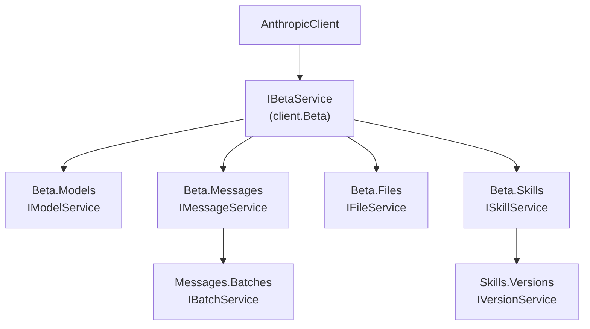
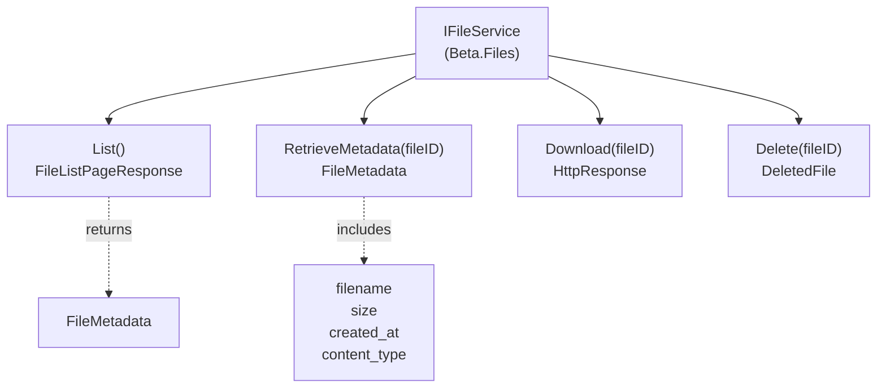
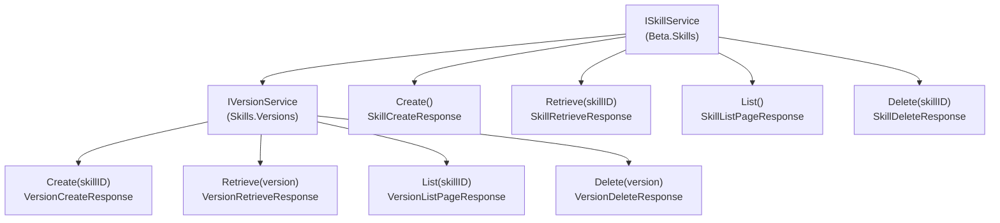
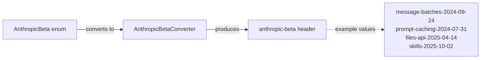
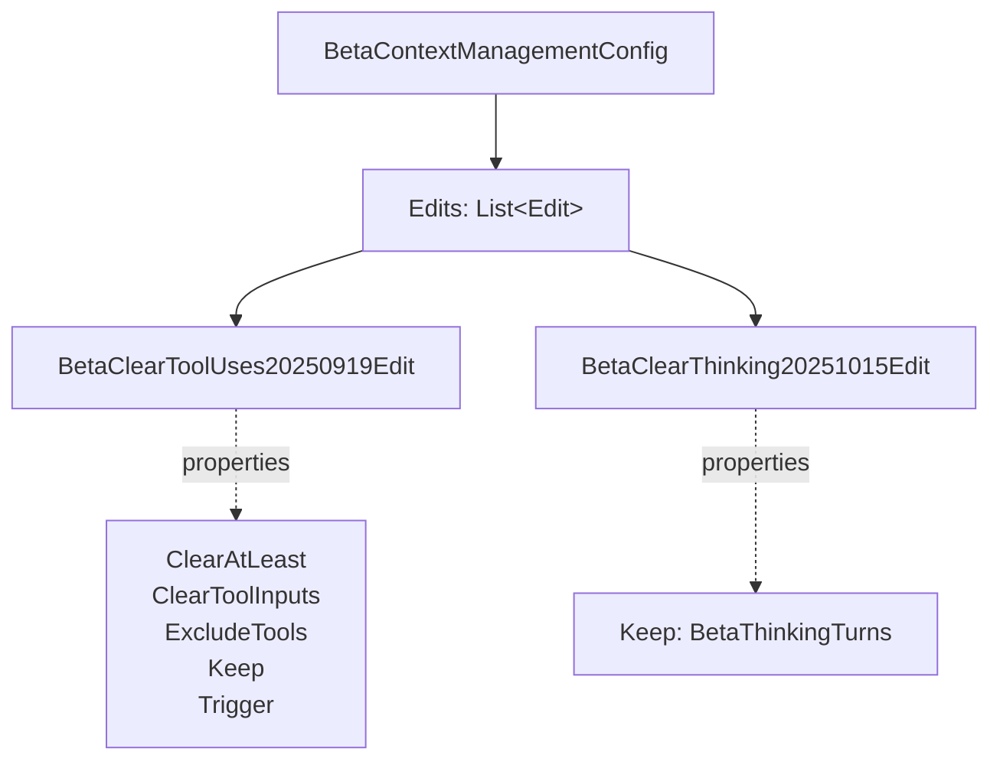
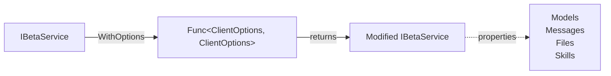

<!-- source: DeepWiki mcp.deepwiki.com · repo anthropics/anthropic-sdk-csharp · page 4.4 Beta Services · fetched 2026-10-26 -->

# Beta Services

<details>
<summary>Relevant source files</summary>

The following files were used as context for generating this wiki page:

- [src/Anthropic.Tests/AnthropicTestClients.cs](src/Anthropic.Tests/AnthropicTestClients.cs)
- [src/Anthropic.Tests/Models/Beta/BetaErrorTest.cs](src/Anthropic.Tests/Models/Beta/BetaErrorTest.cs)
- [src/Anthropic.Tests/Models/Beta/Messages/Batches/BetaMessageBatchResultTest.cs](src/Anthropic.Tests/Models/Beta/Messages/Batches/BetaMessageBatchResultTest.cs)
- [src/Anthropic.Tests/Models/Beta/Messages/BetaBashCodeExecutionToolResultBlockParamTest.cs](src/Anthropic.Tests/Models/Beta/Messages/BetaBashCodeExecutionToolResultBlockParamTest.cs)
- [src/Anthropic.Tests/Models/Beta/Messages/BetaBashCodeExecutionToolResultBlockTest.cs](src/Anthropic.Tests/Models/Beta/Messages/BetaBashCodeExecutionToolResultBlockTest.cs)
- [src/Anthropic.Tests/Models/Beta/Messages/BetaCitationsDeltaTest.cs](src/Anthropic.Tests/Models/Beta/Messages/BetaCitationsDeltaTest.cs)
- [src/Anthropic.Tests/Models/Beta/Messages/BetaClearToolUses20250919EditTest.cs](src/Anthropic.Tests/Models/Beta/Messages/BetaClearToolUses20250919EditTest.cs)
- [src/Anthropic.Tests/Models/Beta/Messages/BetaCodeExecutionToolResultBlockContentTest.cs](src/Anthropic.Tests/Models/Beta/Messages/BetaCodeExecutionToolResultBlockContentTest.cs)
- [src/Anthropic.Tests/Models/Beta/Messages/BetaCodeExecutionToolResultBlockParamContentTest.cs](src/Anthropic.Tests/Models/Beta/Messages/BetaCodeExecutionToolResultBlockParamContentTest.cs)
- [src/Anthropic.Tests/Models/Beta/Messages/BetaContentBlockParamTest.cs](src/Anthropic.Tests/Models/Beta/Messages/BetaContentBlockParamTest.cs)
- [src/Anthropic.Tests/Models/Beta/Messages/BetaContextManagementConfigTest.cs](src/Anthropic.Tests/Models/Beta/Messages/BetaContextManagementConfigTest.cs)
- [src/Anthropic.Tests/Services/Beta/FileServiceTest.cs](src/Anthropic.Tests/Services/Beta/FileServiceTest.cs)
- [src/Anthropic.Tests/Services/Beta/MessageServiceTest.cs](src/Anthropic.Tests/Services/Beta/MessageServiceTest.cs)
- [src/Anthropic.Tests/Services/Beta/Messages/BatchServiceTest.cs](src/Anthropic.Tests/Services/Beta/Messages/BatchServiceTest.cs)
- [src/Anthropic.Tests/Services/Beta/ModelServiceTest.cs](src/Anthropic.Tests/Services/Beta/ModelServiceTest.cs)
- [src/Anthropic.Tests/Services/Beta/SkillServiceTest.cs](src/Anthropic.Tests/Services/Beta/SkillServiceTest.cs)
- [src/Anthropic.Tests/Services/Beta/Skills/VersionServiceTest.cs](src/Anthropic.Tests/Services/Beta/Skills/VersionServiceTest.cs)
- [src/Anthropic.Tests/Services/MessageServiceTest.cs](src/Anthropic.Tests/Services/MessageServiceTest.cs)
- [src/Anthropic.Tests/Services/Messages/BatchServiceTest.cs](src/Anthropic.Tests/Services/Messages/BatchServiceTest.cs)
- [src/Anthropic.Tests/Services/ModelServiceTest.cs](src/Anthropic.Tests/Services/ModelServiceTest.cs)

</details>


This page documents the beta API services exposed through `IBetaService`, which provide experimental and preview features that may change before general availability. Beta services include enhanced message capabilities, file management, skills hosting, and beta versions of core services.

For stable message and model APIs, see [Messages Service](#4.1) and [Models Service](#4.3). For batch processing with beta features, see [Batch Processing](#4.2).

## Overview

Beta services are accessed via the `Beta` property on `AnthropicClient` and expose four main sub-services:



**Sources:** [src/Anthropic/Services/IBetaService.cs:1-29](), [src/Anthropic/IAnthropicClient.cs:91]()

## Beta Models Service

The beta models service provides the same functionality as the stable models service but may return additional metadata or support experimental model features.

### Interface

| Method | Description | Return Type |
|--------|-------------|-------------|
| `Retrieve(modelID)` | Get information about a specific model | `Task<BetaModelInfo>` |
| `List()` | List available models | `Task<ModelListPageResponse>` |

The `BetaModelInfo` response may include additional fields not present in the stable `ModelInfo` type, such as experimental capabilities or feature flags.

**Sources:** [src/Anthropic/Services/Beta/IModelService.cs:1-54]()

## Beta Messages Service

The beta messages service extends the standard messages API with experimental features like context management, container-based request reuse, and enhanced tool capabilities.

### Key Enhancements

```mermaid
graph LR
    MessageService["Beta.Messages"]
    
    Create["Create()<br/>BetaMessage"]
    Stream["CreateStreaming()<br/>BetaRawMessageStreamEvent"]
    Count["CountTokens()<br/>BetaMessageTokensCount"]
    Batches["Batches<br/>IBatchService"]
    
    MessageService --> Create
    MessageService --> Stream
    MessageService --> Count
    MessageService --> Batches
    
    Create -.->|returns| BetaContentBlocks["14 BetaContentBlock types<br/>vs 6 stable types"]
    Create -.->|supports| BetaTools["17 BetaToolUnion types<br/>vs 6 stable types"]
    Create -.->|uses| Context["BetaContextManagementConfig"]
    Create -.->|uses| Container["BetaContainerParams"]
```



### Method Signatures

| Method | Parameters | Return Type |
|--------|------------|-------------|
| `Create` | `MessageCreateParams` | `Task<BetaMessage>` |
| `CreateStreaming` | `MessageCreateParams` | `IAsyncEnumerable<BetaRawMessageStreamEvent>` |
| `CountTokens` | `MessageCountTokensParams` | `Task<BetaMessageTokensCount>` |

### Beta-Specific Features

The beta messages service accepts the same `MessageCreateParams` as the stable API, but when used through the beta service, additional fields become available:

- **Context Management**: `ContextManagement` property for editing conversation history
- **Container Support**: `Container` property for request reuse and skills integration
- **MCP Servers**: `MCPServers` property for Model Context Protocol integration
- **Output Configuration**: `OutputConfig` property for controlling reasoning effort
- **Enhanced Tools**: Support for web search, code execution, and MCP toolsets

**Sources:** [src/Anthropic/Services/Beta/IMessageService.cs:1-70](), [src/Anthropic.Tests/Models/Beta/Messages/Batches/BatchCreateParamsTest.cs:18-126]()

## Files Service

The Files API allows uploading, listing, and managing files that can be referenced in messages for document processing, citations, and RAG (Retrieval Augmented Generation) workflows.

### File Operations



### Interface Methods

| Method | Description | Return Type |
|--------|-------------|-------------|
| `List()` | List all uploaded files | `Task<FileListPageResponse>` |
| `RetrieveMetadata(fileID)` | Get file metadata without downloading content | `Task<FileMetadata>` |
| `Download(fileID)` | Download file content | `Task<HttpResponse>` |
| `Delete(fileID)` | Delete a file | `Task<DeletedFile>` |

### Usage Pattern

Files uploaded through this API can be referenced in messages using document content blocks with citations. The Files API requires the `FilesAPI2025_04_14` beta feature to be enabled.

**Sources:** [src/Anthropic/Services/Beta/IFileService.cs:1-76]()

## Skills Service

The Skills API enables creating, managing, and versioning hosted capabilities that can be invoked by Claude during message generation. Skills are reusable code packages that extend Claude's capabilities.

### Service Hierarchy



### Skill Management Operations

| Service | Method | Description | Return Type |
|---------|--------|-------------|-------------|
| Skills | `Create()` | Create a new skill | `Task<SkillCreateResponse>` |
| Skills | `Retrieve(skillID)` | Get skill details | `Task<SkillRetrieveResponse>` |
| Skills | `List()` | List all skills | `Task<SkillListPageResponse>` |
| Skills | `Delete(skillID)` | Delete a skill | `Task<SkillDeleteResponse>` |
| Versions | `Create(skillID)` | Create a new skill version | `Task<VersionCreateResponse>` |
| Versions | `Retrieve(version)` | Get version details | `Task<VersionRetrieveResponse>` |
| Versions | `List(skillID)` | List all versions | `Task<VersionListPageResponse>` |
| Versions | `Delete(version)` | Delete a version | `Task<VersionDeleteResponse>` |

### Container-Based Usage

Skills are invoked through the container system in message requests. The `BetaContainerParams` type specifies which skills should be available:

```
Container = new BetaContainerParams()
{
    ID = "container-id",
    Skills = [
        new() {
            SkillID = "skill-id",
            Type = BetaSkillParamsType.Anthropic,
            Version = "1.0.0"
        }
    ]
}
```

**Sources:** [src/Anthropic/Services/Beta/ISkillService.cs:1-72](), [src/Anthropic/Services/Beta/Skills/IVersionService.cs:1-83](), [src/Anthropic.Tests/Models/Beta/Messages/Batches/BatchCreateParamsTest.cs:23-35]()

## Enabling Beta Features

Beta features must be explicitly enabled via the `AnthropicBeta` enum. Each beta feature has a version date indicating when it was introduced.

### Beta Feature Catalog

| Beta Feature | Enum Value | Description |
|--------------|------------|-------------|
| Message Batches | `MessageBatches2024_09_24` | Batch message processing |
| Prompt Caching | `PromptCaching2024_07_31` | Cache prompts for efficiency |
| Computer Use | `ComputerUse2024_10_22`<br/>`ComputerUse2025_01_24` | Computer interaction tools |
| PDFs | `PDFs2024_09_25` | PDF document processing |
| Token Counting | `TokenCounting2024_11_01` | Token counting API |
| Token Efficient Tools | `TokenEfficientTools2025_02_19` | Optimized tool definitions |
| Output 128k | `Output128k2025_02_19` | Extended output length |
| Files API | `FilesAPI2025_04_14` | File upload and management |
| MCP Client | `MCPClient2025_04_04`<br/>`MCPClient2025_11_20` | Model Context Protocol support |
| Full Thinking | `DevFullThinking2025_05_14` | Detailed reasoning output |
| Interleaved Thinking | `InterleavedThinking2025_05_14` | Mixed thinking and content |
| Code Execution | `CodeExecution2025_05_22` | Execute code in sandboxed environment |
| Extended Cache TTL | `ExtendedCacheTTL2025_04_11` | Longer cache lifetimes |
| Context 1M | `Context1m2025_08_07` | 1 million token context window |
| Context Management | `ContextManagement2025_06_27` | Edit conversation history |
| Model Context Window Exceeded | `ModelContextWindowExceeded2025_08_26` | Graceful handling of context overflow |
| Skills | `Skills2025_10_02` | Skills API for hosted capabilities |

### Feature Versioning



The `AnthropicBeta` enum values are converted to kebab-case header values. For example, `AnthropicBeta.FilesAPI2025_04_14` becomes `"files-api-2025-04-14"` in the HTTP request header.

**Sources:** [src/Anthropic/Models/Beta/AnthropicBeta.cs:1-104]()

## Context Management (Beta)

Context management is a beta feature that allows editing the conversation history to optimize token usage and control information flow. This feature is accessed through the `ContextManagement` property in `MessageCreateParams`.

### Edit Operations



### Clear Tool Uses Edit

The `BetaClearToolUses20250919Edit` type removes tool use history from the conversation context based on configurable triggers and filters:

| Property | Type | Description |
|----------|------|-------------|
| `ClearAtLeast` | `BetaInputTokensClearAtLeast?` | Minimum tokens to clear |
| `ClearToolInputs` | `bool` or `List<string>` | Whether to clear tool inputs (all or specific tools) |
| `ExcludeTools` | `List<string>?` | Tool names to exclude from clearing |
| `Keep` | `BetaToolUsesKeep?` | Number of recent tool uses to retain |
| `Trigger` | `Trigger?` | When to apply the edit (input tokens or tool uses) |

### Clear Thinking Edit

The `BetaClearThinking20251015Edit` type removes thinking blocks from the conversation history:

| Property | Type | Description |
|----------|------|-------------|
| `Keep` | `BetaThinkingTurns?` | Number of recent thinking turns to retain |

### Trigger Types

Edits can be triggered based on:
- **Input Tokens**: `BetaInputTokensTrigger(threshold)` - Apply when input token count exceeds threshold
- **Tool Uses**: `BetaToolUsesTrigger(count)` - Apply after a certain number of tool invocations

**Sources:** [src/Anthropic.Tests/Models/Beta/Messages/BetaContextManagementConfigTest.cs:1-230](), [src/Anthropic.Tests/Models/Beta/Messages/BetaClearToolUses20250919EditTest.cs:1-320]()

## Beta vs Stable Services

The following table summarizes the differences between beta and stable service interfaces:

| Aspect | Stable API | Beta API |
|--------|------------|----------|
| Access | `client.Messages`, `client.Models` | `client.Beta.Messages`, `client.Beta.Models` |
| Message Response | `Message` (6 content block types) | `BetaMessage` (14 content block types) |
| Tool Support | `ToolUnion` (6 types) | `BetaToolUnion` (17 types) |
| Content Blocks | Basic text, image, tool use | + thinking, citations, search results |
| Context Management | Not available | `BetaContextManagementConfig` |
| Container System | Not available | `BetaContainerParams` for skills |
| Files API | Not available | `Beta.Files` service |
| Skills API | Not available | `Beta.Skills` service |
| Batch Processing | `Messages.Batches` | `Beta.Messages.Batches` |

**Sources:** [src/Anthropic/Services/IBetaService.cs:1-29](), [src/Anthropic/IAnthropicClient.cs:87-91]()

## WithOptions Pattern

All beta services support the `WithOptions` pattern for per-request configuration:



This allows creating modified service instances with different base URLs, timeouts, or beta features enabled without affecting the original client instance.

**Sources:** [src/Anthropic/Services/IBetaService.cs:14-19](), [src/Anthropic/Services/Beta/IMessageService.cs:18-25](), [src/Anthropic/Services/Beta/IModelService.cs:17-23]()

---

