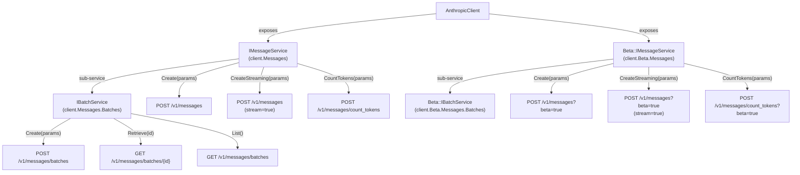
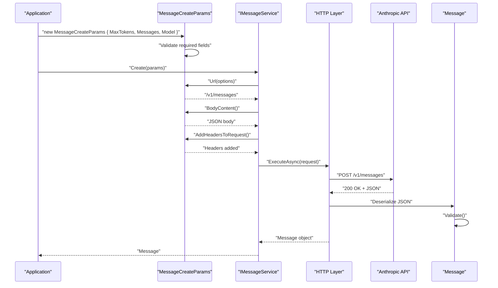
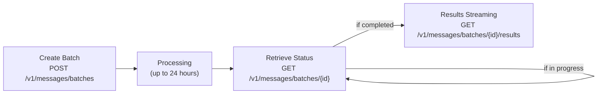
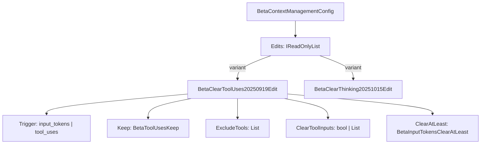
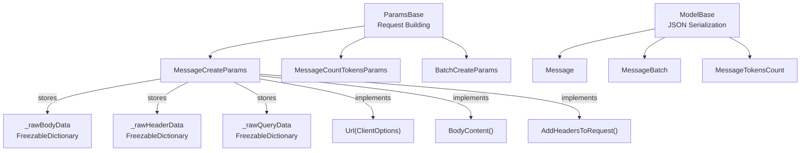

<!-- source: DeepWiki mcp.deepwiki.com · repo anthropics/anthropic-sdk-csharp · page 5 Working with Messages · fetched 2026-10-26 -->

# Working with Messages

<details>
<summary>Relevant source files</summary>

The following files were used as context for generating this wiki page:

- [src/Anthropic.Tests/Models/Beta/Messages/Batches/BatchCreateParamsTest.cs](src/Anthropic.Tests/Models/Beta/Messages/Batches/BatchCreateParamsTest.cs)
- [src/Anthropic.Tests/Models/Beta/Messages/BetaClearThinking20251015EditTest.cs](src/Anthropic.Tests/Models/Beta/Messages/BetaClearThinking20251015EditTest.cs)
- [src/Anthropic.Tests/Models/Beta/Messages/BetaMessageParamTest.cs](src/Anthropic.Tests/Models/Beta/Messages/BetaMessageParamTest.cs)
- [src/Anthropic.Tests/Models/Beta/Messages/BetaMessageTest.cs](src/Anthropic.Tests/Models/Beta/Messages/BetaMessageTest.cs)
- [src/Anthropic.Tests/Models/Beta/Messages/BetaServerToolUseBlockParamTest.cs](src/Anthropic.Tests/Models/Beta/Messages/BetaServerToolUseBlockParamTest.cs)
- [src/Anthropic.Tests/Models/Beta/Messages/BetaServerToolUseBlockTest.cs](src/Anthropic.Tests/Models/Beta/Messages/BetaServerToolUseBlockTest.cs)
- [src/Anthropic.Tests/Models/Beta/Messages/MessageCreateParamsTest.cs](src/Anthropic.Tests/Models/Beta/Messages/MessageCreateParamsTest.cs)
- [src/Anthropic.Tests/Models/Messages/Batches/BatchCreateParamsTest.cs](src/Anthropic.Tests/Models/Messages/Batches/BatchCreateParamsTest.cs)
- [src/Anthropic.Tests/Models/Messages/MessageCreateParamsTest.cs](src/Anthropic.Tests/Models/Messages/MessageCreateParamsTest.cs)
- [src/Anthropic.Tests/Models/Messages/MessageParamTest.cs](src/Anthropic.Tests/Models/Messages/MessageParamTest.cs)
- [src/Anthropic.Tests/Models/Messages/MessageTest.cs](src/Anthropic.Tests/Models/Messages/MessageTest.cs)

</details>


This page provides a comprehensive guide to creating and managing messages using the Anthropic C# SDK. It covers the core Messages API, including synchronous message creation, token counting, and batch processing. For streaming responses, see [Streaming Responses](#5.2). For detailed parameter configuration, see [Message Parameters](#5.1). For content block types and citation handling, see [Content Blocks](#5.3) and [Citations and Source Attribution](#5.4).

## Overview

The Messages API enables conversational interactions with Claude models through the `IMessageService` interface. Messages are created by sending a list of conversational turns (user and assistant messages) along with configuration parameters, and Claude generates the next message in the conversation.

The SDK provides two API variants:
- **Standard API**: Production-ready features accessed via `client.Messages`
- **Beta API**: Experimental features accessed via `client.Beta.Messages`

## Message Service Architecture



**Sources**: [src/Anthropic/Models/Messages/MessageCreateParams.cs:432-437](), [src/Anthropic/Models/Beta/Messages/MessageCreateParams.cs:554-562](), [src/Anthropic/Models/Messages/MessageCountTokensParams.cs:283-290](), [src/Anthropic/Models/Messages/Batches/BatchCreateParams.cs:89-96]()

## Core Message Service Methods

The `IMessageService` interface provides three primary operations:

| Method | Purpose | Returns | API Endpoint |
|--------|---------|---------|-------------|
| `Create` | Create a message synchronously | `Message` | `/v1/messages` |
| `CreateStreaming` | Stream message generation | `IAsyncEnumerable<RawMessageStreamEvent>` | `/v1/messages` |
| `CountTokens` | Count tokens without creating message | `MessageTokensCount` | `/v1/messages/count_tokens` |

### Message Creation Flow



**Sources**: [examples/MessagesExample/Program.cs:10-30](), [src/Anthropic.Tests/Services/MessageServiceTest.cs:14-25](), [src/Anthropic/Models/Messages/MessageCreateParams.cs:432-452]()

## Basic Message Creation

### Simple Message Example

The most basic message creation requires three parameters: `MaxTokens`, `Messages`, and `Model`.

```csharp
// From examples/MessagesExample/Program.cs:10-20
MessageCreateParams parameters = new()
{
    MaxTokens = 2048,
    Messages =
    [
        new() { Content = "Tell me a story about building the best SDK!", Role = Role.User },
    ],
    Model = "claude-sonnet-4-5",
};

var response = await client.Messages.Create(parameters);
```

**Sources**: [examples/MessagesExample/Program.cs:10-20]()

### Processing Message Responses

Messages contain a `Content` collection that holds various content blocks. To extract text:

```csharp
// From examples/MessagesExample/Program.cs:22-28
var message = string.Join(
    "",
    response
        .Content.Where(message => message.Value is TextBlock)
        .Select(message => message.Value as TextBlock)
        .Select((textBlock) => textBlock.Text)
);
```

**Sources**: [examples/MessagesExample/Program.cs:22-28]()

## Request Parameters Structure

### MessageCreateParams Hierarchy

```mermaid
graph TB
    ParamsBase["ParamsBase"]
    MsgParams["MessageCreateParams"]
    BetaMsgParams["Beta::MessageCreateParams"]
    
    ParamsBase --> MsgParams
    ParamsBase --> BetaMsgParams
    
    MsgParams -->|"required"| MaxTokens["MaxTokens: long"]
    MsgParams -->|"required"| Messages["Messages: IReadOnlyList<MessageParam>"]
    MsgParams -->|"required"| Model["Model: ApiEnum<string, Model>"]
    
    MsgParams -->|"optional"| System["System: MessageCreateParamsSystem"]
    MsgParams -->|"optional"| Temperature["Temperature: double?"]
    MsgParams -->|"optional"| Tools["Tools: IReadOnlyList<ToolUnion>"]
    MsgParams -->|"optional"| ToolChoice["ToolChoice: ToolChoice?"]
    MsgParams -->|"optional"| Thinking["Thinking: ThinkingConfigParam?"]
    MsgParams -->|"optional"| StopSequences["StopSequences: IReadOnlyList<string>"]
    MsgParams -->|"optional"| TopK["TopK: long?"]
    MsgParams -->|"optional"| TopP["TopP: double?"]
    MsgParams -->|"optional"| Metadata["Metadata: Metadata?"]
    MsgParams -->|"optional"| ServiceTier["ServiceTier: ApiEnum<ServiceTier>?"]
    
    BetaMsgParams -->|"additional"| Container["Container: Container?"]
    BetaMsgParams -->|"additional"| ContextMgmt["ContextManagement: BetaContextManagementConfig?"]
    BetaMsgParams -->|"additional"| MCPServers["MCPServers: IReadOnlyList<...>"]
    BetaMsgParams -->|"additional"| OutputConfig["OutputConfig: BetaOutputConfig?"]
    BetaMsgParams -->|"additional"| OutputFormat["OutputFormat: BetaJSONOutputFormat?"]
    BetaMsgParams -->|"additional"| Betas["Betas: IReadOnlyList<AnthropicBeta>"]
```



**Sources**: [src/Anthropic/Models/Messages/MessageCreateParams.cs:23-453](), [src/Anthropic/Models/Beta/Messages/MessageCreateParams.cs:24-577]()

### Required Parameters

| Parameter | Type | Description |
|-----------|------|-------------|
| `MaxTokens` | `long` | Maximum tokens to generate before stopping |
| `Messages` | `IReadOnlyList<MessageParam>` | Alternating user/assistant conversation turns |
| `Model` | `ApiEnum<string, Model>` | Claude model identifier (e.g., "claude-sonnet-4-5") |

**Sources**: [src/Anthropic/Models/Messages/MessageCreateParams.cs:31-111]()

### Optional Parameters

| Parameter | Type | Default | Description |
|-----------|------|---------|-------------|
| `System` | `MessageCreateParamsSystem?` | `null` | System prompt (string or TextBlockParam list) |
| `Temperature` | `double?` | `1.0` | Randomness (0.0-1.0) |
| `StopSequences` | `IReadOnlyList<string>?` | `null` | Custom stop sequences |
| `TopK` | `long?` | `null` | Sample from top K tokens |
| `TopP` | `double?` | `null` | Nucleus sampling threshold |
| `Tools` | `IReadOnlyList<ToolUnion>?` | `null` | Tool definitions |
| `ToolChoice` | `ToolChoice?` | `null` | Tool selection strategy |
| `Thinking` | `ThinkingConfigParam?` | `null` | Extended thinking configuration |
| `Metadata` | `Metadata?` | `null` | Request metadata (e.g., user_id) |
| `ServiceTier` | `ApiEnum<ServiceTier>?` | `null` | Priority vs. standard capacity |

**Sources**: [src/Anthropic/Models/Messages/MessageCreateParams.cs:113-383]()

## Token Counting

Before creating a message, you can count the number of tokens it will consume using `CountTokens`:

```csharp
// From src/Anthropic.Tests/Services/MessageServiceTest.cs:52-58
var messageTokensCount = await client.Messages.CountTokens(
    new() { 
        Messages = [new() { Content = "string", Role = Role.User }], 
        Model = modelName 
    }
);
```

The `MessageCountTokensParams` class accepts similar parameters to `MessageCreateParams` but does not require `MaxTokens` since no message is being generated.

**Sources**: [src/Anthropic.Tests/Services/MessageServiceTest.cs:48-58](), [src/Anthropic/Models/Messages/MessageCountTokensParams.cs:15-306]()

## Batch Processing

For processing multiple messages asynchronously, use the batch API:



### Creating a Batch

```csharp
// From src/Anthropic.Tests/Services/Messages/BatchServiceTest.cs:16-93
var messageBatch = await client.Messages.Batches.Create(
    new()
    {
        Requests =
        [
            new()
            {
                CustomID = "my-custom-id-1",
                Params = new()
                {
                    MaxTokens = 1024,
                    Messages = [new() { Content = "Hello, world", Role = Role.User }],
                    Model = modelName,
                    // ... additional parameters
                }
            },
        ]
    }
);
```

### Batch Operations

| Method | Purpose | Endpoint |
|--------|---------|----------|
| `Create(BatchCreateParams)` | Create a new batch | `POST /v1/messages/batches` |
| `Retrieve(string id)` | Get batch status | `GET /v1/messages/batches/{id}` |
| `List()` | List all batches | `GET /v1/messages/batches` |
| `Cancel(string id)` | Cancel a batch | `POST /v1/messages/batches/{id}/cancel` |
| `Delete(string id)` | Delete a batch | `DELETE /v1/messages/batches/{id}` |
| `ResultsStreaming(string id)` | Stream batch results | `GET /v1/messages/batches/{id}/results` |

**Sources**: [src/Anthropic.Tests/Services/Messages/BatchServiceTest.cs:10-139](), [src/Anthropic/Models/Messages/Batches/BatchCreateParams.cs:14-112]()

## Beta Features

The Beta Messages API provides experimental features not yet available in the standard API:

### Context Management

Context management allows controlling conversation history across multiple requests:



Context management configuration is set via `MessageCreateParams.ContextManagement`:

| Edit Type | Purpose | Configuration |
|-----------|---------|---------------|
| `BetaClearToolUses20250919Edit` | Clear tool use history | Trigger, Keep, ExcludeTools, ClearToolInputs |
| `BetaClearThinking20251015Edit` | Clear thinking blocks | Trigger conditions |

**Sources**: [src/Anthropic/Models/Beta/Messages/MessageCreateParams.cs:137-148](), [src/Anthropic/Models/Beta/Messages/BetaContextManagementConfig.cs:15-350](), [src/Anthropic/Models/Beta/Messages/BetaClearToolUses20250919Edit.cs:12-654]()

### Container System

Containers enable request reuse across multiple message calls:

```csharp
// Beta feature
var params = new Beta.MessageCreateParams
{
    Container = new BetaContainerParams { /* ... */ },
    // OR
    Container = "container-id-string",
    // ... other parameters
};
```

The `Container` property is a union type accepting either `BetaContainerParams` or a string identifier.

**Sources**: [src/Anthropic/Models/Beta/Messages/MessageCreateParams.cs:125-130]()

### MCP Server Integration

The Beta API supports Model Context Protocol (MCP) servers for external tool integration:

```csharp
var params = new Beta.MessageCreateParams
{
    MCPServers = 
    [
        new BetaRequestMCPServerURLDefinition { /* server config */ }
    ],
    // ... other parameters
};
```

**Sources**: [src/Anthropic/Models/Beta/Messages/MessageCreateParams.cs:152-171]()

### Output Configuration

Control model effort and output format:

```csharp
var params = new Beta.MessageCreateParams
{
    OutputConfig = new BetaOutputConfig { /* effort settings */ },
    OutputFormat = new BetaJSONOutputFormat { /* schema */ },
    // ... other parameters
};
```

**Sources**: [src/Anthropic/Models/Beta/Messages/MessageCreateParams.cs:194-224]()

## Data Model Infrastructure

### ParamsBase and ModelBase



All request parameter classes inherit from `ParamsBase` and use a dictionary-based storage model with property accessors. This allows flexible JSON serialization while maintaining type safety.

**Sources**: [src/Anthropic/Models/Messages/MessageCreateParams.cs:23-453](), [src/Anthropic/Models/Messages/MessageCreateParams.cs:25-29]()

### Union Types

The SDK extensively uses union types for polymorphic data:

| Union Type | Variants | Usage |
|------------|----------|-------|
| `MessageCreateParamsSystem` | `string`, `IReadOnlyList<TextBlockParam>` | System prompt |
| `ServiceTier` | `Auto`, `StandardOnly` | Capacity selection |
| `Container` | `BetaContainerParams`, `string` | Container reference |
| `ToolUnion` | 6 standard tool types | Tool definitions |
| `BetaToolUnion` | 17 beta tool types | Extended tool definitions |

Union types provide `TryPickX()`, `Switch()`, and `Match()` methods for type-safe variant handling.

**Sources**: [src/Anthropic/Models/Messages/MessageCreateParams.cs:454-754](), [src/Anthropic/Models/Beta/Messages/MessageCreateParams.cs:579-811]()

## Standard vs. Beta API Comparison

| Feature | Standard API | Beta API | Accessed Via |
|---------|--------------|----------|--------------|
| Message Creation | ✓ | ✓ | `client.Messages.Create` / `client.Beta.Messages.Create` |
| Streaming | ✓ | ✓ | `client.Messages.CreateStreaming` / `client.Beta.Messages.CreateStreaming` |
| Token Counting | ✓ | ✓ | `client.Messages.CountTokens` / `client.Beta.Messages.CountTokens` |
| Batch Processing | ✓ | ✓ | `client.Messages.Batches` / `client.Beta.Messages.Batches` |
| Context Management | ✗ | ✓ | `params.ContextManagement` |
| Container System | ✗ | ✓ | `params.Container` |
| MCP Servers | ✗ | ✓ | `params.MCPServers` |
| Output Config | ✗ | ✓ | `params.OutputConfig` / `params.OutputFormat` |
| Extended Tools | 6 types | 17 types | `params.Tools` |

Beta features require setting the `anthropic-beta` header via the `Betas` parameter or are automatically set when using Beta-specific APIs.

**Sources**: [src/Anthropic/Models/Messages/MessageCreateParams.cs:1-453](), [src/Anthropic/Models/Beta/Messages/MessageCreateParams.cs:1-577]()

## URL Construction and API Endpoints

The parameter classes construct their URLs dynamically:

```csharp
// Standard API
public override Uri Url(ClientOptions options)
{
    return new UriBuilder(
        options.BaseUrl.ToString().TrimEnd('/') + "/v1/messages"
    ) { Query = this.QueryString(options) }.Uri;
}

// Beta API
public override Uri Url(ClientOptions options)
{
    return new UriBuilder(
        options.BaseUrl.ToString().TrimEnd('/') + "/v1/messages?beta=true"
    ) { Query = this.QueryString(options) }.Uri;
}
```

**Sources**: [src/Anthropic/Models/Messages/MessageCreateParams.cs:432-438](), [src/Anthropic/Models/Beta/Messages/MessageCreateParams.cs:554-562]()

---

