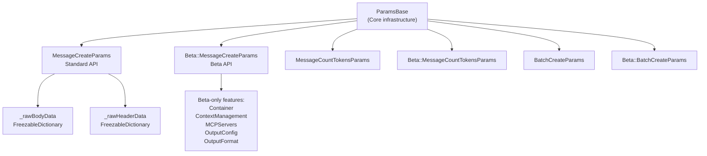
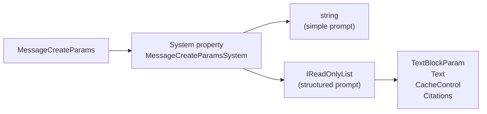
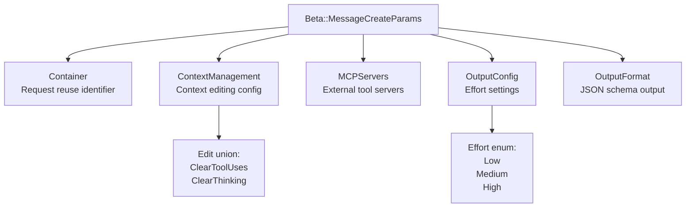
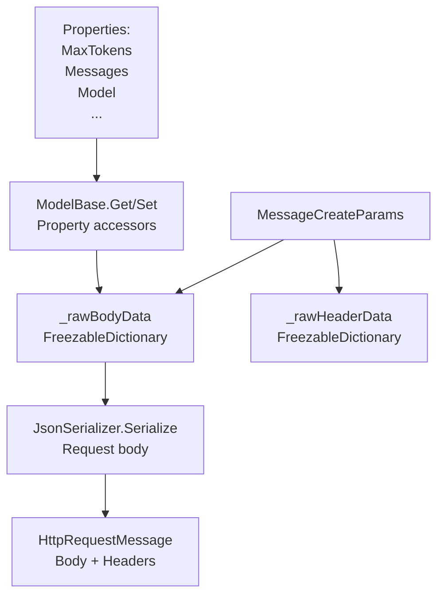
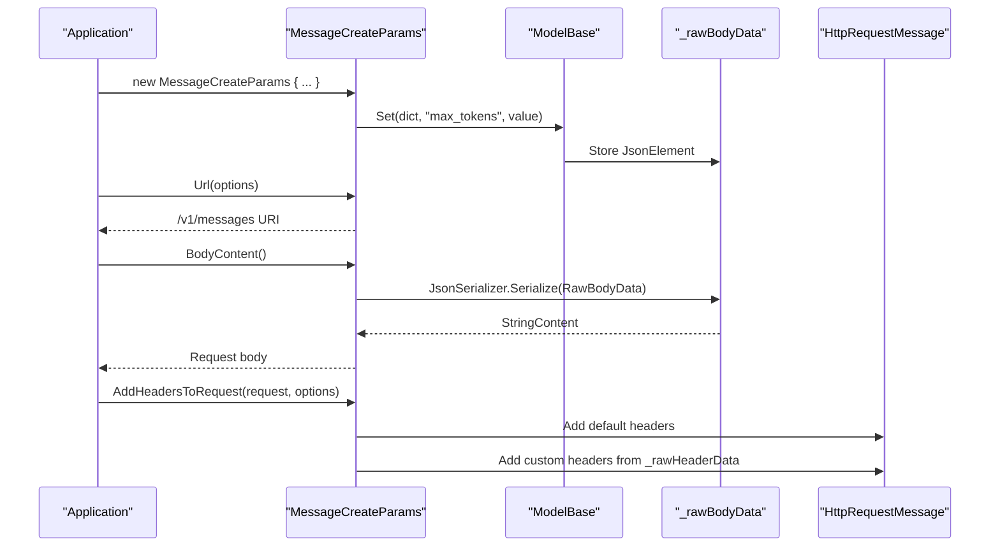
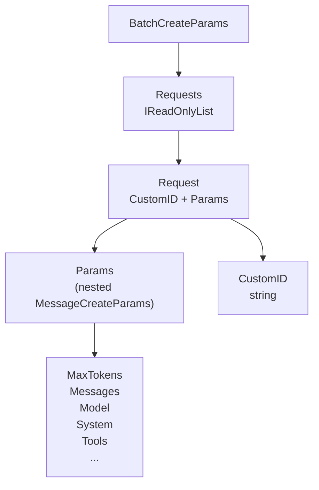

<!-- source: DeepWiki mcp.deepwiki.com · repo anthropics/anthropic-sdk-csharp · page 5.1 Message Parameters · fetched 2026-10-26 -->

# Message Parameters

<details>
<summary>Relevant source files</summary>

The following files were used as context for generating this wiki page:

- [src/Anthropic.Tests/Models/Beta/Messages/Batches/BatchCreateParamsTest.cs](src/Anthropic.Tests/Models/Beta/Messages/Batches/BatchCreateParamsTest.cs)
- [src/Anthropic.Tests/Models/Beta/Messages/BetaClearThinking20251015EditTest.cs](src/Anthropic.Tests/Models/Beta/Messages/BetaClearThinking20251015EditTest.cs)
- [src/Anthropic.Tests/Models/Beta/Messages/BetaMessageParamTest.cs](src/Anthropic.Tests/Models/Beta/Messages/BetaMessageParamTest.cs)
- [src/Anthropic.Tests/Models/Beta/Messages/BetaServerToolUseBlockParamTest.cs](src/Anthropic.Tests/Models/Beta/Messages/BetaServerToolUseBlockParamTest.cs)
- [src/Anthropic.Tests/Models/Beta/Messages/BetaServerToolUseBlockTest.cs](src/Anthropic.Tests/Models/Beta/Messages/BetaServerToolUseBlockTest.cs)
- [src/Anthropic.Tests/Models/Beta/Messages/MessageCreateParamsTest.cs](src/Anthropic.Tests/Models/Beta/Messages/MessageCreateParamsTest.cs)
- [src/Anthropic.Tests/Models/Messages/Batches/BatchCreateParamsTest.cs](src/Anthropic.Tests/Models/Messages/Batches/BatchCreateParamsTest.cs)
- [src/Anthropic.Tests/Models/Messages/MessageCreateParamsTest.cs](src/Anthropic.Tests/Models/Messages/MessageCreateParamsTest.cs)
- [src/Anthropic.Tests/Models/Messages/MessageParamTest.cs](src/Anthropic.Tests/Models/Messages/MessageParamTest.cs)

</details>


This page documents the parameter classes used to configure message creation requests to the Anthropic API. These classes define the input structure for creating messages, counting tokens, and batch processing operations.

For information about the response objects returned from message creation, see [Content Blocks](#5.3). For details on how to use streaming responses, see [Streaming Responses](#5.2). For tool configuration details, see [Tool Types](#6.1).

## Overview

Message parameter classes inherit from `ParamsBase` and provide strongly-typed configuration for API requests. The SDK provides separate implementations for standard and beta API versions, located in:

- Standard API: `Anthropic.Models.Messages` namespace
- Beta API: `Anthropic.Models.Beta.Messages` namespace

The primary parameter classes are:

| Class | Purpose | Endpoint |
|-------|---------|----------|
| `MessageCreateParams` | Create a single message | `/v1/messages` |
| `MessageCountTokensParams` | Count tokens without creating message | `/v1/messages/count_tokens` |
| `BatchCreateParams` | Create multiple messages in batch | `/v1/messages/batches` |

**Sources:** [src/Anthropic/Models/Messages/MessageCreateParams.cs:23](), [src/Anthropic/Models/Beta/Messages/MessageCreateParams.cs:24](), [src/Anthropic/Models/Messages/MessageCountTokensParams.cs:23]()

## MessageCreateParams Architecture



**Sources:** [src/Anthropic/Models/Messages/MessageCreateParams.cs:23-24](), [src/Anthropic/Models/Beta/Messages/MessageCreateParams.cs:24-25]()

## Required Parameters

All message creation requests must specify three required parameters:

### MaxTokens

```csharp
public required long MaxTokens { get; init; }
```

Specifies the absolute maximum number of tokens to generate. The model may stop before reaching this limit. Different models have different maximum values.

**Sources:** [src/Anthropic/Models/Messages/MessageCreateParams.cs:31-44](), [src/Anthropic/Models/Beta/Messages/MessageCreateParams.cs:32-45]()

### Messages

```csharp
public required IReadOnlyList<MessageParam> Messages { get; init; }
```

A list of input messages representing the conversational history. Messages must alternate between `user` and `assistant` roles. Each message contains:
- `Role` - either `User` or `Assistant`
- `Content` - either a string or list of content blocks

The SDK supports up to 100,000 messages in a single request. Consecutive messages with the same role are automatically combined.

**Sources:** [src/Anthropic/Models/Messages/MessageCreateParams.cs:46-101](), [src/Anthropic/Models/Beta/Messages/MessageCreateParams.cs:47-105]()

### Model

```csharp
public required ApiEnum<string, Model> Model { get; init; }
```

Specifies which Claude model to use for completion. The `ApiEnum<string, Model>` type allows both predefined enum values and custom string values for forward compatibility.

**Sources:** [src/Anthropic/Models/Messages/MessageCreateParams.cs:103-111](), [src/Anthropic/Models/Beta/Messages/MessageCreateParams.cs:107-121]()

## Example: Basic Message Creation

```csharp
MessageCreateParams parameters = new()
{
    MaxTokens = 2048,
    Messages = [
        new() { Content = "Tell me a story", Role = Role.User }
    ],
    Model = "claude-sonnet-4-5"
};

var response = await client.Messages.Create(parameters);
```

**Sources:** [examples/MessagesExample/Program.cs:10-20]()

## Sampling Parameters

Parameters that control the randomness and creativity of model outputs:

### Temperature

```csharp
public double? Temperature { get; init; }
```

Controls randomness injection. Range: `0.0` to `1.0`. Default: `1.0`.
- Lower values (closer to 0.0): More deterministic, better for analytical tasks
- Higher values (closer to 1.0): More creative, better for generative tasks

Even at `temperature = 0.0`, results are not fully deterministic.

**Sources:** [src/Anthropic/Models/Messages/MessageCreateParams.cs:209-231]()

### TopK

```csharp
public long? TopK { get; init; }
```

Samples only from the top K options for each token. Removes "long tail" low-probability responses. Recommended for advanced use cases only.

**Sources:** [src/Anthropic/Models/Messages/MessageCreateParams.cs:339-358]()

### TopP

```csharp
public double? TopP { get; init; }
```

Uses nucleus sampling to cut off the cumulative probability distribution at a threshold. Should not be used simultaneously with `Temperature`.

**Sources:** [src/Anthropic/Models/Messages/MessageCreateParams.cs:360-383]()

## System Prompt Configuration



The `System` parameter is a union type supporting two variants:

1. **String variant**: Simple text prompt
2. **Block list variant**: Structured prompt with cache control and citations

```csharp
// String variant
parameters.System = "You are a helpful assistant.";

// Block list variant
parameters.System = new List<TextBlockParam>
{
    new() 
    { 
        Text = "You are a helpful assistant.",
        CacheControl = new() { TTL = TTL.TTL5m }
    }
};
```

**Sources:** [src/Anthropic/Models/Messages/MessageCreateParams.cs:183-207](), [src/Anthropic/Models/Messages/MessageCreateParams.cs:455-665]()

## Tool Configuration

### Tools Parameter

```csharp
public IReadOnlyList<ToolUnion>? Tools { get; init; }
```

Defines tools the model may use. The standard API uses `ToolUnion` (6 tool types), while the beta API uses `BetaToolUnion` (17+ tool types including web search, code execution, and MCP toolsets).

Each tool definition includes:
- `Name` - Tool identifier
- `Description` - Optional but recommended
- `InputSchema` - JSON Schema for tool input
- `CacheControl` - Optional cache configuration

**Sources:** [src/Anthropic/Models/Messages/MessageCreateParams.cs:278-337]()

### ToolChoice Parameter

```csharp
public ToolChoice? ToolChoice { get; init; }
```

Controls how the model uses tools:
- `ToolChoiceAuto` - Model decides whether to use tools
- `ToolChoiceAny` - Model must use at least one tool
- `ToolChoiceTool` - Model must use a specific tool

**Sources:** [src/Anthropic/Models/Messages/MessageCreateParams.cs:260-276]()

## Beta-Specific Parameters

The beta API extends `MessageCreateParams` with additional configuration options:



**Sources:** [src/Anthropic/Models/Beta/Messages/MessageCreateParams.cs:124-209]()

### Container

```csharp
public Container? Container { get; init; }
```

Union type supporting:
- `BetaContainerParams` - Structured container configuration
- `string` - Simple container identifier

Enables request reuse across multiple API calls by maintaining context.

**Sources:** [src/Anthropic/Models/Beta/Messages/MessageCreateParams.cs:124-130](), [src/Anthropic/Models/Beta/Messages/MessageCreateParams.cs:580-761]()

### ContextManagement

```csharp
public BetaContextManagementConfig? ContextManagement { get; init; }
```

Controls how Claude manages context across requests. Supports edits like:
- `ClearToolUses` - Remove tool use history
- `ClearThinking` - Remove reasoning traces

Each edit can specify triggers based on token count or tool use count.

**Sources:** [src/Anthropic/Models/Beta/Messages/MessageCreateParams.cs:132-148](), [src/Anthropic/Models/Beta/Messages/BetaContextManagementConfig.cs:15-68]()

### MCPServers

```csharp
public IReadOnlyList<BetaRequestMCPServerURLDefinition>? MCPServers { get; init; }
```

Defines Model Context Protocol (MCP) servers to utilize for external tool capabilities. Each server definition includes URL and authentication configuration.

**Sources:** [src/Anthropic/Models/Beta/Messages/MessageCreateParams.cs:150-171]()

### OutputConfig

```csharp
public BetaOutputConfig? OutputConfig { get; init; }
```

Controls model output characteristics, particularly the effort level (`Low`, `Medium`, `High`) the model should apply to its response.

**Sources:** [src/Anthropic/Models/Beta/Messages/MessageCreateParams.cs:190-209]()

### OutputFormat

```csharp
public BetaJSONOutputFormat? OutputFormat { get; init; }
```

Specifies a JSON schema for structured output format, enabling the model to return responses conforming to a predefined schema.

**Sources:** [src/Anthropic/Models/Beta/Messages/MessageCreateParams.cs:211-224]()

## Additional Configuration

### StopSequences

```csharp
public IReadOnlyList<string>? StopSequences { get; init; }
```

Custom text sequences that trigger generation stop. When encountered, `stop_reason` becomes `"stop_sequence"`.

**Sources:** [src/Anthropic/Models/Messages/MessageCreateParams.cs:157-181]()

### Metadata

```csharp
public Metadata? Metadata { get; init; }
```

Object containing metadata about the request, such as `UserID` for tracking and analytics.

**Sources:** [src/Anthropic/Models/Messages/MessageCreateParams.cs:113-128]()

### ServiceTier

```csharp
public ApiEnum<string, ServiceTier>? ServiceTier { get; init; }
```

Enum controlling capacity priority:
- `ServiceTier.Auto` - Automatic selection
- `ServiceTier.StandardOnly` - Standard capacity only

**Sources:** [src/Anthropic/Models/Messages/MessageCreateParams.cs:130-155](), [src/Anthropic/Models/Messages/MessageCreateParams.cs:455-467]()

### Thinking Configuration

```csharp
public ThinkingConfigParam? Thinking { get; init; }
```

Enables extended thinking mode, where responses include `thinking` content blocks showing Claude's reasoning process. Requires minimum 1,024 token budget and counts toward `max_tokens`.

**Sources:** [src/Anthropic/Models/Messages/MessageCreateParams.cs:233-258]()

## Parameter Serialization



Parameters use a dictionary-backed storage model where:

1. Properties are stored in `_rawBodyData` or `_rawHeaderData` as `JsonElement`
2. Getters use `ModelBase.GetNotNullClass<T>()` or `ModelBase.GetNullableClass<T>()`
3. Setters use `ModelBase.Set()` to update dictionaries
4. Serialization occurs via `BodyContent()` method

**Sources:** [src/Anthropic/Models/Messages/MessageCreateParams.cs:24-28](), [src/Anthropic/Models/Messages/MessageCreateParams.cs:440-443]()

## Request Construction Flow



**Sources:** [src/Anthropic/Models/Messages/MessageCreateParams.cs:432-452]()

## MessageCountTokensParams

A specialized parameter class for token counting without message creation:

```csharp
public sealed record class MessageCountTokensParams : ParamsBase
{
    public required IReadOnlyList<MessageParam> Messages { get; init; }
    public required ApiEnum<string, Model> Model { get; init; }
    public MessageCountTokensParamsSystem? System { get; init; }
    public ThinkingConfigParam? Thinking { get; init; }
    public ToolChoice? ToolChoice { get; init; }
    public IReadOnlyList<MessageCountTokensTool>? Tools { get; init; }
}
```

This class omits generation parameters (Temperature, MaxTokens, StopSequences) but includes configuration needed for accurate token counting.

**Sources:** [src/Anthropic/Models/Messages/MessageCountTokensParams.cs:23-235]()

## Batch Processing Parameters



`BatchCreateParams` enables batch processing of multiple message requests:

```csharp
var batch = await client.Messages.Batches.Create(new()
{
    Requests = [
        new()
        {
            CustomID = "request-1",
            Params = new()
            {
                MaxTokens = 1024,
                Messages = [...],
                Model = modelName
            }
        }
    ]
});
```

Each request contains:
- `CustomID` - Unique identifier for matching results
- `Params` - Full message creation parameters

**Sources:** [src/Anthropic/Models/Messages/Batches/BatchCreateParams.cs:24-112](), [src/Anthropic/Models/Messages/Batches/BatchCreateParams.cs:114-171]()

## Validation

Parameter objects support validation via the `Validate()` method:

```csharp
public override void Validate()
{
    _ = this.MaxTokens;  // Check required property
    _ = this.Messages;
    _ = this.Model;
    
    foreach (var message in this.Messages)
    {
        message.Validate();  // Recursive validation
    }
    
    this.Tools?.ForEach(tool => tool.Validate());
}
```

Validation ensures:
- Required properties are set
- Enum values are valid
- Nested objects pass validation
- Union types contain known variants

**Sources:** Test files demonstrate validation: [src/Anthropic.Tests/Services/MessageServiceTest.cs:24](), [src/Anthropic.Tests/Services/Messages/BatchServiceTest.cs:93]()

## Parameter Reuse and Immutability

Parameter classes are `record` types with `init`-only properties, enabling immutability and structural equality:

```csharp
// Create base parameters
var baseParams = new MessageCreateParams()
{
    MaxTokens = 1024,
    Model = "claude-sonnet-4-5",
    Messages = [...]
};

// Copy with modifications
var modifiedParams = baseParams with 
{ 
    Temperature = 0.5,
    TopP = 0.9 
};
```

The `WithOptions` pattern on clients creates new client instances sharing connection pools while allowing parameter customization.

**Sources:** [src/Anthropic/Models/Messages/MessageCreateParams.cs:385-402]()

---

