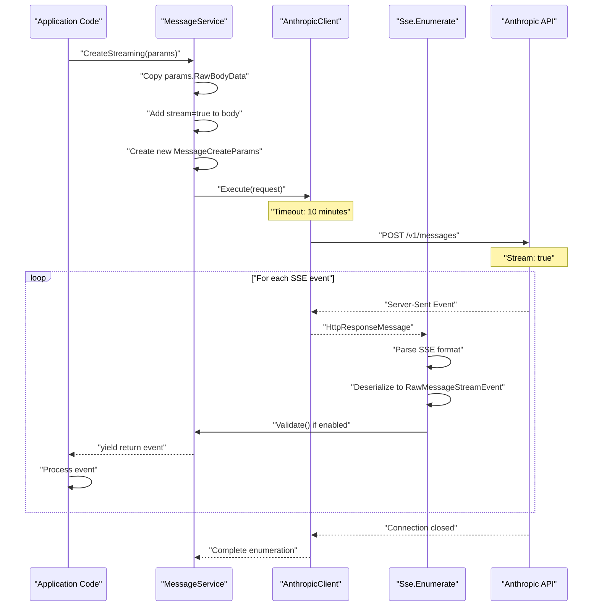
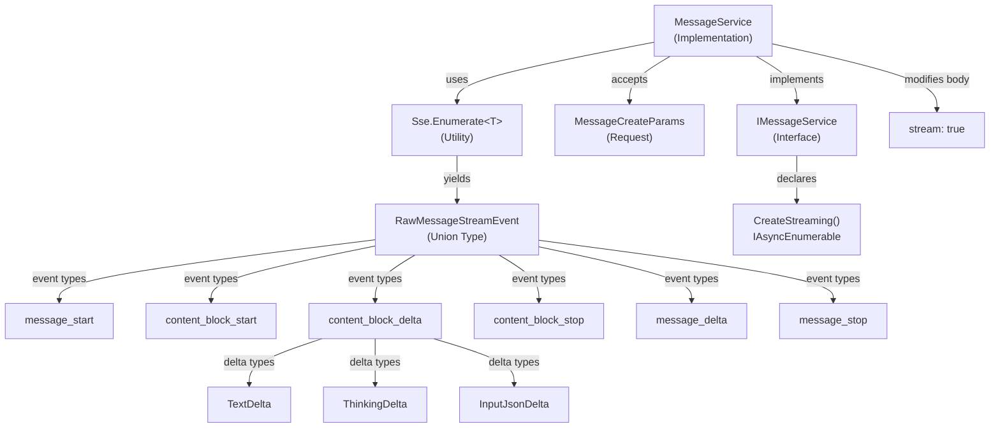
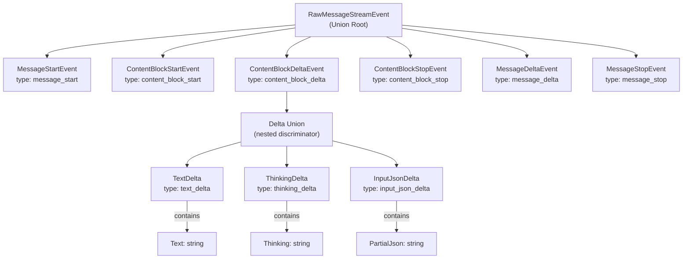
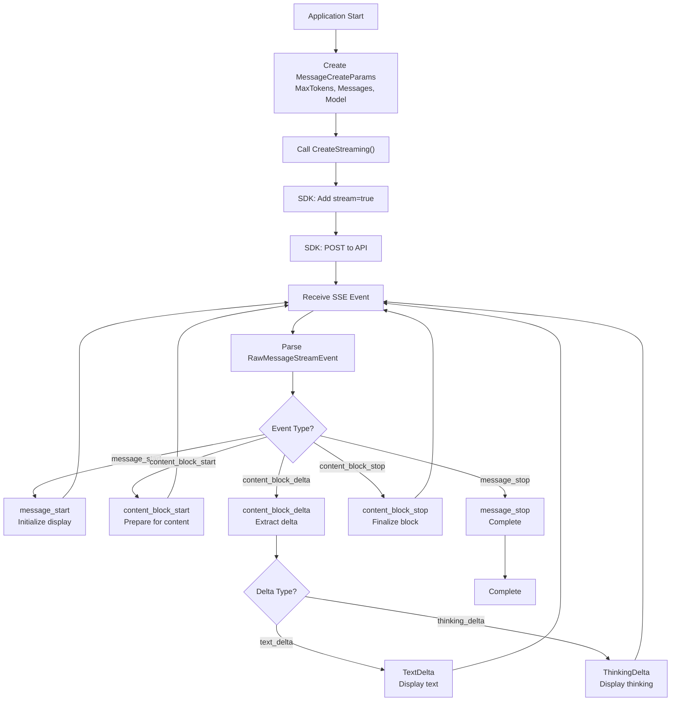

<!-- source: DeepWiki mcp.deepwiki.com · repo anthropics/anthropic-sdk-csharp · page 5.2 Streaming Responses · fetched 2026-10-26 -->

# Streaming Responses

<details>
<summary>Relevant source files</summary>

The following files were used as context for generating this wiki page:

- [examples/MessagesExample/MessagesExample.csproj](examples/MessagesExample/MessagesExample.csproj)
- [examples/MessagesExample/Program.cs](examples/MessagesExample/Program.cs)
- [examples/MessagesStreamingExample/MessagesStreamingExample.csproj](examples/MessagesStreamingExample/MessagesStreamingExample.csproj)
- [examples/MessagesStreamingExample/Program.cs](examples/MessagesStreamingExample/Program.cs)
- [examples/ThinkingExample/Program.cs](examples/ThinkingExample/Program.cs)
- [examples/ThinkingExample/ThinkingExample.csproj](examples/ThinkingExample/ThinkingExample.csproj)
- [examples/ThinkingStreamingExample/Program.cs](examples/ThinkingStreamingExample/Program.cs)
- [examples/ThinkingStreamingExample/ThinkingStreamingExample.csproj](examples/ThinkingStreamingExample/ThinkingStreamingExample.csproj)
- [src/Anthropic/Core/ApiEnum.cs](src/Anthropic/Core/ApiEnum.cs)
- [src/Anthropic/Core/FreezableDictionary.cs](src/Anthropic/Core/FreezableDictionary.cs)
- [src/Anthropic/Core/HttpResponse.cs](src/Anthropic/Core/HttpResponse.cs)
- [src/Anthropic/Core/ParamsBase.cs](src/Anthropic/Core/ParamsBase.cs)
- [src/Anthropic/Services/Beta/MessageService.cs](src/Anthropic/Services/Beta/MessageService.cs)
- [src/Anthropic/Services/MessageService.cs](src/Anthropic/Services/MessageService.cs)

</details>


## Purpose and Scope

This page documents the streaming response functionality in the Anthropic C# SDK, which allows applications to receive incremental message content as it is generated rather than waiting for complete responses. Streaming is essential for building responsive user interfaces that display content progressively.

This page covers the `CreateStreaming` method on `IMessageService`, stream event types, and processing patterns. For general message creation without streaming, see [Message Parameters](#5.1). For beta-specific streaming features including enhanced thinking and citations, see [Beta Services](#4.4).

**Sources:** [src/Anthropic/Services/MessageService.cs:67-104](), [examples/MessagesStreamingExample/Program.cs:1-28]()

## Streaming Architecture Overview

The SDK implements streaming using Server-Sent Events (SSE), yielding events as an `IAsyncEnumerable` that applications can consume with `await foreach`. The streaming architecture automatically handles request modification, HTTP response parsing, and event deserialization.



**Sources:** [src/Anthropic/Services/MessageService.cs:67-104](), [src/Anthropic/AnthropicClient.cs:100-152]()

## Code Entity Relationships



**Sources:** [src/Anthropic/Services/MessageService.cs:16-129]()

## Initiating Streaming Requests

### Basic Streaming

To stream a message response, call `CreateStreaming` on the `Messages` service. The method signature returns an `IAsyncEnumerable<RawMessageStreamEvent>`:

```csharp
// From examples/MessagesStreamingExample/Program.cs
IAsyncEnumerable<RawMessageStreamEvent> responseUpdates = client.Messages.CreateStreaming(
    parameters
);
```

The SDK automatically modifies the request to include `stream: true` in the body. Applications do not need to manually set this flag.

**Sources:** [src/Anthropic/Services/MessageService.cs:67-78](), [examples/MessagesStreamingExample/Program.cs:17-19]()

### Beta Streaming

For beta features including enhanced thinking and citations, use the beta message service:

```csharp
IAsyncEnumerable<BetaRawMessageStreamEvent> responseUpdates = 
    client.Beta.Messages.CreateStreaming(parameters);
```

The beta variant returns `BetaRawMessageStreamEvent` which includes additional event types and enhanced content blocks.

**Sources:** [src/Anthropic/Services/Beta/MessageService.cs:73-113]()

### Request Modification

The streaming implementation modifies parameters internally:

| Step | Operation | Location |
|------|-----------|----------|
| 1. Copy raw body data | `Enumerable.ToDictionary(parameters.RawBodyData, ...)` | Line 72 |
| 2. Add streaming flag | `rawBodyData["stream"] = JsonSerializer.Deserialize<JsonElement>("true")` | Line 73 |
| 3. Reconstruct params | `MessageCreateParams.FromRawUnchecked(...)` | Lines 74-78 |
| 4. Execute request | Standard HTTP request with 10-minute timeout | Lines 85-98 |

**Sources:** [src/Anthropic/Services/MessageService.cs:72-78]()

## Processing Stream Events

### Event Enumeration Pattern

Consume stream events using C#'s `await foreach` pattern:

```csharp
await foreach (RawMessageStreamEvent rawEvent in responseUpdates)
{
    // Process event
}
```

Each iteration receives a single `RawMessageStreamEvent` representing one SSE event from the API.

**Sources:** [examples/MessagesStreamingExample/Program.cs:21-27]()

### Event Type Discrimination

`RawMessageStreamEvent` is a discriminated union type. Use the `TryPick*` methods to safely extract specific event types:

```csharp
if (rawEvent.TryPickContentBlockDelta(out var delta))
{
    // Process delta event
}
```

Available discriminators:
- `TryPickMessageStart(out MessageStartEvent)`
- `TryPickContentBlockStart(out ContentBlockStartEvent)`
- `TryPickContentBlockDelta(out ContentBlockDeltaEvent)`
- `TryPickContentBlockStop(out ContentBlockStopEvent)`
- `TryPickMessageDelta(out MessageDeltaEvent)`
- `TryPickMessageStop(out MessageStopEvent)`

**Sources:** [examples/MessagesStreamingExample/Program.cs:22-23]()

### Content Delta Extraction

Content block deltas contain the actual incremental content. Further discriminate the delta type:

```csharp
if (rawEvent.TryPickContentBlockDelta(out var delta))
{
    if (delta.Delta.TryPickText(out var textDelta))
    {
        Console.Write(textDelta.Text);
    }
    else if (delta.Delta.TryPickThinking(out var thinkingDelta))
    {
        Console.Write(thinkingDelta.Thinking);
    }
}
```

**Sources:** [examples/ThinkingStreamingExample/Program.cs:22-35]()

## Stream Event Types



### Event Lifecycle

| Event Type | Purpose | Occurrence |
|------------|---------|------------|
| `message_start` | Initiates stream, provides message metadata | Once at start |
| `content_block_start` | Begins a new content block | Once per block |
| `content_block_delta` | Incremental content within a block | Multiple per block |
| `content_block_stop` | Completes a content block | Once per block |
| `message_delta` | Updates message-level metadata (usage, stop_reason) | Once near end |
| `message_stop` | Terminates the stream | Once at end |

### Delta Content Types

| Delta Type | Field | Purpose | Example Use Case |
|------------|-------|---------|------------------|
| `TextDelta` | `Text` | Incremental text response | Standard conversation |
| `ThinkingDelta` | `Thinking` | Incremental thinking/reasoning | Extended thinking mode |
| `InputJsonDelta` | `PartialJson` | Tool invocation JSON fragments | Tool use streaming |

**Sources:** [examples/MessagesStreamingExample/Program.cs:22-26](), [examples/ThinkingStreamingExample/Program.cs:22-35]()

## Response Validation

The SDK optionally validates each streamed event if `ResponseValidation` is enabled on the client:

```csharp
// In MessageService.CreateStreaming
if (this._client.ResponseValidation)
{
    message.Validate();
}
```

Validation occurs per event before yielding. This verifies that:
- Event structure matches expected schema
- Required fields are present
- Enum values are recognized

Enable validation via `ClientOptions`:

```csharp
var client = new AnthropicClient() { ResponseValidation = true };
```

**Sources:** [src/Anthropic/Services/MessageService.cs:98-101]()

## Timeout Configuration

Streaming requests use an extended default timeout of 10 minutes to accommodate long-running generation:

```csharp
._client.WithOptions(options =>
    options with
    {
        Timeout = options.Timeout ?? TimeSpan.FromMinutes(10),
    }
)
```

This can be overridden via `ClientOptions.Timeout` before initiating the stream.

**Sources:** [src/Anthropic/Services/MessageService.cs:86-90]()

## Server-Sent Events (SSE) Processing

The SDK uses an internal `Sse.Enumerate<T>` utility to parse SSE format:

```csharp
await foreach (
    var message in Sse.Enumerate<RawMessageStreamEvent>(response.Message, cancellationToken)
)
```

This utility:
1. Reads the `HttpResponseMessage` content stream
2. Parses SSE framing (data:, event:, id: fields)
3. Deserializes JSON payloads to `RawMessageStreamEvent`
4. Yields events as they arrive

The implementation handles SSE protocol details including event boundaries, reconnection tokens, and UTF-8 decoding.

**Sources:** [src/Anthropic/Services/MessageService.cs:94-96]()

## Error Handling in Streams

### Network Errors

Network failures during streaming trigger standard SDK exceptions:
- `AnthropicIOException` - I/O errors during HTTP communication
- `HttpRequestException` - HTTP-level failures

These exceptions propagate from the `await foreach` loop.

### Cancellation

Pass a `CancellationToken` to gracefully terminate streaming:

```csharp
await foreach (var event in responseUpdates.WithCancellation(cancellationToken))
{
    // Process event
}
```

Cancellation closes the HTTP connection and completes the enumeration.

**Sources:** [src/Anthropic/Services/MessageService.cs:69]()

### Validation Errors

If `ResponseValidation` is enabled, invalid events throw `AnthropicInvalidDataException` during enumeration:

```csharp
try
{
    await foreach (var event in responseUpdates)
    {
        // Process
    }
}
catch (AnthropicInvalidDataException ex)
{
    // Handle validation failure
}
```

**Sources:** [src/Anthropic/Services/MessageService.cs:98-101]()

## Complete Streaming Example



**Sources:** [examples/MessagesStreamingExample/Program.cs:1-28](), [examples/ThinkingStreamingExample/Program.cs:1-36]()

## Beta Streaming Differences

The beta message service (`client.Beta.Messages.CreateStreaming`) returns `BetaRawMessageStreamEvent` instead of `RawMessageStreamEvent`. Key differences:

| Feature | Standard | Beta |
|---------|----------|------|
| Event type | `RawMessageStreamEvent` | `BetaRawMessageStreamEvent` |
| Content blocks | 6 types (text, image, etc.) | 14 types (includes citations, search results) |
| Citation streaming | Not available | Character-level citation deltas |
| Enhanced thinking | Basic thinking blocks | Redacted thinking support |

The streaming mechanics are identical; only the event payload structure differs.

**Sources:** [src/Anthropic/Services/Beta/MessageService.cs:73-113]()

---

