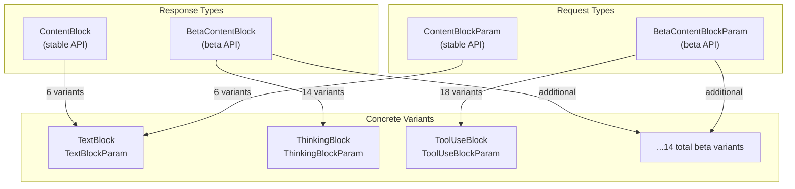
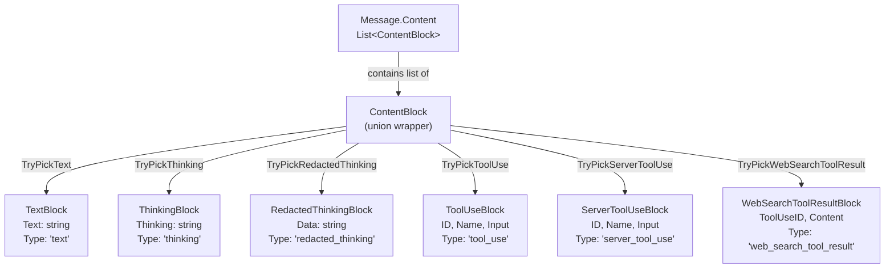
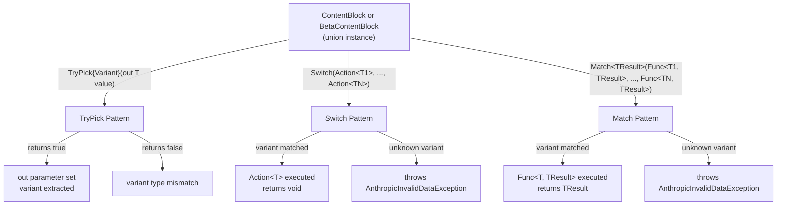
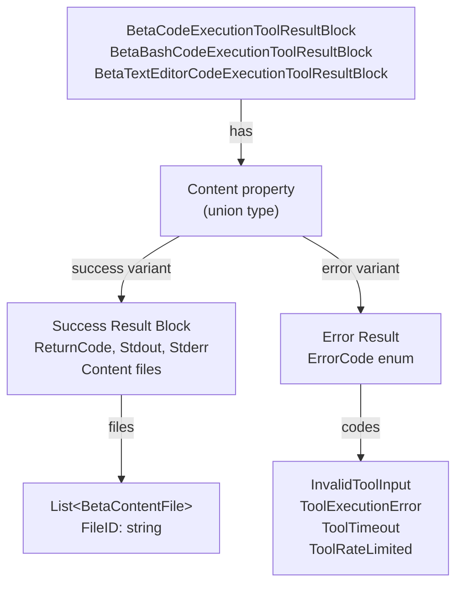
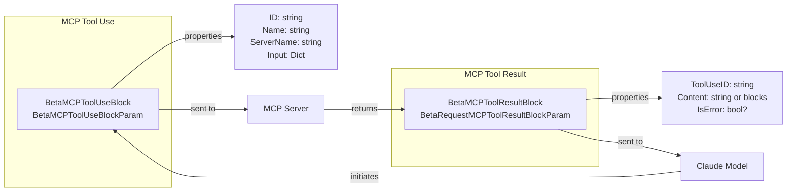

<!-- source: DeepWiki mcp.deepwiki.com · repo anthropics/anthropic-sdk-csharp · page 5.3 Content Blocks · fetched 2026-10-26 -->

# Content Blocks

<details>
<summary>Relevant source files</summary>

The following files were used as context for generating this wiki page:

- [src/Anthropic.Tests/Models/Beta/BetaErrorTest.cs](src/Anthropic.Tests/Models/Beta/BetaErrorTest.cs)
- [src/Anthropic.Tests/Models/Beta/Messages/Batches/BatchCreateParamsTest.cs](src/Anthropic.Tests/Models/Beta/Messages/Batches/BatchCreateParamsTest.cs)
- [src/Anthropic.Tests/Models/Beta/Messages/Batches/BetaMessageBatchResultTest.cs](src/Anthropic.Tests/Models/Beta/Messages/Batches/BetaMessageBatchResultTest.cs)
- [src/Anthropic.Tests/Models/Beta/Messages/BetaBashCodeExecutionToolResultBlockParamTest.cs](src/Anthropic.Tests/Models/Beta/Messages/BetaBashCodeExecutionToolResultBlockParamTest.cs)
- [src/Anthropic.Tests/Models/Beta/Messages/BetaBashCodeExecutionToolResultBlockTest.cs](src/Anthropic.Tests/Models/Beta/Messages/BetaBashCodeExecutionToolResultBlockTest.cs)
- [src/Anthropic.Tests/Models/Beta/Messages/BetaCitationsDeltaTest.cs](src/Anthropic.Tests/Models/Beta/Messages/BetaCitationsDeltaTest.cs)
- [src/Anthropic.Tests/Models/Beta/Messages/BetaClearThinking20251015EditTest.cs](src/Anthropic.Tests/Models/Beta/Messages/BetaClearThinking20251015EditTest.cs)
- [src/Anthropic.Tests/Models/Beta/Messages/BetaClearToolUses20250919EditTest.cs](src/Anthropic.Tests/Models/Beta/Messages/BetaClearToolUses20250919EditTest.cs)
- [src/Anthropic.Tests/Models/Beta/Messages/BetaCodeExecutionToolResultBlockContentTest.cs](src/Anthropic.Tests/Models/Beta/Messages/BetaCodeExecutionToolResultBlockContentTest.cs)
- [src/Anthropic.Tests/Models/Beta/Messages/BetaCodeExecutionToolResultBlockParamContentTest.cs](src/Anthropic.Tests/Models/Beta/Messages/BetaCodeExecutionToolResultBlockParamContentTest.cs)
- [src/Anthropic.Tests/Models/Beta/Messages/BetaContentBlockParamTest.cs](src/Anthropic.Tests/Models/Beta/Messages/BetaContentBlockParamTest.cs)
- [src/Anthropic.Tests/Models/Beta/Messages/BetaContextManagementConfigTest.cs](src/Anthropic.Tests/Models/Beta/Messages/BetaContextManagementConfigTest.cs)
- [src/Anthropic.Tests/Models/Beta/Messages/BetaMessageParamTest.cs](src/Anthropic.Tests/Models/Beta/Messages/BetaMessageParamTest.cs)
- [src/Anthropic.Tests/Models/Beta/Messages/BetaServerToolUseBlockParamTest.cs](src/Anthropic.Tests/Models/Beta/Messages/BetaServerToolUseBlockParamTest.cs)
- [src/Anthropic.Tests/Models/Beta/Messages/BetaServerToolUseBlockTest.cs](src/Anthropic.Tests/Models/Beta/Messages/BetaServerToolUseBlockTest.cs)
- [src/Anthropic.Tests/Models/Beta/Messages/MessageCreateParamsTest.cs](src/Anthropic.Tests/Models/Beta/Messages/MessageCreateParamsTest.cs)
- [src/Anthropic.Tests/Models/Messages/Batches/BatchCreateParamsTest.cs](src/Anthropic.Tests/Models/Messages/Batches/BatchCreateParamsTest.cs)
- [src/Anthropic.Tests/Models/Messages/MessageCreateParamsTest.cs](src/Anthropic.Tests/Models/Messages/MessageCreateParamsTest.cs)
- [src/Anthropic.Tests/Models/Messages/MessageParamTest.cs](src/Anthropic.Tests/Models/Messages/MessageParamTest.cs)

</details>


Content blocks represent the polymorphic content types that can appear in messages exchanged with Claude. The SDK implements a discriminated union pattern where `ContentBlock` (stable) and `BetaContentBlock` (beta) types can contain one of multiple concrete variants. The stable API provides 6 content block types for responses, while the beta API extends this to 14 response types and 18 request parameter types.

All content blocks use a `type` field discriminator for JSON serialization/deserialization. The SDK provides type-safe access through `TryPick*` methods, exhaustive `Switch` handlers, and `Match<T>` pattern matching.

For citations embedded in text blocks, see page 5.4. For tool-related content blocks, see section 6.

## Union Type Architecture

Content blocks implement a discriminated union pattern through wrapper types that hold one concrete variant. The `Value` property stores the variant, while pattern matching methods provide type-safe access.

**Union Type Hierarchy:**



**Union Pattern Methods:**

| Method Pattern | Return Type | Purpose | Behavior on Unknown |
|----------------|-------------|---------|---------------------|
| `TryPick{Variant}(out var x)` | `bool` | Type checking with output | Returns `false` |
| `Switch(...)` | `void` | Exhaustive handling | Throws `AnthropicInvalidDataException` |
| `Match<T>(...)` | `T` | Pattern matching with return | Throws `AnthropicInvalidDataException` |
| `Validate()` | `void` | Validation | Throws on unknown variant |

**Sources:** [src/Anthropic/Models/Messages/ContentBlock.cs:1-375](), [src/Anthropic/Models/Beta/Messages/BetaContentBlock.cs:1-748](), [src/Anthropic/Models/Beta/Messages/BetaContentBlockParam.cs:1-1100]()

## Stable API Content Blocks

The `ContentBlock` union type wraps 6 response variants. Each variant includes a `Type` property with a constant JSON discriminator value.

**Stable Content Block Variants:**

| Type Discriminator | Class Name | Key Properties | Use Case |
|-------------------|------------|----------------|----------|
| `"text"` | `TextBlock` | `Text: string` | Plain text responses |
| `"thinking"` | `ThinkingBlock` | `Thinking: string` | Extended reasoning content |
| `"redacted_thinking"` | `RedactedThinkingBlock` | `Data: string` | Privacy-redacted reasoning |
| `"tool_use"` | `ToolUseBlock` | `ID: string`<br/>`Name: string`<br/>`Input: Dictionary<string, JsonElement>` | Custom tool invocation |
| `"server_tool_use"` | `ServerToolUseBlock` | `ID: string`<br/>`Name: string`<br/>`Input: Dictionary<string, JsonElement>` | Server-side tool invocation |
| `"web_search_tool_result"` | `WebSearchToolResultBlock` | `ToolUseID: string`<br/>`Content: List<WebSearchResultBlock>` | Web search results |

**Type Hierarchy:**



**Accessing Content Blocks:**

```csharp
// Iterate through Message.Content
foreach (var block in message.Content)
{
    // Use TryPick methods for type-safe access
    if (block.TryPickText(out var textBlock))
    {
        Console.WriteLine(textBlock.Text);
    }
    else if (block.TryPickToolUse(out var toolUseBlock))
    {
        Console.WriteLine($"Tool: {toolUseBlock.Name}");
        // toolUseBlock.Input is Dictionary<string, JsonElement>
    }
}
```

**Sources:** [src/Anthropic/Models/Messages/ContentBlock.cs:9-375](), [src/Anthropic.Tests/Models/Messages/MessageParamTest.cs:58-135]()

## Beta API Content Blocks

The `BetaContentBlock` union extends the stable API to 14 response variants, adding citations, specialized tool results, and container support.

**Beta Content Block Response Variants:**

```mermaid
graph TB
    BetaContentBlock["BetaContentBlock<br/>(union wrapper)"]
    
    subgraph "Text & Thinking (3)"
        BetaTextBlock["BetaTextBlock<br/>Text + Citations"]
        BetaThinkingBlock["BetaThinkingBlock<br/>Thinking"]
        BetaRedactedThinkingBlock["BetaRedactedThinkingBlock<br/>Data"]
    end
    
    subgraph "Tool Use (3)"
        BetaToolUseBlock["BetaToolUseBlock<br/>ID, Name, Input"]
        BetaServerToolUseBlock["BetaServerToolUseBlock<br/>ID, Name, Input, Caller"]
        BetaMCPToolUseBlock["BetaMCPToolUseBlock<br/>ID, Name, ServerName, Input"]
    end
    
    subgraph "Web Tool Results (2)"
        BetaWebSearchToolResultBlock["BetaWebSearchToolResultBlock<br/>ToolUseID, Content"]
        BetaWebFetchToolResultBlock["BetaWebFetchToolResultBlock<br/>ToolUseID, Content"]
    end
    
    subgraph "Code Execution Results (3)"
        BetaCodeExecutionToolResultBlock["BetaCodeExecutionToolResultBlock<br/>ToolUseID, Content"]
        BetaBashCodeExecutionToolResultBlock["BetaBashCodeExecutionToolResultBlock<br/>ToolUseID, Content"]
        BetaTextEditorCodeExecutionToolResultBlock["BetaTextEditorCodeExecutionToolResultBlock<br/>ToolUseID, Content"]
    end
    
    subgraph "Other Results (2)"
        BetaToolSearchToolResultBlock["BetaToolSearchToolResultBlock<br/>ToolUseID, Content"]
        BetaMCPToolResultBlock["BetaMCPToolResultBlock<br/>ToolUseID, Content, IsError"]
    end
    
    subgraph "Container (1)"
        BetaContainerUploadBlock["BetaContainerUploadBlock<br/>FileID"]
    end
    
    BetaContentBlock --> BetaTextBlock
    BetaContentBlock --> BetaThinkingBlock
    BetaContentBlock --> BetaRedactedThinkingBlock
    BetaContentBlock --> BetaToolUseBlock
    BetaContentBlock --> BetaServerToolUseBlock
    BetaContentBlock --> BetaMCPToolUseBlock
    BetaContentBlock --> BetaWebSearchToolResultBlock
    BetaContentBlock --> BetaWebFetchToolResultBlock
    BetaContentBlock --> BetaCodeExecutionToolResultBlock
    BetaContentBlock --> BetaBashCodeExecutionToolResultBlock
    BetaContentBlock --> BetaTextEditorCodeExecutionToolResultBlock
    BetaContentBlock --> BetaToolSearchToolResultBlock
    BetaContentBlock --> BetaMCPToolResultBlock
    BetaContentBlock --> BetaContainerUploadBlock
```



**Beta-Specific Features:**

| Feature | Class | Key Properties |
|---------|-------|----------------|
| Citations in text | `BetaTextBlock` | `Citations: List<BetaTextCitation>?` |
| Server tool caller tracking | `BetaServerToolUseBlock` | `Caller: BetaServerToolUseBlockCaller` (union of `BetaDirectCaller` or `BetaServerToolCaller`) |
| MCP server integration | `BetaMCPToolUseBlock` | `ServerName: string` identifies MCP server |
| Container file uploads | `BetaContainerUploadBlock` | `FileID: string` references uploaded file |
| Web fetch tool results | `BetaWebFetchToolResultBlock` | Content union: success or error |
| Code execution variants | `BetaCodeExecutionToolResultBlock`<br/>`BetaBashCodeExecutionToolResultBlock`<br/>`BetaTextEditorCodeExecutionToolResultBlock` | Different execution environments |
| Tool search results | `BetaToolSearchToolResultBlock` | Search within tool definitions |

**Sources:** [src/Anthropic/Models/Beta/Messages/BetaContentBlock.cs:9-748](), [src/Anthropic.Tests/Models/Beta/Messages/Batches/BetaMessageBatchResultTest.cs:1-227]()

## Content Block Parameters (Request)

Request content blocks use `ContentBlockParam` (stable, 6 variants) or `BetaContentBlockParam` (beta, 18 variants) union types. The beta API adds input-only variants like `BetaImageBlockParam` and `BetaRequestDocumentBlock`.

**Beta Content Block Parameter Variants (18 total):**

| Type Discriminator | Class Name | Key Properties | Direction |
|-------------------|------------|----------------|-----------|
| `"text"` | `BetaTextBlockParam` | `Text: string`<br/>`Citations: List<BetaCitationParam>?`<br/>`CacheControl: BetaCacheControlEphemeral?` | User input |
| `"image"` | `BetaImageBlockParam` | `Source: BetaImageBlockParamSource` (union)<br/>`CacheControl: BetaCacheControlEphemeral?` | User input |
| `"document"` | `BetaRequestDocumentBlock` | `Source: BetaRequestDocumentBlockSource` (union)<br/>`Title: string?`<br/>`Context: string?`<br/>`Citations: BetaCitationsConfig?`<br/>`CacheControl: BetaCacheControlEphemeral?` | User input |
| `"search_result"` | `BetaSearchResultBlockParam` | `Content: List<BetaTextBlockParam>`<br/>`Source: string`<br/>`Title: string`<br/>`Citations: BetaCitationsConfig?`<br/>`CacheControl: BetaCacheControlEphemeral?` | User input |
| `"thinking"` | `BetaThinkingBlockParam` | `Thinking: string`<br/>`Signature: string?` | Assistant context |
| `"redacted_thinking"` | `BetaRedactedThinkingBlockParam` | `Data: string` | Assistant context |
| `"tool_use"` | `BetaToolUseBlockParam` | `ID: string`<br/>`Name: string`<br/>`Input: Dictionary<string, JsonElement>`<br/>`Caller: BetaToolUseBlockParamCaller?`<br/>`CacheControl: BetaCacheControlEphemeral?` | Assistant output |
| `"tool_result"` | `BetaToolResultBlockParam` | `ToolUseID: string`<br/>`Content: BetaToolResultBlockParamContent` (union)<br/>`IsError: bool?`<br/>`CacheControl: BetaCacheControlEphemeral?` | User input |
| `"server_tool_use"` | `BetaServerToolUseBlockParam` | `ID: string`<br/>`Name: BetaServerToolUseBlockParamName` (enum)<br/>`Input: Dictionary<string, JsonElement>`<br/>`Caller: BetaServerToolUseBlockParamCaller?`<br/>`CacheControl: BetaCacheControlEphemeral?` | Assistant output |
| `"web_search_tool_result"` | `BetaWebSearchToolResultBlockParam` | `ToolUseID: string`<br/>`Content: BetaWebSearchToolResultBlockParamContent` (union)<br/>`CacheControl: BetaCacheControlEphemeral?` | User input |
| `"web_fetch_tool_result"` | `BetaWebFetchToolResultBlockParam` | `ToolUseID: string`<br/>`Content: BetaWebFetchToolResultBlockParamContent` (union)<br/>`CacheControl: BetaCacheControlEphemeral?` | User input |
| `"code_execution_tool_result"` | `BetaCodeExecutionToolResultBlockParam` | `ToolUseID: string`<br/>`Content: BetaCodeExecutionToolResultBlockParamContent` (union)<br/>`CacheControl: BetaCacheControlEphemeral?` | User input |
| `"bash_code_execution_tool_result"` | `BetaBashCodeExecutionToolResultBlockParam` | `ToolUseID: string`<br/>`Content: BetaBashCodeExecutionToolResultBlockParamContent` (union)<br/>`CacheControl: BetaCacheControlEphemeral?` | User input |
| `"text_editor_code_execution_tool_result"` | `BetaTextEditorCodeExecutionToolResultBlockParam` | `ToolUseID: string`<br/>`Content: BetaTextEditorCodeExecutionToolResultBlockParamContent` (union)<br/>`CacheControl: BetaCacheControlEphemeral?` | User input |
| `"tool_search_tool_result"` | `BetaToolSearchToolResultBlockParam` | `ToolUseID: string`<br/>`Content: BetaToolSearchToolResultBlockParamContent` (union)<br/>`CacheControl: BetaCacheControlEphemeral?` | User input |
| `"mcp_tool_use"` | `BetaMCPToolUseBlockParam` | `ID: string`<br/>`Name: string`<br/>`ServerName: string`<br/>`Input: Dictionary<string, JsonElement>`<br/>`CacheControl: BetaCacheControlEphemeral?` | Assistant output |
| `"mcp_tool_result"` | `BetaRequestMCPToolResultBlockParam` | `ToolUseID: string`<br/>`Content: BetaMCPToolResultBlockParamContent` (union)<br/>`IsError: bool?`<br/>`CacheControl: BetaCacheControlEphemeral?` | User input |
| `"container_upload"` | `BetaContainerUploadBlockParam` | `FileID: string`<br/>`CacheControl: BetaCacheControlEphemeral?` | User input |

**Content Block Parameter Structure:**

```mermaid
graph TB
    BetaContentBlockParam["BetaContentBlockParam<br/>(union of 18 variants)"]
    
    subgraph "User Input Blocks"
        TextParam["BetaTextBlockParam<br/>Text + Citations"]
        ImageParam["BetaImageBlockParam<br/>Source (base64/url)"]
        DocParam["BetaRequestDocumentBlock<br/>PDF source"]
        SearchParam["BetaSearchResultBlockParam<br/>Search content"]
        ContainerParam["BetaContainerUploadBlockParam<br/>FileID"]
    end
    
    subgraph "Tool Result Blocks (8 types)"
        ToolResultParam["BetaToolResultBlockParam"]
        WebSearchResultParam["BetaWebSearchToolResultBlockParam"]
        WebFetchResultParam["BetaWebFetchToolResultBlockParam"]
        CodeExecResultParam["BetaCodeExecutionToolResultBlockParam"]
        BashExecResultParam["BetaBashCodeExecutionToolResultBlockParam"]
        TextEditorResultParam["BetaTextEditorCodeExecutionToolResultBlockParam"]
        ToolSearchResultParam["BetaToolSearchToolResultBlockParam"]
        MCPResultParam["BetaRequestMCPToolResultBlockParam"]
    end
    
    subgraph "Assistant Context Blocks"
        ThinkingParam["BetaThinkingBlockParam"]
        RedactedParam["BetaRedactedThinkingBlockParam"]
        ToolUseParam["BetaToolUseBlockParam"]
        ServerToolUseParam["BetaServerToolUseBlockParam"]
        MCPToolUseParam["BetaMCPToolUseBlockParam"]
    end
    
    subgraph "Cache Control"
        CacheControl["BetaCacheControlEphemeral<br/>TTL: TTL.TTL5m or TTL.TTL1h"]
    end
    
    BetaContentBlockParam --> TextParam
    BetaContentBlockParam --> ImageParam
    BetaContentBlockParam --> DocParam
    BetaContentBlockParam --> SearchParam
    BetaContentBlockParam --> ContainerParam
    BetaContentBlockParam --> ToolResultParam
    BetaContentBlockParam --> WebSearchResultParam
    BetaContentBlockParam --> WebFetchResultParam
    BetaContentBlockParam --> CodeExecResultParam
    BetaContentBlockParam --> BashExecResultParam
    BetaContentBlockParam --> TextEditorResultParam
    BetaContentBlockParam --> ToolSearchResultParam
    BetaContentBlockParam --> MCPResultParam
    BetaContentBlockParam --> ThinkingParam
    BetaContentBlockParam --> RedactedParam
    BetaContentBlockParam --> ToolUseParam
    BetaContentBlockParam --> ServerToolUseParam
    BetaContentBlockParam --> MCPToolUseParam
    
    TextParam -.->|"optional property"| CacheControl
    ImageParam -.->|"optional property"| CacheControl
    DocParam -.->|"optional property"| CacheControl
    ToolUseParam -.->|"optional property"| CacheControl
    ToolResultParam -.->|"optional property"| CacheControl
```



**Cache Control Usage:**

Most content block parameters support `BetaCacheControlEphemeral` with TTL values:

```csharp
// Text block with 5-minute cache
new BetaTextBlockParam
{
    Text = "Large context document...",
    CacheControl = new BetaCacheControlEphemeral { TTL = TTL.TTL5m }
}

// Image block with 1-hour cache
new BetaImageBlockParam
{
    Source = new BetaBase64ImageSource 
    { 
        Data = base64EncodedImage,
        MediaType = MediaType.ImageJPEG
    },
    CacheControl = new BetaCacheControlEphemeral { TTL = TTL.TTL1h }
}
```

**Sources:** [src/Anthropic/Models/Beta/Messages/BetaContentBlockParam.cs:9-1100](), [src/Anthropic.Tests/Models/Beta/Messages/BetaContentBlockParamTest.cs:1-690](), [src/Anthropic.Tests/Models/Beta/Messages/Batches/BatchCreateParamsTest.cs:1-723]()

## Citations in Text Blocks

`BetaTextBlock` and `BetaTextBlockParam` include an optional `Citations` property containing source attribution. Citations use discriminated unions: `BetaTextCitation` (responses) and `BetaCitationParam` (requests), each with 5 location variants.

**Citation Location Variants:**

| Type Discriminator | Class Name | Key Properties | Use Case |
|-------------------|------------|----------------|----------|
| `"char_location"` | `BetaCitationCharLocation`<br/>`BetaCitationCharLocationParam` | `StartCharIndex: long`<br/>`EndCharIndex: long`<br/>`FileID: string?`<br/>`DocumentIndex: long`<br/>`DocumentTitle: string?`<br/>`CitedText: string` | Character-level text references |
| `"page_location"` | `BetaCitationPageLocation`<br/>`BetaCitationPageLocationParam` | `StartPageNumber: long`<br/>`EndPageNumber: long`<br/>`FileID: string?`<br/>`DocumentIndex: long`<br/>`DocumentTitle: string?`<br/>`CitedText: string` | PDF page references |
| `"content_block_location"` | `BetaCitationContentBlockLocation`<br/>`BetaCitationContentBlockLocationParam` | `StartBlockIndex: long`<br/>`EndBlockIndex: long`<br/>`FileID: string?`<br/>`DocumentIndex: long`<br/>`DocumentTitle: string?`<br/>`CitedText: string` | Content block references |
| `"web_search_result_location"` | `BetaCitationsWebSearchResultLocation`<br/>`BetaCitationsWebSearchResultLocationParam` | `EncryptedIndex: string`<br/>`URL: string`<br/>`Title: string`<br/>`CitedText: string` | Web search result references |
| `"search_result_location"` | `BetaCitationSearchResultLocation`<br/>`BetaCitationSearchResultLocationParam` | `SearchResultIndex: long`<br/>`StartBlockIndex: long`<br/>`EndBlockIndex: long`<br/>`Source: string`<br/>`Title: string`<br/>`CitedText: string` | Custom search result references |

**Citation Access Pattern:**

```csharp
// Access citations from BetaTextBlock
if (contentBlock.TryPickText(out var textBlock))
{
    Console.WriteLine($"Text: {textBlock.Text}");
    
    if (textBlock.Citations != null)
    {
        foreach (var citation in textBlock.Citations)
        {
            // Use Switch for exhaustive handling
            citation.Switch(
                charLocation: cl => 
                    Console.WriteLine($"Char citation: {cl.CitedText} at {cl.StartCharIndex}-{cl.EndCharIndex}"),
                pageLocation: pl => 
                    Console.WriteLine($"Page citation: {pl.CitedText} on pages {pl.StartPageNumber}-{pl.EndPageNumber}"),
                contentBlockLocation: cbl => 
                    Console.WriteLine($"Block citation: {cbl.CitedText} in blocks {cbl.StartBlockIndex}-{cbl.EndBlockIndex}"),
                citationsWebSearchResultLocation: wsl => 
                    Console.WriteLine($"Web citation: {wsl.CitedText} from {wsl.URL}"),
                citationSearchResultLocation: srl => 
                    Console.WriteLine($"Search citation: {srl.CitedText} from {srl.Source}")
            );
        }
    }
}
```

For comprehensive documentation on citation types, see page 5.4.

**Sources:** [src/Anthropic/Models/Beta/Messages/BetaTextBlock.cs:1-50](), [src/Anthropic/Models/Beta/Messages/BetaTextCitation.cs:1-577](), [src/Anthropic.Tests/Models/Beta/Messages/BetaCitationsDeltaTest.cs:116-298](), [src/Anthropic.Tests/Models/Messages/Batches/BatchCreateParamsTest.cs:29-43]()

## Pattern Matching and Type Safety

Content block unions provide three type-safe access patterns: `TryPick*`, `Switch`, and `Match<T>`. All methods validate the variant type at runtime.

**Pattern Matching Methods:**



### TryPick Pattern

`TryPick{Variant}(out T value)` attempts to extract a specific variant. Returns `true` if the variant matches, `false` otherwise. Use when you only care about specific variants:

```csharp
// Process only text and tool use blocks
foreach (var block in message.Content)
{
    if (block.TryPickText(out var textBlock))
    {
        Console.WriteLine($"Text: {textBlock.Text}");
    }
    else if (block.TryPickToolUse(out var toolUseBlock))
    {
        Console.WriteLine($"Tool: {toolUseBlock.Name}");
        var result = ExecuteTool(toolUseBlock.Name, toolUseBlock.Input);
        // Send tool result back to Claude
    }
    // Other variants silently ignored
}
```

**Available TryPick Methods (ContentBlock):**
- `TryPickText(out TextBlock value)`
- `TryPickThinking(out ThinkingBlock value)`
- `TryPickRedactedThinking(out RedactedThinkingBlock value)`
- `TryPickToolUse(out ToolUseBlock value)`
- `TryPickServerToolUse(out ServerToolUseBlock value)`
- `TryPickWebSearchToolResult(out WebSearchToolResultBlock value)`

### Switch Pattern

`Switch(Action<T1>, ..., Action<TN>)` calls the appropriate action for the variant. Throws `AnthropicInvalidDataException` if the variant is unknown. Use for exhaustive handling:

```csharp
// Handle all possible content block types
block.Switch(
    text: t => Console.WriteLine($"Text: {t.Text}"),
    thinking: th => Console.WriteLine($"Thinking: {th.Thinking}"),
    redactedThinking: rt => Console.WriteLine("Thinking redacted"),
    toolUse: tu => 
    {
        Console.WriteLine($"Tool use: {tu.Name}");
        ExecuteTool(tu.Name, tu.Input);
    },
    serverToolUse: stu => Console.WriteLine($"Server tool: {stu.Name}"),
    webSearchToolResult: wsr => 
    {
        Console.WriteLine("Web search results:");
        foreach (var result in wsr.Content)
        {
            Console.WriteLine($"  {result.Title}: {result.URL}");
        }
    }
);
```

### Match Pattern

`Match<TResult>(Func<T1, TResult>, ..., Func<TN, TResult>)` calls the appropriate function and returns a value. Throws `AnthropicInvalidDataException` if the variant is unknown. Use when you need to transform or compute from the variant:

```csharp
// Extract displayable text from any content block
var displayText = block.Match(
    text: t => t.Text,
    thinking: th => $"[Thinking: {th.Thinking}]",
    redactedThinking: rt => "[Thinking redacted]",
    toolUse: tu => $"[Using tool: {tu.Name}]",
    serverToolUse: stu => $"[Server tool: {stu.Name}]",
    webSearchToolResult: wsr => $"[{wsr.Content.Count} web search results]"
);
Console.WriteLine(displayText);

// Calculate token estimates
var estimatedTokens = block.Match(
    text: t => t.Text.Length / 4,  // Rough token estimate
    thinking: th => th.Thinking.Length / 4,
    redactedThinking: rt => rt.Data.Length / 4,
    toolUse: tu => JsonSerializer.Serialize(tu.Input).Length / 4,
    serverToolUse: stu => JsonSerializer.Serialize(stu.Input).Length / 4,
    webSearchToolResult: wsr => wsr.Content.Sum(r => r.Content.Length) / 4
);
```

### Validation

`Validate()` checks that the union contains a known variant and calls `Validate()` on the variant itself:

```csharp
try
{
    contentBlock.Validate();
    // Content block is valid
}
catch (AnthropicInvalidDataException ex)
{
    // Unknown variant type or variant validation failed
    Console.WriteLine($"Invalid content block: {ex.Message}");
}
```

**When to Use Each Pattern:**

| Pattern | Use When | Returns | Throws on Unknown |
|---------|----------|---------|-------------------|
| `TryPick*` | Interested in specific variants only | `bool` | No |
| `Switch` | Need exhaustive handling with side effects | `void` | Yes |
| `Match<T>` | Need exhaustive handling with return value | `T` | Yes |
| `Validate` | Need to verify variant is known | `void` | Yes |

**Sources:** [src/Anthropic/Models/Messages/ContentBlock.cs:92-324](), [src/Anthropic/Models/Beta/Messages/BetaContentBlock.cs:185-666](), [src/Anthropic.Tests/Models/Beta/Messages/BetaMessageParamTest.cs:58-135]()

## Code Execution Tool Result Blocks

The beta API provides three code execution result block types, each with a `Content` property that is a union of success or error results.

**Code Execution Result Block Types:**

| Block Type | Type Discriminator | Content Union | Success Properties | Error Type |
|------------|-------------------|---------------|-------------------|------------|
| `BetaCodeExecutionToolResultBlock` | `"code_execution_tool_result"` | `BetaCodeExecutionToolResultBlockContent` | `BetaCodeExecutionResultBlock`:<br/>`ReturnCode: long`<br/>`Stdout: string?`<br/>`Stderr: string?`<br/>`Content: List<BetaContentFile>` | `BetaCodeExecutionToolResultError`:<br/>`ErrorCode: BetaCodeExecutionToolResultErrorCode` |
| `BetaBashCodeExecutionToolResultBlock` | `"bash_code_execution_tool_result"` | `Content` union | `BetaBashCodeExecutionResultBlock`:<br/>`ReturnCode: long`<br/>`Stdout: string?`<br/>`Stderr: string?`<br/>`Content: List<BetaContentFile>` | `BetaBashCodeExecutionToolResultError`:<br/>`ErrorCode: ErrorCode` |
| `BetaTextEditorCodeExecutionToolResultBlock` | `"text_editor_code_execution_tool_result"` | `BetaTextEditorCodeExecutionToolResultBlockContent` | `BetaTextEditorCodeExecutionResultBlock`:<br/>`Content: List<BetaContentFile>` | `BetaTextEditorCodeExecutionToolResultError`:<br/>`ErrorCode: BetaTextEditorCodeExecutionToolResultErrorCode`<br/>`ErrorMessage: string` |

**Common Block Properties:**

```csharp
// All three block types have these properties
public class BetaCodeExecutionToolResultBlock
{
    public BetaCodeExecutionToolResultBlockContent Content { get; set; }  // Union: success or error
    public string ToolUseID { get; set; }  // Links to tool use request
    public JsonElement Type { get; set; }  // "code_execution_tool_result"
}
```

**Content Union Structure:**



**Error Code Enums:**

All code execution errors use similar enum values:
- `InvalidToolInput`: Malformed input provided to tool
- `ToolExecutionError`: Execution failed during runtime
- `ToolTimeout`: Execution exceeded time limit
- `ToolRateLimited`: Too many execution requests

**Accessing Code Execution Results:**

```csharp
// Handle code execution result in response
if (contentBlock.TryPickCodeExecutionToolResult(out var codeResult))
{
    codeResult.Content.Switch(
        betaCodeExecutionToolResultError: error =>
            Console.WriteLine($"Code execution failed: {error.ErrorCode}"),
        betaCodeExecutionResultBlock: success =>
        {
            Console.WriteLine($"Return code: {success.ReturnCode}");
            Console.WriteLine($"Stdout: {success.Stdout}");
            Console.WriteLine($"Stderr: {success.Stderr}");
            foreach (var file in success.Content)
            {
                Console.WriteLine($"Output file: {file.FileID}");
            }
        }
    );
}

// Similar pattern for bash execution
if (contentBlock.TryPickBashCodeExecutionToolResult(out var bashResult))
{
    bashResult.Content.Switch(
        betaBashCodeExecutionToolResultError: error =>
            Console.WriteLine($"Bash execution error: {error.ErrorCode}"),
        betaBashCodeExecutionResultBlock: success =>
            ProcessBashOutput(success.ReturnCode, success.Stdout, success.Stderr)
    );
}

// Text editor has different success structure
if (contentBlock.TryPickTextEditorCodeExecutionToolResult(out var editorResult))
{
    editorResult.Content.Switch(
        betaTextEditorCodeExecutionToolResultError: error =>
            Console.WriteLine($"Error: {error.ErrorCode} - {error.ErrorMessage}"),
        betaTextEditorCodeExecutionResultBlock: success =>
        {
            foreach (var file in success.Content)
            {
                Console.WriteLine($"Modified file: {file.FileID}");
            }
        }
    );
}
```

**Sources:** [src/Anthropic/Models/Beta/Messages/BetaContentBlock.cs:135-160](), [src/Anthropic.Tests/Models/Beta/Messages/BetaBashCodeExecutionToolResultBlockTest.cs:1-137](), [src/Anthropic.Tests/Models/Beta/Messages/BetaCodeExecutionToolResultBlockContentTest.cs:1-69]()

## Container and MCP Integration

The beta API includes specialized content blocks for container-based workflows and Model Context Protocol (MCP) integration.

### Container Upload Blocks

`BetaContainerUploadBlock` represents files uploaded to a container for reuse across multiple messages:

| Property | Type | Description |
|----------|------|-------------|
| `Type` | `JsonElement` | Always `"container_upload"` |
| `FileID` | `string` | Unique identifier for uploaded file |
| `CacheControl` | `BetaCacheControlEphemeral?` | Optional cache control |

### MCP Tool Blocks

MCP integration enables Claude to use tools from external servers following the Model Context Protocol:



**Key Differences from Regular Tools:**

- `ServerName`: Identifies which MCP server provides the tool
- Server-managed tool discovery and execution
- Integration with external tool ecosystems

**Sources:** [src/Anthropic/Models/Beta/Messages/BetaContentBlock.cs:162-177](), [src/Anthropic.Tests/Models/Beta/Messages/BetaContentBlockParamTest.cs:277-308]()

---

