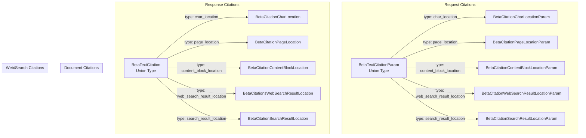
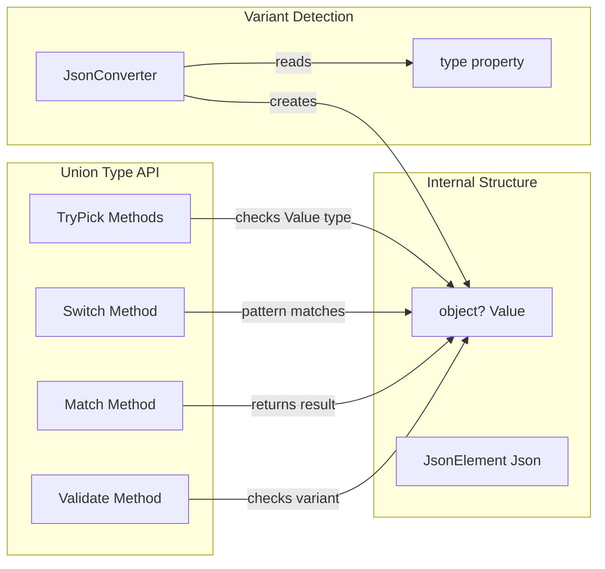
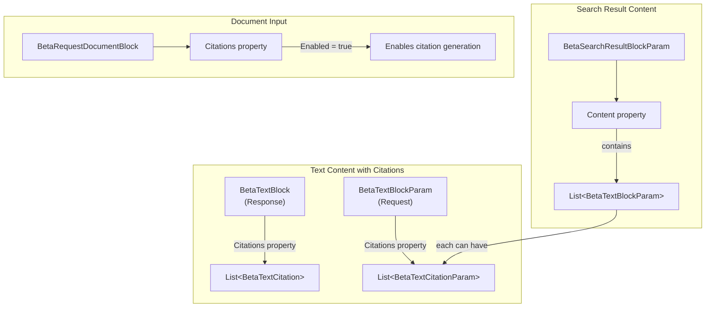
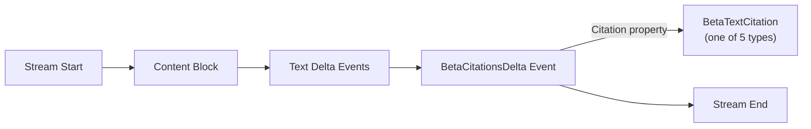

<!-- source: DeepWiki mcp.deepwiki.com · repo anthropics/anthropic-sdk-csharp · page 5.4 Citations and Source Attribution · fetched 2026-10-26 -->

# Citations and Source Attribution

<details>
<summary>Relevant source files</summary>

The following files were used as context for generating this wiki page:

- [src/Anthropic.Tests/Models/Beta/BetaErrorTest.cs](src/Anthropic.Tests/Models/Beta/BetaErrorTest.cs)
- [src/Anthropic.Tests/Models/Beta/Messages/Batches/BetaMessageBatchResultTest.cs](src/Anthropic.Tests/Models/Beta/Messages/Batches/BetaMessageBatchResultTest.cs)
- [src/Anthropic.Tests/Models/Beta/Messages/BetaBashCodeExecutionToolResultBlockParamTest.cs](src/Anthropic.Tests/Models/Beta/Messages/BetaBashCodeExecutionToolResultBlockParamTest.cs)
- [src/Anthropic.Tests/Models/Beta/Messages/BetaBashCodeExecutionToolResultBlockTest.cs](src/Anthropic.Tests/Models/Beta/Messages/BetaBashCodeExecutionToolResultBlockTest.cs)
- [src/Anthropic.Tests/Models/Beta/Messages/BetaCitationsDeltaTest.cs](src/Anthropic.Tests/Models/Beta/Messages/BetaCitationsDeltaTest.cs)
- [src/Anthropic.Tests/Models/Beta/Messages/BetaClearToolUses20250919EditTest.cs](src/Anthropic.Tests/Models/Beta/Messages/BetaClearToolUses20250919EditTest.cs)
- [src/Anthropic.Tests/Models/Beta/Messages/BetaCodeExecutionToolResultBlockContentTest.cs](src/Anthropic.Tests/Models/Beta/Messages/BetaCodeExecutionToolResultBlockContentTest.cs)
- [src/Anthropic.Tests/Models/Beta/Messages/BetaCodeExecutionToolResultBlockParamContentTest.cs](src/Anthropic.Tests/Models/Beta/Messages/BetaCodeExecutionToolResultBlockParamContentTest.cs)
- [src/Anthropic.Tests/Models/Beta/Messages/BetaContentBlockParamTest.cs](src/Anthropic.Tests/Models/Beta/Messages/BetaContentBlockParamTest.cs)
- [src/Anthropic.Tests/Models/Beta/Messages/BetaContextManagementConfigTest.cs](src/Anthropic.Tests/Models/Beta/Messages/BetaContextManagementConfigTest.cs)
- [src/Anthropic.Tests/Models/Beta/Messages/BetaMessageTest.cs](src/Anthropic.Tests/Models/Beta/Messages/BetaMessageTest.cs)
- [src/Anthropic.Tests/Models/Messages/MessageTest.cs](src/Anthropic.Tests/Models/Messages/MessageTest.cs)

</details>


This page documents the citation and source attribution system in the Anthropic SDK. Citations enable Claude to reference specific locations in source materials (documents, web search results, search results) when generating responses, providing transparency and verifiability for information presented in messages.

For information about content blocks in general, see [Content Blocks](#5.3). For document upload and handling, see [Beta Services](#4.4).

## Overview

The citation system is a **beta feature** that allows Claude to attribute generated text to specific locations in source documents or search results. Citations are represented as structured objects that specify:

- What text was cited
- Where the citation came from (file, web search, etc.)
- Precise location information (character ranges, page numbers, block indices)

Citations appear as properties on text content blocks in API responses and can be included in request content blocks when providing source material with pre-existing citations.

**Sources:** [src/Anthropic/Models/Beta/Messages/BetaTextCitation.cs:1-586](), [src/Anthropic/Models/Beta/Messages/BetaTextCitationParam.cs:1-586]()

## Citation Location Type System



**Sources:** [src/Anthropic/Models/Beta/Messages/BetaTextCitation.cs:9-428](), [src/Anthropic/Models/Beta/Messages/BetaTextCitationParam.cs:9-434]()

### Character Location Citations

Character location citations reference a specific character range within a document, identified by start and end character indices.

| Property | Type | Description |
|----------|------|-------------|
| `CitedText` | `string` | The actual text being cited |
| `DocumentIndex` | `long` | Index of the document in the input |
| `DocumentTitle` | `string?` | Optional title of the document |
| `FileID` | `string` | ID of the uploaded file |
| `StartCharIndex` | `long` | Starting character position (0-indexed) |
| `EndCharIndex` | `long` | Ending character position (exclusive) |
| `Type` | `JsonElement` | Always `"char_location"` |

**Sources:** [src/Anthropic/Models/Beta/Messages/BetaTextCitation.cs:133-137](), [src/Anthropic.Tests/Models/Beta/Messages/BetaCitationsDeltaTest.cs:13-22]()

### Page Location Citations

Page location citations reference a range of pages within a document, useful for PDF documents and other paginated materials.

| Property | Type | Description |
|----------|------|-------------|
| `CitedText` | `string` | The actual text being cited |
| `DocumentIndex` | `long` | Index of the document in the input |
| `DocumentTitle` | `string?` | Optional title of the document |
| `FileID` | `string` | ID of the uploaded file |
| `StartPageNumber` | `long` | Starting page number (1-indexed) |
| `EndPageNumber` | `long` | Ending page number (inclusive) |
| `Type` | `JsonElement` | Always `"page_location"` |

**Sources:** [src/Anthropic/Models/Beta/Messages/BetaTextCitation.cs:139-143](), [src/Anthropic.Tests/Models/Beta/Messages/BetaCitationsDeltaTest.cs:135-150]()

### Content Block Location Citations

Content block location citations reference a range of content blocks within a document, useful when documents are structured into discrete blocks.

| Property | Type | Description |
|----------|------|-------------|
| `CitedText` | `string` | The actual text being cited |
| `DocumentIndex` | `long` | Index of the document in the input |
| `DocumentTitle` | `string?` | Optional title of the document |
| `FileID` | `string` | ID of the uploaded file |
| `StartBlockIndex` | `long` | Starting block index (0-indexed) |
| `EndBlockIndex` | `long` | Ending block index (inclusive) |
| `Type` | `JsonElement` | Always `"content_block_location"` |

**Sources:** [src/Anthropic/Models/Beta/Messages/BetaTextCitation.cs:145-149](), [src/Anthropic.Tests/Models/Beta/Messages/BetaCitationsDeltaTest.cs:153-167]()

### Web Search Result Location Citations

Web search result location citations reference content from web search results, using encrypted indices to protect user privacy.

| Property | Type | Description |
|----------|------|-------------|
| `CitedText` | `string` | The actual text being cited |
| `EncryptedIndex` | `string` | Encrypted index of the search result |
| `Title` | `string` | Title of the web page |
| `URL` | `string` | URL of the web page |
| `Type` | `JsonElement` | Always `"web_search_result_location"` |

**Sources:** [src/Anthropic/Models/Beta/Messages/BetaTextCitation.cs:151-155](), [src/Anthropic.Tests/Models/Beta/Messages/BetaCitationsDeltaTest.cs:169-182]()

### Search Result Location Citations

Search result location citations reference content from generic search results, identified by block ranges within the result.

| Property | Type | Description |
|----------|------|-------------|
| `CitedText` | `string` | The actual text being cited |
| `SearchResultIndex` | `long` | Index of the search result |
| `Source` | `string` | Source identifier for the search result |
| `Title` | `string` | Title of the search result |
| `StartBlockIndex` | `long` | Starting block index within the result |
| `EndBlockIndex` | `long` | Ending block index within the result |
| `Type` | `JsonElement` | Always `"search_result_location"` |

**Sources:** [src/Anthropic/Models/Beta/Messages/BetaTextCitation.cs:157-161](), [src/Anthropic.Tests/Models/Beta/Messages/BetaCitationsDeltaTest.cs:184-199]()

## Citation Union Type Pattern



Both `BetaTextCitation` and `BetaTextCitationParam` use discriminated union types that provide type-safe handling of the five citation location variants.

### Working with Citation Unions

**TryPick Pattern:**
```csharp
if (citation.TryPickCitationCharLocation(out var charLocation))
{
    // Work with character-based citation
    Console.WriteLine($"Cited text: {charLocation.CitedText}");
    Console.WriteLine($"Range: {charLocation.StartCharIndex}-{charLocation.EndCharIndex}");
}
else if (citation.TryPickCitationPageLocation(out var pageLocation))
{
    // Work with page-based citation
    Console.WriteLine($"Pages: {pageLocation.StartPageNumber}-{pageLocation.EndPageNumber}");
}
```

**Switch Pattern:**
```csharp
citation.Switch(
    citationCharLocation: (loc) => ProcessCharLocation(loc),
    citationPageLocation: (loc) => ProcessPageLocation(loc),
    citationContentBlockLocation: (loc) => ProcessBlockLocation(loc),
    citationsWebSearchResultLocation: (loc) => ProcessWebLocation(loc),
    citationSearchResultLocation: (loc) => ProcessSearchLocation(loc)
);
```

**Match Pattern:**
```csharp
string summary = citation.Match(
    citationCharLocation: (loc) => $"Chars {loc.StartCharIndex}-{loc.EndCharIndex}",
    citationPageLocation: (loc) => $"Pages {loc.StartPageNumber}-{loc.EndPageNumber}",
    citationContentBlockLocation: (loc) => $"Blocks {loc.StartBlockIndex}-{loc.EndBlockIndex}",
    citationsWebSearchResultLocation: (loc) => $"Web: {loc.URL}",
    citationSearchResultLocation: (loc) => $"Result: {loc.Title}"
);
```

**Sources:** [src/Anthropic/Models/Beta/Messages/BetaTextCitation.cs:163-277](), [src/Anthropic/Models/Beta/Messages/BetaTextCitation.cs:278-378](), [src/Anthropic/Models/Beta/Messages/BetaTextCitationParam.cs:158-276]()

## Citations in Content Blocks



### Text Blocks with Citations

The `BetaTextBlock` (response) and `BetaTextBlockParam` (request) content blocks include a `Citations` property that holds a list of citation objects. Each citation references a portion of the text content.

**Response Text Block:**
```csharp
BetaTextBlock textBlock = // from API response
if (textBlock.Citations != null)
{
    foreach (var citation in textBlock.Citations)
    {
        Console.WriteLine($"Cited: '{citation.CitedText}'");
        // Access common properties across all citation types
        Console.WriteLine($"Document index: {citation.DocumentIndex}");
    }
}
```

**Sources:** [src/Anthropic/Models/Beta/Messages/BetaContentBlock.cs:93-97](), [src/Anthropic.Tests/Models/Beta/Messages/BetaContentBlockParamTest.cs:10-31]()

### Search Result Blocks with Citations

`BetaSearchResultBlockParam` allows providing search results as input, where each result can contain text blocks with citations:

```csharp
var searchResult = new BetaSearchResultBlockParam
{
    Title = "Source Article",
    Source = "https://example.com",
    Content = new List<BetaTextBlockParam>
    {
        new()
        {
            Text = "Important information from the article.",
            Citations = new List<BetaTextCitationParam>
            {
                new BetaCitationCharLocationParam
                {
                    CitedText = "Important information",
                    DocumentIndex = 0,
                    DocumentTitle = "Source Article",
                    StartCharIndex = 0,
                    EndCharIndex = 21
                }
            }
        }
    }
};
```

**Sources:** [src/Anthropic.Tests/Models/Beta/Messages/BetaContentBlockParamTest.cs:67-98](), [src/Anthropic/Models/Beta/Messages/BetaContentBlockParam.cs:204-208]()

### Enabling Citations for Documents

When uploading documents via `BetaRequestDocumentBlock`, citations can be enabled by setting the `Citations` configuration:

```csharp
var documentBlock = new BetaRequestDocumentBlock
{
    Source = new BetaBase64PDFSource("U3RhaW5sZXNzIHJvY2tz"),
    Title = "Research Paper",
    Context = "This is a research paper about AI",
    Citations = new BetaCitationsConfig { Enabled = true }
};
```

**Sources:** [src/Anthropic.Tests/Models/Beta/Messages/BetaContentBlockParamTest.cs:51-64]()

## Streaming Citations

When using streaming message creation, citations are delivered incrementally via `BetaCitationsDelta` events.



### BetaCitationsDelta Structure

| Property | Type | Description |
|----------|------|-------------|
| `Type` | `JsonElement` | Always `"citations_delta"` |
| `Citation` | `BetaTextCitation` | The citation being added (union of 5 types) |

**Example:**
```csharp
await foreach (var streamEvent in stream)
{
    if (streamEvent.TryPickContentBlockDelta(out var delta))
    {
        if (delta.Delta.TryPickCitationsDelta(out var citationsDelta))
        {
            var citation = citationsDelta.Citation;
            citation.Switch(
                citationCharLocation: (loc) => 
                    Console.WriteLine($"Citation: {loc.CitedText} [{loc.StartCharIndex}:{loc.EndCharIndex}]"),
                citationPageLocation: (loc) => 
                    Console.WriteLine($"Citation: {loc.CitedText} [p.{loc.StartPageNumber}-{loc.EndPageNumber}]"),
                // ... handle other citation types
            );
        }
    }
}
```

**Sources:** [src/Anthropic.Tests/Models/Beta/Messages/BetaCitationsDeltaTest.cs:6-114]()

## Common Citation Properties

All citation types share certain common properties accessible via the union type's properties:

| Property | Available On | Description |
|----------|-------------|-------------|
| `CitedText` | All types | The text being cited |
| `DocumentIndex` | Document citations | Index of the document (char, page, block) |
| `DocumentTitle` | Document citations | Title of the document (char, page, block) |
| `FileID` | Document citations | File ID (char, page, block) |
| `Type` | All types | Discriminator identifying the citation type |
| `Title` | Web/search citations | Title of the result |
| `StartBlockIndex` | Block/search citations | Starting block index |
| `EndBlockIndex` | Block/search citations | Ending block index |

These properties use nullable return types (`string?`, `long?`) when not available for all citation variants, returning `null` for inapplicable types.

**Sources:** [src/Anthropic/Models/Beta/Messages/BetaTextCitation.cs:21-131](), [src/Anthropic/Models/Beta/Messages/BetaTextCitationParam.cs:21-117]()

## Citation Validation

Both request and response citation types implement validation via the `Validate()` method:

```csharp
// Validate a citation union
citation.Validate(); // Throws AnthropicInvalidDataException if invalid

// Validate works for all variants
BetaTextCitationParam citation = new BetaCitationCharLocationParam
{
    CitedText = "example",
    DocumentIndex = 0,
    StartCharIndex = 0,
    EndCharIndex = 7
};
citation.Validate(); // Ensures the variant is valid
```

Validation ensures:
1. The citation union contains a known variant
2. The variant itself passes its own validation rules
3. Required properties are present

**Sources:** [src/Anthropic/Models/Beta/Messages/BetaTextCitation.cs:392-417](), [src/Anthropic/Models/Beta/Messages/BetaTextCitationParam.cs:408-423](), [src/Anthropic.Tests/Models/Beta/Messages/BetaCitationsDeltaTest.cs:97-113]()

## JSON Serialization

Citations use custom JSON converters (`BetaTextCitationConverter`, `BetaTextCitationParamConverter`) that deserialize based on the `type` discriminator property:

- `"char_location"` → Character location citation
- `"page_location"` → Page location citation  
- `"content_block_location"` → Content block location citation
- `"web_search_result_location"` → Web search result citation
- `"search_result_location"` → Search result citation

The converters attempt to deserialize to each type based on the discriminator, falling back to raw `JsonElement` storage if deserialization fails. This ensures forward compatibility with new citation types.

**Sources:** [src/Anthropic/Models/Beta/Messages/BetaTextCitation.cs:430-577](), [src/Anthropic/Models/Beta/Messages/BetaTextCitationParam.cs:436-585]()

---

