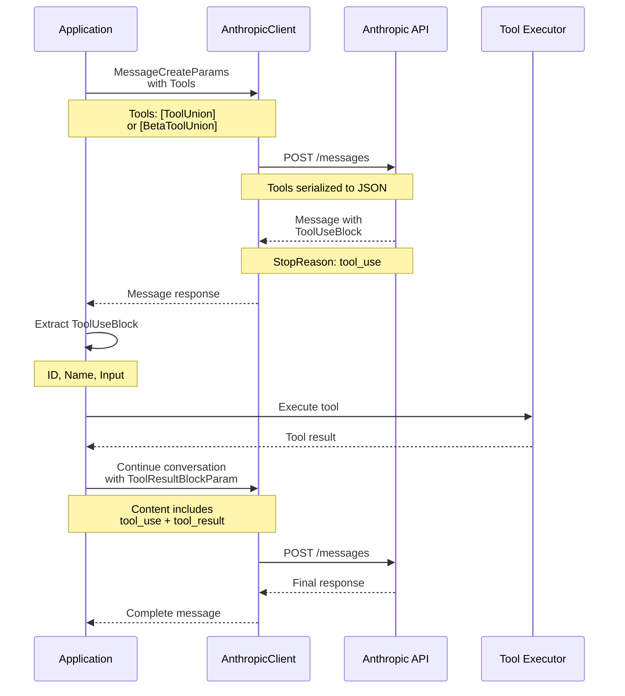

<!-- source: DeepWiki mcp.deepwiki.com · repo anthropics/anthropic-sdk-csharp · page 6 Tools and Function Calling · fetched 2026-10-26 -->

# Tools and Function Calling

<details>
<summary>Relevant source files</summary>

The following files were used as context for generating this wiki page:

- [src/Anthropic.Tests/Models/Beta/Messages/Batches/BatchCreateParamsTest.cs](src/Anthropic.Tests/Models/Beta/Messages/Batches/BatchCreateParamsTest.cs)
- [src/Anthropic.Tests/Models/Beta/Messages/BetaClearThinking20251015EditTest.cs](src/Anthropic.Tests/Models/Beta/Messages/BetaClearThinking20251015EditTest.cs)
- [src/Anthropic.Tests/Models/Beta/Messages/BetaMessageParamTest.cs](src/Anthropic.Tests/Models/Beta/Messages/BetaMessageParamTest.cs)
- [src/Anthropic.Tests/Models/Beta/Messages/BetaServerToolUseBlockParamTest.cs](src/Anthropic.Tests/Models/Beta/Messages/BetaServerToolUseBlockParamTest.cs)
- [src/Anthropic.Tests/Models/Beta/Messages/BetaServerToolUseBlockTest.cs](src/Anthropic.Tests/Models/Beta/Messages/BetaServerToolUseBlockTest.cs)
- [src/Anthropic.Tests/Models/Beta/Messages/MessageCreateParamsTest.cs](src/Anthropic.Tests/Models/Beta/Messages/MessageCreateParamsTest.cs)
- [src/Anthropic.Tests/Models/Messages/Batches/BatchCreateParamsTest.cs](src/Anthropic.Tests/Models/Messages/Batches/BatchCreateParamsTest.cs)
- [src/Anthropic.Tests/Models/Messages/MessageCreateParamsTest.cs](src/Anthropic.Tests/Models/Messages/MessageCreateParamsTest.cs)
- [src/Anthropic.Tests/Models/Messages/MessageParamTest.cs](src/Anthropic.Tests/Models/Messages/MessageParamTest.cs)
- [src/Anthropic/Models/Beta/Messages/BetaToolUnion.cs](src/Anthropic/Models/Beta/Messages/BetaToolUnion.cs)
- [src/Anthropic/Models/Messages/MessageCountTokensTool.cs](src/Anthropic/Models/Messages/MessageCountTokensTool.cs)
- [src/Anthropic/Models/Messages/ToolTextEditor20250429.cs](src/Anthropic/Models/Messages/ToolTextEditor20250429.cs)
- [src/Anthropic/Models/Messages/ToolUnion.cs](src/Anthropic/Models/Messages/ToolUnion.cs)

</details>


This document covers the tool integration system in the Anthropic C# SDK, including tool definitions, execution flow, and function calling capabilities. Tools enable Claude to interact with external systems and execute code during message generation.

For information about message creation and streaming, see [Working with Messages](#5). For Model Context Protocol integration, see [Model Context Protocol (MCP)](#8.2). For code execution and web tool specifics, see [Code Execution Tools](#6.3) and [Web Tools](#6.4).

## Overview

The SDK provides a type-safe union-based architecture for tool integration, supporting both custom user-defined tools and built-in Anthropic tools. Tools are specified in message creation requests and Claude can request their execution, returning structured results that influence subsequent generation.

**Tool Categories:**
- **Custom Tools**: User-defined with JSON schemas
- **Code Execution**: Bash, text editor, general code execution
- **Web Tools**: Search, fetch
- **Computer Use**: Desktop interaction capabilities
- **Search Tools**: BM25 and regex-based search
- **Memory Tools**: Context persistence
- **MCP Toolsets**: External server tool collections

Sources: [src/Anthropic/Models/Messages/ToolUnion.cs:1-465](), [src/Anthropic/Models/Beta/Messages/BetaToolUnion.cs:1-1078]()

## Tool Type System Architecture

```mermaid
graph TB
    subgraph "Standard API"
        ToolUnion["ToolUnion<br/>(6 variants)"]
        Tool["Tool<br/>(Custom)"]
        Bash124["ToolBash20250124"]
        TextEd124["ToolTextEditor20250124"]
        TextEd429["ToolTextEditor20250429"]
        TextEd728["ToolTextEditor20250728"]
        WebSearch["WebSearchTool20250305"]
    end
    
    subgraph "Beta API"
        BetaToolUnion["BetaToolUnion<br/>(17 variants)"]
        BetaTool["BetaTool<br/>(Custom)"]
        BetaBash22["BetaToolBash20241022"]
        BetaBash124["BetaToolBash20250124"]
        CodeExec522["BetaCodeExecutionTool20250522"]
        CodeExec825["BetaCodeExecutionTool20250825"]
        CompUse22["BetaToolComputerUse20241022"]
        Memory["BetaMemoryTool20250818"]
        CompUse124["BetaToolComputerUse20250124"]
        TextEd22["BetaToolTextEditor20241022"]
        CompUse1124["BetaToolComputerUse20251124"]
        BetaTextEd124["BetaToolTextEditor20250124"]
        BetaTextEd429["BetaToolTextEditor20250429"]
        BetaTextEd728["BetaToolTextEditor20250728"]
        BetaWebSearch["BetaWebSearchTool20250305"]
        WebFetch["BetaWebFetchTool20250910"]
        SearchBM25["BetaToolSearchToolBm25_20251119"]
        SearchRegex["BetaToolSearchToolRegex20251119"]
        MCPToolset["BetaMCPToolset"]
    end
    
    subgraph "Token Counting"
        CountTokensTool["MessageCountTokensTool<br/>(6 variants)"]
    end
    
    subgraph "Shared Properties"
        CacheControl["CacheControlEphemeral<br/>TTL: 5m | 1h"]
        DeferLoading["DeferLoading<br/>bool?"]
        Strict["Strict<br/>bool?"]
    end
    
    ToolUnion --> Tool
    ToolUnion --> Bash124
    ToolUnion --> TextEd124
    ToolUnion --> TextEd429
    ToolUnion --> TextEd728
    ToolUnion --> WebSearch
    
    BetaToolUnion --> BetaTool
    BetaToolUnion --> BetaBash22
    BetaToolUnion --> BetaBash124
    BetaToolUnion --> CodeExec522
    BetaToolUnion --> CodeExec825
    BetaToolUnion --> CompUse22
    BetaToolUnion --> Memory
    BetaToolUnion --> CompUse124
    BetaToolUnion --> TextEd22
    BetaToolUnion --> CompUse1124
    BetaToolUnion --> BetaTextEd124
    BetaToolUnion --> BetaTextEd429
    BetaToolUnion --> BetaTextEd728
    BetaToolUnion --> BetaWebSearch
    BetaToolUnion --> WebFetch
    BetaToolUnion --> SearchBM25
    BetaToolUnion --> SearchRegex
    BetaToolUnion --> MCPToolset
    
    Tool -.-> CacheControl
    BetaTool -.-> CacheControl
    BetaTool -.-> DeferLoading
    BetaTool -.-> Strict
```



**Tool Union Pattern**

All tool types use a discriminated union pattern providing type-safe variant handling:

| Method | Purpose | Return Type |
|--------|---------|-------------|
| `TryPickTool(out Tool value)` | Check if instance is specific variant | `bool` |
| `Switch(...)` | Execute action for actual variant | `void` |
| `Match<T>(...)` | Execute function for actual variant | `T` |
| `Validate()` | Ensure variant and data validity | `void` |

Sources: [src/Anthropic/Models/Messages/ToolUnion.cs:10-358](), [src/Anthropic/Models/Beta/Messages/BetaToolUnion.cs:9-1078]()

## Tool Versioning Strategy

Tools are versioned with date-based suffixes to enable controlled API evolution:

| Tool Family | Versions | Purpose |
|-------------|----------|---------|
| Bash | `20241022`, `20250124` | Shell command execution |
| TextEditor | `20241022`, `20250124`, `20250429`, `20250728` | File editing operations |
| CodeExecution | `20250522`, `20250825` | General code execution |
| ComputerUse | `20241022`, `20250124`, `20251124` | Desktop automation |
| WebSearch | `20250305` | Web search queries |
| WebFetch | `20250910` | Web page retrieval |
| SearchTools | `20251119` | Document search (BM25, regex) |
| Memory | `20250818` | Context persistence |

Sources: [src/Anthropic/Models/Messages/ToolUnion.cs:42-70](), [src/Anthropic/Models/Beta/Messages/BetaToolUnion.cs:216-322]()

## Custom Tool Definition

Custom tools are defined using the `Tool` or `BetaTool` classes with JSON schemas:

```csharp
// Standard custom tool
var weatherTool = new Tool()
{
    Name = "get_weather",
    Description = "Get current weather for a location",
    InputSchema = new Dictionary<string, JsonElement>
    {
        { "type", JsonSerializer.SerializeToElement("object") },
        { "properties", JsonSerializer.SerializeToElement(new {
            location = new { 
                type = "string", 
                description = "City name" 
            },
            unit = new { 
                type = "string", 
                enum = new[] { "celsius", "fahrenheit" } 
            }
        })},
        { "required", JsonSerializer.SerializeToElement(new[] { "location" }) }
    },
    CacheControl = new CacheControlEphemeral { TTL = TTL.TTL5m }
};

// Beta custom tool with additional options
var betaTool = new BetaTool()
{
    Name = "search_database",
    Description = "Search internal database",
    InputSchema = schemaDict,
    DeferLoading = false,
    Strict = true,
    CacheControl = new BetaCacheControlEphemeral { TTL = TTL.TTL1h }
};
```

**Tool Schema Properties:**

| Property | Type | Required | Description |
|----------|------|----------|-------------|
| `Name` | `string` | Yes | Tool identifier for invocation |
| `Description` | `string` | No | Natural language description |
| `InputSchema` | `Dictionary<string, JsonElement>` | Yes | JSON schema for tool input |
| `CacheControl` | `CacheControlEphemeral` | No | Prompt caching configuration |
| `DeferLoading` | `bool?` | No | (Beta) Delay tool loading |
| `Strict` | `bool?` | No | (Beta) Enforce strict schema validation |

Sources: [src/Anthropic/Models/Messages/Tool.cs](), [src/Anthropic/Models/Beta/Messages/BetaTool.cs]()

## Tool Execution Flow



**Flow States:**

1. **Tool Specification**: Tools provided in `MessageCreateParams.Tools`
2. **Tool Use Request**: API responds with `StopReason.ToolUse` and `ToolUseBlock`
3. **Tool Execution**: Application executes requested tool
4. **Result Submission**: Application sends `ToolResultBlockParam` in next turn
5. **Completion**: API processes result and continues generation

Sources: [src/Anthropic/Models/Messages/MessageCreateParams.cs](), [src/Anthropic/Models/Messages/ContentBlock.cs]()

## Built-in Tool Types

### Code Execution Tools

**ToolBash20250124 / BetaToolBash20250124**

Execute bash shell commands in sandboxed environment:

```csharp
var bashTool = new ToolBash20250124()
{
    CacheControl = new CacheControlEphemeral { TTL = TTL.TTL5m }
};

// Result handling
var bashResult = new BetaBashCodeExecutionToolResultBlockParam
{
    ToolUseID = "toolu_123",
    Content = new BetaBashCodeExecutionResultBlockParam
    {
        Stdout = "command output",
        Stderr = "error output",
        ReturnCode = 0,
        Content = new[] { new BetaFileRefOutput("file_id") }
    }
};
```

**BetaCodeExecutionTool20250522 / BetaCodeExecutionTool20250825**

General purpose code execution across multiple languages:

```csharp
var codeExecTool = new BetaCodeExecutionTool20250825();

// Error result
var errorResult = new BetaCodeExecutionToolResultBlockParam
{
    ToolUseID = "toolu_456",
    Content = new BetaCodeExecutionToolResultErrorParam(
        BetaCodeExecutionToolResultErrorCode.InvalidToolInput
    )
};
```

**Error Codes:**

| Code | Description |
|------|-------------|
| `InvalidToolInput` | Malformed input parameters |
| `ExecutionError` | Runtime execution failure |
| `Timeout` | Execution exceeded time limit |

Sources: [src/Anthropic/Models/Messages/ToolBash20250124.cs](), [src/Anthropic/Models/Beta/Messages/BetaCodeExecutionTool20250825.cs](), [src/Anthropic.Tests/Models/Beta/Messages/BetaBashCodeExecutionToolResultBlockTest.cs:1-136]()

### Text Editor Tools

**ToolTextEditor Family**

File editing operations with version-specific capabilities:

```csharp
// Version 20250429 - String replacement based editing
var textEditorTool = new ToolTextEditor20250429()
{
    CacheControl = new CacheControlEphemeral { TTL = TTL.TTL5m }
};
// Name: "str_replace_based_edit_tool"

// Version 20250728 - Advanced editing
var advancedEditor = new ToolTextEditor20250728();

// Error handling
var editorError = new BetaTextEditorCodeExecutionToolResultErrorParam
{
    ErrorCode = BetaTextEditorCodeExecutionToolResultErrorParamErrorCode.InvalidToolInput,
    ErrorMessage = "File not found"
};
```

Sources: [src/Anthropic/Models/Messages/ToolTextEditor20250429.cs:1-108](), [src/Anthropic/Models/Messages/ToolTextEditor20250728.cs]()

### Web Tools

**WebSearchTool20250305 / BetaWebSearchTool20250305**

Perform web searches with result limits:

```csharp
var webSearchTool = new BetaWebSearchTool20250305()
{
    MaxUses = 5,
    CacheControl = new BetaCacheControlEphemeral { TTL = TTL.TTL1h }
};

// Search result handling
var searchResult = new BetaWebSearchToolResultBlockParam
{
    ToolUseID = "srvtoolu_789",
    Content = new BetaWebSearchToolResultContent(
        new[]
        {
            new BetaWebSearchToolResultItem
            {
                Title = "Result Title",
                URL = "https://example.com",
                EncryptedContent = "encrypted_content",
                PageAge = "2 days ago"
            }
        }
    )
};
```

**BetaWebFetchTool20250910**

Retrieve specific web pages:

```csharp
var webFetchTool = new BetaWebFetchTool20250910()
{
    MaxUses = 10
};

// Error result
var fetchError = new BetaWebFetchToolResultErrorBlockParam(
    BetaWebFetchToolResultErrorCode.InvalidURL
);
```

**Web Tool Error Codes:**

| Code | Description |
|------|-------------|
| `InvalidToolInput` | Invalid parameters |
| `InvalidURL` | Malformed URL |
| `Timeout` | Request timeout |
| `FetchError` | Network or server error |

Sources: [src/Anthropic/Models/Messages/WebSearchTool20250305.cs](), [src/Anthropic/Models/Beta/Messages/BetaWebSearchTool20250305.cs](), [src/Anthropic/Models/Beta/Messages/BetaWebFetchTool20250910.cs]()

### Computer Use Tools

**BetaToolComputerUse Family**

Desktop automation with mouse, keyboard, and screen capture:

```csharp
var computerUse = new BetaToolComputerUse20251124()
{
    DisplayHeightPx = 768,
    DisplayWidthPx = 1024,
    DisplayNumber = 1,
    CacheControl = new BetaCacheControlEphemeral { TTL = TTL.TTL5m }
};
```

**Display Configuration Properties:**

| Property | Type | Description |
|----------|------|-------------|
| `DisplayHeightPx` | `long?` | Screen height in pixels |
| `DisplayWidthPx` | `long?` | Screen width in pixels |
| `DisplayNumber` | `long?` | Display identifier for multi-monitor |

Sources: [src/Anthropic/Models/Beta/Messages/BetaToolComputerUse20251124.cs](), [src/Anthropic/Models/Beta/Messages/BetaToolComputerUse20250124.cs]()

### Search Tools

**BetaToolSearchToolBm25_20251119**

BM25 algorithm-based document search:

```csharp
var bm25Search = new BetaToolSearchToolBm25_20251119()
{
    DeferLoading = false,
    Strict = true
};
```

**BetaToolSearchToolRegex20251119**

Regex pattern-based search:

```csharp
var regexSearch = new BetaToolSearchToolRegex20251119();

// Result with error
var searchError = new BetaToolSearchToolResultErrorParam(
    BetaToolSearchToolResultErrorParamErrorCode.InvalidToolInput
);
```

Sources: [src/Anthropic/Models/Beta/Messages/BetaToolSearchToolBm25_20251119.cs](), [src/Anthropic/Models/Beta/Messages/BetaToolSearchToolRegex20251119.cs]()

### Memory Tools

**BetaMemoryTool20250818**

Context persistence across conversations:

```csharp
var memoryTool = new BetaMemoryTool20250818()
{
    DeferLoading = false,
    CacheControl = new BetaCacheControlEphemeral { TTL = TTL.TTL1h }
};
```

Sources: [src/Anthropic/Models/Beta/Messages/BetaMemoryTool20250818.cs]()

### MCP Toolsets

**BetaMCPToolset**

Group of tools from Model Context Protocol server:

```csharp
var mcpToolset = new BetaMCPToolset()
{
    ServerName = "my-mcp-server",
    CacheControl = new BetaCacheControlEphemeral { TTL = TTL.TTL5m },
    // Per-tool overrides available
    PerToolOverrides = new Dictionary<string, BetaMCPToolOverride>
    {
        { "tool_name", new BetaMCPToolOverride { Enabled = true } }
    }
};

// Tool use from MCP
var mcpToolUse = new BetaMCPToolUseBlockParam
{
    ID = "toolu_mcp_123",
    Name = "tool_name",
    ServerName = "my-mcp-server",
    Input = new Dictionary<string, JsonElement>
    {
        { "param1", JsonSerializer.SerializeToElement("value1") }
    }
};

// Result submission
var mcpResult = new BetaRequestMCPToolResultBlockParam
{
    ToolUseID = "toolu_mcp_123",
    Content = "result content",
    IsError = false
};
```

Sources: [src/Anthropic/Models/Beta/Messages/BetaMCPToolset.cs](), [src/Anthropic/Models/Beta/Messages/BetaMCPToolUseBlockParam.cs]()

## Tool Result Handling

### Standard Tool Results

**ToolResultBlockParam**

Generic tool result for custom tools:

```csharp
// Success result
var toolResult = new ToolResultBlockParam()
{
    ToolUseID = "toolu_abc123",
    Content = "Tool execution completed successfully",
    IsError = false,
    CacheControl = new CacheControlEphemeral { TTL = TTL.TTL5m }
};

// Error result
var errorResult = new ToolResultBlockParam()
{
    ToolUseID = "toolu_abc123",
    Content = "Error: Invalid input parameters",
    IsError = true
};

// Structured content
var structuredResult = new ToolResultBlockParam()
{
    ToolUseID = "toolu_abc123",
    Content = new ContentBlockParam[]
    {
        new TextBlockParam { Text = "Operation completed" },
        new ImageBlockParam { Source = imageSource }
    }
};
```

Sources: [src/Anthropic/Models/Messages/ToolResultBlockParam.cs](), [src/Anthropic/Models/Beta/Messages/BetaToolResultBlockParam.cs]()

### Server Tool Results

Server tools (web search, web fetch, code execution) have specialized result types:

```csharp
// Web search result
var webSearchResult = new BetaWebSearchToolResultBlockParam
{
    ToolUseID = "srvtoolu_123",
    Content = new BetaWebSearchToolResultContent(results)
};

// Web fetch result
var webFetchResult = new BetaWebFetchToolResultBlockParam
{
    ToolUseID = "srvtoolu_456",
    Content = new BetaWebFetchToolResultContentBlockParam
    {
        URL = "https://example.com",
        Content = "Page content",
        Metadata = metadata
    }
};

// Code execution result
var codeResult = new BetaCodeExecutionToolResultBlockParam
{
    ToolUseID = "srvtoolu_789",
    Content = new BetaCodeExecutionResultBlockParam
    {
        Stdout = "output",
        Stderr = "",
        ReturnCode = 0
    }
};
```

Sources: [src/Anthropic/Models/Beta/Messages/BetaWebSearchToolResultBlockParam.cs](), [src/Anthropic/Models/Beta/Messages/BetaWebFetchToolResultBlockParam.cs](), [src/Anthropic/Models/Beta/Messages/BetaCodeExecutionToolResultBlockParam.cs]()

## Error Handling Patterns

### Error Code Enumerations

Different tool families have specific error code types:

| Error Type | Codes |
|------------|-------|
| `ErrorCode` | `InvalidToolInput` |
| `BetaCodeExecutionToolResultErrorCode` | `InvalidToolInput`, `ExecutionError`, `Timeout` |
| `BetaBashCodeExecutionToolResultErrorParamErrorCode` | `InvalidToolInput` |
| `BetaWebFetchToolResultErrorCode` | `InvalidToolInput`, `InvalidURL`, `Timeout`, `FetchError` |
| `BetaToolSearchToolResultErrorParamErrorCode` | `InvalidToolInput` |

### Error Result Construction

```csharp
// Generic tool error
var genericError = new ToolResultBlockParam
{
    ToolUseID = "toolu_123",
    Content = "Error description",
    IsError = true
};

// Typed code execution error
var codeError = new BetaCodeExecutionToolResultErrorParam(
    BetaCodeExecutionToolResultErrorCode.Timeout
);

// Bash error
var bashError = new BetaBashCodeExecutionToolResultErrorParam(
    BetaBashCodeExecutionToolResultErrorParamErrorCode.InvalidToolInput
);

// Web fetch error
var fetchError = new BetaWebFetchToolResultErrorBlockParam(
    BetaWebFetchToolResultErrorCode.InvalidURL
);

// Text editor error with message
var editorError = new BetaTextEditorCodeExecutionToolResultErrorParam
{
    ErrorCode = BetaTextEditorCodeExecutionToolResultErrorParamErrorCode.InvalidToolInput,
    ErrorMessage = "File path does not exist"
};
```

Sources: [src/Anthropic/Models/Messages/ErrorCode.cs](), [src/Anthropic/Models/Beta/Messages/BetaCodeExecutionToolResultErrorCode.cs](), [src/Anthropic.Tests/Models/Beta/Messages/BetaBashCodeExecutionToolResultBlockTest.cs:84-135]()

## Advanced Tool Configuration

### Cache Control for Tools

Tools support prompt caching to optimize repeated tool definitions:

```csharp
// 5-minute TTL
var tool = new Tool
{
    Name = "calculator",
    InputSchema = schema,
    CacheControl = new CacheControlEphemeral { TTL = TTL.TTL5m }
};

// 1-hour TTL for beta tools
var betaTool = new BetaTool
{
    Name = "search",
    InputSchema = schema,
    CacheControl = new BetaCacheControlEphemeral { TTL = TTL.TTL1h }
};
```

**TTL Options:**

| Value | Duration | Use Case |
|-------|----------|----------|
| `TTL.TTL5m` | 5 minutes | Short sessions |
| `TTL.TTL1h` | 1 hour | Long sessions |

Sources: [src/Anthropic/Models/Messages/CacheControlEphemeral.cs](), [src/Anthropic/Models/Messages/TTL.cs]()

### Deferred Loading (Beta)

Delay tool loading until first use:

```csharp
var tool = new BetaTool
{
    Name = "heavy_tool",
    InputSchema = schema,
    DeferLoading = true  // Load on first invocation
};
```

Sources: [src/Anthropic/Models/Beta/Messages/BetaTool.cs]()

### Strict Mode (Beta)

Enforce strict JSON schema validation:

```csharp
var tool = new BetaTool
{
    Name = "typed_tool",
    InputSchema = strictSchema,
    Strict = true  // Enable strict validation
};
```

Sources: [src/Anthropic/Models/Beta/Messages/BetaTool.cs]()

## Union Type Pattern Methods

All tool unions (`ToolUnion`, `BetaToolUnion`, `MessageCountTokensTool`) provide consistent methods for variant handling:

### Variant Detection

```csharp
ToolUnion toolUnion = GetTool();

// Check specific variant
if (toolUnion.TryPickTool(out var customTool))
{
    // Handle custom tool
    Console.WriteLine($"Tool: {customTool.Name}");
}
else if (toolUnion.TryPickBash20250124(out var bashTool))
{
    // Handle bash tool
    ExecuteBashTool(bashTool);
}
else if (toolUnion.TryPickWebSearchTool20250305(out var webSearch))
{
    // Handle web search
    var maxUses = webSearch.MaxUses;
}
```

Sources: [src/Anthropic/Models/Messages/ToolUnion.cs:92-201]()

### Exhaustive Handling with Switch

```csharp
toolUnion.Switch(
    tool: (t) => HandleCustomTool(t),
    bash20250124: (t) => HandleBashTool(t),
    textEditor20250124: (t) => HandleTextEditor(t),
    textEditor20250429: (t) => HandleTextEditor(t),
    textEditor20250728: (t) => HandleTextEditor(t),
    webSearchTool20250305: (t) => HandleWebSearch(t)
);
```

Sources: [src/Anthropic/Models/Messages/ToolUnion.cs:227-261]()

### Mapping with Match

```csharp
string toolName = toolUnion.Match(
    tool: (t) => t.Name,
    bash20250124: (t) => "bash_tool",
    textEditor20250124: (t) => "text_editor_v1",
    textEditor20250429: (t) => "text_editor_v2",
    textEditor20250728: (t) => "text_editor_v3",
    webSearchTool20250305: (t) => "web_search"
);
```

Sources: [src/Anthropic/Models/Messages/ToolUnion.cs:288-309]()

### Validation

```csharp
// Throws AnthropicInvalidDataException if:
// 1. No variant matched (unknown tool type)
// 2. Variant data invalid (e.g., missing required fields)
toolUnion.Validate();
```

Sources: [src/Anthropic/Models/Messages/ToolUnion.cs:333-347]()

## Token Counting for Tools

The `MessageCountTokensTool` union supports token analysis for tool definitions:

```csharp
var countParams = new MessageCountTokensParams()
{
    Model = Model.ClaudeSonnet4_0_20251022,
    Messages = messages,
    Tools = new MessageCountTokensTool[]
    {
        new Tool { Name = "calculator", InputSchema = schema },
        new ToolBash20250124(),
        new WebSearchTool20250305()
    }
};

var tokenCount = await client.Messages.CountTokens(countParams);
Console.WriteLine($"Input tokens: {tokenCount.InputTokens}");
```

Sources: [src/Anthropic/Models/Messages/MessageCountTokensTool.cs:1-471](), [src/Anthropic/Models/Messages/MessageCountTokensParams.cs]()

## Complete Tool Usage Example

```csharp
// Define tools
var tools = new ToolUnion[]
{
    new Tool
    {
        Name = "get_stock_price",
        Description = "Get current stock price",
        InputSchema = new Dictionary<string, JsonElement>
        {
            { "type", JsonSerializer.SerializeToElement("object") },
            { "properties", JsonSerializer.SerializeToElement(new {
                symbol = new { type = "string", description = "Stock symbol" }
            })},
            { "required", JsonSerializer.SerializeToElement(new[] { "symbol" }) }
        },
        CacheControl = new CacheControlEphemeral { TTL = TTL.TTL5m }
    },
    new ToolBash20250124(),
    new WebSearchTool20250305()
};

// Initial request
var message = await client.Messages.Create(new MessageCreateParams
{
    Model = Model.ClaudeSonnet4_0_20251022,
    MaxTokens = 1024,
    Messages = new[]
    {
        new MessageParam
        {
            Role = Role.User,
            Content = "What's the stock price for AAPL?"
        }
    },
    Tools = tools
});

// Check for tool use
if (message.StopReason == StopReason.ToolUse)
{
    var toolUseBlocks = message.Content
        .Where(c => c.TryPickToolUse(out _))
        .ToList();
    
    foreach (var contentBlock in toolUseBlocks)
    {
        if (contentBlock.TryPickToolUse(out var toolUse))
        {
            // Execute tool
            var result = ExecuteTool(toolUse.Name, toolUse.Input);
            
            // Continue conversation with result
            var followUp = await client.Messages.Create(new MessageCreateParams
            {
                Model = Model.ClaudeSonnet4_0_20251022,
                MaxTokens = 1024,
                Messages = new[]
                {
                    new MessageParam { Role = Role.User, Content = "What's the stock price for AAPL?" },
                    new MessageParam { Role = Role.Assistant, Content = message.Content },
                    new MessageParam
                    {
                        Role = Role.User,
                        Content = new ContentBlockParam[]
                        {
                            new ToolResultBlockParam
                            {
                                ToolUseID = toolUse.ID,
                                Content = result,
                                IsError = false
                            }
                        }
                    }
                },
                Tools = tools
            });
        }
    }
}
```

Sources: [src/Anthropic/Models/Messages/MessageCreateParams.cs](), [src/Anthropic/Models/Messages/ContentBlock.cs](), [src/Anthropic/Models/Messages/ToolResultBlockParam.cs]()

---

