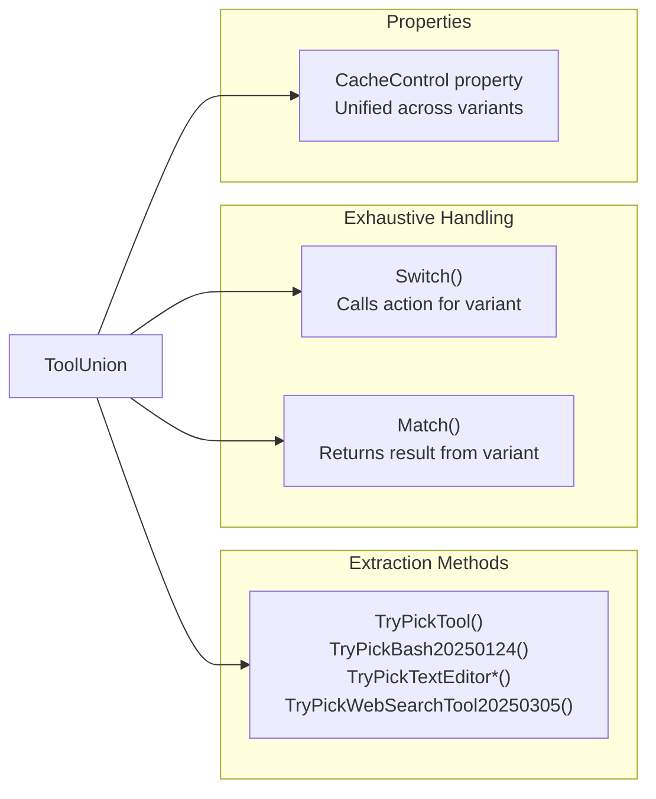
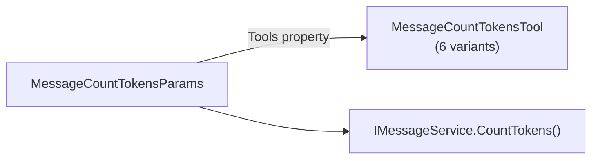
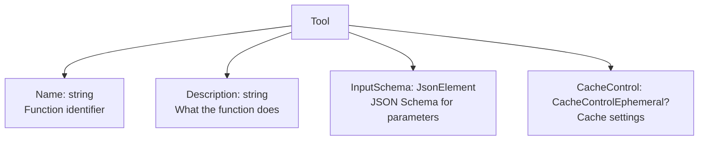
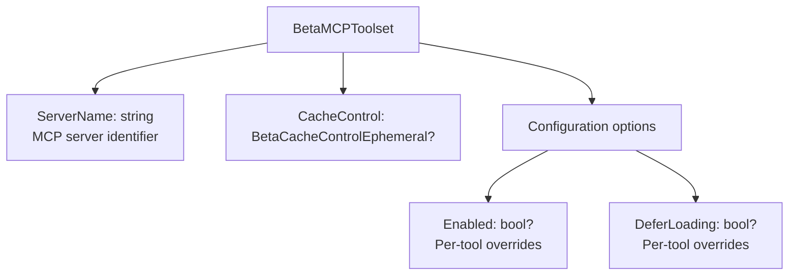
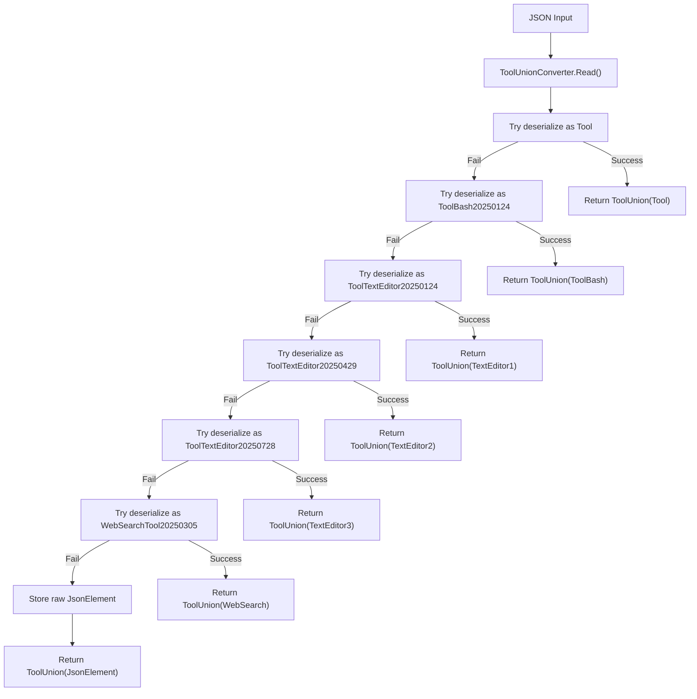

<!-- source: DeepWiki mcp.deepwiki.com · repo anthropics/anthropic-sdk-csharp · page 6.1 Tool Types · fetched 2026-10-26 -->

# Tool Types

<details>
<summary>Relevant source files</summary>

The following files were used as context for generating this wiki page:

- [src/Anthropic.Tests/Models/Beta/Messages/Batches/BatchCreateParamsTest.cs](src/Anthropic.Tests/Models/Beta/Messages/Batches/BatchCreateParamsTest.cs)
- [src/Anthropic.Tests/Models/Beta/Messages/BetaClearThinking20251015EditTest.cs](src/Anthropic.Tests/Models/Beta/Messages/BetaClearThinking20251015EditTest.cs)
- [src/Anthropic.Tests/Models/Beta/Messages/BetaMessageParamTest.cs](src/Anthropic.Tests/Models/Beta/Messages/BetaMessageParamTest.cs)
- [src/Anthropic.Tests/Models/Beta/Messages/BetaServerToolUseBlockParamTest.cs](src/Anthropic.Tests/Models/Beta/Messages/BetaServerToolUseBlockParamTest.cs)
- [src/Anthropic.Tests/Models/Beta/Messages/BetaServerToolUseBlockTest.cs](src/Anthropic.Tests/Models/Beta/Messages/BetaServerToolUseBlockTest.cs)
- [src/Anthropic.Tests/Models/Beta/Messages/MessageCreateParamsTest.cs](src/Anthropic.Tests/Models/Beta/Messages/MessageCreateParamsTest.cs)
- [src/Anthropic.Tests/Models/Messages/Batches/BatchCreateParamsTest.cs](src/Anthropic.Tests/Models/Messages/Batches/BatchCreateParamsTest.cs)
- [src/Anthropic.Tests/Models/Messages/MessageCreateParamsTest.cs](src/Anthropic.Tests/Models/Messages/MessageCreateParamsTest.cs)
- [src/Anthropic.Tests/Models/Messages/MessageParamTest.cs](src/Anthropic.Tests/Models/Messages/MessageParamTest.cs)
- [src/Anthropic/Models/Beta/Messages/BetaToolUnion.cs](src/Anthropic/Models/Beta/Messages/BetaToolUnion.cs)
- [src/Anthropic/Models/Messages/MessageCountTokensTool.cs](src/Anthropic/Models/Messages/MessageCountTokensTool.cs)
- [src/Anthropic/Models/Messages/ToolTextEditor20250429.cs](src/Anthropic/Models/Messages/ToolTextEditor20250429.cs)
- [src/Anthropic/Models/Messages/ToolUnion.cs](src/Anthropic/Models/Messages/ToolUnion.cs)

</details>


This page documents the tool type system in the Anthropic C# SDK. Tools enable Claude to execute actions like running code, searching the web, or calling custom functions. The SDK provides three union types for representing tools: `ToolUnion` for standard API usage, `BetaToolUnion` for beta features, and `MessageCountTokensTool` for token counting operations. Each union type contains multiple tool variants with distinct capabilities.

For information about tool execution flow and handling tool results, see [Tool Execution Flow](#6.2). For details on code execution tools specifically, see [Code Execution Tools](#6.3). For web-based tools, see [Web Tools](#6.4).

## Union Type Architecture

The SDK uses a discriminated union pattern to represent different tool types in a type-safe manner. Each union type wraps multiple concrete tool variants and provides pattern matching methods for working with them.

**Standard vs Beta Tool Types**

```mermaid
graph TB
    subgraph "Standard Tool Types"
        ToolUnion["ToolUnion<br/>(6 variants)"]
        MessageCountTokensTool["MessageCountTokensTool<br/>(6 variants)"]
    end
    
    subgraph "Beta Tool Types"
        BetaToolUnion["BetaToolUnion<br/>(17 variants)"]
    end
    
    subgraph "Common Variants"
        Tool["Tool<br/>Custom function"]
        Bash["ToolBash20250124<br/>Bash execution"]
        TextEditor124["ToolTextEditor20250124"]
        TextEditor429["ToolTextEditor20250429"]
        TextEditor728["ToolTextEditor20250728"]
        WebSearch["WebSearchTool20250305"]
    end
    
    subgraph "Beta-Only Variants"
        BetaTool["BetaTool"]
        ComputerUse["BetaToolComputerUse variants"]
        CodeExec["BetaCodeExecutionTool variants"]
        Memory["BetaMemoryTool20250818"]
        WebFetch["BetaWebFetchTool20250910"]
        SearchTools["BetaToolSearchTool variants"]
        MCPToolset["BetaMCPToolset"]
    end
    
    ToolUnion -.-> Tool
    ToolUnion -.-> Bash
    ToolUnion -.-> TextEditor124
    ToolUnion -.-> TextEditor429
    ToolUnion -.-> TextEditor728
    ToolUnion -.-> WebSearch
    
    MessageCountTokensTool -.-> Tool
    MessageCountTokensTool -.-> Bash
    MessageCountTokensTool -.-> TextEditor124
    MessageCountTokensTool -.-> TextEditor429
    MessageCountTokensTool -.-> TextEditor728
    MessageCountTokensTool -.-> WebSearch
    
    BetaToolUnion -.-> BetaTool
    BetaToolUnion -.-> Bash
    BetaToolUnion -.-> ComputerUse
    BetaToolUnion -.-> CodeExec
    BetaToolUnion -.-> Memory
    BetaToolUnion -.-> TextEditor124
    BetaToolUnion -.-> TextEditor429
    BetaToolUnion -.-> TextEditor728
    BetaToolUnion -.-> WebSearch
    BetaToolUnion -.-> WebFetch
    BetaToolUnion -.-> SearchTools
    BetaToolUnion -.-> MCPToolset
```



**Sources:** [src/Anthropic/Models/Messages/ToolUnion.cs:10-464](), [src/Anthropic/Models/Beta/Messages/BetaToolUnion.cs:16-1016](), [src/Anthropic/Models/Messages/MessageCountTokensTool.cs:10-470]()

## ToolUnion - Standard Tools

`ToolUnion` provides the standard set of tools available in the stable API. It contains 6 tool variants that can be used without beta headers.

| Tool Variant | Class Name | Purpose | Version Date |
|--------------|------------|---------|--------------|
| Custom Tool | `Tool` | User-defined function with JSON schema | N/A |
| Bash Execution | `ToolBash20250124` | Execute bash commands | 2025-01-24 |
| Text Editor (v1) | `ToolTextEditor20250124` | File editing operations | 2025-01-24 |
| Text Editor (v2) | `ToolTextEditor20250429` | Enhanced file editing | 2025-04-29 |
| Text Editor (v3) | `ToolTextEditor20250728` | Latest file editing | 2025-07-28 |
| Web Search | `WebSearchTool20250305` | Search the web | 2025-03-05 |

**ToolUnion Pattern Matching Methods**



The `ToolUnion` class [src/Anthropic/Models/Messages/ToolUnion.cs:10-358]() provides several ways to work with tool variants:

- **TryPick methods** [src/Anthropic/Models/Messages/ToolUnion.cs:92-201]() - Extract a specific variant if present
- **Switch method** [src/Anthropic/Models/Messages/ToolUnion.cs:227-261]() - Execute an action based on the variant
- **Match method** [src/Anthropic/Models/Messages/ToolUnion.cs:288-309]() - Transform the variant and return a result
- **CacheControl property** [src/Anthropic/Models/Messages/ToolUnion.cs:21-34]() - Unified access to cache control settings

**Sources:** [src/Anthropic/Models/Messages/ToolUnion.cs:1-464]()

## BetaToolUnion - Beta Tools

`BetaToolUnion` extends the tool system with 17 variants including experimental and beta features. It requires beta API headers to use.

**Beta Tool Variants**

```mermaid
graph TB
    BetaToolUnion["BetaToolUnion"]
    
    subgraph "Custom & Standard"
        BetaTool["BetaTool"]
        Bash1["BetaToolBash20241022"]
        Bash2["BetaToolBash20250124"]
    end
    
    subgraph "Text Editors"
        TE1["BetaToolTextEditor20241022"]
        TE2["BetaToolTextEditor20250124"]
        TE3["BetaToolTextEditor20250429"]
        TE4["BetaToolTextEditor20250728"]
    end
    
    subgraph "Computer Use"
        CU1["BetaToolComputerUse20241022"]
        CU2["BetaToolComputerUse20250124"]
        CU3["BetaToolComputerUse20251124"]
    end
    
    subgraph "Code Execution"
        CE1["BetaCodeExecutionTool20250522"]
        CE2["BetaCodeExecutionTool20250825"]
    end
    
    subgraph "Web & Search"
        WebSearch["BetaWebSearchTool20250305"]
        WebFetch["BetaWebFetchTool20250910"]
        SearchBM25["BetaToolSearchToolBm25_20251119"]
        SearchRegex["BetaToolSearchToolRegex20251119"]
    end
    
    subgraph "Advanced"
        Memory["BetaMemoryTool20250818"]
        MCP["BetaMCPToolset"]
    end
    
    BetaToolUnion --> BetaTool
    BetaToolUnion --> Bash1
    BetaToolUnion --> Bash2
    BetaToolUnion --> TE1
    BetaToolUnion --> TE2
    BetaToolUnion --> TE3
    BetaToolUnion --> TE4
    BetaToolUnion --> CU1
    BetaToolUnion --> CU2
    BetaToolUnion --> CU3
    BetaToolUnion --> CE1
    BetaToolUnion --> CE2
    BetaToolUnion --> WebSearch
    BetaToolUnion --> WebFetch
    BetaToolUnion --> SearchBM25
    BetaToolUnion --> SearchRegex
    BetaToolUnion --> Memory
    BetaToolUnion --> MCP
```



**BetaToolUnion Additional Properties**

The `BetaToolUnion` [src/Anthropic/Models/Beta/Messages/BetaToolUnion.cs:16-1016]() exposes additional properties beyond `CacheControl`:

- **DeferLoading** [src/Anthropic/Models/Beta/Messages/BetaToolUnion.cs:54-79]() - Delay tool initialization
- **Strict** [src/Anthropic/Models/Beta/Messages/BetaToolUnion.cs:81-106]() - Enforce strict schema validation
- **DisplayHeightPx** [src/Anthropic/Models/Beta/Messages/BetaToolUnion.cs:108-133]() - Screen height for computer use tools
- **DisplayWidthPx** [src/Anthropic/Models/Beta/Messages/BetaToolUnion.cs:135-160]() - Screen width for computer use tools
- **DisplayNumber** [src/Anthropic/Models/Beta/Messages/BetaToolUnion.cs:162-187]() - Display identifier for computer use
- **MaxUses** [src/Anthropic/Models/Beta/Messages/BetaToolUnion.cs:189-214]() - Usage limits for web tools

**Sources:** [src/Anthropic/Models/Beta/Messages/BetaToolUnion.cs:1-1016]()

## MessageCountTokensTool

`MessageCountTokensTool` is a specialized union type used with the token counting API. It contains the same 6 variants as `ToolUnion` but is used specifically for the `CountTokens` operation.

**Usage Context**



The `MessageCountTokensTool` union [src/Anthropic/Models/Messages/MessageCountTokensTool.cs:10-470]() has identical structure to `ToolUnion` but serves a distinct purpose in token counting scenarios where the SDK needs to calculate token usage for tool definitions without executing them.

**Sources:** [src/Anthropic/Models/Messages/MessageCountTokensTool.cs:1-470]()

## Standard Tool Variants

### Tool - Custom Functions

`Tool` represents a user-defined function with a JSON schema. This is the most flexible tool type for custom integrations.

**Tool Structure**



**Sources:** Referenced in [src/Anthropic/Models/Messages/ToolUnion.cs:92-96]()

### ToolBash20250124 - Bash Execution

Executes bash commands in a sandboxed environment. This tool allows Claude to run shell commands.

**Sources:** [src/Anthropic/Models/Messages/ToolUnion.cs:42-46](), [src/Anthropic/Models/Messages/ToolUnion.cs:113-117]()

### Text Editor Tools

Three versions of text editor tools with progressive improvements:

| Version | Class Name | Constant Name | Features |
|---------|------------|---------------|----------|
| v1 | `ToolTextEditor20250124` | `"str_replace_based_edit_tool"` | Basic file editing |
| v2 | `ToolTextEditor20250429` | `"str_replace_based_edit_tool"` | Enhanced editing |
| v3 | `ToolTextEditor20250728` | `"str_replace_based_edit_tool"` | Latest improvements |

Each text editor tool has a fixed `Name` property [src/Anthropic/Models/Messages/ToolTextEditor20250429.cs:19-23]() set to `"str_replace_based_edit_tool"` and a `Type` property identifying its version [src/Anthropic/Models/Messages/ToolTextEditor20250429.cs:26-29]().

**Sources:** [src/Anthropic/Models/Messages/ToolTextEditor20250429.cs:1-108]()

### WebSearchTool20250305

Enables Claude to search the web for information. This tool integrates with Anthropic's web search service.

**Sources:** [src/Anthropic/Models/Messages/ToolUnion.cs:66-70](), [src/Anthropic/Models/Messages/ToolUnion.cs:197-201]()

## Beta-Only Tool Variants

### Computer Use Tools

Computer use tools enable Claude to control a computer via screenshots and keyboard/mouse actions. Three versions are available:

- **BetaToolComputerUse20241022** [src/Anthropic/Models/Beta/Messages/BetaToolUnion.cs:246-250]()
- **BetaToolComputerUse20250124** [src/Anthropic/Models/Beta/Messages/BetaToolUnion.cs:258-262]()
- **BetaToolComputerUse20251124** [src/Anthropic/Models/Beta/Messages/BetaToolUnion.cs:270-274]()

These tools support display configuration via `DisplayHeightPx`, `DisplayWidthPx`, and `DisplayNumber` properties.

**Sources:** [src/Anthropic/Models/Beta/Messages/BetaToolUnion.cs:108-187]()

### Code Execution Tools

General-purpose code execution beyond bash:

- **BetaCodeExecutionTool20250522** [src/Anthropic/Models/Beta/Messages/BetaToolUnion.cs:234-238]()
- **BetaCodeExecutionTool20250825** [src/Anthropic/Models/Beta/Messages/BetaToolUnion.cs:240-244]()

**Sources:** [src/Anthropic/Models/Beta/Messages/BetaToolUnion.cs:234-244]()

### BetaMemoryTool20250818

Enables Claude to store and retrieve information across conversations.

**Sources:** [src/Anthropic/Models/Beta/Messages/BetaToolUnion.cs:252-256](), [src/Anthropic/Models/Beta/Messages/BetaToolUnion.cs:476-480]()

### Web Fetch Tool

**BetaWebFetchTool20250910** fetches content from specific URLs. Unlike web search, this retrieves the full content of a known URL.

The tool supports a `MaxUses` property [src/Anthropic/Models/Beta/Messages/BetaToolUnion.cs:189-214]() to limit the number of fetch operations.

**Sources:** [src/Anthropic/Models/Beta/Messages/BetaToolUnion.cs:300-304]()

### Search Tools

Advanced search capabilities with different algorithms:

- **BetaToolSearchToolBm25_20251119** - BM25 ranking algorithm [src/Anthropic/Models/Beta/Messages/BetaToolUnion.cs:306-310]()
- **BetaToolSearchToolRegex20251119** - Regex-based search [src/Anthropic/Models/Beta/Messages/BetaToolUnion.cs:312-316]()

**Sources:** [src/Anthropic/Models/Beta/Messages/BetaToolUnion.cs:306-316]()

### BetaMCPToolset

**BetaMCPToolset** represents a collection of tools from a Model Context Protocol (MCP) server. This enables integration with external tool providers.

**MCP Toolset Structure**



The MCP toolset is unique in that it does not have individual `DeferLoading` or `Strict` properties [src/Anthropic/Models/Beta/Messages/BetaToolUnion.cs:76](), [src/Anthropic/Models/Beta/Messages/BetaToolUnion.cs:103](), returning `null` instead. This is because MCP toolsets configure these properties per-tool rather than at the toolset level.

**Sources:** [src/Anthropic/Models/Beta/Messages/BetaToolUnion.cs:318-322](), [src/Anthropic/Models/Beta/Messages/BetaToolUnion.cs:717-721](), [src/Anthropic/Models/Beta/Messages/BetaToolUnion.cs:9-14]()

## Working with Tool Unions

### Pattern Matching

All three union types provide consistent pattern matching APIs.

**TryPick Methods**

Check if the union contains a specific variant:

```csharp
// Example code structure (do not execute)
if (toolUnion.TryPickTool(out var customTool))
{
    // customTool is of type Tool
}
else if (toolUnion.TryPickBash20250124(out var bashTool))
{
    // bashTool is of type ToolBash20250124
}
```

**Sources:** [src/Anthropic/Models/Messages/ToolUnion.cs:92-201]()

**Switch Method**

Execute different code for each variant:

```csharp
// Example code structure (do not execute)
toolUnion.Switch(
    tool: (t) => { /* handle custom tool */ },
    bash20250124: (b) => { /* handle bash */ },
    textEditor20250124: (te) => { /* handle editor v1 */ },
    textEditor20250429: (te) => { /* handle editor v2 */ },
    textEditor20250728: (te) => { /* handle editor v3 */ },
    webSearchTool20250305: (ws) => { /* handle web search */ }
);
```

**Sources:** [src/Anthropic/Models/Messages/ToolUnion.cs:227-261]()

**Match Method**

Transform the variant and return a result:

```csharp
// Example code structure (do not execute)
string toolName = toolUnion.Match(
    tool: (t) => t.Name,
    bash20250124: (b) => "bash",
    textEditor20250124: (te) => "text_editor_v1",
    textEditor20250429: (te) => "text_editor_v2",
    textEditor20250728: (te) => "text_editor_v3",
    webSearchTool20250305: (ws) => "web_search"
);
```

**Sources:** [src/Anthropic/Models/Messages/ToolUnion.cs:288-309]()

### Validation

All union types implement validation through the `Validate()` method [src/Anthropic/Models/Messages/ToolUnion.cs:333-347](), which ensures:

1. The union was constructed with a known variant
2. The underlying variant itself is valid

The validation process uses the `Switch` method to delegate to each variant's `Validate()` method.

**Sources:** [src/Anthropic/Models/Messages/ToolUnion.cs:333-347]()

### Serialization

Tool unions use custom JSON converters that attempt deserialization into each variant in sequence:

**ToolUnion Deserialization Flow**



The converter [src/Anthropic/Models/Messages/ToolUnion.cs:360-464]() attempts to deserialize into each variant type in order. Each attempt validates the deserialized object before accepting it. If all attempts fail, the raw JSON is stored and will cause validation to fail later.

**Sources:** [src/Anthropic/Models/Messages/ToolUnion.cs:360-464]()

## Cache Control Support

All tool variants support prompt caching via the `CacheControl` property. The union types expose a unified `CacheControl` property [src/Anthropic/Models/Messages/ToolUnion.cs:21-34]() that delegates to the underlying variant using the `Match` method.

Cache control allows tools to be cached with ephemeral TTLs (`5m` or `1h`) to reduce latency and costs when tools are reused across requests. See [Cache Control](#7.4) for more details.

**Sources:** [src/Anthropic/Models/Messages/ToolUnion.cs:21-34]()

## Version Dating Convention

Many tool types include version dates in their class names (e.g., `ToolBash20250124`, `ToolTextEditor20250429`). These dates represent the API version when the tool was introduced or last modified. The SDK supports multiple versions simultaneously to allow gradual migration between tool implementations as they evolve.

**Sources:** [src/Anthropic/Models/Messages/ToolUnion.cs:42-70](), [src/Anthropic/Models/Messages/ToolTextEditor20250429.cs:11]()

---

