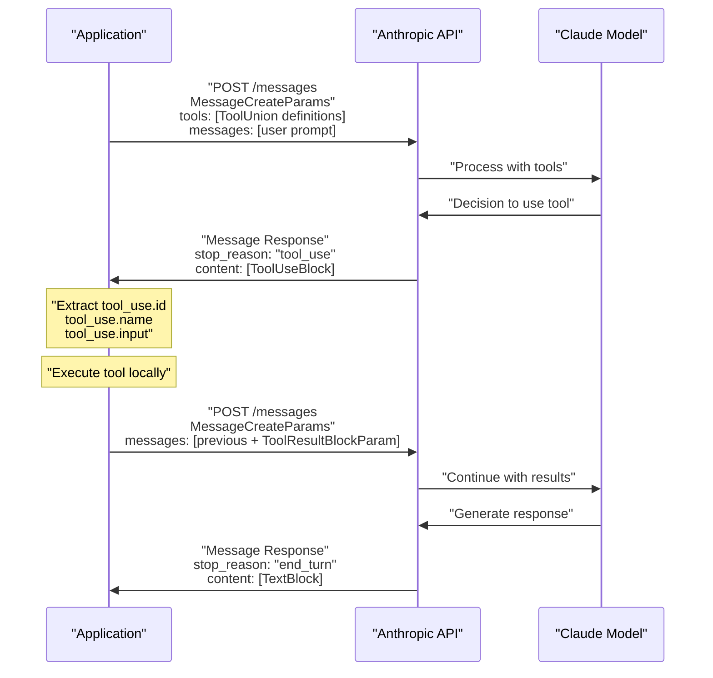
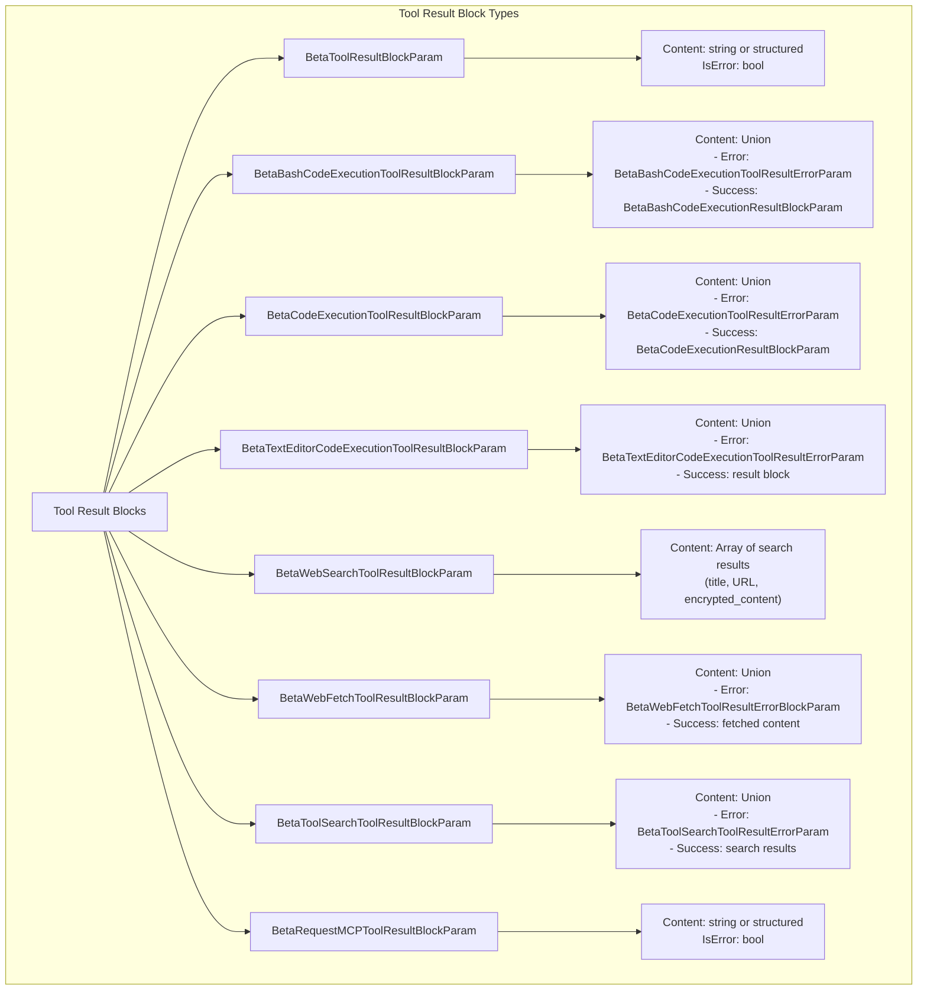
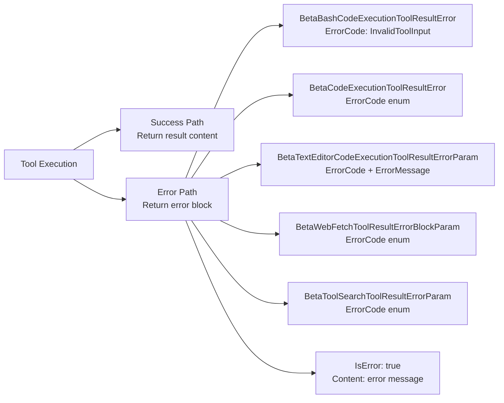
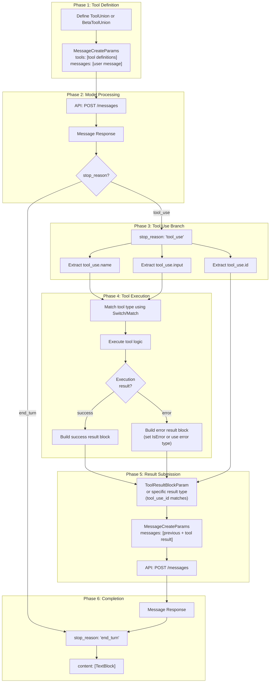

<!-- source: DeepWiki mcp.deepwiki.com · repo anthropics/anthropic-sdk-csharp · page 6.2 Tool Execution Flow · fetched 2026-10-26 -->

# Tool Execution Flow

<details>
<summary>Relevant source files</summary>

The following files were used as context for generating this wiki page:

- [examples/ChatClientExample/Program.cs](examples/ChatClientExample/Program.cs)
- [src/Anthropic.Tests/AnthropicClientBetaExtensionsTests.cs](src/Anthropic.Tests/AnthropicClientBetaExtensionsTests.cs)
- [src/Anthropic.Tests/AnthropicClientExtensionsTests.cs](src/Anthropic.Tests/AnthropicClientExtensionsTests.cs)
- [src/Anthropic.Tests/AnthropicClientExtensionsTestsBase.cs](src/Anthropic.Tests/AnthropicClientExtensionsTestsBase.cs)
- [src/Anthropic.Tests/Models/Beta/Messages/Batches/BatchCreateParamsTest.cs](src/Anthropic.Tests/Models/Beta/Messages/Batches/BatchCreateParamsTest.cs)
- [src/Anthropic.Tests/Models/Beta/Messages/BetaClearThinking20251015EditTest.cs](src/Anthropic.Tests/Models/Beta/Messages/BetaClearThinking20251015EditTest.cs)
- [src/Anthropic.Tests/Models/Beta/Messages/BetaMessageParamTest.cs](src/Anthropic.Tests/Models/Beta/Messages/BetaMessageParamTest.cs)
- [src/Anthropic.Tests/Models/Beta/Messages/BetaServerToolUseBlockParamTest.cs](src/Anthropic.Tests/Models/Beta/Messages/BetaServerToolUseBlockParamTest.cs)
- [src/Anthropic.Tests/Models/Beta/Messages/BetaServerToolUseBlockTest.cs](src/Anthropic.Tests/Models/Beta/Messages/BetaServerToolUseBlockTest.cs)
- [src/Anthropic.Tests/Models/Beta/Messages/MessageCreateParamsTest.cs](src/Anthropic.Tests/Models/Beta/Messages/MessageCreateParamsTest.cs)
- [src/Anthropic.Tests/Models/Messages/Batches/BatchCreateParamsTest.cs](src/Anthropic.Tests/Models/Messages/Batches/BatchCreateParamsTest.cs)
- [src/Anthropic.Tests/Models/Messages/MessageCreateParamsTest.cs](src/Anthropic.Tests/Models/Messages/MessageCreateParamsTest.cs)
- [src/Anthropic.Tests/Models/Messages/MessageParamTest.cs](src/Anthropic.Tests/Models/Messages/MessageParamTest.cs)
- [src/Anthropic/AnthropicClientExtensions.cs](src/Anthropic/AnthropicClientExtensions.cs)
- [src/Anthropic/Models/Beta/Messages/BetaToolUnion.cs](src/Anthropic/Models/Beta/Messages/BetaToolUnion.cs)
- [src/Anthropic/Models/Messages/MessageCountTokensTool.cs](src/Anthropic/Models/Messages/MessageCountTokensTool.cs)
- [src/Anthropic/Models/Messages/ToolTextEditor20250429.cs](src/Anthropic/Models/Messages/ToolTextEditor20250429.cs)
- [src/Anthropic/Models/Messages/ToolUnion.cs](src/Anthropic/Models/Messages/ToolUnion.cs)
- [src/Anthropic/Services/Beta/Messages/AnthropicBetaClientExtensions.cs](src/Anthropic/Services/Beta/Messages/AnthropicBetaClientExtensions.cs)

</details>


## Purpose and Scope

This document explains the complete lifecycle of tool execution in the Anthropic SDK, from defining tools in requests to handling tool results and errors. It covers the request-response cycle, content block types, error handling patterns, and best practices for implementing tool-enabled applications.

For information about specific tool types and their schemas, see [Tool Types](#6.1). For details on code execution tools, see [Code Execution Tools](#6.3), and for web-related tools, see [Web Tools](#6.4).

## Overview of Tool Execution Lifecycle

Tool execution follows a multi-turn conversation pattern where the model requests tool use and the application provides results:



**Sources:** Architecture understanding from repository structure

The lifecycle consists of five phases:

1. **Tool Definition**: Application defines available tools in the request
2. **Tool Use Request**: Model responds with `tool_use` content blocks
3. **Tool Execution**: Application executes the requested tools
4. **Tool Result Response**: Application sends tool results back
5. **Continuation**: Model processes results and continues generation

## Tool Definition Phase

Tools are defined using union types that encapsulate different tool variants.

### Standard Tool Union

The `ToolUnion` class supports 6 tool variants [src/Anthropic/Models/Messages/ToolUnion.cs:10-358]():

- `Tool` - Custom user-defined tools with JSON schema
- `ToolBash20250124` - Bash command execution
- `ToolTextEditor20250124` - Text editor operations (version 20250124)
- `ToolTextEditor20250429` - Text editor operations (version 20250429) 
- `ToolTextEditor20250728` - Text editor operations (version 20250728)
- `WebSearchTool20250305` - Web search capabilities

### Beta Tool Union

The `BetaToolUnion` class provides 17 tool variants [src/Anthropic/Models/Beta/Messages/BetaToolUnion.cs:16-1169](), including:

- `BetaTool` - Custom user-defined tools
- `BetaToolBash20241022`, `BetaToolBash20250124` - Bash execution (multiple versions)
- `BetaCodeExecutionTool20250522`, `BetaCodeExecutionTool20250825` - General code execution
- `BetaToolComputerUse20241022`, `BetaToolComputerUse20250124`, `BetaToolComputerUse20251124` - Computer control
- `BetaToolTextEditor20241022`, `BetaToolTextEditor20250124`, `BetaToolTextEditor20250429`, `BetaToolTextEditor20250728` - Text editing
- `BetaWebSearchTool20250305` - Web search
- `BetaWebFetchTool20250910` - Web content fetching
- `BetaToolSearchToolBm25_20251119`, `BetaToolSearchToolRegex20251119` - Search tools
- `BetaMemoryTool20250818` - Memory management
- `BetaMCPToolset` - Model Context Protocol toolsets

### Tool Properties

Tools defined in unions share common properties accessed through helper methods [src/Anthropic/Models/Messages/ToolUnion.cs:21-34]():

- `CacheControl` - Ephemeral cache settings (5m or 1h TTL)
- Tool-specific configuration (varies by type)

**Sources:**
- [src/Anthropic/Models/Messages/ToolUnion.cs:1-464]()
- [src/Anthropic/Models/Beta/Messages/BetaToolUnion.cs:1-1169]()
- [src/Anthropic/Models/Messages/MessageCountTokensTool.cs:1-470]()

## Tool Use Content Blocks

When the model decides to use a tool, it returns content blocks that specify which tool to invoke and with what parameters.

### Custom Tool Use Block

For custom tools, the response contains a `BetaToolUseBlockParam` [src/Anthropic.Tests/Models/Beta/Messages/BetaContentBlockParamTest.cs:117-133]():

```
Properties:
- ID: string (unique identifier for this tool use)
- Name: string (tool name matching tool definition)
- Input: Dictionary<string, JsonElement> (tool parameters)
- CacheControl: BetaCacheControlEphemeral (optional)
- Caller: BetaDirectCaller (caller information)
```

### Server Tool Use Block

For server-side tools (web search, code execution), the response contains a `BetaServerToolUseBlockParam` [src/Anthropic.Tests/Models/Beta/Messages/BetaContentBlockParamTest.cs:151-167]():

```
Properties:
- ID: string (prefixed with "srvtoolu_")
- Name: BetaServerToolUseBlockParamName enum
- Input: Dictionary<string, JsonElement>
- CacheControl: BetaCacheControlEphemeral (optional)
- Caller: BetaDirectCaller
```

### MCP Tool Use Block

For Model Context Protocol tools, the response contains a `BetaMCPToolUseBlockParam` [src/Anthropic.Tests/Models/Beta/Messages/BetaContentBlockParamTest.cs:277-293]():

```
Properties:
- ID: string (unique identifier)
- Name: string (MCP tool name)
- ServerName: string (MCP server name)
- Input: Dictionary<string, JsonElement>
- CacheControl: BetaCacheControlEphemeral (optional)
```

**Sources:**
- [src/Anthropic.Tests/Models/Beta/Messages/BetaContentBlockParamTest.cs:1-690]()

## Tool Result Content Blocks

After executing a tool, the application must send back a tool result using the appropriate result block type. Each tool type has a specific result block structure.

### Tool Result Types Reference



**Sources:**
- [src/Anthropic.Tests/Models/Beta/Messages/BetaContentBlockParamTest.cs:1-690]()

### Standard Tool Result

For custom tools, use `BetaToolResultBlockParam` [src/Anthropic.Tests/Models/Beta/Messages/BetaContentBlockParamTest.cs:136-148]():

```
Required:
- ToolUseID: string (matches tool_use.id)
- Content: string or structured content

Optional:
- IsError: bool (indicates execution failure)
- CacheControl: BetaCacheControlEphemeral
```

### Bash Code Execution Result

For bash tools, use `BetaBashCodeExecutionToolResultBlockParam` [src/Anthropic.Tests/Models/Beta/Messages/BetaBashCodeExecutionToolResultBlockParamTest.cs:11-103]():

```
Required:
- ToolUseID: string
- Content: BetaBashCodeExecutionToolResultBlockParamContent union
  * On error: BetaBashCodeExecutionToolResultErrorParam
    - ErrorCode: BetaBashCodeExecutionToolResultErrorParamErrorCode
  * On success: BetaBashCodeExecutionResultBlockParam
    - Content: Array<BetaContainerUploadBlockParam> (file references)
    - ReturnCode: int
    - Stderr: string
    - Stdout: string

Optional:
- CacheControl: BetaCacheControlEphemeral
```

### Code Execution Result

For general code execution, use `BetaCodeExecutionToolResultBlockParam` [src/Anthropic.Tests/Models/Beta/Messages/BetaContentBlockParamTest.cs:210-223]():

```
Required:
- ToolUseID: string
- Content: BetaCodeExecutionToolResultBlockParamContent union
  * Error: BetaCodeExecutionToolResultErrorParam
  * Success: BetaCodeExecutionResultBlockParam

Optional:
- CacheControl: BetaCacheControlEphemeral
```

### Text Editor Result

For text editor tools, use `BetaTextEditorCodeExecutionToolResultBlockParam` [src/Anthropic.Tests/Models/Beta/Messages/BetaContentBlockParamTest.cs:242-258]():

```
Required:
- ToolUseID: string
- Content: union type
  * Error: BetaTextEditorCodeExecutionToolResultErrorParam
    - ErrorCode: BetaTextEditorCodeExecutionToolResultErrorParamErrorCode
    - ErrorMessage: string

Optional:
- CacheControl: BetaCacheControlEphemeral
```

### Web Search Result

For web search, use `BetaWebSearchToolResultBlockParam` [src/Anthropic.Tests/Models/Beta/Messages/BetaContentBlockParamTest.cs:170-191]():

```
Required:
- ToolUseID: string
- Content: array of search result objects
  * EncryptedContent: string
  * Title: string
  * URL: string
  * PageAge: string (optional)

Optional:
- CacheControl: BetaCacheControlEphemeral
```

### Web Fetch Result

For web fetch, use `BetaWebFetchToolResultBlockParam` [src/Anthropic.Tests/Models/Beta/Messages/BetaContentBlockParamTest.cs:194-207]():

```
Required:
- ToolUseID: string
- Content: BetaWebFetchToolResultBlockParamContent union
  * Error: BetaWebFetchToolResultErrorBlockParam
  * Success: fetched content block

Optional:
- CacheControl: BetaCacheControlEphemeral
```

### Tool Search Result

For search tools, use `BetaToolSearchToolResultBlockParam` [src/Anthropic.Tests/Models/Beta/Messages/BetaContentBlockParamTest.cs:261-274]():

```
Required:
- ToolUseID: string
- Content: BetaToolSearchToolResultBlockParamContent union
  * Error: BetaToolSearchToolResultErrorParam
  * Success: search results

Optional:
- CacheControl: BetaCacheControlEphemeral
```

### MCP Tool Result

For MCP tools, use `BetaRequestMCPToolResultBlockParam` [src/Anthropic.Tests/Models/Beta/Messages/BetaContentBlockParamTest.cs:296-308]():

```
Required:
- ToolUseID: string
- Content: string or structured content

Optional:
- IsError: bool
- CacheControl: BetaCacheControlEphemeral
```

**Sources:**
- [src/Anthropic.Tests/Models/Beta/Messages/BetaBashCodeExecutionToolResultBlockTest.cs:1-136]()
- [src/Anthropic.Tests/Models/Beta/Messages/BetaBashCodeExecutionToolResultBlockParamTest.cs:1-230]()
- [src/Anthropic.Tests/Models/Beta/Messages/BetaCodeExecutionToolResultBlockParamContentTest.cs:1-70]()
- [src/Anthropic.Tests/Models/Beta/Messages/BetaCodeExecutionToolResultBlockContentTest.cs:1-70]()
- [src/Anthropic.Tests/Models/Beta/Messages/BetaContentBlockParamTest.cs:1-690]()

## Error Handling

Tool execution can fail at multiple points. The SDK provides structured error handling through specific error types and codes.

### Tool-Level Errors



**Sources:** Error handling patterns from test files

### Bash Code Execution Errors

`BetaBashCodeExecutionToolResultError` with error code enum [src/Anthropic.Tests/Models/Beta/Messages/BetaBashCodeExecutionToolResultBlockTest.cs:18]():

- `InvalidToolInput` - The tool input parameters were invalid

Usage example [src/Anthropic.Tests/Models/Beta/Messages/BetaBashCodeExecutionToolResultBlockTest.cs:88-91]():
```
Content value = new(
    new BetaBashCodeExecutionToolResultError(ErrorCode.InvalidToolInput)
);
```

### Code Execution Errors

`BetaCodeExecutionToolResultError` with `BetaCodeExecutionToolResultErrorCode` enum [src/Anthropic.Tests/Models/Beta/Messages/BetaCodeExecutionToolResultBlockContentTest.cs:9-17]():

- `InvalidToolInput` - Invalid input parameters

### Text Editor Errors

`BetaTextEditorCodeExecutionToolResultErrorParam` provides both error code and human-readable message [src/Anthropic.Tests/Models/Beta/Messages/BetaContentBlockParamTest.cs:247-252]():

```
Properties:
- ErrorCode: BetaTextEditorCodeExecutionToolResultErrorParamErrorCode
- ErrorMessage: string
```

Error codes include:
- `InvalidToolInput` - Invalid input parameters

### Web Fetch Errors

`BetaWebFetchToolResultErrorBlockParam` with `BetaWebFetchToolResultErrorCode` enum:

- `InvalidToolInput` - Invalid input parameters

### Tool Search Errors

`BetaToolSearchToolResultErrorParam` with error code enum:

- `InvalidToolInput` - Invalid input parameters

**Sources:**
- [src/Anthropic.Tests/Models/Beta/Messages/BetaBashCodeExecutionToolResultBlockTest.cs:1-136]()
- [src/Anthropic.Tests/Models/Beta/Messages/BetaCodeExecutionToolResultBlockContentTest.cs:1-70]()
- [src/Anthropic.Tests/Models/Beta/Messages/BetaContentBlockParamTest.cs:1-690]()

### API-Level Errors

When the API itself returns an error, it uses the `BetaError` union type [src/Anthropic.Tests/Models/Beta/BetaErrorTest.cs:7-160]():

| Error Type | Description |
|------------|-------------|
| `BetaInvalidRequestError` | Invalid request parameters or malformed request |
| `BetaAuthenticationError` | Authentication failure (invalid API key) |
| `BetaBillingError` | Billing-related issues (insufficient credits) |
| `BetaPermissionError` | Permission denied for requested resource |
| `BetaNotFoundError` | Requested resource not found |
| `BetaRateLimitError` | Rate limit exceeded |
| `BetaGatewayTimeoutError` | Gateway timeout during request processing |
| `BetaAPIError` | General API error |
| `BetaOverloadedError` | Service temporarily overloaded |

**Sources:**
- [src/Anthropic.Tests/Models/Beta/BetaErrorTest.cs:1-160]()

### Batch Processing Errors

For batch message processing, results can be in various states [src/Anthropic.Tests/Models/Beta/Messages/Batches/BetaMessageBatchResultTest.cs:10-227]():

| Result State | Type | Description |
|--------------|------|-------------|
| Succeeded | `BetaMessageBatchSucceededResult` | Successful execution with message response |
| Errored | `BetaMessageBatchErroredResult` | Execution failed with `BetaErrorResponse` |
| Canceled | `BetaMessageBatchCanceledResult` | Request was canceled before processing |
| Expired | `BetaMessageBatchExpiredResult` | Request expired before processing completed |

**Sources:**
- [src/Anthropic.Tests/Models/Beta/Messages/Batches/BetaMessageBatchResultTest.cs:1-227]()

## Stop Reasons

The `StopReason` field in message responses indicates why generation stopped [src/Anthropic.Tests/Models/Beta/Messages/Batches/BetaMessageBatchResultTest.cs:63]():

| Stop Reason | Description | Next Action |
|-------------|-------------|-------------|
| `EndTurn` | Natural completion of response | Generation complete |
| `ToolUse` | Model wants to use a tool | Execute tool and send results |
| `MaxTokens` | Hit configured token limit | Consider increasing limit or summarizing |
| `StopSequence` | Hit a configured stop sequence | Natural stop point reached |

**Sources:**
- [src/Anthropic.Tests/Models/Beta/Messages/Batches/BetaMessageBatchResultTest.cs:1-227]()

## Union Type Pattern for Tool Handling

The SDK uses discriminated union types for type-safe tool handling. Union types provide multiple ways to access and validate their contained variants.

### Pattern: Switch for Side Effects

The `Switch` method calls different handlers based on the union's variant [src/Anthropic/Models/Messages/ToolUnion.cs:227-261]():

```csharp
toolUnion.Switch(
    tool: (Tool value) => 
    {
        // Handle custom tool
        Console.WriteLine($"Custom tool: {value.Name}");
    },
    bash20250124: (ToolBash20250124 value) => 
    {
        // Handle bash tool
        ExecuteBashCommand(value);
    },
    textEditor20250124: (ToolTextEditor20250124 value) => 
    {
        // Handle text editor v1
    },
    textEditor20250429: (ToolTextEditor20250429 value) => 
    {
        // Handle text editor v2
    },
    textEditor20250728: (ToolTextEditor20250728 value) => 
    {
        // Handle text editor v3
    },
    webSearchTool20250305: (WebSearchTool20250305 value) => 
    {
        // Handle web search
    }
);
```

### Pattern: Match for Return Values

The `Match` method calls handlers and returns a result [src/Anthropic/Models/Messages/ToolUnion.cs:288-309]():

```csharp
var toolType = toolUnion.Match<string>(
    tool: (Tool value) => "custom",
    bash20250124: (ToolBash20250124 value) => "bash",
    textEditor20250124: (ToolTextEditor20250124 value) => "text_editor_v1",
    textEditor20250429: (ToolTextEditor20250429 value) => "text_editor_v2",
    textEditor20250728: (ToolTextEditor20250728 value) => "text_editor_v3",
    webSearchTool20250305: (WebSearchTool20250305 value) => "web_search"
);
```

### Pattern: TryPick for Specific Variants

To check if a union contains a specific type without handling all variants [src/Anthropic/Models/Messages/ToolUnion.cs:92-96]():

```csharp
if (toolUnion.TryPickTool(out var customTool))
{
    // Handle custom tool only
    Console.WriteLine($"Custom tool: {customTool.Name}");
}
else if (toolUnion.TryPickBash20250124(out var bashTool))
{
    // Handle bash tool
}
```

### Validation

Union types provide a `Validate()` method [src/Anthropic/Models/Messages/ToolUnion.cs:333-347]():

```csharp
public void Validate()
{
    if (this.Value == null)
    {
        throw new AnthropicInvalidDataException(
            "Data did not match any variant of ToolUnion"
        );
    }
    this.Switch(
        (tool) => tool.Validate(),
        (bash20250124) => bash20250124.Validate(),
        // ... validates each variant
    );
}
```

This ensures:
1. The union was constructed with a known variant
2. The variant itself passes its own validation rules

This is particularly important for instances deserialized from API responses.

**Sources:**
- [src/Anthropic/Models/Messages/ToolUnion.cs:1-464]()
- [src/Anthropic/Models/Beta/Messages/BetaToolUnion.cs:1-1169]()

## Complete Execution Flow Diagram



**Sources:**
- [src/Anthropic/Models/Messages/ToolUnion.cs:1-464]()
- [src/Anthropic.Tests/Models/Beta/Messages/BetaContentBlockParamTest.cs:1-690]()
- [src/Anthropic.Tests/Models/Beta/Messages/BetaBashCodeExecutionToolResultBlockParamTest.cs:1-230]()

## Cache Control in Tool Execution

Tool results support cache control to optimize token usage in multi-turn conversations.

### Cache Control Settings

The `CacheControl` property accepts `BetaCacheControlEphemeral` with TTL values [src/Anthropic.Tests/Models/Beta/Messages/BetaBashCodeExecutionToolResultBlockParamTest.cs:17-28]():

```csharp
new BetaBashCodeExecutionToolResultBlockParam
{
    Content = /* ... */,
    ToolUseID = "srvtoolu_SQfNkl1n_JR_",
    CacheControl = new() { TTL = TTL.TTL5m }
};
```

Available TTL values:
- `TTL.TTL5m` - 5 minute ephemeral cache (for short-lived data)
- `TTL.TTL1h` - 1 hour ephemeral cache (for longer-lived data)

### Where Cache Control Applies

Cache control can be applied at multiple points:

1. **Tool Definitions** - Cache the tool schema itself [src/Anthropic/Models/Messages/ToolUnion.cs:21-34]()
2. **Tool Results** - Cache the result of tool execution for reuse
3. **Content Blocks** - Cache any content block in messages

### Cache Control Benefits

- Reduces token consumption in subsequent requests
- Improves latency for repeated tool executions
- Particularly useful for expensive operations (file processing, web searches)

**Sources:**
- [src/Anthropic.Tests/Models/Beta/Messages/BetaBashCodeExecutionToolResultBlockParamTest.cs:1-230]()
- [src/Anthropic/Models/Messages/ToolUnion.cs:1-464]()

## Context Management with Tool History

The beta API supports context management edits to control tool use history [src/Anthropic.Tests/Models/Beta/Messages/Batches/BetaMessageBatchResultTest.cs:54-61]():

```csharp
ContextManagement = new(
    [
        new BetaClearToolUses20250919EditResponse()
        {
            ClearedInputTokens = 0,
            ClearedToolUses = 0,
        }
    ]
)
```

This enables:
- **Token Optimization**: Remove old tool use blocks from context to save tokens
- **Thinking Cleanup**: Clear thinking blocks associated with tool decisions
- **Selective History**: Maintain important context while reducing consumption

For detailed information on context management features, see [Context Management](#7.1).

**Sources:**
- [src/Anthropic.Tests/Models/Beta/Messages/Batches/BetaMessageBatchResultTest.cs:1-227]()
- [src/Anthropic.Tests/Models/Beta/Messages/BetaClearThinking20251015EditTest.cs:1-217]()

## Best Practices

### 1. Match tool_use_id Exactly

The `ToolUseID` in result blocks must exactly match the `ID` from the corresponding `tool_use` block [src/Anthropic.Tests/Models/Beta/Messages/BetaBashCodeExecutionToolResultBlockParamTest.cs:14-16]():

```
Tool Use Block:
- ID: "srvtoolu_SQfNkl1n_JR_"

Tool Result Block:
- ToolUseID: "srvtoolu_SQfNkl1n_JR_"  // Must match exactly
```

### 2. Use Type-Specific Result Blocks

Rather than generic `ToolResultBlockParam`, use the specific result block type for each tool:

- Bash → `BetaBashCodeExecutionToolResultBlockParam`
- Code execution → `BetaCodeExecutionToolResultBlockParam`
- Text editor → `BetaTextEditorCodeExecutionToolResultBlockParam`
- Web search → `BetaWebSearchToolResultBlockParam`
- Web fetch → `BetaWebFetchToolResultBlockParam`
- MCP → `BetaRequestMCPToolResultBlockParam`

This ensures proper validation and type safety.

### 3. Provide Structured Error Information

When tools fail, use structured error blocks with specific error codes [src/Anthropic.Tests/Models/Beta/Messages/BetaBashCodeExecutionToolResultBlockParamTest.cs:92-103]():

```csharp
// Good: Structured error
Content = new BetaBashCodeExecutionToolResultErrorParam(
    BetaBashCodeExecutionToolResultErrorParamErrorCode.InvalidToolInput
)

// Avoid: Generic error message
Content = "Error: something went wrong"
```

### 4. Validate Deserialized Union Types

After deserializing tool definitions or results from JSON, always validate [src/Anthropic/Models/Messages/ToolUnion.cs:333-347]():

```csharp
var toolUnion = JsonSerializer.Deserialize<ToolUnion>(json);
toolUnion.Validate();  // Ensures valid variant and data
```

### 5. Handle All Stop Reasons

Check `stop_reason` to determine the appropriate action [src/Anthropic.Tests/Models/Beta/Messages/Batches/BetaMessageBatchResultTest.cs:63]():

```csharp
switch (response.StopReason)
{
    case BetaStopReason.ToolUse:
        // Execute tools and send results
        break;
    case BetaStopReason.EndTurn:
        // Generation complete
        break;
    case BetaStopReason.MaxTokens:
        // Consider increasing token limit
        break;
    case BetaStopReason.StopSequence:
        // Natural stop point reached
        break;
}
```

### 6. Leverage Cache Control for Expensive Operations

Set appropriate cache TTL values for expensive tool executions [src/Anthropic.Tests/Models/Beta/Messages/BetaBashCodeExecutionToolResultBlockParamTest.cs:17]():

```csharp
// Long-running or expensive operation
CacheControl = new() { TTL = TTL.TTL1h }

// Fast or frequently-changing operation
CacheControl = new() { TTL = TTL.TTL5m }
```

### 7. Use Union Type Helpers

Leverage `Switch`, `Match`, and `TryPick` methods for type-safe variant handling [src/Anthropic/Models/Messages/ToolUnion.cs:92-309]():

```csharp
// Pattern matching with early exit
if (toolUnion.TryPickTool(out var customTool))
{
    return HandleCustomTool(customTool);
}

// Exhaustive handling
return toolUnion.Match<string>(
    tool: t => HandleCustom(t),
    bash20250124: b => HandleBash(b),
    // ... handle all variants
);
```

**Sources:**
- [src/Anthropic/Models/Messages/ToolUnion.cs:1-464]()
- [src/Anthropic.Tests/Models/Beta/Messages/BetaBashCodeExecutionToolResultBlockParamTest.cs:1-230]()
- [src/Anthropic.Tests/Models/Beta/Messages/Batches/BetaMessageBatchResultTest.cs:1-227]()

---

