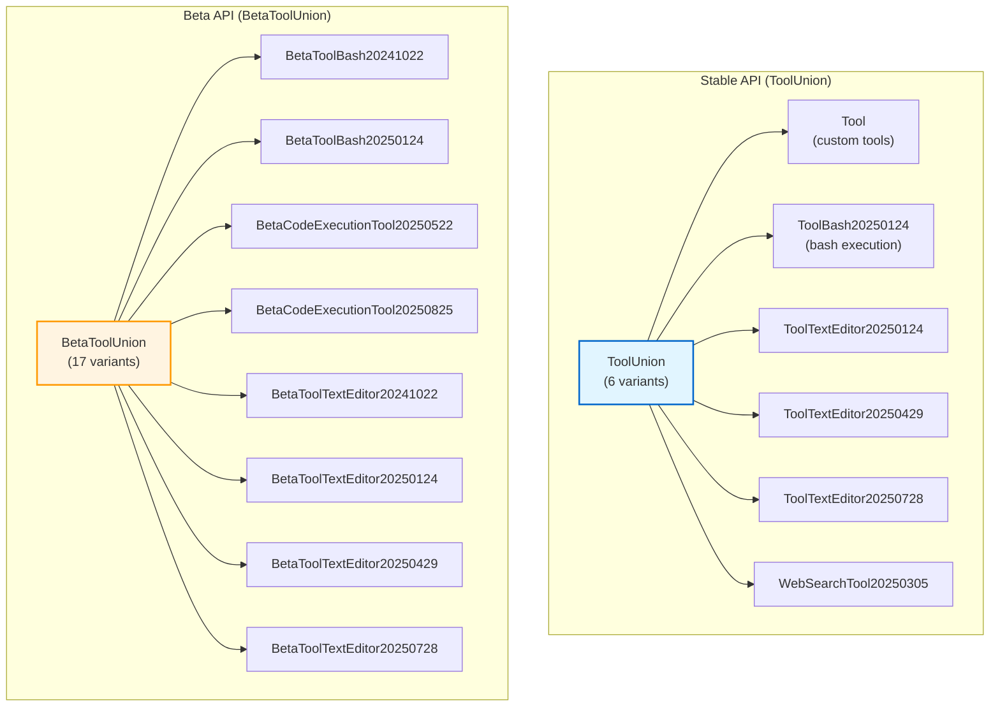
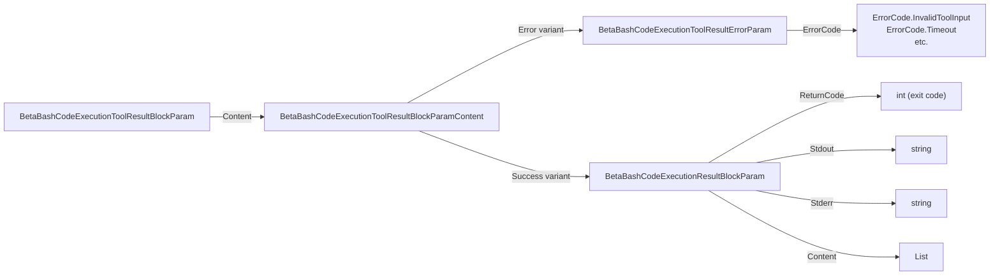
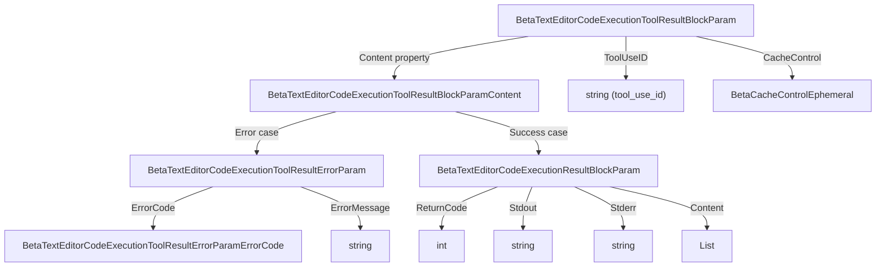
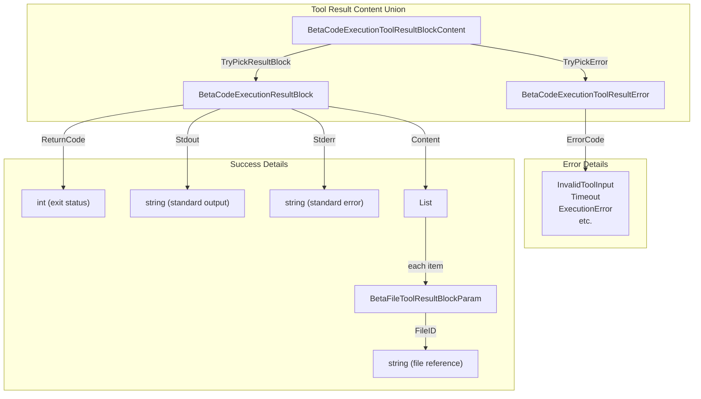
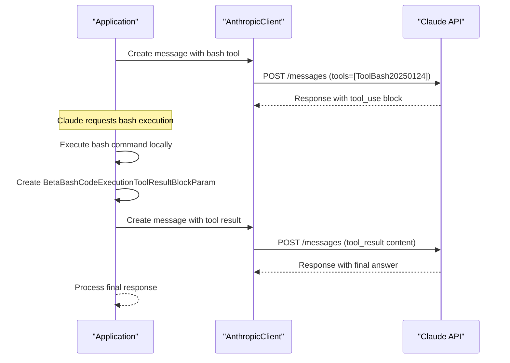

<!-- source: DeepWiki mcp.deepwiki.com · repo anthropics/anthropic-sdk-csharp · page 6.3 Code Execution Tools · fetched 2026-10-26 -->

# Code Execution Tools

<details>
<summary>Relevant source files</summary>

The following files were used as context for generating this wiki page:

- [src/Anthropic.Tests/Models/Beta/BetaErrorTest.cs](src/Anthropic.Tests/Models/Beta/BetaErrorTest.cs)
- [src/Anthropic.Tests/Models/Beta/Messages/Batches/BatchCreateParamsTest.cs](src/Anthropic.Tests/Models/Beta/Messages/Batches/BatchCreateParamsTest.cs)
- [src/Anthropic.Tests/Models/Beta/Messages/Batches/BetaMessageBatchResultTest.cs](src/Anthropic.Tests/Models/Beta/Messages/Batches/BetaMessageBatchResultTest.cs)
- [src/Anthropic.Tests/Models/Beta/Messages/BetaBashCodeExecutionToolResultBlockParamTest.cs](src/Anthropic.Tests/Models/Beta/Messages/BetaBashCodeExecutionToolResultBlockParamTest.cs)
- [src/Anthropic.Tests/Models/Beta/Messages/BetaBashCodeExecutionToolResultBlockTest.cs](src/Anthropic.Tests/Models/Beta/Messages/BetaBashCodeExecutionToolResultBlockTest.cs)
- [src/Anthropic.Tests/Models/Beta/Messages/BetaCitationsDeltaTest.cs](src/Anthropic.Tests/Models/Beta/Messages/BetaCitationsDeltaTest.cs)
- [src/Anthropic.Tests/Models/Beta/Messages/BetaClearThinking20251015EditTest.cs](src/Anthropic.Tests/Models/Beta/Messages/BetaClearThinking20251015EditTest.cs)
- [src/Anthropic.Tests/Models/Beta/Messages/BetaClearToolUses20250919EditTest.cs](src/Anthropic.Tests/Models/Beta/Messages/BetaClearToolUses20250919EditTest.cs)
- [src/Anthropic.Tests/Models/Beta/Messages/BetaCodeExecutionToolResultBlockContentTest.cs](src/Anthropic.Tests/Models/Beta/Messages/BetaCodeExecutionToolResultBlockContentTest.cs)
- [src/Anthropic.Tests/Models/Beta/Messages/BetaCodeExecutionToolResultBlockParamContentTest.cs](src/Anthropic.Tests/Models/Beta/Messages/BetaCodeExecutionToolResultBlockParamContentTest.cs)
- [src/Anthropic.Tests/Models/Beta/Messages/BetaContentBlockParamTest.cs](src/Anthropic.Tests/Models/Beta/Messages/BetaContentBlockParamTest.cs)
- [src/Anthropic.Tests/Models/Beta/Messages/BetaContextManagementConfigTest.cs](src/Anthropic.Tests/Models/Beta/Messages/BetaContextManagementConfigTest.cs)
- [src/Anthropic.Tests/Models/Beta/Messages/BetaMessageParamTest.cs](src/Anthropic.Tests/Models/Beta/Messages/BetaMessageParamTest.cs)
- [src/Anthropic.Tests/Models/Beta/Messages/BetaServerToolUseBlockParamTest.cs](src/Anthropic.Tests/Models/Beta/Messages/BetaServerToolUseBlockParamTest.cs)
- [src/Anthropic.Tests/Models/Beta/Messages/BetaServerToolUseBlockTest.cs](src/Anthropic.Tests/Models/Beta/Messages/BetaServerToolUseBlockTest.cs)
- [src/Anthropic.Tests/Models/Beta/Messages/MessageCreateParamsTest.cs](src/Anthropic.Tests/Models/Beta/Messages/MessageCreateParamsTest.cs)
- [src/Anthropic.Tests/Models/Messages/Batches/BatchCreateParamsTest.cs](src/Anthropic.Tests/Models/Messages/Batches/BatchCreateParamsTest.cs)
- [src/Anthropic.Tests/Models/Messages/MessageCreateParamsTest.cs](src/Anthropic.Tests/Models/Messages/MessageCreateParamsTest.cs)
- [src/Anthropic.Tests/Models/Messages/MessageParamTest.cs](src/Anthropic.Tests/Models/Messages/MessageParamTest.cs)

</details>


This page documents the code execution tool capabilities available in the Anthropic C# SDK. These tools enable Claude to execute code, run bash commands, and edit files within controlled environments. 

For general tool integration patterns and custom tool definitions, see [Tool Types](#6.1). For understanding the broader tool execution lifecycle, see [Tool Execution Flow](#6.2).

## Overview

Code execution tools provide Claude with the ability to:
- Execute bash commands via versioned bash tool implementations
- Edit files using text editor tools with multiple command strategies
- Run general code execution through dedicated code execution tools

These tools are available in both stable and beta API versions, with the beta versions offering additional features and newer tool variants. All code execution tools return structured results containing stdout, stderr, return codes, and file references.

**Sources:** [src/Anthropic/Models/Messages/ToolUnion.cs:1-465](), [src/Anthropic/Models/Beta/Messages/BetaToolUnion.cs:1-100]()

## Tool Type Hierarchy

The SDK organizes code execution tools through discriminated union types that support multiple versioned implementations:



**Sources:** [src/Anthropic/Models/Messages/ToolUnion.cs:10-358](), [src/Anthropic/Models/Beta/Messages/BetaToolUnion.cs:16-1100]()

## Bash Execution Tools

Bash tools allow Claude to execute bash commands and receive results including stdout, stderr, and return codes.

### Stable API: ToolBash20250124

The stable bash tool is accessed through `ToolBash20250124` and is part of the `ToolUnion` discriminated union.

| Property | Type | Description |
|----------|------|-------------|
| `Name` | `JsonElement` | Tool name (constant: specific bash tool identifier) |
| `Type` | `JsonElement` | Tool type identifier |
| `CacheControl` | `CacheControlEphemeral?` | Optional cache control settings |

The tool can be instantiated and added to message parameters:

```csharp
var bashTool = new ToolBash20250124();
// CacheControl can be set for prompt caching
bashTool.CacheControl = new CacheControlEphemeral { TTL = TTL.TTL5m };
```

**Sources:** [src/Anthropic/Models/Messages/ToolUnion.cs:42-46]()

### Beta API: BetaToolBash20241022 and BetaToolBash20250124

The beta API includes multiple versions of bash tools:

- `BetaToolBash20241022` - Earlier beta version
- `BetaToolBash20250124` - Latest beta version matching stable API date

Both support additional beta-specific features:

| Property | Type | Description |
|----------|------|-------------|
| `DeferLoading` | `bool?` | Whether to defer tool loading |
| `Strict` | `bool?` | Enable strict mode validation |

**Sources:** [src/Anthropic/Models/Beta/Messages/BetaToolUnion.cs:222-232]()

### Bash Tool Results

When Claude executes a bash command, the result is returned as a `BetaBashCodeExecutionToolResultBlock`:



The content union type discriminates between error and success results:

**Error Result:**
```csharp
new BetaBashCodeExecutionToolResultBlockParam
{
    Content = new BetaBashCodeExecutionToolResultErrorParam(
        BetaBashCodeExecutionToolResultErrorParamErrorCode.InvalidToolInput
    ),
    ToolUseID = "srvtoolu_12345",
    CacheControl = new() { TTL = TTL.TTL5m }
}
```

**Success Result:**
```csharp
new BetaBashCodeExecutionToolResultBlockParam
{
    Content = new BetaBashCodeExecutionResultBlockParam
    {
        ReturnCode = 0,
        Stdout = "command output",
        Stderr = "",
        Content = [new BetaFileToolResultBlockParam("file_id_123")]
    },
    ToolUseID = "srvtoolu_12345"
}
```

**Sources:** [src/Anthropic.Tests/Models/Beta/Messages/BetaBashCodeExecutionToolResultBlockParamTest.cs:11-102]()

## Text Editor Tools

Text editor tools enable Claude to edit files programmatically. Multiple versions exist with different editing strategies.

### Version Overview

| Version | Tool Class | Name Constant | Description |
|---------|-----------|---------------|-------------|
| 20241022 | `BetaToolTextEditor20241022` | Beta only | Early beta version |
| 20250124 | `ToolTextEditor20250124` / `BetaToolTextEditor20250124` | Both APIs | Initial stable version |
| 20250429 | `ToolTextEditor20250429` / `BetaToolTextEditor20250429` | Both APIs | String-replace based editing |
| 20250728 | `ToolTextEditor20250728` / `BetaToolTextEditor20250728` | Both APIs | Latest version |

### ToolTextEditor20250429 Example

The 20250429 version uses a string-replace based editing strategy:

```csharp
var textEditorTool = new ToolTextEditor20250429
{
    CacheControl = new CacheControlEphemeral { TTL = TTL.TTL1h }
};
```

Key characteristics:
- Tool name: `"str_replace_based_edit_tool"`
- Type identifier: `"text_editor_20250429"`
- Supports cache control for repeated operations

**Sources:** [src/Anthropic/Models/Messages/ToolTextEditor20250429.cs:1-108]()

### Text Editor Tool Results

Text editor execution results follow a similar pattern to bash tools:



**Sources:** [src/Anthropic.Tests/Models/Beta/Messages/BetaContentBlockParamTest.cs:242-258]()

## General Code Execution Tools

The beta API includes dedicated code execution tools that are distinct from bash and text editor tools.

### BetaCodeExecutionTool20250522 and BetaCodeExecutionTool20250825

These tools provide general-purpose code execution capabilities:

```csharp
// Version 20250522
var codeExecTool = new BetaCodeExecutionTool20250522
{
    CacheControl = new BetaCacheControlEphemeral { TTL = TTL.TTL5m },
    DeferLoading = false,
    Strict = true
};

// Version 20250825 (latest)
var latestCodeExecTool = new BetaCodeExecutionTool20250825
{
    CacheControl = new BetaCacheControlEphemeral { TTL = TTL.TTL1h }
};
```

**Sources:** [src/Anthropic/Models/Beta/Messages/BetaToolUnion.cs:233-244]()

### Code Execution Results

Results are structured as `BetaCodeExecutionToolResultBlockParam`:

**Error Handling:**
```csharp
new BetaCodeExecutionToolResultBlockParam
{
    Content = new BetaCodeExecutionToolResultErrorParam(
        BetaCodeExecutionToolResultErrorCode.InvalidToolInput
    ),
    ToolUseID = "srvtoolu_abc123",
    CacheControl = new() { TTL = TTL.TTL5m }
}
```

**Success Result:**
```csharp
new BetaCodeExecutionToolResultBlockParam
{
    Content = new BetaCodeExecutionResultBlockParam
    {
        ReturnCode = 0,
        Stdout = "execution output",
        Stderr = "warning messages",
        Content = [new BetaFileToolResultBlockParam("file_id")]
    },
    ToolUseID = "srvtoolu_abc123"
}
```

**Sources:** [src/Anthropic.Tests/Models/Beta/Messages/BetaCodeExecutionToolResultBlockParamContentTest.cs:9-68]()

## Result Block Structure

All code execution tools share a common result structure through union types:



### Validation Pattern

All tool result types implement validation:

```csharp
var result = new BetaCodeExecutionToolResultBlockParam
{
    Content = /* ... */,
    ToolUseID = "srvtoolu_12345"
};

// Validate the result structure
result.Validate();
```

The validation ensures:
- Required fields are present
- Union type contains a valid variant
- Nested objects are valid
- Constant fields match expected values

**Sources:** [src/Anthropic.Tests/Models/Beta/Messages/BetaCodeExecutionToolResultBlockContentTest.cs:1-70]()

## Working with Tool Results in Messages

Code execution tool results are included in message content as part of the conversation flow:



### Content Block Integration

Tool results are added to message parameters as content blocks:

```csharp
var messageParams = new BetaMessageCreateParams
{
    Model = Model.ClaudeSonnet4_20250514,
    MaxTokens = 1024,
    Messages = new[]
    {
        new BetaMessageParam
        {
            Role = Role.User,
            Content = "Execute: ls -la"
        },
        new BetaMessageParam
        {
            Role = Role.Assistant,
            Content = new BetaContentBlockParam[]
            {
                new BetaServerToolUseBlockParam
                {
                    ID = "srvtoolu_123",
                    Name = BetaServerToolUseBlockParamName.BashCommand,
                    Input = new Dictionary<string, JsonElement>
                    {
                        ["command"] = JsonSerializer.SerializeToElement("ls -la")
                    }
                }
            }
        },
        new BetaMessageParam
        {
            Role = Role.User,
            Content = new BetaContentBlockParam[]
            {
                new BetaBashCodeExecutionToolResultBlockParam
                {
                    ToolUseID = "srvtoolu_123",
                    Content = new BetaBashCodeExecutionResultBlockParam
                    {
                        ReturnCode = 0,
                        Stdout = "total 48\ndrwxr-xr-x...",
                        Stderr = ""
                    }
                }
            }
        }
    },
    Tools = new BetaToolUnion[]
    {
        new BetaToolBash20250124()
    }
};
```

**Sources:** [src/Anthropic.Tests/Models/Beta/Messages/BetaContentBlockParamTest.cs:226-239]()

## Tool Versioning Strategy

Code execution tools use date-based versioning to track API evolution:

| Version Pattern | Example | Purpose |
|----------------|---------|---------|
| YYYYMMDD | 20250124 | Release date identifier |
| Beta prefix | BetaToolBash20241022 | Beta API variant |
| Stable suffix | ToolBash20250124 | Stable API variant |

### Migration Between Versions

When newer tool versions are released:

1. **Backward Compatibility**: Old versions continue to work
2. **Explicit Versioning**: Applications choose specific versions
3. **Gradual Migration**: Can test new versions in beta before stable promotion

```csharp
// Using stable API with latest version
var tools = new ToolUnion[]
{
    new ToolTextEditor20250728(), // Latest stable text editor
    new ToolBash20250124()        // Latest stable bash
};

// Using beta API with experimental versions
var betaTools = new BetaToolUnion[]
{
    new BetaCodeExecutionTool20250825(), // Latest general code execution
    new BetaToolTextEditor20250728()      // Latest text editor in beta
};
```

**Sources:** [src/Anthropic/Models/Messages/ToolUnion.cs:42-70](), [src/Anthropic/Models/Beta/Messages/BetaToolUnion.cs:228-292]()

## Error Codes Reference

Code execution tools return standardized error codes:

### Common Error Codes

| Error Code | Description | Applicable Tools |
|-----------|-------------|------------------|
| `InvalidToolInput` | Tool input validation failed | All tools |
| `Timeout` | Execution exceeded time limit | Bash, CodeExecution |
| `ExecutionError` | Runtime execution failure | All tools |
| `FileNotFound` | Referenced file not accessible | TextEditor |
| `PermissionDenied` | Insufficient permissions | Bash, CodeExecution |

### Error Code Usage

```csharp
// Check for specific error types
var result = /* ... get tool result ... */;

if (result.Content.TryPickError(out var error))
{
    switch (error.ErrorCode)
    {
        case BetaCodeExecutionToolResultErrorCode.InvalidToolInput:
            // Handle invalid input
            break;
        case BetaCodeExecutionToolResultErrorCode.Timeout:
            // Handle timeout
            break;
        default:
            // Handle other errors
            break;
    }
}
else if (result.Content.TryPickResultBlock(out var success))
{
    // Process successful execution
    var output = success.Stdout;
    var returnCode = success.ReturnCode;
}
```

**Sources:** [src/Anthropic.Tests/Models/Beta/Messages/BetaBashCodeExecutionToolResultBlockTest.cs:15-22]()

## Cache Control Integration

All code execution tools support prompt caching through the `CacheControl` property:

```csharp
var tool = new ToolBash20250124
{
    CacheControl = new CacheControlEphemeral
    {
        TTL = TTL.TTL5m  // 5-minute cache
        // or TTL.TTL1h for 1-hour cache
    }
};
```

Cache control enables:
- Reduced latency for repeated tool definitions
- Lower token costs for frequently used tools
- Improved performance in multi-turn conversations

For detailed caching strategies, see [Cache Control](#7.4).

**Sources:** [src/Anthropic/Models/Messages/ToolTextEditor20250429.cs:34-41]()

## Pattern Matching on Tool Unions

The `ToolUnion` and `BetaToolUnion` types provide pattern matching methods:

### Switch Pattern

```csharp
toolUnion.Switch(
    tool: (customTool) => { /* handle custom tool */ },
    bash20250124: (bashTool) => { /* handle bash */ },
    textEditor20250124: (editorTool) => { /* handle text editor v1 */ },
    textEditor20250429: (editorTool) => { /* handle text editor v2 */ },
    textEditor20250728: (editorTool) => { /* handle text editor v3 */ },
    webSearchTool20250305: (searchTool) => { /* handle web search */ }
);
```

### Match Pattern with Return Value

```csharp
var toolName = toolUnion.Match(
    tool: (t) => t.Name,
    bash20250124: (_) => "bash_tool",
    textEditor20250124: (_) => "text_editor_v1",
    textEditor20250429: (_) => "text_editor_v2",
    textEditor20250728: (_) => "text_editor_v3",
    webSearchTool20250305: (_) => "web_search"
);
```

### TryPick Pattern

```csharp
if (toolUnion.TryPickBash20250124(out var bashTool))
{
    // Work specifically with bash tool
    var cacheControl = bashTool.CacheControl;
}
else if (toolUnion.TryPickTextEditor20250728(out var editorTool))
{
    // Work specifically with latest text editor
}
```

**Sources:** [src/Anthropic/Models/Messages/ToolUnion.cs:227-310]()

## Best Practices

### Tool Selection

1. **Use Latest Versions**: Prefer newer tool versions for enhanced capabilities
2. **Explicit Versioning**: Always specify exact tool versions for reproducibility
3. **Beta for Experimentation**: Use beta tools when testing new features

### Result Handling

1. **Always Validate**: Call `Validate()` on tool results before processing
2. **Handle Both Variants**: Check for both error and success cases
3. **Inspect Return Codes**: Even successful executions may have non-zero return codes

### Performance Optimization

1. **Enable Caching**: Set `CacheControl` on frequently used tools
2. **Reuse Tool Definitions**: Share tool instances across messages when possible
3. **Defer Loading**: Use `DeferLoading` in beta tools to optimize initialization

**Sources:** [src/Anthropic.Tests/Models/Beta/Messages/BetaContentBlockParamTest.cs:90-103]()

---

