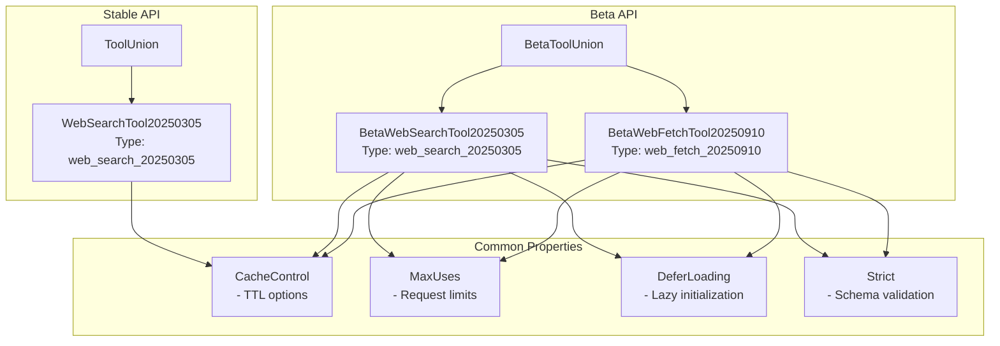
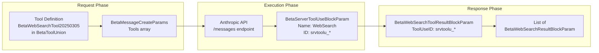
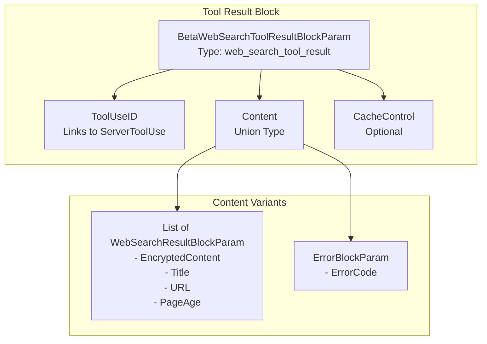
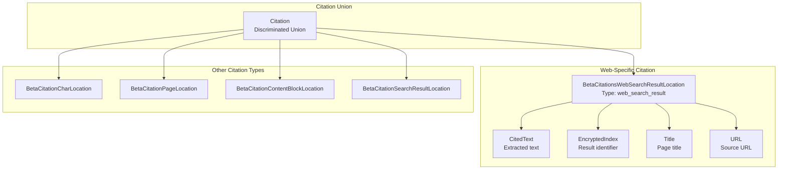
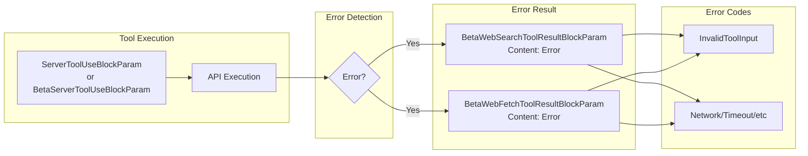
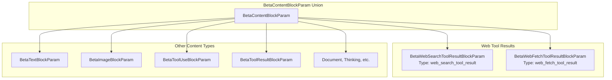
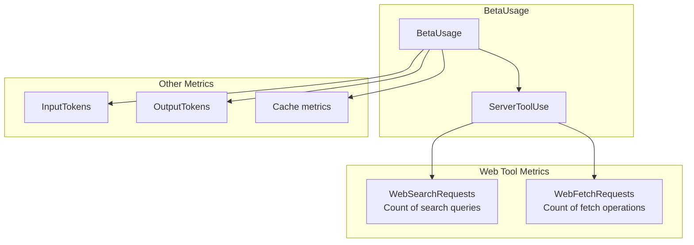

<!-- source: DeepWiki mcp.deepwiki.com · repo anthropics/anthropic-sdk-csharp · page 6.4 Web Tools · fetched 2026-10-26 -->

# Web Tools

Relevant source files

The following files were used as context for generating this wiki page:

- [src/Anthropic.Tests/Models/Beta/BetaErrorTest.cs](src/Anthropic.Tests/Models/Beta/BetaErrorTest.cs)
- [src/Anthropic.Tests/Models/Beta/Messages/Batches/BetaMessageBatchResultTest.cs](src/Anthropic.Tests/Models/Beta/Messages/Batches/BetaMessageBatchResultTest.cs)
- [src/Anthropic.Tests/Models/Beta/Messages/BetaBashCodeExecutionToolResultBlockParamTest.cs](src/Anthropic.Tests/Models/Beta/Messages/BetaBashCodeExecutionToolResultBlockParamTest.cs)
- [src/Anthropic.Tests/Models/Beta/Messages/BetaBashCodeExecutionToolResultBlockTest.cs](src/Anthropic.Tests/Models/Beta/Messages/BetaBashCodeExecutionToolResultBlockTest.cs)
- [src/Anthropic.Tests/Models/Beta/Messages/BetaCitationsDeltaTest.cs](src/Anthropic.Tests/Models/Beta/Messages/BetaCitationsDeltaTest.cs)
- [src/Anthropic.Tests/Models/Beta/Messages/BetaClearToolUses20250919EditTest.cs](src/Anthropic.Tests/Models/Beta/Messages/BetaClearToolUses20250919EditTest.cs)
- [src/Anthropic.Tests/Models/Beta/Messages/BetaCodeExecutionToolResultBlockContentTest.cs](src/Anthropic.Tests/Models/Beta/Messages/BetaCodeExecutionToolResultBlockContentTest.cs)
- [src/Anthropic.Tests/Models/Beta/Messages/BetaCodeExecutionToolResultBlockParamContentTest.cs](src/Anthropic.Tests/Models/Beta/Messages/BetaCodeExecutionToolResultBlockParamContentTest.cs)
- [src/Anthropic.Tests/Models/Beta/Messages/BetaContentBlockParamTest.cs](src/Anthropic.Tests/Models/Beta/Messages/BetaContentBlockParamTest.cs)
- [src/Anthropic.Tests/Models/Beta/Messages/BetaContextManagementConfigTest.cs](src/Anthropic.Tests/Models/Beta/Messages/BetaContextManagementConfigTest.cs)
- [src/Anthropic/Models/Beta/Messages/BetaToolUnion.cs](src/Anthropic/Models/Beta/Messages/BetaToolUnion.cs)
- [src/Anthropic/Models/Messages/MessageCountTokensTool.cs](src/Anthropic/Models/Messages/MessageCountTokensTool.cs)
- [src/Anthropic/Models/Messages/ToolTextEditor20250429.cs](src/Anthropic/Models/Messages/ToolTextEditor20250429.cs)
- [src/Anthropic/Models/Messages/ToolUnion.cs](src/Anthropic/Models/Messages/ToolUnion.cs)

This page documents the web-related tools available in the Anthropic C# SDK, including web search and web fetch capabilities. These tools enable Claude to retrieve and process information from the internet during conversations.

For information about other tool types such as code execution tools, see [Code Execution Tools](#6.3). For general tool configuration and execution patterns, see [Tool Types](#6.1) and [Tool Execution Flow](#6.2).

## Overview

The SDK provides two primary web tools:

| Tool | API Level | Purpose | Version Identifier |
|------|-----------|---------|-------------------|
| `WebSearchTool20250305` | Stable | Performs web searches and returns results | `web_search_20250305` |
| `BetaWebSearchTool20250305` | Beta | Web search with advanced features | `web_search_20250305` |
| `BetaWebFetchTool20250910` | Beta | Fetches and processes web page content | `web_fetch_20250910` |

Web tools are included in the discriminated union types `ToolUnion` (stable API) and `BetaToolUnion` (beta API), allowing type-safe configuration alongside custom tools, code execution tools, and other server-side tools.

**Sources:** [src/Anthropic/Models/Messages/ToolUnion.cs:10-70](), [src/Anthropic/Models/Beta/Messages/BetaToolUnion.cs:9-322]()

## Tool Variants and Hierarchy

**Sources:** [src/Anthropic/Models/Messages/ToolUnion.cs:21-34](), [src/Anthropic/Models/Beta/Messages/BetaToolUnion.cs:27-214]()

## Web Search Tool

### Tool Definition

The web search tool is defined in both stable and beta APIs. The beta version provides additional configuration options for controlling usage and caching behavior.

**Stable API (`WebSearchTool20250305`):**
- Accessible via `ToolUnion` in `MessageCreateParams.Tools`
- Supports cache control for prompt caching
- Type discriminator: `"web_search_20250305"`

**Beta API (`BetaWebSearchTool20250305`):**
- Accessible via `BetaToolUnion` in `BetaMessageCreateParams.Tools`
- Includes `MaxUses` property to limit the number of search requests per conversation
- Supports deferred loading and strict schema validation
- Type discriminator: `"web_search_20250305"`

**Sources:** [src/Anthropic/Models/Messages/ToolUnion.cs:66-70](), [src/Anthropic/Models/Beta/Messages/BetaToolUnion.cs:294-298]()

### Configuration Properties

The beta web search tool exposes the following configuration properties through `BetaToolUnion`:

| Property | Type | Description | Access Pattern |
|----------|------|-------------|----------------|
| `CacheControl` | `BetaCacheControlEphemeral?` | Cache breakpoint configuration | Via `Match` or `TryPickWebSearchTool20250305` |
| `MaxUses` | `long?` | Maximum number of web search requests allowed | Direct property on `BetaToolUnion` |
| `DeferLoading` | `bool?` | Whether to defer tool initialization | Direct property on `BetaToolUnion` |
| `Strict` | `bool?` | Enable strict JSON schema validation | Direct property on `BetaToolUnion` |

The `MaxUses` property is particularly important for controlling costs and rate limits when using web search functionality.

**Sources:** [src/Anthropic/Models/Beta/Messages/BetaToolUnion.cs:189-214]()

### Tool Usage Pattern

**Sources:** [src/Anthropic.Tests/Models/Beta/Messages/BetaContentBlockParamTest.cs:170-191]()

### Web Search Results

Web search results are returned via `BetaWebSearchToolResultBlockParam`, which contains a content union that can represent either successful results or errors.

**Result Structure (`BetaWebSearchResultBlockParam`):**

| Property | Type | Description |
|----------|------|-------------|
| `EncryptedContent` | `string` | Encrypted web page content for model processing |
| `Title` | `string` | Page title |
| `URL` | `string` | Source URL |
| `PageAge` | `string?` | Temporal metadata about the page |

The `EncryptedContent` field contains encrypted web page text that Claude can process securely. This encryption ensures that sensitive web content is not exposed directly while still allowing the model to extract information.

**Sources:** [src/Anthropic.Tests/Models/Beta/Messages/BetaContentBlockParamTest.cs:170-191](), [src/Anthropic.Tests/Models/Beta/Messages/BetaContentBlockParamTest.cs:510-535]()

### Tool Result Integration

Web search results can be provided back to the model in subsequent messages using `BetaWebSearchToolResultBlockParam`:

**Sources:** [src/Anthropic.Tests/Models/Beta/Messages/BetaContentBlockParamTest.cs:170-191]()

## Web Fetch Tool

The web fetch tool is available only in the beta API and provides functionality to retrieve and process specific web pages.

### Tool Definition

`BetaWebFetchTool20250910` is accessible via `BetaToolUnion` and includes:
- Type discriminator: `"web_fetch_20250910"`
- `MaxUses` property for rate limiting
- Cache control support
- Deferred loading and strict schema validation

**Sources:** [src/Anthropic/Models/Beta/Messages/BetaToolUnion.cs:300-304]()

### Configuration

The web fetch tool shares the same configuration pattern as web search:

| Property | Type | Purpose |
|----------|------|---------|
| `CacheControl` | `BetaCacheControlEphemeral?` | Enable prompt caching at this tool definition |
| `MaxUses` | `long?` | Limit the number of fetch requests (typically 2-10) |
| `DeferLoading` | `bool?` | Defer tool initialization until first use |
| `Strict` | `bool?` | Enforce strict JSON schema validation |

**Sources:** [src/Anthropic/Models/Beta/Messages/BetaToolUnion.cs:189-214]()

### Web Fetch Results

Web fetch results are returned via `BetaWebFetchToolResultBlockParam`, which uses a content union to represent success or error states.

**Result Content Variants:**
1. **Success Result** - Contains fetched web page content (structure varies by implementation)
2. **Error Result** - `BetaWebFetchToolResultErrorBlockParam` with error code

**Error Codes:**
- `BetaWebFetchToolResultErrorCode.InvalidToolInput` - Malformed input parameters
- Additional error codes for network failures, timeouts, etc.

**Sources:** [src/Anthropic.Tests/Models/Beta/Messages/BetaContentBlockParamTest.cs:194-207](), [src/Anthropic.Tests/Models/Beta/Messages/BetaContentBlockParamTest.cs:538-554]()

## Citations for Web Search Results

Web search results support specialized citation types that reference encrypted search result content.

### Citation Types

**Sources:** [src/Anthropic.Tests/Models/Beta/Messages/BetaCitationsDeltaTest.cs:170-182](), [src/Anthropic.Tests/Models/Beta/Messages/BetaCitationsDeltaTest.cs:262-277]()

### Web Search Citation Structure

`BetaCitationsWebSearchResultLocation` provides attribution for content extracted from web search results:

| Property | Type | Description |
|----------|------|-------------|
| `CitedText` | `string` | The specific text that was cited |
| `EncryptedIndex` | `string` | Encrypted identifier linking to the search result |
| `Title` | `string` | Title of the source page |
| `URL` | `string` | Source URL |

The `EncryptedIndex` property securely references the search result without exposing sensitive information about which specific result was used.

**Sources:** [src/Anthropic.Tests/Models/Beta/Messages/BetaCitationsDeltaTest.cs:170-182]()

## Error Handling

Web tools can fail for various reasons including network issues, invalid inputs, or rate limits. Errors are returned via specialized error block parameters.

### Error Flow

**Sources:** [src/Anthropic.Tests/Models/Beta/Messages/BetaContentBlockParamTest.cs:194-207]()

### Error Code Handling

Error codes are represented as enumerations:
- `BetaWebFetchToolResultErrorCode.InvalidToolInput` - Invalid parameters provided to the tool
- Additional error codes for specific failure modes (network errors, authentication failures, rate limits)

When processing tool results, applications should check for error content and handle it appropriately, potentially retrying with corrected parameters or informing the user of the failure.

**Sources:** [src/Anthropic.Tests/Models/Beta/Messages/BetaContentBlockParamTest.cs:194-207]()

## Integration with Content Blocks

Web tool results integrate into the broader content block system, allowing them to be mixed with other content types in messages.

### Content Block Union

Web tool results are variants in the `BetaContentBlockParam` union:

**Sources:** [src/Anthropic.Tests/Models/Beta/Messages/BetaContentBlockParamTest.cs:170-207]()

### Message Construction Pattern

To use web tools in a conversation:

1. **Define the tool** in `BetaMessageCreateParams.Tools` using `BetaToolUnion`
2. **Receive server tool use** - Claude will use `BetaServerToolUseBlockParam` with `Name = WebSearch` or `Name = WebFetch`
3. **Return results** - Provide `BetaWebSearchToolResultBlockParam` or `BetaWebFetchToolResultBlockParam` in the next message's content array
4. **Process citations** - Extract `BetaCitationsWebSearchResultLocation` from response citations if available

**Sources:** [src/Anthropic.Tests/Models/Beta/Messages/BetaContentBlockParamTest.cs:170-191]()

## Usage Metrics

Web tool usage is tracked in the `Usage` metrics returned with each message response.

### Server Tool Use Metrics

The `BetaUsage` object includes a `ServerToolUse` property that tracks web tool requests:

These metrics help track costs and ensure compliance with `MaxUses` limits configured on the tools.

**Sources:** [src/Anthropic.Tests/Models/Beta/Messages/Batches/BetaMessageBatchResultTest.cs:76-77]()

## Tool Identification Patterns

Web tools use specific naming and ID patterns that distinguish them from custom tools.

### Server Tool Use Block

When Claude invokes a web tool, it uses `BetaServerToolUseBlockParam` with:
- `Name` property set to an enum value: `BetaServerToolUseBlockParamName.WebSearch` or `BetaServerToolUseBlockParamName.WebFetch`
- `ID` property prefixed with `"srvtoolu_"` (e.g., `"srvtoolu_SQfNkl1n_JR_"`)
- `Input` dictionary containing tool-specific parameters

This differs from custom tools which use `BetaToolUseBlockParam` with arbitrary names.

**Sources:** [src/Anthropic.Tests/Models/Beta/Messages/BetaContentBlockParamTest.cs:152-167]()

## Cache Control Integration

Web tools support prompt caching through the `CacheControl` property, allowing tool definitions to serve as cache breakpoints.

### Cache Configuration

Both `WebSearchTool20250305` and the beta variants support `CacheControlEphemeral` with TTL options:
- `TTL.TTL5m` - 5-minute cache lifetime
- `TTL.TTL1h` - 1-hour cache lifetime

Setting cache control on web tool definitions can improve performance when the same tool configuration is reused across multiple requests.

**Sources:** [src/Anthropic/Models/Messages/ToolUnion.cs:21-34](), [src/Anthropic.Tests/Models/Beta/Messages/BetaContentBlockParamTest.cs:186-188]()

---

