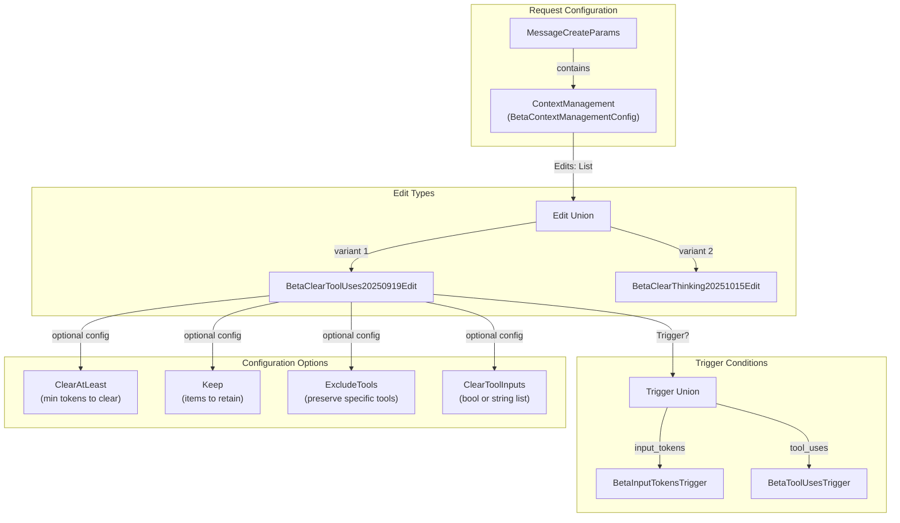
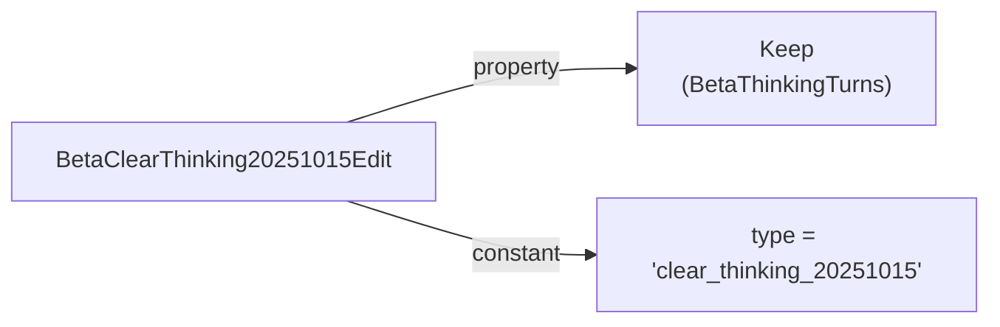
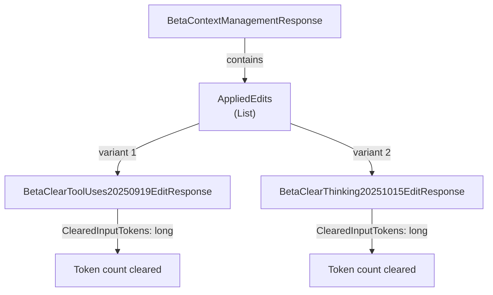
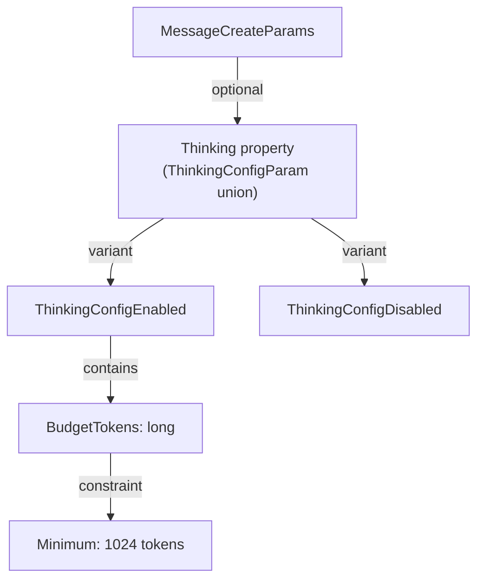
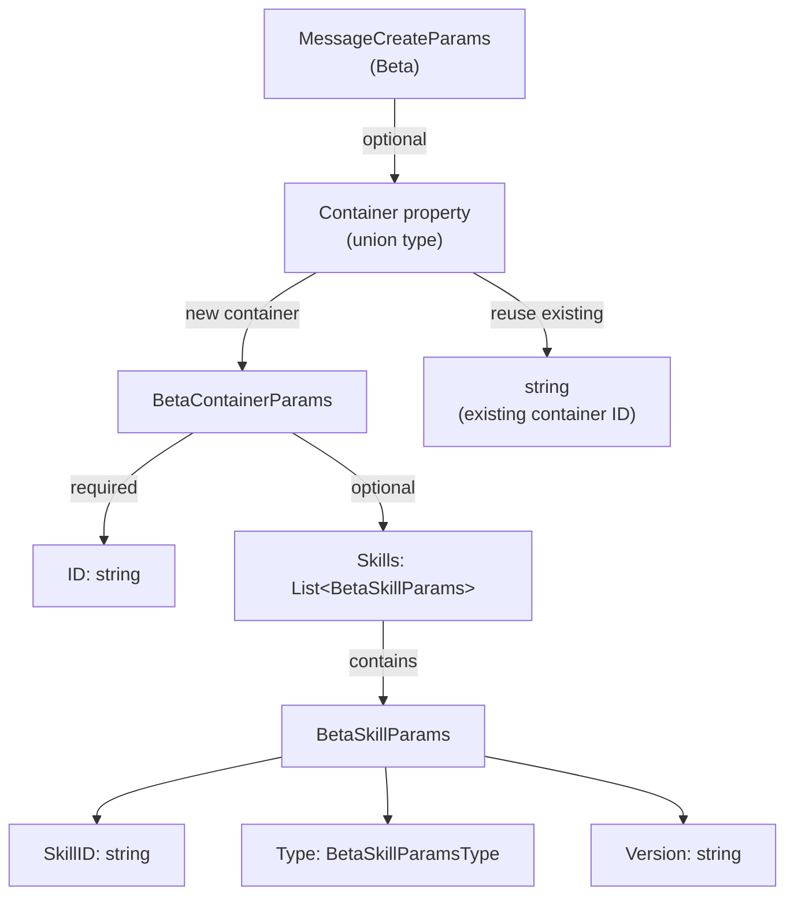
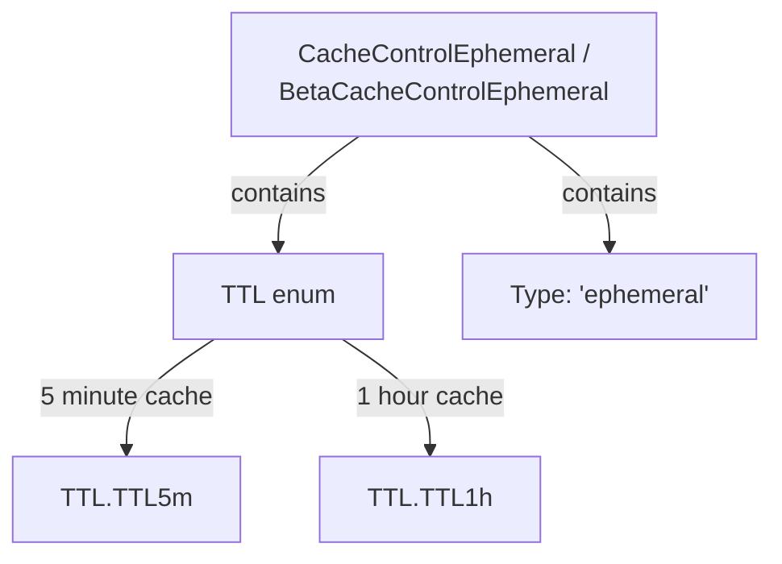
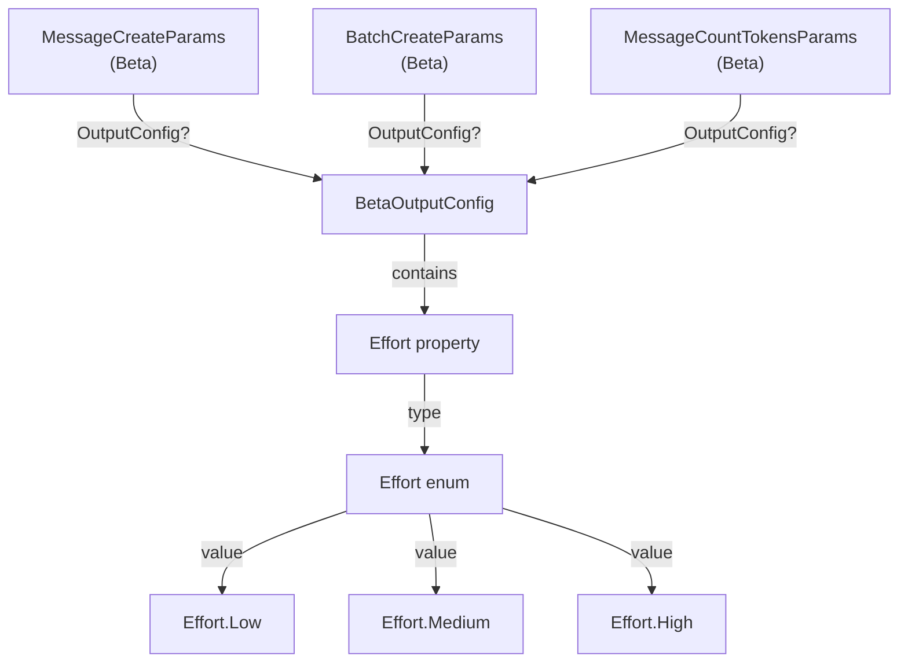
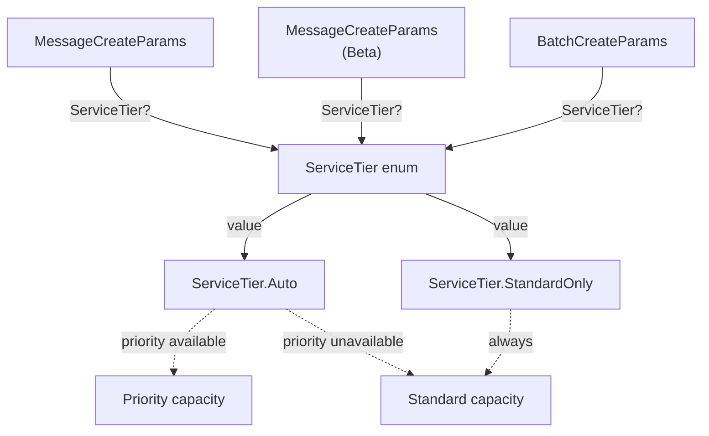
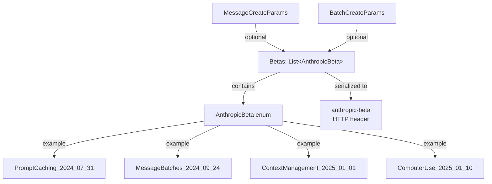
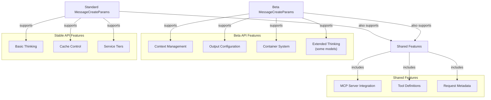

<!-- source: DeepWiki mcp.deepwiki.com · repo anthropics/anthropic-sdk-csharp · page 7 Advanced Features · fetched 2026-10-26 -->

# Advanced Features

<details>
<summary>Relevant source files</summary>

The following files were used as context for generating this wiki page:

- [examples/MessagesExample/MessagesExample.csproj](examples/MessagesExample/MessagesExample.csproj)
- [examples/MessagesExample/Program.cs](examples/MessagesExample/Program.cs)
- [examples/MessagesStreamingExample/MessagesStreamingExample.csproj](examples/MessagesStreamingExample/MessagesStreamingExample.csproj)
- [examples/MessagesStreamingExample/Program.cs](examples/MessagesStreamingExample/Program.cs)
- [examples/ThinkingExample/Program.cs](examples/ThinkingExample/Program.cs)
- [examples/ThinkingExample/ThinkingExample.csproj](examples/ThinkingExample/ThinkingExample.csproj)
- [examples/ThinkingStreamingExample/Program.cs](examples/ThinkingStreamingExample/Program.cs)
- [examples/ThinkingStreamingExample/ThinkingStreamingExample.csproj](examples/ThinkingStreamingExample/ThinkingStreamingExample.csproj)
- [src/Anthropic.Tests/Models/Beta/BetaErrorTest.cs](src/Anthropic.Tests/Models/Beta/BetaErrorTest.cs)
- [src/Anthropic.Tests/Models/Beta/Messages/Batches/BetaMessageBatchResultTest.cs](src/Anthropic.Tests/Models/Beta/Messages/Batches/BetaMessageBatchResultTest.cs)
- [src/Anthropic.Tests/Models/Beta/Messages/BetaBashCodeExecutionToolResultBlockParamTest.cs](src/Anthropic.Tests/Models/Beta/Messages/BetaBashCodeExecutionToolResultBlockParamTest.cs)
- [src/Anthropic.Tests/Models/Beta/Messages/BetaBashCodeExecutionToolResultBlockTest.cs](src/Anthropic.Tests/Models/Beta/Messages/BetaBashCodeExecutionToolResultBlockTest.cs)
- [src/Anthropic.Tests/Models/Beta/Messages/BetaCitationsDeltaTest.cs](src/Anthropic.Tests/Models/Beta/Messages/BetaCitationsDeltaTest.cs)
- [src/Anthropic.Tests/Models/Beta/Messages/BetaClearToolUses20250919EditTest.cs](src/Anthropic.Tests/Models/Beta/Messages/BetaClearToolUses20250919EditTest.cs)
- [src/Anthropic.Tests/Models/Beta/Messages/BetaCodeExecutionToolResultBlockContentTest.cs](src/Anthropic.Tests/Models/Beta/Messages/BetaCodeExecutionToolResultBlockContentTest.cs)
- [src/Anthropic.Tests/Models/Beta/Messages/BetaCodeExecutionToolResultBlockParamContentTest.cs](src/Anthropic.Tests/Models/Beta/Messages/BetaCodeExecutionToolResultBlockParamContentTest.cs)
- [src/Anthropic.Tests/Models/Beta/Messages/BetaContentBlockParamTest.cs](src/Anthropic.Tests/Models/Beta/Messages/BetaContentBlockParamTest.cs)
- [src/Anthropic.Tests/Models/Beta/Messages/BetaContextManagementConfigTest.cs](src/Anthropic.Tests/Models/Beta/Messages/BetaContextManagementConfigTest.cs)

</details>


This page documents sophisticated SDK capabilities designed for advanced use cases including context management, extended thinking, container-based request reuse, and prompt caching. These features are primarily available through the Beta API and enable fine-grained control over Claude's behavior, memory management, and performance optimization.

For basic message creation and streaming, see [Working with Messages](#5). For tool integration, see [Tools and Function Calling](#6). For beta-specific APIs like Files and Skills, see [Beta Services](#4.4).

---

## Overview

The SDK exposes several advanced features that provide enhanced control over request processing:

| Feature | Purpose | API Surface | Beta Required |
|---------|---------|-------------|---------------|
| Context Management | Control how conversation history is cleared between turns | `BetaContextManagementConfig` | Yes |
| Extended Thinking | Enable Claude's reasoning process in responses | `BetaThinkingConfigParam` | Yes (some models) |
| Container System | Reuse request state across multiple API calls | `BetaContainerParams` | Yes |
| Cache Control | Reduce costs and latency via prompt caching | `CacheControl` with `TTL` | No |
| Output Configuration | Control response effort level | `BetaOutputConfig` | Yes |
| Service Tiers | Choose between priority and standard capacity | `ServiceTier` enum | No |

**Sources:**
- [src/Anthropic/Models/Beta/Messages/MessageCreateParams.cs:1-577]()
- [src/Anthropic/Models/Beta/Messages/BetaContextManagementConfig.cs:1-350]()

---

## Context Management

Context management allows precise control over conversation history, enabling applications to clear tool uses, thinking content, or other elements when context windows grow large. This is essential for long-running conversations that would otherwise exceed token limits.

### Configuration Structure



**Diagram: Context Management Configuration Hierarchy**

**Sources:**
- [src/Anthropic/Models/Beta/Messages/MessageCreateParams.cs:132-148]()
- [src/Anthropic/Models/Beta/Messages/BetaContextManagementConfig.cs:10-77]()
- [src/Anthropic/Models/Beta/Messages/BetaClearToolUses20250919Edit.cs:1-649]()

### Clearing Tool Uses

The `BetaClearToolUses20250919Edit` edit type removes tool use history from conversation context. This helps manage token usage in tool-heavy workflows.

| Property | Type | Description |
|----------|------|-------------|
| `ClearAtLeast` | `BetaInputTokensClearAtLeast?` | Minimum tokens that must be cleared for edit to apply |
| `ClearToolInputs` | `ClearToolInputs?` | Boolean (clear all) or list of tool names (clear specific) |
| `ExcludeTools` | `IReadOnlyList<string>?` | Tool names to preserve from clearing |
| `Keep` | `BetaToolUsesKeep?` | Number of recent tool uses to retain |
| `Trigger` | `Trigger?` | Condition that activates clearing (input tokens or tool use count) |

The `ClearToolInputs` property uses a union type that accepts either:
- `bool` - Clear all tool inputs if `true`
- `IReadOnlyList<string>` - Specific tool input IDs to clear

The `Trigger` property determines when clearing occurs:
- `BetaInputTokensTrigger` - Triggers when input token count reaches threshold
- `BetaToolUsesTrigger` - Triggers when tool use count reaches threshold

**Sources:**
- [src/Anthropic/Models/Beta/Messages/BetaClearToolUses20250919Edit.cs:16-154]()
- [src/Anthropic/Models/Beta/Messages/BetaClearToolUses20250919Edit.cs:156-378]()
- [src/Anthropic/Models/Beta/Messages/BetaClearToolUses20250919Edit.cs:380-649]()

### Clearing Thinking Content

The `BetaClearThinking20251015Edit` edit type removes extended thinking blocks from conversation history, useful for managing context when using the thinking feature extensively.



**Diagram: Clear Thinking Edit Structure**

**Sources:**
- [src/Anthropic/Models/Beta/Messages/BetaContextManagementConfig.cs:196-199]()

### Response Tracking

After a request with context management, the response includes `BetaContextManagementResponse` showing which edits were applied:



**Diagram: Context Management Response Structure**

**Sources:**
- [src/Anthropic/Models/Beta/Messages/BetaContextManagementResponse.cs:1-385]()

---

## Extended Thinking and Reasoning

Extended thinking enables Claude to show its reasoning process in `thinking` content blocks before providing a final answer. This feature is configured via the `Thinking` parameter in `MessageCreateParams`. For comprehensive details on thinking blocks, redacted thinking, and response processing, see [Thinking and Reasoning](#7.2).

### Configuration Structure



**Diagram: Thinking Configuration in MessageCreateParams**

### Basic Usage Example

The SDK includes example applications demonstrating thinking feature usage:

| Example | Purpose | Key Types |
|---------|---------|-----------|
| `ThinkingExample/Program.cs` | Non-streaming thinking responses | `ThinkingConfigEnabled`, `ThinkingBlock` |
| `ThinkingStreamingExample/Program.cs` | Streaming thinking deltas | `ThinkingConfigEnabled`, `ThinkingDelta` |

The thinking budget specifies how many tokens Claude can allocate to reasoning. This counts toward the overall `MaxTokens` limit. The minimum budget is 1024 tokens.

```csharp
// From ThinkingExample/Program.cs
Thinking = new ThinkingConfigEnabled() { BudgetTokens = 1024 }
```

Response content blocks include thinking via the `ThinkingBlock` type, which can be extracted using `TryPickThinking()`:

```csharp
// From ThinkingExample/Program.cs
if (block.TryPickThinking(out ThinkingBlock? thinking))
{
    Console.WriteLine($"Thinking: {thinking.Thinking}");
}
```

**Sources:**
- [examples/ThinkingExample/Program.cs:1-38]()
- [examples/ThinkingStreamingExample/Program.cs:1-36]()
- [src/Anthropic/Models/Messages/MessageCreateParams.cs:232-258]()

---

## Container System

Containers enable request state reuse across multiple API calls, improving efficiency for stateful interactions. The container system is integrated with the Skills API for maintaining execution context across conversation turns. For comprehensive container lifecycle management and expiration details, see [Container System](#7.3).

### Container Configuration Types



**Diagram: Container Property Structure in MessageCreateParams**

### Container Response Fields

Responses include container metadata via the `BetaContainer` type:

| Property | Type | Description |
|----------|------|-------------|
| `ID` | `string` | Unique container identifier for reuse |
| `ExpiresAt` | `DateTimeOffset` | Container expiration timestamp |
| `Skills` | `List<BetaSkill>?` | Active skills in container |

Container IDs from responses can be passed to subsequent requests to maintain state.

**Sources:**
- [src/Anthropic/Models/Beta/Messages/MessageCreateParams.cs:123-130]()
- [src/Anthropic/Models/Beta/Messages/MessageCreateParams.cs:579-761]()
- [src/Anthropic.Tests/Models/Beta/Messages/Batches/BetaMessageBatchResultTest.cs:20-33]()

---

## Prompt Caching

Prompt caching reduces costs and latency by caching frequently reused content such as system prompts, tool definitions, and conversation context. Cache entries use configurable time-to-live (TTL) values. For detailed caching strategies and usage metrics, see [Cache Control](#7.4).

### Cache Control Types



**Diagram: CacheControlEphemeral Structure**

### Cacheable Content Types

Cache control can be applied to multiple content types via their `CacheControl` property:

| Content Type | Example Class | Location |
|--------------|---------------|----------|
| System Prompts | `BetaTextBlockParam` | System prompt text blocks |
| Tool Definitions | `BetaTool`, `Tool` | Individual tool configurations |
| Message Content | `BetaContentBlockParam` | User/assistant message blocks |
| Tool Results | `BetaToolResultBlockParam` | Tool execution results |
| Search Results | `BetaSearchResultBlockParam` | Web search result blocks |

The `CacheControl` property is optional on all supported types, enabling selective caching at granular levels.

### Usage Metrics

Cache usage is reported in response `Usage` objects:

| Metric | Property | Description |
|--------|----------|-------------|
| Cache Creation | `CacheCreationInputTokens` | Tokens used to create cache entries |
| Cache Reads | `CacheReadInputTokens` | Tokens loaded from cache |
| TTL-Specific Creation | `CacheCreation.Ephemeral5mInputTokens` | Tokens cached with 5m TTL |
| TTL-Specific Creation | `CacheCreation.Ephemeral1hInputTokens` | Tokens cached with 1h TTL |

**Sources:**
- [src/Anthropic.Tests/Models/Beta/Messages/BetaContentBlockParamTest.cs:43-44]()
- [src/Anthropic.Tests/Models/Beta/Messages/BetaBashCodeExecutionToolResultBlockParamTest.cs:17-18]()
- [src/Anthropic.Tests/Models/Beta/Messages/Batches/BetaMessageBatchResultTest.cs:68-76]()

---

## Output Configuration

The `BetaOutputConfig` type controls Claude's response generation characteristics, particularly the computational effort applied to reasoning and response quality. This configuration is available in beta messages and batch processing requests.

### Configuration Structure



**Diagram: BetaOutputConfig Usage Across Request Types**

### Effort Levels

The `Effort` enum controls computational resource allocation:

| Effort Level | Behavior |
|--------------|----------|
| `Effort.Low` | Faster responses, reduced reasoning depth |
| `Effort.Medium` | Balanced speed and reasoning quality |
| `Effort.High` | Maximum reasoning depth, longer processing time |

Higher effort levels may produce more thorough responses but consume additional tokens and processing time. The effort setting influences both thinking token usage and output token generation.

**Sources:**
- [src/Anthropic/Models/Beta/Messages/MessageCreateParams.cs:190-209]()
- [src/Anthropic.Tests/Models/Beta/Messages/Batches/BatchCreateParamsTest.cs:61]()

---

## Service Tiers

Service tiers provide capacity management by allowing applications to select between priority processing (when available) and standard capacity. The `ServiceTier` enum is available in both standard and beta message requests.

### Configuration Usage



**Diagram: ServiceTier Usage in Request Types**

### Enum Values and Behavior

| Enum Value | JSON Wire Value | Description |
|------------|-----------------|-------------|
| `ServiceTier.Auto` | `"auto"` | Uses priority capacity if available; automatically falls back to standard capacity when priority is unavailable |
| `ServiceTier.StandardOnly` | `"standard_only"` | Exclusively uses standard capacity; never attempts priority capacity |

### Response Service Tier Reporting

Responses include the actual service tier used via the `Usage.ServiceTier` property:

- Standard API: `UsageServiceTier.Standard`
- Beta API: `BetaUsageServiceTier.Standard` or `BetaUsageServiceTier.Auto`

Priority capacity may offer reduced latency during high-demand periods. Standard capacity provides consistent availability with predictable pricing.

**Sources:**
- [src/Anthropic/Models/Beta/Messages/MessageCreateParams.cs:226-251]()
- [src/Anthropic/Models/Beta/Messages/MessageCreateParams.cs:812-855]()
- [src/Anthropic.Tests/Models/Beta/Messages/Batches/BetaMessageBatchResultTest.cs:77]()

---

## Beta Feature Activation

Advanced features often require beta API access, enabled via the `Betas` header. The SDK provides the `AnthropicBeta` enum for type-safe feature activation.

### Beta Header Configuration



**Diagram: Beta Feature Activation via Betas Property**

### Beta Feature Examples

The `AnthropicBeta` enum defines available beta features:

| Enum Value | Wire Format | Feature |
|------------|-------------|---------|
| `AnthropicBeta.PromptCaching_2024_07_31` | `"prompt-caching-2024-07-31"` | Prompt caching with TTL |
| `AnthropicBeta.MessageBatches_2024_09_24` | `"message-batches-2024-09-24"` | Batch message processing |
| `AnthropicBeta.ContextManagement_2025_01_01` | `"context-management-2025-01-01"` | Context editing and clearing |
| `AnthropicBeta.ComputerUse_2025_01_10` | `"computer-use-2025-01-10"` | Computer interaction tools |

Multiple beta features can be activated simultaneously. The SDK serializes the list as comma-separated values in the `anthropic-beta` HTTP header.

**Sources:**
- [src/Anthropic/Models/Beta/Messages/MessageCreateParams.cs:484-505]()
- [src/Anthropic/Models/Beta/Messages/Batches/BatchCreateParams.cs:44-65]()

---

## Feature Compatibility Matrix



**Diagram: Feature Availability by API Version**

Both beta and standard APIs support core features like tools and metadata. Advanced features like context management and output configuration require the beta API, while features like cache control and service tiers are available in both.

**Sources:**
- [src/Anthropic/Models/Beta/Messages/MessageCreateParams.cs:1-577]()
- [src/Anthropic/Models/Messages/MessageCreateParams.cs:1-588]()

---

