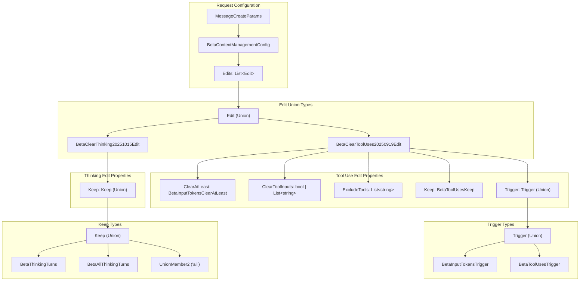
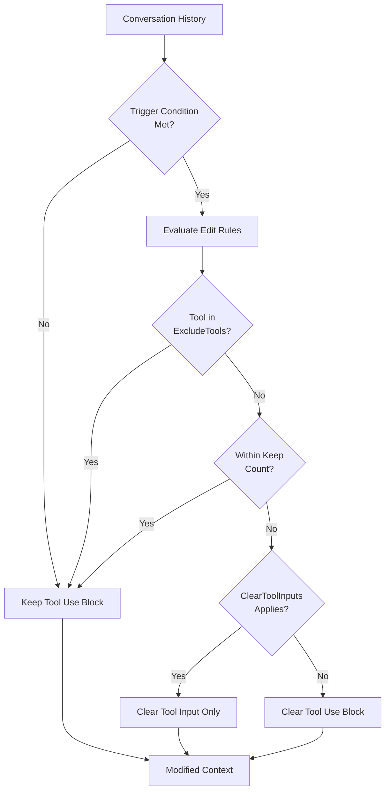
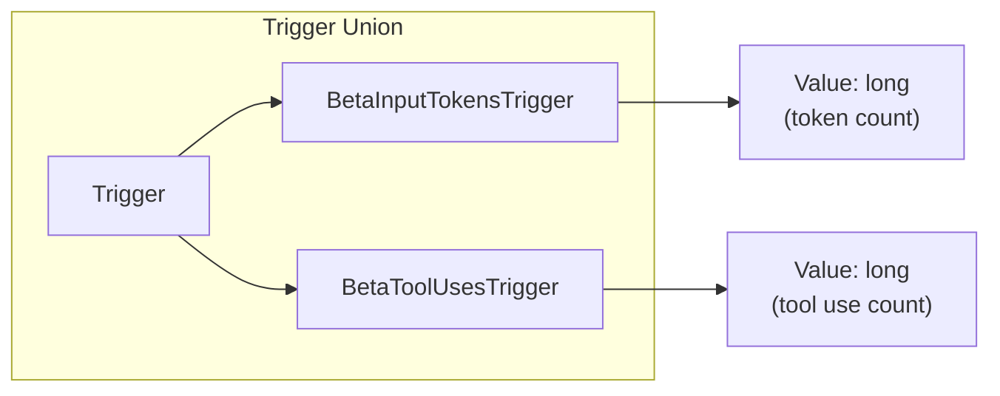
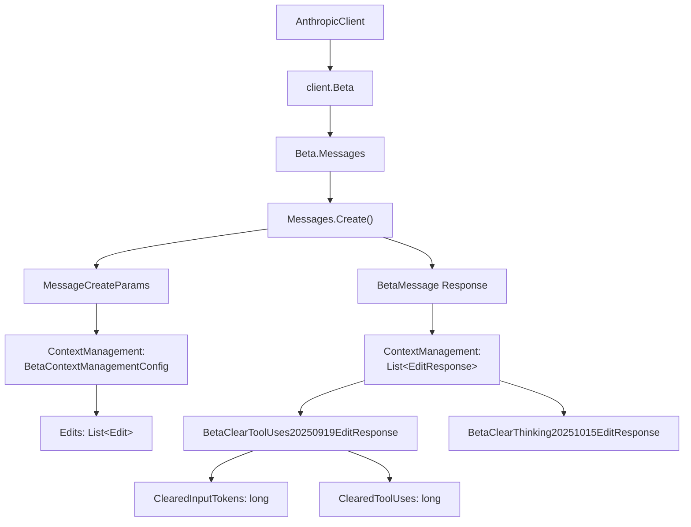
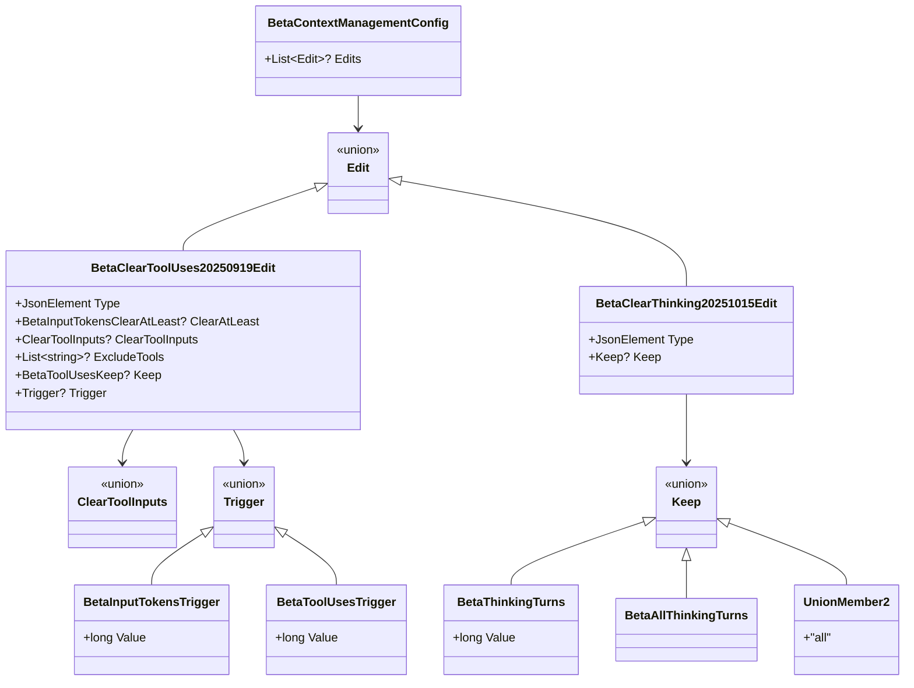

<!-- source: DeepWiki mcp.deepwiki.com · repo anthropics/anthropic-sdk-csharp · page 7.1 Context Management · fetched 2026-10-26 -->

# Context Management

<details>
<summary>Relevant source files</summary>

The following files were used as context for generating this wiki page:

- [src/Anthropic.Tests/Models/Beta/BetaErrorTest.cs](src/Anthropic.Tests/Models/Beta/BetaErrorTest.cs)
- [src/Anthropic.Tests/Models/Beta/Messages/Batches/BatchCreateParamsTest.cs](src/Anthropic.Tests/Models/Beta/Messages/Batches/BatchCreateParamsTest.cs)
- [src/Anthropic.Tests/Models/Beta/Messages/Batches/BetaMessageBatchResultTest.cs](src/Anthropic.Tests/Models/Beta/Messages/Batches/BetaMessageBatchResultTest.cs)
- [src/Anthropic.Tests/Models/Beta/Messages/BetaBashCodeExecutionToolResultBlockParamTest.cs](src/Anthropic.Tests/Models/Beta/Messages/BetaBashCodeExecutionToolResultBlockParamTest.cs)
- [src/Anthropic.Tests/Models/Beta/Messages/BetaBashCodeExecutionToolResultBlockTest.cs](src/Anthropic.Tests/Models/Beta/Messages/BetaBashCodeExecutionToolResultBlockTest.cs)
- [src/Anthropic.Tests/Models/Beta/Messages/BetaCitationsDeltaTest.cs](src/Anthropic.Tests/Models/Beta/Messages/BetaCitationsDeltaTest.cs)
- [src/Anthropic.Tests/Models/Beta/Messages/BetaClearThinking20251015EditTest.cs](src/Anthropic.Tests/Models/Beta/Messages/BetaClearThinking20251015EditTest.cs)
- [src/Anthropic.Tests/Models/Beta/Messages/BetaClearToolUses20250919EditTest.cs](src/Anthropic.Tests/Models/Beta/Messages/BetaClearToolUses20250919EditTest.cs)
- [src/Anthropic.Tests/Models/Beta/Messages/BetaCodeExecutionToolResultBlockContentTest.cs](src/Anthropic.Tests/Models/Beta/Messages/BetaCodeExecutionToolResultBlockContentTest.cs)
- [src/Anthropic.Tests/Models/Beta/Messages/BetaCodeExecutionToolResultBlockParamContentTest.cs](src/Anthropic.Tests/Models/Beta/Messages/BetaCodeExecutionToolResultBlockParamContentTest.cs)
- [src/Anthropic.Tests/Models/Beta/Messages/BetaContentBlockParamTest.cs](src/Anthropic.Tests/Models/Beta/Messages/BetaContentBlockParamTest.cs)
- [src/Anthropic.Tests/Models/Beta/Messages/BetaContextManagementConfigTest.cs](src/Anthropic.Tests/Models/Beta/Messages/BetaContextManagementConfigTest.cs)
- [src/Anthropic.Tests/Models/Beta/Messages/BetaMessageParamTest.cs](src/Anthropic.Tests/Models/Beta/Messages/BetaMessageParamTest.cs)
- [src/Anthropic.Tests/Models/Beta/Messages/BetaServerToolUseBlockParamTest.cs](src/Anthropic.Tests/Models/Beta/Messages/BetaServerToolUseBlockParamTest.cs)
- [src/Anthropic.Tests/Models/Beta/Messages/BetaServerToolUseBlockTest.cs](src/Anthropic.Tests/Models/Beta/Messages/BetaServerToolUseBlockTest.cs)
- [src/Anthropic.Tests/Models/Beta/Messages/MessageCreateParamsTest.cs](src/Anthropic.Tests/Models/Beta/Messages/MessageCreateParamsTest.cs)
- [src/Anthropic.Tests/Models/Messages/Batches/BatchCreateParamsTest.cs](src/Anthropic.Tests/Models/Messages/Batches/BatchCreateParamsTest.cs)
- [src/Anthropic.Tests/Models/Messages/MessageCreateParamsTest.cs](src/Anthropic.Tests/Models/Messages/MessageCreateParamsTest.cs)
- [src/Anthropic.Tests/Models/Messages/MessageParamTest.cs](src/Anthropic.Tests/Models/Messages/MessageParamTest.cs)

</details>


Context management is a beta feature in the Anthropic C# SDK that enables automatic pruning and editing of conversation context to stay within token limits and optimize API performance. This feature allows developers to configure rules for removing tool uses, thinking blocks, and other content from the conversation history based on configurable triggers.

For information about tool execution and tool blocks, see [Tools and Function Calling](#6). For information about thinking and reasoning features, see [Thinking and Reasoning](#7.2).

## Overview

Context management provides automated control over the conversation context sent to Claude by defining edit operations that execute when specific conditions are met. This is particularly useful for long-running conversations where token limits may be exceeded or when certain parts of the conversation history are no longer relevant.

The context management system operates through:
- **Configuration**: `BetaContextManagementConfig` defines the edit rules
- **Edits**: Specific operations like clearing tool uses or thinking blocks
- **Triggers**: Conditions that determine when edits are applied
- **Response Tracking**: Information about what was cleared in the API response

Sources: [src/Anthropic.Tests/Models/Beta/Messages/BetaContextManagementConfigTest.cs:1-175](), [src/Anthropic.Tests/Models/Beta/Messages/Batches/BatchCreateParamsTest.cs:36-49]()

## Context Management Architecture



Sources: [src/Anthropic.Tests/Models/Beta/Messages/BetaContextManagementConfigTest.cs:8-175](), [src/Anthropic.Tests/Models/Beta/Messages/BetaClearToolUses20250919EditTest.cs:1-320](), [src/Anthropic.Tests/Models/Beta/Messages/BetaClearThinking20251015EditTest.cs:1-221]()

## Configuration Structure

### BetaContextManagementConfig

The `BetaContextManagementConfig` class is the top-level configuration object for context management. It contains a list of edit operations that will be applied to the conversation context.

**Properties:**
| Property | Type | Required | Description |
|----------|------|----------|-------------|
| `Edits` | `List<Edit>` | No | List of edit operations to apply to context |

The `Edits` property is optional and nullable. If not set, it will not appear in the serialized JSON. Setting it to `null` explicitly will omit it from the request.

```csharp
// Example configuration with multiple edits
var config = new BetaContextManagementConfig
{
    Edits = [
        new BetaClearToolUses20250919Edit()
        {
            ClearAtLeast = new(0),
            ClearToolInputs = true,
            ExcludeTools = ["important_tool"],
            Keep = new(2),
            Trigger = new BetaInputTokensTrigger(100000)
        },
        new BetaClearThinking20251015Edit()
        {
            Keep = new BetaThinkingTurns(1)
        }
    ]
};
```

Sources: [src/Anthropic.Tests/Models/Beta/Messages/BetaContextManagementConfigTest.cs:8-175]()

### Edit Union Type

The `Edit` union type represents different kinds of context editing operations. Currently supported edit types:

| Edit Type | Purpose | Version Date |
|-----------|---------|--------------|
| `BetaClearToolUses20250919Edit` | Clear tool use blocks from context | 2025-09-19 |
| `BetaClearThinking20251015Edit` | Clear thinking blocks from context | 2025-10-15 |

Sources: [src/Anthropic.Tests/Models/Beta/Messages/BetaContextManagementConfigTest.cs:177-230]()

## Tool Use Clearing

### BetaClearToolUses20250919Edit

The `BetaClearToolUses20250919Edit` class removes tool use blocks and their results from the conversation history to reduce token usage. This is useful when tool executions are no longer relevant to the current conversation context.

**Properties:**

| Property | Type | Required | Description |
|----------|------|----------|-------------|
| `Type` | `JsonElement` | Yes (auto) | Always `"clear_tool_uses_20250919"` |
| `ClearAtLeast` | `BetaInputTokensClearAtLeast?` | No | Minimum number of input tokens to clear |
| `ClearToolInputs` | `ClearToolInputs?` | No | Whether to clear tool inputs (bool or list of tool names) |
| `ExcludeTools` | `List<string>?` | No | Tool names to exclude from clearing |
| `Keep` | `BetaToolUsesKeep?` | No | Number of most recent tool uses to keep |
| `Trigger` | `Trigger?` | No | Condition that triggers this edit |

**ClearToolInputs Union Type:**
- `bool`: If `true`, clear all tool inputs; if `false`, keep all tool inputs
- `List<string>`: List of specific tool names whose inputs should be cleared

**Example Usage:**

```csharp
// Clear tool uses when input tokens exceed 100,000
// Keep the 2 most recent tool uses
// Clear inputs for specific tools
var edit = new BetaClearToolUses20250919Edit
{
    ClearAtLeast = new(5000),          // Clear at least 5000 tokens
    ClearToolInputs = ["data_fetch"],  // Only clear inputs from data_fetch tool
    ExcludeTools = ["critical_tool"],  // Never clear critical_tool
    Keep = new(2),                     // Keep 2 most recent tool uses
    Trigger = new BetaInputTokensTrigger(100000)  // Trigger at 100k input tokens
};
```

Sources: [src/Anthropic.Tests/Models/Beta/Messages/BetaClearToolUses20250919EditTest.cs:1-320](), [src/Anthropic.Tests/Models/Beta/Messages/Batches/BatchCreateParamsTest.cs:36-49]()

### Tool Use Clearing Flow



Sources: [src/Anthropic.Tests/Models/Beta/Messages/BetaClearToolUses20250919EditTest.cs:1-320]()

## Thinking Block Clearing

### BetaClearThinking20251015Edit

The `BetaClearThinking20251015Edit` class removes thinking blocks from the conversation history. Thinking blocks contain Claude's internal reasoning process and can consume significant tokens in long conversations.

**Properties:**

| Property | Type | Required | Description |
|----------|------|----------|-------------|
| `Type` | `JsonElement` | Yes (auto) | Always `"clear_thinking_20251015"` |
| `Keep` | `Keep?` | No | Specifies what thinking content to retain |

**Keep Union Type:**

The `Keep` union determines what thinking blocks to preserve:

| Type | Description | Example |
|------|-------------|---------|
| `BetaThinkingTurns` | Keep the most recent N conversation turns with thinking | `new BetaThinkingTurns(3)` |
| `BetaAllThinkingTurns` | Keep all thinking blocks | `new BetaAllThinkingTurns()` |
| `UnionMember2` ("all") | Keep all thinking content (constant) | `new UnionMember2()` |

**Example Usage:**

```csharp
// Keep only the last thinking turn
var edit = new BetaClearThinking20251015Edit
{
    Keep = new BetaThinkingTurns(1)
};

// Keep all thinking blocks
var keepAllEdit = new BetaClearThinking20251015Edit
{
    Keep = new BetaAllThinkingTurns()
};

// Keep everything using the constant
var keepConstantEdit = new BetaClearThinking20251015Edit
{
    Keep = new UnionMember2()  // "all"
};
```

Sources: [src/Anthropic.Tests/Models/Beta/Messages/BetaClearThinking20251015EditTest.cs:1-221]()

## Triggers

Triggers define the conditions under which context edits are applied. The SDK supports two trigger types through the `Trigger` union type.

### Trigger Types



Sources: [src/Anthropic.Tests/Models/Beta/Messages/BetaClearToolUses20250919EditTest.cs:284-319]()

### BetaInputTokensTrigger

Triggers the edit when the input token count reaches or exceeds the specified value.

```csharp
// Trigger when input tokens reach 100,000
var trigger = new BetaInputTokensTrigger(100000);
```

**Properties:**
- `Value` (`long`): The input token threshold

### BetaToolUsesTrigger

Triggers the edit when the number of tool use blocks reaches or exceeds the specified value.

```csharp
// Trigger when there are 50 or more tool uses in the context
var trigger = new BetaToolUsesTrigger(50);
```

**Properties:**
- `Value` (`long`): The tool use count threshold

Sources: [src/Anthropic.Tests/Models/Beta/Messages/BetaClearToolUses20250919EditTest.cs:284-319]()

## Integration with Messages API

Context management is configured through the `ContextManagement` property on beta message creation parameters.

### Usage in MessageCreateParams



Sources: [src/Anthropic.Tests/Models/Beta/Messages/Batches/BatchCreateParamsTest.cs:36-49](), [src/Anthropic.Tests/Models/Beta/Messages/Batches/BetaMessageBatchResultTest.cs:53-59]()

### Example: Complete Message Creation with Context Management

```csharp
var messageParams = new MessageCreateParams
{
    Model = Model.ClaudeOpus4_5_20251101,
    MaxTokens = 1024,
    Messages = [
        new() { Content = "Hello, world", Role = Role.User }
    ],
    ContextManagement = new BetaContextManagementConfig
    {
        Edits = [
            new BetaClearToolUses20250919Edit
            {
                ClearAtLeast = new(1000),
                ClearToolInputs = true,
                ExcludeTools = ["important_tool"],
                Keep = new(5),
                Trigger = new BetaInputTokensTrigger(80000)
            },
            new BetaClearThinking20251015Edit
            {
                Keep = new BetaThinkingTurns(2)
            }
        ]
    }
};
```

Sources: [src/Anthropic.Tests/Models/Beta/Messages/Batches/BatchCreateParamsTest.cs:18-49]()

### Response Tracking

When context management edits are applied, the API response includes information about what was cleared:

```csharp
// Response includes context management results
// BetaClearToolUses20250919EditResponse
var response = new BetaClearToolUses20250919EditResponse
{
    ClearedInputTokens = 15000,  // Tokens removed
    ClearedToolUses = 10         // Tool use blocks removed
};
```

Sources: [src/Anthropic.Tests/Models/Beta/Messages/Batches/BetaMessageBatchResultTest.cs:55-59]()

## Batch Processing Support

Context management is fully supported in batch processing through the `BetaMessageBatch` API. Each request in a batch can have its own context management configuration.

```csharp
var batchRequest = new Request
{
    CustomID = "my-request-1",
    Params = new Params
    {
        MaxTokens = 1024,
        Messages = [new() { Content = "Hello", Role = Role.User }],
        Model = Model.ClaudeOpus4_5_20251101,
        ContextManagement = new BetaContextManagementConfig
        {
            Edits = [
                new BetaClearToolUses20250919Edit
                {
                    Keep = new(3),
                    Trigger = new BetaInputTokensTrigger(50000)
                }
            ]
        }
    }
};
```

Sources: [src/Anthropic.Tests/Models/Beta/Messages/Batches/BatchCreateParamsTest.cs:14-127]()

## Type Hierarchy Reference



Sources: [src/Anthropic.Tests/Models/Beta/Messages/BetaContextManagementConfigTest.cs:1-175](), [src/Anthropic.Tests/Models/Beta/Messages/BetaClearToolUses20250919EditTest.cs:1-320](), [src/Anthropic.Tests/Models/Beta/Messages/BetaClearThinking20251015EditTest.cs:1-221]()

## Serialization Behavior

Context management types follow the SDK's standard serialization patterns:

### Optional Property Handling

Optional properties have specific serialization behaviors:

**Optional Non-Nullable Properties:**
- When unset: Property does not appear in serialized JSON
- When set to `null`: Property does not appear in serialized JSON
- Example: `Edits`, `Trigger`, `Keep`

**Optional Nullable Properties:**
- When unset: Property does not appear in serialized JSON  
- When set to `null`: Property appears in JSON as `null`
- Example: `ClearAtLeast`, `ClearToolInputs`, `ExcludeTools`

```csharp
// Property not set - not in JSON
var config1 = new BetaContextManagementConfig { };
// JSON: {}

// Property explicitly null - not in JSON (optional non-nullable)
var config2 = new BetaContextManagementConfig { Edits = null };
// JSON: {}

// Property explicitly null - appears as null (optional nullable)
var edit = new BetaClearToolUses20250919Edit 
{ 
    Trigger = new BetaInputTokensTrigger(1000),
    ClearAtLeast = null  // Appears as "clear_at_least": null
};
```

Sources: [src/Anthropic.Tests/Models/Beta/Messages/BetaContextManagementConfigTest.cs:135-174](), [src/Anthropic.Tests/Models/Beta/Messages/BetaClearToolUses20250919EditTest.cs:114-244]()

---

