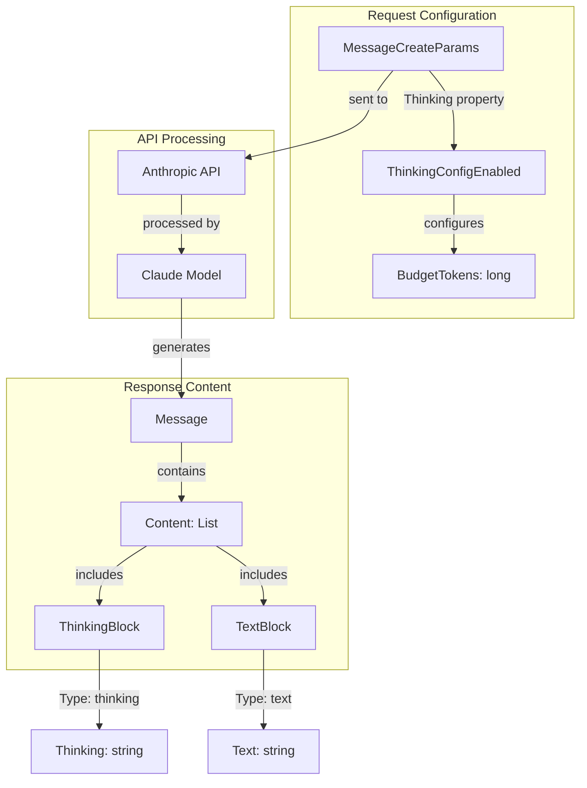
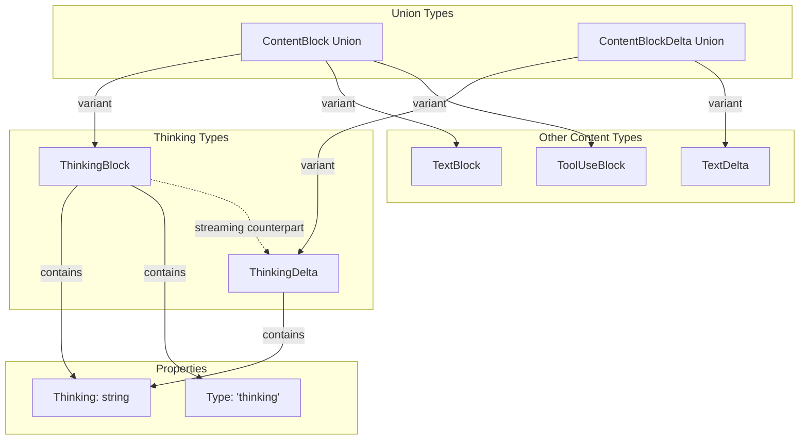
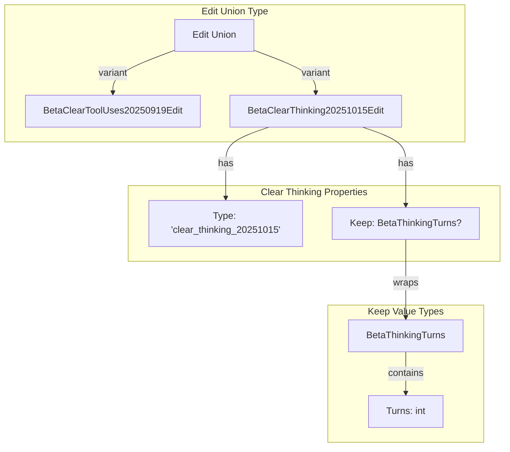

<!-- source: DeepWiki mcp.deepwiki.com · repo anthropics/anthropic-sdk-csharp · page 7.2 Thinking and Reasoning · fetched 2026-10-26 -->

# Thinking and Reasoning

<details>
<summary>Relevant source files</summary>

The following files were used as context for generating this wiki page:

- [examples/MessagesExample/MessagesExample.csproj](examples/MessagesExample/MessagesExample.csproj)
- [examples/MessagesExample/Program.cs](examples/MessagesExample/Program.cs)
- [examples/MessagesStreamingExample/MessagesStreamingExample.csproj](examples/MessagesStreamingExample/MessagesStreamingExample.csproj)
- [examples/MessagesStreamingExample/Program.cs](examples/MessagesStreamingExample/Program.cs)
- [examples/ThinkingExample/Program.cs](examples/ThinkingExample/Program.cs)
- [examples/ThinkingExample/ThinkingExample.csproj](examples/ThinkingExample/ThinkingExample.csproj)
- [examples/ThinkingStreamingExample/Program.cs](examples/ThinkingStreamingExample/Program.cs)
- [examples/ThinkingStreamingExample/ThinkingStreamingExample.csproj](examples/ThinkingStreamingExample/ThinkingStreamingExample.csproj)
- [src/Anthropic.Tests/Models/Beta/BetaErrorTest.cs](src/Anthropic.Tests/Models/Beta/BetaErrorTest.cs)
- [src/Anthropic.Tests/Models/Beta/Messages/Batches/BetaMessageBatchResultTest.cs](src/Anthropic.Tests/Models/Beta/Messages/Batches/BetaMessageBatchResultTest.cs)
- [src/Anthropic.Tests/Models/Beta/Messages/BetaBashCodeExecutionToolResultBlockParamTest.cs](src/Anthropic.Tests/Models/Beta/Messages/BetaBashCodeExecutionToolResultBlockParamTest.cs)
- [src/Anthropic.Tests/Models/Beta/Messages/BetaBashCodeExecutionToolResultBlockTest.cs](src/Anthropic.Tests/Models/Beta/Messages/BetaBashCodeExecutionToolResultBlockTest.cs)
- [src/Anthropic.Tests/Models/Beta/Messages/BetaCitationsDeltaTest.cs](src/Anthropic.Tests/Models/Beta/Messages/BetaCitationsDeltaTest.cs)
- [src/Anthropic.Tests/Models/Beta/Messages/BetaClearToolUses20250919EditTest.cs](src/Anthropic.Tests/Models/Beta/Messages/BetaClearToolUses20250919EditTest.cs)
- [src/Anthropic.Tests/Models/Beta/Messages/BetaCodeExecutionToolResultBlockContentTest.cs](src/Anthropic.Tests/Models/Beta/Messages/BetaCodeExecutionToolResultBlockContentTest.cs)
- [src/Anthropic.Tests/Models/Beta/Messages/BetaCodeExecutionToolResultBlockParamContentTest.cs](src/Anthropic.Tests/Models/Beta/Messages/BetaCodeExecutionToolResultBlockParamContentTest.cs)
- [src/Anthropic.Tests/Models/Beta/Messages/BetaContentBlockParamTest.cs](src/Anthropic.Tests/Models/Beta/Messages/BetaContentBlockParamTest.cs)
- [src/Anthropic.Tests/Models/Beta/Messages/BetaContextManagementConfigTest.cs](src/Anthropic.Tests/Models/Beta/Messages/BetaContextManagementConfigTest.cs)

</details>


This page documents the thinking and reasoning feature, which allows Claude to expose its internal reasoning process before generating final responses. This feature enables the model to "think out loud" about complex problems, showing its step-by-step reasoning in dedicated content blocks.

For information about clearing thinking blocks in conversation history, see [Context Management](#7.1). For details on content block types in general, see [Content Blocks](#5.3).

## Overview

The thinking feature provides access to Claude's chain-of-thought reasoning. When enabled, the model generates `ThinkingBlock` content that contains its reasoning process before producing the final text response. This is particularly useful for:

- Understanding how the model arrived at its answer
- Debugging unexpected model behavior  
- Improving transparency in decision-making processes
- Enabling more complex reasoning tasks

The thinking feature is available in both standard and beta APIs, with additional context management capabilities in beta.

**Sources:** [examples/ThinkingExample/Program.cs:1-38](), [examples/ThinkingStreamingExample/Program.cs:1-36]()

## Configuration

### Enabling Thinking

Thinking is enabled via the `Thinking` property in `MessageCreateParams` using the `ThinkingConfigEnabled` class:

```csharp
var parameters = new MessageCreateParams
{
    MaxTokens = 2048,
    Messages = [new() { Content = "Explain quantum computing", Role = Role.User }],
    Model = Model.Claude4Sonnet20250514,
    Thinking = new ThinkingConfigEnabled() { BudgetTokens = 1024 }
};
```

### Configuration Properties

| Property | Type | Description | Required |
|----------|------|-------------|----------|
| `BudgetTokens` | `long` | Maximum tokens allocated for thinking content | Yes |

The `BudgetTokens` value controls how much reasoning the model can generate. Higher values allow more detailed reasoning but consume more tokens from the overall response budget.

**Sources:** [examples/ThinkingExample/Program.cs:7-16](), [examples/ThinkingStreamingExample/Program.cs:7-16](), [src/Anthropic.Tests/Models/Messages/Batches/BatchCreateParamsTest.cs:48]()

## Thinking Content Flow

The following diagram shows how thinking configuration flows through the request-response cycle:



**Sources:** [examples/ThinkingExample/Program.cs:7-30]()

## Response Handling

### Non-Streaming Responses

In non-streaming mode, thinking content appears as `ThinkingBlock` instances in the `Message.Content` collection:

```csharp
var response = await client.Messages.Create(parameters);

foreach (ContentBlock block in response.Content)
{
    if (block.TryPickThinking(out ThinkingBlock? thinking))
    {
        Console.WriteLine($"Thinking: {thinking.Thinking}");
    }
    else if (block.TryPickText(out TextBlock? text))
    {
        Console.WriteLine($"Text: {text.Text}");
    }
}
```

The `ThinkingBlock` class contains:
- `Thinking` (string): The model's reasoning text
- `Type` (string): Always set to "thinking"

**Sources:** [examples/ThinkingExample/Program.cs:18-30]()

### Streaming Responses

In streaming mode, thinking content is delivered incrementally through `ThinkingDelta` events:

```csharp
IAsyncEnumerable<RawMessageStreamEvent> responseUpdates = 
    client.Messages.CreateStreaming(parameters);

await foreach (RawMessageStreamEvent rawEvent in responseUpdates)
{
    if (rawEvent.TryPickContentBlockDelta(out var delta))
    {
        if (delta.Delta.TryPickThinking(out var thinkingDelta))
        {
            Console.Write(thinkingDelta.Thinking);
        }
        else if (delta.Delta.TryPickText(out var textDelta))
        {
            Console.Write(textDelta.Text);
        }
    }
}
```

**Sources:** [examples/ThinkingStreamingExample/Program.cs:18-35]()

## Content Block Type Hierarchy

The following diagram shows how thinking blocks fit into the content type system:



**Sources:** [examples/ThinkingExample/Program.cs:20-29](), [examples/ThinkingStreamingExample/Program.cs:22-34]()

## Beta Features

### Clear Thinking Edit

The beta API provides `BetaClearThinking20251015Edit` for managing thinking history in multi-turn conversations through the context management system.

#### BetaClearThinking20251015Edit Class

| Property | Type | Description | Required |
|----------|------|-------------|----------|
| `Type` | `string` | Always "clear_thinking_20251015" | Auto-set |
| `Keep` | `BetaThinkingTurns?` | Number of thinking turns to retain | Optional |

#### Keep Property

The `Keep` property uses the `BetaThinkingTurns` wrapper type to specify how many recent thinking turns to preserve:

```csharp
var edit = new BetaClearThinking20251015Edit 
{ 
    Keep = new BetaThinkingTurns(1) 
};
```

When `Keep` is omitted or set to null, all thinking history is cleared.

**Sources:** [src/Anthropic.Tests/Models/Beta/Messages/BetaContextManagementConfigTest.cs:196-229]()

### Context Management Integration

Thinking edits are configured through `BetaContextManagementConfig`:

```csharp
var contextManagement = new BetaContextManagementConfig
{
    Edits = 
    [
        new BetaClearThinking20251015Edit 
        { 
            Keep = new BetaThinkingTurns(1) 
        }
    ]
};

var parameters = new BetaMessageCreateParams
{
    MaxTokens = 2048,
    Messages = [...],
    Model = Model.Claude4Sonnet20250514,
    ContextManagement = contextManagement,
    Thinking = new BetaThinkingConfigEnabled(1024)
};
```

**Sources:** [src/Anthropic.Tests/Models/Beta/Messages/BetaContextManagementConfigTest.cs:9-132]()

## Union Type Structure

The `Edit` union type supports multiple edit operations including thinking management:



**Sources:** [src/Anthropic.Tests/Models/Beta/Messages/BetaContextManagementConfigTest.cs:177-230]()

## Standard vs Beta API Comparison

| Feature | Standard API | Beta API |
|---------|--------------|----------|
| Thinking Configuration | `ThinkingConfigEnabled` | `BetaThinkingConfigEnabled` |
| Content Block Type | `ThinkingBlock` | `BetaThinkingBlock` |
| Context Management | Not available | `BetaClearThinking20251015Edit` |
| History Control | Not available | `Keep` property for selective retention |
| Namespace | `Anthropic.Models.Messages` | `Anthropic.Models.Beta.Messages` |

The beta API provides additional capabilities for managing thinking blocks in conversation history, particularly useful for long-running multi-turn interactions where selective history retention is needed.

**Sources:** [src/Anthropic.Tests/Models/Messages/Batches/BatchCreateParamsTest.cs:48](), [src/Anthropic.Tests/Models/Beta/Messages/Batches/BatchCreateParamsTest.cs:93]()

## Token Budget Considerations

The `BudgetTokens` value in `ThinkingConfigEnabled` allocates tokens specifically for thinking content. This budget is separate from but counted toward the `MaxTokens` limit:

- **Total Response Tokens** = Thinking Tokens + Text Tokens
- **Thinking Budget** ≤ BudgetTokens
- **Total Tokens** ≤ MaxTokens

If the model's reasoning requires more tokens than allocated in `BudgetTokens`, the thinking content will be truncated. Setting `BudgetTokens` too high may leave insufficient tokens for the final response text.

**Sources:** [examples/ThinkingExample/Program.cs:9](), [examples/ThinkingStreamingExample/Program.cs:9]()

## Validation and Serialization

The thinking configuration classes inherit from `ModelBase` and support:

- JSON serialization/deserialization roundtripping
- Validation via `Validate()` method
- Optional property handling (null vs omitted)
- Type-safe discriminated unions

Test coverage ensures proper behavior for:
- Field roundtrip through serialization
- Optional nullable properties (set vs unset)
- Optional non-nullable properties (null interpretation)
- Union type discrimination

**Sources:** [src/Anthropic.Tests/Models/Beta/Messages/BetaContextManagementConfigTest.cs:44-174](), [src/Anthropic.Tests/Models/Messages/Batches/BatchCreateParamsTest.cs:135-391]()

---

