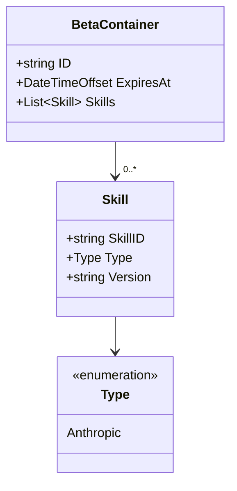
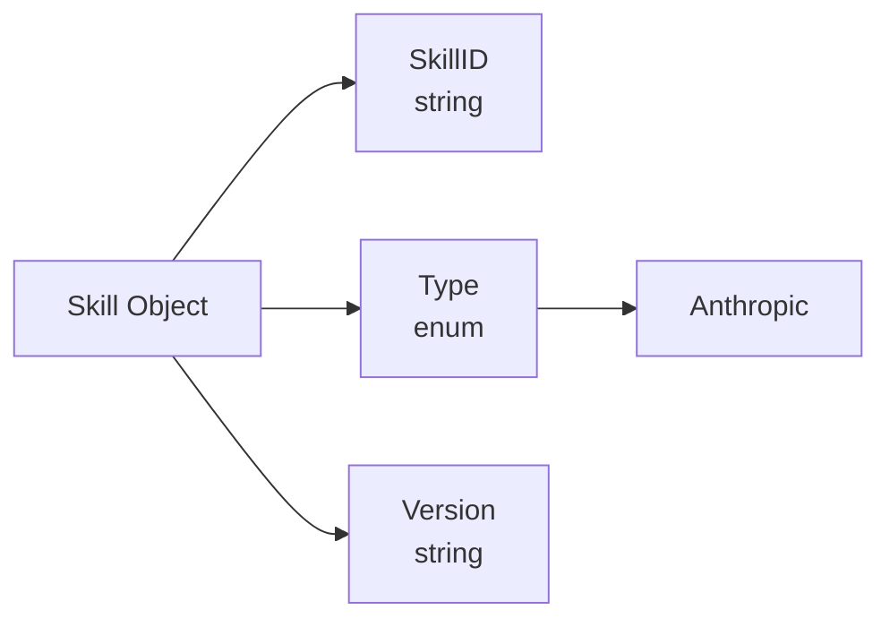
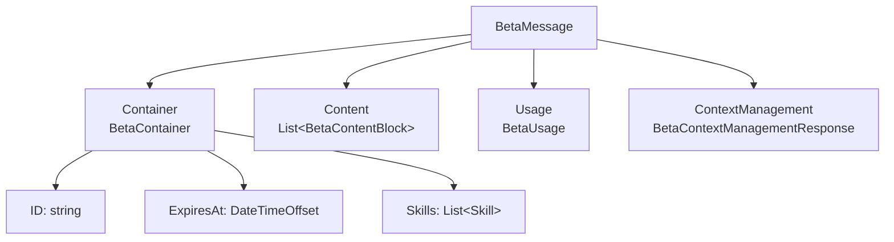
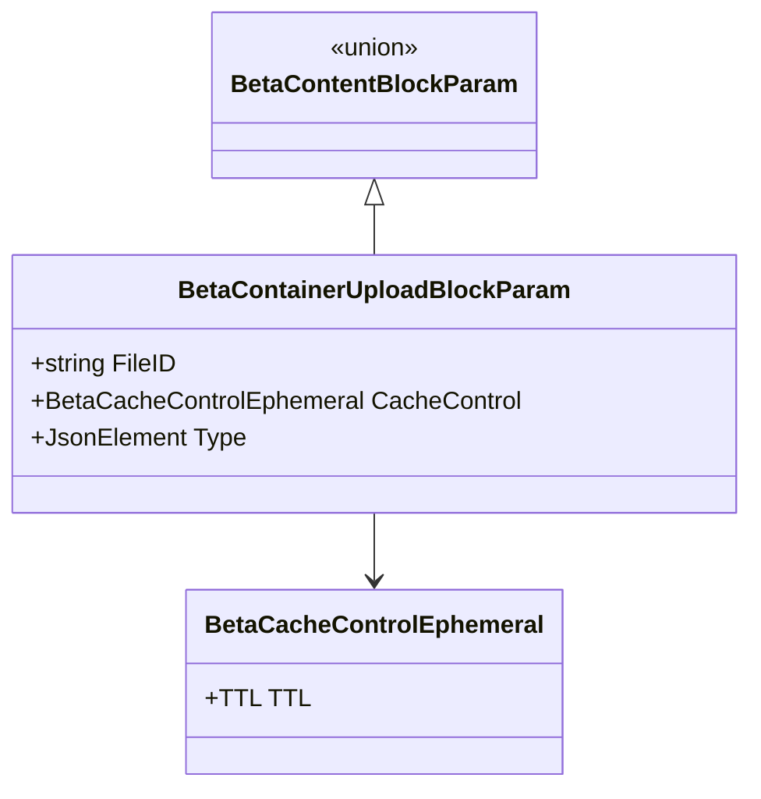
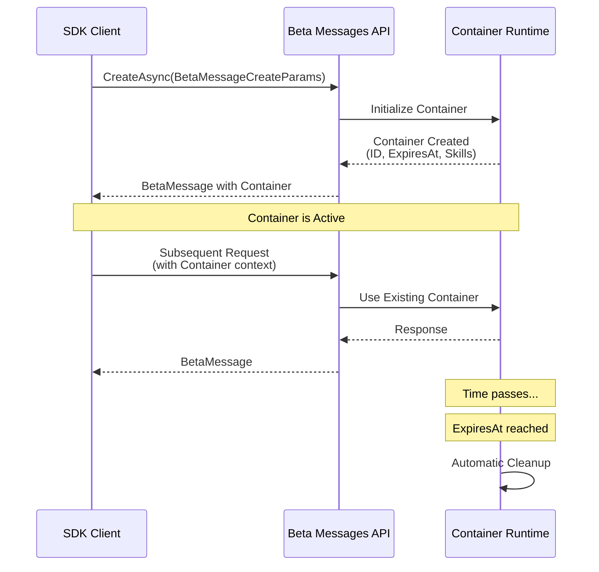
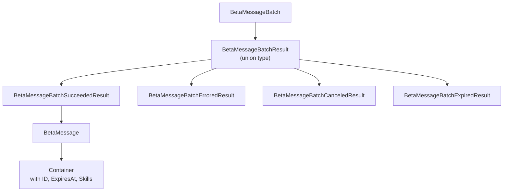
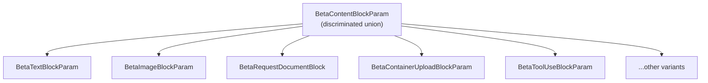

<!-- source: DeepWiki mcp.deepwiki.com · repo anthropics/anthropic-sdk-csharp · page 7.3 Container System · fetched 2026-10-26 -->

# Container System

<details>
<summary>Relevant source files</summary>

The following files were used as context for generating this wiki page:

- [src/Anthropic.Tests/Models/Beta/BetaErrorTest.cs](src/Anthropic.Tests/Models/Beta/BetaErrorTest.cs)
- [src/Anthropic.Tests/Models/Beta/Messages/Batches/BetaMessageBatchResultTest.cs](src/Anthropic.Tests/Models/Beta/Messages/Batches/BetaMessageBatchResultTest.cs)
- [src/Anthropic.Tests/Models/Beta/Messages/BetaBashCodeExecutionToolResultBlockParamTest.cs](src/Anthropic.Tests/Models/Beta/Messages/BetaBashCodeExecutionToolResultBlockParamTest.cs)
- [src/Anthropic.Tests/Models/Beta/Messages/BetaBashCodeExecutionToolResultBlockTest.cs](src/Anthropic.Tests/Models/Beta/Messages/BetaBashCodeExecutionToolResultBlockTest.cs)
- [src/Anthropic.Tests/Models/Beta/Messages/BetaCitationsDeltaTest.cs](src/Anthropic.Tests/Models/Beta/Messages/BetaCitationsDeltaTest.cs)
- [src/Anthropic.Tests/Models/Beta/Messages/BetaClearToolUses20250919EditTest.cs](src/Anthropic.Tests/Models/Beta/Messages/BetaClearToolUses20250919EditTest.cs)
- [src/Anthropic.Tests/Models/Beta/Messages/BetaCodeExecutionToolResultBlockContentTest.cs](src/Anthropic.Tests/Models/Beta/Messages/BetaCodeExecutionToolResultBlockContentTest.cs)
- [src/Anthropic.Tests/Models/Beta/Messages/BetaCodeExecutionToolResultBlockParamContentTest.cs](src/Anthropic.Tests/Models/Beta/Messages/BetaCodeExecutionToolResultBlockParamContentTest.cs)
- [src/Anthropic.Tests/Models/Beta/Messages/BetaContentBlockParamTest.cs](src/Anthropic.Tests/Models/Beta/Messages/BetaContentBlockParamTest.cs)
- [src/Anthropic.Tests/Models/Beta/Messages/BetaContextManagementConfigTest.cs](src/Anthropic.Tests/Models/Beta/Messages/BetaContextManagementConfigTest.cs)
- [src/Anthropic.Tests/Models/Beta/Messages/BetaMessageTest.cs](src/Anthropic.Tests/Models/Beta/Messages/BetaMessageTest.cs)
- [src/Anthropic.Tests/Models/Messages/MessageTest.cs](src/Anthropic.Tests/Models/Messages/MessageTest.cs)

</details>


## Purpose and Scope

This document explains the Container System in the Anthropic C# SDK's beta features. The Container System provides isolated execution environments with versioned skills that can be attached to beta messages. This page covers `BetaContainer` structure, skill management, container lifecycle, and integration with the beta messaging API.

For information about context management and token pruning, see [Context Management](#7.1). For cache control features, see [Cache Control](#7.4).

---

## Overview

The Container System is a beta feature that enables stateful, long-lived execution contexts for AI interactions. Containers encapsulate a set of versioned skills and maintain their own lifecycle with expiration timestamps. They are exclusively available through the beta API and appear in `BetaMessage` responses.

**Key Concepts:**
- **Container**: An isolated environment with a unique ID, expiration time, and associated skills
- **Skills**: Versioned capabilities (e.g., "Anthropic" type skills) that define what operations the container can perform
- **Container Uploads**: Content blocks for uploading files into a container's context
- **Expiration**: Automatic cleanup after a defined time period

---

## BetaContainer Structure

### Core Components

The `BetaContainer` class represents a container instance returned in beta message responses.



**Sources:**
- [src/Anthropic.Tests/Models/Beta/Messages/BetaMessageTest.cs:18-31]()

### Properties

| Property | Type | Description |
|----------|------|-------------|
| `ID` | `string` | Unique identifier for the container (e.g., "container_xyz") |
| `ExpiresAt` | `DateTimeOffset` | Timestamp when the container will be automatically cleaned up |
| `Skills` | `List<Skill>` | Array of skills available within this container |

### Example Structure

```csharp
var container = new BetaContainer
{
    ID = "container_abc123",
    ExpiresAt = DateTimeOffset.Parse("2019-12-27T18:11:19.117Z"),
    Skills = 
    [
        new()
        {
            SkillID = "skill_001",
            Type = Messages.Type.Anthropic,
            Version = "1.0.0"
        }
    ]
};
```

**Sources:**
- [src/Anthropic.Tests/Models/Beta/Messages/BetaMessageTest.cs:18-31]()
- [src/Anthropic.Tests/Models/Beta/Messages/BetaMessageTest.cs:287-300]()

---

## Skills System

### Skill Definition

Each skill within a container represents a versioned capability. Skills are identified by three components:



**Sources:**
- [src/Anthropic.Tests/Models/Beta/Messages/BetaMessageTest.cs:22-30]()

### Skill Properties

| Property | Type | Description |
|----------|------|-------------|
| `SkillID` | `string` | Unique identifier for this skill instance |
| `Type` | `Type` enum | The skill type (currently supports `Anthropic`) |
| `Version` | `string` | Version string for the skill implementation |

### Skill Types

The `Type` enumeration defines skill categories. Currently documented:
- **`Anthropic`**: Anthropic-provided skills

**Sources:**
- [src/Anthropic.Tests/Models/Beta/Messages/BetaMessageTest.cs:27]()
- [src/Anthropic.Tests/Models/Beta/Messages/Batches/BetaMessageBatchResultTest.cs:29]()

### Multiple Skills

Containers can have multiple skills simultaneously. Each skill is independently versioned:

```csharp
Skills = 
[
    new() { SkillID = "skill_001", Type = Type.Anthropic, Version = "1.0.0" },
    new() { SkillID = "skill_002", Type = Type.Anthropic, Version = "2.1.0" }
]
```

**Sources:**
- [src/Anthropic.Tests/Models/Beta/Messages/BetaMessageTest.cs:22-30]()

---

## Container Integration with BetaMessage

### Message Response Structure

Containers appear in `BetaMessage` responses, providing context about the execution environment used:



**Sources:**
- [src/Anthropic.Tests/Models/Beta/Messages/BetaMessageTest.cs:15-73]()

### Accessing Container Information

```csharp
// From a beta message response
BetaMessage message = await client.Beta.Messages.CreateAsync(params);

if (message.Container != null)
{
    string containerId = message.Container.ID;
    DateTimeOffset expiration = message.Container.ExpiresAt;
    
    foreach (var skill in message.Container.Skills)
    {
        Console.WriteLine($"Skill: {skill.SkillID} v{skill.Version}");
    }
}
```

**Sources:**
- [src/Anthropic.Tests/Models/Beta/Messages/BetaMessageTest.cs:134-147]()
- [src/Anthropic.Tests/Models/Beta/Messages/BetaMessageTest.cs:345-358]()

---

## Container Uploads

### BetaContainerUploadBlockParam

The `BetaContainerUploadBlockParam` content block type enables uploading files into a container's context.



**Sources:**
- [src/Anthropic.Tests/Models/Beta/Messages/BetaContentBlockParamTest.cs:311-321]()

### Upload Properties

| Property | Type | Required | Description |
|----------|------|----------|-------------|
| `FileID` | `string` | Yes | ID of the file to upload into the container |
| `CacheControl` | `BetaCacheControlEphemeral` | No | Cache control settings for the uploaded content |
| `Type` | `JsonElement` | Auto | Always `"container_upload"` |

### Usage Example

```csharp
var uploadBlock = new BetaContainerUploadBlockParam
{
    FileID = "file_xyz789",
    CacheControl = new() { TTL = TTL.TTL5m }
};

// Include in message parameters
var messageParams = new BetaMessageCreateParams
{
    Messages = 
    [
        new()
        {
            Role = "user",
            Content = new BetaContentBlockParam(uploadBlock)
        }
    ],
    // ... other parameters
};
```

**Sources:**
- [src/Anthropic.Tests/Models/Beta/Messages/BetaContentBlockParamTest.cs:313-320]()
- [src/Anthropic.Tests/Models/Beta/Messages/BetaContentBlockParamTest.cs:676-689]()

---

## Container Lifecycle

### Creation and Expiration Flow



**Sources:**
- [src/Anthropic.Tests/Models/Beta/Messages/BetaMessageTest.cs:18-31]()

### Expiration Handling

Containers have a defined lifetime specified by the `ExpiresAt` timestamp:

```csharp
// Check container expiration
if (message.Container != null)
{
    TimeSpan timeUntilExpiration = message.Container.ExpiresAt - DateTimeOffset.UtcNow;
    
    if (timeUntilExpiration.TotalMinutes < 5)
    {
        Console.WriteLine("Container will expire soon");
    }
}
```

**Important Considerations:**
- Containers automatically clean up at expiration time
- Expired containers cannot be reused
- Plan multi-turn interactions within the container's lifetime

**Sources:**
- [src/Anthropic.Tests/Models/Beta/Messages/BetaMessageTest.cs:21]()
- [src/Anthropic.Tests/Models/Beta/Messages/BetaMessageTest.cs:79]()

---

## Serialization and Validation

### Roundtrip Serialization

The container system fully supports JSON serialization and deserialization:

```csharp
// Serialize
string json = JsonSerializer.Serialize(message);

// Deserialize
var deserialized = JsonSerializer.Deserialize<BetaMessage>(json);

// Container is preserved
Assert.Equal(message.Container, deserialized.Container);
```

**Sources:**
- [src/Anthropic.Tests/Models/Beta/Messages/BetaMessageTest.cs:150-217]()

### Validation

Containers undergo validation to ensure data integrity:

```csharp
var container = new BetaContainer
{
    ID = "container_abc",
    ExpiresAt = DateTimeOffset.UtcNow.AddHours(24),
    Skills = 
    [
        new() 
        { 
            SkillID = "skill_001", 
            Type = Type.Anthropic, 
            Version = "1.0.0" 
        }
    ]
};

// Validate structure
container.Validate(); // Throws if invalid
```

**Sources:**
- [src/Anthropic.Tests/Models/Beta/Messages/BetaMessageTest.cs:362-425]()

---

## Batch Processing Support

Containers are supported in batch processing operations through `BetaMessageBatchResult`:



**Sources:**
- [src/Anthropic.Tests/Models/Beta/Messages/Batches/BetaMessageBatchResultTest.cs:13-83]()
- [src/Anthropic.Tests/Models/Beta/Messages/Batches/BetaMessageBatchResultTest.cs:115-188]()

### Batch Result Structure

When batch operations succeed, the resulting `BetaMessage` includes full container information:

```csharp
BetaMessageBatchResult result = // ... from batch processing

if (result.Succeeded != null)
{
    BetaMessage message = result.Succeeded.Message;
    
    if (message.Container != null)
    {
        string containerId = message.Container.ID;
        // Container persists across batch operations
    }
}
```

**Sources:**
- [src/Anthropic.Tests/Models/Beta/Messages/Batches/BetaMessageBatchResultTest.cs:17-82]()
- [src/Anthropic.Tests/Models/Beta/Messages/Batches/BetaMessageBatchResultTest.cs:118-183]()

---

## Integration Points

### Related Beta Features

The Container System integrates with other beta features:

| Feature | Relationship | Page Reference |
|---------|-------------|----------------|
| Context Management | Containers maintain context across edits | [Context Management](#7.1) |
| Thinking | Containers can cache thinking state | [Thinking and Reasoning](#7.2) |
| Cache Control | Container uploads support cache control | [Cache Control](#7.4) |
| Skills Service | Manages skill versions and availability | [Beta Services](#4.4) |

**Sources:**
- [src/Anthropic.Tests/Models/Beta/Messages/BetaMessageTest.cs:51-60]()
- [src/Anthropic.Tests/Models/Beta/Messages/BetaContentBlockParamTest.cs:311-321]()

### Content Block Union Type

`BetaContainerUploadBlockParam` is one variant in the `BetaContentBlockParam` union:



**Sources:**
- [src/Anthropic.Tests/Models/Beta/Messages/BetaContentBlockParamTest.cs:8-690]()
- [src/Anthropic.Tests/Models/Beta/Messages/BetaContentBlockParamTest.cs:311-321]()

---

## Summary

The Container System provides:
- **Isolation**: Separate execution environments with unique IDs
- **Skills Management**: Versioned capabilities attached to containers
- **Lifecycle Control**: Automatic expiration and cleanup
- **Upload Support**: File integration via `BetaContainerUploadBlockParam`
- **Batch Compatibility**: Full support in batch processing workflows

Containers are returned in `BetaMessage` responses and enable stateful, multi-turn interactions with well-defined lifecycles. They integrate seamlessly with other beta features including context management, caching, and the skills service.

**Key Implementation Files:**
- Container models: Located in `Anthropic.Models.Beta.Messages` namespace
- Union types: `BetaContentBlockParam` for upload blocks
- Response types: `BetaMessage.Container` property

**Sources:**
- [src/Anthropic.Tests/Models/Beta/Messages/BetaMessageTest.cs:1-427]()
- [src/Anthropic.Tests/Models/Beta/Messages/BetaContentBlockParamTest.cs:1-690]()
- [src/Anthropic.Tests/Models/Beta/Messages/Batches/BetaMessageBatchResultTest.cs:1-228]()

---

