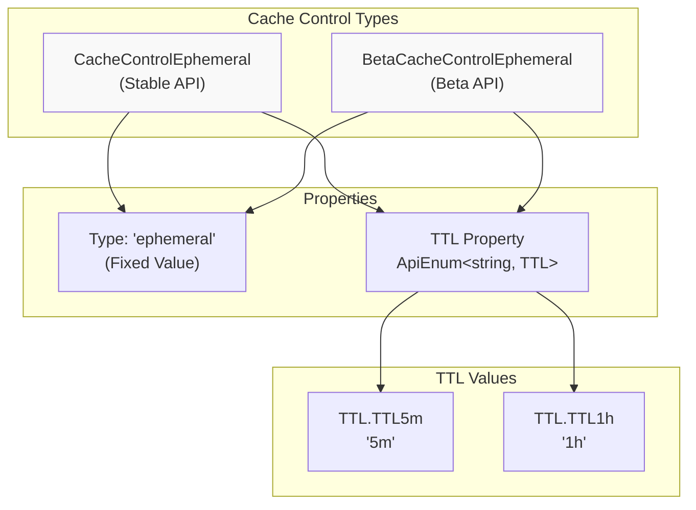
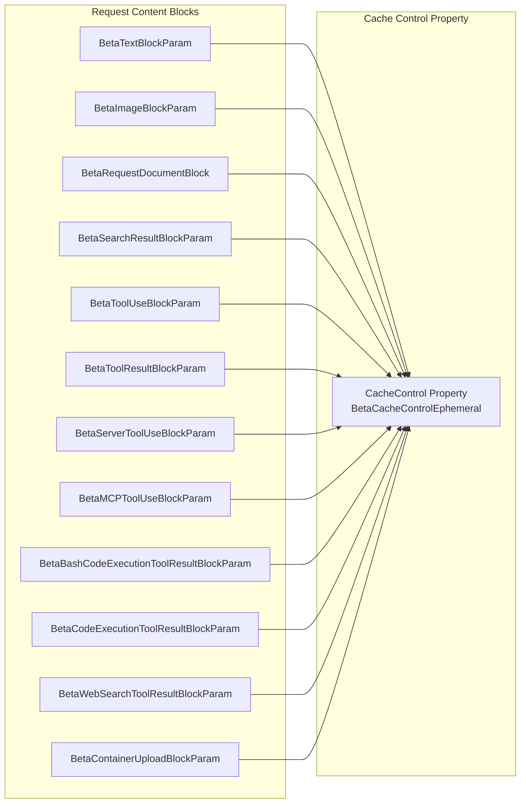
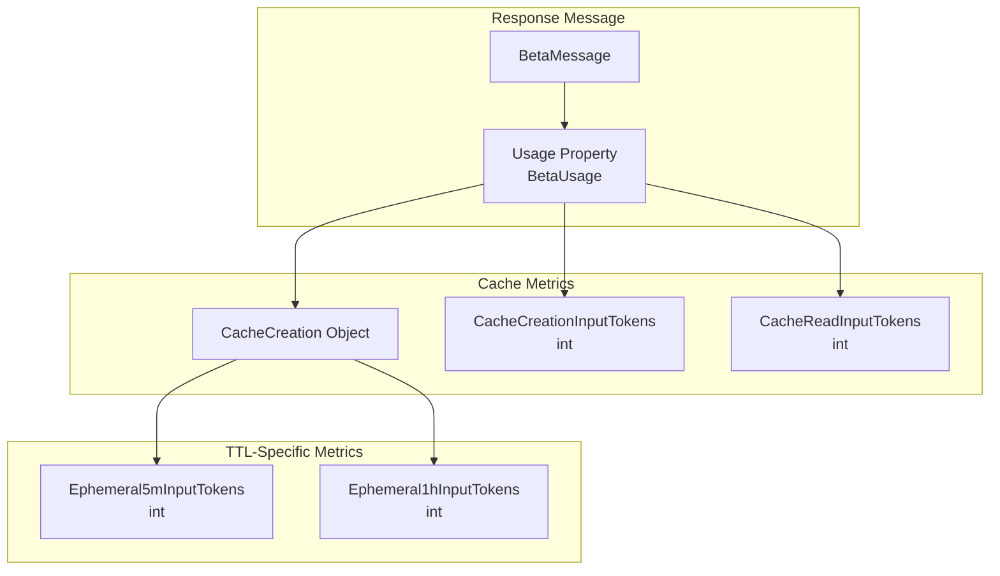
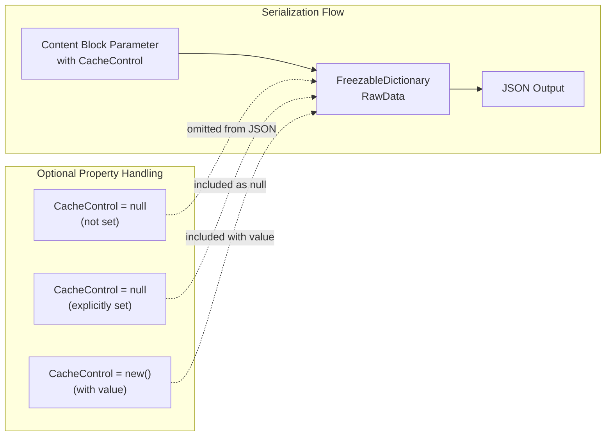

<!-- source: DeepWiki mcp.deepwiki.com · repo anthropics/anthropic-sdk-csharp · page 7.4 Cache Control · fetched 2026-10-26 -->

# Cache Control

<details>
<summary>Relevant source files</summary>

The following files were used as context for generating this wiki page:

- [.csharpierignore](.csharpierignore)
- [src/Anthropic.Tests/Anthropic.Tests.csproj](src/Anthropic.Tests/Anthropic.Tests.csproj)
- [src/Anthropic.Tests/Models/Beta/AnthropicBetaTest.cs](src/Anthropic.Tests/Models/Beta/AnthropicBetaTest.cs)
- [src/Anthropic.Tests/Models/Beta/BetaErrorTest.cs](src/Anthropic.Tests/Models/Beta/BetaErrorTest.cs)
- [src/Anthropic.Tests/Models/Beta/Files/DeletedFileTest.cs](src/Anthropic.Tests/Models/Beta/Files/DeletedFileTest.cs)
- [src/Anthropic.Tests/Models/Beta/Messages/Batches/BetaMessageBatchResultTest.cs](src/Anthropic.Tests/Models/Beta/Messages/Batches/BetaMessageBatchResultTest.cs)
- [src/Anthropic.Tests/Models/Beta/Messages/Batches/BetaMessageBatchTest.cs](src/Anthropic.Tests/Models/Beta/Messages/Batches/BetaMessageBatchTest.cs)
- [src/Anthropic.Tests/Models/Beta/Messages/BetaBase64ImageSourceTest.cs](src/Anthropic.Tests/Models/Beta/Messages/BetaBase64ImageSourceTest.cs)
- [src/Anthropic.Tests/Models/Beta/Messages/BetaBashCodeExecutionToolResultBlockParamTest.cs](src/Anthropic.Tests/Models/Beta/Messages/BetaBashCodeExecutionToolResultBlockParamTest.cs)
- [src/Anthropic.Tests/Models/Beta/Messages/BetaBashCodeExecutionToolResultBlockTest.cs](src/Anthropic.Tests/Models/Beta/Messages/BetaBashCodeExecutionToolResultBlockTest.cs)
- [src/Anthropic.Tests/Models/Beta/Messages/BetaBashCodeExecutionToolResultErrorParamTest.cs](src/Anthropic.Tests/Models/Beta/Messages/BetaBashCodeExecutionToolResultErrorParamTest.cs)
- [src/Anthropic.Tests/Models/Beta/Messages/BetaBashCodeExecutionToolResultErrorTest.cs](src/Anthropic.Tests/Models/Beta/Messages/BetaBashCodeExecutionToolResultErrorTest.cs)
- [src/Anthropic.Tests/Models/Beta/Messages/BetaCacheControlEphemeralTest.cs](src/Anthropic.Tests/Models/Beta/Messages/BetaCacheControlEphemeralTest.cs)
- [src/Anthropic.Tests/Models/Beta/Messages/BetaCitationsDeltaTest.cs](src/Anthropic.Tests/Models/Beta/Messages/BetaCitationsDeltaTest.cs)
- [src/Anthropic.Tests/Models/Beta/Messages/BetaClearToolUses20250919EditTest.cs](src/Anthropic.Tests/Models/Beta/Messages/BetaClearToolUses20250919EditTest.cs)
- [src/Anthropic.Tests/Models/Beta/Messages/BetaCodeExecutionToolResultBlockContentTest.cs](src/Anthropic.Tests/Models/Beta/Messages/BetaCodeExecutionToolResultBlockContentTest.cs)
- [src/Anthropic.Tests/Models/Beta/Messages/BetaCodeExecutionToolResultBlockParamContentTest.cs](src/Anthropic.Tests/Models/Beta/Messages/BetaCodeExecutionToolResultBlockParamContentTest.cs)
- [src/Anthropic.Tests/Models/Beta/Messages/BetaContentBlockParamTest.cs](src/Anthropic.Tests/Models/Beta/Messages/BetaContentBlockParamTest.cs)
- [src/Anthropic.Tests/Models/Beta/Messages/BetaContextManagementConfigTest.cs](src/Anthropic.Tests/Models/Beta/Messages/BetaContextManagementConfigTest.cs)

</details>


This document covers prompt caching functionality in the Anthropic SDK, including the `CacheControlEphemeral` and `BetaCacheControlEphemeral` types, TTL (Time To Live) configuration options, and cache usage metrics. Prompt caching allows you to mark portions of your requests for reuse across multiple API calls, reducing latency and token consumption.

For information about context management and automatic pruning of cached content, see [Context Management](#7.1). For details about message parameters and request construction, see [Message Parameters](#5.1).

## Overview

The SDK provides prompt caching capabilities through cache control objects that can be attached to various content blocks in message requests. Caching is particularly useful for:

- Reusing system prompts across multiple conversations
- Caching large documents or knowledge bases
- Maintaining tool definitions across requests
- Preserving conversation context efficiently

Cache control is available in both stable and beta APIs, with the beta version requiring the `AnthropicBeta.PromptCaching2024_07_31` or `AnthropicBeta.ExtendedCacheTTL2025_04_11` feature flags.

**Sources:** [src/Anthropic.Tests/Models/Beta/Messages/BetaCacheControlEphemeralTest.cs:1-157](), [src/Anthropic.Tests/Models/Beta/AnthropicBetaTest.cs:1-99]()

## Cache Control Structure



**Diagram: Cache Control Type Hierarchy**

Both `CacheControlEphemeral` and `BetaCacheControlEphemeral` share the same structure:

| Property | Type | Description |
|----------|------|-------------|
| `Type` | `JsonElement` | Always serialized as `"ephemeral"` |
| `TTL` | `ApiEnum<string, TTL>` | Optional. Time-to-live duration for the cache |

The `TTL` property is optional and can be left unset, in which case the API uses its default caching behavior.

**Sources:** [src/Anthropic.Tests/Models/Beta/Messages/BetaCacheControlEphemeralTest.cs:10-97]()

## TTL Options

The SDK provides two TTL (Time To Live) duration options through the `TTL` enumeration:

| Value | String Representation | Description |
|-------|----------------------|-------------|
| `TTL.TTL5m` | `"5m"` | Cache expires after 5 minutes |
| `TTL.TTL1h` | `"1h"` | Cache expires after 1 hour |

### TTL Usage Example

```csharp
// Setting 5-minute TTL
var cacheControl = new BetaCacheControlEphemeral 
{ 
    TTL = TTL.TTL5m 
};

// Setting 1-hour TTL (requires ExtendedCacheTTL2025_04_11 beta feature)
var extendedCacheControl = new BetaCacheControlEphemeral 
{ 
    TTL = TTL.TTL1h 
};
```

The extended 1-hour TTL option requires enabling the `AnthropicBeta.ExtendedCacheTTL2025_04_11` beta feature flag.

**Sources:** [src/Anthropic.Tests/Models/Beta/Messages/BetaCacheControlEphemeralTest.cs:100-156](), [src/Anthropic.Tests/Models/Beta/AnthropicBetaTest.cs:64]()

## Cacheable Content Types



**Diagram: Content Types Supporting Cache Control**

Cache control can be attached to numerous content block types in message requests. The following classes include a `CacheControl` property of type `BetaCacheControlEphemeral`:

### Text and Media Content
- `BetaTextBlockParam` - Text content blocks
- `BetaImageBlockParam` - Image content blocks
- `BetaRequestDocumentBlock` - PDF and document uploads

### Search Results
- `BetaSearchResultBlockParam` - Search result content

### Tool Content
- `BetaToolUseBlockParam` - Standard tool invocations
- `BetaToolResultBlockParam` - Standard tool results
- `BetaServerToolUseBlockParam` - Server-side tool invocations
- `BetaMCPToolUseBlockParam` - MCP (Model Context Protocol) tool usage
- `BetaRequestMCPToolResultBlockParam` - MCP tool results

### Code Execution Results
- `BetaBashCodeExecutionToolResultBlockParam` - Bash code execution results
- `BetaCodeExecutionToolResultBlockParam` - Generic code execution results
- `BetaTextEditorCodeExecutionToolResultBlockParam` - Text editor code execution results
- `BetaToolSearchToolResultBlockParam` - Tool search results

### Web Tool Results
- `BetaWebSearchToolResultBlockParam` - Web search results
- `BetaWebFetchToolResultBlockParam` - Web fetch results

### Container Content
- `BetaContainerUploadBlockParam` - Container file uploads

**Sources:** [src/Anthropic.Tests/Models/Beta/Messages/BetaContentBlockParamTest.cs:1-690](), [src/Anthropic.Tests/Models/Beta/Messages/BetaBashCodeExecutionToolResultBlockParamTest.cs:1-229]()

## Cache Usage Metrics



**Diagram: Cache Usage Metrics Structure**

When cached content is used, the API returns detailed metrics in the response's `Usage` object:

| Metric | Type | Description |
|--------|------|-------------|
| `CacheCreationInputTokens` | `int` | Total tokens written to cache |
| `CacheReadInputTokens` | `int` | Total tokens read from cache |
| `CacheCreation.Ephemeral5mInputTokens` | `int` | Tokens cached with 5-minute TTL |
| `CacheCreation.Ephemeral1hInputTokens` | `int` | Tokens cached with 1-hour TTL |

### Example Usage Metrics

From test data, a typical cache-enabled response includes:

```csharp
Usage = new()
{
    CacheCreation = new()
    {
        Ephemeral1hInputTokens = 0,
        Ephemeral5mInputTokens = 0,
    },
    CacheCreationInputTokens = 2051,  // Tokens written to cache
    CacheReadInputTokens = 2051,      // Tokens read from cache
    InputTokens = 2095,               // Total input tokens
    OutputTokens = 503,               // Total output tokens
}
```

These metrics help track cache efficiency and understand token consumption patterns across cached and non-cached content.

**Sources:** [src/Anthropic.Tests/Models/Beta/Messages/Batches/BetaMessageBatchResultTest.cs:66-77]()

## Cache Control Serialization

The SDK handles cache control serialization automatically through the `ModelBase` infrastructure:



**Diagram: Cache Control Property Serialization Behavior**

### Optional Property Behavior

The `CacheControl` property is nullable and optional. The SDK distinguishes between:

1. **Unset (default)**: Property not assigned - omitted from JSON request
2. **Explicitly null**: Property assigned `null` - included in JSON as `null`
3. **Set with value**: Property assigned an object - included in JSON with full value

This behavior is validated through test patterns:

```csharp
// Case 1: Unset - not included in raw data
var model = new BetaBashCodeExecutionToolResultBlockParam
{
    Content = /* ... */,
    ToolUseID = "srvtoolu_SQfNkl1n_JR_",
    // CacheControl not set
};
Assert.Null(model.CacheControl);
Assert.False(model.RawData.ContainsKey("cache_control"));

// Case 2: Explicitly null - included in raw data
var modelWithNull = new BetaBashCodeExecutionToolResultBlockParam
{
    Content = /* ... */,
    ToolUseID = "srvtoolu_SQfNkl1n_JR_",
    CacheControl = null,
};
Assert.Null(modelWithNull.CacheControl);
Assert.True(modelWithNull.RawData.ContainsKey("cache_control"));
```

**Sources:** [src/Anthropic.Tests/Models/Beta/Messages/BetaBashCodeExecutionToolResultBlockParamTest.cs:105-165]()

## Integration with Beta Features

Cache control requires specific beta feature flags depending on the functionality used:

| Feature Flag | Purpose |
|-------------|---------|
| `AnthropicBeta.PromptCaching2024_07_31` | Basic prompt caching support |
| `AnthropicBeta.ExtendedCacheTTL2025_04_11` | Extended 1-hour TTL option |

These flags must be set when initializing the client or creating messages:

```csharp
var client = new AnthropicClient(apiKey: "...");

var messageParams = new BetaMessageCreateParams
{
    Model = Model.ClaudeSonnet4_5_20251022,
    MaxTokens = 1024,
    Messages = 
    [
        new BetaMessageParam
        {
            Role = Role.User,
            Content = 
            [
                new BetaTextBlockParam
                {
                    Text = "Cached content here",
                    CacheControl = new BetaCacheControlEphemeral 
                    { 
                        TTL = TTL.TTL1h 
                    }
                }
            ]
        }
    ]
};

// Beta features are automatically handled by the Beta service
var response = await client.Beta.Messages.Create(
    messageParams,
    // ExtendedCacheTTL feature is automatically included when needed
);
```

**Sources:** [src/Anthropic.Tests/Models/Beta/AnthropicBetaTest.cs:11-29]()

## Common Usage Patterns

### Pattern 1: Caching System Prompts

System prompts are ideal candidates for caching as they often remain constant across many requests:

```csharp
var messageParams = new BetaMessageCreateParams
{
    Model = Model.ClaudeSonnet4_5_20251022,
    MaxTokens = 1024,
    System = 
    [
        new BetaTextBlockParam
        {
            Text = "You are a helpful assistant with expertise in...",
            CacheControl = new BetaCacheControlEphemeral { TTL = TTL.TTL5m }
        }
    ],
    Messages = [/* user messages */]
};
```

### Pattern 2: Caching Documents

Large documents can be cached to avoid retransmitting them with each request:

```csharp
var documentBlock = new BetaRequestDocumentBlock
{
    Source = new BetaBase64PDFSource("U3RhaW5sZXNzIHJvY2tz"),
    Title = "Reference Manual",
    CacheControl = new BetaCacheControlEphemeral { TTL = TTL.TTL1h }
};
```

### Pattern 3: Caching Tool Definitions

Tool definitions can be cached when using the same tools across multiple requests:

```csharp
var toolUseBlock = new BetaToolUseBlockParam
{
    ID = "tool_123",
    Name = "calculator",
    Input = new Dictionary<string, JsonElement>
    {
        { "expression", JsonSerializer.SerializeToElement("2 + 2") }
    },
    CacheControl = new BetaCacheControlEphemeral { TTL = TTL.TTL5m }
};
```

**Sources:** [src/Anthropic.Tests/Models/Beta/Messages/BetaContentBlockParamTest.cs:9-689]()

## Validation and Error Handling

The SDK validates cache control objects through the `Validate()` method inherited from `ModelBase`:

```csharp
var cacheControl = new BetaCacheControlEphemeral { TTL = TTL.TTL5m };
cacheControl.Validate(); // Validates TTL is a known value

// Invalid TTL values throw AnthropicInvalidDataException
var invalidTTL = JsonSerializer.Deserialize<ApiEnum<string, TTL>>(
    JsonSerializer.Deserialize<JsonElement>("\"invalid value\""),
    ModelBase.SerializerOptions
);
Assert.Throws<AnthropicInvalidDataException>(() => invalidTTL.Validate());
```

The validation ensures:
- TTL values are recognized enum members (`TTL5m` or `TTL1h`)
- Required properties are set when applicable
- Type discriminators are correctly serialized

**Sources:** [src/Anthropic.Tests/Models/Beta/Messages/BetaCacheControlEphemeralTest.cs:49-156]()

---

