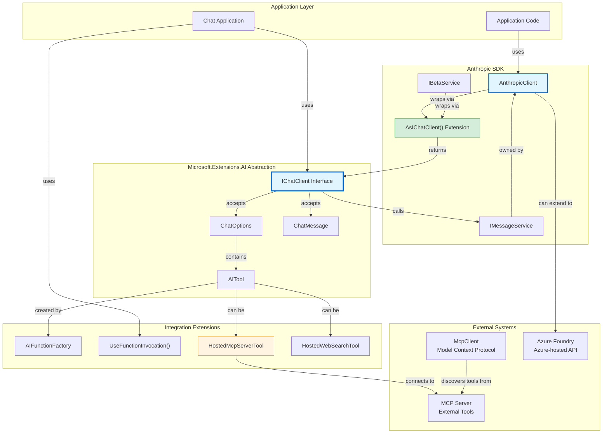
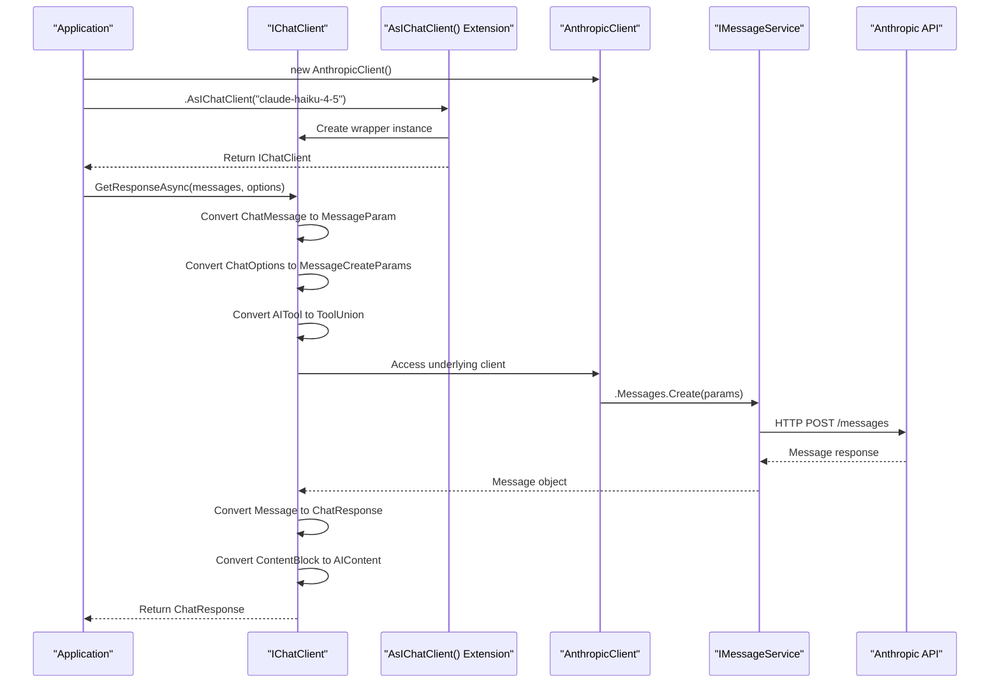
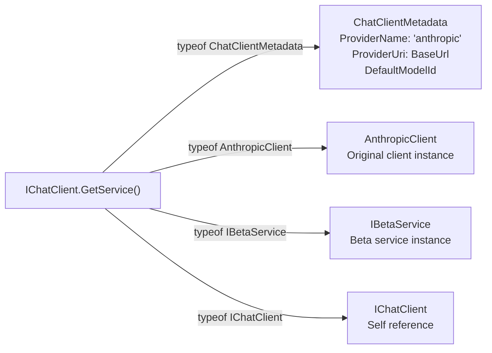
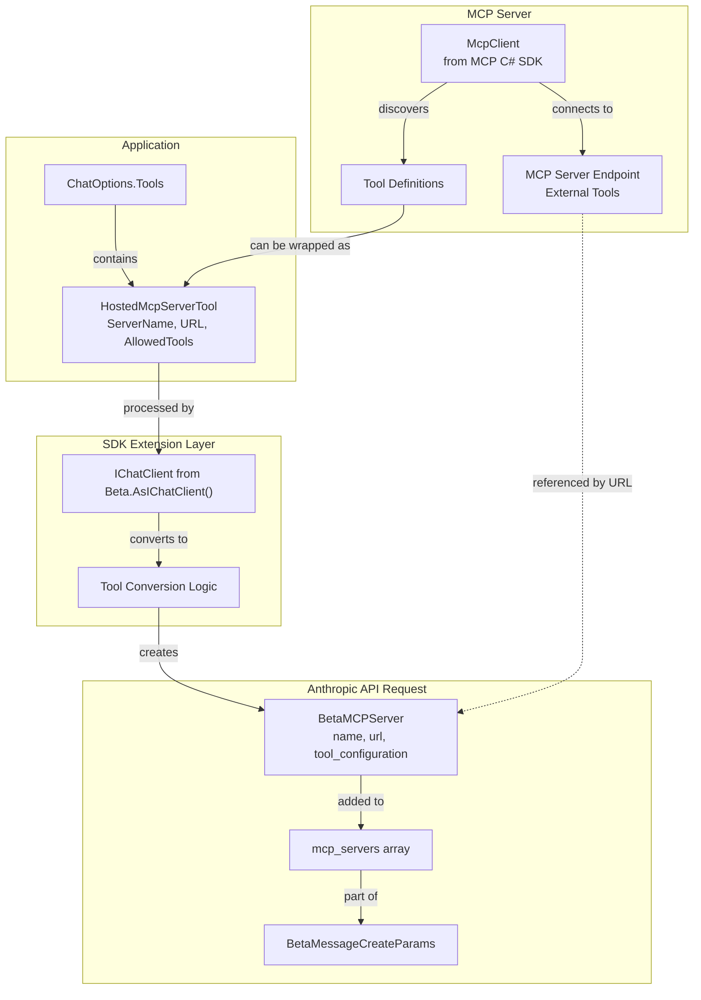
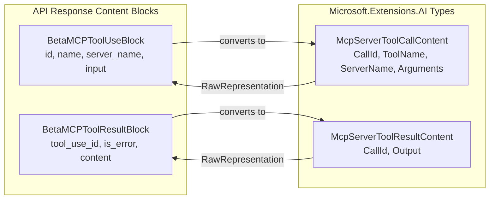
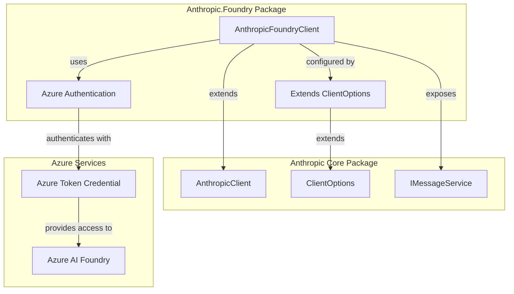
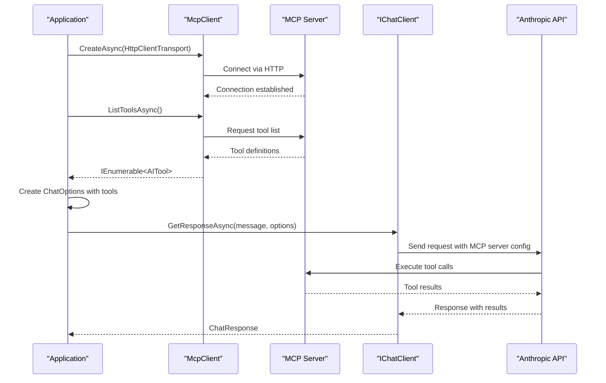
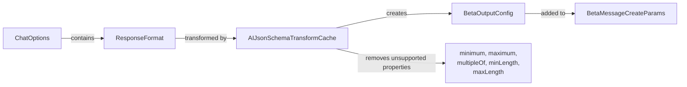
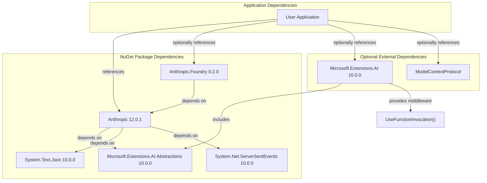
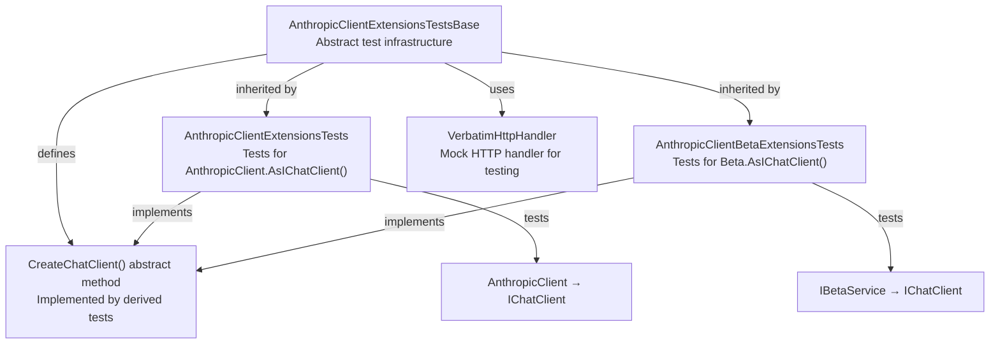

<!-- source: DeepWiki mcp.deepwiki.com · repo anthropics/anthropic-sdk-csharp · page 8 Ecosystem Integration · fetched 2026-10-26 -->

# Ecosystem Integration

<details>
<summary>Relevant source files</summary>

The following files were used as context for generating this wiki page:

- [README.md](README.md)
- [examples/ChatClientExample/Program.cs](examples/ChatClientExample/Program.cs)
- [src/Anthropic.Foundry/AnthropicFoundryClient.cs](src/Anthropic.Foundry/AnthropicFoundryClient.cs)
- [src/Anthropic.Tests/AnthropicClientBetaExtensionsTests.cs](src/Anthropic.Tests/AnthropicClientBetaExtensionsTests.cs)
- [src/Anthropic.Tests/AnthropicClientExtensionsTests.cs](src/Anthropic.Tests/AnthropicClientExtensionsTests.cs)
- [src/Anthropic.Tests/AnthropicClientExtensionsTestsBase.cs](src/Anthropic.Tests/AnthropicClientExtensionsTestsBase.cs)
- [src/Anthropic.Tests/TestBase.cs](src/Anthropic.Tests/TestBase.cs)
- [src/Anthropic/AnthropicClient.cs](src/Anthropic/AnthropicClient.cs)
- [src/Anthropic/AnthropicClientExtensions.cs](src/Anthropic/AnthropicClientExtensions.cs)
- [src/Anthropic/Core/ClientOptions.cs](src/Anthropic/Core/ClientOptions.cs)
- [src/Anthropic/Core/EnvironmentUrl.cs](src/Anthropic/Core/EnvironmentUrl.cs)
- [src/Anthropic/IAnthropicClient.cs](src/Anthropic/IAnthropicClient.cs)
- [src/Anthropic/Services/Beta/Messages/AnthropicBetaClientExtensions.cs](src/Anthropic/Services/Beta/Messages/AnthropicBetaClientExtensions.cs)

</details>


This document describes how the Anthropic C# SDK integrates with external frameworks, protocols, and platforms to enable broader ecosystem compatibility and advanced use cases.

The SDK provides three primary integration points:
1. **Microsoft.Extensions.AI abstractions** for AI provider portability
2. **Model Context Protocol (MCP)** for connecting to external tool servers
3. **Azure Foundry Client** for Azure-hosted API deployments

For detailed implementation guides on using Messages and Tools within these integrations, see [Working with Messages](#5) and [Tools and Function Calling](#6). For specific integration details, see [Microsoft.Extensions.AI (IChatClient)](#8.1), [Model Context Protocol (MCP)](#8.2), and [Azure Foundry Client](#8.3).

## Integration Architecture



**Integration Flow Architecture**: This diagram shows how the SDK bridges application code to the Anthropic API through the Microsoft.Extensions.AI abstraction layer. The `AsIChatClient()` extension method converts `AnthropicClient` or `IBetaService` into an `IChatClient` implementation. Applications can use either the native SDK directly or the standard `IChatClient` interface. External integrations like MCP servers and Azure Foundry extend functionality without changing the core API.

Sources: [src/Anthropic/AnthropicClientExtensions.cs:19-52](), [src/Anthropic/Services/Beta/Messages/AnthropicBetaClientExtensions.cs:69-102](), [README.md:158-183]()

## Microsoft.Extensions.AI Integration

The SDK implements the `IChatClient` interface from the `Microsoft.Extensions.AI.Abstractions` library, providing a standardized way to interact with AI models across different providers.

### Conversion Process



**Type Conversion Flow**: This sequence shows how `AsIChatClient()` creates a wrapper that translates between Microsoft.Extensions.AI types (`ChatMessage`, `ChatOptions`, `AITool`) and Anthropic SDK types (`MessageParam`, `MessageCreateParams`, `ToolUnion`). The wrapper delegates to the underlying `IMessageService` for API communication.

Sources: [src/Anthropic/AnthropicClientExtensions.cs:83-172](), [src/Anthropic/Services/Beta/Messages/AnthropicBetaClientExtensions.cs:133-254]()

### Key Extension Methods

| Extension Method | Target Type | Purpose | Return Type |
|-----------------|-------------|---------|-------------|
| `AsIChatClient()` | `IAnthropicClient` | Wraps standard client as IChatClient | `IChatClient` |
| `AsIChatClient()` | `IBetaService` | Wraps beta service as IChatClient | `IChatClient` |
| `AsAITool()` | `ToolUnion` | Wraps Anthropic tool as AITool | `AITool` |
| `AsAITool()` | `BetaToolUnion` | Wraps beta tool as AITool | `AITool` |
| `AsAITool()` | `BetaSkillParams` | Wraps skill as AITool | `AITool` |

Sources: [src/Anthropic/AnthropicClientExtensions.cs:32-81](), [src/Anthropic/Services/Beta/Messages/AnthropicBetaClientExtensions.cs:22-131]()

### Client Metadata and Service Discovery

The `IChatClient` implementation supports service discovery through the `GetService()` method, allowing access to metadata and the underlying Anthropic client:



**Service Discovery Pattern**: The `GetService()` method provides type-based access to the underlying infrastructure. Applications can retrieve the original `AnthropicClient` or `IBetaService` to access native SDK features while maintaining portability through `IChatClient`.

Sources: [src/Anthropic/AnthropicClientExtensions.cs:100-128](), [src/Anthropic/Services/Beta/Messages/AnthropicBetaClientExtensions.cs:176-213]()

## Model Context Protocol Support

The SDK supports the Model Context Protocol (MCP) specification, enabling Claude to access tools from external MCP servers. This integration works through the `HostedMcpServerTool` type from Microsoft.Extensions.AI.

### MCP Tool Integration



**MCP Integration Architecture**: When an application provides `HostedMcpServerTool` instances in `ChatOptions.Tools`, the SDK converts them to `BetaMCPServer` objects in the API request. The Anthropic API connects to the specified MCP server URL and accesses available tools. The `McpClient` can also discover tools from MCP servers and wrap them for use with the SDK.

Sources: [src/Anthropic/Services/Beta/Messages/AnthropicBetaClientExtensions.cs:1143-1228](), [README.md:165-183]()

### MCP Tool Types in Responses



**MCP Content Block Conversion**: The SDK converts MCP-specific content blocks from API responses into standard Microsoft.Extensions.AI types. The original Anthropic types are preserved in the `RawRepresentation` property for applications that need native SDK access.

Sources: [src/Anthropic/Services/Beta/Messages/AnthropicBetaClientExtensions.cs:958-1026]()

### MCP Configuration Options

| Property | Type | Purpose |
|----------|------|---------|
| `ServerName` | `string` | Identifier for the MCP server |
| `Url` | `Uri` | HTTP endpoint of the MCP server |
| `AllowedTools` | `IEnumerable<string>?` | Optional whitelist of tool names |
| `Enabled` | `bool` | Whether tool configuration is enabled (default: true when AllowedTools provided) |

The `AllowedTools` property enables fine-grained control over which tools from an MCP server can be used by the model.

Sources: [src/Anthropic/Services/Beta/Messages/AnthropicBetaClientExtensions.cs:1143-1228]()

## Azure Foundry Client

The `Anthropic.Foundry` package extends the core SDK with Azure-specific authentication and configuration for accessing Anthropic models deployed on Azure AI Foundry.

### Package Structure



**Azure Foundry Extension Architecture**: The `AnthropicFoundryClient` extends the base `AnthropicClient` with Azure-specific authentication mechanisms. It maintains full compatibility with the core SDK APIs while adding Azure token credential support.

Sources: [.release-please-manifest.json:1-4](), [src/Anthropic/Anthropic.csproj:1-55](), [src/Anthropic.Foundry/CHANGELOG.md:1-59]()

### Package Versioning

| Package | Current Version | Status |
|---------|----------------|--------|
| `Anthropic` | 12.0.1 | Beta - Core SDK |
| `Anthropic.Foundry` | 0.2.0 | Beta - Azure extension |

Both packages follow prerelease versioning and are managed independently through the release-please automation system.

Sources: [.release-please-manifest.json:1-4](), [release-please-config.json:1-72]()

## Integration Usage Patterns

### Basic IChatClient Usage

The following example demonstrates the fundamental pattern for using the SDK through the `IChatClient` abstraction:

```csharp
// From examples/ChatClientExample/Program.cs
IChatClient chatClient = new AnthropicClient()
    .AsIChatClient("claude-haiku-4-5")
    .AsBuilder()
    .UseFunctionInvocation()
    .Build();
```

This pattern:
1. Creates an `AnthropicClient` (configured from environment variables)
2. Converts it to `IChatClient` with a default model
3. Uses the builder pattern to add middleware (`UseFunctionInvocation()`)
4. Results in a client that can automatically invoke tools

Sources: [examples/ChatClientExample/Program.cs:1-33]()

### MCP Integration Pattern



**MCP Integration Flow**: Applications connect to MCP servers using the `McpClient` from the MCP C# SDK, discover available tools, and pass them to the Anthropic SDK through `ChatOptions`. The Anthropic API connects directly to the MCP server during request processing.

Sources: [README.md:165-183](), [src/Anthropic.Tests/AnthropicClientBetaExtensionsTests.cs:113-169]()

### Tool Type Conversion

The SDK provides multiple paths for integrating tools:

| Source Tool Type | Conversion Method | Target Type | Use Case |
|-----------------|-------------------|-------------|----------|
| C# Function | `AIFunctionFactory.Create()` | `AIFunction` | Custom application functions |
| `ToolUnion` | `.AsAITool()` | `AITool` (wrapper) | Native Anthropic tools |
| `BetaToolUnion` | `.AsAITool()` | `AITool` (wrapper) | Beta Anthropic tools |
| `BetaSkillParams` | `.AsAITool()` | `AITool` (wrapper) | Hosted Anthropic skills |
| MCP Server | `McpClient.ListToolsAsync()` | `IEnumerable<AITool>` | External MCP tools |
| - | `new HostedMcpServerTool()` | `HostedMcpServerTool` | Direct MCP server reference |

The wrapper types (`AsAITool()`) preserve the original Anthropic types in `RawRepresentation` and are only understood by Anthropic's `IChatClient` implementation.

Sources: [src/Anthropic/AnthropicClientExtensions.cs:54-81](), [src/Anthropic/Services/Beta/Messages/AnthropicBetaClientExtensions.cs:22-131]()

### Response Format Integration

The beta `IChatClient` supports structured output through `ChatOptions.ResponseFormat`:



**Response Format Transformation**: The SDK transforms JSON schemas from `ChatOptions.ResponseFormat` to remove properties unsupported by Anthropic's structured output API (minimum, maximum, multipleOf, minLength, maxLength). The transformed schema is included in the request as `BetaOutputConfig`.

Sources: [src/Anthropic/Services/Beta/Messages/AnthropicBetaClientExtensions.cs:141-168]()

## Cross-Package Dependencies



**Package Dependency Graph**: The core `Anthropic` package has minimal dependencies: Microsoft.Extensions.AI.Abstractions for `IChatClient` interface, System.Text.Json for serialization, and System.Net.ServerSentEvents for streaming. Applications can optionally reference the full `Microsoft.Extensions.AI` package for middleware like `UseFunctionInvocation()`, or the `ModelContextProtocol` package for MCP client capabilities.

Sources: [src/Anthropic/Anthropic.csproj:43-54](), [examples/ChatClientExample/ChatClientExample.csproj:1-12]()

## Integration Testing Patterns

The SDK test suite demonstrates integration patterns through the `AnthropicClientExtensionsTestsBase` abstract class, which provides common test infrastructure for both standard and beta client extensions:



**Test Architecture Pattern**: The test suite uses template method pattern to test both standard and beta client extensions with identical test cases. The abstract `CreateChatClient()` method allows each test class to specify which conversion path to test while sharing common verification logic.

Sources: [src/Anthropic.Tests/AnthropicClientExtensionsTestsBase.cs:17-39](), [src/Anthropic.Tests/AnthropicClientExtensionsTests.cs:13-22](), [src/Anthropic.Tests/AnthropicClientBetaExtensionsTests.cs:16-22]()

---

