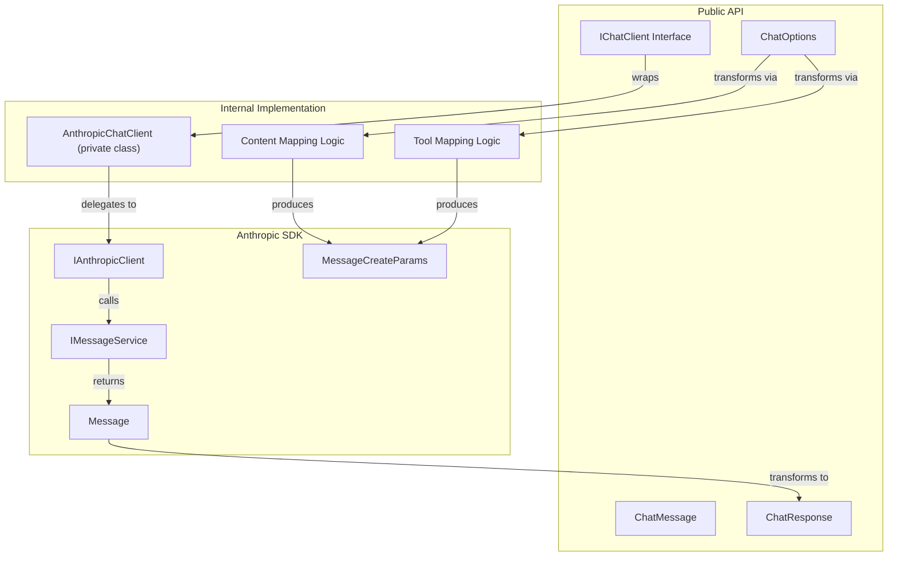
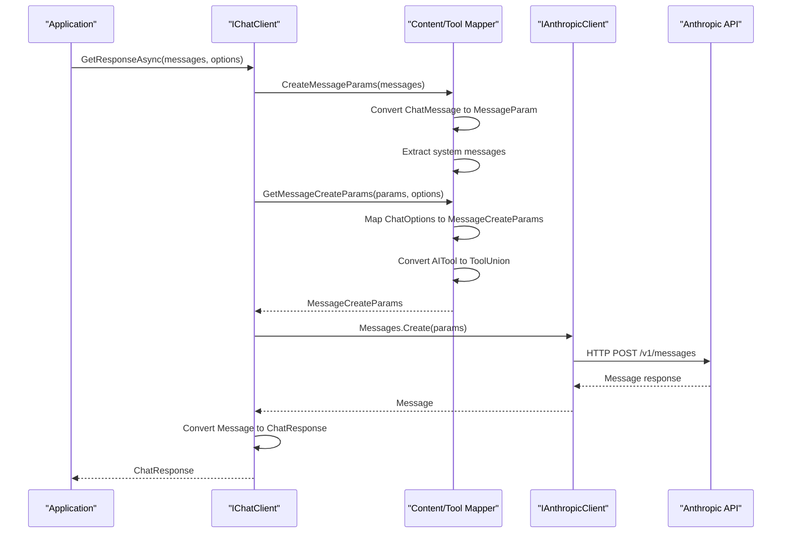
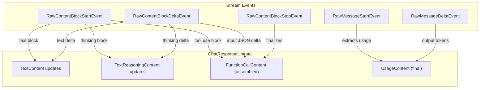

<!-- source: DeepWiki mcp.deepwiki.com · repo anthropics/anthropic-sdk-csharp · page 8.1 Microsoft.Extensions.AI (IChatClient) · fetched 2026-10-26 -->

# Microsoft.Extensions.AI (IChatClient)

<details>
<summary>Relevant source files</summary>

The following files were used as context for generating this wiki page:

- [examples/ChatClientExample/Program.cs](examples/ChatClientExample/Program.cs)
- [examples/MessagesExample/MessagesExample.csproj](examples/MessagesExample/MessagesExample.csproj)
- [examples/MessagesExample/Program.cs](examples/MessagesExample/Program.cs)
- [examples/MessagesStreamingExample/MessagesStreamingExample.csproj](examples/MessagesStreamingExample/MessagesStreamingExample.csproj)
- [examples/MessagesStreamingExample/Program.cs](examples/MessagesStreamingExample/Program.cs)
- [examples/ThinkingExample/Program.cs](examples/ThinkingExample/Program.cs)
- [examples/ThinkingExample/ThinkingExample.csproj](examples/ThinkingExample/ThinkingExample.csproj)
- [examples/ThinkingStreamingExample/Program.cs](examples/ThinkingStreamingExample/Program.cs)
- [examples/ThinkingStreamingExample/ThinkingStreamingExample.csproj](examples/ThinkingStreamingExample/ThinkingStreamingExample.csproj)
- [src/Anthropic.Tests/AnthropicClientBetaExtensionsTests.cs](src/Anthropic.Tests/AnthropicClientBetaExtensionsTests.cs)
- [src/Anthropic.Tests/AnthropicClientExtensionsTests.cs](src/Anthropic.Tests/AnthropicClientExtensionsTests.cs)
- [src/Anthropic.Tests/AnthropicClientExtensionsTestsBase.cs](src/Anthropic.Tests/AnthropicClientExtensionsTestsBase.cs)
- [src/Anthropic/AnthropicClientExtensions.cs](src/Anthropic/AnthropicClientExtensions.cs)
- [src/Anthropic/Services/Beta/Messages/AnthropicBetaClientExtensions.cs](src/Anthropic/Services/Beta/Messages/AnthropicBetaClientExtensions.cs)

</details>


## Overview

This page documents the SDK's integration with the `Microsoft.Extensions.AI` abstraction layer. The SDK provides `IChatClient` adapters that enable `AnthropicClient` and `IBetaService` to work with any library or framework that supports the standard `IChatClient` interface.

**Purpose:** Enable interoperability with the broader .NET AI ecosystem by exposing Anthropic's API through a standardized interface.

**Scope:** This page covers the `AsIChatClient()` extension methods, content mapping, tool integration, and streaming support. For direct SDK usage without the abstraction, see [Messages Service](#4.1). For Model Context Protocol integration specifically, see [Model Context Protocol (MCP)](#8.2).

**Key Benefits:**
- **Portability:** Switch between AI providers with minimal code changes
- **Ecosystem Integration:** Use middleware, logging, and function invocation builders from `Microsoft.Extensions.AI`
- **Standardized Tools:** Leverage common tool abstractions like `AIFunction`, `HostedWebSearchTool`, and `HostedMcpServerTool`

Sources: [README.md:158-183](), [src/Anthropic/Anthropic.csproj:49]()

## Extension Methods

The SDK provides two primary extension methods for creating `IChatClient` instances:

### AsIChatClient for IAnthropicClient

```csharp
public static IChatClient AsIChatClient(
    this IAnthropicClient client,
    string? defaultModelId = null,
    int? defaultMaxOutputTokens = null
)
```

Creates an `IChatClient` wrapper for the standard Messages API.

**Parameters:**
- `defaultModelId` - Model ID to use when not specified in `ChatOptions`. Required if not provided per-request.
- `defaultMaxOutputTokens` - Default token limit (defaults to 1024 if not specified)

**Example:**
```csharp
IChatClient chatClient = new AnthropicClient()
    .AsIChatClient("claude-haiku-4-5");
```

Sources: [src/Anthropic/AnthropicClientExtensions.cs:32-52]()

### AsIChatClient for IBetaService

```csharp
public static IChatClient AsIChatClient(
    this IBetaService betaService,
    string? defaultModelId = null,
    int? defaultMaxOutputTokens = null
)
```

Creates an `IChatClient` wrapper for the Beta Messages API, providing access to experimental features like:
- Skills API integration
- Hosted MCP server tools
- Enhanced citation support
- Advanced tool configurations

**Example:**
```csharp
IChatClient chatClient = new AnthropicClient()
    .Beta
    .AsIChatClient("claude-sonnet-4-5-20250929");
```

Sources: [src/Anthropic/Services/Beta/Messages/AnthropicBetaClientExtensions.cs:82-102]()

## Architecture

### IChatClient Wrapper Implementation



**Key Components:**
- **AnthropicChatClient** - Private class implementing `IChatClient` at [src/Anthropic/AnthropicClientExtensions.cs:83-680]()
- **Content Mapping** - Transforms between `ChatMessage` and `MessageParam` at [src/Anthropic/AnthropicClientExtensions.cs:390-680]()
- **Tool Mapping** - Converts `AITool` instances to Anthropic tool formats at [src/Anthropic/AnthropicClientExtensions.cs:686-957]()

Sources: [src/Anthropic/AnthropicClientExtensions.cs:83-957]()

### Request Flow Diagram



Sources: [src/Anthropic/AnthropicClientExtensions.cs:131-172]()

## Content Mapping

### ChatMessage to MessageParam Conversion

The `IChatClient` implementation converts between Microsoft.Extensions.AI types and Anthropic types:

| Microsoft.Extensions.AI | Anthropic SDK | Notes |
|------------------------|---------------|-------|
| `ChatMessage` | `MessageParam` | Container for role and content |
| `ChatRole.System` | `system` parameter | Extracted separately from messages array |
| `ChatRole.User` | `Role.User` | User message |
| `ChatRole.Assistant` | `Role.Assistant` | Assistant message, trailing whitespace trimmed |
| `TextContent` | `TextBlockParam` | Plain text content |
| `TextReasoningContent` | `ThinkingBlockParam` or `RedactedThinkingBlockParam` | Extended thinking support |
| `DataContent` (image) | `ImageBlockParam` | Base64-encoded images |
| `DataContent` (PDF) | `DocumentBlockParam` | Base64-encoded PDFs |
| `DataContent` (text) | `DocumentBlockParam` | Plain text documents |
| `UriContent` (image) | `ImageBlockParam` with URL | Image from URL |
| `UriContent` (PDF) | `DocumentBlockParam` with URL | PDF from URL |
| `HostedFileContent` | `RequestDocumentBlock` (Beta) | File ID reference |
| `FunctionCallContent` | `ToolUseBlockParam` | Tool invocation request |
| `FunctionResultContent` | `ToolResultBlockParam` | Tool execution result |

Sources: [src/Anthropic/AnthropicClientExtensions.cs:390-680]()

### System Message Handling

System messages are extracted from the message list and set via the `System` parameter:

```csharp
// Input: ChatMessage with ChatRole.System
new ChatMessage(ChatRole.System, "You are a helpful assistant.")

// Output: MessageCreateParams.System
System = new List<TextBlockParam> 
{
    new() { Text = "You are a helpful assistant." }
}
```

Multiple system messages are combined into a list. The API sees these as sequential system instructions.

Sources: [src/Anthropic/AnthropicClientExtensions.cs:400-410]()

### Image and Document Content

**Images:**
```csharp
// DataContent with base64
new DataContent("image/jpeg", base64Data)
// Maps to:
new ImageBlockParam() 
{
    Source = new(new Base64ImageSource() 
    {
        Data = base64Data,
        MediaType = "image/jpeg"
    })
}

// UriContent with URL
new UriContent(new Uri("https://example.com/image.jpg"), "image/jpeg")
// Maps to:
new ImageBlockParam() 
{
    Source = new(new URLImageSource() 
    {
        URL = "https://example.com/image.jpg"
    })
}
```

**Documents:**
```csharp
// PDF via DataContent
new DataContent("application/pdf", pdfBytes)
// Maps to:
new DocumentBlockParam() 
{
    Source = new(new Base64PDFSource() { Data = base64PdfData })
}

// Plain text via DataContent
new DataContent("text/plain", textBytes)
// Maps to:
new DocumentBlockParam() 
{
    Source = new(new PlainTextSource() { Data = textString })
}
```

Sources: [src/Anthropic/AnthropicClientExtensions.cs:455-521]()

### Thinking and Reasoning Content

The SDK maps `TextReasoningContent` to Anthropic's thinking blocks:

```csharp
// With thinking text and signature
new TextReasoningContent("Let me analyze this...")
{
    ProtectedData = "signature_xyz"
}
// Maps to:
new ThinkingBlockParam() 
{
    Thinking = "Let me analyze this...",
    Signature = "signature_xyz"
}

// Redacted thinking (signature only)
new TextReasoningContent(null)
{
    ProtectedData = "redacted_data"
}
// Maps to:
new RedactedThinkingBlockParam() 
{
    Data = "redacted_data"
}
```

Sources: [src/Anthropic/AnthropicClientExtensions.cs:439-453]()

## Tool Integration

### AIFunction to Tool Conversion

Standard `AIFunction` instances are automatically converted to Anthropic's custom tool format:

```csharp
ChatOptions options = new()
{
    Tools = 
    [
        AIFunctionFactory.Create(
            (string location) => GetWeather(location),
            "get_weather",
            "Gets the weather for a location"
        )
    ]
};

// Converts to:
new Tool() 
{
    Name = "get_weather",
    Description = "Gets the weather for a location",
    InputSchema = /* JSON schema from function signature */
}
```

The schema transformation removes properties unsupported by Claude:
- `minimum`
- `maximum`
- `multipleOf`
- `minLength`
- `maxLength`

And sets `additionalProperties: false` by default.

Sources: [src/Anthropic/AnthropicClientExtensions.cs:686-786](), [src/Anthropic/Services/Beta/Messages/AnthropicBetaClientExtensions.cs:141-168]()

### Hosted Web Search Tool

The `HostedWebSearchTool` from Microsoft.Extensions.AI maps to Anthropic's web search:

```csharp
ChatOptions options = new()
{
    Tools = [new HostedWebSearchTool()]
};

// Converts to:
new WebSearchTool20250305() { /* web search configuration */ }
```

With domain restrictions:
```csharp
new HostedWebSearchTool() 
{
    AllowedDomains = ["wikipedia.org", "github.com"]
}

// Converts to:
new WebSearchTool20250305() 
{
    AllowedDomains = ["wikipedia.org", "github.com"]
}
```

Sources: [src/Anthropic/AnthropicClientExtensions.cs:828-843]()

### Hosted MCP Server Tool (Beta Only)

The Beta `IChatClient` supports `HostedMcpServerTool` for MCP integration:

```csharp
ChatOptions options = new()
{
    Tools = 
    [
        new HostedMcpServerTool(
            "my-server", 
            new Uri("https://mcp.example.com/server")
        )
        {
            AllowedTools = ["tool1", "tool2"]
        }
    ]
};

// Converts to:
new BetaMCPServer() 
{
    Name = "mcp",
    Type = BetaMCPServerType.Url,
    Url = "https://mcp.example.com/server",
    ToolConfiguration = new() 
    {
        Enabled = true,
        AllowedTools = ["tool1", "tool2"]
    }
}
```

Multiple MCP servers can be specified in a single request.

Sources: [src/Anthropic/Services/Beta/Messages/AnthropicBetaClientExtensions.cs:827-903]()

### Hosted File Search Tool (Beta Only)

File search tools are converted to Anthropic's file upload/search mechanism:

```csharp
ChatOptions options = new()
{
    Tools = 
    [
        new HostedFileSearchTool() 
        {
            Files = [fileId1, fileId2]
        }
    ]
};

// Uploads files and configures search tool
```

Sources: [src/Anthropic/Services/Beta/Messages/AnthropicBetaClientExtensions.cs:904-953]()

### Custom Tool Wrappers

Both standard and beta clients provide `AsAITool()` extension methods for wrapping native tool types:

**Standard API:**
```csharp
// Wrap a ToolUnion
ToolUnion webSearch = new WebSearchTool20250305() 
{
    AllowedDomains = ["github.com"]
};

ChatOptions options = new()
{
    Tools = [webSearch.AsAITool()]
};
```

**Beta API:**
```csharp
// Wrap a BetaToolUnion
BetaToolUnion codeExec = new BetaCodeExecutionTool20250826();

ChatOptions options = new()
{
    Tools = [codeExec.AsAITool()]
};

// Wrap a skill
BetaSkillParams skill = new() 
{
    Type = BetaSkillParamsType.Anthropic,
    SkillID = "pptx",
    Version = "latest"
};

ChatOptions options = new()
{
    Tools = [skill.AsAITool()]
};
```

These wrappers preserve the original tool instance via `GetService<T>()`:

```csharp
AITool aiTool = webSearch.AsAITool();
ToolUnion? original = aiTool.GetService<ToolUnion>();
```

Sources: [src/Anthropic/AnthropicClientExtensions.cs:73-81](), [src/Anthropic/Services/Beta/Messages/AnthropicBetaClientExtensions.cs:59-67, 104-131]()

## Streaming Support

### GetStreamingResponseAsync

The `IChatClient` implementation supports streaming via `GetStreamingResponseAsync()`:

```csharp
await foreach (var update in chatClient.GetStreamingResponseAsync(
    "Tell me a story", 
    options))
{
    Console.Write(update);
}
```

**Stream Event Processing:**



**Key Behaviors:**
- Text and thinking deltas are yielded immediately as separate `ChatResponseUpdate` instances
- Tool calls are assembled incrementally and yielded once when `ContentBlockStop` is received
- Usage information is accumulated throughout the stream and yielded as a final `UsageContent` update
- Finish reason is set when `MessageDelta` event provides `StopReason`

Sources: [src/Anthropic/AnthropicClientExtensions.cs:175-388]()

### Streaming Tool Calls

Tool calls require special handling during streaming:

```csharp
Dictionary<long, StreamingFunctionData>? streamingFunctions = null;

// On ContentBlockStart with ToolUseBlock:
streamingFunctions[contentBlockStart.Index] = new()
{
    CallId = toolUse.ID,
    Name = toolUse.Name,
};

// On ContentBlockDelta with InputJSONDelta:
if (streamingFunctions.TryGetValue(index, out var functionData))
{
    functionData.Arguments.Append(inputDelta.PartialJSON);
}

// On ContentBlockStop:
foreach (var sf in streamingFunctions)
{
    yield return new ChatResponseUpdate(ChatRole.Assistant,
    [
        FunctionCallContent.CreateFromParsedArguments(
            sf.Value.Arguments.ToString(),
            sf.Value.CallId,
            sf.Value.Name,
            json => JsonSerializer.Deserialize(json, ...)
        )
    ]);
}
```

Sources: [src/Anthropic/AnthropicClientExtensions.cs:282-363]()

## Response Formats and Structured Outputs

### JSON Schema Transformation

The `IChatClient` implementation automatically transforms JSON schemas to comply with Claude's structured output constraints:

```csharp
ChatOptions options = new()
{
    ResponseFormat = ChatResponseFormat.Json(
        new JsonElement(/* your JSON schema */)
    )
};

// Schema is automatically transformed to:
// - Set additionalProperties: false
// - Remove unsupported properties (minimum, maximum, etc.)
```

The transformation uses `AIJsonSchemaTransformCache` with the following rules:
1. **Disallow additional properties** - Sets `additionalProperties: false` on all objects
2. **Remove numeric constraints** - Removes `minimum`, `maximum`, `multipleOf`
3. **Remove string length constraints** - Removes `minLength`, `maxLength`

Sources: [src/Anthropic/Services/Beta/Messages/AnthropicBetaClientExtensions.cs:141-168]()

### Structured Output Example

```csharp
public class PersonInfo
{
    public string Name { get; set; }
    public int Age { get; set; }
}

ChatOptions options = new()
{
    ResponseFormat = ChatResponseFormat.ForType<PersonInfo>()
};

ChatResponse response = await chatClient.GetResponseAsync(
    "Tell me about Albert Einstein", 
    options
);

// Response contains structured JSON matching PersonInfo schema
```

The Beta `IChatClient` automatically configures the response format via `BetaOutputFormatJSONSchema`.

Sources: [src/Anthropic/Services/Beta/Messages/AnthropicBetaClientExtensions.cs:755-801]()

## Service Retrieval

### GetService Method

The `IChatClient` wrapper implements `IServiceProvider` via the `GetService()` method:

```csharp
IChatClient chatClient = client.AsIChatClient("claude-haiku-4-5");

// Retrieve metadata
ChatClientMetadata? metadata = chatClient.GetService<ChatClientMetadata>();
// Provider name: "anthropic"
// Provider URI: https://api.anthropic.com/
// Model ID: "claude-haiku-4-5"

// Retrieve underlying client
IAnthropicClient? anthropicClient = chatClient.GetService<IAnthropicClient>();
AnthropicClient? concreteClient = chatClient.GetService<AnthropicClient>();

// Retrieve the IChatClient itself
IChatClient? self = chatClient.GetService<IChatClient>();
```

For Beta clients:
```csharp
IChatClient betaChatClient = client.Beta.AsIChatClient("claude-sonnet-4-5-20250929");

// Retrieve beta service
IBetaService? betaService = betaChatClient.GetService<IBetaService>();
```

**Notes:**
- Returns `null` if service key is non-null
- Returns `null` if type is not supported
- Throws `ArgumentNullException` if `serviceType` is null

Sources: [src/Anthropic/AnthropicClientExtensions.cs:100-128](), [src/Anthropic/Services/Beta/Messages/AnthropicBetaClientExtensions.cs:179-213]()

## Advanced Features

### RawRepresentationFactory

The `ChatOptions.RawRepresentationFactory` allows pre-configuring request parameters:

```csharp
ChatOptions options = new()
{
    RawRepresentationFactory = _ => new MessageCreateParams()
    {
        MaxTokens = 2048,
        Model = "claude-haiku-4-5",
        Messages = 
        [
            new MessageParam()
            {
                Role = Role.User,
                Content = new MessageParamContent(
                    [new TextBlockParam() { Text = "Context from factory" }]
                )
            }
        ]
    }
};

// The factory-provided MessageCreateParams is used as the base,
// then additional messages from GetResponseAsync are appended
ChatResponse response = await chatClient.GetResponseAsync(
    "New question", 
    options
);
```

**Merging Behavior:**
- Messages from the factory are prepended to messages from the call
- System messages are merged (factory system + call system)
- Other parameters from the factory take precedence unless overridden by `ChatOptions`

Sources: [src/Anthropic/AnthropicClientExtensions.cs:958-1021]()

### Raw Representation Access

Both requests and responses preserve their native Anthropic SDK representations:

**Response Raw Representation:**
```csharp
ChatResponse response = await chatClient.GetResponseAsync("Test");

// Access the underlying Message object
Message? rawMessage = response.RawRepresentation as Message;
string messageId = rawMessage.ID;
```

**Content Raw Representation:**
```csharp
foreach (AIContent content in response.Messages[0].Contents)
{
    switch (content)
    {
        case TextContent tc:
            TextBlock? rawBlock = tc.RawRepresentation as TextBlock;
            break;
            
        case FunctionCallContent fcc:
            ToolUseBlock? rawToolUse = fcc.RawRepresentation as ToolUseBlock;
            break;
    }
}
```

**Beta-Specific Content:**
```csharp
// Beta IChatClient provides access to beta-specific blocks
BetaMessage? betaMessage = response.RawRepresentation as BetaMessage;

foreach (AIContent content in response.Messages[0].Contents)
{
    if (content is McpServerToolCallContent mcpCall)
    {
        BetaMCPToolUseBlock? rawMcp = mcpCall.RawRepresentation as BetaMCPToolUseBlock;
    }
}
```

Sources: [src/Anthropic/AnthropicClientExtensions.cs:157-171](), [src/Anthropic/Services/Beta/Messages/AnthropicBetaClientExtensions.cs:239-253]()

## Usage Examples

### Basic Chat Completion

```csharp
using Anthropic;
using Microsoft.Extensions.AI;

IChatClient chatClient = new AnthropicClient()
    .AsIChatClient("claude-haiku-4-5");

ChatResponse response = await chatClient.GetResponseAsync("What is 2+2?");

Console.WriteLine(response.Messages[0].Text);
// Output: "4"
```

Sources: [examples/ChatClientExample/Program.cs:1-33]()

### Chat with Function Calling

```csharp
IChatClient chatClient = new AnthropicClient()
    .AsIChatClient("claude-haiku-4-5")
    .AsBuilder()
    .UseFunctionInvocation()  // Automatic tool execution
    .Build();

ChatOptions options = new()
{
    Tools = 
    [
        AIFunctionFactory.Create(
            () => Environment.UserName,
            "get_current_user_name",
            "Gets the current user's name."
        )
    ]
};

ChatResponse response = await chatClient.GetResponseAsync(
    "Write a haiku about the current user's name", 
    options
);
```

Sources: [examples/ChatClientExample/Program.cs:1-33]()

### Streaming with Tools

```csharp
IChatClient chatClient = new AnthropicClient()
    .AsIChatClient("claude-haiku-4-5")
    .AsBuilder()
    .UseFunctionInvocation()
    .Build();

await foreach (var update in chatClient.GetStreamingResponseAsync(
    "Tell me a story",
    options))
{
    Console.Write(update);
}
```

Sources: [examples/ChatClientExample/Program.cs:23-32]()

### Using MCP Servers (Beta)

```csharp
using Anthropic;
using Microsoft.Extensions.AI;

IChatClient chatClient = new AnthropicClient()
    .Beta
    .AsIChatClient("claude-sonnet-4-5-20250929")
    .AsBuilder()
    .UseFunctionInvocation()
    .Build();

ChatOptions options = new()
{
    Tools = 
    [
        new HostedMcpServerTool(
            "learning-server",
            new Uri("https://learn.microsoft.com/api/mcp")
        )
    ]
};

ChatResponse response = await chatClient.GetResponseAsync(
    "Tell me about IChatClient",
    options
);
```

Sources: [README.md:165-183]()

### Structured Outputs (Beta)

```csharp
public class WeatherInfo
{
    public string Location { get; set; }
    public int Temperature { get; set; }
    public string Conditions { get; set; }
}

IChatClient chatClient = new AnthropicClient()
    .Beta
    .AsIChatClient("claude-sonnet-4-5-20250929");

ChatOptions options = new()
{
    ResponseFormat = ChatResponseFormat.ForType<WeatherInfo>()
};

ChatResponse response = await chatClient.GetResponseAsync(
    "What's the weather in San Francisco?",
    options
);

// Parse structured response
WeatherInfo? weather = JsonSerializer.Deserialize<WeatherInfo>(
    response.Messages[0].Text
);
```

Sources: [src/Anthropic.Tests/AnthropicClientBetaExtensionsTests.cs:493-574]()

### Using Skills (Beta)

```csharp
IChatClient chatClient = new AnthropicClient()
    .Beta
    .AsIChatClient("claude-sonnet-4-5-20250929");

ChatOptions options = new()
{
    Tools = 
    [
        new BetaSkillParams 
        { 
            Type = BetaSkillParamsType.Anthropic,
            SkillID = "pptx",
            Version = "latest"
        }.AsAITool(),
        
        new BetaSkillParams 
        { 
            Type = BetaSkillParamsType.Anthropic,
            SkillID = "xlsx",
            Version = "latest"
        }.AsAITool()
    ]
};

// Skills are automatically configured in the container
// Code execution tool is automatically added if needed
ChatResponse response = await chatClient.GetResponseAsync(
    "Create a PowerPoint presentation about AI",
    options
);
```

Sources: [src/Anthropic/Services/Beta/Messages/AnthropicBetaClientExtensions.cs:23-67]()

## Key Differences: Standard vs Beta IChatClient

| Feature | Standard IChatClient | Beta IChatClient |
|---------|---------------------|------------------|
| Base Client | `IAnthropicClient` | `IBetaService` |
| Tool Types | `ToolUnion` (6 types) | `BetaToolUnion` (17+ types) |
| MCP Servers | Not supported | `HostedMcpServerTool` |
| File Search | Not supported | `HostedFileSearchTool` |
| Skills | Not supported | `BetaSkillParams.AsAITool()` |
| Structured Outputs | Not supported | `BetaOutputFormatJSONSchema` |
| Content Types | Basic (text, images, documents) | Extended (citations, search results) |
| Response Objects | `Message` | `BetaMessage` |
| API Namespace | `Anthropic.Models.Messages` | `Anthropic.Models.Beta.Messages` |

Sources: [src/Anthropic/AnthropicClientExtensions.cs:32-52](), [src/Anthropic/Services/Beta/Messages/AnthropicBetaClientExtensions.cs:82-102]()

---

