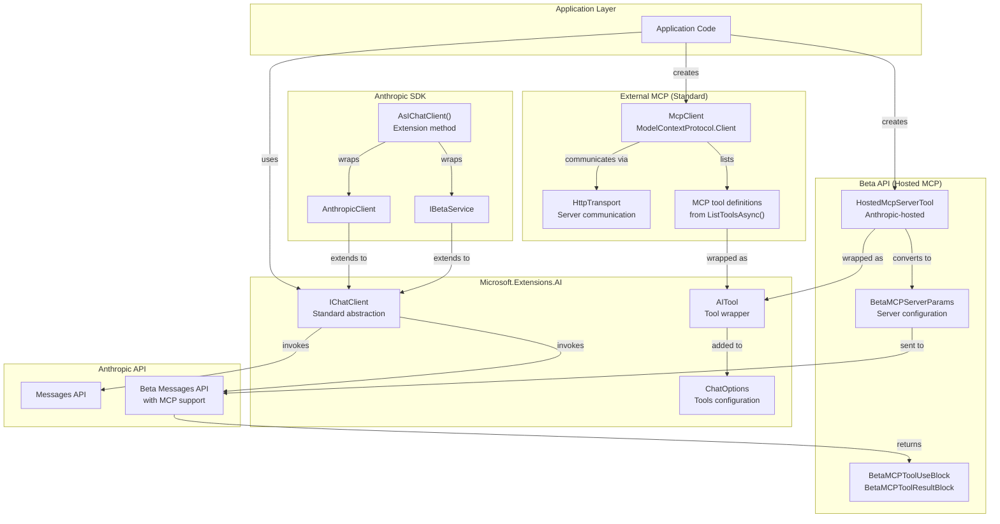
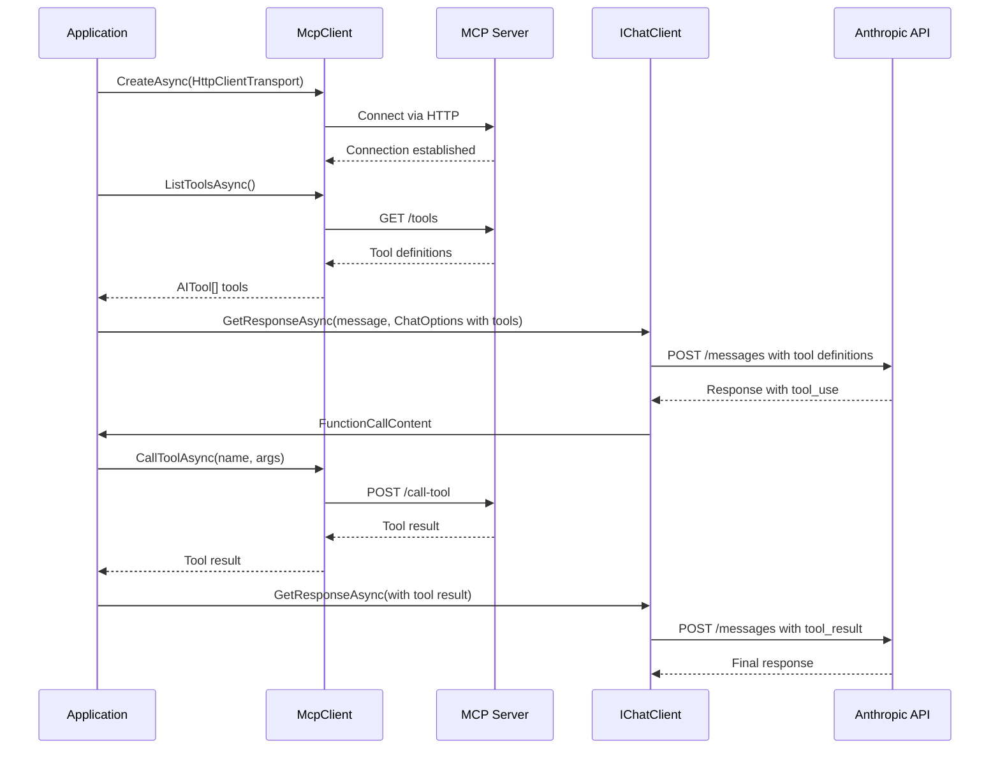
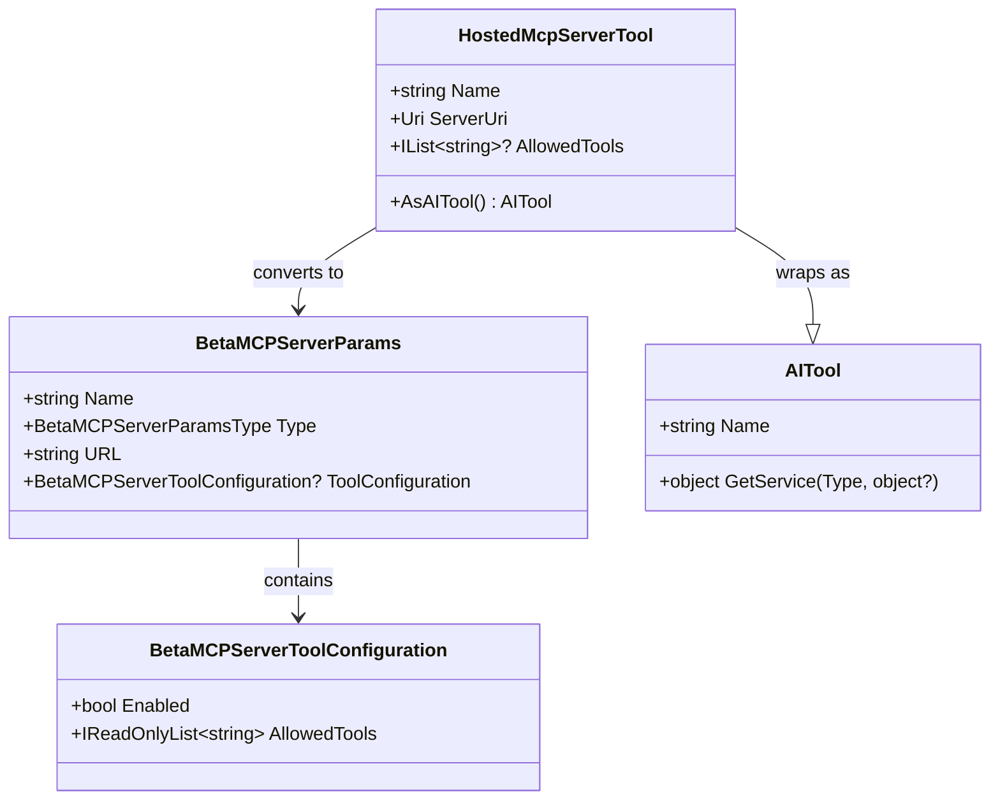
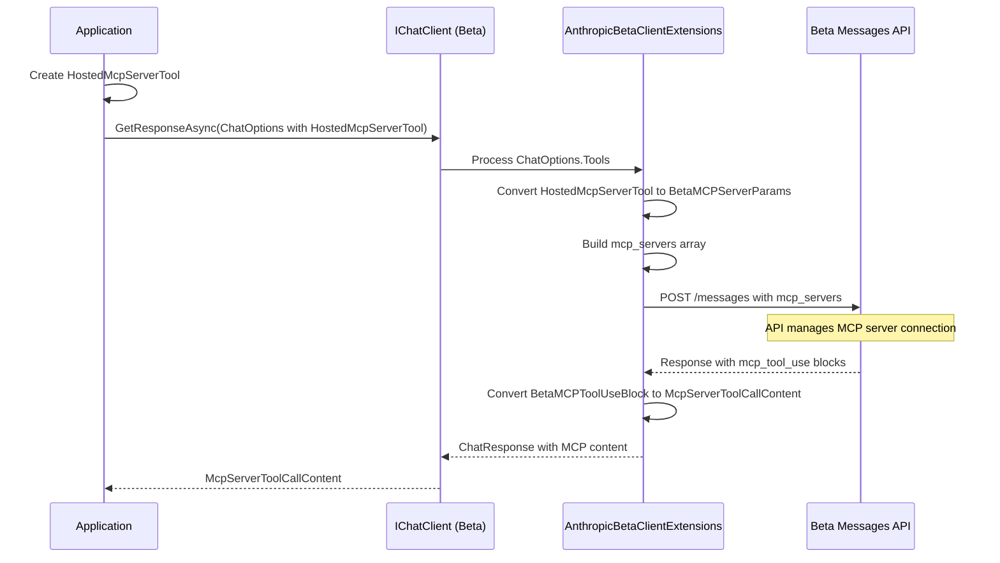
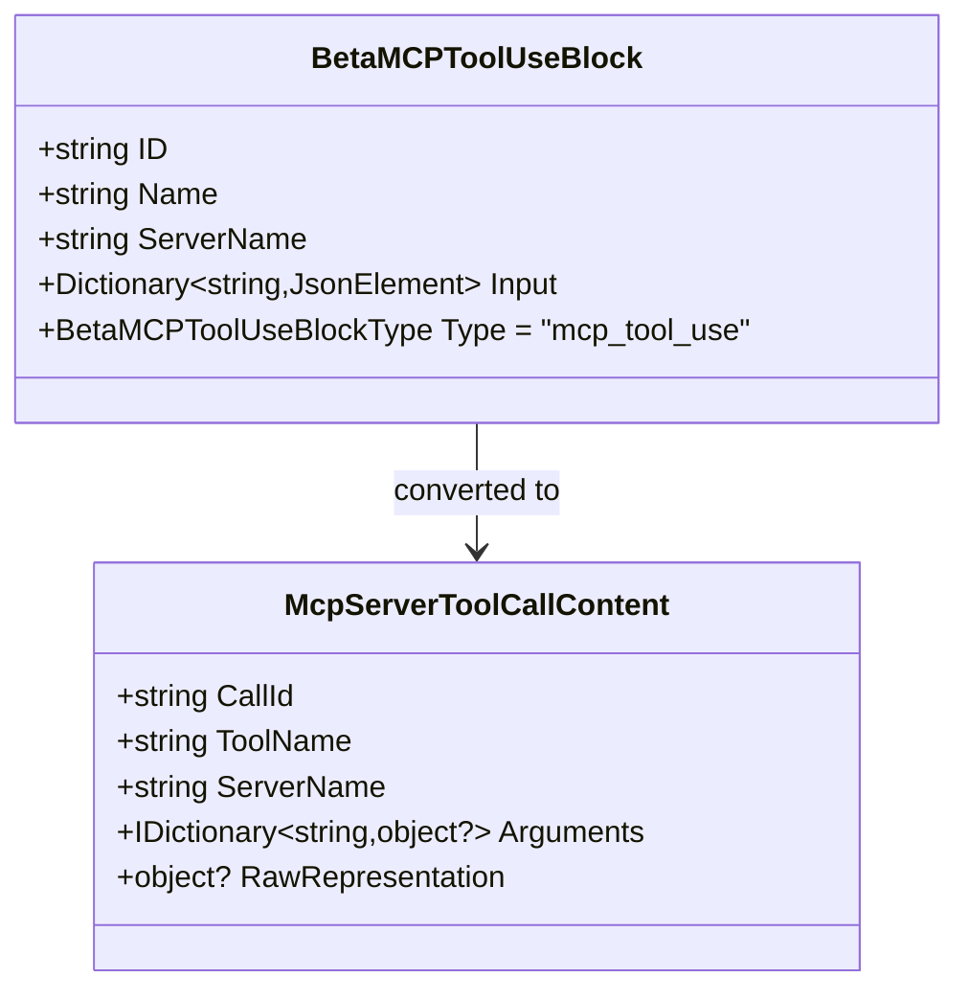
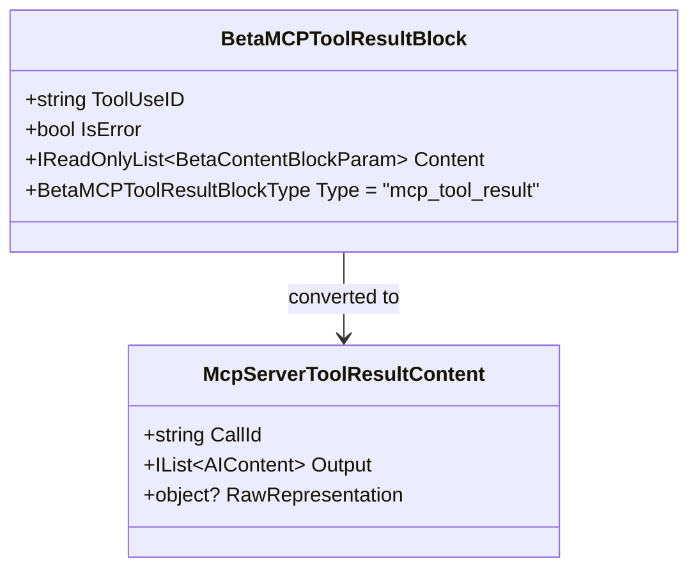

<!-- source: DeepWiki mcp.deepwiki.com · repo anthropics/anthropic-sdk-csharp · page 8.2 Model Context Protocol (MCP) · fetched 2026-10-26 -->

# Model Context Protocol (MCP)

<details>
<summary>Relevant source files</summary>

The following files were used as context for generating this wiki page:

- [src/Anthropic.Tests/Models/Beta/BetaErrorTest.cs](src/Anthropic.Tests/Models/Beta/BetaErrorTest.cs)
- [src/Anthropic.Tests/Models/Beta/Messages/Batches/BatchCreateParamsTest.cs](src/Anthropic.Tests/Models/Beta/Messages/Batches/BatchCreateParamsTest.cs)
- [src/Anthropic.Tests/Models/Beta/Messages/Batches/BetaMessageBatchResultTest.cs](src/Anthropic.Tests/Models/Beta/Messages/Batches/BetaMessageBatchResultTest.cs)
- [src/Anthropic.Tests/Models/Beta/Messages/BetaBashCodeExecutionToolResultBlockParamTest.cs](src/Anthropic.Tests/Models/Beta/Messages/BetaBashCodeExecutionToolResultBlockParamTest.cs)
- [src/Anthropic.Tests/Models/Beta/Messages/BetaBashCodeExecutionToolResultBlockTest.cs](src/Anthropic.Tests/Models/Beta/Messages/BetaBashCodeExecutionToolResultBlockTest.cs)
- [src/Anthropic.Tests/Models/Beta/Messages/BetaCitationsDeltaTest.cs](src/Anthropic.Tests/Models/Beta/Messages/BetaCitationsDeltaTest.cs)
- [src/Anthropic.Tests/Models/Beta/Messages/BetaClearThinking20251015EditTest.cs](src/Anthropic.Tests/Models/Beta/Messages/BetaClearThinking20251015EditTest.cs)
- [src/Anthropic.Tests/Models/Beta/Messages/BetaClearToolUses20250919EditTest.cs](src/Anthropic.Tests/Models/Beta/Messages/BetaClearToolUses20250919EditTest.cs)
- [src/Anthropic.Tests/Models/Beta/Messages/BetaCodeExecutionToolResultBlockContentTest.cs](src/Anthropic.Tests/Models/Beta/Messages/BetaCodeExecutionToolResultBlockContentTest.cs)
- [src/Anthropic.Tests/Models/Beta/Messages/BetaCodeExecutionToolResultBlockParamContentTest.cs](src/Anthropic.Tests/Models/Beta/Messages/BetaCodeExecutionToolResultBlockParamContentTest.cs)
- [src/Anthropic.Tests/Models/Beta/Messages/BetaContentBlockParamTest.cs](src/Anthropic.Tests/Models/Beta/Messages/BetaContentBlockParamTest.cs)
- [src/Anthropic.Tests/Models/Beta/Messages/BetaContextManagementConfigTest.cs](src/Anthropic.Tests/Models/Beta/Messages/BetaContextManagementConfigTest.cs)
- [src/Anthropic.Tests/Models/Beta/Messages/BetaMessageParamTest.cs](src/Anthropic.Tests/Models/Beta/Messages/BetaMessageParamTest.cs)
- [src/Anthropic.Tests/Models/Beta/Messages/BetaServerToolUseBlockParamTest.cs](src/Anthropic.Tests/Models/Beta/Messages/BetaServerToolUseBlockParamTest.cs)
- [src/Anthropic.Tests/Models/Beta/Messages/BetaServerToolUseBlockTest.cs](src/Anthropic.Tests/Models/Beta/Messages/BetaServerToolUseBlockTest.cs)
- [src/Anthropic.Tests/Models/Beta/Messages/MessageCreateParamsTest.cs](src/Anthropic.Tests/Models/Beta/Messages/MessageCreateParamsTest.cs)
- [src/Anthropic.Tests/Models/Messages/Batches/BatchCreateParamsTest.cs](src/Anthropic.Tests/Models/Messages/Batches/BatchCreateParamsTest.cs)
- [src/Anthropic.Tests/Models/Messages/MessageCreateParamsTest.cs](src/Anthropic.Tests/Models/Messages/MessageCreateParamsTest.cs)
- [src/Anthropic.Tests/Models/Messages/MessageParamTest.cs](src/Anthropic.Tests/Models/Messages/MessageParamTest.cs)

</details>


## Purpose and Scope

This document describes how the Anthropic C# SDK integrates with the Model Context Protocol (MCP) to enable Claude to access external tools and data sources through MCP servers. MCP is a protocol for connecting AI models to external capabilities via standardized tool definitions.

The SDK provides two integration pathways:
1. **External MCP servers** via `Microsoft.Extensions.AI` abstractions (standard approach)
2. **Anthropic-hosted MCP servers** via the Beta API (managed infrastructure)

For general information about the `IChatClient` abstraction layer, see [Microsoft.Extensions.AI (IChatClient)](#8.1). For Beta API features, see [Beta Services](#4.4).

---

## Integration Architecture

**MCP Integration Layers**



**Sources:** [README.md:158-183](), [src/Anthropic/Services/Beta/Messages/AnthropicBetaClientExtensions.cs:1-103]()

---

## MCP via Microsoft.Extensions.AI

The standard approach uses the external `ModelContextProtocol.Client` package to connect to MCP servers and expose their tools through the `IChatClient` abstraction.

### Key Components

| Component | Package | Purpose |
|-----------|---------|---------|
| `McpClient` | `ModelContextProtocol.Client` | Connects to MCP servers via HTTP/SSE |
| `IChatClient` | `Microsoft.Extensions.AI` | Universal AI chat interface |
| `AITool` | `Microsoft.Extensions.AI.Abstractions` | Tool definition wrapper |
| `ChatOptions` | `Microsoft.Extensions.AI` | Request configuration with tools |

### External MCP Flow



**Sources:** [README.md:158-183](), [examples/ChatClientExample/Program.cs:1-33]()

### Code Example

The SDK uses `Microsoft.Extensions.AI` to enable MCP integration:

```csharp
// Connect to external MCP server
McpClient learningServer = await McpClient.CreateAsync(
    new HttpClientTransport(new() { 
        Endpoint = new("https://learn.microsoft.com/api/mcp") 
    }));

// Get IChatClient from Anthropic SDK
IChatClient chatClient = new AnthropicClient()
    .AsIChatClient("claude-haiku-4-5")
    .AsBuilder()
    .UseFunctionInvocation()  // Enables automatic tool calling
    .Build();

// List MCP tools and add to chat options
ChatOptions options = new() { 
    Tools = [.. await learningServer.ListToolsAsync()] 
};

// Claude can now use MCP server tools
ChatResponse response = await chatClient.GetResponseAsync(
    "Tell me about IChatClient", 
    options);
```

**Sources:** [README.md:165-183](), [examples/ChatClientExample/Program.cs:4-22]()

### Requirements

- **NuGet Packages:**
  - `Anthropic` (this SDK)
  - `Microsoft.Extensions.AI` version 10.0.0+
  - `ModelContextProtocol.Client` (external MCP SDK)

- **API Compatibility:**
  - Works with both standard and Beta APIs
  - External MCP servers must implement MCP protocol

**Sources:** [src/Anthropic/Anthropic.csproj:49](), [examples/ChatClientExample/ChatClientExample.csproj:4]()

---

## Beta API: Hosted MCP Servers

The Beta API provides native support for Anthropic-hosted MCP servers through `HostedMcpServerTool`, eliminating the need to manage external MCP infrastructure.

### HostedMcpServerTool Structure



**Sources:** [src/Anthropic.Tests/AnthropicClientBetaExtensionsTests.cs:112-305]()

### Hosted MCP Request Flow



**Sources:** [src/Anthropic/Services/Beta/Messages/AnthropicBetaClientExtensions.cs:82-102](), [src/Anthropic.Tests/AnthropicClientBetaExtensionsTests.cs:112-169]()

### Code Example: Single Hosted MCP Server

```csharp
// Get Beta IChatClient
IChatClient chatClient = new AnthropicClient()
    .Beta
    .AsIChatClient("claude-sonnet-4-5-20250929");

// Configure Anthropic-hosted MCP server
ChatOptions options = new()
{
    Tools = 
    [
        new HostedMcpServerTool(
            "my-mcp-server", 
            new Uri("https://mcp.example.com/server"))
    ]
};

ChatResponse response = await chatClient.GetResponseAsync(
    "Use the MCP server", 
    options);
```

**Sources:** [src/Anthropic.Tests/AnthropicClientBetaExtensionsTests.cs:112-169]()

### Code Example: Tool Filtering

Limit which tools from an MCP server Claude can access:

```csharp
ChatOptions options = new()
{
    Tools = 
    [
        new HostedMcpServerTool(
            "my-mcp-server", 
            new Uri("https://mcp.example.com/server"))
        {
            AllowedTools = ["search", "fetch", "summarize"]
        }
    ]
};
```

This generates a request with `tool_configuration`:

```json
{
  "mcp_servers": [{
    "name": "mcp",
    "type": "url",
    "url": "https://mcp.example.com/server",
    "tool_configuration": {
      "enabled": true,
      "allowed_tools": ["search", "fetch", "summarize"]
    }
  }]
}
```

**Sources:** [src/Anthropic.Tests/AnthropicClientBetaExtensionsTests.cs:171-233]()

### Code Example: Multiple MCP Servers

The Beta API supports multiple hosted MCP servers in a single request:

```csharp
ChatOptions options = new()
{
    Tools = 
    [
        new HostedMcpServerTool(
            "server1", 
            new Uri("https://server1.example.com")),
        
        new HostedMcpServerTool(
            "server2", 
            new Uri("https://server2.example.com"))
        {
            AllowedTools = ["tool_a", "tool_b"]
        }
    ]
};
```

**Sources:** [src/Anthropic.Tests/AnthropicClientBetaExtensionsTests.cs:235-305]()

---

## MCP Content Types

The Beta API defines specialized content blocks for MCP tool interactions.

### MCP Content Block Types

| Content Type | SDK Class | Purpose | Direction |
|-------------|-----------|---------|-----------|
| MCP Tool Use | `BetaMCPToolUseBlock` | Request to call MCP tool | Assistant → User |
| MCP Tool Result | `BetaMCPToolResultBlock` | Result from MCP tool | User → Assistant |

### MCP Tool Use Block

When Claude wants to call an MCP tool, the response contains a `BetaMCPToolUseBlock`:



**API Response Example:**

```json
{
  "content": [{
    "type": "mcp_tool_use",
    "id": "mcp_call_123",
    "name": "search",
    "server_name": "my-mcp-server",
    "input": {
      "query": "test query"
    }
  }]
}
```

The SDK converts this to `McpServerToolCallContent` for use with `Microsoft.Extensions.AI`:

```csharp
McpServerToolCallContent mcpToolCall = (McpServerToolCallContent)
    response.Messages[0].Contents[0];

Assert.Equal("mcp_call_123", mcpToolCall.CallId);
Assert.Equal("search", mcpToolCall.ToolName);
Assert.Equal("my-mcp-server", mcpToolCall.ServerName);
```

**Sources:** [src/Anthropic.Tests/AnthropicClientBetaExtensionsTests.cs:379-434]()

### MCP Tool Result Block

MCP tool results are returned using `BetaMCPToolResultBlock`:



**API Response Example:**

```json
{
  "content": [{
    "type": "mcp_tool_result",
    "tool_use_id": "mcp_call_456",
    "is_error": false,
    "content": [{
      "type": "text",
      "text": "Result from MCP tool"
    }]
  }]
}
```

The SDK converts this to `McpServerToolResultContent`:

```csharp
McpServerToolResultContent mcpResult = (McpServerToolResultContent)
    response.Messages[0].Contents[0];

Assert.Equal("mcp_call_456", mcpResult.CallId);
Assert.Single(mcpResult.Output);
Assert.Equal("Result from MCP tool", 
    ((TextContent)mcpResult.Output[0]).Text);
```

**Sources:** [src/Anthropic.Tests/AnthropicClientBetaExtensionsTests.cs:436-490]()

---

## Comparison: External vs Hosted MCP

### Feature Comparison

| Feature | External MCP | Hosted MCP (Beta) |
|---------|-------------|-------------------|
| **Setup Complexity** | Requires external MCP server | Anthropic manages infrastructure |
| **Package Dependencies** | `ModelContextProtocol.Client` required | Only `Anthropic` SDK needed |
| **Server Management** | You deploy and maintain | Anthropic hosts and maintains |
| **Tool Discovery** | `McpClient.ListToolsAsync()` | Automatic via server URL |
| **API Compatibility** | Standard and Beta APIs | Beta API only |
| **Tool Filtering** | Client-side filtering | Server-side `AllowedTools` |
| **Content Types** | Standard `FunctionCallContent` | Specialized `McpServerToolCallContent` |
| **Use Case** | Custom/private MCP servers | Anthropic-approved MCP servers |

### When to Use External MCP

Use the external MCP approach when:
- You need to connect to custom or private MCP servers
- You want standard `Microsoft.Extensions.AI` compatibility
- You're using existing MCP infrastructure
- You need full control over MCP server lifecycle

### When to Use Hosted MCP

Use the hosted MCP approach when:
- You want Anthropic to manage MCP infrastructure
- You're using Anthropic-approved MCP servers
- You want server-side tool filtering
- You prefer simplified deployment

**Sources:** [README.md:158-183](), [src/Anthropic.Tests/AnthropicClientBetaExtensionsTests.cs:112-490]()

---

## Raw Tool Wrapping

For advanced scenarios, you can wrap raw `BetaToolUnion` instances as `AITool` objects.

### AsAITool Extension Method

The `AsAITool()` extension method allows any `BetaToolUnion` to be used with `IChatClient`:

```csharp
public static AITool AsAITool(this BetaToolUnion tool)
```

**Key Points:**
- Only works with `IChatClient` instances from this SDK
- Does not convert to portable `Microsoft.Extensions.AI` types
- Useful for Anthropic-specific tool types without standard equivalents

**Example:**

```csharp
BetaToolUnion customTool = new BetaWebSearchTool20250305() 
{ 
    AllowedDomains = ["github.com"] 
};

ChatOptions options = new() 
{ 
    Tools = [customTool.AsAITool()] 
};
```

**Preferred Alternatives:**

When portable types exist, use them instead:
- `AIFunction` for custom functions
- `HostedWebSearchTool` for web search
- `HostedMcpServerTool` for MCP servers
- `HostedFileSearchTool` for file search

**Sources:** [src/Anthropic/Services/Beta/Messages/AnthropicBetaClientExtensions.cs:104-132](), [src/Anthropic/AnthropicClientExtensions.cs:54-81]()

---

## Integration Testing

The SDK includes comprehensive tests demonstrating MCP integration patterns.

### Test Coverage

| Test | File | Lines | Purpose |
|------|------|-------|---------|
| Single Hosted MCP Server | `AnthropicClientBetaExtensionsTests.cs` | 112-169 | Basic MCP server usage |
| Tool Filtering | `AnthropicClientBetaExtensionsTests.cs` | 171-233 | `AllowedTools` configuration |
| Multiple MCP Servers | `AnthropicClientBetaExtensionsTests.cs` | 235-305 | Multiple server handling |
| MCP Tool Use Block | `AnthropicClientBetaExtensionsTests.cs` | 379-434 | Tool call content parsing |
| MCP Tool Result Block | `AnthropicClientBetaExtensionsTests.cs` | 436-490 | Tool result content parsing |

### Test Pattern

All MCP tests follow this pattern:

1. Create `VerbatimHttpHandler` with expected request/response
2. Initialize `IChatClient` from `AnthropicClient.Beta`
3. Configure `ChatOptions` with MCP tools
4. Send request via `GetResponseAsync()`
5. Assert content types and properties

**Sources:** [src/Anthropic.Tests/AnthropicClientBetaExtensionsTests.cs:1-490]()

---

