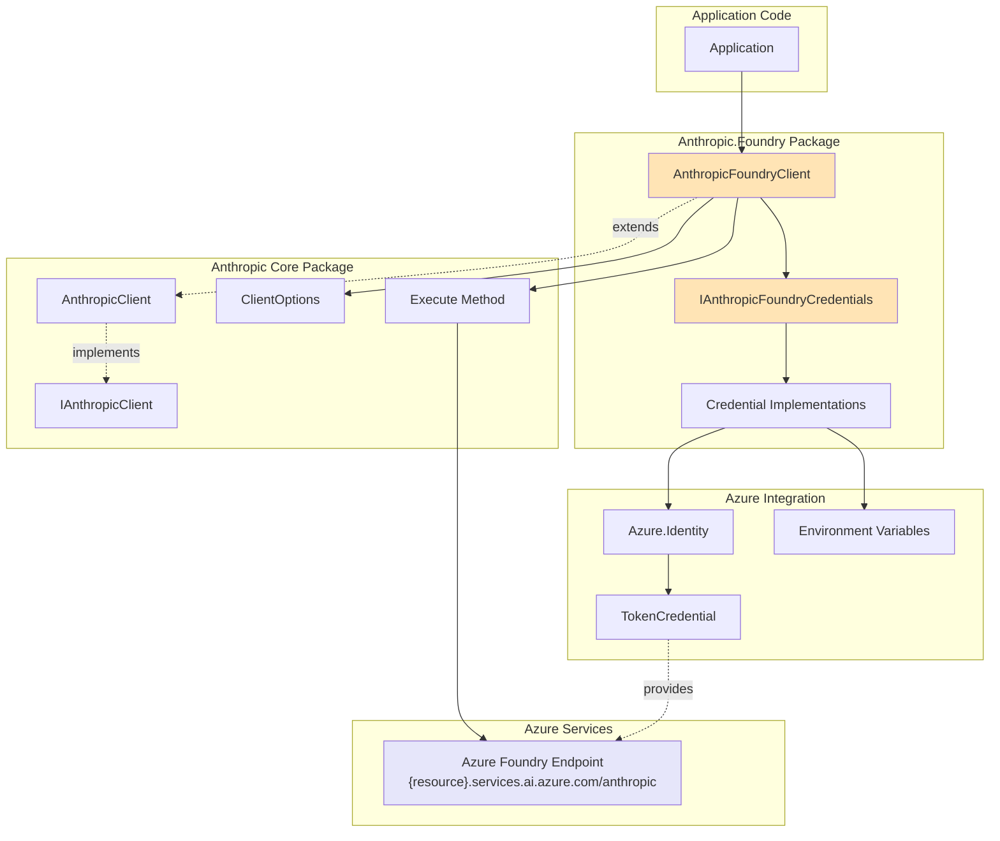
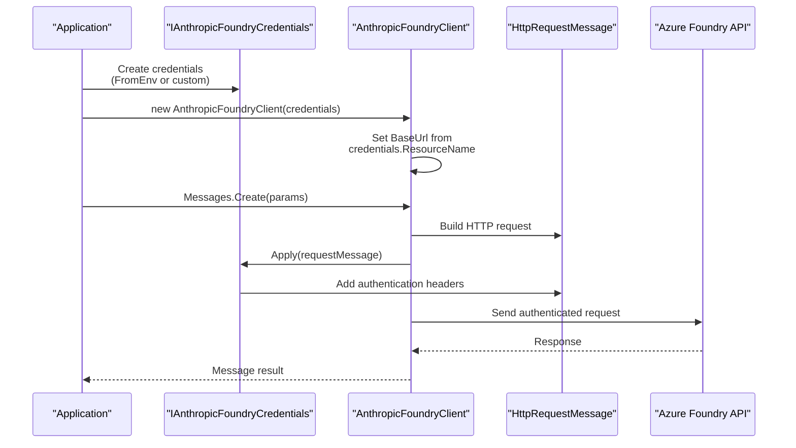
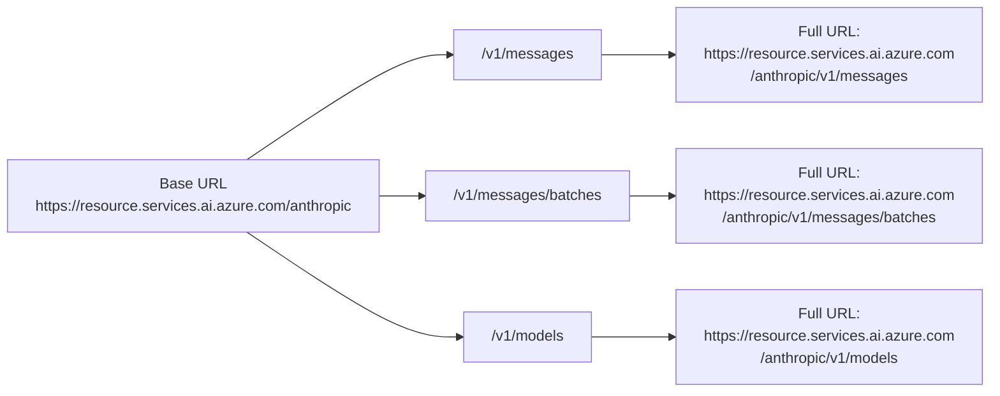
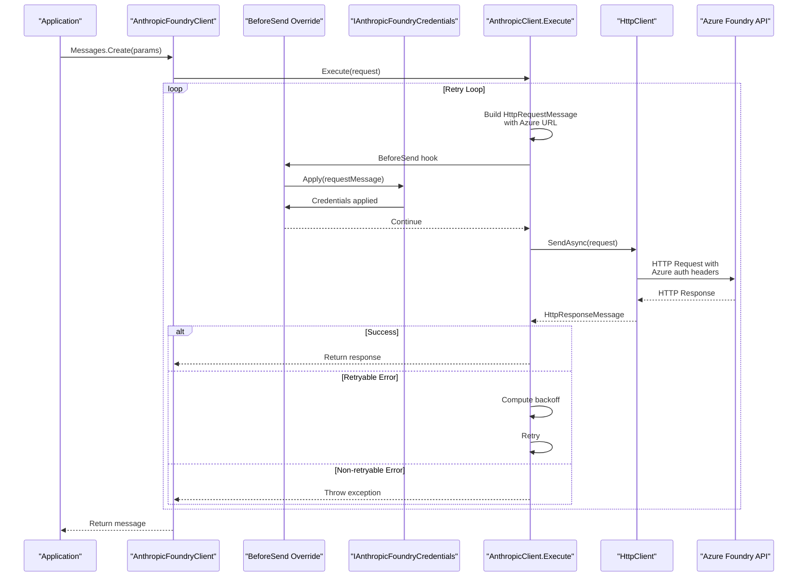
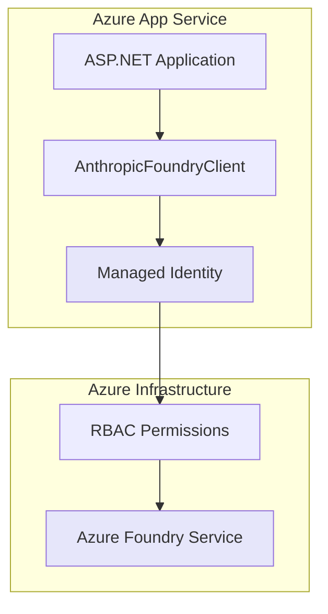
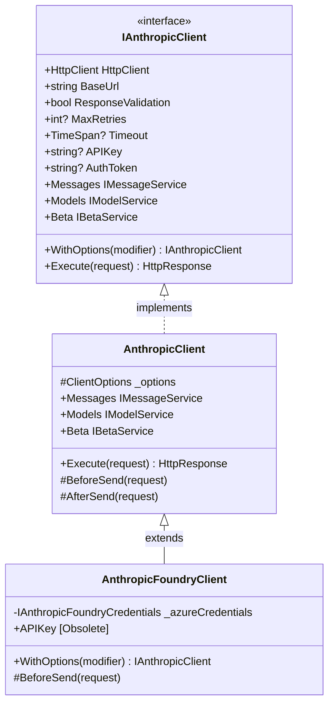

<!-- source: DeepWiki mcp.deepwiki.com · repo anthropics/anthropic-sdk-csharp · page 8.3 Azure Foundry Client · fetched 2026-10-26 -->

# Azure Foundry Client

<details>
<summary>Relevant source files</summary>

The following files were used as context for generating this wiki page:

- [.release-please-manifest.json](.release-please-manifest.json)
- [CHANGELOG.md](CHANGELOG.md)
- [README.md](README.md)
- [examples/ChatClientExample/ChatClientExample.csproj](examples/ChatClientExample/ChatClientExample.csproj)
- [release-please-config.json](release-please-config.json)
- [src/Anthropic.Foundry/Anthropic.Foundry.csproj](src/Anthropic.Foundry/Anthropic.Foundry.csproj)
- [src/Anthropic.Foundry/AnthropicFoundryClient.cs](src/Anthropic.Foundry/AnthropicFoundryClient.cs)
- [src/Anthropic.Foundry/CHANGELOG.md](src/Anthropic.Foundry/CHANGELOG.md)
- [src/Anthropic.Tests/TestBase.cs](src/Anthropic.Tests/TestBase.cs)
- [src/Anthropic/Anthropic.csproj](src/Anthropic/Anthropic.csproj)
- [src/Anthropic/AnthropicClient.cs](src/Anthropic/AnthropicClient.cs)
- [src/Anthropic/CHANGELOG.md](src/Anthropic/CHANGELOG.md)
- [src/Anthropic/Core/ClientOptions.cs](src/Anthropic/Core/ClientOptions.cs)
- [src/Anthropic/Core/EnvironmentUrl.cs](src/Anthropic/Core/EnvironmentUrl.cs)
- [src/Anthropic/IAnthropicClient.cs](src/Anthropic/IAnthropicClient.cs)
- [src/logo.png](src/logo.png)

</details>


## Purpose and Scope

This page documents the Azure Foundry integration for the Anthropic C# SDK, specifically covering the `AnthropicFoundryClient` class and its associated credential management system. The Foundry client enables applications to invoke the Azure-hosted Anthropic API using Azure-native authentication mechanisms.

For core client configuration and behavior, see [Client Layer](#3.1). For general authentication and API configuration, see [Configuration](#2.2).

**Sources:** [src/Anthropic.Foundry/AnthropicFoundryClient.cs:1-64](), [README.md:1-356]()

---

## Package Structure

The Azure Foundry integration is distributed as a separate NuGet package `Anthropic.Foundry` (currently version 0.3.0), which depends on the core `Anthropic` package (version 12.1.0). This allows the core SDK to remain lightweight while providing Azure integration as an opt-in feature.

### Dependencies

| Package | Version | Purpose |
|---------|---------|---------|
| `Anthropic` | 12.1.0 | Core SDK functionality |
| `Azure.Identity` | 1.17.0 | Azure authentication primitives |
| `System.Collections.Immutable` | 8.0.0 | .NET Standard 2.0 compatibility |
| `System.Threading.Tasks.Extensions` | 4.6.3 | .NET Standard 2.0 async support |

**Sources:** [src/Anthropic.Foundry/Anthropic.Foundry.csproj:1-21](), [.release-please-manifest.json:1-4]()

---

## Architecture Overview



**Diagram: Azure Foundry Client Architecture**

The `AnthropicFoundryClient` extends the base `AnthropicClient` class, overriding key behaviors to support Azure-specific authentication and endpoint construction. The credential management is abstracted through the `IAnthropicFoundryCredentials` interface, allowing for flexible authentication strategies.

**Sources:** [src/Anthropic.Foundry/AnthropicFoundryClient.cs:1-64](), [src/Anthropic/AnthropicClient.cs:1-335]()

---

## AnthropicFoundryClient Class

The `AnthropicFoundryClient` class provides Azure-specific functionality while maintaining compatibility with the core SDK's service layer and API methods.

### Class Declaration

```
namespace: Anthropic.Foundry
class: AnthropicFoundryClient : AnthropicClient
```

**Sources:** [src/Anthropic.Foundry/AnthropicFoundryClient.cs:3-8]()

### Constructor

The client requires an `IAnthropicFoundryCredentials` instance at construction time. The BaseUrl is automatically constructed from the credential's `ResourceName` property:

```
BaseUrl = $"https://{azureCredentials.ResourceName}.services.ai.azure.com/anthropic"
```

**Pattern:** `https://{ResourceName}.services.ai.azure.com/anthropic`

The constructor validates that credentials are not null and configures the base URL. A secondary private constructor accepts both credentials and `ClientOptions` for use with the `WithOptions` pattern.

**Sources:** [src/Anthropic.Foundry/AnthropicFoundryClient.cs:12-32]()

### Property Overrides

#### APIKey Property

The `APIKey` property is marked as `[Obsolete]` and throws `NotSupportedException` when accessed:

```csharp
[Obsolete("The {nameof(APIKey)} property is not supported in this configuration.", true)]
public override string? APIKey
{
    get => throw new NotSupportedException(...);
    init => throw new NotSupportedException(...);
}
```

This prevents confusion between standard API key authentication and Azure credential-based authentication.

**Sources:** [src/Anthropic.Foundry/AnthropicFoundryClient.cs:34-46]()

### Method Overrides

#### WithOptions

Returns a new `AnthropicFoundryClient` instance with modified options while preserving the credential configuration:

```csharp
public override IAnthropicClient WithOptions(Func<ClientOptions, ClientOptions> modifier)
{
    return new AnthropicFoundryClient(_azureCredentials, modifier(_options));
}
```

**Sources:** [src/Anthropic.Foundry/AnthropicFoundryClient.cs:49-52]()

#### BeforeSend

The `BeforeSend` method is overridden to inject Azure credentials into each HTTP request before it is sent:

```csharp
protected override ValueTask BeforeSend<T>(
    HttpRequest<T> request,
    HttpRequestMessage requestMessage,
    CancellationToken cancellationToken)
{
    _azureCredentials.Apply(requestMessage);
    return default;
}
```

This hook ensures that every request includes the necessary Azure authentication headers or tokens without requiring manual intervention.

**Sources:** [src/Anthropic.Foundry/AnthropicFoundryClient.cs:54-63]()

---

## Credential Management

### IAnthropicFoundryCredentials Interface

The `IAnthropicFoundryCredentials` interface abstracts credential provisioning and application. While the interface definition is not included in the provided files, its contract can be inferred from usage:

#### Interface Contract

| Member | Type | Purpose |
|--------|------|---------|
| `ResourceName` | `string` | Azure resource name for URL construction |
| `Apply(HttpRequestMessage)` | `void` | Injects authentication into the request |
| `FromEnv()` | `static` | Factory method for environment-based credentials |

**Sources:** [src/Anthropic.Foundry/AnthropicFoundryClient.cs:10-22]()

### Credential Lifecycle



**Diagram: Credential Application Flow**

Credentials are applied to every request through the `BeforeSend` lifecycle hook, ensuring consistent authentication across all API calls.

**Sources:** [src/Anthropic.Foundry/AnthropicFoundryClient.cs:54-63](), [src/Anthropic/AnthropicClient.cs:158-176]()

---

## Azure Authentication

The Foundry client leverages the `Azure.Identity` library for Azure-native authentication mechanisms. This enables several authentication strategies:

### Authentication Methods

| Method | Use Case | Configuration Source |
|--------|----------|---------------------|
| Managed Identity | Azure-hosted applications | Azure infrastructure |
| Service Principal | CI/CD pipelines, automation | Client ID, Secret, Tenant ID |
| DefaultAzureCredential | Development/production flexibility | Multiple sources (chained) |
| Environment-based | Explicit configuration | Environment variables |

### Environment Variables

The credential implementation can read from environment variables to support the `FromEnv()` factory method. While specific variable names are not provided in the files, typical patterns include:

- `AZURE_TENANT_ID`
- `AZURE_CLIENT_ID`
- `AZURE_CLIENT_SECRET`
- Azure resource name configuration

**Sources:** [src/Anthropic.Foundry/Anthropic.Foundry.csproj:14](), [src/Anthropic.Foundry/AnthropicFoundryClient.cs:15]()

---

## Resource URL Configuration

### URL Construction

The client constructs the Azure Foundry API endpoint using the resource name from the credentials:

```
Base URL Pattern: https://{ResourceName}.services.ai.azure.com/anthropic
```

#### Example URLs

| Resource Name | Resulting Base URL |
|---------------|-------------------|
| `my-anthropic-resource` | `https://my-anthropic-resource.services.ai.azure.com/anthropic` |
| `prod-claude-east` | `https://prod-claude-east.services.ai.azure.com/anthropic` |
| `dev-ai-westus` | `https://dev-ai-westus.services.ai.azure.com/anthropic` |

### API Path Handling

The base URL includes the `/anthropic` path prefix. Service-specific paths are appended to this base:



**Diagram: URL Path Construction**

**Sources:** [src/Anthropic.Foundry/AnthropicFoundryClient.cs:21](), [src/Anthropic/Core/ClientOptions.cs:26-38]()

---

## Request Execution Flow



**Diagram: Request Execution with Azure Authentication**

The credential application occurs within the retry loop, ensuring that each retry attempt includes fresh authentication tokens if token refresh is implemented in the credential provider.

**Sources:** [src/Anthropic.Foundry/AnthropicFoundryClient.cs:54-63](), [src/Anthropic/AnthropicClient.cs:104-156](), [src/Anthropic/AnthropicClient.cs:178-222]()

---

## Deployment Scenarios

### Scenario 1: Azure App Service with Managed Identity



**Diagram: Managed Identity Deployment**

In this scenario, the application uses Azure Managed Identity for authentication, eliminating the need to manage credentials in code or configuration files. The App Service's managed identity is granted appropriate RBAC permissions to access the Foundry resource.

### Scenario 2: Local Development with Service Principal

During local development, developers can use service principal credentials stored in environment variables or Azure CLI credentials. The `DefaultAzureCredential` pattern supports seamless transition between development and production environments.

### Scenario 3: Azure Functions with System-Assigned Identity

Azure Functions can use the Foundry client with system-assigned managed identities, enabling serverless Claude API access without credential management.

**Sources:** [src/Anthropic.Foundry/AnthropicFoundryClient.cs:1-64](), [src/Anthropic.Foundry/Anthropic.Foundry.csproj:14]()

---

## Differences from AnthropicClient

### Comparison Table

| Aspect | AnthropicClient | AnthropicFoundryClient |
|--------|-----------------|------------------------|
| **Authentication** | API Key (`ANTHROPIC_API_KEY`) | Azure credentials (Managed Identity, Service Principal) |
| **Base URL** | `https://api.anthropic.com` | `https://{resource}.services.ai.azure.com/anthropic` |
| **APIKey Property** | Supported | Not supported (throws exception) |
| **AuthToken Property** | Supported | Inherited (unused) |
| **Credential Application** | Headers added by base class | Applied via `BeforeSend` override |
| **Configuration** | Environment variables or manual | Credential object required at construction |
| **Package** | `Anthropic` | `Anthropic.Foundry` (extends `Anthropic`) |

### Inheritance Behavior



**Diagram: Class Inheritance Hierarchy**

The `AnthropicFoundryClient` inherits all service properties and methods from `AnthropicClient`, meaning it provides access to the same `Messages`, `Models`, and `Beta` services. The primary differences are in authentication, URL construction, and the `APIKey` property constraint.

**Sources:** [src/Anthropic.Foundry/AnthropicFoundryClient.cs:8](), [src/Anthropic/AnthropicClient.cs:15](), [src/Anthropic/IAnthropicClient.cs:22]()

---

## Service Access and Compatibility

### Service Layer Access

The Foundry client provides identical service access to the base client:

```csharp
// All service methods work identically
var message = await foundryClient.Messages.Create(params);
var models = await foundryClient.Models.List();
var betaMessage = await foundryClient.Beta.Messages.Create(params);
```

### WithOptions Compatibility

The `WithOptions` pattern is fully supported and returns an `AnthropicFoundryClient` instance:

```csharp
var modifiedClient = foundryClient.WithOptions(options => options with 
{
    Timeout = TimeSpan.FromSeconds(30),
    MaxRetries = 5
});

// modifiedClient is AnthropicFoundryClient with same credentials
```

The returned client maintains the same Azure credentials while applying the modified options.

**Sources:** [src/Anthropic.Foundry/AnthropicFoundryClient.cs:49-52](), [README.md:98-118]()

---

## Error Handling

### Authentication Errors

Authentication failures manifest as HTTP 401 or 403 responses, which are handled by the base client's exception system (see [Error Handling](#3.4)). The credential provider may also throw exceptions during token acquisition.

### Resource Configuration Errors

Invalid resource names result in DNS resolution failures or HTTP 404 responses when the Azure Foundry service cannot be reached. These are wrapped in `AnthropicIOException` or `AnthropicNotFoundException` depending on the failure mode.

**Sources:** [src/Anthropic/AnthropicClient.cs:135-145](), [README.md:213-238]()

---

## Version Compatibility

The Foundry package follows independent versioning from the core SDK:

| Release | Anthropic Version | Foundry Version | Notes |
|---------|------------------|-----------------|-------|
| Current | 12.1.0 | 0.3.0 | Production ready |
| Previous | 12.0.0 | 0.2.0 | `WithOptions` return type fix |
| Initial | 11.0.0 | 0.1.0 | Initial Azure integration |

Breaking changes in the Foundry package are tracked separately from the core SDK. Applications using the Foundry client should specify both package versions in their dependencies.

**Sources:** [.release-please-manifest.json:1-4](), [src/Anthropic.Foundry/CHANGELOG.md:1-78](), [CHANGELOG.md:1-350]()

---

## Testing Considerations

The `TestBase` class and test infrastructure support both standard and Foundry client configurations:

```csharp
[AnthropicTestClients]
public async Task TestMethod(IAnthropicClient client)
{
    // Test works with both AnthropicClient and AnthropicFoundryClient
}
```

The `AnthropicTestClientsAttribute` can provision either client type based on test configuration, allowing tests to verify Azure integration without code duplication.

**Sources:** [src/Anthropic.Tests/TestBase.cs:1-23]()

---

