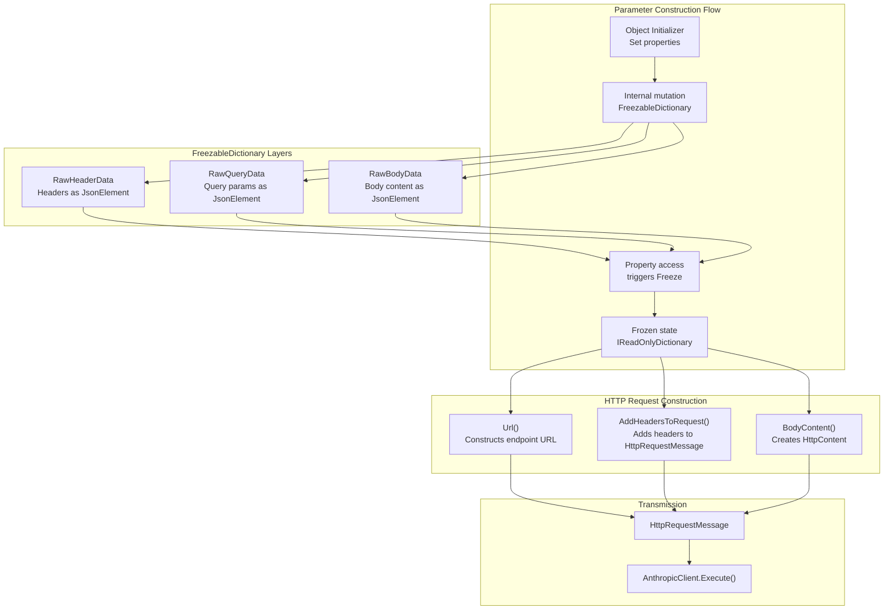
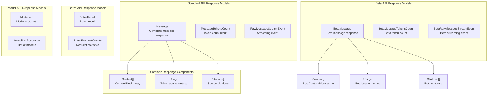
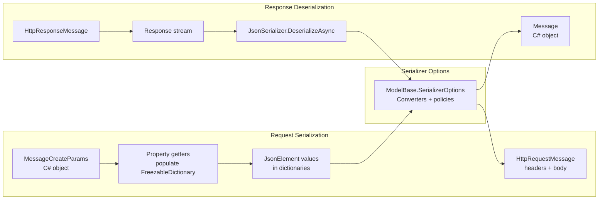
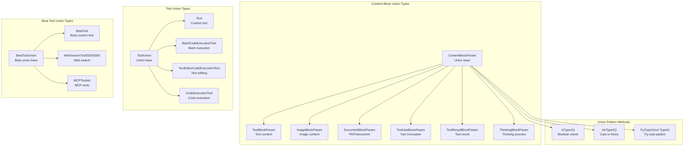

<!-- source: DeepWiki mcp.deepwiki.com · repo anthropics/anthropic-sdk-csharp · page 9 Data Models Reference · fetched 2026-10-26 -->

# Data Models Reference

<details>
<summary>Relevant source files</summary>

The following files were used as context for generating this wiki page:

- [.stats.yml](.stats.yml)
- [src/Anthropic/Core/ApiEnum.cs](src/Anthropic/Core/ApiEnum.cs)
- [src/Anthropic/Core/FreezableDictionary.cs](src/Anthropic/Core/FreezableDictionary.cs)
- [src/Anthropic/Core/HttpResponse.cs](src/Anthropic/Core/HttpResponse.cs)
- [src/Anthropic/Core/ParamsBase.cs](src/Anthropic/Core/ParamsBase.cs)
- [src/Anthropic/Models/Beta/AnthropicBeta.cs](src/Anthropic/Models/Beta/AnthropicBeta.cs)
- [src/Anthropic/Models/Messages/Model.cs](src/Anthropic/Models/Messages/Model.cs)
- [src/Anthropic/Services/Beta/MessageService.cs](src/Anthropic/Services/Beta/MessageService.cs)
- [src/Anthropic/Services/MessageService.cs](src/Anthropic/Services/MessageService.cs)

</details>


## Purpose and Scope

This page provides a comprehensive reference for all data models, types, and enumerations in the Anthropic C# SDK. It documents the foundational infrastructure classes (`ModelBase`, `ParamsBase`, `FreezableDictionary`, `ApiEnum`), type-safe enumerations (`Model`, `AnthropicBeta`), serialization mechanisms, and the union type pattern used throughout the SDK.

For information about:
- How models are used in message creation and response handling, see [Working with Messages](#5)
- Tool-related types and union structures, see [Tools and Function Calling](#6)
- Advanced feature types like context management and thinking blocks, see [Advanced Features](#7)
- Integration-specific type conversions for IChatClient, see [Microsoft.Extensions.AI (IChatClient)](#8.1)

The SDK's detailed sub-topics are covered in:
- Base infrastructure implementation details: [Model Base Infrastructure](#9.1)
- Discriminated union patterns: [Union Types](#9.2)
- Complete Model enum catalog: [Model Selection](#9.3)
- Complete beta features catalog: [Beta Features Enum](#9.4)

## Type System Architecture

The SDK employs a layered type system with several architectural patterns working together:

### Architecture Overview

```mermaid
graph TB
    subgraph "Base Infrastructure Layer"
        ModelBase["ModelBase<br/>Response serialization"]
        ParamsBase["ParamsBase<br/>Request parameters"]
        FreezableDictionary["FreezableDictionary&lt;K,V&gt;<br/>Mutable-then-frozen"]
        ApiEnum["ApiEnum&lt;TRaw,TEnum&gt;<br/>Forward-compatible enums"]
    end
    
    subgraph "Type-Safe Enumerations"
        Model["Model enum<br/>20 model variants"]
        AnthropicBeta["AnthropicBeta enum<br/>19 beta features"]
        ServiceTier["ServiceTier enum<br/>Auto/Standard"]
    end
    
    subgraph "Request Parameter Types"
        MessageCreateParams["MessageCreateParams"]
        BatchCreateParams["BatchCreateParams"]
        MessageCountTokensParams["MessageCountTokensParams"]
    end
    
    subgraph "Response Model Types"
        Message["Message"]
        BetaMessage["BetaMessage"]
        MessageTokensCount["MessageTokensCount"]
        BatchResult["BatchResult"]
    end
    
    subgraph "Union Types"
        ContentBlockParam["ContentBlockParam<br/>Union"]
        ToolUnion["ToolUnion<br/>Union"]
        BetaToolUnion["BetaToolUnion<br/>Union"]
    end
    
    subgraph "Content Variants"
        TextBlockParam["TextBlockParam"]
        ImageBlockParam["ImageBlockParam"]
        ToolUseBlockParam["ToolUseBlockParam"]
        ToolResultBlockParam["ToolResultBlockParam"]
    end
    
    subgraph "Tool Variants"
        Tool["Tool<br/>Custom"]
        BashTool["BashCodeExecutionTool"]
        WebSearchTool["WebSearchTool"]
        MCPToolset["MCPToolset"]
    end
    
    ParamsBase --> MessageCreateParams
    ParamsBase --> BatchCreateParams
    ParamsBase --> FreezableDictionary
    
    MessageCreateParams --> Model
    MessageCreateParams --> ContentBlockParam
    MessageCreateParams --> ToolUnion
    MessageCreateParams --> AnthropicBeta
    
    ContentBlockParam --> TextBlockParam
    ContentBlockParam --> ImageBlockParam
    ContentBlockParam --> ToolUseBlockParam
    ContentBlockParam --> ToolResultBlockParam
    
    ToolUnion --> Tool
    ToolUnion --> BashTool
    BetaToolUnion --> WebSearchTool
    BetaToolUnion --> MCPToolset
    
    Message --> ModelBase
    BetaMessage --> ModelBase
    MessageTokensCount --> ModelBase
```



Sources: [src/Anthropic/Core/ParamsBase.cs](), [src/Anthropic/Core/FreezableDictionary.cs](), [src/Anthropic/Core/ApiEnum.cs](), [src/Anthropic/Models/Messages/Model.cs](), [src/Anthropic/Models/Beta/AnthropicBeta.cs]()

### Key Architectural Patterns

1. **Base Infrastructure**: `ModelBase`, `ParamsBase`, and `FreezableDictionary` provide foundational serialization and parameter handling
2. **Type-Safe Enumerations**: `Model` and `AnthropicBeta` enums with custom JSON converters for API compatibility
3. **Discriminated Unions**: Union types for polymorphic content blocks and tool definitions
4. **API Enum Wrapper**: `ApiEnum<TRaw, TEnum>` for gracefully handling unknown enum values from newer API versions
5. **Parallel Type Hierarchies**: Separate type sets for stable API (`Message`, `Tool`) and beta API (`BetaMessage`, `BetaTool`)

## Core Infrastructure Types

### ModelBase

Foundation class for all response models. Provides shared `JsonSerializerOptions` configuration and standardized serialization/deserialization behavior. All response types inherit from this base.

### ParamsBase

Abstract base class for all request parameter types located at [src/Anthropic/Core/ParamsBase.cs:14-276](). Key responsibilities:

- Maintains three `FreezableDictionary` instances for headers, query parameters, and body data
- Provides abstract `Url(ClientOptions)` method for URL construction
- Converts `JsonElement` values to HTTP headers via `AddHeaderElementToRequest()`
- Converts `JsonElement` values to query string via `AddQueryElementToCollection()`
- Adds default headers including User-Agent, API version, and runtime metadata

Default headers automatically added at [src/Anthropic/Core/ParamsBase.cs:16-31]():
- `User-Agent`: Package name and version
- `X-Stainless-Arch`: OS architecture (x32, x64, arm, arm64)
- `X-Stainless-Lang`: "csharp"
- `X-Stainless-OS`: Operating system (Windows, MacOS, Linux)
- `X-Stainless-Package-Version`: SDK version
- `X-Stainless-Runtime`: Runtime name and version
- `anthropic-version`: "2023-06-01"

### FreezableDictionary<K, V>

A dictionary that can be mutated during construction, then frozen to prevent further modifications, located at [src/Anthropic/Core/FreezableDictionary.cs:16-166]().

**Key Features:**
- Allows modification during object initialization via `init` properties
- `Freeze()` method converts to `FrozenDictionary` and returns `IReadOnlyDictionary<K, V>`
- Throws `InvalidOperationException` on mutation attempts after freezing
- Used internally by `ParamsBase` for `RawHeaderData`, `RawQueryData`, and `RawBodyData`

**Lifecycle:**
1. Construction: `new FreezableDictionary<K, V>()`
2. Mutation: Set values via indexer or `Add()`
3. Freezing: Call `Freeze()` or access via `RawHeaderData`/`RawQueryData`/`RawBodyData` properties
4. Read-only: All operations return frozen dictionary values

Sources: [src/Anthropic/Core/FreezableDictionary.cs:16-166]()

### ApiEnum<TRaw, TEnum>

Wrapper type for handling enum values that may be outside the range of known enum members, located at [src/Anthropic/Core/ApiEnum.cs:24-88]().

**Usage Pattern:**
```
ApiEnum<string, Model> modelValue = responseData.Model;

// Get enum value (returns (Model)(-1) if unknown)
Model model = modelValue.Value();

// Get raw string value
string rawModel = modelValue.Raw();

// Access JsonElement directly
JsonElement json = modelValue.Json;

// Validate known member
modelValue.Validate(); // throws if unknown
```

**Key Methods:**
- `.Value()`: Returns `TEnum` member or `(TEnum)(-1)` if unknown
- `.Raw()`: Returns `TRaw` value, throws `AnthropicInvalidDataException` if type mismatch
- `.Json`: Property exposing underlying `JsonElement`
- `.Validate()`: Throws `AnthropicInvalidDataException` if value is not a defined enum member

**Implicit Operators:**
- `TRaw` → `ApiEnum<TRaw, TEnum>`
- `TEnum` → `ApiEnum<TRaw, TEnum>`
- `ApiEnum<TRaw, TEnum>` → `TRaw`
- `ApiEnum<TRaw, TEnum>` → `TEnum`

Sources: [src/Anthropic/Core/ApiEnum.cs:24-88]()

### HttpResponse

Wrapper for `HttpResponseMessage` providing deserialization and stream access, located at [src/Anthropic/Core/HttpResponse.cs:11-67]().

**Key Methods:**
- `Deserialize<T>(CancellationToken)`: Async deserialization using `ModelBase.SerializerOptions`
- `ReadAsStream(CancellationToken)`: Returns response content as `Stream`
- `ReadAsString(CancellationToken)`: Returns response content as `string`

**Properties:**
- `Message`: The underlying `HttpResponseMessage`
- `CancellationToken`: Cancellation token for the operation

Sources: [src/Anthropic/Core/HttpResponse.cs:11-67]()

## Model Enumeration

The `Model` enum at [src/Anthropic/Models/Messages/Model.cs:13-126]() defines all available Claude model variants.

### Model Variants Table

| C# Enum Member | JSON Value | Status | Description |
|----------------|------------|--------|-------------|
| `ClaudeOpus4_5_20251101` | `claude-opus-4-5-20251101` | Current | Premium model combining maximum intelligence with practical performance |
| `ClaudeOpus4_5` | `claude-opus-4-5` | Current | Premium model combining maximum intelligence with practical performance |
| `Claude3_7SonnetLatest` | `claude-3-7-sonnet-latest` | **Deprecated** | EOL: February 19, 2026 |
| `Claude3_7Sonnet20250219` | `claude-3-7-sonnet-20250219` | **Deprecated** | EOL: February 19, 2026 |
| `Claude3_5HaikuLatest` | `claude-3-5-haiku-latest` | Current | Fastest and most compact model for near-instant responsiveness |
| `Claude3_5Haiku20241022` | `claude-3-5-haiku-20241022` | Current | Our fastest model |
| `ClaudeHaiku4_5` | `claude-haiku-4-5` | Current | Hybrid model, capable of near-instant responses and extended thinking |
| `ClaudeHaiku4_5_20251001` | `claude-haiku-4-5-20251001` | Current | Hybrid model, capable of near-instant responses and extended thinking |
| `ClaudeSonnet4_20250514` | `claude-sonnet-4-20250514` | Current | High-performance model with extended thinking |
| `ClaudeSonnet4_0` | `claude-sonnet-4-0` | Current | High-performance model with extended thinking |
| `Claude4Sonnet20250514` | `claude-4-sonnet-20250514` | Current | High-performance model with extended thinking |
| `ClaudeSonnet4_5` | `claude-sonnet-4-5` | Current | Our best model for real-world agents and coding |
| `ClaudeSonnet4_5_20250929` | `claude-sonnet-4-5-20250929` | Current | Our best model for real-world agents and coding |
| `ClaudeOpus4_0` | `claude-opus-4-0` | Current | Our most capable model |
| `ClaudeOpus4_20250514` | `claude-opus-4-20250514` | Current | Our most capable model |
| `Claude4Opus20250514` | `claude-4-opus-20250514` | Current | Our most capable model |
| `ClaudeOpus4_1_20250805` | `claude-opus-4-1-20250805` | Current | Our most capable model |
| `Claude3OpusLatest` | `claude-3-opus-latest` | **Deprecated** | EOL: January 5, 2026 |
| `Claude_3_Opus_20240229` | `claude-3-opus-20240229` | **Deprecated** | EOL: January 5, 2026 |
| `Claude_3_Haiku_20240307` | `claude-3-haiku-20240307` | Current | Previous most fast and cost-effective |

### Custom Serialization

The `Model` enum uses `ModelConverter` at [src/Anthropic/Models/Messages/Model.cs:128-195]() for JSON serialization:

**Deserialization (`Read` method):**
- Maps JSON strings to enum members via switch expression
- Returns `(Model)(-1)` for unknown model strings
- Enables forward compatibility when API introduces new models

**Serialization (`Write` method):**
- Maps enum members to JSON strings
- Throws `AnthropicInvalidDataException` for invalid enum values
- Ensures only valid models are sent to API

Sources: [src/Anthropic/Models/Messages/Model.cs:13-195]()

## AnthropicBeta Enumeration

The `AnthropicBeta` enum at [src/Anthropic/Models/Beta/AnthropicBeta.cs:9-30]() represents beta features enabled via the `anthropic-beta` header.

### Beta Features Table

| C# Enum Member | JSON Value | Feature |
|----------------|------------|---------|
| `MessageBatches2024_09_24` | `message-batches-2024-09-24` | Batch processing for messages |
| `PromptCaching2024_07_31` | `prompt-caching-2024-07-31` | Cache frequently used prompts |
| `ComputerUse2024_10_22` | `computer-use-2024-10-22` | Computer interaction tools |
| `ComputerUse2025_01_24` | `computer-use-2025-01-24` | Computer interaction tools (updated) |
| `PDFs2024_09_25` | `pdfs-2024-09-25` | PDF document support |
| `TokenCounting2024_11_01` | `token-counting-2024-11-01` | Token counting API |
| `TokenEfficientTools2025_02_19` | `token-efficient-tools-2025-02-19` | Efficient tool definitions |
| `Output128k2025_02_19` | `output-128k-2025-02-19` | Extended output context window |
| `FilesAPI2025_04_14` | `files-api-2025-04-14` | Files service for document upload |
| `MCPClient2025_04_04` | `mcp-client-2025-04-04` | Model Context Protocol integration |
| `MCPClient2025_11_20` | `mcp-client-2025-11-20` | Model Context Protocol (updated) |
| `DevFullThinking2025_05_14` | `dev-full-thinking-2025-05-14` | Development thinking mode |
| `InterleavedThinking2025_05_14` | `interleaved-thinking-2025-05-14` | Interleaved thinking blocks |
| `CodeExecution2025_05_22` | `code-execution-2025-05-22` | Code execution tools |
| `ExtendedCacheTTL2025_04_11` | `extended-cache-ttl-2025-04-11` | Extended cache TTL options (5m, 1h) |
| `Context1m2025_08_07` | `context-1m-2025-08-07` | 1 million token context window |
| `ContextManagement2025_06_27` | `context-management-2025-06-27` | Context management features |
| `ModelContextWindowExceeded2025_08_26` | `model-context-window-exceeded-2025-08-26` | Context window exceeded handling |
| `Skills2025_10_02` | `skills-2025-10-02` | Skills system for containers |

### Custom Serialization

The `AnthropicBeta` enum uses `AnthropicBetaConverter` at [src/Anthropic/Models/Beta/AnthropicBeta.cs:32-103]():
- Follows same serialization pattern as `ModelConverter`
- Returns `(AnthropicBeta)(-1)` for unknown beta feature strings
- Throws `AnthropicInvalidDataException` on serialization of invalid values

Sources: [src/Anthropic/Models/Beta/AnthropicBeta.cs:8-103]()

## Request Parameter Types

All request parameter types inherit from `ParamsBase` and follow a consistent pattern for managing request data.

### Request Parameter Architecture



Sources: [src/Anthropic/Core/ParamsBase.cs:14-276]()

### Key Parameter Types

| Type | Purpose | Key Properties |
|------|---------|----------------|
| `MessageCreateParams` | Create message requests | `Model`, `Messages`, `MaxTokens`, `System`, `Temperature`, `Tools`, `Metadata` |
| `MessageCountTokensParams` | Count tokens before sending | `Model`, `Messages`, `System`, `Tools` |
| `BatchCreateParams` | Batch processing requests | `Requests` (array of request objects) |
| `ModelRetrieveParams` | Retrieve model information | `ModelId` |
| `BetaMessageCreateParams` | Beta message creation | Extends standard params with beta-specific fields |

### Parameter Lifecycle

1. **Construction**: Create instance with object initializer syntax
2. **Property Setting**: Properties modify internal `FreezableDictionary` instances
3. **Freezing**: When passed to service method, accessing `RawHeaderData`/`RawQueryData`/`RawBodyData` freezes dictionaries
4. **Serialization**: `JsonElement` values converted to HTTP request components
5. **Transmission**: HTTP request sent to Anthropic API

### Example Usage in Service

From [src/Anthropic/Services/MessageService.cs:39-64]():
```csharp
public async Task<Message> Create(
    MessageCreateParams parameters,
    CancellationToken cancellationToken = default
)
{
    HttpRequest<MessageCreateParams> request = new()
    {
        Method = HttpMethod.Post,
        Params = parameters,
    };
    using var response = await this._client.WithOptions(options => 
        options with { Timeout = options.Timeout ?? TimeSpan.FromMinutes(10) })
        .Execute(request, cancellationToken)
        .ConfigureAwait(false);
    var message = await response.Deserialize<Message>(cancellationToken);
    if (this._client.ResponseValidation)
    {
        message.Validate();
    }
    return message;
}
```

Sources: [src/Anthropic/Services/MessageService.cs:39-64](), [src/Anthropic/Services/Beta/MessageService.cs:43-70]()

## Response Model Types

Response models inherit from `ModelBase` and represent API responses with standardized deserialization.

### Response Model Hierarchy



Sources: [src/Anthropic/Services/MessageService.cs:58-63](), [src/Anthropic/Services/Beta/MessageService.cs:62-69]()

### Response Validation

Response models support validation via the `Validate()` method. When `ResponseValidation` is enabled on the client:

```csharp
// From MessageService.Create
var message = await response.Deserialize<Message>(cancellationToken);
if (this._client.ResponseValidation)
{
    message.Validate();
}
return message;
```

The `Validate()` method checks that:
- All enum values are defined members (not `(TEnum)(-1)`)
- Required fields are present
- Data types match expected types

Sources: [src/Anthropic/Services/MessageService.cs:58-63]()

## Serialization System

### Serialization and Deserialization Flow



Sources: [src/Anthropic/Core/HttpResponse.cs:17-38](), [src/Anthropic/Core/ParamsBase.cs:56-158]()

### JsonSerializerOptions Configuration

All serialization uses `ModelBase.SerializerOptions` which includes:
- Property name case-insensitive matching
- Camel case property naming policy
- Number handling for strings
- Custom converters for enums (`ModelConverter`, `AnthropicBetaConverter`)
- Custom converters for union types (`ApiEnumConverter<TRaw, TEnum>`)

### Custom JSON Converters

| Converter Class | Applied To | Purpose |
|-----------------|------------|---------|
| `ModelConverter` | `Model` enum | Maps enum members ↔ JSON strings like `"claude-opus-4-5"` |
| `AnthropicBetaConverter` | `AnthropicBeta` enum | Maps enum members ↔ JSON strings like `"message-batches-2024-09-24"` |
| `ApiEnumConverter<TRaw, TEnum>` | `ApiEnum<TRaw, TEnum>` | Wraps/unwraps `JsonElement` for forward compatibility |

### Request Serialization Details

From [src/Anthropic/Core/ParamsBase.cs:56-108](), request parameters are serialized in stages:

1. **Query Parameters**: `AddQueryElementToCollection()` converts `JsonElement` to query string
   - Strings, numbers, booleans → direct string conversion
   - Arrays → comma-separated values
   - Objects → flattened key[subkey] format

2. **Headers**: `AddHeaderElementToRequest()` converts `JsonElement` to HTTP headers
   - Strings, numbers, booleans → direct string conversion
   - Arrays → multiple header values with same key
   - Objects → dot-notation keys (key.subkey)

3. **Body**: `BodyContent()` returns `HttpContent` with JSON body

### Response Deserialization Details

From [src/Anthropic/Core/HttpResponse.cs:17-38](), responses are deserialized:

```csharp
public async Task<T> Deserialize<T>(CancellationToken cancellationToken = default)
{
    return await JsonSerializer.DeserializeAsync<T>(
        await this.ReadAsStream(cts.Token),
        ModelBase.SerializerOptions,
        cts.Token
    ) ?? throw new AnthropicInvalidDataException("Response cannot be null");
}
```

Sources: [src/Anthropic/Core/HttpResponse.cs:17-38](), [src/Anthropic/Core/ParamsBase.cs:56-158]()

## Union Type Pattern

The SDK uses discriminated union types extensively for polymorphic API structures like content blocks and tools.

### Union Type Architecture



Sources: Inferred from architecture patterns

### Union Type Methods

Each union type provides three method patterns for type checking and casting:

1. **`IsTypeX()` methods**: Return `bool` indicating if instance is of specific variant
2. **`AsTypeX()` methods**: Cast to specific variant, throw exception if wrong type
3. **`TryTypeX(out TypeX)` methods**: Try-cast pattern, returns `bool` and outputs value if successful

### Parallel Union Hierarchies

The SDK maintains parallel type hierarchies for stable and beta APIs to allow independent evolution:

| Stable API Type | Beta API Type | Purpose |
|-----------------|---------------|---------|
| `ToolUnion` | `BetaToolUnion` | Tool type discriminated union |
| `ContentBlock` | `BetaContentBlock` | Response content blocks |
| `ContentBlockParam` | `BetaContentBlockParam` | Request content blocks |
| `Message` | `BetaMessage` | Complete message response |
| `Tool` | `BetaTool` | Custom tool definition |
| `Edit` | `BetaEdit` | Context management edits |
| `Citation` | `BetaCitation` | Source citations |

This design allows:
- Beta features to evolve without breaking stable API
- Type-safe usage of beta-specific features
- Clear separation of stable vs experimental APIs
- Independent versioning of feature sets

Sources: Inferred from architecture patterns

## Type System Summary

The data model architecture provides:

### Key Design Principles

1. **Immutability After Initialization**: `FreezableDictionary` allows property setting during construction, then freezes for thread-safety
2. **Type Safety**: Strong typing with enums and union types prevents runtime errors
3. **Forward Compatibility**: `ApiEnum` wrapper handles unknown enum values gracefully when API is newer than SDK
4. **Parallel Hierarchies**: Separate stable/beta type trees enable independent evolution
5. **Consistent Serialization**: Centralized `JsonSerializerOptions` and custom converters ensure uniform JSON handling
6. **Validation Support**: Response models validate enum values when `ResponseValidation` is enabled
7. **Raw Access**: Access to underlying `JsonElement` for debugging and compatibility scenarios

### Type System Capabilities

```mermaid
graph TB
    subgraph "Type Safety Features"
        StrongTyping["Strong Typing<br/>Compile-time checking"]
        UnionTypes["Union Types<br/>Discriminated unions"]
        EnumTypes["Type-safe Enums<br/>Model, AnthropicBeta"]
    end
    
    subgraph "Flexibility Features"
        ApiEnumWrapper["ApiEnum Wrapper<br/>Forward compatibility"]
        RawAccess["JsonElement Access<br/>Debugging support"]
        ParallelHierarchies["Parallel Hierarchies<br/>Stable vs Beta"]
    end
    
    subgraph "Safety Features"
        Immutability["Immutability<br/>After initialization"]
        Validation["Response Validation<br/>Enum checking"]
        CustomConverters["Custom Converters<br/>Controlled serialization"]
    end
    
    StrongTyping --> CompileTime["Compile-time<br/>error detection"]
    UnionTypes --> TypeSafe["Type-safe<br/>polymorphism"]
    EnumTypes --> APICompatible["API-compatible<br/>serialization"]
    
    ApiEnumWrapper --> ForwardCompat["Forward compatibility<br/>with newer APIs"]
    RawAccess --> Debugging["Debugging<br/>and inspection"]
    ParallelHierarchies --> Independent["Independent<br/>evolution"]
    
    Immutability --> ThreadSafe["Thread-safe<br/>after freeze"]
    Validation --> RuntimeSafe["Runtime<br/>safety checks"]
    CustomConverters --> Predictable["Predictable<br/>JSON format"]
```



Sources: [src/Anthropic/Core/ParamsBase.cs](), [src/Anthropic/Core/FreezableDictionary.cs](), [src/Anthropic/Core/ApiEnum.cs](), [src/Anthropic/Models/Messages/Model.cs](), [src/Anthropic/Models/Beta/AnthropicBeta.cs]()

For detailed information on specific model categories, see:
- Infrastructure class implementations: [Model Base Infrastructure](#9.1)
- Union type patterns and usage: [Union Types](#9.2)
- Complete Model enum reference and deprecations: [Model Selection](#9.3)
- Complete AnthropicBeta enum reference: [Beta Features Enum](#9.4)

---

