<!-- source: DeepWiki mcp.deepwiki.com · repo anthropics/anthropic-sdk-csharp · page 9.1 Model Base Infrastructure · fetched 2026-10-26 -->

# Model Base Infrastructure

<details>
<summary>Relevant source files</summary>

The following files were used as context for generating this wiki page:

- [.csharpierignore](.csharpierignore)
- [src/Anthropic.Tests/Anthropic.Tests.csproj](src/Anthropic.Tests/Anthropic.Tests.csproj)
- [src/Anthropic.Tests/Models/Beta/AnthropicBetaTest.cs](src/Anthropic.Tests/Models/Beta/AnthropicBetaTest.cs)
- [src/Anthropic.Tests/Models/Beta/Files/DeletedFileTest.cs](src/Anthropic.Tests/Models/Beta/Files/DeletedFileTest.cs)
- [src/Anthropic.Tests/Models/Beta/Messages/Batches/BetaMessageBatchTest.cs](src/Anthropic.Tests/Models/Beta/Messages/Batches/BetaMessageBatchTest.cs)
- [src/Anthropic.Tests/Models/Beta/Messages/BetaBase64ImageSourceTest.cs](src/Anthropic.Tests/Models/Beta/Messages/BetaBase64ImageSourceTest.cs)
- [src/Anthropic.Tests/Models/Beta/Messages/BetaBashCodeExecutionToolResultErrorParamTest.cs](src/Anthropic.Tests/Models/Beta/Messages/BetaBashCodeExecutionToolResultErrorParamTest.cs)
- [src/Anthropic.Tests/Models/Beta/Messages/BetaBashCodeExecutionToolResultErrorTest.cs](src/Anthropic.Tests/Models/Beta/Messages/BetaBashCodeExecutionToolResultErrorTest.cs)
- [src/Anthropic.Tests/Models/Beta/Messages/BetaCacheControlEphemeralTest.cs](src/Anthropic.Tests/Models/Beta/Messages/BetaCacheControlEphemeralTest.cs)
- [src/Anthropic/Core/ApiEnum.cs](src/Anthropic/Core/ApiEnum.cs)
- [src/Anthropic/Core/FreezableDictionary.cs](src/Anthropic/Core/FreezableDictionary.cs)
- [src/Anthropic/Core/HttpResponse.cs](src/Anthropic/Core/HttpResponse.cs)
- [src/Anthropic/Core/ParamsBase.cs](src/Anthropic/Core/ParamsBase.cs)
- [src/Anthropic/Services/Beta/MessageService.cs](src/Anthropic/Services/Beta/MessageService.cs)
- [src/Anthropic/Services/MessageService.cs](src/Anthropic/Services/MessageService.cs)

</details>


This document explains the core serialization infrastructure that underpins all data models in the SDK, including `ModelBase`, `ParamsBase`, and their supporting components. These base classes provide JSON serialization, deserialization, validation, and raw data access for both request parameters and response objects.

For specific model types (like union types), see [Union Types](#9.2). For information about using models in API calls, see [Request and Response Flow](#3.3).

## Overview

The model base infrastructure provides two abstract base classes:

- **`ModelBase`** - Base class for all API response objects (e.g., `Message`, `MessageBatch`)
- **`ParamsBase`** - Base class for all API request parameters (e.g., `MessageCreateParams`)

Both classes store their data in a `FreezableDictionary<string, JsonElement>`, enabling:
1. **Forward compatibility** - Unknown properties from newer API versions are preserved
2. **Raw data access** - Direct access to underlying JSON for advanced use cases
3. **Type-safe deserialization** - Strongly-typed properties with validation
4. **Immutability** - Data can be frozen after construction to prevent modification

**Sources:** [src/Anthropic/Core/ModelBase.cs:1-289](), [src/Anthropic/Core/ParamsBase.cs:1-277]()

## ModelBase Class

`ModelBase` is the abstract base class for all API response objects. It provides JSON serialization infrastructure, validation, and raw data access.

### Core Structure

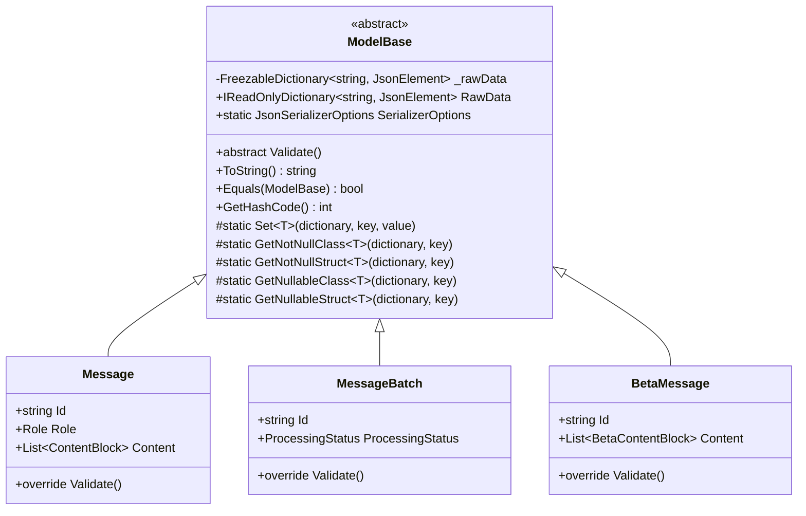

**Sources:** [src/Anthropic/Core/ModelBase.cs:17-265]()

### Key Properties and Methods

| Member | Type | Description |
|--------|------|-------------|
| `_rawData` | `FreezableDictionary<string, JsonElement>` | Private backing storage for all properties |
| `RawData` | `IReadOnlyDictionary<string, JsonElement>` | Public read-only access to raw JSON data |
| `SerializerOptions` | `static JsonSerializerOptions` | Global JSON serialization settings |
| `Validate()` | `abstract void` | Validates required fields and types |
| `ToString()` | `string` | Returns pretty-printed JSON |

**Sources:** [src/Anthropic/Core/ModelBase.cs:17-289]()

### JSON Serialization Configuration

The `SerializerOptions` static field [src/Anthropic/Core/ModelBase.cs:34-112]() configures all JSON converters used throughout the SDK:

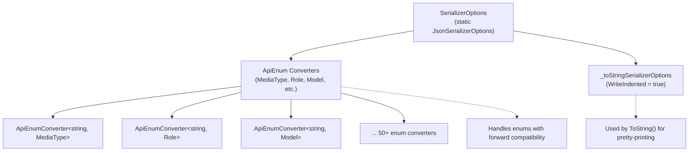

The `SerializerOptions` includes converters for over 50 enum types across the Messages, Beta, and Files namespaces.

**Sources:** [src/Anthropic/Core/ModelBase.cs:34-112]()

### Helper Methods for Property Access

`ModelBase` provides protected static methods for safe property access from the raw data dictionary:

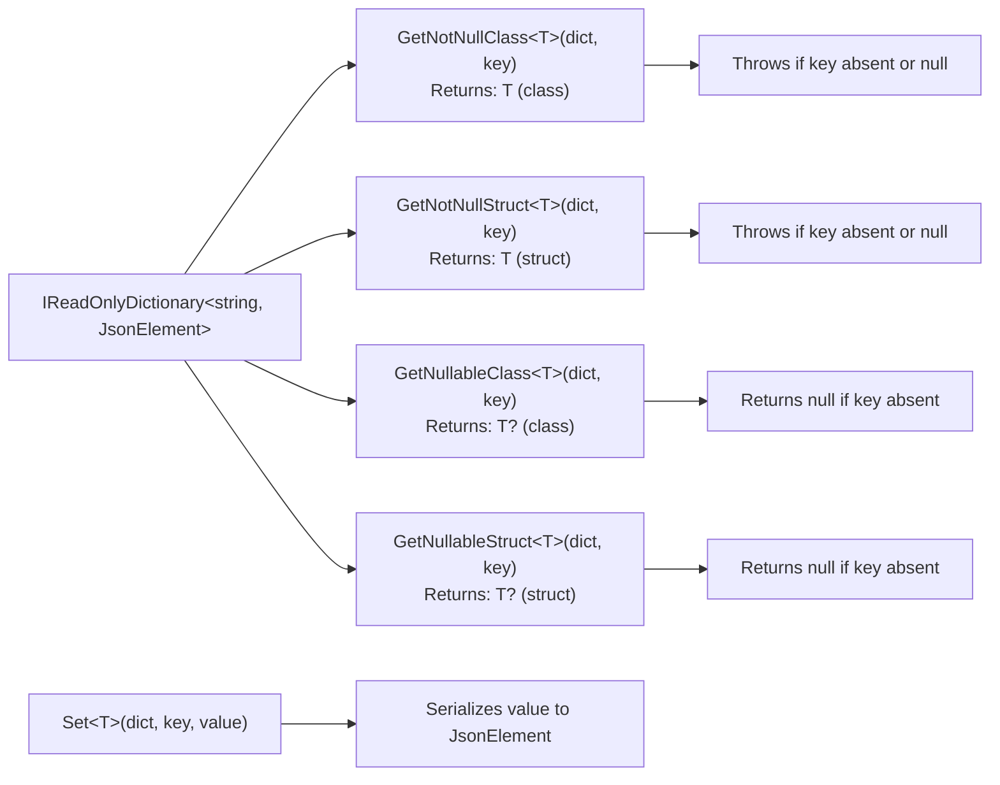

These methods throw `AnthropicInvalidDataException` when:
- A required key is missing
- A value is null when required
- A value cannot be deserialized to the expected type

**Sources:** [src/Anthropic/Core/ModelBase.cs:119-220]()

### Validation System

Each `ModelBase` subclass must implement `Validate()` to verify:
1. All required properties are present
2. All properties are of the expected type
3. Nested objects are also valid

Validation is automatically invoked when `ResponseValidation` is enabled on the client [src/Anthropic/AnthropicClient.cs:41-45]().

**Sources:** [src/Anthropic/Core/ModelBase.cs:255-264]()

## ParamsBase Class

`ParamsBase` is the abstract base class for all API request parameters. It manages query parameters, headers, and request body serialization.

### Core Structure

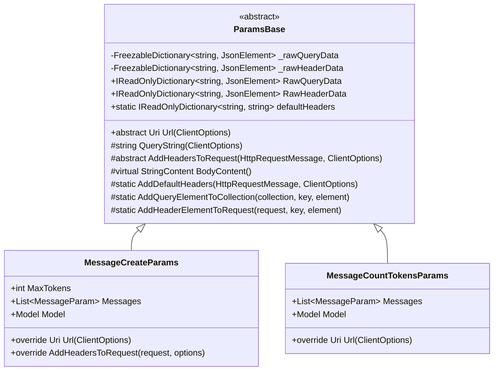

**Sources:** [src/Anthropic/Core/ParamsBase.cs:14-276]()

### Default Headers

`ParamsBase` maintains a static set of default headers [src/Anthropic/Core/ParamsBase.cs:16-32]() added to all requests:

| Header | Value | Purpose |
|--------|-------|---------|
| `User-Agent` | `AnthropicClient/C# {version}` | Client identification |
| `X-Stainless-Lang` | `csharp` | Language identifier |
| `X-Stainless-OS` | Windows/MacOS/Linux | Operating system |
| `X-Stainless-Arch` | x64/arm64/etc | CPU architecture |
| `X-Stainless-Runtime` | .NET Framework/.NET | Runtime name |
| `X-Stainless-Runtime-Version` | 8.0/9.0/etc | Runtime version |
| `X-Stainless-Package-Version` | 12.0.1 | SDK version |
| `anthropic-version` | 2023-06-01 | API version |

Additionally, authentication headers are added based on `ClientOptions`:
- `X-Api-Key: {APIKey}` if `APIKey` is set
- `Authorization: Bearer {AuthToken}` if `AuthToken` is set

**Sources:** [src/Anthropic/Core/ParamsBase.cs:16-212]()

### Query and Header Serialization

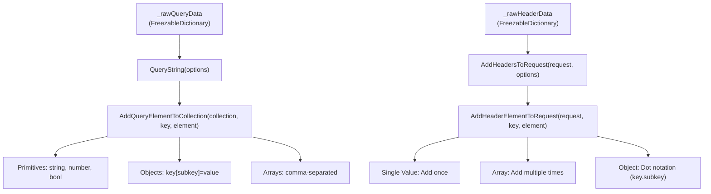

**Sources:** [src/Anthropic/Core/ParamsBase.cs:56-184]()

## ApiEnum Type Wrapper

`ApiEnum<TRaw, TEnum>` is a serializable enum wrapper that handles forward compatibility with API versions that may return unknown enum values [src/Anthropic/Core/ApiEnum.cs:8-88]().

### Core Design

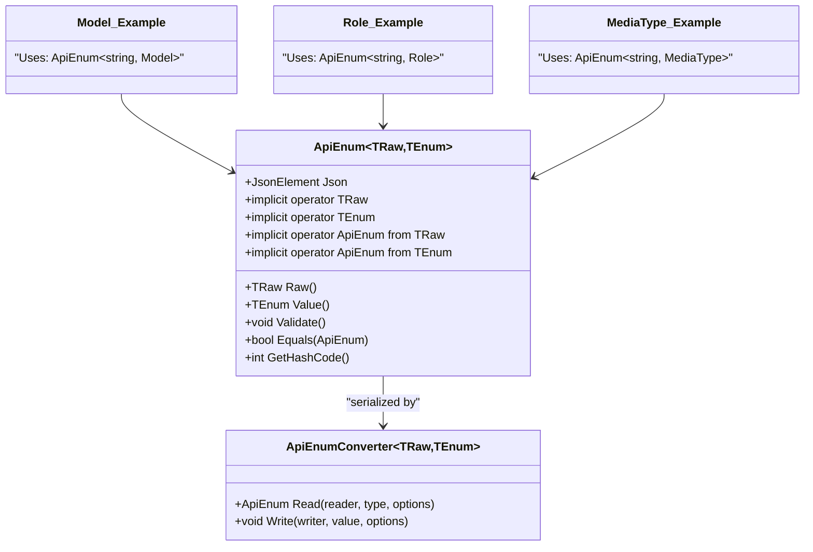

**Sources:** [src/Anthropic/Core/ApiEnum.cs:8-110]()

### Key Methods

| Method | Return Type | Description |
|--------|-------------|-------------|
| `Raw()` | `TRaw` | Returns raw value (e.g., string for string-based enums). Throws if type mismatch. |
| `Value()` | `TEnum` | Returns enum member, or `(TEnum)(-1)` if unknown value |
| `Validate()` | `void` | Throws `AnthropicInvalidDataException` if value not in enum |

**Sources:** [src/Anthropic/Core/ApiEnum.cs:39-67]()

### Implicit Conversions

`ApiEnum` provides implicit operators [src/Anthropic/Core/ApiEnum.cs:79-87]() enabling transparent usage:

```
// Enum to ApiEnum (automatic)
ApiEnum<string, Model> model = Model.Claude35Sonnet20240620;

// ApiEnum to enum (automatic)
Model model = apiEnumInstance;

// ApiEnum to raw (automatic)  
string rawValue = apiEnumInstance;
```

This allows most code to treat `ApiEnum` instances as regular enums while preserving the underlying `JsonElement` for unknown values.

**Sources:** [src/Anthropic/Core/ApiEnum.cs:79-87]()

### Forward Compatibility Pattern

```mermaid
graph TB
    API["API Response<br/>{\"model\": \"claude-4-opus\"}"]
    Deserialize["JsonSerializer.Deserialize&lt;Message&gt;()"]
    ApiEnum["ApiEnum&lt;string, Model&gt;<br/>Json = \"claude-4-opus\""]
    
    API --> Deserialize
    Deserialize --> ApiEnum
    
    ApiEnum --> Value["Value() returns (Model)(-1)<br/>(unknown enum value)"]
    ApiEnum --> Raw["Raw() returns \"claude-4-opus\"<br/>(string value preserved)"]
    ApiEnum --> Validate["Validate() throws<br/>AnthropicInvalidDataException"]
    
    note1["SDK on older version<br/>doesn't know about claude-4-opus"]
    note2["Raw value accessible for logging<br/>or custom handling"]
    
    Deserialize -.-> note1
    Raw -.-> note2
```

**Sources:** [src/Anthropic/Core/ApiEnum.cs:8-67]()

### Usage in Tests

The test files demonstrate the validation and serialization patterns [src/Anthropic.Tests/Models/Beta/Messages/BetaCacheControlEphemeralTest.cs:100-156]():

| Test Pattern | Purpose |
|--------------|---------|
| `Validation_Works` | Verifies known enum values pass validation |
| `InvalidEnumValidationThrows_Works` | Verifies unknown values throw on validation |
| `SerializationRoundtrip_Works` | Ensures known values serialize/deserialize correctly |
| `InvalidEnumSerializationRoundtrip_Works` | Ensures unknown values preserve raw data through roundtrip |

**Sources:** [src/Anthropic.Tests/Models/Beta/Messages/BetaCacheControlEphemeralTest.cs:100-156](), [src/Anthropic.Tests/Models/Beta/AnthropicBetaTest.cs:8-98]()

## JsonElement Handling

All model properties are stored as `JsonElement` instances in the backing `FreezableDictionary<string, JsonElement>`. This provides:

### Type Flexibility

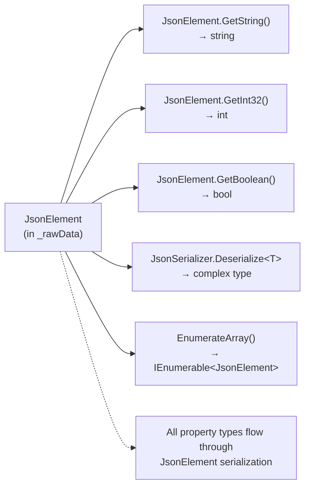

**Sources:** [src/Anthropic/Core/ModelBase.cs:119-220]()

### Property Access Pattern

The `ModelBase` helper methods deserialize `JsonElement` values on demand [src/Anthropic/Core/ModelBase.cs:119-220]():

```
// From _rawData["id"] (JsonElement)
// To string via JsonSerializer.Deserialize<string>
string id = GetNotNullClass<string>(_rawData, "id");

// From _rawData["temperature"] (JsonElement)  
// To double? via JsonSerializer.Deserialize<double?>
double? temperature = GetNullableStruct<double>(_rawData, "temperature");
```

This lazy deserialization allows:
- **Preservation of unknown fields** - Undocumented properties remain in `_rawData`
- **Type safety** - Deserialize exceptions caught and wrapped in `AnthropicInvalidDataException`
- **Nullable semantics** - Distinguish between absent, null, and present values

**Sources:** [src/Anthropic/Core/ModelBase.cs:119-220]()

## Supporting Infrastructure

### FreezableDictionary

`FreezableDictionary<K, V>` is a mutable dictionary that can be frozen into an immutable `FrozenDictionary<K, V>` [src/Anthropic/Core/FreezableDictionary.cs:16-166]():

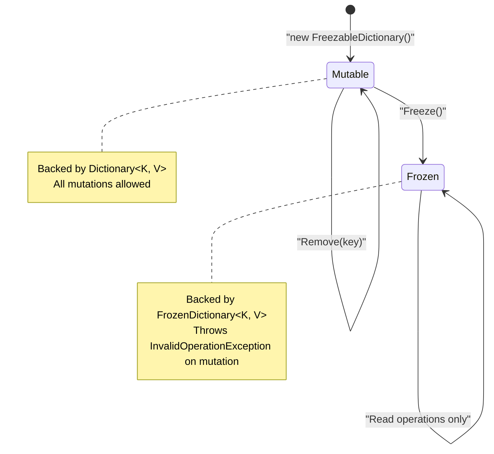

This enables:
1. **Init-only properties** - Properties can be set during object initialization via `init` accessors
2. **Immutability** - Once frozen (via `RawData` property), data cannot be modified
3. **Performance** - `FrozenDictionary` provides faster lookups than `Dictionary`

**Sources:** [src/Anthropic/Core/FreezableDictionary.cs:10-166]()

### ModelConverter

`ModelConverter<TModel, TFromRaw>` is a custom `JsonConverter` that deserializes JSON into `ModelBase` subclasses [src/Anthropic/Core/ModelConverter.cs:8-32]():

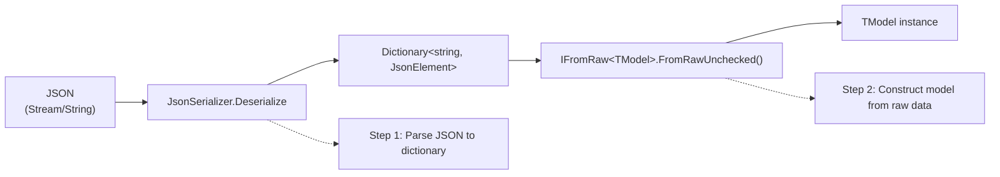

Each `ModelBase` subclass provides a companion `IFromRaw<T>` implementation that constructs instances from raw JSON dictionaries without validation.

**Sources:** [src/Anthropic/Core/ModelConverter.cs:8-32]()

### IFromRaw Interface

The `IFromRaw<T>` interface [src/Anthropic/Core/ModelBase.cs:275-288]() defines a factory pattern for constructing models from raw data:

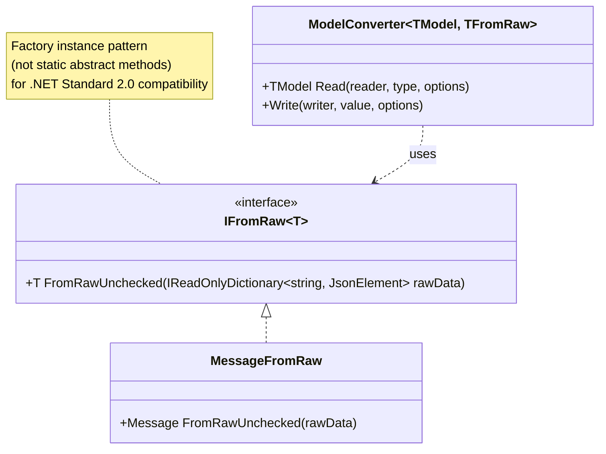

**Sources:** [src/Anthropic/Core/ModelBase.cs:267-288]()

## Serialization Flow

### Deserialization (API Response → Model)

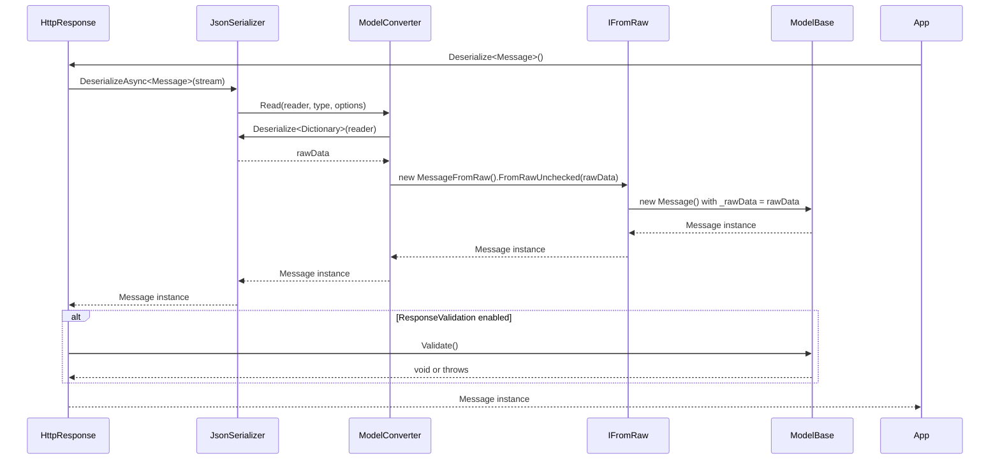

**Sources:** [src/Anthropic/Core/HttpResponse.cs:17-38](), [src/Anthropic/Core/ModelConverter.cs:12-26]()

### Serialization (Model → JSON)

```mermaid
sequenceDiagram
    participant App
    participant JsonSerializer
    participant ModelConverter~TModel,TFromRaw~
    participant ModelBase
    participant FreezableDictionary~string,JsonElement~
    
    App->>JsonSerializer: "Serialize(model)"
    JsonSerializer->>ModelConverter~TModel,TFromRaw~: "Write(writer, model, options)"
    ModelConverter~TModel,TFromRaw~->>ModelBase: "model.RawData"
    ModelBase->>FreezableDictionary~string,JsonElement~: "Freeze()"
    FreezableDictionary~string,JsonElement~-->>ModelBase: "IReadOnlyDictionary&lt;string,JsonElement&gt;"
    ModelBase-->>ModelConverter~TModel,TFromRaw~: "RawData"
    ModelConverter~TModel,TFromRaw~->>JsonSerializer: "Serialize(writer, RawData, options)"
    JsonSerializer-->>ModelConverter~TModel,TFromRaw~: "void"
    ModelConverter~TModel,TFromRaw~-->>JsonSerializer: "void"
    JsonSerializer-->>App: "JSON string"
```

**Sources:** [src/Anthropic/Core/ModelConverter.cs:28-31]()

## Raw Data Access Patterns

Both `ModelBase` and `ParamsBase` expose raw data for advanced scenarios:

### Reading Unknown Properties

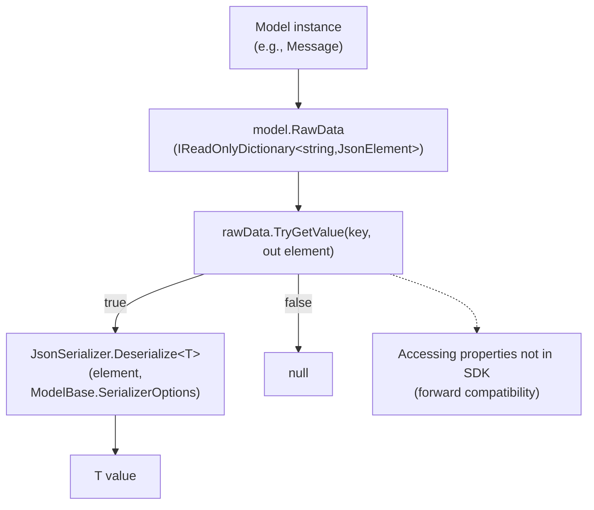

This enables accessing newer API properties before SDK support is added.

**Sources:** [src/Anthropic/Core/ModelBase.cs:26-32]()

### Constructing Models with Unknown Data

Each params class provides a static `FromRawUnchecked()` method [src/Anthropic/Services/MessageService.cs:74-78]() accepting raw dictionaries for headers, query, and body:

```
MessageCreateParams.FromRawUnchecked(
    rawHeaderData: new Dictionary<string, JsonElement>(),
    rawQueryData: new Dictionary<string, JsonElement>(),
    rawBodyData: new Dictionary<string, JsonElement> 
    {
        ["undocumented_field"] = JsonSerializer.SerializeToElement("value")
    }
)
```

This pattern is used internally for streaming requests [src/Anthropic/Services/MessageService.cs:72-78]() where `stream: true` must be added to the body:

```
var rawBodyData = Enumerable.ToDictionary(parameters.RawBodyData, e => e.Key, e => e.Value);
rawBodyData["stream"] = JsonSerializer.Deserialize<JsonElement>("true");
parameters = MessageCreateParams.FromRawUnchecked(
    parameters.RawHeaderData,
    parameters.RawQueryData,
    rawBodyData
);
```

**Sources:** [src/Anthropic/Services/MessageService.cs:67-78](), [src/Anthropic/Services/Beta/MessageService.cs:73-84]()

## Design Patterns

### Record Class Pattern

Both `ModelBase` and `ParamsBase` use the `record class` pattern [src/Anthropic/Core/ModelBase.cs:17](), [src/Anthropic/Core/ParamsBase.cs:14]() which provides:

1. **Immutable by default** - Properties are typically `init`-only
2. **Value-based equality** - Overridden `Equals()` compares `RawData` contents [src/Anthropic/Core/ModelBase.cs:227-248]()
3. **Copy constructors** - Enable non-destructive mutation patterns
4. **Deconstruction** - Not used in this codebase, but available

### Copy Constructor Pattern

Both base classes provide protected copy constructors [src/Anthropic/Core/ModelBase.cs:21-24](), [src/Anthropic/Core/ParamsBase.cs:38-42]() that copy the backing dictionaries:

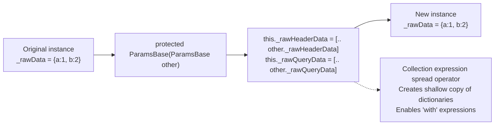

This enables the `with` expression pattern for creating modified copies while preserving immutability.

**Sources:** [src/Anthropic/Core/ModelBase.cs:21-24](), [src/Anthropic/Core/ParamsBase.cs:38-42]()

### Exception Handling

The infrastructure uses `AnthropicInvalidDataException` for all data validation failures [src/Anthropic/Core/ModelBase.cs:131-146]():

| Scenario | Exception Message |
|----------|------------------|
| Missing required property | `'{key}' cannot be absent` |
| Null required property | `'{key}' cannot be null` |
| Type mismatch | `'{key}' must be of type {type}` |
| Invalid enum value | `Invalid enum value` |

**Sources:** [src/Anthropic/Core/ModelBase.cs:119-220](), [src/Anthropic/Core/ApiEnum.cs:61-67]()

## Summary

The model base infrastructure provides:

1. **Type-safe serialization** via `ModelBase.SerializerOptions` with 50+ custom converters
2. **Forward compatibility** by preserving unknown JSON properties in `RawData`
3. **Validation** through abstract `Validate()` methods on each model
4. **Immutability** using `FreezableDictionary` and record classes
5. **Request construction** via `ParamsBase` with query/header/body management
6. **Raw data access** for advanced scenarios and future API features

This design balances type safety with flexibility, enabling the SDK to work with both current and future API versions without breaking changes.

**Sources:** [src/Anthropic/Core/ModelBase.cs:1-289](), [src/Anthropic/Core/ParamsBase.cs:1-277](), [src/Anthropic/Core/FreezableDictionary.cs:1-167](), [src/Anthropic/Core/ModelConverter.cs:1-33]()

---

