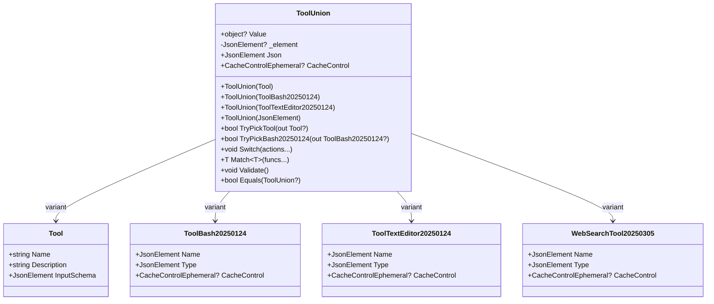
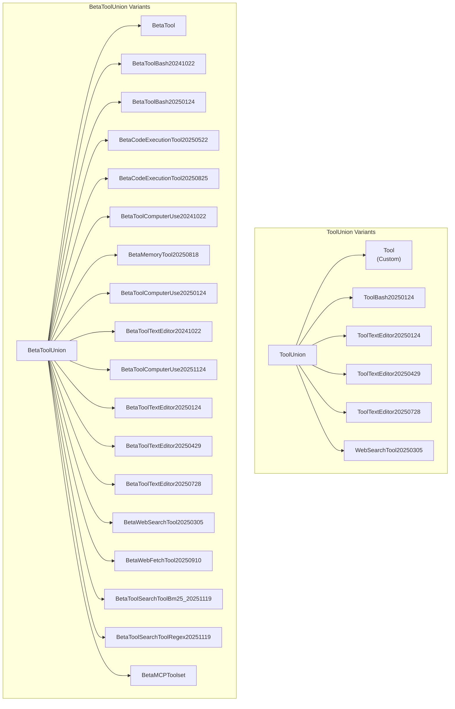
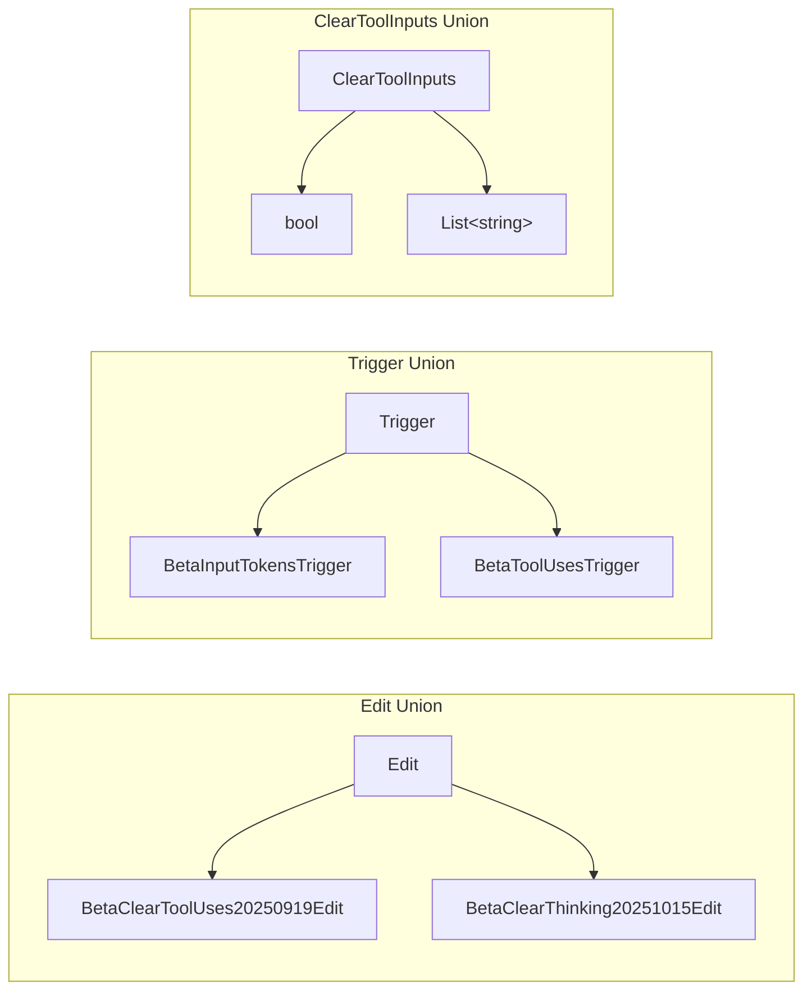
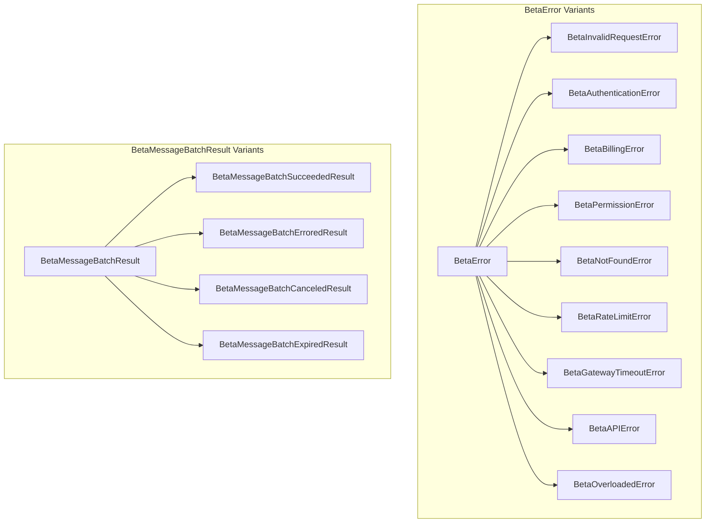
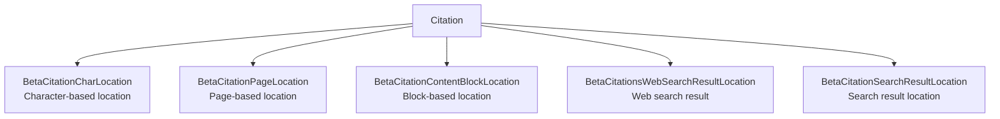
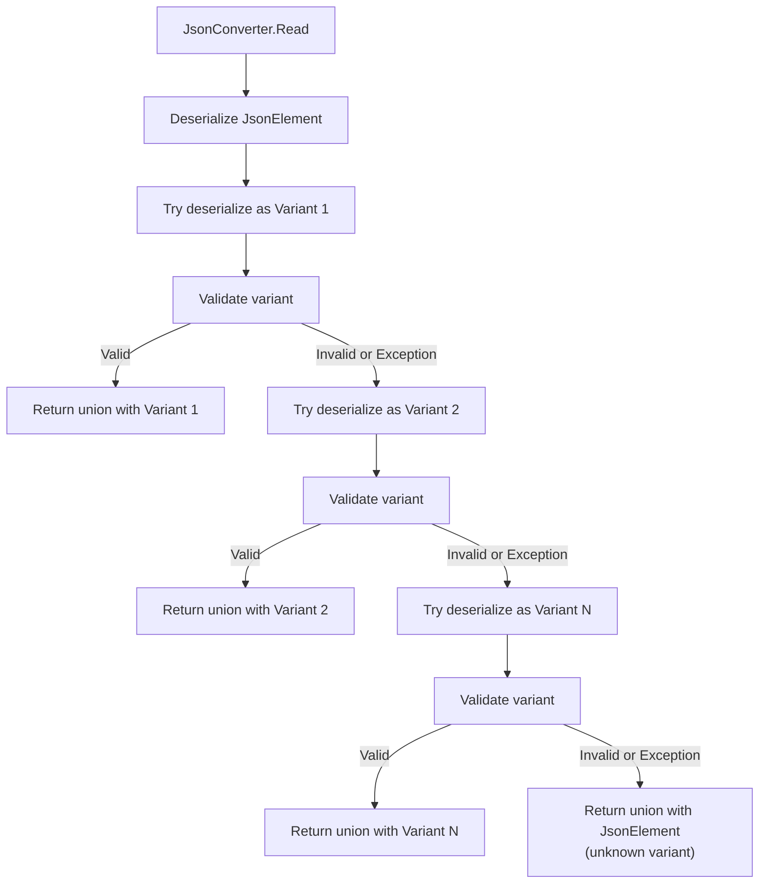

<!-- source: DeepWiki mcp.deepwiki.com · repo anthropics/anthropic-sdk-csharp · page 9.2 Union Types · fetched 2026-10-26 -->

# Union Types

<details>
<summary>Relevant source files</summary>

The following files were used as context for generating this wiki page:

- [src/Anthropic.Tests/Models/Beta/BetaErrorTest.cs](src/Anthropic.Tests/Models/Beta/BetaErrorTest.cs)
- [src/Anthropic.Tests/Models/Beta/Messages/Batches/BetaMessageBatchResultTest.cs](src/Anthropic.Tests/Models/Beta/Messages/Batches/BetaMessageBatchResultTest.cs)
- [src/Anthropic.Tests/Models/Beta/Messages/BetaBashCodeExecutionToolResultBlockParamTest.cs](src/Anthropic.Tests/Models/Beta/Messages/BetaBashCodeExecutionToolResultBlockParamTest.cs)
- [src/Anthropic.Tests/Models/Beta/Messages/BetaBashCodeExecutionToolResultBlockTest.cs](src/Anthropic.Tests/Models/Beta/Messages/BetaBashCodeExecutionToolResultBlockTest.cs)
- [src/Anthropic.Tests/Models/Beta/Messages/BetaCitationsDeltaTest.cs](src/Anthropic.Tests/Models/Beta/Messages/BetaCitationsDeltaTest.cs)
- [src/Anthropic.Tests/Models/Beta/Messages/BetaClearToolUses20250919EditTest.cs](src/Anthropic.Tests/Models/Beta/Messages/BetaClearToolUses20250919EditTest.cs)
- [src/Anthropic.Tests/Models/Beta/Messages/BetaCodeExecutionToolResultBlockContentTest.cs](src/Anthropic.Tests/Models/Beta/Messages/BetaCodeExecutionToolResultBlockContentTest.cs)
- [src/Anthropic.Tests/Models/Beta/Messages/BetaCodeExecutionToolResultBlockParamContentTest.cs](src/Anthropic.Tests/Models/Beta/Messages/BetaCodeExecutionToolResultBlockParamContentTest.cs)
- [src/Anthropic.Tests/Models/Beta/Messages/BetaContentBlockParamTest.cs](src/Anthropic.Tests/Models/Beta/Messages/BetaContentBlockParamTest.cs)
- [src/Anthropic.Tests/Models/Beta/Messages/BetaContextManagementConfigTest.cs](src/Anthropic.Tests/Models/Beta/Messages/BetaContextManagementConfigTest.cs)
- [src/Anthropic/Models/Beta/Messages/BetaToolUnion.cs](src/Anthropic/Models/Beta/Messages/BetaToolUnion.cs)
- [src/Anthropic/Models/Messages/MessageCountTokensTool.cs](src/Anthropic/Models/Messages/MessageCountTokensTool.cs)
- [src/Anthropic/Models/Messages/ToolTextEditor20250429.cs](src/Anthropic/Models/Messages/ToolTextEditor20250429.cs)
- [src/Anthropic/Models/Messages/ToolUnion.cs](src/Anthropic/Models/Messages/ToolUnion.cs)

</details>


This page documents the discriminated union pattern used throughout the Anthropic C# SDK to represent polymorphic API structures. Union types provide type-safe handling of JSON data that can take multiple shapes based on a discriminator field.

For information about the base infrastructure that union types build upon, see [Model Base Infrastructure](#9.1). For specific enumerations like `Model` and `AnthropicBeta`, see [Model Selection](#9.3) and [Beta Features Enum](#9.4).

## Purpose and Scope

Union types in this SDK solve the problem of representing API response fields that can contain different types of objects. For example, a tool can be a custom `Tool`, a bash tool `ToolBash20250124`, a text editor tool, a web search tool, or an MCP toolset. Rather than using a base class hierarchy or loosely-typed `object` properties, the SDK uses discriminated union types that:

- Provide compile-time type safety when working with polymorphic data
- Enable exhaustive pattern matching through `Switch` and `Match` methods
- Support safe variant extraction through `TryPick*` methods
- Preserve the original JSON for equality comparisons and serialization
- Handle unknown variants gracefully during deserialization

## Core Architecture

### Union Type Structure

All union types in the SDK follow a consistent implementation pattern. Each union type is a record class that wraps one of several possible variant types.



**Sources:** [src/Anthropic/Models/Messages/ToolUnion.cs:10-358]()

### Key Components

| Component | Purpose | Example |
|-----------|---------|---------|
| `Value` property | Holds the actual variant instance as `object?` | [src/Anthropic/Models/Messages/ToolUnion.cs:12]() |
| `_element` field | Caches the JSON representation | [src/Anthropic/Models/Messages/ToolUnion.cs:14]() |
| `Json` property | Provides access to JSON element (lazy serialization) | [src/Anthropic/Models/Messages/ToolUnion.cs:16-19]() |
| Variant constructors | Create union from specific variant type | [src/Anthropic/Models/Messages/ToolUnion.cs:36-70]() |
| `JsonElement` constructor | Create union from raw JSON during deserialization | [src/Anthropic/Models/Messages/ToolUnion.cs:72-75]() |
| `TryPick*` methods | Safe variant extraction with null checking | [src/Anthropic/Models/Messages/ToolUnion.cs:92-201]() |
| `Switch` method | Execute action based on variant type | [src/Anthropic/Models/Messages/ToolUnion.cs:227-261]() |
| `Match<T>` method | Return value based on variant type | [src/Anthropic/Models/Messages/ToolUnion.cs:288-309]() |
| Implicit operators | Enable automatic conversion from variant to union | [src/Anthropic/Models/Messages/ToolUnion.cs:311-321]() |
| `Validate` method | Validates the contained variant | [src/Anthropic/Models/Messages/ToolUnion.cs:333-347]() |
| `Equals` method | JSON-based equality comparison | [src/Anthropic/Models/Messages/ToolUnion.cs:349-352]() |

**Sources:** [src/Anthropic/Models/Messages/ToolUnion.cs:10-358]()

## Common Union Types

### Tool Unions



**Sources:** [src/Anthropic/Models/Messages/ToolUnion.cs:36-70](), [src/Anthropic/Models/Beta/Messages/BetaToolUnion.cs:216-322]()

### Content Block Unions

The `BetaContentBlockParam` union represents different types of content that can be included in messages:

| Variant Type | Purpose |
|--------------|---------|
| `BetaTextBlockParam` | Plain text content with optional citations |
| `BetaImageBlockParam` | Image content with base64 data or URL source |
| `BetaRequestDocumentBlock` | PDF document with optional citation extraction |
| `BetaSearchResultBlockParam` | Search result with title, source, and content |
| `BetaThinkingBlockParam` | Extended thinking content with signature |
| `BetaRedactedThinkingBlockParam` | Redacted thinking content for privacy |
| `BetaToolUseBlockParam` | Tool invocation with input parameters |
| `BetaToolResultBlockParam` | Tool execution results |
| `BetaServerToolUseBlockParam` | Server-side tool invocation |
| `BetaWebSearchToolResultBlockParam` | Web search tool results |
| `BetaWebFetchToolResultBlockParam` | Web fetch tool results |
| `BetaCodeExecutionToolResultBlockParam` | Code execution results |
| `BetaBashCodeExecutionToolResultBlockParam` | Bash execution results |
| `BetaTextEditorCodeExecutionToolResultBlockParam` | Text editor tool results |
| `BetaToolSearchToolResultBlockParam` | Search tool results |
| `BetaMCPToolUseBlockParam` | MCP tool invocation |
| `BetaRequestMCPToolResultBlockParam` | MCP tool results |
| `BetaContainerUploadBlockParam` | Container file upload |

**Sources:** [src/Anthropic.Tests/Models/Beta/Messages/BetaContentBlockParamTest.cs:9-622]()

### Context Management Unions



**Sources:** [src/Anthropic.Tests/Models/Beta/Messages/BetaClearToolUses20250919EditTest.cs:247-319]()

### Error and Result Unions



**Sources:** [src/Anthropic.Tests/Models/Beta/BetaErrorTest.cs:7-160](), [src/Anthropic.Tests/Models/Beta/Messages/Batches/BetaMessageBatchResultTest.cs:10-227]()

### Citation Unions

The `Citation` union represents different ways to locate cited content:



**Sources:** [src/Anthropic.Tests/Models/Beta/Messages/BetaCitationsDeltaTest.cs:116-298]()

## Working with Union Types

### Variant Extraction with TryPick

Use `TryPick*` methods to safely extract a specific variant:

```csharp
// Example: Checking if a tool union contains a custom Tool
if (toolUnion.TryPickTool(out var customTool))
{
    // customTool is of type Tool
    Console.WriteLine($"Tool name: {customTool.Name}");
}
else if (toolUnion.TryPickBash20250124(out var bashTool))
{
    // bashTool is of type ToolBash20250124
    Console.WriteLine("Bash tool detected");
}
```

Each `TryPick*` method returns `bool` and uses the `[NotNullWhen(true)]` attribute for proper null handling. The method performs a type check using `as` operator and returns whether the cast succeeded.

**Sources:** [src/Anthropic/Models/Messages/ToolUnion.cs:92-96](), [src/Anthropic/Models/Messages/ToolUnion.cs:113-117]()

### Pattern Matching with Switch

The `Switch` method executes an action based on the variant type, requiring handlers for all possible variants:

```csharp
toolUnion.Switch(
    tool: (Tool t) => {
        // Handle custom tool
        ProcessCustomTool(t);
    },
    bash20250124: (ToolBash20250124 t) => {
        // Handle bash tool
        ExecuteBashCommand(t);
    },
    textEditor20250124: (ToolTextEditor20250124 t) => {
        // Handle text editor tool
        EditText(t);
    },
    textEditor20250429: (ToolTextEditor20250429 t) => {
        // Handle newer text editor
        EditTextV2(t);
    },
    textEditor20250728: (ToolTextEditor20250728 t) => {
        // Handle latest text editor
        EditTextV3(t);
    },
    webSearchTool20250305: (WebSearchTool20250305 t) => {
        // Handle web search
        PerformSearch(t);
    }
);
```

If the union contains an unknown variant (e.g., from raw JSON that didn't match any expected shape), `Switch` throws `AnthropicInvalidDataException`.

**Sources:** [src/Anthropic/Models/Messages/ToolUnion.cs:227-261]()

### Pattern Matching with Match

The `Match<T>` method is similar to `Switch` but returns a value, enabling functional-style programming:

```csharp
string toolDescription = toolUnion.Match<string>(
    tool: (t) => $"Custom tool: {t.Name}",
    bash20250124: (t) => "Bash execution tool",
    textEditor20250124: (t) => "Text editor tool v1",
    textEditor20250429: (t) => "Text editor tool v2",
    textEditor20250728: (t) => "Text editor tool v3",
    webSearchTool20250305: (t) => "Web search tool"
);

// Extract common properties across variants
CacheControlEphemeral? cacheControl = toolUnion.Match<CacheControlEphemeral?>(
    tool: (x) => x.CacheControl,
    bash20250124: (x) => x.CacheControl,
    textEditor20250124: (x) => x.CacheControl,
    textEditor20250429: (x) => x.CacheControl,
    textEditor20250728: (x) => x.CacheControl,
    webSearchTool20250305: (x) => x.CacheControl
);
```

The SDK uses `Match` internally to implement shared property accessors. For example, `ToolUnion.CacheControl` uses `Match` to extract the cache control from whichever variant is present.

**Sources:** [src/Anthropic/Models/Messages/ToolUnion.cs:288-309](), [src/Anthropic/Models/Messages/ToolUnion.cs:21-34]()

### Implicit Conversions

Union types provide implicit operators for convenient construction:

```csharp
// Implicit conversion from variant to union
Tool customTool = new Tool { 
    Name = "my_tool", 
    Description = "A custom tool",
    InputSchema = /* ... */
};

ToolUnion union = customTool; // Implicit conversion

// Can be used directly in collections
List<ToolUnion> tools = new List<ToolUnion>
{
    new Tool { /* ... */ },
    new ToolBash20250124(),
    new WebSearchTool20250305()
};
```

**Sources:** [src/Anthropic/Models/Messages/ToolUnion.cs:311-321]()

## Serialization and Deserialization

### Deserialization Process

Union types use custom `JsonConverter` implementations that attempt to deserialize the JSON as each variant type in sequence:



The converter catches both `JsonException` and `AnthropicInvalidDataException` when attempting each variant, ensuring that a failed deserialization attempt doesn't abort the process.

**Sources:** [src/Anthropic/Models/Messages/ToolUnion.cs:362-453]()

### Serialization Process

Serialization is straightforward - the union type serializes its cached `Json` property:

```csharp
public override void Write(
    Utf8JsonWriter writer,
    ToolUnion value,
    JsonSerializerOptions options
)
{
    JsonSerializer.Serialize(writer, value.Json, options);
}
```

The `Json` property lazily serializes the `Value` if `_element` is null, then caches the result.

**Sources:** [src/Anthropic/Models/Messages/ToolUnion.cs:456-463](), [src/Anthropic/Models/Messages/ToolUnion.cs:16-19]()

### Handling Unknown Variants

When deserialization fails for all known variants, the union is constructed with the raw `JsonElement`:

```csharp
public ToolUnion(JsonElement element)
{
    this._element = element;
}
```

This allows the SDK to preserve unknown data from API responses, which is important for forward compatibility. The `Value` property remains `null` in this case.

When working with such unions:
- `TryPick*` methods will all return `false`
- `Switch` and `Match` throw `AnthropicInvalidDataException`
- `Validate` throws `AnthropicInvalidDataException`
- The JSON is still preserved and can be accessed via the `Json` property

**Sources:** [src/Anthropic/Models/Messages/ToolUnion.cs:72-75](), [src/Anthropic/Models/Messages/ToolUnion.cs:335-338]()

## Validation and Error Handling

### Validating Union Contents

The `Validate` method ensures the union contains a known variant and that the variant itself is valid:

```csharp
public void Validate()
{
    if (this.Value == null)
    {
        throw new AnthropicInvalidDataException("Data did not match any variant of ToolUnion");
    }
    this.Switch(
        (tool) => tool.Validate(),
        (bash20250124) => bash20250124.Validate(),
        (textEditor20250124) => textEditor20250124.Validate(),
        (textEditor20250429) => textEditor20250429.Validate(),
        (textEditor20250728) => textEditor20250728.Validate(),
        (webSearchTool20250305) => webSearchTool20250305.Validate()
    );
}
```

This two-level validation:
1. Checks that the union contains a recognized variant (not an unknown JSON element)
2. Delegates to the variant's own `Validate` method to check variant-specific constraints

**Sources:** [src/Anthropic/Models/Messages/ToolUnion.cs:333-347]()

### Equality Comparison

Union types use JSON-based equality rather than structural equality:

```csharp
public virtual bool Equals(ToolUnion? other)
{
    return other != null && JsonElement.DeepEquals(this.Json, other.Json);
}
```

This approach:
- Works correctly even with unknown variants (which only have JSON)
- Handles all variants uniformly without variant-specific equality logic
- Preserves semantic equality for deserialized and re-serialized objects
- Returns consistent results even when the same logical value is represented by different in-memory objects

The hash code implementation returns a constant value to maintain the contract that equal objects have equal hash codes, though this makes union types unsuitable as dictionary keys.

**Sources:** [src/Anthropic/Models/Messages/ToolUnion.cs:349-357]()

## Union Type Naming Conventions

Union type names in the SDK follow patterns:

| Pattern | Example | Purpose |
|---------|---------|---------|
| `*Union` | `ToolUnion`, `BetaToolUnion` | Primary unions for tool definitions |
| `*Content` | `BetaCodeExecutionToolResultBlockContent` | Union for content within a block |
| `*Result` | `BetaMessageBatchResult` | Union for operation outcomes |
| Plain name | `Edit`, `Trigger`, `Citation` | Context-specific unions |

Beta versions of union types are prefixed with `Beta` and often have more variants than their stable counterparts, reflecting experimental features.

**Sources:** [src/Anthropic/Models/Messages/ToolUnion.cs:10](), [src/Anthropic/Models/Beta/Messages/BetaToolUnion.cs:16](), [src/Anthropic.Tests/Models/Beta/Messages/BetaCodeExecutionToolResultBlockContentTest.cs:6]()

## Testing Union Types

The test suite validates union types through multiple patterns:

### Validation Tests

Each variant can be validated independently:

```csharp
[Fact]
public void BetaClearToolUses20250919ValidationWorks()
{
    Edit value = new(
        new BetaClearToolUses20250919Edit()
        {
            ClearAtLeast = new(0),
            ClearToolInputs = true,
            ExcludeTools = ["string"],
            Keep = new(0),
            Trigger = new BetaInputTokensTrigger(1),
        }
    );
    value.Validate();
}
```

**Sources:** [src/Anthropic.Tests/Models/Beta/Messages/BetaContextManagementConfigTest.cs:179-193]()

### Serialization Roundtrip Tests

Tests verify that union types can be serialized and deserialized without data loss:

```csharp
[Fact]
public void BetaInputTokensSerializationRoundtripWorks()
{
    Trigger value = new(new BetaInputTokensTrigger(1));
    string element = JsonSerializer.Serialize(value);
    var deserialized = JsonSerializer.Deserialize<Trigger>(element);

    Assert.Equal(value, deserialized);
}
```

**Sources:** [src/Anthropic.Tests/Models/Beta/Messages/BetaClearToolUses20250919EditTest.cs:300-308]()

---

