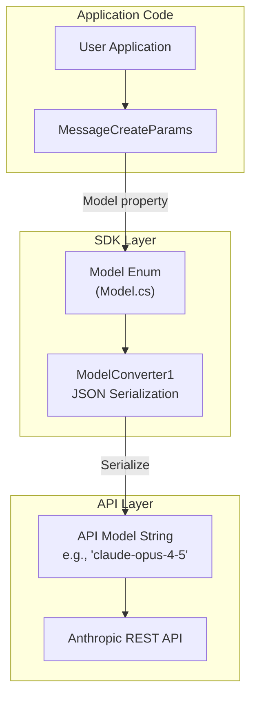
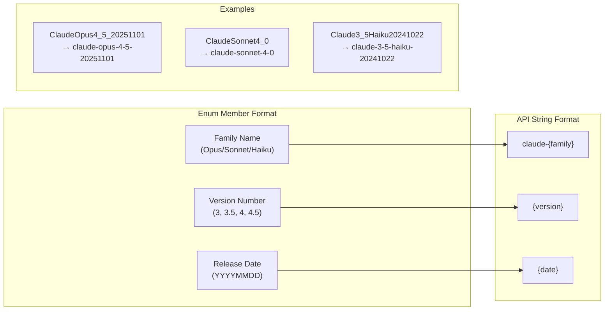
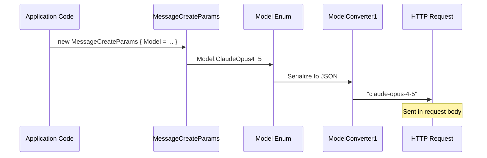
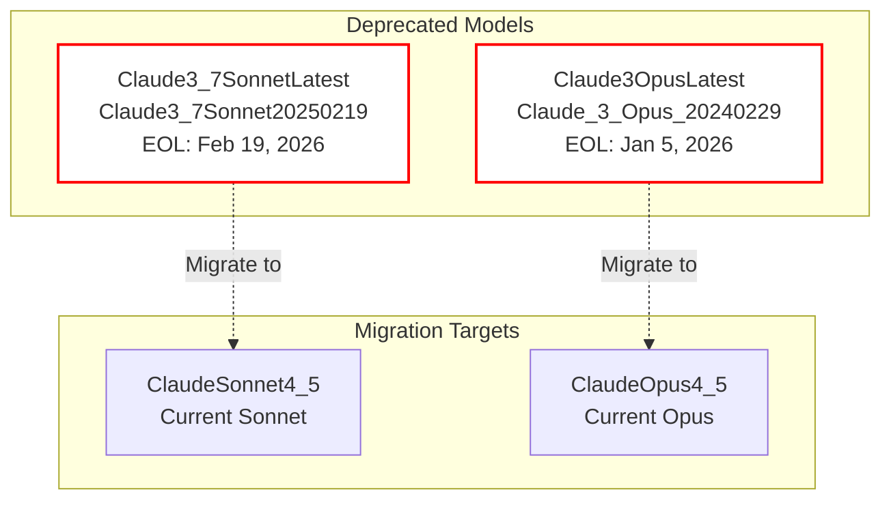
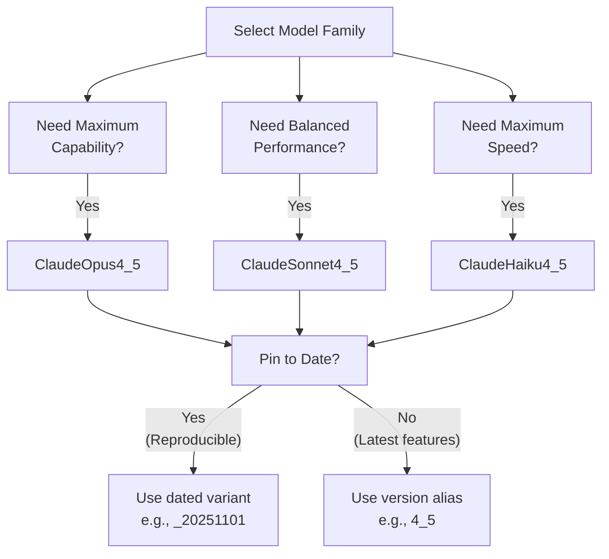

<!-- source: DeepWiki mcp.deepwiki.com · repo anthropics/anthropic-sdk-csharp · page 9.3 Model Selection · fetched 2026-10-26 -->

# Model Selection

<details>
<summary>Relevant source files</summary>

The following files were used as context for generating this wiki page:

- [.csharpierignore](.csharpierignore)
- [.stats.yml](.stats.yml)
- [src/Anthropic.Tests/Anthropic.Tests.csproj](src/Anthropic.Tests/Anthropic.Tests.csproj)
- [src/Anthropic.Tests/Models/Beta/AnthropicBetaTest.cs](src/Anthropic.Tests/Models/Beta/AnthropicBetaTest.cs)
- [src/Anthropic.Tests/Models/Beta/Files/DeletedFileTest.cs](src/Anthropic.Tests/Models/Beta/Files/DeletedFileTest.cs)
- [src/Anthropic.Tests/Models/Beta/Messages/Batches/BetaMessageBatchTest.cs](src/Anthropic.Tests/Models/Beta/Messages/Batches/BetaMessageBatchTest.cs)
- [src/Anthropic.Tests/Models/Beta/Messages/BetaBase64ImageSourceTest.cs](src/Anthropic.Tests/Models/Beta/Messages/BetaBase64ImageSourceTest.cs)
- [src/Anthropic.Tests/Models/Beta/Messages/BetaBashCodeExecutionToolResultErrorParamTest.cs](src/Anthropic.Tests/Models/Beta/Messages/BetaBashCodeExecutionToolResultErrorParamTest.cs)
- [src/Anthropic.Tests/Models/Beta/Messages/BetaBashCodeExecutionToolResultErrorTest.cs](src/Anthropic.Tests/Models/Beta/Messages/BetaBashCodeExecutionToolResultErrorTest.cs)
- [src/Anthropic.Tests/Models/Beta/Messages/BetaCacheControlEphemeralTest.cs](src/Anthropic.Tests/Models/Beta/Messages/BetaCacheControlEphemeralTest.cs)
- [src/Anthropic/Models/Beta/AnthropicBeta.cs](src/Anthropic/Models/Beta/AnthropicBeta.cs)
- [src/Anthropic/Models/Messages/Model.cs](src/Anthropic/Models/Messages/Model.cs)

</details>


This document provides a technical reference for the `Model` enum defined in the Anthropic C# SDK. It explains the available Claude model variants, their characteristics, naming conventions, and how to specify models in API requests. For information about constructing message requests, see [Message Parameters](#5.1). For details on beta feature flags that may affect model behavior, see [Beta Features Enum](#9.4).

---

## Overview

The `Model` enum serves as a strongly-typed enumeration of all supported Claude AI models. It is defined in [src/Anthropic/Models/Messages/Model.cs:13-126]() and represents the model identifiers used by the Anthropic API. When creating messages, batch operations, or token counting requests, you must specify which model to use via this enum.



**Sources:** [src/Anthropic/Models/Messages/Model.cs:1-196]()

---

## Model Families

Claude models are organized into three primary families, each optimized for different use cases:

### Opus Family (Maximum Capability)

The most capable models in the Claude lineup, designed for complex reasoning and analysis tasks.

| Enum Member | API String | Description | Status |
|-------------|------------|-------------|--------|
| `ClaudeOpus4_5_20251101` | `claude-opus-4-5-20251101` | Premium model combining maximum intelligence with practical performance | Current |
| `ClaudeOpus4_5` | `claude-opus-4-5` | Alias for latest Opus 4.5 | Current |
| `ClaudeOpus4_0` | `claude-opus-4-0` | Opus 4.0 version | Current |
| `ClaudeOpus4_20250514` | `claude-opus-4-20250514` | Dated Opus 4.0 variant | Current |
| `Claude4Opus20250514` | `claude-4-opus-20250514` | Alternative naming for Opus 4.0 | Current |
| `ClaudeOpus4_1_20250805` | `claude-opus-4-1-20250805` | Opus 4.1 variant | Current |
| `Claude3OpusLatest` | `claude-3-opus-latest` | Claude 3 Opus (Excels at writing and complex tasks) | Deprecated (EOL: Jan 5, 2026) |
| `Claude_3_Opus_20240229` | `claude-3-opus-20240229` | Claude 3 Opus dated release | Deprecated (EOL: Jan 5, 2026) |

### Sonnet Family (Balanced Performance)

High-performance models optimized for real-world agents, coding tasks, and extended thinking.

| Enum Member | API String | Description | Status |
|-------------|------------|-------------|--------|
| `ClaudeSonnet4_5` | `claude-sonnet-4-5` | Best model for real-world agents and coding | Current |
| `ClaudeSonnet4_5_20250929` | `claude-sonnet-4-5-20250929` | Dated Sonnet 4.5 release | Current |
| `ClaudeSonnet4_20250514` | `claude-sonnet-4-20250514` | Sonnet 4.0 with extended thinking | Current |
| `ClaudeSonnet4_0` | `claude-sonnet-4-0` | Alias for Sonnet 4.0 | Current |
| `Claude4Sonnet20250514` | `claude-4-sonnet-20250514` | Alternative naming for Sonnet 4.0 | Current |
| `Claude3_7SonnetLatest` | `claude-3-7-sonnet-latest` | Claude 3.7 with early extended thinking | Deprecated (EOL: Feb 19, 2026) |
| `Claude3_7Sonnet20250219` | `claude-3-7-sonnet-20250219` | Dated Claude 3.7 release | Deprecated (EOL: Feb 19, 2026) |

### Haiku Family (Speed & Efficiency)

Fastest and most cost-effective models designed for near-instant responsiveness.

| Enum Member | API String | Description | Status |
|-------------|------------|-------------|--------|
| `ClaudeHaiku4_5` | `claude-haiku-4-5` | Hybrid model with near-instant responses and extended thinking | Current |
| `ClaudeHaiku4_5_20251001` | `claude-haiku-4-5-20251001` | Dated Haiku 4.5 release | Current |
| `Claude3_5HaikuLatest` | `claude-3-5-haiku-latest` | Fastest and most compact model | Current |
| `Claude3_5Haiku20241022` | `claude-3-5-haiku-20241022` | Dated Haiku 3.5 release | Current |
| `Claude_3_Haiku_20240307` | `claude-3-haiku-20240307` | Previous fast and cost-effective model | Current |

**Sources:** [src/Anthropic/Models/Messages/Model.cs:14-126]()

---

## Model Naming Conventions



The SDK uses three naming patterns:

1. **Version-only aliases**: `ClaudeOpus4_5` → `claude-opus-4-5` (points to latest release)
2. **Dated releases**: `ClaudeOpus4_5_20251101` → `claude-opus-4-5-20251101` (specific release)
3. **Alternative formats**: Some models have multiple enum members mapping to the same API string for backwards compatibility

**Sources:** [src/Anthropic/Models/Messages/Model.cs:14-126](), [src/Anthropic/Models/Messages/Model.cs:136-159]()

---

## Using Models in Message Requests

The `Model` enum is used as a required parameter when creating messages:



### Basic Usage

When constructing a `MessageCreateParams` object, specify the model via the `Model` property:

```csharp
// Using the Model enum
MessageCreateParams parameters = new()
{
    Model = Model.ClaudeOpus4_5_20251101,
    MaxTokens = 1024,
    Messages = [...]
};
```

The enum is defined at [src/Anthropic/Models/Messages/Model.cs:13]() with the attribute:
```csharp
[JsonConverter(typeof(ModelConverter1))]
public enum Model
```

**Sources:** [README.md:42-65](), [src/Anthropic/Models/Messages/Model.cs:8-13]()

---

## Deprecation and Model Lifecycle

Some models are marked with the `[Obsolete]` attribute to indicate they will be removed from service:



### Deprecation Attributes

Models marked for deprecation include the `[System::Obsolete]` attribute with a message indicating the end-of-life date:

- **Claude 3.7 Sonnet variants**: [src/Anthropic/Models/Messages/Model.cs:28-39]()
  - `Claude3_7SonnetLatest`
  - `Claude3_7Sonnet20250219`
  - EOL: February 19, 2026

- **Claude 3 Opus variants**: [src/Anthropic/Models/Messages/Model.cs:109-120]()
  - `Claude3OpusLatest`
  - `Claude_3_Opus_20240229`
  - EOL: January 5, 2026

The deprecation message directs users to visit the model deprecations documentation for migration guidance.

**Sources:** [src/Anthropic/Models/Messages/Model.cs:28-30](), [src/Anthropic/Models/Messages/Model.cs:109-111](), [CHANGELOG.md:229]()

---

## JSON Serialization Implementation

The `Model` enum uses a custom JSON converter to map enum values to API string identifiers:

```mermaid
graph TB
    subgraph "Serialization (Write)"
        EnumVal["Model.ClaudeOpus4_5"]
        Converter["ModelConverter1.Write()"]
        StringVal["'claude-opus-4-5'"]
        
        EnumVal --> Converter
        Converter --> StringVal
    end
    
    subgraph "Deserialization (Read)"
        JsonStr["'claude-opus-4-5'"]
        ConvRead["ModelConverter1.Read()"]
        EnumResult["Model.ClaudeOpus4_5"]
        
        JsonStr --> ConvRead
        ConvRead --> EnumResult
    end
    
    subgraph "Error Handling"
        InvalidStr["Unknown String"]
        ConvErr["Read()"]
        NegOne["(Model)(-1)"]
        
        InvalidStr --> ConvErr
        ConvErr --> NegOne
    end
```



### Converter Implementation

The `ModelConverter1` class at [src/Anthropic/Models/Messages/Model.cs:128-195]() provides bidirectional conversion:

**Deserialization** ([src/Anthropic/Models/Messages/Model.cs:130-160]()):
- Uses a switch expression to map JSON strings to enum values
- Returns `(Model)(-1)` for unknown model strings (forward compatibility)

**Serialization** ([src/Anthropic/Models/Messages/Model.cs:162-194]()):
- Uses a switch expression to map enum values to JSON strings
- Throws `AnthropicInvalidDataException` for invalid enum values

### Forward Compatibility

When the API returns an unknown model string, the deserializer returns `(Model)(-1)` rather than throwing an exception. This allows the SDK to handle new models that may be added to the API before the SDK is updated.

**Sources:** [src/Anthropic/Models/Messages/Model.cs:128-195](), [src/Anthropic/Models/Messages/Model.cs:158](), [src/Anthropic/Models/Messages/Model.cs:188-190]()

---

## Model Selection Guidelines

### By Use Case

| Use Case | Recommended Model | Rationale |
|----------|------------------|-----------|
| Complex reasoning, analysis | `ClaudeOpus4_5` | Maximum intelligence and capability |
| Production agents, coding | `ClaudeSonnet4_5` | Best balance of performance and capability |
| High-throughput, latency-sensitive | `ClaudeHaiku4_5` or `Claude3_5HaikuLatest` | Fastest response times |
| Cost optimization | `ClaudeHaiku4_5` | Most cost-effective with good capability |
| Extended thinking tasks | `ClaudeSonnet4_20250514` or `ClaudeHaiku4_5` | Supports extended reasoning |

### Version Selection Strategy



**Pinning to dated releases** (e.g., `ClaudeOpus4_5_20251101`) ensures reproducible behavior, while **using version aliases** (e.g., `ClaudeOpus4_5`) automatically uses the latest release in that version family.

**Sources:** [src/Anthropic/Models/Messages/Model.cs:14-126](), [README.md:59]()

---

## Integration Points

The `Model` enum is used in the following SDK components:

| Component | Usage | File Reference |
|-----------|-------|----------------|
| `MessageCreateParams` | Required parameter for message creation | [src/Anthropic/Models/Messages/MessageCreateParams.cs]() |
| `MessageCountTokensParams` | Model specification for token counting | [src/Anthropic/Models/Messages/MessageCountTokensParams.cs]() |
| `BatchCreateParams` | Model selection for batch operations | [src/Anthropic/Models/Batches/BatchCreateParams.cs]() |
| Beta services | Model specification for beta API features | Beta namespace |

### Example: Message Creation

From the README at [README.md:42-65]():

```csharp
MessageCreateParams parameters = new()
{
    MaxTokens = 1024,
    Messages = [...],
    Model = Model.ClaudeOpus4_5_20251101,  // Model selection here
};

var message = await client.Messages.Create(parameters);
```

**Sources:** [README.md:42-65](), [src/Anthropic/Models/Messages/Model.cs:8-11]()

---

## Version History

The Model enum has evolved across SDK releases:

| SDK Version | Notable Model Changes |
|-------------|----------------------|
| 10.3.0 | Added Claude Opus 4.5, Effort, Advanced Tool Use support |
| 10.1.0 | Added Foundry client support |
| 0.1.0 | Added Claude Opus 4.1, context management features |
| Initial | Claude 3 Opus, Sonnet 3.5, Haiku 3.5 support |

**Sources:** [CHANGELOG.md:72-78](), [CHANGELOG.md:243-249](), [.release-please-manifest.json:1-4](), [src/Anthropic/Anthropic.csproj:7]()

---

