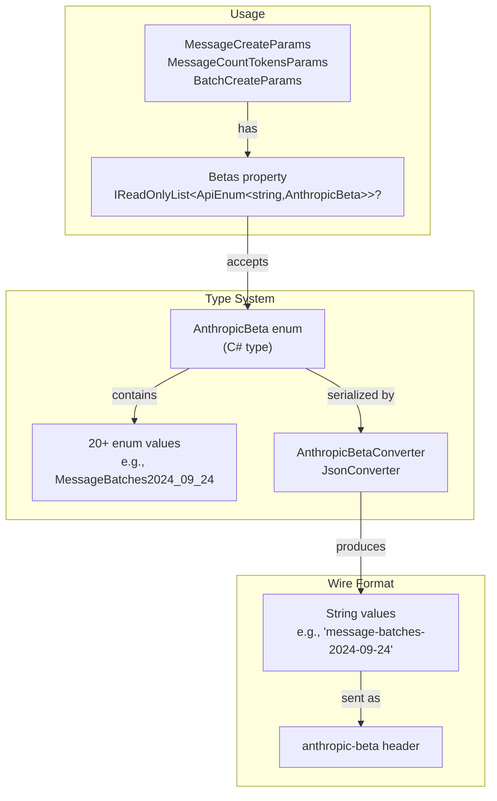
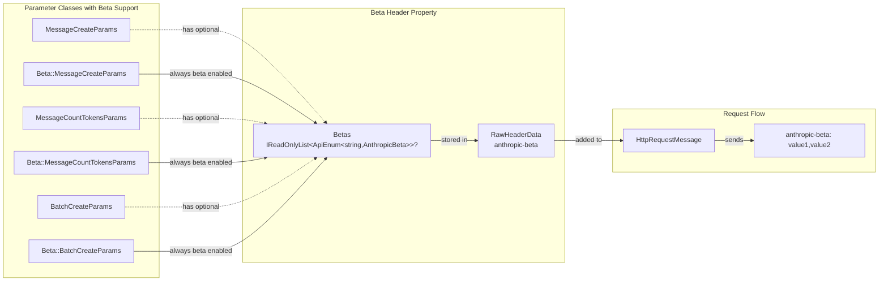
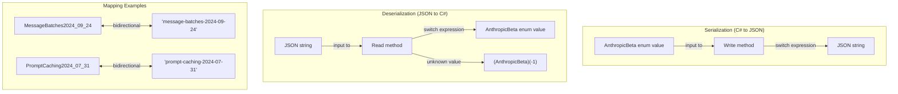
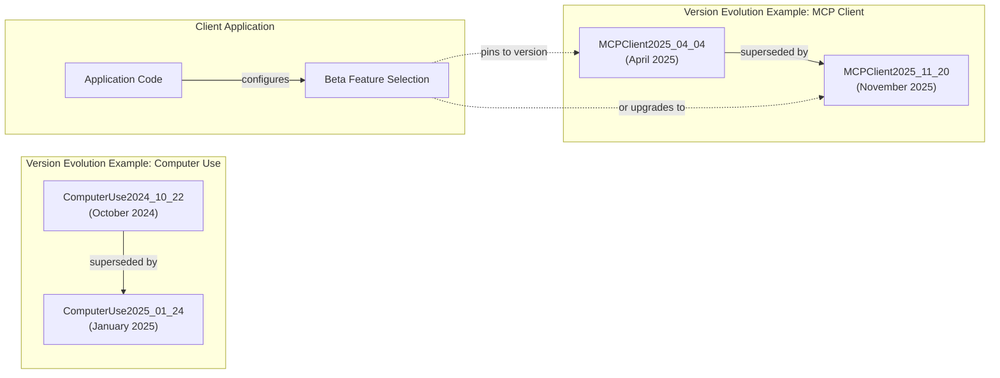
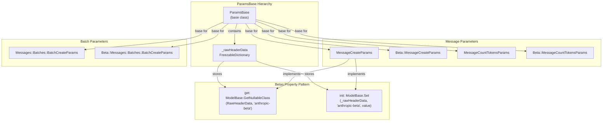
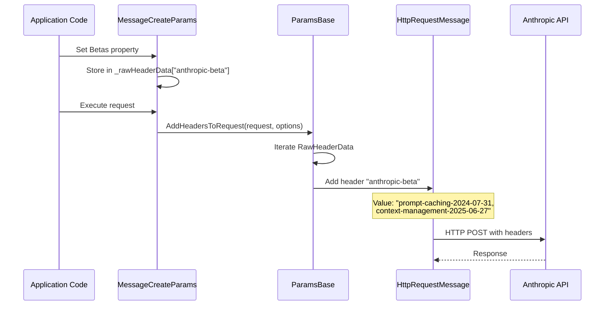
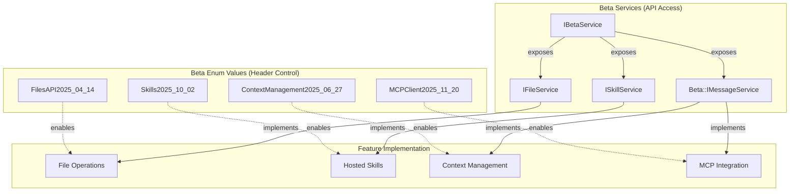

<!-- source: DeepWiki mcp.deepwiki.com · repo anthropics/anthropic-sdk-csharp · page 9.4 Beta Features Enum · fetched 2026-10-26 -->

# Beta Features Enum

<details>
<summary>Relevant source files</summary>

The following files were used as context for generating this wiki page:

- [.csharpierignore](.csharpierignore)
- [.stats.yml](.stats.yml)
- [src/Anthropic.Tests/Anthropic.Tests.csproj](src/Anthropic.Tests/Anthropic.Tests.csproj)
- [src/Anthropic.Tests/Models/Beta/AnthropicBetaTest.cs](src/Anthropic.Tests/Models/Beta/AnthropicBetaTest.cs)
- [src/Anthropic.Tests/Models/Beta/Files/DeletedFileTest.cs](src/Anthropic.Tests/Models/Beta/Files/DeletedFileTest.cs)
- [src/Anthropic.Tests/Models/Beta/Messages/Batches/BetaMessageBatchTest.cs](src/Anthropic.Tests/Models/Beta/Messages/Batches/BetaMessageBatchTest.cs)
- [src/Anthropic.Tests/Models/Beta/Messages/BetaBase64ImageSourceTest.cs](src/Anthropic.Tests/Models/Beta/Messages/BetaBase64ImageSourceTest.cs)
- [src/Anthropic.Tests/Models/Beta/Messages/BetaBashCodeExecutionToolResultErrorParamTest.cs](src/Anthropic.Tests/Models/Beta/Messages/BetaBashCodeExecutionToolResultErrorParamTest.cs)
- [src/Anthropic.Tests/Models/Beta/Messages/BetaBashCodeExecutionToolResultErrorTest.cs](src/Anthropic.Tests/Models/Beta/Messages/BetaBashCodeExecutionToolResultErrorTest.cs)
- [src/Anthropic.Tests/Models/Beta/Messages/BetaCacheControlEphemeralTest.cs](src/Anthropic.Tests/Models/Beta/Messages/BetaCacheControlEphemeralTest.cs)
- [src/Anthropic/Models/Beta/AnthropicBeta.cs](src/Anthropic/Models/Beta/AnthropicBeta.cs)
- [src/Anthropic/Models/Messages/Model.cs](src/Anthropic/Models/Messages/Model.cs)

</details>


This page documents the `AnthropicBeta` enum, which defines available beta API features that can be enabled via request headers. For information about beta-specific services and endpoints, see [Beta Services](#4.4). For context management and other advanced beta features, see [Context Management](#7.1).

## Purpose and Scope

The `AnthropicBeta` enum provides type-safe access to Anthropic's experimental API features. Each enum value corresponds to a specific beta feature version that must be explicitly requested through the `anthropic-beta` HTTP header. This mechanism allows the SDK to access new capabilities while maintaining stability for production features.

## Enum Definition

The `AnthropicBeta` enum is defined in [src/Anthropic/Models/Beta/AnthropicBeta.cs:9-30]() and includes a custom JSON converter for header serialization.



**Sources:** [src/Anthropic/Models/Beta/AnthropicBeta.cs:9-30](), [src/Anthropic/Models/Beta/Messages/MessageCreateParams.cs:487-505]()

## Available Beta Features

The following table lists all beta features defined in the enum, their string representations, and primary use cases:

| Enum Value | String Representation | Feature Area | Description |
|------------|----------------------|--------------|-------------|
| `MessageBatches2024_09_24` | `message-batches-2024-09-24` | Batch Processing | Batch message creation requests |
| `PromptCaching2024_07_31` | `prompt-caching-2024-07-31` | Caching | Cache control with ephemeral TTLs |
| `ComputerUse2024_10_22` | `computer-use-2024-10-22` | Tools | Computer interaction tools (v1) |
| `ComputerUse2025_01_24` | `computer-use-2025-01-24` | Tools | Computer interaction tools (v2) |
| `PDFs2024_09_25` | `pdfs-2024-09-25` | Content | PDF document processing |
| `TokenCounting2024_11_01` | `token-counting-2024-11-01` | Tokens | Token counting API |
| `TokenEfficientTools2025_02_19` | `token-efficient-tools-2025-02-19` | Tools | Optimized tool representations |
| `Output128k2025_02_19` | `output-128k-2025-02-19` | Output | Extended output token limit |
| `FilesAPI2025_04_14` | `files-api-2025-04-14` | Files | File upload and management |
| `MCPClient2025_04_04` | `mcp-client-2025-04-04` | MCP | Model Context Protocol (v1) |
| `MCPClient2025_11_20` | `mcp-client-2025-11-20` | MCP | Model Context Protocol (v2) |
| `DevFullThinking2025_05_14` | `dev-full-thinking-2025-05-14` | Thinking | Full thinking mode access |
| `InterleavedThinking2025_05_14` | `interleaved-thinking-2025-05-14` | Thinking | Interleaved thinking blocks |
| `CodeExecution2025_05_22` | `code-execution-2025-05-22` | Tools | Server-side code execution |
| `ExtendedCacheTTL2025_04_11` | `extended-cache-ttl-2025-04-11` | Caching | Longer cache TTL options |
| `Context1m2025_08_07` | `context-1m-2025-08-07` | Context | 1 million token context window |
| `ContextManagement2025_06_27` | `context-management-2025-06-27` | Context | Context editing operations |
| `ModelContextWindowExceeded2025_08_26` | `model-context-window-exceeded-2025-08-26` | Error Handling | Context window overflow handling |
| `Skills2025_10_02` | `skills-2025-10-02` | Skills | Hosted capabilities API |

**Sources:** [src/Anthropic/Models/Beta/AnthropicBeta.cs:10-30]()

## Usage in Request Parameters

Beta features are enabled by setting the `Betas` property on request parameter objects. The property accepts a list of `ApiEnum<string, AnthropicBeta>` values, allowing for multiple beta features to be enabled simultaneously.



**Sources:** [src/Anthropic/Models/Beta/Messages/MessageCreateParams.cs:487-505](), [src/Anthropic/Models/Messages/MessageCreateParams.cs:1-453](), [src/Anthropic/Models/Beta/Messages/BatchCreateParams.cs:47-65]()

### Example: Enabling Single Beta Feature

```csharp
var messageParams = new MessageCreateParams
{
    Model = Model.ClaudeSonnet4_5,
    MaxTokens = 1024,
    Messages = messages,
    Betas = new[] { AnthropicBeta.PromptCaching2024_07_31 }
};
```

### Example: Enabling Multiple Beta Features

```csharp
var messageParams = new Beta.Messages.MessageCreateParams
{
    Model = Model.ClaudeSonnet4_5,
    MaxTokens = 1024,
    Messages = messages,
    Betas = new[]
    {
        AnthropicBeta.ContextManagement2025_06_27,
        AnthropicBeta.ExtendedCacheTTL2025_04_11,
        AnthropicBeta.TokenEfficientTools2025_02_19
    }
};
```

**Sources:** [src/Anthropic/Models/Beta/Messages/MessageCreateParams.cs:487-505]()

## Header Serialization

The `AnthropicBetaConverter` class handles bidirectional conversion between enum values and their wire-format string representations.



**Sources:** [src/Anthropic/Models/Beta/AnthropicBeta.cs:32-103]()

### Serialization Logic

The converter implements a switch-based mapping:

| Direction | Method | Line Reference |
|-----------|--------|----------------|
| JSON → Enum | `Read(ref Utf8JsonReader, Type, JsonSerializerOptions)` | [src/Anthropic/Models/Beta/AnthropicBeta.cs:34-64]() |
| Enum → JSON | `Write(Utf8JsonWriter, AnthropicBeta, JsonSerializerOptions)` | [src/Anthropic/Models/Beta/AnthropicBeta.cs:66-102]() |

**Invalid Value Handling:** Unknown string values are deserialized to `(AnthropicBeta)(-1)`, while invalid enum values during serialization throw `AnthropicInvalidDataException` [src/Anthropic/Models/Beta/AnthropicBeta.cs:96-98]().

**Sources:** [src/Anthropic/Models/Beta/AnthropicBeta.cs:32-103]()

## Beta Feature Versioning

Each beta feature includes a date-based version identifier in its name, following the pattern `{FeatureName}{YYYY_MM_DD}`. This versioning system allows:

1. **Multiple concurrent versions** - Different versions of the same feature can coexist
2. **Breaking changes** - New versions can introduce incompatible changes
3. **Migration tracking** - Applications can upgrade incrementally by feature
4. **Stability signaling** - Date indicates when the version was introduced



**Sources:** [src/Anthropic/Models/Beta/AnthropicBeta.cs:10-30]()

## Integration with Parameter Classes

The `Betas` property is consistently implemented across parameter classes that support beta features:



**Sources:** [src/Anthropic/Models/Beta/Messages/MessageCreateParams.cs:487-505](), [src/Anthropic/Models/Messages/MessageCreateParams.cs:1-453](), [src/Anthropic/Models/Beta/Messages/BatchCreateParams.cs:47-65]()

### Property Implementation Pattern

All parameter classes use a consistent implementation pattern:

1. **Storage**: Beta values are stored in `RawHeaderData` dictionary with key `"anthropic-beta"`
2. **Getter**: Retrieves nullable list via `ModelBase.GetNullableClass`
3. **Setter**: Stores value via `ModelBase.Set` if non-null
4. **Type**: `IReadOnlyList<ApiEnum<string, AnthropicBeta>>?`

**Sources:** [src/Anthropic/Models/Beta/Messages/MessageCreateParams.cs:487-505](), [src/Anthropic/Models/Beta/Messages/MessageCountTokensParams.cs:323-341]()

## Request Header Construction

When a request is sent, the beta features are serialized into the HTTP header:



**Sources:** [src/Anthropic/Models/Beta/Messages/MessageCreateParams.cs:569-576](), [src/Anthropic/Models/Messages/MessageCreateParams.cs:445-452]()

### Header Format

Multiple beta features are combined into a single comma-separated header value:

- Single feature: `anthropic-beta: message-batches-2024-09-24`
- Multiple features: `anthropic-beta: prompt-caching-2024-07-31,context-management-2025-06-27`

**Sources:** [src/Anthropic/Models/Beta/Messages/MessageCreateParams.cs:569-576]()

## Relationship to Beta Services

Beta features enabled via the enum correspond to functionality accessed through beta-specific service interfaces:



**Sources:** [src/Anthropic/Models/Beta/AnthropicBeta.cs:10-30]()

## Error Handling

If an unknown beta feature string is received during deserialization, the converter assigns the sentinel value `(AnthropicBeta)(-1)` [src/Anthropic/Models/Beta/AnthropicBeta.cs:62](). During serialization, attempting to write an invalid enum value throws `AnthropicInvalidDataException` [src/Anthropic/Models/Beta/AnthropicBeta.cs:96-98]().

**Sources:** [src/Anthropic/Models/Beta/AnthropicBeta.cs:32-103]()

---

