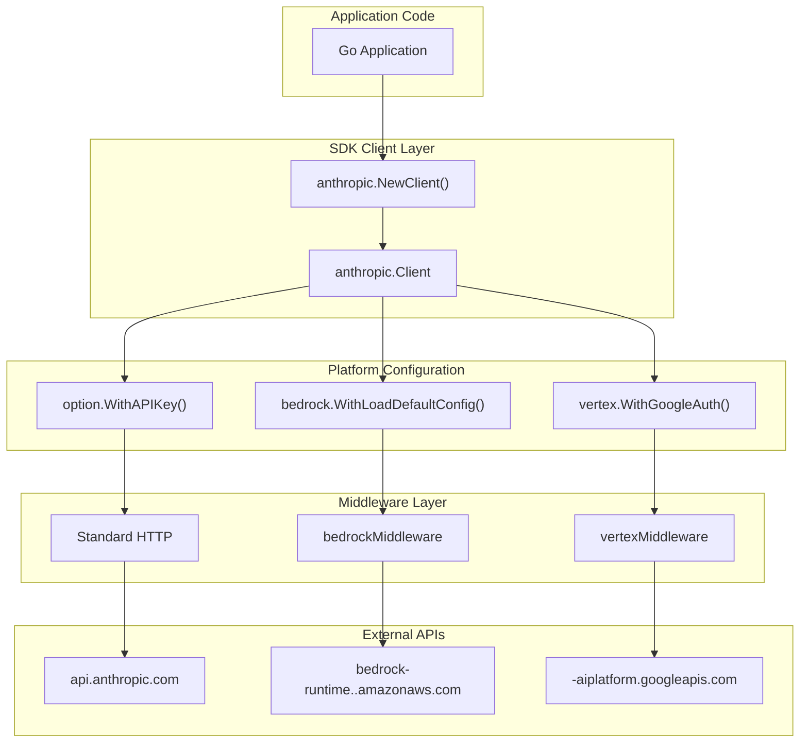
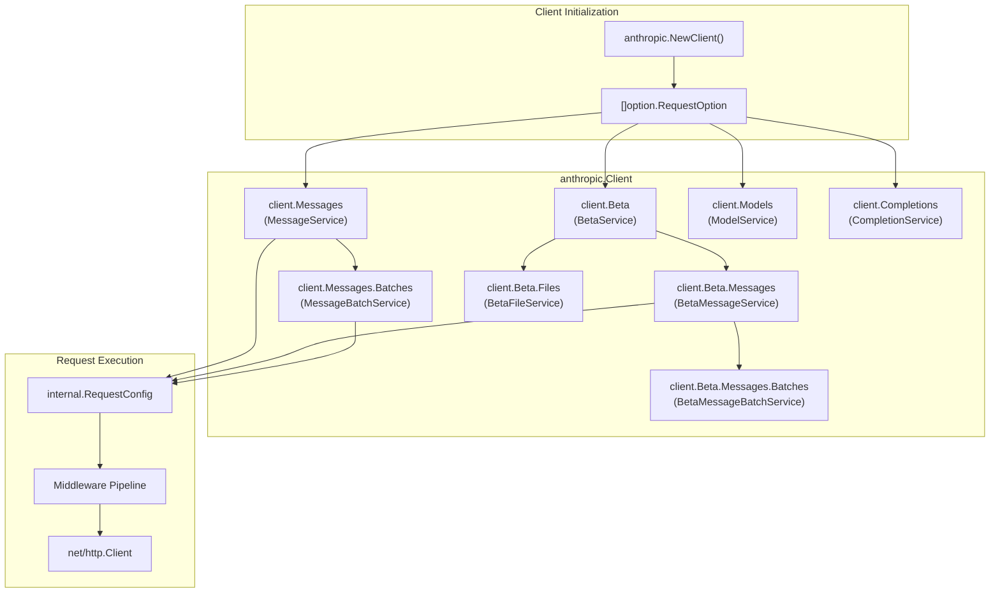
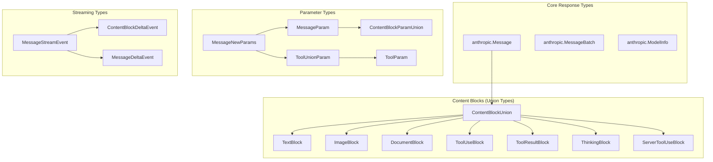

<!-- source: DeepWiki mcp.deepwiki.com · repo anthropics/anthropic-sdk-go · page 1 Overview · fetched 2026-10-26 -->

# Overview

<details>
<summary>Relevant source files</summary>

The following files were used as context for generating this wiki page:

- [.release-please-manifest.json](.release-please-manifest.json)
- [CHANGELOG.md](CHANGELOG.md)
- [README.md](README.md)
- [api.md](api.md)
- [examples/go.mod](examples/go.mod)
- [examples/go.sum](examples/go.sum)
- [go.mod](go.mod)
- [go.sum](go.sum)
- [internal/version.go](internal/version.go)
- [shared/constant/constants.go](shared/constant/constants.go)

</details>


This document provides a high-level introduction to the Anthropic Go SDK, its architecture, and core capabilities. The SDK enables Go applications to interact with Claude AI models through multiple deployment platforms.

For detailed information about specific features:
- Installation and basic usage patterns, see [Getting Started](#2)
- Client configuration options, see [Client Configuration](#3.1)
- API services and endpoints, see [Messages API](#4) and [Other Services](#8)
- Cloud platform integrations, see [Cloud Provider Integrations](#7.1)

## Purpose and Scope

The Anthropic Go SDK (`github.com/anthropics/anthropic-sdk-go`) is an officially supported library that provides type-safe access to Anthropic's Claude AI models. The SDK abstracts the complexities of API communication, request serialization, error handling, and streaming while maintaining idiomatic Go patterns.

**Key capabilities:**
- Synchronous and streaming message generation
- Tool calling and function execution
- Batch processing for high-volume workloads
- Multi-platform deployment (direct API, AWS Bedrock, Google Vertex AI)
- Prompt caching and context management
- Built-in retry logic and error handling

**Current version:** 1.26.0  
**Minimum Go version:** 1.22

Sources: [README.md:1-40](), [go.mod:1-6](), [internal/version.go:1-6]()

## Deployment Options

The SDK supports three deployment platforms, each accessed through the same `anthropic.Client` interface with platform-specific middleware:



**Direct Anthropic API:**
- Default deployment option
- Requires `ANTHROPIC_API_KEY` environment variable or explicit configuration
- Configured via `option.WithAPIKey()`

**AWS Bedrock:**
- Integrates with AWS authentication (IAM or bearer tokens)
- Configured via `bedrock.WithLoadDefaultConfig()` or `bedrock.WithConfig()`
- Supports AWS SigV4 signing and custom EventStream decoding
- Base URL pattern: `https://bedrock-runtime.<region>.amazonaws.com`

**Google Vertex AI:**
- Integrates with Google Cloud authentication (Application Default Credentials)
- Configured via `vertex.WithGoogleAuth()` or `vertex.WithCredentials()`
- Base URL pattern: `https://<region>-aiplatform.googleapis.com`

Sources: [README.md:881-984](), [bedrock/bedrock.go](), [vertex/vertex.go]()

## Core Architecture

### Client and Services

The SDK follows a client-service pattern where `anthropic.Client` acts as the root object providing access to specialized service endpoints:



**Service hierarchy:**
- `client.Messages`: Core message creation API (stable)
- `client.Messages.Batches`: Asynchronous batch processing
- `client.Beta.Messages`: Beta message features (context management, extended thinking)
- `client.Beta.Messages.Batches`: Beta batch processing
- `client.Beta.Files`: File upload and management
- `client.Models`: Model information and listing
- `client.Completions`: Legacy text completions (deprecated)

Sources: [client.go](), [message.go](), [messagebatch.go](), [beta.go]()

### Type System

The SDK employs a comprehensive type system with discriminated unions for polymorphic content:



**Type categories:**
- **Response types**: Immutable structs with metadata fields (e.g., `Message`, `MessageBatch`)
- **Parameter types**: Request structs with `Param` suffix (e.g., `MessageNewParams`, `ToolParam`)
- **Union types**: Discriminated unions with `AsAny()` conversion methods
- **Streaming types**: Event-based delta types for real-time updates
- **Helper types**: Citations, cache control, metadata, usage statistics

Sources: [message.go](), [messageparam.go](), [tool.go](), [contentblock.go]()

## Key Features

### Messages API

The primary interface for conversational interactions. Supports:
- Synchronous message generation via `client.Messages.New()`
- Streaming responses via `client.Messages.NewStreaming()`
- System prompts, multi-turn conversations, and temperature control
- Content blocks: text, images, documents, tool use/results, thinking

**Example structure:**
```go
message, err := client.Messages.New(ctx, anthropic.MessageNewParams{
    Model:     anthropic.ModelClaudeSonnet4_5_20250929,
    MaxTokens: 1024,
    Messages: []anthropic.MessageParam{
        anthropic.NewUserMessage(
            anthropic.NewTextBlock("Query text"),
        ),
    },
})
```

Sources: [README.md:42-70](), [message.go]()

### Streaming Support

Server-sent events (SSE) streaming for real-time response generation:
- Event types: `message_start`, `content_block_start`, `content_block_delta`, `content_block_stop`, `message_delta`, `message_stop`
- Accumulator pattern via `Message.Accumulate()` for reconstructing complete messages
- Custom stream buffer handling for large responses

Sources: [README.md:123-160](), [messagestream.go]()

### Tool Calling

Comprehensive tool execution framework:
- Custom tool definitions with JSON schemas
- Tool choice strategies: `auto`, `any`, `tool`, `none`
- Server-side tools: web search, web fetch, code execution, bash, text editor
- Multi-turn conversation loops for tool execution
- Automatic tool runners in beta API via `toolrunner` package

Sources: [README.md:163-368](), [tool.go](), [toolrunner/]()

### Batch Processing

Asynchronous processing for high-volume workloads:
- Submit batches via `client.Messages.Batches.New()`
- Poll status via `client.Messages.Batches.Get()`
- Stream results as JSONL via `ResultsStreaming()`
- Per-request tracking with `custom_id` field
- Result types: `succeeded`, `errored`, `canceled`, `expired`

Sources: [README.md:587-623](), [messagebatch.go]()

### Beta Features

Experimental features accessed through `client.Beta`:
- Context management (automatic compaction, tool use clearing, thinking truncation)
- Extended thinking modes (adaptive, enabled, disabled)
- Model Context Protocol (MCP) integration
- Per-iteration usage tracking
- Advanced file handling

Sources: [beta.go](), [betamessage.go]()

## Request Execution Pipeline

The SDK implements a sophisticated request pipeline with retry logic, middleware support, and platform-specific transformations:

```mermaid
graph LR
    subgraph "Request Construction"
        Params["Parameter Struct"]
        Serialization["JSON/Multipart/Query<br/>Encoding"]
        Headers["Header Construction<br/>(User-Agent, Auth, Beta)"]
    end
    
    subgraph "Middleware Pipeline"
        CustomMW["Custom Middleware"]
        PlatformMW["Platform Middleware<br/>(Bedrock/Vertex)"]
        RetryMW["Retry Logic"]
    end
    
    subgraph "HTTP Execution"
        HTTPClient["http.Client.Do()"]
        Response["http.Response"]
    end
    
    subgraph "Response Processing"
        StatusCheck{{"Status<br/>Check"}}
        Deserialize["JSON Unmarshal"]
        ErrorConstruct["apierror.Error"]
    end
    
    Params --> Serialization
    Serialization --> Headers
    Headers --> CustomMW
    CustomMW --> PlatformMW
    PlatformMW --> RetryMW
    RetryMW --> HTTPClient
    HTTPClient --> Response
    Response --> StatusCheck
    StatusCheck -->|"2xx"| Deserialize
    StatusCheck -->|"4xx/5xx"| ErrorConstruct
    StatusCheck -->|"429/5xx<br/>(retry)"| RetryMW
```



**Pipeline stages:**
1. **Parameter encoding**: Polymorphic serialization based on content type
2. **Header construction**: Authentication, API versioning, beta flags
3. **Custom middleware**: User-provided request/response transformations
4. **Platform middleware**: Bedrock/Vertex-specific URL and body modifications
5. **Retry logic**: Exponential backoff with configurable max attempts (default: 2)
6. **HTTP execution**: Standard `net/http` client with timeout support
7. **Response handling**: Status-based branching with structured error types

Sources: [client.go](), [option/requestoption.go](), [internal/requestconfig.go]()

## Error Handling

The SDK provides structured error types with rich debugging context:

| Error Type | HTTP Status | Description |
|------------|-------------|-------------|
| `InvalidRequestError` | 400 | Malformed request parameters |
| `AuthenticationError` | 401 | Invalid or missing API key |
| `PermissionError` | 403 | Insufficient permissions |
| `NotFoundError` | 404 | Resource not found |
| `RateLimitError` | 429 | Rate limit exceeded |
| `OverloadedError` | 529 | Server overloaded |
| `APIError` | 500+ | Internal server error |
| `TimeoutError` | - | Request timeout |

**Error structure (`anthropic.Error`):**
- `StatusCode`: HTTP status code
- `RequestID`: Unique request identifier for support
- `Type`: Error type discriminator
- `Message`: Human-readable error message
- `DumpRequest()`: Serialized HTTP request
- `DumpResponse()`: Serialized HTTP response

Sources: [README.md:624-660](), [error.go](), [shared/errorobject.go]()

## Package Structure

```
anthropic-sdk-go/
├── anthropic.go           # Client and core types
├── message.go             # Messages API
├── messagebatch.go        # Batch processing
├── beta.go                # Beta features
├── model.go               # Models API
├── completion.go          # Legacy completions
├── bedrock/               # AWS Bedrock integration
├── vertex/                # Google Vertex AI integration
├── toolrunner/            # Automatic tool execution
├── option/                # Request options
├── internal/              # Internal utilities
│   ├── requestconfig.go   # Request configuration
│   ├── retry.go           # Retry logic
│   ├── apijson/           # JSON encoding
│   └── encoding/          # Parameter encoding
└── shared/                # Shared types and constants
    ├── errorobject.go     # Error types
    └── constant/          # Type constants
```

Sources: Repository file structure

## Dependencies

The SDK has minimal external dependencies:

| Package | Purpose |
|---------|---------|
| `github.com/tidwall/gjson` | JSON path queries |
| `github.com/tidwall/sjson` | JSON path updates |
| `github.com/aws/aws-sdk-go-v2` | AWS Bedrock integration |
| `google.golang.org/api` | Google Vertex AI integration |
| `github.com/invopop/jsonschema` | Tool schema generation |

All core functionality uses only Go standard library packages (`net/http`, `encoding/json`, `context`, etc.).

Sources: [go.mod:7-21]()

---

