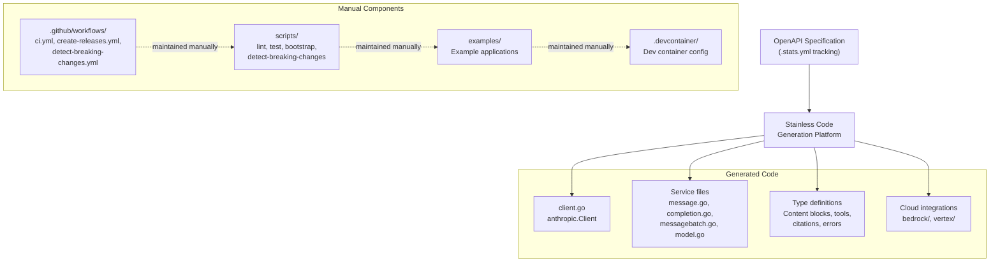
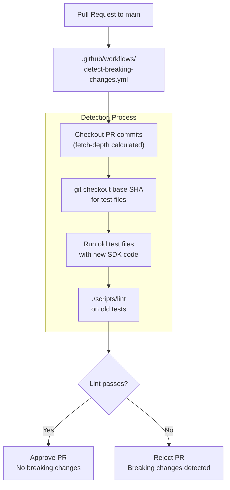

<!-- source: DeepWiki mcp.deepwiki.com · repo anthropics/anthropic-sdk-go · page 10 Development Guide · fetched 2026-10-26 -->

# Development Guide

<details>
<summary>Relevant source files</summary>

The following files were used as context for generating this wiki page:

- [.github/workflows/ci.yml](.github/workflows/ci.yml)
- [.github/workflows/create-releases.yml](.github/workflows/create-releases.yml)
- [.github/workflows/detect-breaking-changes.yml](.github/workflows/detect-breaking-changes.yml)
- [examples/go.mod](examples/go.mod)
- [examples/go.sum](examples/go.sum)
- [go.mod](go.mod)
- [go.sum](go.sum)
- [scripts/detect-breaking-changes](scripts/detect-breaking-changes)

</details>


This guide covers the development workflow, environment setup, and contribution process for the anthropic-sdk-go repository. Since this SDK is generated from OpenAPI specifications using the Stainless platform, the development model differs from traditional open-source projects.

This page provides an overview of the development environment and workflow. For detailed information, see:
- **Testing** (page 10.1) - Test suite organization, VCR recordings, and running tests
- **CI/CD Pipeline** (page 10.2) - GitHub Actions workflows, linting, and release automation
- **Dependencies** (page 10.3) - SDK dependencies and version management

## Generated SDK Architecture

The anthropic-sdk-go SDK is fully generated from OpenAPI specifications using the Stainless code generation platform. This automated approach ensures consistency with the API specification and enables rapid updates when the API changes.

### Code Generation Model



**What is generated:**
- Core client implementation in [client.go]()
- Service methods in files like [message.go](), [completion.go](), [messagebatch.go]()
- All type definitions for messages, content blocks, tools, citations
- Error handling structures in the `apierror` package
- Cloud provider middleware in `bedrock/` and `vertex/` packages

**What is manually maintained:**
- CI/CD workflows in [.github/workflows/]()
- Build and test scripts in [scripts/]()
- Example applications in [examples/]()
- Development container configuration in [.devcontainer/]()
- Documentation and README files

**Sources:** [.github/workflows/ci.yml:1-50](), [.github/workflows/create-releases.yml:1-32](), [.github/workflows/detect-breaking-changes.yml:1-33]()

## Development Environment Setup

### Prerequisites

The SDK requires Go 1.23.0 or later, as specified in [go.mod:3]():

```
go 1.23.0
toolchain go1.24.3
```

### Repository Setup

Clone the repository and set up dependencies:

```bash
git clone https://github.com/anthropics/anthropic-sdk-go.git
cd anthropic-sdk-go
go mod download
```

### Development Scripts

The repository provides several scripts for common development tasks:

| Script | Purpose | Used By |
|--------|---------|---------|
| `./scripts/bootstrap` | Initialize development environment | CI test job |
| `./scripts/lint` | Run code linting and formatting checks | CI lint job |
| `./scripts/test` | Execute the test suite | CI test job |
| `./scripts/detect-breaking-changes` | Check for API breaking changes | Breaking changes workflow |

**Sources:** [.github/workflows/ci.yml:31,46,49](), [.github/workflows/detect-breaking-changes.yml:29-33](), [scripts/detect-breaking-changes:1-35]()

### Running Locally

**Linting:**
```bash
./scripts/lint
```

**Running tests:**
```bash
./scripts/bootstrap  # First time setup
./scripts/test       # Run test suite
```

**Building:**
```bash
go build ./...
```

The test suite uses VCR (Video Cassette Recorder) recordings to replay HTTP interactions without making real API calls. See page 10.1 for details on the testing infrastructure.

**Sources:** [.github/workflows/ci.yml:46,49](), [go.mod:13]()

## Development Workflow

### Working with Generated Code

Since most code is generated, the typical development workflow focuses on:

1. **Updating examples** - Add new example applications in [examples/]()
2. **Improving tooling** - Enhance build scripts, CI workflows, or dev environment
3. **Reporting issues** - File GitHub issues for bugs or feature requests
4. **Testing changes** - Validate SDK behavior through comprehensive tests

### Making Changes

**For manually-maintained components:**

1. Create a feature branch from `main`
2. Make your changes to:
   - GitHub Actions workflows in [.github/workflows/]()
   - Build scripts in [scripts/]()
   - Examples in [examples/]()
   - Documentation files
3. Run linting and tests locally:
   ```bash
   ./scripts/lint
   ./scripts/test
   ```
4. Submit a pull request to `main`

**For generated code changes:**

Generated code cannot be modified directly. To request changes:

1. File a GitHub issue describing the desired change
2. Changes require updates to the OpenAPI specification
3. The Stainless team evaluates and implements approved changes
4. New code is generated and merged automatically

### Branch Strategy

The repository uses specific branch patterns:

| Branch Pattern | Purpose | CI Behavior |
|----------------|---------|-------------|
| `main` | Primary development branch | Full CI + releases |
| `generated` | Auto-generated code updates | Excluded from CI |
| `codegen/**` | Code generation artifacts | Excluded from CI |
| `integrated/**` | Integration testing | Excluded from CI |
| `stl-preview-head/**` | Preview branches | Excluded from CI |
| `stl-preview-base/**` | Preview base branches | Excluded from CI |

**Sources:** [.github/workflows/ci.yml:3-13]()

## Automated Quality Checks

### Breaking Change Detection

Pull requests automatically check for breaking changes using a unique approach:



The breaking change detection works by:
1. Checking out test files from the PR base commit
2. Attempting to run those old tests against the new SDK code
3. If old tests fail to compile/lint, it indicates a breaking API change

Test files monitored for breaking changes:
- `client_test.go`
- `completion_test.go`
- `message_test.go`
- `messagebatch_test.go`
- `model_test.go`
- `betamodel_test.go`
- `betamessage_test.go`
- `betamessagebatch_test.go`
- `betafile_test.go`
- `betaskill_test.go`
- `betaskillversion_test.go`
- `usage_test.go`
- `paginationauto_test.go`
- `paginationmanual_test.go`

**Sources:** [.github/workflows/detect-breaking-changes.yml:1-33](), [scripts/detect-breaking-changes:1-35]()

### Continuous Integration

All pushes and pull requests trigger the CI workflow, which runs:

1. **Lint job** - Code quality and formatting checks
2. **Test job** - Full test suite execution

The CI runs on `ubuntu-latest` (or `depot-ubuntu-24.04` for the main repository), uses Go version from [go.mod](), and executes within a 10-minute timeout.

See page 10.2 for detailed information on the CI/CD pipeline, including the automated release process.

**Sources:** [.github/workflows/ci.yml:1-50]()

## Contribution Guidelines

### What Can Be Contributed

Given the generated nature of this SDK, contributions are limited to:

1. **Documentation improvements** - README, examples, guides
2. **Development tooling** - Scripts, CI improvements, dev containers
3. **Security policies** - Updates to security reporting procedures
4. **Issue reporting** - Bug reports, feature requests (routed to Stainless)

### What Cannot Be Contributed

The following are generated and cannot accept direct contributions:

- Core client implementation
- Service method implementations
- Type definitions and structures
- Error handling mechanisms
- HTTP client logic
- Authentication implementations

### Feedback and Feature Requests

For SDK functionality changes or new features:
1. Report issues through GitHub Issues
2. Feature requests are evaluated by the Stainless team
3. Changes require updates to the underlying OpenAPI specification
4. Implementation happens through the code generation pipeline

**Sources:** [SECURITY.md:5-7](), [.github/workflows/create-releases.yml:22-23]()

---

