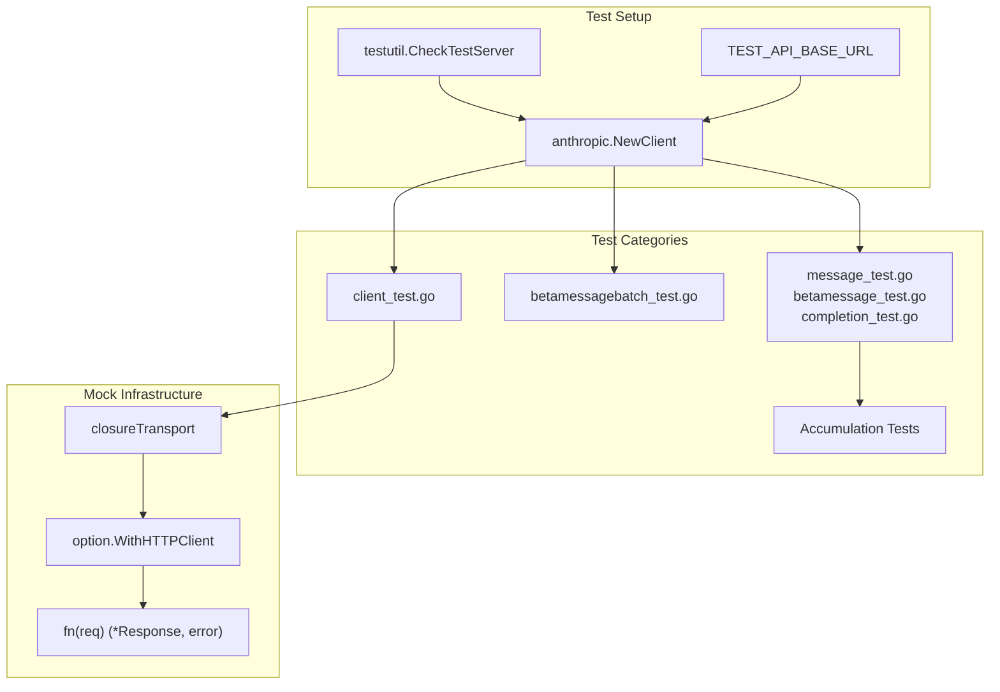
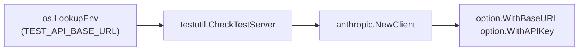
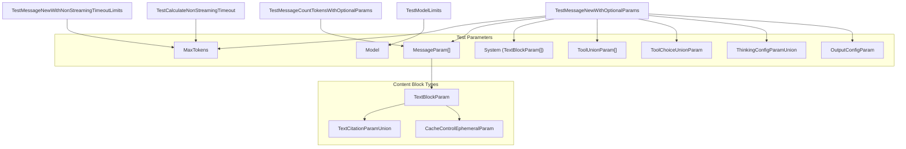
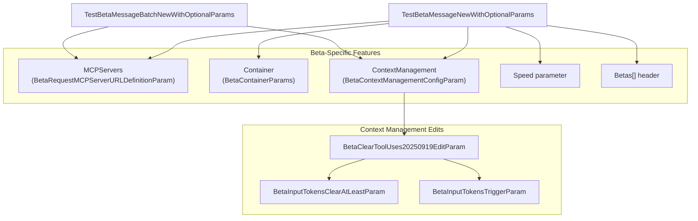
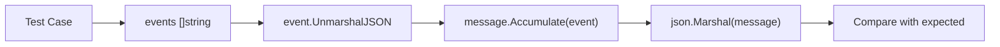
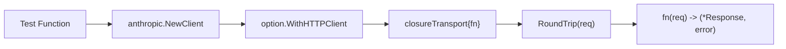
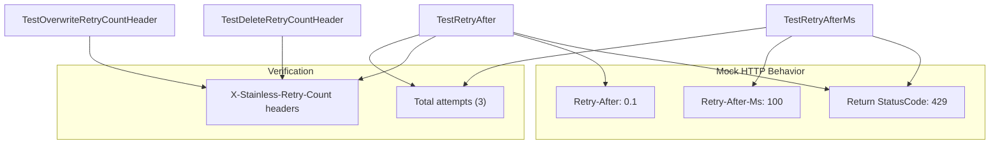
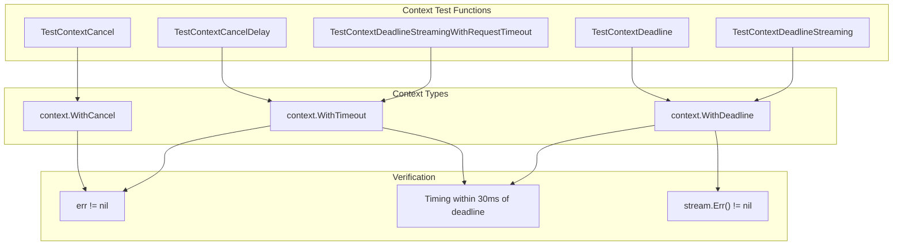
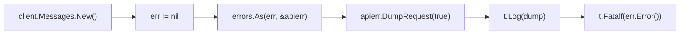
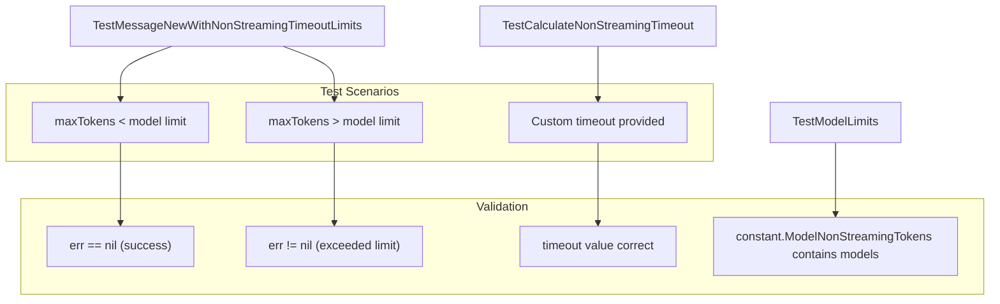

<!-- source: DeepWiki mcp.deepwiki.com · repo anthropics/anthropic-sdk-go · page 10.1 Testing · fetched 2026-10-26 -->

# Testing

<details>
<summary>Relevant source files</summary>

The following files were used as context for generating this wiki page:

- [.github/workflows/ci.yml](.github/workflows/ci.yml)
- [.github/workflows/create-releases.yml](.github/workflows/create-releases.yml)
- [.github/workflows/detect-breaking-changes.yml](.github/workflows/detect-breaking-changes.yml)
- [betamessage_test.go](betamessage_test.go)
- [betamessagebatch_test.go](betamessagebatch_test.go)
- [client_test.go](client_test.go)
- [completion_test.go](completion_test.go)
- [message_test.go](message_test.go)
- [scripts/detect-breaking-changes](scripts/detect-breaking-changes)
- [usage_test.go](usage_test.go)

</details>


This document describes the SDK's test suite, test patterns, and how to run tests. The test infrastructure includes unit tests, integration tests, streaming tests, and breaking change detection.

For CI/CD pipeline details, see page 10.2. For SDK architecture information, see page 9.

## Running Tests

### Local Test Execution

Tests are executed using the `./scripts/test` script:

```bash
# Run all tests
./scripts/test

# Run specific test files
go test -v ./message_test.go

# Run specific test functions
go test -v -run TestMessageNewWithOptionalParams
```

**Sources:** [.github/workflows/ci.yml:48-49]()

### Test Server Configuration

Tests require a mock API server for integration testing. The test infrastructure checks for server availability:

| Environment Variable | Purpose | Default |
|---------------------|---------|---------|
| `TEST_API_BASE_URL` | Override mock server URL | `http://localhost:4010` |

Tests automatically skip if the server is unavailable using `testutil.CheckTestServer()`.

**Sources:** [message_test.go:20-26](), [usage_test.go:16-22]()

## Test Suite Organization

### Test File Structure

The SDK contains the following test files:

| File | Purpose | Key Test Functions |
|------|---------|-------------------|
| `message_test.go` | Messages API tests | `TestMessageNewWithOptionalParams`, `TestAccumulate`, `TestMessageNewWithNonStreamingTimeoutLimits` |
| `betamessage_test.go` | Beta Messages API tests | `TestBetaMessageNewWithOptionalParams`, `TestBetaAccumulate` |
| `betamessagebatch_test.go` | Beta batch processing tests | `TestBetaMessageBatchNewWithOptionalParams`, `TestBetaMessageBatchGetWithOptionalParams` |
| `client_test.go` | Client configuration tests | `TestUserAgentHeader`, `TestRetryAfter`, `TestContextCancel` |
| `completion_test.go` | Legacy completions API tests | `TestCompletionNewWithOptionalParams` |
| `usage_test.go` | Basic usage examples | `TestUsage` |

**Sources:** [message_test.go:1-602](), [betamessage_test.go:1-499](), [betamessagebatch_test.go:1-294](), [client_test.go:1-457](), [completion_test.go:1-49](), [usage_test.go:1-44]()

### Test Infrastructure Components

**Diagram: Test Infrastructure Architecture**



**Sources:** [message_test.go:19-26](), [client_test.go:19-25](), [testutil package reference]()

## Test Patterns

### Standard Test Setup

**Diagram: Test Setup Flow**



All test functions follow this standard pattern:

```go
func TestMessageNewWithOptionalParams(t *testing.T) {
    baseURL := "http://localhost:4010"
    if envURL, ok := os.LookupEnv("TEST_API_BASE_URL"); ok {
        baseURL = envURL
    }
    if !testutil.CheckTestServer(t, baseURL) {
        return
    }
    client := anthropic.NewClient(
        option.WithBaseURL(baseURL),
        option.WithAPIKey("my-anthropic-api-key"),
    )
    // Test execution...
}
```

**Sources:** [message_test.go:19-30](), [betamessage_test.go:17-29](), [usage_test.go:15-26]()

### Client Configuration Options

| Option | Usage in Tests | Purpose |
|--------|---------------|---------|
| `option.WithBaseURL` | All tests | Set mock server URL |
| `option.WithAPIKey` | All tests | Set test API key |
| `option.WithHTTPClient` | `client_test.go` | Inject mock HTTP client |
| `option.WithHeader` | `client_test.go` | Add/modify headers |
| `option.WithRequestTimeout` | Timeout tests | Override default timeout |

**Sources:** [message_test.go:27-30](), [client_test.go:29-41](), [client_test.go:432]()

## API Testing Patterns

### Message API Tests

**Diagram: Message Test Coverage**



The `TestMessageNewWithOptionalParams` test validates all optional parameters including:
- Message content with text blocks, citations, and cache control
- System prompts with cache control
- Tool definitions with input schemas and configuration
- Tool choice strategies (auto, any, specific)
- Thinking configuration
- Output configuration and format
- Metadata, temperature, top_k, top_p parameters

**Sources:** [message_test.go:19-132](), [message_test.go:134-238]()

### Token Limit and Timeout Tests

The SDK includes specific tests for token limit validation and timeout calculation:

| Test Function | Purpose | Tested Behavior |
|--------------|---------|-----------------|
| `TestMessageNewWithNonStreamingTimeoutLimits` | Validate token limits | Requests below model limits succeed; requests above limits fail |
| `TestCalculateNonStreamingTimeout` | Timeout calculation logic | Calculates appropriate timeout based on token count and model |
| `TestModelLimits` | Model constant validation | Verifies `constant.ModelNonStreamingTokens` contains expected models |

**Sources:** [message_test.go:405-459](), [message_test.go:461-543](), [message_test.go:545-559]()

### Beta API Tests

Beta API tests include additional features not present in the stable API:

**Diagram: Beta-Specific Test Features**



Key differences from stable API:

| Feature | Stable API | Beta API |
|---------|-----------|----------|
| Type Prefix | `anthropic.MessageParam` | `anthropic.BetaMessageParam` |
| MCP Servers | Not available | `MCPServers []BetaRequestMCPServerURLDefinitionParam` |
| Container | String only | `BetaContainerParams` with Skills |
| Context Management | Not available | `ContextManagement BetaContextManagementConfigParam` |
| Speed | Not available | `Speed BetaMessageNewParamsSpeed` |
| Beta Headers | Not used | `Betas []AnthropicBeta` |

**Sources:** [betamessage_test.go:17-177](), [betamessagebatch_test.go:16-182]()

## Streaming and Accumulation Tests

### Message Accumulation Testing

The `TestAccumulate` and `TestBetaAccumulate` functions use table-driven tests to verify streaming event accumulation:

**Diagram: Stream Event Accumulation Flow**



Each test case defines:
- `expected`: The final accumulated `Message` or `BetaMessage`
- `events`: Array of JSON event strings simulating server-sent events

**Sources:** [message_test.go:240-403](), [betamessage_test.go:323-498]()

### Stream Event Types

| Event Type | Delta Types | Accumulated Into |
|-----------|-------------|------------------|
| `message_start` | N/A | `Message` initialization |
| `content_block_start` | N/A | Creates new content block |
| `content_block_delta` | `text_delta`, `thinking_delta`, `input_json_delta`, `citations_delta`, `signature_delta`, `compaction_delta` | Updates content block |
| `content_block_stop` | N/A | Finalizes content block |
| `message_stop` | N/A | Finalizes message |

**Sources:** [message_test.go:252-378]()

### Accumulation Test Cases

The test suite covers these accumulation scenarios:

| Test Case | Content Blocks | Key Validations |
|-----------|---------------|-----------------|
| "empty message" | None | Basic message structure |
| "text content block" | 1 text block | Text delta accumulation |
| "text content block with citations" | 1 text block with citations | Citation delta handling |
| "tool use block" | 1 tool_use block | JSON input accumulation |
| "tool use block with no params" | 1 tool_use block | Empty input handling |
| "server tool use block" | 1 server_tool_use block | Server-side tool handling |
| "thinking block" | 1 thinking block | Thinking and signature deltas |
| "redacted thinking block" | 1 redacted_thinking block | Redacted data handling |
| "compaction block" (beta) | 1 compaction block | Content compression |
| "multiple content blocks" | 4 blocks (text, thinking, tool_use, text) | Multi-block streaming |

**Sources:** [message_test.go:241-378](), [betamessage_test.go:324-473]()

## HTTP Client Mocking

### closureTransport Pattern

The `closureTransport` type enables HTTP response mocking by wrapping a custom function:

**Diagram: HTTP Mocking Architecture**



Implementation:

```go
type closureTransport struct {
    fn func(req *http.Request) (*http.Response, error)
}

func (t *closureTransport) RoundTrip(req *http.Request) (*http.Response, error) {
    return t.fn(req)
}
```

**Sources:** [client_test.go:19-25]()

### Mock Usage Examples

The closureTransport is used to test various client behaviors:

| Test Function | Mock Purpose | Verification |
|--------------|--------------|--------------|
| `TestUserAgentHeader` | Capture User-Agent header | Verifies SDK version in header |
| `TestRetryAfter` | Return 429 with Retry-After | Verifies retry count headers |
| `TestRetryAfterMs` | Return 429 with Retry-After-Ms | Verifies millisecond retry delays |
| `TestContextCancel` | Block until context done | Verifies context cancellation |
| `TestContextDeadline` | Block until context done | Verifies deadline enforcement |

**Sources:** [client_test.go:27-57](), [client_test.go:59-102](), [client_test.go:224-253](), [client_test.go:286-332]()

### Retry Logic Tests

**Diagram: Retry Logic Test Coverage**



Key retry test validations:

| Test | Mock Response | Verification |
|------|--------------|--------------|
| `TestRetryAfter` | `429` with `Retry-After: 0.1` | Retry count headers: `["0", "1", "2"]` |
| `TestRetryAfterMs` | `429` with `Retry-After-Ms: 100` | 3 attempts total |
| `TestDeleteRetryCountHeader` | `429` with header deletion | Empty retry count headers |
| `TestOverwriteRetryCountHeader` | `429` with custom header value | Custom value preserved |

**Sources:** [client_test.go:59-102](), [client_test.go:104-143](), [client_test.go:145-184](), [client_test.go:186-222]()

### Context and Timeout Tests

**Diagram: Context Testing Patterns**



The context tests verify proper handling of cancellation and deadlines:

| Test | Context Type | Verification |
|------|-------------|--------------|
| `TestContextCancel` | Immediate cancel | Returns error immediately |
| `TestContextCancelDelay` | 2ms timeout | Returns error after timeout |
| `TestContextDeadline` | 100ms deadline | Returns within 30ms of deadline |
| `TestContextDeadlineStreaming` | 100ms deadline with streaming | Stream.Err() returns error |
| `TestContextDeadlineStreamingWithRequestTimeout` | `option.WithRequestTimeout` | Stream timeout enforced |

**Sources:** [client_test.go:224-253](), [client_test.go:255-284](), [client_test.go:286-332](), [client_test.go:334-391](), [client_test.go:393-451]()

## Error Handling Tests

### API Error Testing Pattern

**Diagram: Error Handling Flow**



All tests use a consistent error handling pattern:

```go
_, err := client.Messages.New(context.TODO(), params)
if err != nil {
    var apierr *anthropic.Error
    if errors.As(err, &apierr) {
        t.Log(string(apierr.DumpRequest(true)))
    }
    t.Fatalf("err should be nil: %s", err.Error())
}
```

**Sources:** [message_test.go:125-131](), [betamessage_test.go:170-176](), [completion_test.go:41-47]()

### Token Limit Validation Tests

**Diagram: Token Limit Test Flow**



Key validation tests:

| Test | Purpose | Assertions |
|------|---------|-----------|
| `TestMessageNewWithNonStreamingTimeoutLimits` | Enforce model token limits | Requests below limit succeed; above limit fail |
| `TestCalculateNonStreamingTimeout` | Calculate appropriate timeouts | Returns correct timeout or error for token counts |
| `TestModelLimits` | Verify limit constants | Checks `constant.ModelNonStreamingTokens` contains expected models |

**Sources:** [message_test.go:405-459](), [message_test.go:461-543](), [message_test.go:545-559]()

### Content Type Serialization Tests

The SDK tests serialization of union types:

| Test | Input | Expected Behavior |
|------|-------|-------------------|
| `TestToolResultBlockParamStringContent` | JSON with string content | Converts to `TextBlock` |
| `TestMessageParamStringContent` | JSON with string content | Converts to `TextBlock` |
| `TestMessageParamArrayContent` | JSON with array content | Parses multiple content blocks |

**Sources:** [message_test.go:561-571](), [message_test.go:573-583](), [message_test.go:585-602]()

## Best Practices for Application Testing

### Test Structure Recommendations

1. **Environment Configuration**: Always check for test server availability
2. **Client Setup**: Use consistent client configuration patterns
3. **Error Handling**: Test both success and error scenarios
4. **Streaming Tests**: Verify accumulation logic for streaming responses
5. **Timeout Testing**: Test context cancellation and deadline handling
6. **Mock Strategy**: Use custom transports for HTTP mocking

### Testing Checklist

| Category | Test Coverage | Implementation |
|----------|---------------|----------------|
| Basic Operations | ✓ Success cases | Standard API calls |
| Error Handling | ✓ API errors | `errors.As()` pattern |
| Streaming | ✓ Event accumulation | Table-driven tests |
| Timeouts | ✓ Context handling | Custom transports |
| Retries | ✓ Retry logic | Header validation |
| Parameters | ✓ All optional params | Comprehensive param testing |

### Integration Test Patterns

For integration tests, follow the patterns established in the SDK:

1. **Server Check**: Use `testutil.CheckTestServer()` to verify availability
2. **Environment Variables**: Support `TEST_API_BASE_URL` override
3. **Client Configuration**: Use `option.WithBaseURL()` and `option.WithAPIKey()`
4. **Error Validation**: Check for `*anthropic.Error` types using `errors.As()`
5. **Response Validation**: Verify response structure and content

**Sources:** [usage_test.go:15-43](), [message_test.go:19-30](), [client_test.go:27-41]()

---

