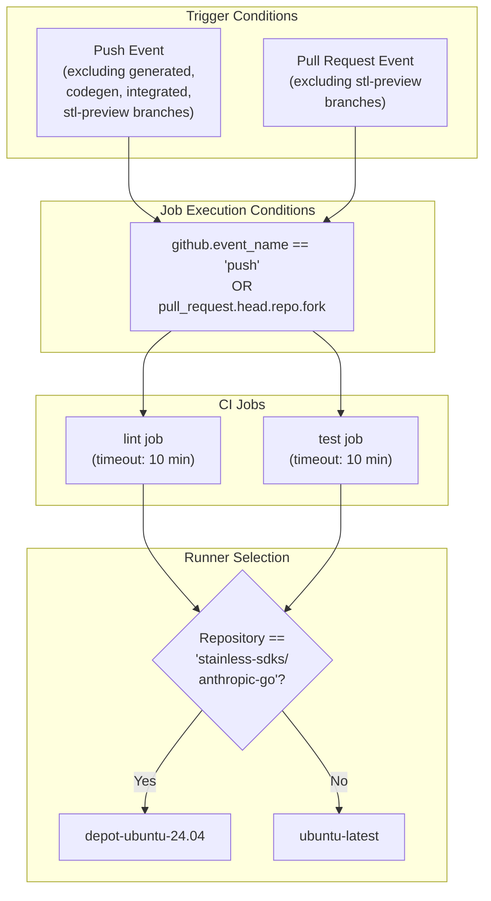
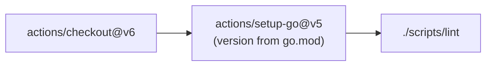
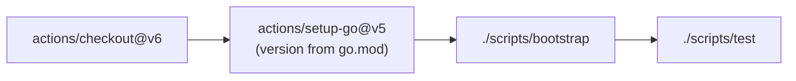
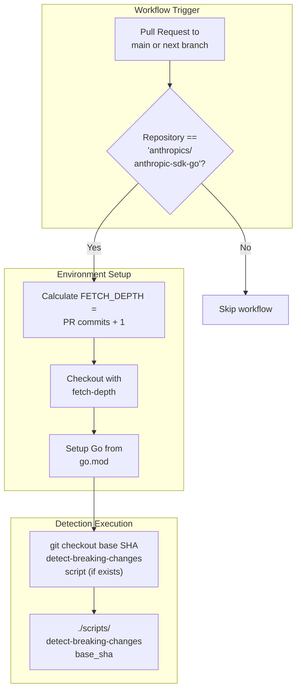
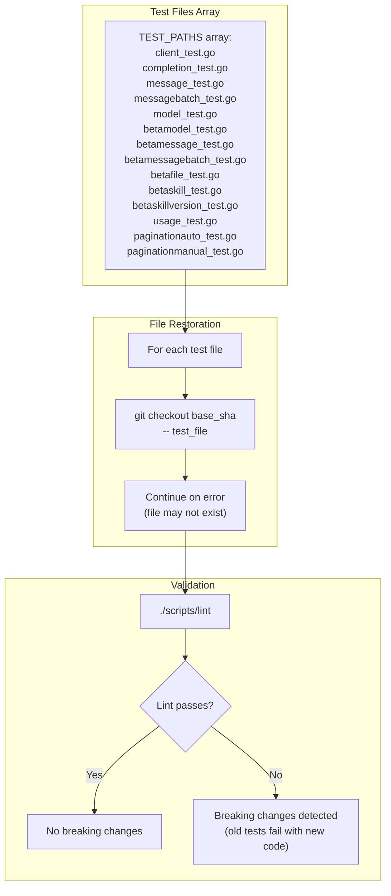
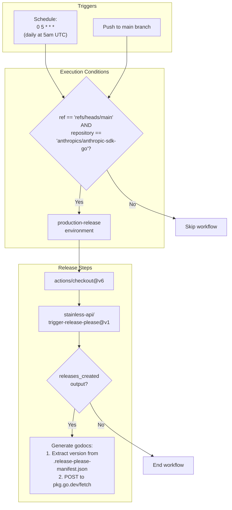
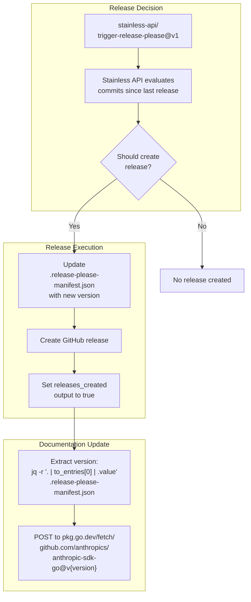
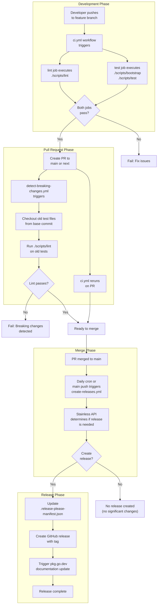

<!-- source: DeepWiki mcp.deepwiki.com · repo anthropics/anthropic-sdk-go · page 10.2 CI/CD Pipeline · fetched 2026-10-26 -->

# CI/CD Pipeline

<details>
<summary>Relevant source files</summary>

The following files were used as context for generating this wiki page:

- [.github/workflows/ci.yml](.github/workflows/ci.yml)
- [.github/workflows/create-releases.yml](.github/workflows/create-releases.yml)
- [.github/workflows/detect-breaking-changes.yml](.github/workflows/detect-breaking-changes.yml)
- [scripts/detect-breaking-changes](scripts/detect-breaking-changes)

</details>


## Purpose and Scope

This document explains the continuous integration and continuous deployment (CI/CD) infrastructure for the Anthropic Go SDK. It covers the GitHub Actions workflows that enforce code quality, detect breaking changes, and automate releases. For information about the testing infrastructure itself, see [Testing](#10.1). For details on dependency management, see [Dependencies](#10.3).

## Overview

The CI/CD pipeline consists of three GitHub Actions workflows that run at different stages of development:

| Workflow | Trigger | Purpose |
|----------|---------|---------|
| `ci.yml` | Push, Pull Request | Runs linting and tests on all commits |
| `detect-breaking-changes.yml` | Pull Request to main/next | Validates backward compatibility |
| `create-releases.yml` | Daily schedule, Push to main | Publishes releases to GitHub and pkg.go.dev |

These workflows operate in sequence: code changes must pass `ci.yml` checks, then pass breaking change detection, before being eligible for release via `create-releases.yml`.

Sources: [.github/workflows/ci.yml:1-50](), [.github/workflows/detect-breaking-changes.yml:1-33](), [.github/workflows/create-releases.yml:1-32]()

## CI Workflow

### Workflow Configuration

The `ci.yml` workflow runs on pushes and pull requests to all branches except specific excluded branches used for code generation and preview environments.



**Diagram: CI Workflow Trigger and Execution Logic**

The workflow uses conditional runner selection: internal repository builds use `depot-ubuntu-24.04` for faster builds, while external forks use `ubuntu-latest`. Both jobs have a 10-minute timeout to prevent hung builds.

Sources: [.github/workflows/ci.yml:2-21](), [.github/workflows/ci.yml:32-36]()

### Lint Job

The `lint` job executes code quality checks:



**Diagram: Lint Job Steps**

The job checks out the repository, sets up Go using the version specified in `go.mod`, and executes the `./scripts/lint` script. This script performs code quality validation including formatting checks, static analysis, and other linting rules.

Sources: [.github/workflows/ci.yml:16-31]()

### Test Job

The `test` job runs the complete test suite:



**Diagram: Test Job Steps**

The test job includes an additional `./scripts/bootstrap` step before running tests. This bootstrap script prepares the test environment with necessary dependencies and configuration.

Sources: [.github/workflows/ci.yml:32-49]()

## Breaking Change Detection

### Detection Workflow

The `detect-breaking-changes.yml` workflow runs only on pull requests to `main` or `next` branches and only for the main repository (not forks). This workflow implements a sophisticated backward compatibility check.



**Diagram: Breaking Change Detection Workflow**

The workflow calculates fetch depth based on the number of commits in the PR to ensure sufficient git history is available. It then attempts to check out the previous version of the detection script itself before running it, ensuring that breaking changes are detected even when the detection script is modified or test files are removed.

Sources: [.github/workflows/detect-breaking-changes.yml:1-33]()

### Detection Mechanism

The breaking change detection works by testing old test files against new SDK code:



**Diagram: Breaking Change Detection Algorithm**

The script checks out old versions of test files (from the PR base commit) and runs the linter against them with the new SDK code. If old tests no longer compile or lint with the new SDK, this indicates a breaking API change. The script continues gracefully if test files don't exist in the base commit.

This approach is more sophisticated than simply running old tests because it catches:
- Changes that make old code fail to compile
- Removed functions or types that old tests depend on
- Changes to function signatures that break old usage patterns
- Entire test files being removed (by checking out the old detection script)

Sources: [scripts/detect-breaking-changes:1-35]()

### Covered Test Files

The detection mechanism monitors these test files for backward compatibility:

| Test File | Coverage Area |
|-----------|---------------|
| `client_test.go` | Client configuration and initialization |
| `completion_test.go` | Legacy completions API |
| `message_test.go` | Core messages API |
| `messagebatch_test.go` | Message batch processing |
| `model_test.go` | Models service |
| `betamodel_test.go` | Beta models service |
| `betamessage_test.go` | Beta messages features |
| `betamessagebatch_test.go` | Beta batch processing |
| `betafile_test.go` | Beta file management |
| `betaskill_test.go` | Beta skills functionality |
| `betaskillversion_test.go` | Beta skill versioning |
| `usage_test.go` | Usage tracking |
| `paginationauto_test.go` | Auto-pagination |
| `paginationmanual_test.go` | Manual pagination |

These test files represent the public API surface that must remain backward compatible between releases.

Sources: [scripts/detect-breaking-changes:9-24]()

## Release Workflow

### Workflow Configuration

The `create-releases.yml` workflow runs on two triggers:
- Daily at 5:00 AM UTC (scheduled cron job)
- On pushes to the `main` branch



**Diagram: Release Workflow Execution Flow**

The workflow only runs on the main branch of the official repository and requires the `production-release` environment, which likely includes approval gates and secrets management.

Sources: [.github/workflows/create-releases.yml:1-32]()

### Release Process

The release process uses Stainless API's `trigger-release-please` action:



**Diagram: Release Creation and Publication Process**

The Stainless API determines whether a release should be created based on commit analysis (likely using conventional commit messages). If a release is warranted, it updates the version manifest, creates a GitHub release, and triggers godoc generation by posting to pkg.go.dev's fetch endpoint with the new version tag.

Sources: [.github/workflows/create-releases.yml:19-31]()

### Version Management

The workflow uses `.release-please-manifest.json` to track the current version. The version extraction uses `jq` to parse the first entry in the manifest:

```bash
version=$(jq -r '. | to_entries[0] | .value' .release-please-manifest.json)
```

This extracted version is used to construct the pkg.go.dev fetch URL: `https://pkg.go.dev/fetch/github.com/anthropics/anthropic-sdk-go@v${version}`.

The version bounds in the manifest are marked with special comments (`x-release-please-start-version` and `x-release-please-end`) that likely allow the release automation to update version numbers programmatically.

Sources: [.github/workflows/create-releases.yml:25-31]()

## Script Integration

The workflows call these shell scripts for execution:

| Script | Called By | Purpose |
|--------|-----------|---------|
| `./scripts/lint` | `ci.yml` lint job, `detect-breaking-changes` | Code quality validation |
| `./scripts/test` | `ci.yml` test job | Test suite execution |
| `./scripts/bootstrap` | `ci.yml` test job | Test environment preparation |
| `./scripts/detect-breaking-changes` | `detect-breaking-changes.yml` | Backward compatibility validation |

The scripts provide abstraction between the CI configuration and the actual implementation of linting, testing, and validation. This allows the implementation to evolve independently of the workflow definitions.

Sources: [.github/workflows/ci.yml:31](), [.github/workflows/ci.yml:46](), [.github/workflows/ci.yml:49](), [.github/workflows/detect-breaking-changes.yml:33](), [scripts/detect-breaking-changes:1-35]()

## Pipeline Execution Flow



**Diagram: Complete CI/CD Pipeline from Development to Release**

This diagram shows the complete flow from initial development through to release. Code changes must pass all CI checks, then pass breaking change detection in the PR, before being eligible for automated release. The release process runs daily or on main branch pushes, with Stainless API making the final determination of whether changes warrant a new release.

Sources: [.github/workflows/ci.yml:1-50](), [.github/workflows/detect-breaking-changes.yml:1-33](), [.github/workflows/create-releases.yml:1-32]()

---

