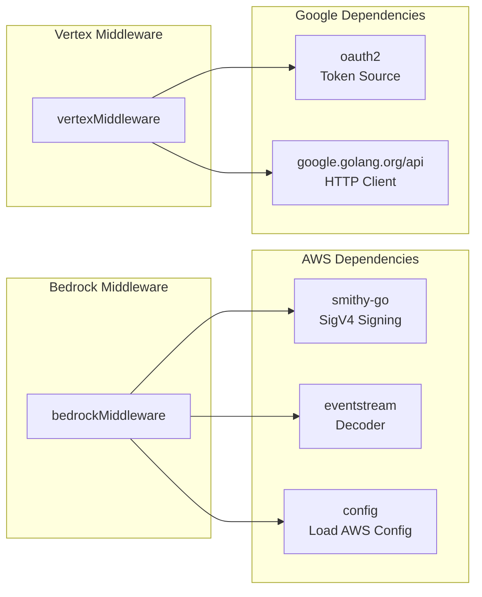
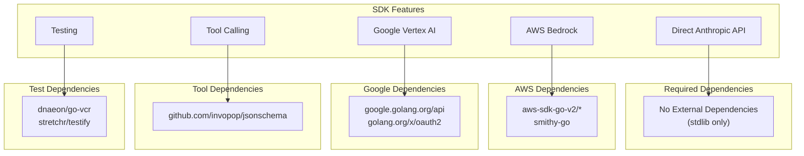
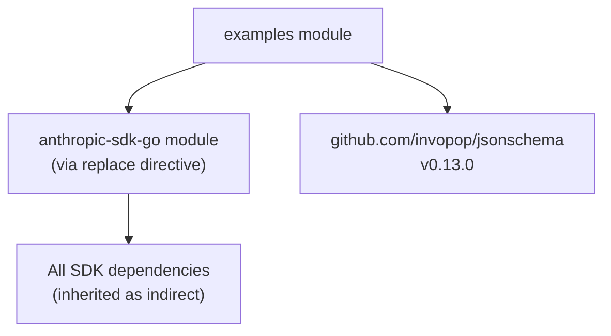

<!-- source: DeepWiki mcp.deepwiki.com · repo anthropics/anthropic-sdk-go · page 10.3 Dependencies · fetched 2026-10-26 -->

# Dependencies

<details>
<summary>Relevant source files</summary>

The following files were used as context for generating this wiki page:

- [examples/go.mod](examples/go.mod)
- [examples/go.sum](examples/go.sum)
- [go.mod](go.mod)
- [go.sum](go.sum)

</details>


This document catalogs all external dependencies used by the Anthropic Go SDK, their purposes, version requirements, and how they relate to SDK features. The SDK maintains a minimal dependency footprint while supporting multiple cloud platforms and comprehensive testing infrastructure.

For information about the development workflow and dependency updates, see [CI/CD Pipeline](#10.2). For details on how cloud integrations use their respective dependencies, see [Cloud Provider Integrations](#7.1).

## Overview

The SDK's dependencies fall into several categories:
- **Cloud Platform Integration**: AWS SDK and Google Cloud libraries for Bedrock and Vertex AI support
- **JSON Processing**: High-performance JSON parsing and schema generation
- **Testing Infrastructure**: VCR recording, assertions, and test utilities
- **Authentication**: OAuth2 support for Google Vertex AI
- **Concurrency**: Utilities for managing concurrent operations

All dependencies are specified in [go.mod:1-67]() with cryptographic checksums in [go.sum:1-208]().

## Dependency Architecture

```mermaid
graph TB
    subgraph "SDK Core"
        CoreAPI["anthropic-sdk-go<br/>Core API"]
    end
    
    subgraph "Cloud Platform Dependencies"
        AWSSDK["github.com/aws/aws-sdk-go-v2<br/>v1.30.3"]
        AWSEventStream["aws-sdk-go-v2/aws/protocol/eventstream<br/>v1.6.3"]
        AWSConfig["aws-sdk-go-v2/config<br/>v1.27.27"]
        AWSCreds["aws-sdk-go-v2/credentials<br/>v1.17.27"]
        Smithy["github.com/aws/smithy-go<br/>v1.20.3"]
        
        GoogleAPI["google.golang.org/api<br/>v0.189.0"]
        OAuth2["golang.org/x/oauth2<br/>v0.30.0"]
    end
    
    subgraph "JSON Processing"
        GJSON["github.com/tidwall/gjson<br/>v1.18.0"]
        SJSON["github.com/tidwall/sjson<br/>v1.2.5"]
        JSONSchema["github.com/invopop/jsonschema<br/>v0.13.0"]
    end
    
    subgraph "Testing Infrastructure"
        VCR["github.com/dnaeon/go-vcr<br/>v1.2.0"]
        Testify["github.com/stretchr/testify<br/>v1.8.4"]
    end
    
    subgraph "Concurrency"
        Sync["golang.org/x/sync<br/>v0.16.0"]
    end
    
    CoreAPI --> AWSSDK
    CoreAPI --> AWSEventStream
    CoreAPI --> AWSConfig
    CoreAPI --> AWSCreds
    CoreAPI --> Smithy
    
    CoreAPI --> GoogleAPI
    CoreAPI --> OAuth2
    
    CoreAPI --> GJSON
    CoreAPI --> SJSON
    CoreAPI --> JSONSchema
    
    CoreAPI --> VCR
    CoreAPI --> Testify
    
    CoreAPI --> Sync
```



**Purpose**: Maps SDK functionality to dependency packages

Sources: [go.mod:7-21]()

## Cloud Platform Dependencies

### AWS Bedrock Integration

The SDK requires multiple AWS SDK v2 packages to support Bedrock integration:

| Package | Version | Purpose |
|---------|---------|---------|
| `github.com/aws/aws-sdk-go-v2` | v1.30.3 | Core AWS SDK functionality |
| `aws-sdk-go-v2/aws/protocol/eventstream` | v1.6.3 | EventStream decoding for streaming responses |
| `aws-sdk-go-v2/config` | v1.27.27 | AWS configuration loading |
| `aws-sdk-go-v2/credentials` | v1.17.27 | AWS credential management |
| `github.com/aws/smithy-go` | v1.20.3 | AWS protocol support and signing |

The `eventstream` package is critical for handling Bedrock's streaming response format, which differs from standard SSE. The middleware in `bedrock.go` uses these packages to transform requests, sign them with SigV4, and decode streaming responses.

Sources: [go.mod:8-12]()

### Google Vertex AI Integration

Vertex AI integration requires Google Cloud and OAuth2 dependencies:

| Package | Version | Purpose |
|---------|---------|---------|
| `google.golang.org/api` | v0.189.0 | Google Cloud API client libraries |
| `golang.org/x/oauth2` | v0.30.0 | OAuth2 authentication flow |

These support the middleware in `vertex.go` that authenticates requests using Google Application Default Credentials (ADC) or explicit service account keys.

Sources: [go.mod:18-20]()



**Purpose**: Shows how cloud integration middleware uses platform-specific dependencies

Sources: [go.mod:8-20]()

## JSON Processing Dependencies

The SDK uses specialized JSON libraries for performance-critical operations:

### GJSON and SJSON

| Package | Version | Purpose |
|---------|---------|---------|
| `github.com/tidwall/gjson` | v1.18.0 | Fast JSON path queries without unmarshaling |
| `github.com/tidwall/sjson` | v1.2.5 | Fast JSON modification without unmarshaling |

These libraries enable efficient JSON manipulation during request transformation, particularly in cloud platform middleware where specific fields need to be moved, deleted, or modified without full deserialization.

**Usage Example**: The Bedrock middleware uses `sjson` to inject `anthropic_version` into the request body and `gjson` to extract the model identifier for URL construction.

Sources: [go.mod:16-17]()

### JSON Schema Generation

| Package | Version | Purpose |
|---------|---------|---------|
| `github.com/invopop/jsonschema` | v0.13.0 | Generate JSON schemas from Go structs |

This dependency supports tool definition functionality where users need to generate JSON schemas from Go types for the `ToolParam.InputSchema` field. This is referenced in example code demonstrating tool usage.

Sources: [go.mod:14]()

## Testing Infrastructure

### VCR Recording

| Package | Version | Purpose |
|---------|---------|---------|
| `github.com/dnaeon/go-vcr` | v1.2.0 | HTTP interaction recording and replay |

The VCR (Video Cassette Recorder) library records HTTP requests and responses to YAML files in `testdata/` directories. This enables:
- Running tests without live API access
- Deterministic test behavior
- Faster test execution
- Protection of API credentials in CI

Test files use `vcr.NewRecorder()` to create recording transports that wrap the HTTP client.

Sources: [go.mod:13]()

### Assertion Library

| Package | Version | Purpose |
|---------|---------|---------|
| `github.com/stretchr/testify` | v1.8.4 | Test assertions and utilities |

Testify provides the `assert` and `require` packages used throughout the test suite for readable assertions:
- `assert.Equal()` for value comparisons
- `assert.NoError()` for error checking
- `require.NotNil()` for non-nil assertions with early exit

Sources: [go.mod:15]()

## Concurrency Utilities

| Package | Version | Purpose |
|---------|---------|---------|
| `golang.org/x/sync` | v0.16.0 | Extended concurrency primitives |

This package provides `errgroup.Group` for managing goroutine lifecycles and error propagation, used in concurrent operations like parallel batch processing or multi-stream handling.

Sources: [go.mod:19]()

## Transitive Dependencies

The SDK has numerous indirect dependencies pulled in by direct dependencies. Key transitive dependencies include:

```mermaid
graph TB
    subgraph "Direct Dependencies"
        GoogleAPI["google.golang.org/api"]
        AWSSDK["aws-sdk-go-v2"]
    end
    
    subgraph "Google Cloud Transitive"
        CloudAuth["cloud.google.com/go/auth<br/>v0.7.2"]
        OAuth2Adapt["cloud.google.com/go/auth/oauth2adapt<br/>v0.2.3"]
        Metadata["cloud.google.com/go/compute/metadata<br/>v0.5.0"]
        GRPC["google.golang.org/grpc<br/>v1.64.1"]
        Protobuf["google.golang.org/protobuf<br/>v1.34.2"]
    end
    
    subgraph "AWS Transitive"
        IMDS["aws-sdk-go-v2/feature/ec2/imds<br/>v1.16.11"]
        SSO["aws-sdk-go-v2/service/sso<br/>v1.22.4"]
        SSOOIDC["aws-sdk-go-v2/service/ssooidc<br/>v1.26.4"]
        STS["aws-sdk-go-v2/service/sts<br/>v1.30.3"]
    end
    
    subgraph "Common Transitive"
        XNet["golang.org/x/net<br/>v0.41.0"]
        XCrypto["golang.org/x/crypto<br/>v0.40.0"]
        XText["golang.org/x/text<br/>v0.27.0"]
    end
    
    GoogleAPI --> CloudAuth
    GoogleAPI --> OAuth2Adapt
    GoogleAPI --> Metadata
    GoogleAPI --> GRPC
    GoogleAPI --> Protobuf
    
    AWSSDK --> IMDS
    AWSSDK --> SSO
    AWSSDK --> SSOOIDC
    AWSSDK --> STS
    
    GoogleAPI --> XNet
    GoogleAPI --> XCrypto
    GoogleAPI --> XText
    
    AWSSDK --> XNet
    AWSSDK --> XCrypto
```



**Purpose**: Illustrates the transitive dependency tree for major platform integrations

Sources: [go.mod:23-67]()

### Authentication-Related Transitive Dependencies

Cloud platform authentication pulls in multiple service-specific packages:

**AWS Authentication Chain**:
- `aws-sdk-go-v2/service/sso` (v1.22.4): AWS Single Sign-On support
- `aws-sdk-go-v2/service/ssooidc` (v1.26.4): SSO OIDC token provider
- `aws-sdk-go-v2/service/sts` (v1.30.3): AWS Security Token Service
- `aws-sdk-go-v2/feature/ec2/imds` (v1.16.11): EC2 instance metadata service

**Google Authentication Chain**:
- `cloud.google.com/go/auth` (v0.7.2): Google Cloud authentication
- `cloud.google.com/go/auth/oauth2adapt` (v0.2.3): OAuth2 token adaptation
- `cloud.google.com/go/compute/metadata` (v0.5.0): GCP metadata service

Sources: [go.mod:24-35]()

### OpenTelemetry Transitive Dependencies

Google Cloud libraries include OpenTelemetry instrumentation:

| Package | Version | Purpose |
|---------|---------|---------|
| `go.opentelemetry.io/otel` | v1.24.0 | Core OpenTelemetry API |
| `go.opentelemetry.io/otel/trace` | v1.24.0 | Distributed tracing |
| `go.opentelemetry.io/contrib/instrumentation/net/http/otelhttp` | v0.49.0 | HTTP instrumentation |
| `go.opentelemetry.io/contrib/instrumentation/google.golang.org/grpc/otelgrpc` | v0.49.0 | gRPC instrumentation |

These are used internally by Google Cloud libraries but don't affect SDK users unless they explicitly configure OpenTelemetry.

Sources: [go.mod:52-56]()

## Version Requirements

### Go Toolchain

The SDK requires:
- **Minimum Go version**: `1.23.0` ([go.mod:3]())
- **Toolchain version**: `go1.24.3` ([go.mod:5]())

The toolchain directive ensures consistent builds across different environments. Users can still build with Go 1.23.0, but the recommended toolchain is 1.24.3.

### Major Version Constraints

All dependencies use semantic versioning. Key version decisions:

**AWS SDK v2**: The SDK uses v2 of the AWS SDK, not v1. The v2 SDK has a modular design where each service is a separate module, reducing dependency bloat.

**Google API Client**: Version v0.189.0 includes support for the Vertex AI rawPredict and streamRawPredict endpoints required by the SDK.

**JSON Libraries**: GJSON v1.18.0 and SJSON v1.2.5 provide stable APIs with performance optimizations for the SDK's use cases.

Sources: [go.mod:3-21]()

## Dependency Categories by SDK Feature



**Purpose**: Maps SDK features to their dependency requirements

Sources: [go.mod:7-21]()

### Optional Dependencies

Users of the SDK do **not** require all dependencies unless they use specific features:

- **AWS dependencies**: Only needed when using `bedrock.WithConfig()` or similar Bedrock options
- **Google dependencies**: Only needed when using `vertex.WithGoogleAuth()` or similar Vertex options
- **JSON schema generation**: Only needed when generating schemas from Go structs for tool definitions
- **Test dependencies**: Only needed when running the SDK's test suite

The Go module system automatically includes transitive dependencies, but compiled binaries only include code that's actually used.

## Examples Module Dependencies

The examples module ([examples/go.mod:1-70]()) has a separate dependency set:



**Purpose**: Shows the examples module dependency structure

The examples module:
1. Uses a `replace` directive to point to the local SDK ([examples/go.mod:3]())
2. Directly requires `invopop/jsonschema` for tool schema examples ([examples/go.mod:11]())
3. Inherits all SDK dependencies as indirect dependencies ([examples/go.mod:14-69]())

This separation allows examples to demonstrate additional patterns (like schema generation) without forcing those dependencies on all SDK users.

Sources: [examples/go.mod:1-70]()

## Dependency Management

### Update Policy

Dependencies are updated through:
1. Dependabot or manual updates creating PRs
2. CI pipeline validation ([CI/CD Pipeline](#10.2))
3. Breaking change detection against old test files
4. Release process incorporating updates

### Checksum Verification

The [go.sum:1-208]() file contains cryptographic checksums for all dependencies and their transitive dependencies. Go automatically verifies these checksums during builds to prevent tampering.

Format: Each entry has two checksums - one for the module `.zip` file and one for the `go.mod` file:
```
github.com/pkg/name v1.2.3 h1:checksum...
github.com/pkg/name v1.2.3/go.mod h1:checksum...
```

### Vendor Directory

The SDK does not commit a `vendor/` directory. Dependencies are fetched from the Go module proxy (`proxy.golang.org`) or directly from version control systems.

Sources: [go.mod:1-67](), [go.sum:1-208]()

## Platform-Specific Considerations

### AWS Bedrock Dependencies

When deploying to AWS Lambda or EC2, the AWS SDK dependencies leverage:
- EC2 Instance Metadata Service (IMDS) for automatic credential discovery
- AWS Systems Manager Parameter Store integration via the config package
- Shared configuration files (`~/.aws/config`, `~/.aws/credentials`)

The `aws-sdk-go-v2/config` package ([go.mod:10]()) handles this credential chain automatically.

### Google Vertex AI Dependencies

When deploying to Google Cloud (GCE, GKE, Cloud Run), the Google dependencies leverage:
- Compute Engine metadata service for automatic credential discovery
- Application Default Credentials (ADC) file
- Workload Identity for GKE

The `cloud.google.com/go/auth` transitive dependency ([go.mod:24]()) handles this credential chain automatically.

Sources: [go.mod:8-20](), [go.mod:24-26]()

## Minimal Dependency Principle

The SDK maintains a minimal dependency footprint by:

1. **Using standard library when possible**: HTTP client, JSON encoding/decoding, context management
2. **Avoiding framework dependencies**: No web frameworks, no heavyweight logging frameworks
3. **Selective feature dependencies**: Platform-specific dependencies only required when using those platforms
4. **High-quality, focused libraries**: GJSON/SJSON for performance, testify for testing clarity

This approach minimizes:
- Binary size for compiled applications
- Security surface area
- Version conflict potential
- Build times

Sources: [go.mod:1-67]()