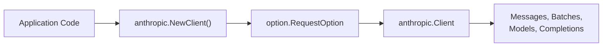
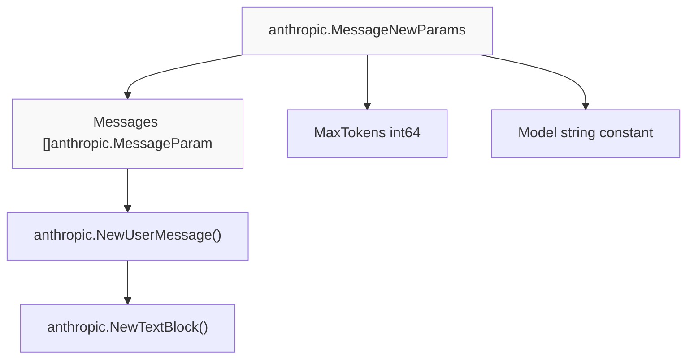
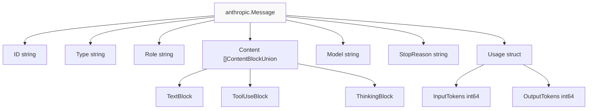
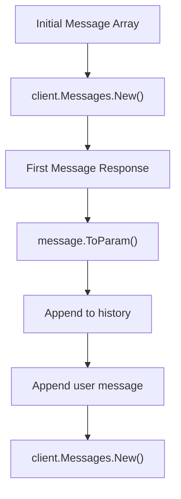

<!-- source: DeepWiki mcp.deepwiki.com · repo anthropics/anthropic-sdk-go · page 2 Getting Started · fetched 2026-10-26 -->

# Getting Started

<details>
<summary>Relevant source files</summary>

The following files were used as context for generating this wiki page:

- [.release-please-manifest.json](.release-please-manifest.json)
- [CHANGELOG.md](CHANGELOG.md)
- [README.md](README.md)
- [internal/version.go](internal/version.go)
- [message.go](message.go)

</details>


This guide walks through installing the Anthropic Go SDK, configuring authentication, and sending your first API request to Claude. By the end, you'll understand how to initialize a client and create basic message exchanges.

For detailed information about configuration options, see [Client Configuration](#3.1). For advanced message features like streaming and tool use, see [Messages API](#4).

---

## Installation

The SDK is distributed as a standard Go module. Import it in your project:

```go
import (
    "github.com/anthropics/anthropic-sdk-go"
)
```

To pin to a specific version, use `go get`:

```sh
go get -u 'github.com/anthropics/anthropic-sdk-go@v1.26.0'
```

**Sources:** [README.md:12-32]()

---

## Requirements

The SDK requires **Go 1.22 or higher**. This minimum version is necessary to support the `omitzero` JSON semantics used throughout the SDK for request field handling.

**Sources:** [README.md:34-36](), [CHANGELOG.md:213]()

---

## API Key Configuration

The SDK requires an Anthropic API key for authentication. There are two methods to provide your key:

### Method 1: Environment Variable (Recommended)

Set the `ANTHROPIC_API_KEY` environment variable:

```sh
export ANTHROPIC_API_KEY='your-api-key-here'
```

The client automatically reads this variable during initialization via `os.LookupEnv()`.

### Method 2: Explicit Configuration

Pass the API key directly when creating the client:

```go
client := anthropic.NewClient(
    option.WithAPIKey("your-api-key-here"),
)
```

**Sources:** [README.md:54-56]()

---

## Client Initialization

### Basic Client Creation

The entry point for all SDK operations is the `anthropic.Client` struct, created via `anthropic.NewClient()`:



**Client Creation Flow**

The client constructor accepts variadic `option.RequestOption` parameters that configure global behavior:

| Option Function | Purpose | Example |
|----------------|---------|---------|
| `option.WithAPIKey()` | Set authentication key | `option.WithAPIKey("sk-...")` |
| `option.WithBaseURL()` | Override API endpoint | `option.WithBaseURL("https://custom.api.com")` |
| `option.WithHTTPClient()` | Provide custom HTTP client | `option.WithHTTPClient(customClient)` |
| `option.WithMaxRetries()` | Configure retry behavior | `option.WithMaxRetries(5)` |
| `option.WithRequestTimeout()` | Set per-request timeout | `option.WithRequestTimeout(30*time.Second)` |

### Minimal Example

```go
package main

import "github.com/anthropics/anthropic-sdk-go"

func main() {
    client := anthropic.NewClient()
    // Client is now ready to use
}
```

When no options are provided, the client uses:
- API key from `ANTHROPIC_API_KEY` environment variable
- Default base URL: `https://api.anthropic.com`
- Default retry count: 2 retries
- No per-request timeout (uses context timeout instead)

**Sources:** [README.md:53-56](), [message.go:24-43]()

---

## Sending Your First Message

### Message Creation Components

Creating a message requires three core components:



**Message Structure Mapping to Code**

### Complete Example

The following example demonstrates creating a simple question-answer interaction:

```go
package main

import (
    "context"
    "fmt"
    
    "github.com/anthropics/anthropic-sdk-go"
    "github.com/anthropics/anthropic-sdk-go/option"
)

func main() {
    client := anthropic.NewClient(
        option.WithAPIKey("my-anthropic-api-key"),
    )
    
    message, err := client.Messages.New(context.TODO(), anthropic.MessageNewParams{
        MaxTokens: 1024,
        Messages: []anthropic.MessageParam{
            anthropic.NewUserMessage(anthropic.NewTextBlock("What is a quaternion?")),
        },
        Model: anthropic.ModelClaudeSonnet4_5_20250929,
    })
    if err != nil {
        panic(err.Error())
    }
    fmt.Printf("%+v\n", message.Content)
}
```

### Parameter Breakdown

**Required Parameters:**

| Parameter | Type | Purpose | Example |
|-----------|------|---------|---------|
| `MaxTokens` | `int64` | Maximum response tokens | `1024` |
| `Messages` | `[]anthropic.MessageParam` | Conversation history | See below |
| `Model` | `string` | Model identifier | `anthropic.ModelClaudeSonnet4_5_20250929` |

**Helper Functions:**

- `anthropic.NewUserMessage()` - Creates a user message with content blocks
- `anthropic.NewTextBlock()` - Creates a text content block
- Both functions return properly typed structures for the `MessageNewParams`

**Available Model Constants:**

The SDK provides constants for all available models in [message.go:7866-7886](). Examples include:
- `anthropic.ModelClaudeSonnet4_5_20250929`
- `anthropic.ModelClaudeOpus4_6_20250925`
- `anthropic.ModelClaude3Opus20240229`

**Sources:** [README.md:42-70](), [message.go:45-69]()

---

## Understanding the Response

### Response Structure

The `client.Messages.New()` call returns two values:

```go
message, err := client.Messages.New(context.TODO(), params)
```

Where:
- `message` is a `*anthropic.Message` struct containing the response
- `err` is an error (see [Error Handling](#3.4) for details)

### Message Response Fields



**Key Response Fields**

**Content Blocks:**

The `Content` field is a slice of `ContentBlockUnion`, which can contain different types of content. For a basic text response, access it as:

```go
for _, block := range message.Content {
    if textBlock, ok := block.AsAny().(anthropic.TextBlock); ok {
        fmt.Println(textBlock.Text)
    }
}
```

The `.AsAny()` method returns the concrete type of the content block. See [Content Blocks](#4.2) for all available types.

**Stop Reason:**

The `StopReason` field indicates why generation stopped:
- `"end_turn"` - Natural completion
- `"max_tokens"` - Hit token limit
- `"stop_sequence"` - Hit a stop sequence
- `"tool_use"` - Model wants to use a tool

**Usage Tracking:**

The `Usage` struct contains token consumption:
- `InputTokens` - Tokens in the request
- `OutputTokens` - Tokens in the response
- Additional fields for cache usage when caching is enabled

**Sources:** [message.go:7676-7722]()

---

## Multi-Turn Conversations

To maintain conversation context, append messages to a message history:



**Conversation Flow with Message History**

### Pattern

1. Start with initial user message
2. Get assistant response
3. Convert response to parameter format using `.ToParam()`
4. Append to message array
5. Add new user message
6. Send updated array in next request

### Example Structure

```go
messages := []anthropic.MessageParam{
    anthropic.NewUserMessage(anthropic.NewTextBlock("What is my first name?")),
}

// First request
message, err := client.Messages.New(context.TODO(), anthropic.MessageNewParams{
    Model:     anthropic.ModelClaudeSonnet4_5_20250929,
    Messages:  messages,
    MaxTokens: 1024,
})

// Append assistant response
messages = append(messages, message.ToParam())

// Append new user message
messages = append(messages, anthropic.NewUserMessage(
    anthropic.NewTextBlock("My full name is John Doe"),
))

// Second request with full history
message, err = client.Messages.New(context.TODO(), anthropic.MessageNewParams{
    Model:     anthropic.ModelClaudeSonnet4_5_20250929,
    Messages:  messages,
    MaxTokens: 1024,
})
```

**Key Method:**

- `message.ToParam()` - Converts a `Message` response into a `MessageParam` suitable for inclusion in the `Messages` array of subsequent requests

**Sources:** [README.md:72-103](), [message.go:7767-7774]()

---

## System Prompts

System prompts provide instructions that apply to the entire conversation. They are specified via the `System` parameter:

```go
message, err := client.Messages.New(context.TODO(), anthropic.MessageNewParams{
    Model:     anthropic.ModelClaudeSonnet4_5_20250929,
    MaxTokens: 1024,
    System: []anthropic.TextBlockParam{
        {Text: "Be very serious at all times."},
    },
    Messages: messages,
})
```

### System Parameter Structure

- Type: `[]anthropic.TextBlockParam`
- Accepts multiple text blocks for complex instructions
- Applied before all message exchanges
- Cannot be updated mid-conversation (send as part of each request)

**Sources:** [README.md:107-119]()

---

## Request Context and Timeouts

All SDK methods accept a `context.Context` as the first parameter for timeout and cancellation control:

### Context Timeout

```go
ctx, cancel := context.WithTimeout(context.Background(), 5*time.Minute)
defer cancel()

message, err := client.Messages.New(ctx, params)
```

### Per-Request Timeout

For retry-aware timeouts, use `option.WithRequestTimeout()`:

```go
message, err := client.Messages.New(
    ctx,
    params,
    option.WithRequestTimeout(20*time.Second), // Per-retry timeout
)
```

**Important Distinction:**

- **Context timeout**: Total time including all retries
- **Request timeout**: Maximum time per individual attempt

For non-streaming requests with large `MaxTokens`, the SDK automatically calculates appropriate timeouts to prevent network idle disconnections. See [message.go:55-64]() for the timeout calculation logic.

**Sources:** [README.md:662-689](), [message.go:55-64]()

---

## Next Steps

Now that you can send basic messages, explore:

- **[Streaming Messages](#4.3)** - Real-time response streaming with SSE
- **[Tool Calling](#5)** - Extend Claude with function calls
- **[Content Blocks](#4.2)** - Images, documents, and rich content
- **[Error Handling](#3.4)** - Robust error management
- **[Cloud Integrations](#7.1)** - Deploy on AWS Bedrock or Google Vertex AI

For complete API documentation, see the [official Anthropic API reference](https://docs.anthropic.com/claude/reference/).

**Sources:** [README.md:1-1000]()

---

