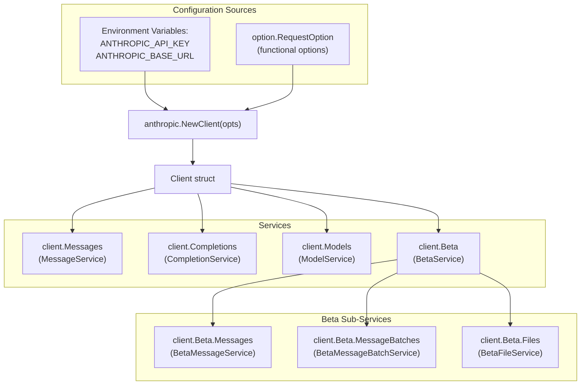
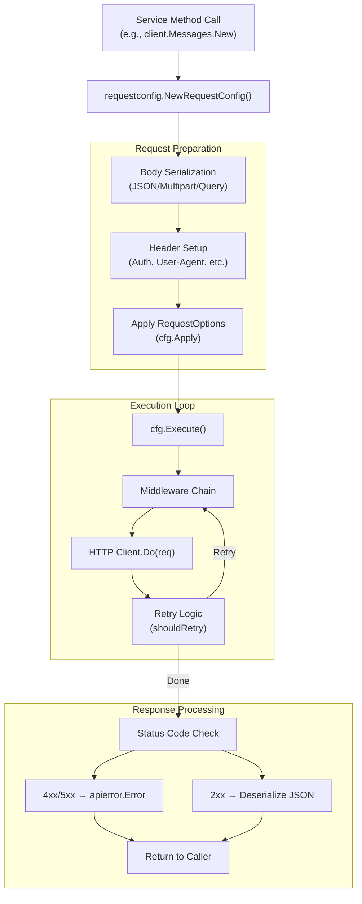
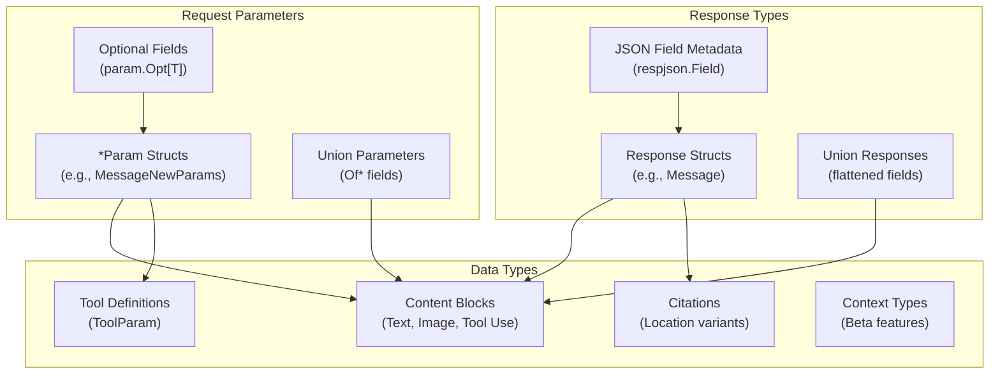

<!-- source: DeepWiki mcp.deepwiki.com · repo anthropics/anthropic-sdk-go · page 3 Core Concepts · fetched 2026-10-26 -->

# Core Concepts

<details>
<summary>Relevant source files</summary>

The following files were used as context for generating this wiki page:

- [.release-please-manifest.json](.release-please-manifest.json)
- [CHANGELOG.md](CHANGELOG.md)
- [README.md](README.md)
- [client.go](client.go)
- [internal/apierror/apierror.go](internal/apierror/apierror.go)
- [internal/apijson/subfield.go](internal/apijson/subfield.go)
- [internal/requestconfig/requestconfig.go](internal/requestconfig/requestconfig.go)
- [internal/version.go](internal/version.go)
- [option/requestoption.go](option/requestoption.go)
- [packages/pagination/pagination.go](packages/pagination/pagination.go)

</details>


This document explains the fundamental concepts and patterns that apply across all SDK functionality. These core concepts form the foundation for understanding how to configure clients, make requests, handle responses, and work with the SDK's type system.

**Child Pages:**
- [3.1 Client Configuration](#3.1) - How to configure the client with API keys, timeouts, retries, and custom options
- [3.2 Request and Response Handling](#3.2) - The request execution pipeline, response processing, and timeouts
- [3.3 Parameter Encoding](#3.3) - How parameters are serialized (JSON, multipart, query) and optional field handling
- [3.4 Error Handling](#3.4) - Error types, response structure, and debugging methods

For specific API usage, see [Messages API](#4), [Tool Calling](#5), and [Beta Services](#6).

## SDK Architecture Overview

The SDK is organized around a central `anthropic.Client` that provides access to API services through a service-oriented architecture. Each service corresponds to a set of related API endpoints.

**Client and Service Structure**



**Client Initialization Pattern**

The `anthropic.NewClient()` function creates a client with default configuration from environment variables, then applies any additional options passed as arguments. This pattern allows both simple usage with environment-based configuration and explicit control when needed.

```go
// Default initialization (uses environment variables)
client := anthropic.NewClient()

// Explicit configuration
client := anthropic.NewClient(
    option.WithAPIKey("sk-ant-..."),
    option.WithBaseURL("https://api.anthropic.com"),
    option.WithMaxRetries(5),
)
```

See [Client Configuration](#3.1) for detailed configuration options.

Sources: [client.go:28-61](), [client.go:32-44](), [README.md:43-68]()

## Request/Response Lifecycle

Every API call in the SDK follows a consistent lifecycle from request creation through response handling. Understanding this flow is essential for debugging and advanced usage.

**Request Execution Pipeline**



**Key Components**

| Component | Location | Purpose |
|-----------|----------|---------|
| `requestconfig.NewRequestConfig()` | [internal/requestconfig/requestconfig.go:90-191]() | Creates request configuration with serialization |
| `requestconfig.RequestConfig` | [internal/requestconfig/requestconfig.go:199-225]() | Holds request state (retries, timeout, headers, etc.) |
| `requestconfig.RequestConfig.Execute()` | [internal/requestconfig/requestconfig.go:377-558]() | Executes request with retry loop |
| `option.RequestOption` | [option/requestoption.go:18-23]() | Functional options pattern for configuration |
| `apierror.Error` | [internal/apierror/apierror.go:14-57]() | API error response structure |

**Retry Behavior**

The SDK automatically retries failed requests up to 2 times (configurable via `option.WithMaxRetries()`). Retry conditions include:
- Connection errors (no response received)
- HTTP 408 (Request Timeout)
- HTTP 409 (Conflict)
- HTTP 429 (Too Many Requests)
- HTTP 5xx (Server Errors)

The retry delay uses exponential backoff with jitter and respects `Retry-After` headers from the API.

See [Request and Response Handling](#3.2) for detailed information about the execution pipeline, retry logic, and timeout management.

Sources: [internal/requestconfig/requestconfig.go:377-558](), [internal/requestconfig/requestconfig.go:90-191](), [internal/requestconfig/requestconfig.go:241-266](), [internal/requestconfig/requestconfig.go:358-375]()

## Type System and Data Model

The SDK provides a rich type system that maps to the Anthropic API's data structures. This includes support for union types, optional parameters, and sophisticated serialization patterns.

**Type Categories**



**Union Type Pattern**

The API uses union types extensively. The SDK represents these differently for requests vs. responses:

**Request Unions** use "Of" prefixed fields where only one should be set:
```go
type ContentBlockParamUnion struct {
    OfText     *TextBlockParam     `json:",omitzero,inline"`
    OfImage    *ImageBlockParam    `json:",omitzero,inline"`
    OfToolUse  *ToolUseBlockParam  `json:",omitzero,inline"`
    OfDocument *DocumentBlockParam `json:",omitzero,inline"`
}
```

**Response Unions** use flattened fields from all variants with a type discriminator:
```go
type ContentBlockUnion struct {
    Type    string  // "text", "image", "tool_use"
    Text    string  // from TextBlock
    Source  ...     // from ImageBlock
    Name    string  // from ToolUseBlock
    // ... other fields
}
```

Use `.AsAny()` to convert to the specific variant type for type-safe handling.

**Optional Parameters**

The SDK uses Go 1.24+ `omitzero` semantics for optional fields:

| Type | Required | Optional | Null |
|------|----------|----------|------|
| Primitives | `json:"field,required"` | `anthropic.String("val")` | `param.Null[string]()` |
| Structs | Direct value | `json:"field,omitzero"` | `param.NullStruct[T]()` |
| Slices/Maps | Direct value | `json:"field,omitzero"` | `param.Null[[]T]()` |

Helper constructors: `anthropic.String()`, `anthropic.Int()`, `anthropic.Bool()`, `anthropic.Float()`

Check presence with `param.IsOmitted(value)`.

See [Parameter Encoding](#3.3) for detailed serialization rules and format detection.

Sources: [README.md:370-410](), [README.md:432-460](), [README.md:522-559]()

## Authentication and Security

The SDK supports multiple authentication methods and security configurations.

### Authentication Methods

| Method | Environment Variable | Request Option | Header |
|---|---|---|---|
| API Key | `ANTHROPIC_API_KEY` | `option.WithAPIKey()` | `X-Api-Key` |
| Auth Token | `ANTHROPIC_AUTH_TOKEN` | `option.WithAuthToken()` | `Authorization: Bearer` |

### Default Headers

The SDK automatically sets several headers for API compatibility and debugging:

- `User-Agent`: Contains SDK version information
- `anthropic-version`: API version (`2023-06-01`)
- `X-Stainless-*`: Platform and runtime information
- `Accept`: `application/json`

Sources: [internal/requestconfig/requestconfig.go:27-31](), [internal/requestconfig/requestconfig.go:69-78](), [option/requestoption.go:270-284]()

---

